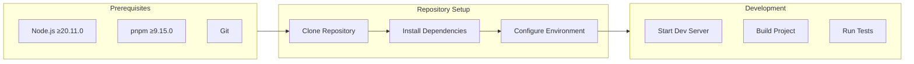
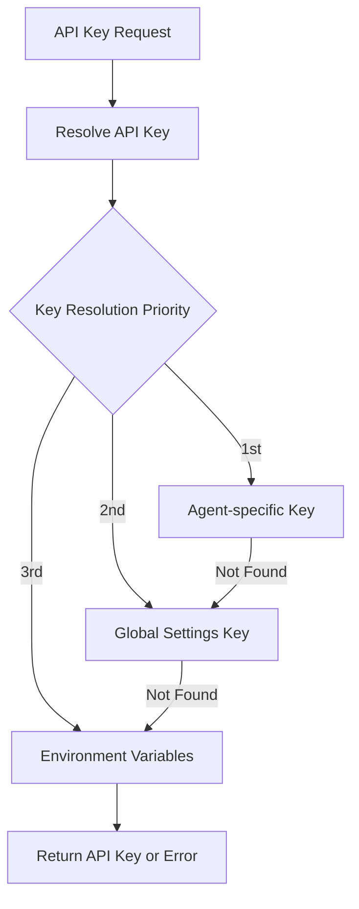
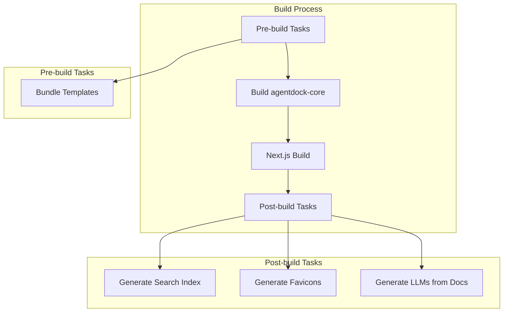
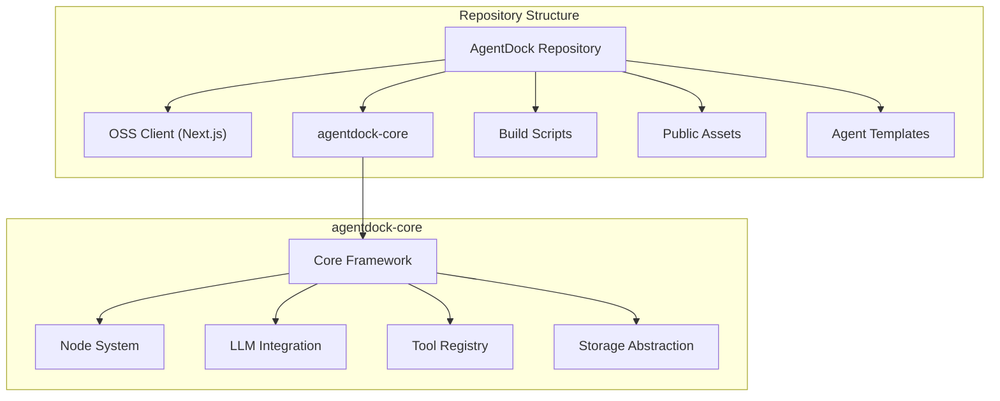
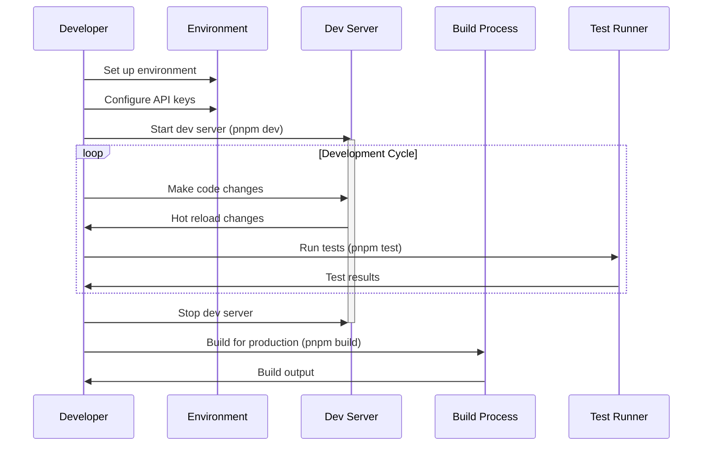

<!-- source: DeepWiki mcp.deepwiki.com · repo AgentDock/AgentDock · page 6 Development Guide · fetched 2026-10-26 -->

# Development Guide

<details>
<summary>Relevant source files</summary>

The following files were used as context for generating this wiki page:

- [.gitignore](.gitignore)
- [package.json](package.json)
- [pnpm-lock.yaml](pnpm-lock.yaml)
- [scripts/generate-favicons.js](scripts/generate-favicons.js)

</details>


This guide provides comprehensive instructions for developers working with the AgentDock repository. It covers environment setup, API key management, build system details, and contributing guidelines to help you get started with development, testing, and contributing to the project.

For information about agent templates and configuration, see [Agents and Tools](#5). For core framework architecture details, see [AgentDock Core](#3).

## Environment Setup

Before you begin development, ensure your system meets the following requirements:



### System Requirements

AgentDock requires the following environment:

- **Node.js**: Version 20.11.0 or higher
- **Package Manager**: pnpm 9.15.0 or higher
- **Operating System**: macOS, Windows, or Linux

You can verify your Node.js and pnpm versions with:

```bash
node --version
pnpm --version
```

### Installation Steps

1. Clone the repository:
   ```bash
   git clone https://github.com/AgentDock/AgentDock.git
   cd AgentDock
   ```

2. Install dependencies:
   ```bash
   pnpm install
   ```
   
   For a clean installation (removing node_modules and reinstalling):
   ```bash
   pnpm clean-install
   ```

3. Create a local environment file by copying the example:
   ```bash
   cp .env.example .env
   ```

4. Configure your environment variables (see API Keys Management section)

Sources: [package.json:5-8](), [package.json:10-34](), [.gitignore:39-41]()

## API Keys Management

The AgentDock framework integrates with various LLM providers that require API keys. The system uses a prioritized approach to resolve API keys.



### API Key Configuration

API keys can be configured in multiple ways:

1. **Environment Variables**: Set in `.env` file at the project root
   ```
   OPENAI_API_KEY=sk-...
   ANTHROPIC_API_KEY=sk-...
   GOOGLE_API_KEY=...
   ```

2. **Global Settings**: Configured in the application UI Settings page

3. **Agent-specific Keys**: Configured in agent template's `nodeConfigurations` section

### Supported API Keys

The following API keys are supported:

| Provider     | Environment Variable   | Purpose                           |
|--------------|------------------------|-----------------------------------|
| OpenAI       | `OPENAI_API_KEY`       | Access to GPT models              |
| Anthropic    | `ANTHROPIC_API_KEY`    | Access to Claude models           |
| Google       | `GOOGLE_API_KEY`       | Access to Gemini models           |
| Groq         | `GROQ_API_KEY`         | Access to Groq inference API      |
| Serper       | `SERPER_API_KEY`       | Web search capabilities           |

### API Key Resolution Order

When the system needs an API key, it follows this resolution order:
1. Check for agent-specific key in the template configuration
2. Check global settings stored in the application
3. Fall back to environment variables

Sources: [.gitignore:39-41]()

## Build System

AgentDock uses Next.js for the client application and has a custom core framework. The build process includes several stages and scripts.



### Development Scripts

The project includes several npm scripts to facilitate development:

| Command             | Description                                                   |
|---------------------|---------------------------------------------------------------|
| `pnpm dev`          | Start the development server                                  |
| `pnpm build`        | Build the project for production                              |
| `pnpm start`        | Start the production server                                   |
| `pnpm lint`         | Run ESLint to check code quality                              |
| `pnpm lint:fix`     | Run ESLint and automatically fix issues                       |
| `pnpm typecheck`    | Run TypeScript type checking                                  |
| `pnpm test`         | Run all tests                                                 |
| `pnpm validate`     | Run pre-deployment validation                                 |

### Build Process Explained

1. **Pre-build**:
   - Bundles agent templates with `scripts/bundle-templates.ts`

2. **Core Library Build**:
   - Builds the agentdock-core package

3. **Next.js Build**:
   - Compiles and optimizes the Next.js application

4. **Post-build**:
   - Generates search index with `scripts/generate-search-index.ts`
   - Creates favicons with `scripts/generate-favicons.js`
   - Generates LLM definitions with `scripts/generate-llms-from-docs.ts`

### Generated Artifacts

The build process generates several artifacts:

| Path                      | Description                          |
|---------------------------|--------------------------------------|
| `.next/`                  | Next.js build output                 |
| `agentdock-core/dist/`    | Compiled core framework              |
| `public/search-index.json`| Search index for documentation       |
| `public/llms.txt`         | LLM definitions                      |
| `public/favicon*.png`     | Various favicon sizes                |

Sources: [package.json:10-34](), [scripts/generate-favicons.js:1-44](), [.gitignore:65-75]()

## Project Structure

The AgentDock repository is structured as a monorepo with two main components:



### Key Directories

- `/` - Project root containing configuration files
- `/src` - Next.js application source code
- `/agentdock-core` - Core framework package
- `/scripts` - Build and utility scripts
- `/public` - Static assets and generated files
- `/templates` - Agent template configuration files

Sources: [package.json:1-173](), [.gitignore:1-75]()

## Development Workflow

The typical development workflow involves running the development server, making changes, and testing:



### Development Server

Start the development server:

```bash
pnpm dev
```

This will:
1. Run pre-build tasks (bundle templates)
2. Build the agentdock-core package
3. Start the Next.js development server
4. Watch for changes and reload as needed

### Testing

Run tests to verify your changes:

```bash
pnpm test          # Run all tests
pnpm test:unit     # Run unit tests only
pnpm test:watch    # Run tests in watch mode
```

Sources: [package.json:10-34]()

## Contributing Guidelines

When contributing to AgentDock, follow these guidelines:

### Code Quality

- Run linting and type checking before submitting changes:
  ```bash
  pnpm lint
  pnpm typecheck
  ```

- Use ESLint and Prettier to maintain code style consistency

### Git Workflow

1. Create a branch for your feature or bugfix
2. Make your changes with descriptive commit messages
3. Ensure all tests pass
4. Submit a pull request

### Pre-commit Hooks

The repository uses Husky for pre-commit hooks to ensure code quality:

```bash
pnpm git-hooks-validate
```

This script runs before commits to validate code quality.

Sources: [package.json:10-34](), [.gitignore:50-56]()

## Dependency Management

The project uses pnpm for dependency management, with specific version requirements defined in package.json.

### Adding Dependencies

```bash
pnpm add <package-name>          # Add as regular dependency
pnpm add -D <package-name>       # Add as dev dependency
```

### Updating Dependencies

```bash
pnpm update                      # Update all dependencies
pnpm update <package-name>       # Update specific dependency
```

### Dependency Overrides

The project uses overrides for certain packages to ensure compatibility and security. These are defined in package.json:

```json
"overrides": {
  "@types/react": "19.0.10",
  "@types/react-dom": "19.0.4",
  "undici": ">=5.28.5",
  "esbuild": ">=0.25.0"
}
```

Sources: [package.json:163-172]()

## Troubleshooting

### Common Issues

1. **Missing API keys**
   - Check that your API keys are properly configured in the .env file
   - Verify the keys have the correct permissions

2. **Build failures**
   - Ensure Node.js and pnpm versions meet requirements
   - Try cleaning node_modules with `pnpm clean-install`

3. **Core package issues**
   - Rebuild the core package manually: `pnpm build:agentdock-core`

4. **Type errors**
   - Run `pnpm typecheck` to identify type issues
   - Check for mismatches between package versions

Sources: [package.json:10-34](), [.gitignore:39-41]()

---

