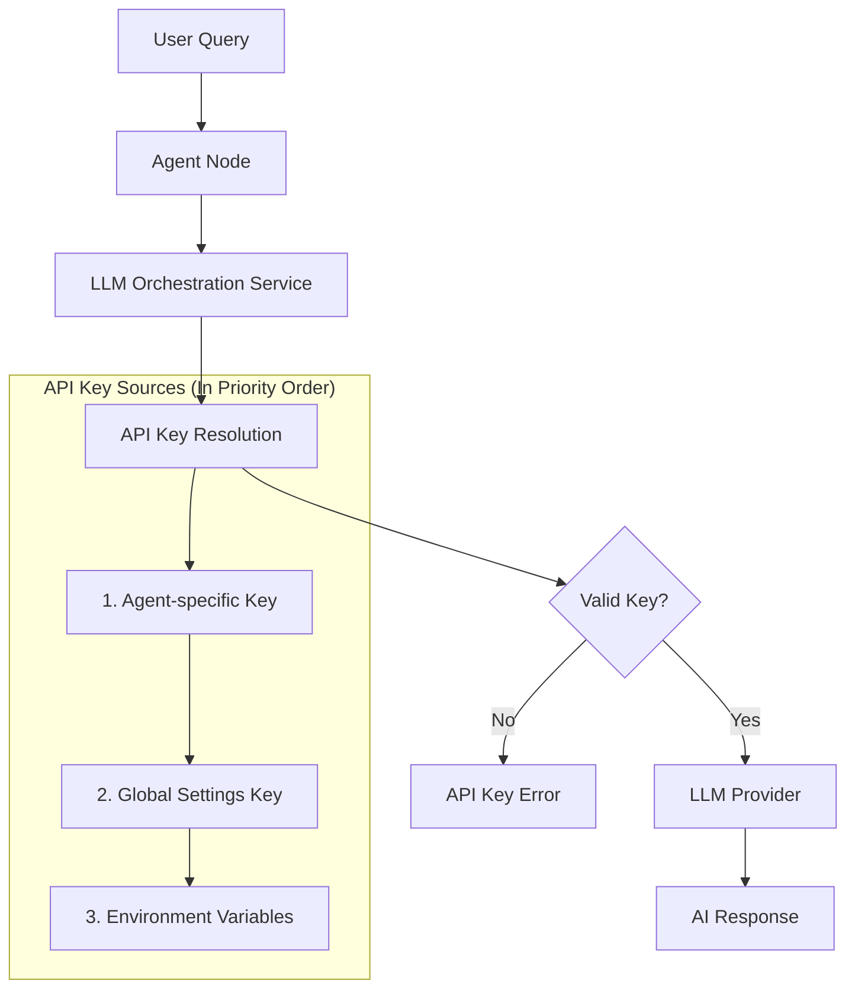
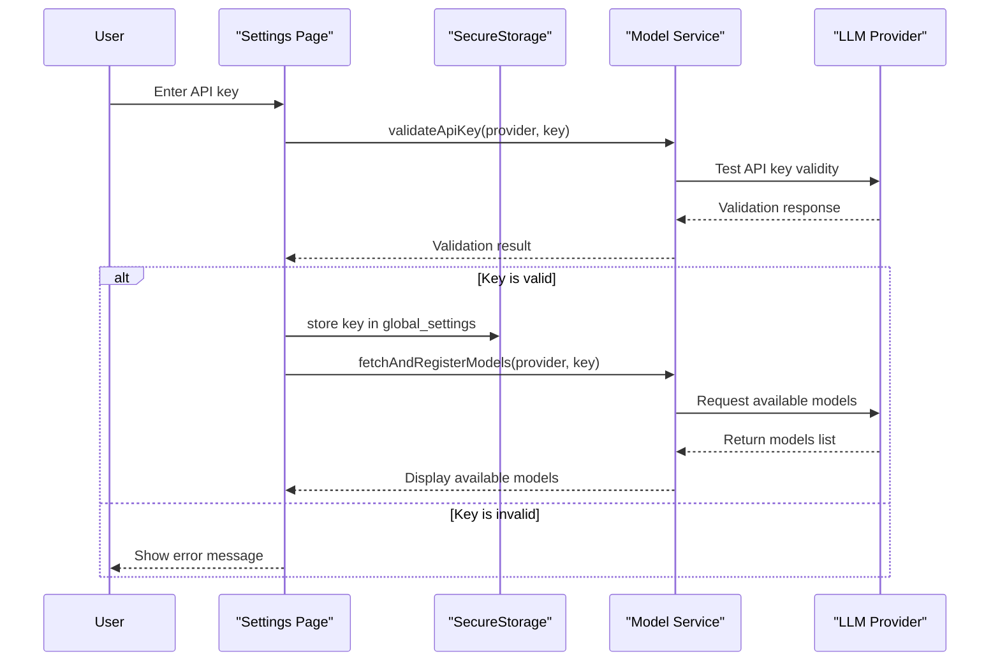
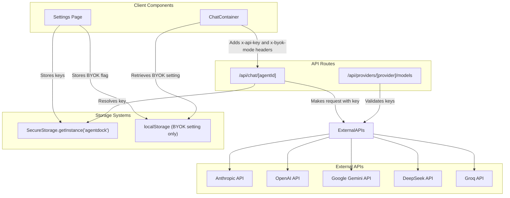
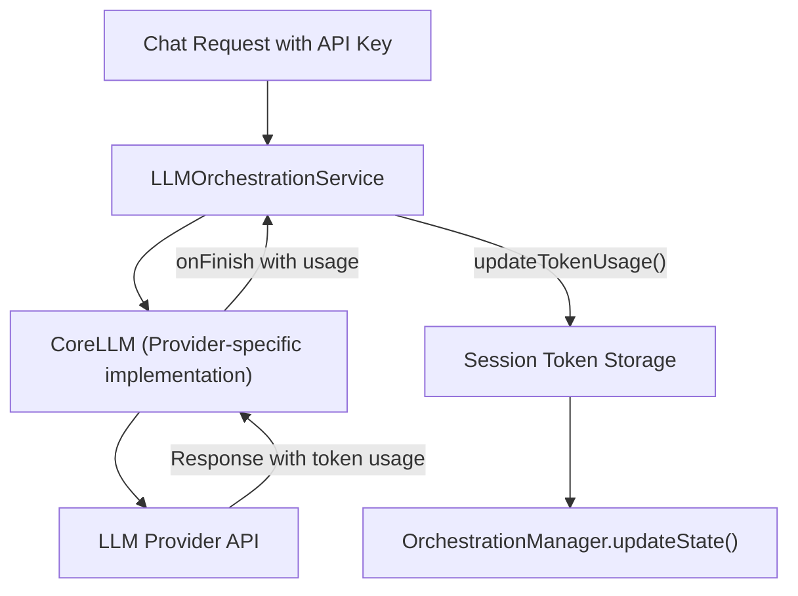

<!-- source: DeepWiki mcp.deepwiki.com · repo AgentDock/AgentDock · page 6.2 API Keys Management · fetched 2026-10-26 -->

# API Keys Management

Relevant source files

The following files were used as context for generating this wiki page:

- [.env.example](.env.example)
- [agentdock-core/src/llm/llm-orchestration-service.ts](agentdock-core/src/llm/llm-orchestration-service.ts)
- [src/app/api/chat/[agentId]/route.ts](src/app/api/chat/[agentId]/route.ts)
- [src/app/settings/debug-panel.tsx](src/app/settings/debug-panel.tsx)
- [src/app/settings/model-display.tsx](src/app/settings/model-display.tsx)
- [src/app/settings/page.tsx](src/app/settings/page.tsx)
- [src/app/settings/types.ts](src/app/settings/types.ts)
- [src/components/chat/chat-container.tsx](src/components/chat/chat-container.tsx)
- [src/components/chat/chat-status.tsx](src/components/chat/chat-status.tsx)
- [src/hooks/use-session-info.ts](src/hooks/use-session-info.ts)
- [src/lib/models/registry.ts](src/lib/models/registry.ts)
- [src/lib/services/model-service.ts](src/lib/services/model-service.ts)

This document explains how API keys are managed within the AgentDock framework, covering the hierarchical resolution system, supported providers, configuration interfaces, and security considerations. For information about creating custom tools that require API keys, see [Custom Tools](#5.2).

## Overview

AgentDock uses a prioritized system for managing API keys for various AI and tool providers. This system allows flexibility in configuration while maintaining security best practices. Keys can be provided at different levels with a clear resolution precedence.

Sources: [src/app/api/chat/[agentId]/route.ts:103-199]()

## Key Resolution Process

AgentDock resolves API keys using a hierarchical approach that prioritizes more specific configurations:

1. **Agent-specific custom key** - Keys provided for a specific agent
2. **Global settings key** - Keys configured in the global settings page
3. **Environment variables** - Keys set in the deployment environment

This resolution happens in the `resolveApiKey` function which is called during chat processing.

### Resolution Function

The system attempts to find a valid API key by:
1. Checking request headers for an `x-api-key` header
2. Looking up keys in the global settings storage
3. Falling back to environment variables if BYOK mode is not enabled

The function returns the first valid key found or `null` if no key is available.

Sources: [src/app/api/chat/[agentId]/route.ts:103-199]()

## Supported API Key Providers

AgentDock supports multiple LLM and tool providers that require API keys:

| Provider | Environment Variable | Purpose |
|----------|---------------------|---------|
| OpenAI | `OPENAI_API_KEY` | For OpenAI models like GPT-4 and GPT-3.5 |
| Anthropic | `ANTHROPIC_API_KEY` | For Anthropic Claude models |
| Google Gemini | `GEMINI_API_KEY` | For Google Gemini models |
| DeepSeek | `DEEPSEEK_API_KEY` | For DeepSeek models |
| Groq | `GROQ_API_KEY` | For Groq models like Llama 3 and Mixtral |
| Serper | `SERPER_API_KEY` | For search functionality |
| Firecrawl | `FIRECRAWL_API_KEY` | For deeper web search |
| Various scientific APIs | Multiple | For scientific research tools |

Sources: [.env.example:47-74](), [src/app/settings/page.tsx:31-37]()

## API Key Configuration Flow

Sources: [src/app/settings/page.tsx:76-140](), [src/lib/services/model-service.ts:1-65]()

## Settings Page Interface

The Settings page provides a user interface for managing API keys with:

1. Input fields for each supported provider
2. Real-time validation of entered keys
3. Display of available models when a valid key is provided
4. Clear button to remove stored keys
5. Toggle for BYOK mode

When a valid API key is entered and validated, the system fetches and displays available models from that provider to confirm successful configuration.

### Model Display Component

The ModelDisplay component shows available models for a provider when a valid API key is configured. This provides immediate feedback to users about their API key's validity and the models they can access.

Sources: [src/app/settings/page.tsx:1-489](), [src/app/settings/model-display.tsx:1-251]()

## BYOK (Bring Your Own Keys) Mode

BYOK Mode enforces stricter API key requirements:

- When enabled, environment variables are ignored completely
- Users must provide their own API keys in settings
- Requests will fail with a clear error message if no user-provided key is available

This mode is useful for:
- Deployments where you don't want to share API keys
- Ensuring users only use their own keys for billing purposes
- Enforcing separation between user resources

BYOK mode is stored in localStorage and included in API requests via the `x-byok-mode` header.

Sources: [src/app/settings/page.tsx:198-223](), [src/app/api/chat/[agentId]/route.ts:434-441]()

## API Key Storage Architecture

Sources: [src/app/settings/page.tsx:28](), [src/components/chat/chat-container.tsx:109-119](), [src/app/api/chat/[agentId]/route.ts:103-199]()

## API Key Validation

API keys are validated through the ModelService, which makes requests to the appropriate provider API to check their validity. The validation process:

1. Makes a request to the provider's model listing endpoint
2. Checks if the provider accepts the key
3. Returns `true` if the key is valid, `false` otherwise

The system also fetches available models when a key is validated, providing feedback to users on what models they can access.

Sources: [src/lib/services/model-service.ts:49-64]()

## Token Usage and API Key Relationship

When a valid API key is used, the system tracks token usage per session:

The system stores cumulative token usage associated with the API key, providing:
- Tracking of tokens used in the session
- Headers in API responses with token usage information
- Display of usage in debug mode

Sources: [agentdock-core/src/llm/llm-orchestration-service.ts:305-356](), [src/components/chat/chat-container.tsx:234-242]()

## Error Handling for API Key Issues

The system handles API key errors gracefully with user-friendly messages:

1. If a required API key is missing, a clear error is shown with a link to the settings page
2. If a key is invalid, an appropriate error message is displayed
3. If BYOK mode is enabled but no key is provided, a specific error explains the requirement

The ChatError component displays these messages in a user-friendly format with actionable next steps.

Sources: [src/components/chat/chat-status.tsx:26-199](), [src/app/api/chat/[agentId]/route.ts:144-152]()

## Security Considerations

API keys are sensitive credentials that must be handled securely:

1. **Storage Security**: Keys are stored in SecureStorage, an abstraction that provides secure storage
2. **Logging Protection**: Keys are masked in logs using the `maskSensitiveData` function
3. **UI Security**: Keys are displayed as password fields in the UI
4. **Request Handling**: Keys are passed via headers rather than URL parameters
5. **Environment Variables**: In production, keys should be set as secure environment variables

Source: [src/app/api/chat/[agentId]/route.ts:66-69](), [src/app/settings/page.tsx:1-489]()

## Troubleshooting

Common API key issues and their solutions:

| Issue | Possible Cause | Solution |
|-------|---------------|----------|
| "API key is required" error | No key provided at any level | Add a key in settings or environment variables |
| "Invalid API key format" error | Key doesn't match expected format | Check key format for the specific provider |
| "Rate limit exceeded" error | Too many requests with your key | Wait and retry or use a different key |
| Models not showing after adding key | Key may be invalid or not have proper permissions | Verify key has correct permissions and scopes |
| "BYOK mode is enabled" error | No user-provided key with BYOK mode on | Add a key in settings or disable BYOK mode |

Sources: [src/components/chat/chat-status.tsx:93-97](), [src/app/api/chat/[agentId]/route.ts:144-152]()

---

