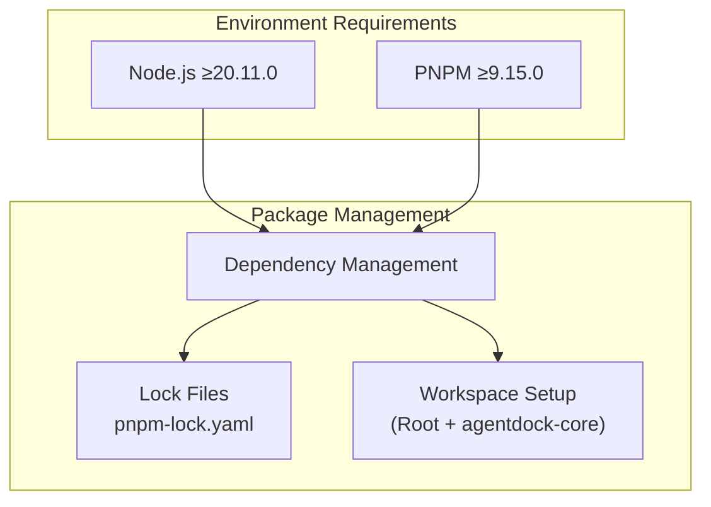
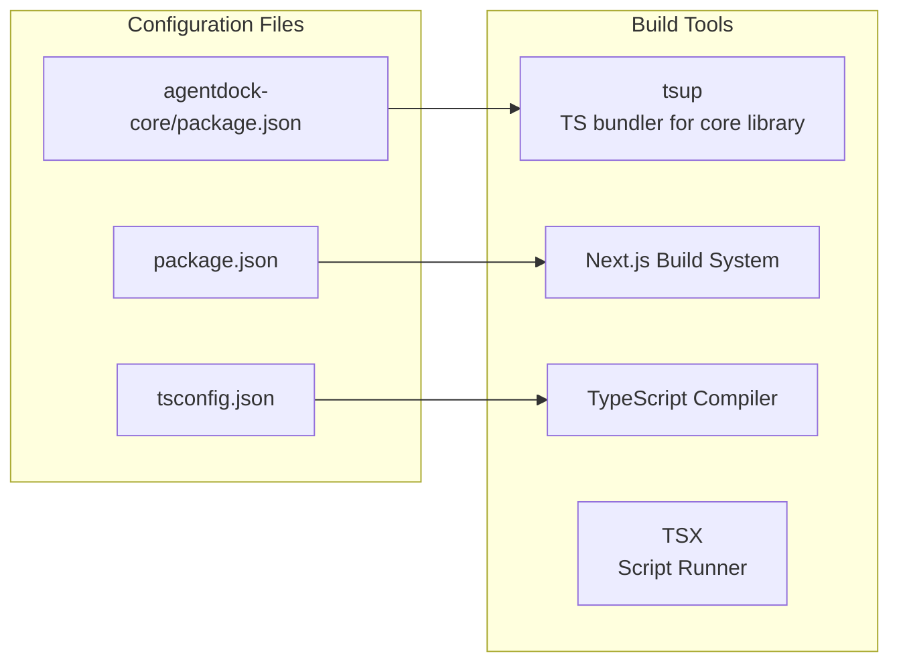
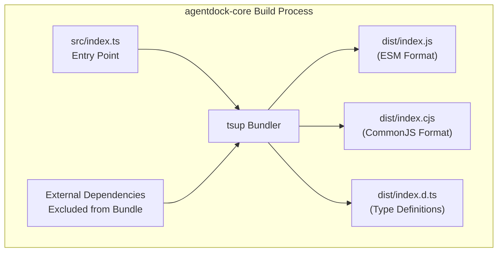
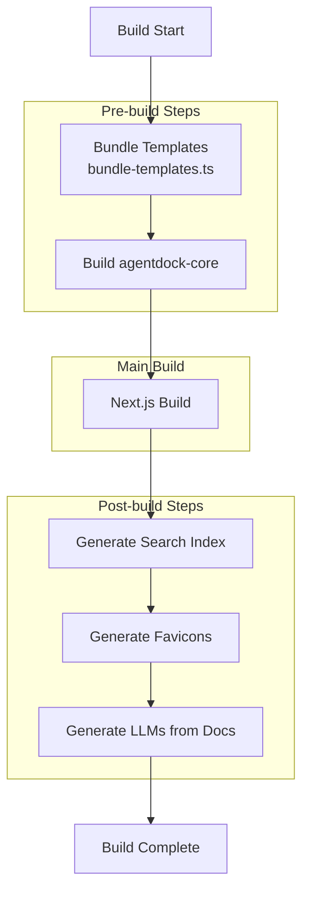
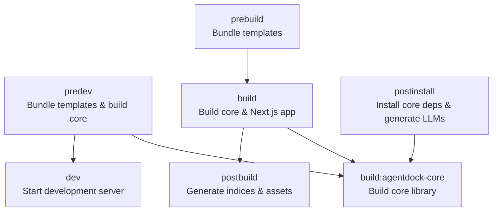
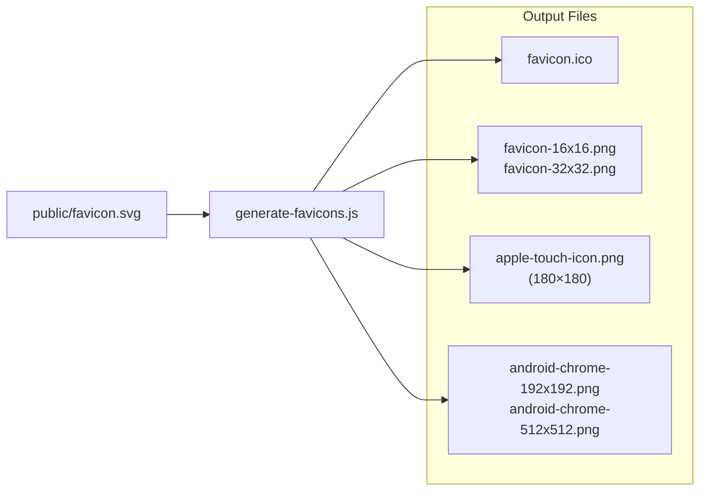
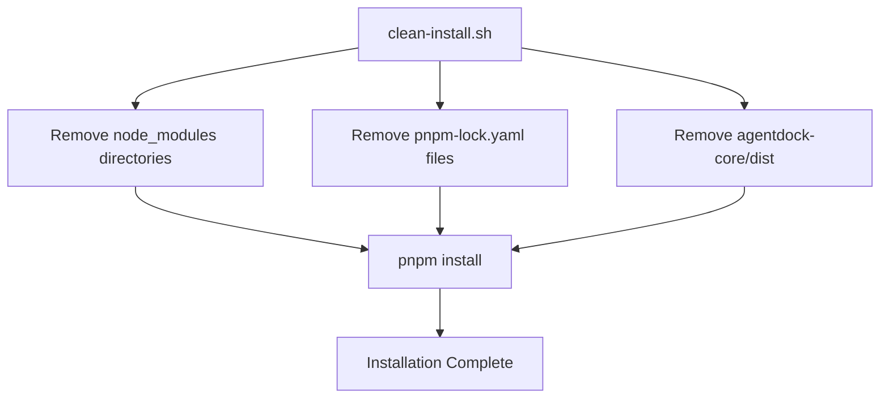
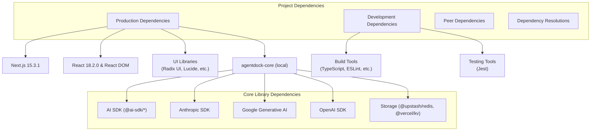

<!-- source: DeepWiki mcp.deepwiki.com · repo AgentDock/AgentDock · page 6.3 Build System · fetched 2026-10-26 -->

# Build System

<details>
<summary>Relevant source files</summary>

The following files were used as context for generating this wiki page:

- [agentdock-core/package.json](agentdock-core/package.json)
- [agentdock-core/pnpm-lock.yaml](agentdock-core/pnpm-lock.yaml)
- [agentdock-core/src/nodes/agent-node.ts](agentdock-core/src/nodes/agent-node.ts)
- [agentdock-core/tsconfig.json](agentdock-core/tsconfig.json)
- [package.json](package.json)
- [pnpm-lock.yaml](pnpm-lock.yaml)
- [scripts/clean-install.sh](scripts/clean-install.sh)
- [scripts/generate-favicons.js](scripts/generate-favicons.js)

</details>


This document outlines the build system used in AgentDock, detailing the tools, scripts, and processes that transform source code into deployable artifacts. It covers build configuration, dependency management, and the automated steps involved in building both the core library and the Next.js web application.

For environment setup information, see [Environment Setup](#6.1).
For contributing guidelines, see [Contributing Guidelines](#6.4).

## Package Manager and Environment Requirements

AgentDock uses PNPM as its package manager with strict version requirements to ensure consistent builds across development environments.

| Requirement | Minimum Version |
|-------------|----------------|
| Node.js     | 20.11.0        |
| PNPM        | 9.15.0         |



Sources: [package.json:4-8](), [pnpm-lock.yaml:1-16]()

## Project Structure and Build Components

AgentDock consists of two main components that require building:

1. **agentdock-core**: A TypeScript library bundled using tsup
2. **Next.js client**: The web application using Next.js framework

### Build Tools



Sources: [package.json:10-35](), [agentdock-core/package.json:12-16](), [agentdock-core/tsconfig.json:1-21]()

## Core Library Build

The `agentdock-core` library is built using `tsup`, which provides a streamlined bundling process for TypeScript libraries.



**Build Command:**
```
tsup src/index.ts --format esm,cjs --dts --external ai --external @ai-sdk/* --external @anthropic-ai/* --external @google/* --external openai --external @upstash/* --external @vercel/*
```

This command:
- Uses `src/index.ts` as the entry point
- Outputs both ESM and CommonJS formats
- Generates TypeScript declaration files
- Excludes specified dependencies from the bundle

Sources: [agentdock-core/package.json:13-13]()

## Build Process Flow

The complete build process includes several steps that run in sequence:



Sources: [package.json:11-15]()

### Pre-build Steps

1. **Bundle Templates**: The `bundle-templates.ts` script processes agent templates, preparing them for use in the application.

2. **Build Core Library**: The `agentdock-core` library is built before the main application to ensure dependencies are available.

### Main Build

The Next.js application is built using the standard Next.js build process, which includes:
- Transpiling TypeScript/JavaScript
- Bundling modules
- Optimizing assets
- Generating static pages where applicable

### Post-build Steps

1. **Generate Search Index**: Creates a search index for documentation and content.

2. **Generate Favicons**: Processes SVG favicon source and generates various sizes and formats of favicons for different platforms.

3. **Generate LLMs from Docs**: Extracts and processes LLM-related documentation.

## Script Dependency Graph

The following diagram shows the relationships between build scripts:



Sources: [package.json:11-35]()

## Favicon Generation Process

The `generate-favicons.js` script processes an SVG source file to create various favicon formats:



The script uses `sharp` for image processing and `to-ico` for ICO file generation.

Sources: [scripts/generate-favicons.js:1-44]()

## Clean Installation Process

The `clean-install.sh` script provides a way to completely reset the project dependencies and perform a fresh installation:



Sources: [scripts/clean-install.sh:1-13]()

## Development Build Process

For development, AgentDock uses a separate workflow to enable fast feedback:

| Command | Description |
|---------|-------------|
| `pnpm dev` | Runs pre-dev scripts and starts Next.js dev server |
| `pnpm predev` | Bundles templates and builds core library |

The development build process:
1. Ensures templates are bundled
2. Builds the core library
3. Starts the Next.js development server with hot reloading

Sources: [package.json:13-13]()

## TypeScript Configurations

### Core Library TypeScript Configuration

The `agentdock-core` library uses the following TypeScript configuration:

| Option | Value | Purpose |
|--------|-------|---------|
| target | es2020 | Specify ECMAScript target version |
| module | esnext | Use ES modules |
| moduleResolution | bundler | Modern module resolution |
| outDir | ./dist | Output directory for compiled files |
| declaration | true | Generate declaration files |

Sources: [agentdock-core/tsconfig.json:2-17]()

## Dependency Management



Sources: [package.json:36-127](), [package.json:128-162](), [agentdock-core/package.json:18-28]()

## Troubleshooting Build Issues

| Issue | Solution |
|-------|----------|
| Dependency conflicts | Run `pnpm clean-install` to reset dependencies |
| TypeScript errors | Run `pnpm typecheck` to identify type issues |
| Build failures | Check console output for specific errors and verify Node/PNPM versions |
| Core library issues | Try building core separately with `pnpm build:agentdock-core` |

Sources: [scripts/clean-install.sh:1-13](), [package.json:19-19]()

## Build Command Reference

| Command | Description |
|---------|-------------|
| `pnpm build` | Complete production build |
| `pnpm dev` | Development build with hot reloading |
| `pnpm typecheck` | Type-check without emitting files |
| `pnpm lint` | Run ESLint on the codebase |
| `pnpm test` | Run Jest tests |
| `pnpm clean-install` | Reset and reinstall dependencies |
| `pnpm build:agentdock-core` | Build only the core library |

Sources: [package.json:10-35]()

---

