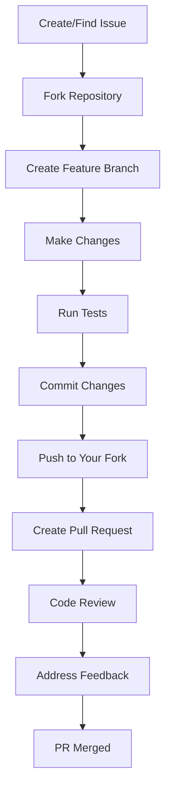
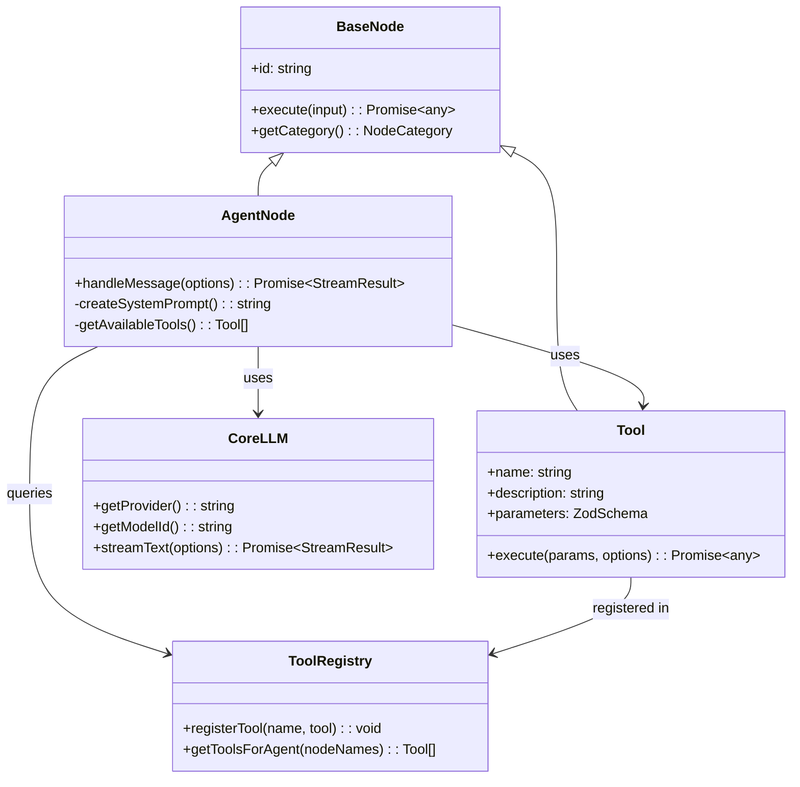
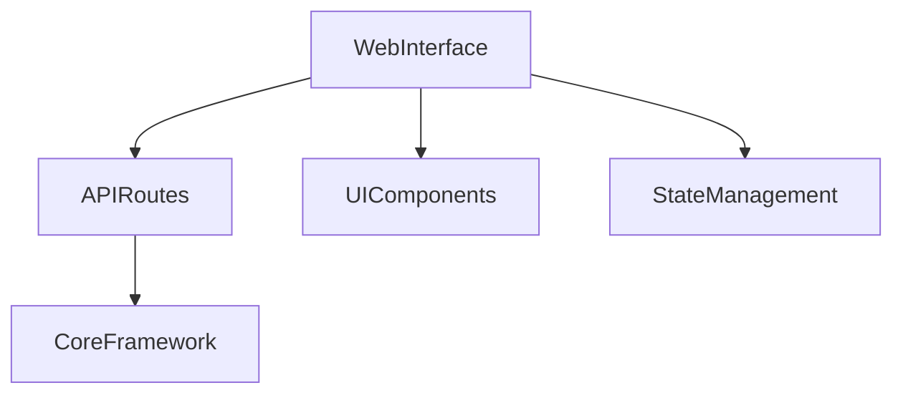
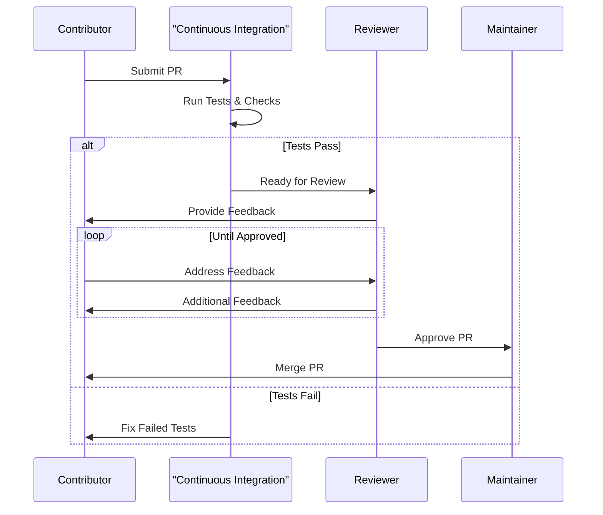
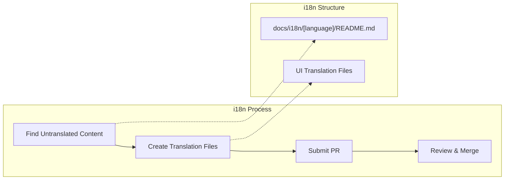

<!-- source: DeepWiki mcp.deepwiki.com · repo AgentDock/AgentDock · page 6.4 Contributing Guidelines · fetched 2026-10-26 -->

# Contributing Guidelines

<details>
<summary>Relevant source files</summary>

The following files were used as context for generating this wiki page:

- [docs/i18n/README.md](docs/i18n/README.md)
- [docs/i18n/arabic/README.md](docs/i18n/arabic/README.md)
- [docs/i18n/deutsch/README.md](docs/i18n/deutsch/README.md)

</details>


This document outlines the process and standards for contributing to the AgentDock repository. It provides guidance on workflow, code standards, and best practices to ensure a smooth contribution experience.

For setting up your development environment, please refer to [Environment Setup](#6.1). For API key management, see [API Keys Management](#6.2), and for build system details, see [Build System](#6.3).

## Contribution Workflow

The AgentDock project follows a standard GitHub workflow for contributions. This section outlines the process from creating an issue to getting your pull request merged.

### Issue First Approach

Before writing any code, we recommend creating or finding an issue that describes the bug you're fixing or the feature you're implementing. This ensures that:

1. The maintainers are aware of the work you plan to do
2. You don't duplicate work someone else is already doing
3. The feature or fix aligns with the project's roadmap

### Contribution Process



Sources: N/A (Standard GitHub workflow)

### Branch Naming Conventions

When creating a branch for your contribution, use the following naming convention:

- `feature/<issue-number>-brief-description` - For new features
- `fix/<issue-number>-brief-description` - For bug fixes
- `docs/<issue-number>-brief-description` - For documentation changes
- `refactor/<issue-number>-brief-description` - For code refactoring

Example: `feature/123-add-weather-tool`

### Commit Message Guidelines

Write clear, concise commit messages that explain what changes were made and why. Use the following format:

```
<type>(<scope>): <subject>

<body>

<footer>
```

Where:
- `<type>` is one of: feat, fix, docs, style, refactor, test, chore
- `<scope>` is optional and indicates the part of the codebase affected
- `<subject>` is a short description of the change
- `<body>` provides detailed explanation (optional)
- `<footer>` references issues and breaking changes (optional)

Example:
```
feat(tools): add weather information tool

Implements a new tool that fetches current weather data using OpenWeatherMap API.

Closes #123
```

## Contribution Areas

AgentDock has several key areas where contributions are welcome. Understanding the project structure will help you locate where your contributions should go.

### Project Structure and Contribution Areas

```mermaid
flowchart TD
    subgraph "Contribution Areas"
        ContribCore["Core Contributions"]
        ContribClient["Client Contributions"]
        ContribTools["Tool Contributions"]
        ContribDocs["Documentation"]
        ContribI18n["Internationalization"]
    end
    
    subgraph "AgentDock Repository"
        subgraph "agentdock-core"
            CoreFramework["CoreFramework"]
            NodeSystem["NodeSystem"]
            LLMSystem["LLMSystem"]
            SessionManager["SessionManager"]
            ToolRegistry["ToolRegistry"]
            StorageAbs["StorageAbstraction"]
            Orchestration["Orchestration"]
        end
        
        subgraph "OSS Client (Next.js)"
            WebClient["WebInterface"]
            APIRoutes["APIRoutes"]
            State["StateManagement"]
            Components["UIComponents"]
        end
        
        subgraph "Tools & Extensions"
            Tools["CustomTools"]
        end
        
        subgraph "Documentation"
            Docs["Documentation Files"]
            I18n["i18n Translations"]
        end
    end
    
    ContribCore --> agentdock-core
    ContribClient --> "OSS Client (Next.js)"
    ContribTools --> Tools
    ContribDocs --> Documentation
    ContribI18n --> I18n
```

Sources: High-Level System Architecture diagram in the prompt

### Core Framework Contributions

Contributions to the core framework (`agentdock-core`) can include:

- Enhancing the Node System
- Improving LLM integration
- Optimizing session management
- Extending storage abstractions
- Enhancing orchestration capabilities

When contributing to the core framework, make sure you understand the relationships between components:



Sources: Agent and Tool Relationship Model diagram in the prompt

### Client Contributions

The OSS Client is built with Next.js and includes:

- Web interface components
- API routes
- State management
- UI components

When contributing to the client, understand the component hierarchy:



Sources: High-Level System Architecture diagram in the prompt

### Tool Contributions

One of the most valuable contributions is creating custom tools that extend agent capabilities. Tools in AgentDock are specialized nodes that implement specific functionality.

When contributing a new tool:

1. Create a new file in the appropriate tools directory
2. Extend the `BaseNode` class
3. Implement the required methods and properties
4. Register the tool in the `ToolRegistry`
5. Update documentation to describe the tool's purpose and usage

### Documentation Contributions

Documentation improvements are always welcome. This includes:

- Updating or adding API documentation
- Creating tutorials or examples
- Fixing typos or clarifying existing content
- Adding diagrams to illustrate concepts

## Code Standards

### TypeScript Guidelines

AgentDock is built with TypeScript and values type safety throughout the codebase:

- Ensure all functions have proper return types
- Use interfaces and types to define data structures
- Avoid using `any` type when possible
- Leverage TypeScript's utility types when appropriate

### Documentation Standards

When documenting code:

- Use JSDoc comments for functions and classes
- Explain the purpose, parameters, and return values
- Include examples where helpful
- Keep comments up-to-date when changing code

### Testing Requirements

Each contribution should include appropriate tests:

- Unit tests for individual functions and components
- Integration tests for component interactions
- Update existing tests when behavior changes

## Pull Request Review Process

When you submit a pull request, here's what happens:



Sources: N/A (Standard pull request workflow)

### Review Criteria

Pull requests are reviewed for:

1. Code quality and adherence to project standards
2. Test coverage
3. Documentation completeness
4. Performance considerations
5. Security implications

### Addressing Feedback

When receiving feedback on your PR:

1. Address all comments and suggestions
2. Mark comments as resolved once addressed
3. Ask clarifying questions if the feedback is unclear
4. Push additional commits to your branch as needed

## Community Guidelines

### Communication Channels

- GitHub Issues: For bug reports and feature requests
- Pull Request discussions: For code-related feedback
- Community forums or chat platforms (if applicable)

### Code of Conduct

All contributors are expected to:

- Be respectful and inclusive
- Provide constructive feedback
- Assume good intentions from other contributors
- Focus on the code, not the person

## Internationalization Contributions

AgentDock supports multiple languages through its internationalization (i18n) system. Contributing translations is a valuable way to help make the project accessible to more users.

For detailed information on the i18n structure and process, see [i18n Structure](#7.1) and [Adding New Translations](#7.2).



Sources: [docs/i18n/README.md]() and [docs/i18n/arabic/README.md](), [docs/i18n/deutsch/README.md]()

### Translation Guidelines

When contributing translations:

1. Check if your target language already exists in the `docs/i18n/` directory
2. Maintain the same file structure and formatting as the original
3. Translate the content, not the technical elements (like HTML tags, code blocks, or variable names)
4. Test your translations in the UI when applicable

## FAQ for Contributors

**Q: I'm new to open source. How can I start contributing?**  
A: Start with issues labeled "good first issue" or help with documentation and translations.

**Q: How long does the PR review process typically take?**  
A: The review process can vary depending on the complexity of the contribution and maintainer availability, but we aim to provide initial feedback within a week.

**Q: Can I contribute to documentation without coding skills?**  
A: Absolutely! Documentation improvements are valuable contributions and don't necessarily require coding skills.

**Q: What if my contribution doesn't align with an existing issue?**  
A: Create a new issue describing what you want to contribute and why before starting work.

**Q: How can I get help if I'm stuck while working on a contribution?**  
A: Ask questions in the related issue or PR. The maintainers and community are there to help.

---

