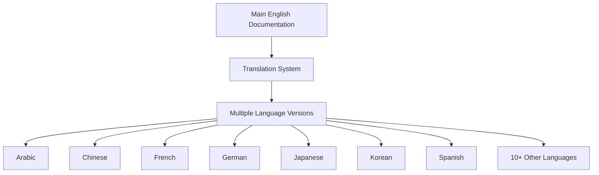
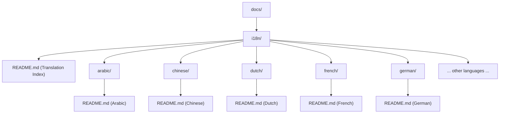
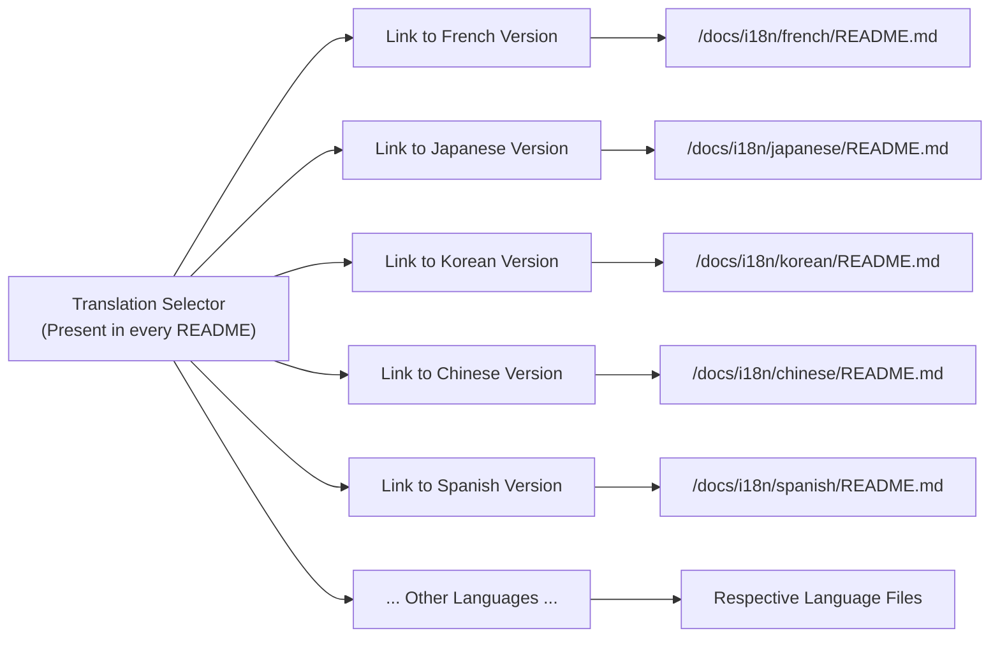
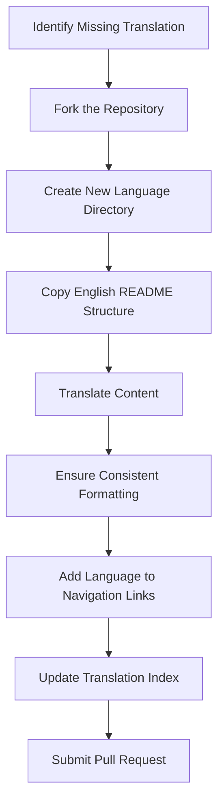
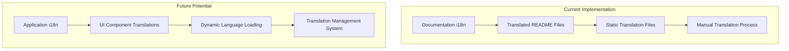
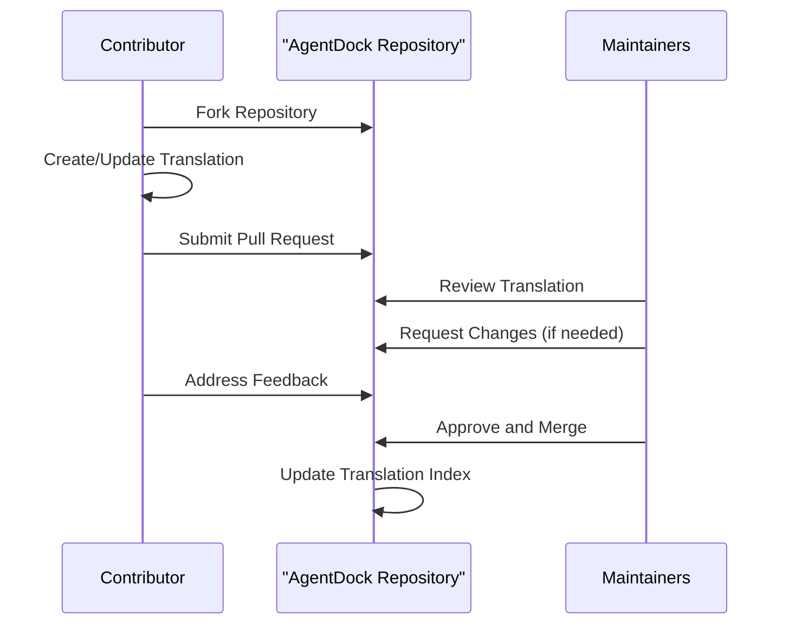

<!-- source: DeepWiki mcp.deepwiki.com · repo AgentDock/AgentDock · page 7 Internationalization · fetched 2026-10-26 -->

# Internationalization

<details>
<summary>Relevant source files</summary>

The following files were used as context for generating this wiki page:

- [docs/i18n/README.md](docs/i18n/README.md)
- [docs/i18n/arabic/README.md](docs/i18n/arabic/README.md)
- [docs/i18n/chinese/README.md](docs/i18n/chinese/README.md)
- [docs/i18n/deutsch/README.md](docs/i18n/deutsch/README.md)
- [docs/i18n/dutch/README.md](docs/i18n/dutch/README.md)
- [docs/i18n/french/README.md](docs/i18n/french/README.md)
- [docs/i18n/greek/README.md](docs/i18n/greek/README.md)
- [docs/i18n/italian/README.md](docs/i18n/italian/README.md)
- [docs/i18n/japanese/README.md](docs/i18n/japanese/README.md)
- [docs/i18n/korean/README.md](docs/i18n/korean/README.md)
- [docs/i18n/polish/README.md](docs/i18n/polish/README.md)
- [docs/i18n/russian/README.md](docs/i18n/russian/README.md)
- [docs/i18n/spanish/README.md](docs/i18n/spanish/README.md)

</details>


This document outlines the internationalization (i18n) approach in the AgentDock repository, focusing on how multilingual support is implemented and how to add new translations to the project. For information about API keys management, see [API Keys Management](#6.2).

## Overview

AgentDock supports multiple languages through a documentation-based internationalization approach. Currently, the project provides translated versions of the main README file in various languages, allowing non-English speaking developers to understand the core concepts and setup instructions in their preferred language.

The internationalization strategy focuses on making essential documentation accessible to a global audience while maintaining a consistent developer experience across languages.



Sources: [docs/i18n/README.md:1-23]()

## i18n Structure

The internationalization system is built around a simple and maintainable file structure, where each language has its own dedicated directory containing translated documentation files.

### Directory Organization

The translation files are organized in a language-specific directory structure under the `docs/i18n` path.



Sources: [docs/i18n/README.md:1-23](), [docs/i18n/arabic/README.md:1-5](), [docs/i18n/chinese/README.md:1-5](), [docs/i18n/deutsch/README.md:1-5](), [docs/i18n/dutch/README.md:1-5]()

### Navigation Between Translations

Each translated README file contains a language navigation section at the top, providing direct links to all available translations. This allows users to easily switch between language versions.



Sources: [docs/i18n/arabic/README.md:5-7](), [docs/i18n/chinese/README.md:5-7](), [docs/i18n/deutsch/README.md:5-7](), [docs/i18n/dutch/README.md:5-7]()

### Translation Index File

A central `README.md` file in the `docs/i18n` directory serves as the translation index, listing all available languages with links to their respective translations.

| Feature | Description |
|---------|-------------|
| Index File | Located at `/docs/i18n/README.md` |
| Language List | Lists all available translations with links |
| Navigation | Provides easy access to all language versions |
| Versioning Note | Indicates possible lag behind main English README |

Sources: [docs/i18n/README.md:1-23]()

## Adding New Translations

The process for adding new translations to the AgentDock project involves creating language-specific files following the established structure and conventions.

### Translation Process



Sources: [docs/i18n/README.md:1-23](), [docs/i18n/arabic/README.md:5-7](), [docs/i18n/chinese/README.md:5-7]()

### Translation Guidelines

When creating a new translation, it's important to follow these guidelines:

1. **Directory Structure**: Create a new directory under `docs/i18n/` named after the language (use the language name in English, lowercase)
2. **File Naming**: Use the same file names as the English version
3. **Content Structure**: Maintain the same structure, headings, and organization as the original English version
4. **Links**: Update internal links to point to the correct translated files
5. **Language Navigation**: Include the standard language navigation section at the top
6. **Images and Code**: Keep code snippets, file paths, and images unchanged
7. **Mermaid Diagrams**: Translate the text in diagrams but keep the structure intact

Sources: [docs/i18n/arabic/README.md:1-374](), [docs/i18n/chinese/README.md:1-374](), [docs/i18n/deutsch/README.md:1-374]()

### File Structure Template

When adding a new translation, each translated README.md should follow this general structure:

```
<logo image>

## 🌐 README Translations
[List of all language links]

# AgentDock: [Translated Title]

[Translated introduction and main content]

...

---
[Back to Translation Index](/docs/i18n/README.md)
```

Sources: [docs/i18n/arabic/README.md:1-374](), [docs/i18n/chinese/README.md:1-374]()

## i18n Implementation Details

The current internationalization implementation focuses on documentation translations rather than runtime application translations. This approach allows for multilingual documentation support while maintaining a simpler codebase.

### Documentation vs. Application i18n



Sources: [docs/i18n/README.md:1-23](), [docs/i18n/arabic/README.md:1-374](), [docs/i18n/chinese/README.md:1-374]()

### Translation Consistency Mechanisms

To maintain consistency across translations:

1. **Structure Alignment**: All translations follow the same section structure as the English version
2. **Link Standardization**: Navigation links at the top of each file use a consistent format
3. **Content Synchronization**: Critical elements like code examples, configuration instructions, and diagrams are preserved across translations
4. **Visual Formatting**: Formatting like tables, lists, and emphasis are kept consistent

Sources: [docs/i18n/arabic/README.md:1-374](), [docs/i18n/chinese/README.md:1-374]()

## Current Language Support

AgentDock documentation currently supports the following languages:

| Language | File Path | Status |
|----------|-----------|--------|
| Arabic | `/docs/i18n/arabic/README.md` | Available |
| Chinese | `/docs/i18n/chinese/README.md` | Available |
| Dutch | `/docs/i18n/dutch/README.md` | Available |
| French | `/docs/i18n/french/README.md` | Available |
| German | `/docs/i18n/deutsch/README.md` | Available |
| Greek | `/docs/i18n/greek/README.md` | Available |
| Italian | `/docs/i18n/italian/README.md` | Available |
| Japanese | `/docs/i18n/japanese/README.md` | Available |
| Korean | `/docs/i18n/korean/README.md` | Available |
| Polish | `/docs/i18n/polish/README.md` | Available |
| Russian | `/docs/i18n/russian/README.md` | Available |
| Spanish | `/docs/i18n/spanish/README.md` | Available |
| Turkish | `/docs/i18n/turkish/README.md` | Available |
| Ukrainian | `/docs/i18n/ukrainian/README.md` | Available |

Sources: [docs/i18n/README.md:7-20]()

## Contribution Process

Contributing a new translation or updating an existing one follows the standard GitHub workflow:



Sources: [docs/i18n/README.md:1-23]()

## Future i18n Considerations

While the current i18n implementation focuses on documentation, future expansions could include:

1. **UI Component Translation**: Implementing dynamic language switching for the UI
2. **Translation Management System**: Adding tools to manage, update, and synchronize translations
3. **Automated Translation Workflows**: Creating systems to help maintain translations as the main documentation evolves
4. **Translation Contribution Interface**: Developing a more streamlined process for translation contributions

Sources: [docs/i18n/README.md:22-23]()

## Related Resources

- [API Keys Management](#6.2): Information about managing API keys across different environments
- [Contributing Guidelines](#6.4): General guidelines for contributing to the repository
- [Build System](#6.3): Details about the build system and scripts

---

