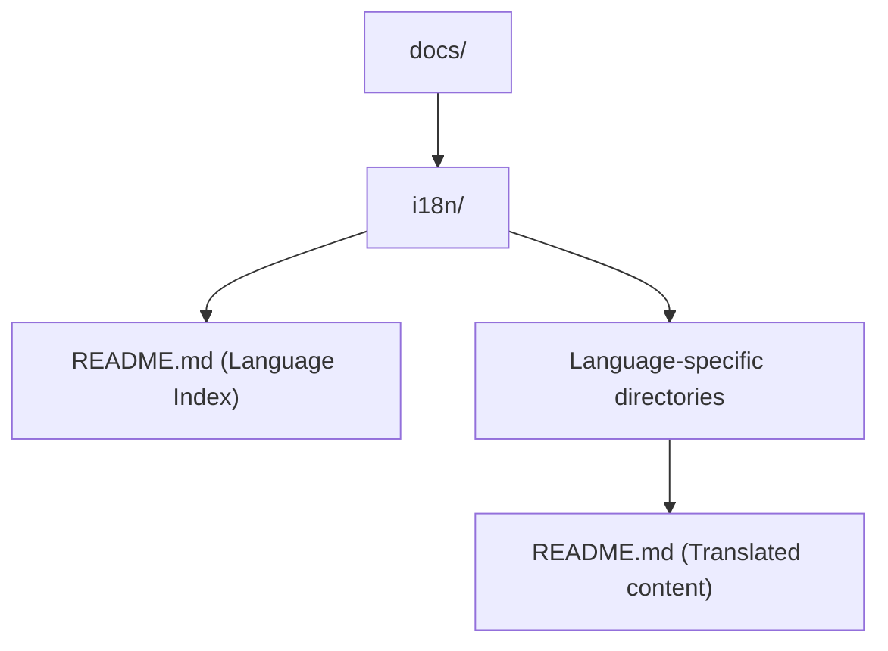
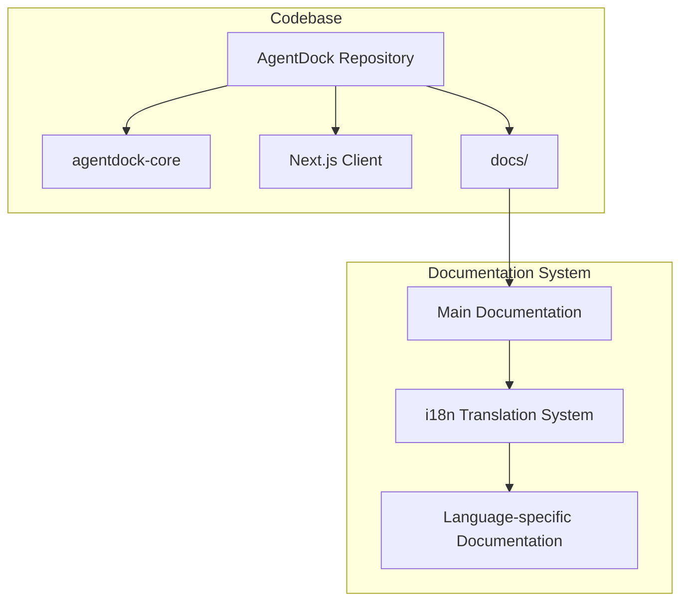
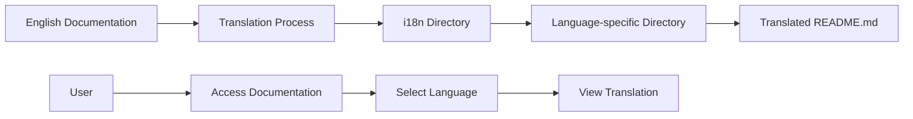

<!-- source: DeepWiki mcp.deepwiki.com · repo AgentDock/AgentDock · page 7.1 i18n Structure · fetched 2026-10-26 -->

# i18n Structure

<details>
<summary>Relevant source files</summary>

The following files were used as context for generating this wiki page:

- [docs/i18n/README.md](docs/i18n/README.md)
- [docs/i18n/arabic/README.md](docs/i18n/arabic/README.md)
- [docs/i18n/chinese/README.md](docs/i18n/chinese/README.md)
- [docs/i18n/deutsch/README.md](docs/i18n/deutsch/README.md)
- [docs/i18n/dutch/README.md](docs/i18n/dutch/README.md)
- [docs/i18n/french/README.md](docs/i18n/french/README.md)
- [docs/i18n/greek/README.md](docs/i18n/greek/README.md)
- [docs/i18n/italian/README.md](docs/i18n/italian/README.md)
- [docs/i18n/japanese/README.md](docs/i18n/japanese/README.md)
- [docs/i18n/korean/README.md](docs/i18n/korean/README.md)
- [docs/i18n/polish/README.md](docs/i18n/polish/README.md)
- [docs/i18n/russian/README.md](docs/i18n/russian/README.md)
- [docs/i18n/spanish/README.md](docs/i18n/spanish/README.md)

</details>


This document outlines the internationalization (i18n) structure within the AgentDock repository. It describes how translations are organized, the directory structure, language support, and navigation between translated documentation. For information about adding new translations, see [Adding New Translations](#7.2).

## Overview

The AgentDock project implements internationalization through a directory-based approach focused primarily on documentation translation. Currently, the main README document has been translated into multiple languages, allowing global users to understand the project's purpose, architecture, and usage instructions in their preferred language.

## Directory Structure

The i18n system is organized in a hierarchical directory structure within the `docs` folder.



Sources: [docs/i18n/README.md]()

Each language has its own dedicated directory within the `i18n` folder, containing the translated documentation files.

## Language Support

The AgentDock project currently supports the following languages:

| Language | Directory | File Path |
|----------|-----------|-----------|
| Arabic | arabic | docs/i18n/arabic/README.md |
| Chinese | chinese | docs/i18n/chinese/README.md |
| German | deutsch | docs/i18n/deutsch/README.md |
| Dutch | dutch | docs/i18n/dutch/README.md |
| French | french | docs/i18n/french/README.md |
| Greek | greek | docs/i18n/greek/README.md |
| Italian | italian | docs/i18n/italian/README.md |
| Japanese | japanese | docs/i18n/japanese/README.md |
| Korean | korean | docs/i18n/korean/README.md |
| Polish | polish | docs/i18n/polish/README.md |
| Russian | russian | docs/i18n/russian/README.md |
| Spanish | spanish | docs/i18n/spanish/README.md |
| Turkish | turkish | docs/i18n/turkish/README.md |
| Ukrainian | ukrainian | docs/i18n/ukrainian/README.md |

Sources: [docs/i18n/README.md](), [docs/i18n/arabic/README.md](), [docs/i18n/chinese/README.md](), [docs/i18n/deutsch/README.md](), [docs/i18n/dutch/README.md](), [docs/i18n/greek/README.md]()

## Translation Index

The main entry point for all translations is the `docs/i18n/README.md` file, which serves as an index listing all available language translations with direct links to each.

```mermaid
graph TD
    Index["docs/i18n/README.md"]
    ar["Arabic (arabic/README.md)"]
    zh["Chinese (chinese/README.md)"]
    de["German (deutsch/README.md)"]
    nl["Dutch (dutch/README.md)"]
    fr["French (french/README.md)"]
    el["Greek (greek/README.md)"]
    it["Italian (italian/README.md)"]
    ja["Japanese (japanese/README.md)"]
    ko["Korean (korean/README.md)"]
    pl["Polish (polish/README.md)"]
    ru["Russian (russian/README.md)"]
    es["Spanish (spanish/README.md)"]
    tr["Turkish (turkish/README.md)"]
    uk["Ukrainian (ukrainian/README.md)"]
    
    Index --> ar
    Index --> zh
    Index --> de
    Index --> nl
    Index --> fr
    Index --> el
    Index --> it
    Index --> ja
    Index --> ko
    Index --> pl
    Index --> ru
    Index --> es
    Index --> tr
    Index --> uk
```



Sources: [docs/i18n/README.md]()

## Translation Content Structure

All translated README files follow the same structure as the original English README, containing the following key sections:

1. **Header** - Project logo and language navigation links
2. **Introduction** - Overview of AgentDock
3. **Design Principles** - Philosophical foundations including configurable determinism
4. **Core Architecture** - Technical structure explanation
5. **Getting Started** - Installation and setup instructions
6. **Advanced Features** - Detailed capabilities
7. **Documentation** - Information about available documentation
8. **Repository Structure** - Organization of the codebase
9. **Features, Roadmap, and Contributing** - Additional project information

Sources: [docs/i18n/arabic/README.md:9-371](), [docs/i18n/chinese/README.md:9-371](), [docs/i18n/deutsch/README.md:9-371]()

## Cross-Language Navigation

Each translated README contains a navigation section at the top that allows users to quickly switch between languages. This navigation mechanism uses relative links to other language versions.

```mermaid
flowchart TD
    subgraph "docs/i18n"
        LangReadme["Any Language README.md"]
        NavLinks["Navigation Links Section"]
        ArabicLink["Arabic Link"]
        ChineseLink["Chinese Link"]
        GermanLink["German Link"]
        DutchLink["Dutch Link"]
        FrenchLink["French Link"]
        GreekLink["Greek Link"]
        ItalianLink["Italian Link"]
        JapaneseLink["Japanese Link"]
        KoreanLink["Korean Link"]
        PolishLink["Polish Link"]
        RussianLink["Russian Link"]
        SpanishLink["Spanish Link"]
        TurkishLink["Turkish Link"]
        UkrainianLink["Ukrainian Link"]
        
        LangReadme --> NavLinks
        NavLinks --> ArabicLink
        NavLinks --> ChineseLink
        NavLinks --> GermanLink
        NavLinks --> DutchLink
        NavLinks --> FrenchLink
        NavLinks --> GreekLink
        NavLinks --> ItalianLink
        NavLinks --> JapaneseLink
        NavLinks --> KoreanLink
        NavLinks --> PolishLink
        NavLinks --> RussianLink
        NavLinks --> SpanishLink
        NavLinks --> TurkishLink
        NavLinks --> UkrainianLink
    end
    
    ArabicLink --> ArabicReadme["arabic/README.md"]
    ChineseLink --> ChineseReadme["chinese/README.md"]
    GermanLink --> GermanReadme["deutsch/README.md"]
    DutchLink --> DutchReadme["dutch/README.md"]
    FrenchLink --> FrenchReadme["french/README.md"]
    GreekLink --> GreekReadme["greek/README.md"]
    ItalianLink --> ItalianReadme["italian/README.md"]
    JapaneseLink --> JapaneseReadme["japanese/README.md"]
    KoreanLink --> KoreanReadme["korean/README.md"]
    PolishLink --> PolishReadme["polish/README.md"]
    RussianLink --> RussianReadme["russian/README.md"]
    SpanishLink --> SpanishReadme["spanish/README.md"]
    TurkishLink --> TurkishReadme["turkish/README.md"]
    UkrainianLink --> UkrainianReadme["ukrainian/README.md"]
```



Sources: [docs/i18n/arabic/README.md:7](), [docs/i18n/chinese/README.md:7](), [docs/i18n/deutsch/README.md:7]()

## Translation Pattern

The navigation link pattern used in all README files follows this consistent format:

```
[Français](/docs/i18n/french/README.md) • [日本語](/docs/i18n/japanese/README.md) • [한국어](/docs/i18n/korean/README.md) • [中文](/docs/i18n/chinese/README.md) • [Español](/docs/i18n/spanish/README.md) • [Italiano](/docs/i18n/italian/README.md) • [Nederlands](/docs/i18n/dutch/README.md) • [Deutsch](/docs/i18n/deutsch/README.md) • [Polski](/docs/i18n/polish/README.md) • [Türkçe](/docs/i18n/turkish/README.md) • [Українська](/docs/i18n/ukrainian/README.md) • [Ελληνικά](/docs/i18n/greek/README.md) • [Русский](/docs/i18n/russian/README.md) • [العربية](/docs/i18n/arabic/README.md)
```

Sources: [docs/i18n/arabic/README.md:7](), [docs/i18n/chinese/README.md:7](), [docs/i18n/deutsch/README.md:7]()

## Translation End Reference

Each translated README ends with a link back to the language index:

```
[Back to Translation Index](/docs/i18n/README.md)
```

Sources: [docs/i18n/arabic/README.md:374](), [docs/i18n/chinese/README.md:374](), [docs/i18n/dutch/README.md:374]()

## Code-to-Documentation Mapping

The internationalization structure primarily focuses on documentation rather than code-level internationalization. The relationship between the documentation translations and the codebase is illustrated below:



Sources: [docs/i18n/README.md]()

## Translation Workflow

The process of creating and accessing translations follows this workflow:



Sources: [docs/i18n/README.md](), [docs/i18n/arabic/README.md](), [docs/i18n/chinese/README.md]()

## Conclusion

The AgentDock internationalization structure provides a straightforward approach to documentation translation, enabling global users to access project information in their preferred language. The current system is documentation-focused, with comprehensive translations of the main README file. Each translation maintains the same content structure and includes a consistent cross-language navigation mechanism.

---

