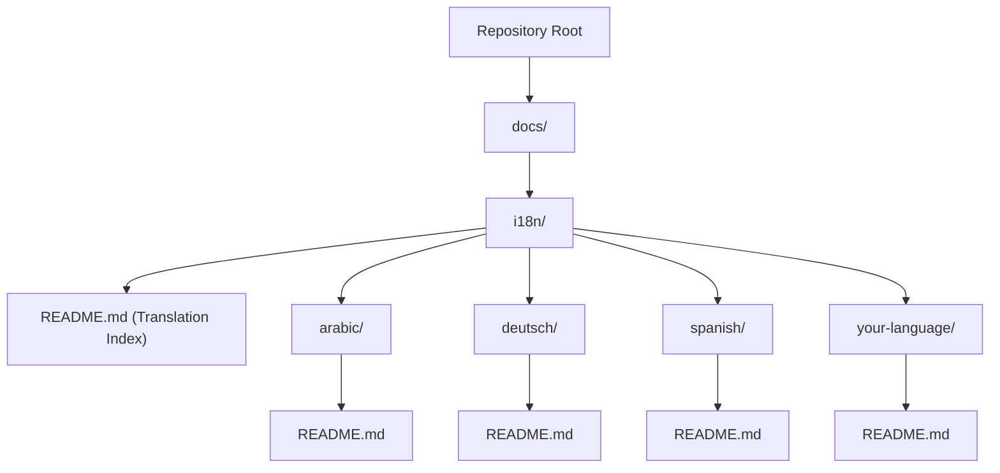
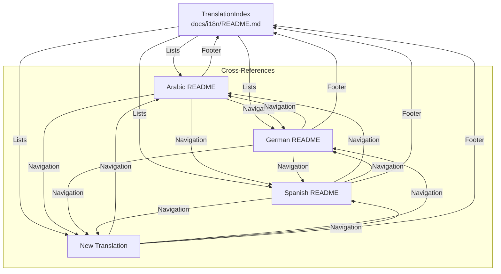
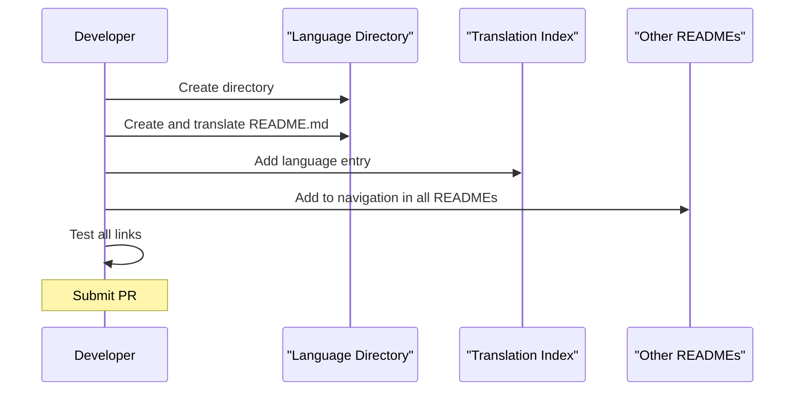

<!-- source: DeepWiki mcp.deepwiki.com · repo AgentDock/AgentDock · page 7.2 Adding New Translations · fetched 2026-10-26 -->

# Adding New Translations

<details>
<summary>Relevant source files</summary>

The following files were used as context for generating this wiki page:

- [docs/i18n/README.md](docs/i18n/README.md)
- [docs/i18n/arabic/README.md](docs/i18n/arabic/README.md)
- [docs/i18n/deutsch/README.md](docs/i18n/deutsch/README.md)
- [docs/i18n/italian/README.md](docs/i18n/italian/README.md)
- [docs/i18n/japanese/README.md](docs/i18n/japanese/README.md)
- [docs/i18n/korean/README.md](docs/i18n/korean/README.md)
- [docs/i18n/polish/README.md](docs/i18n/polish/README.md)
- [docs/i18n/russian/README.md](docs/i18n/russian/README.md)
- [docs/i18n/spanish/README.md](docs/i18n/spanish/README.md)

</details>


This document provides step-by-step instructions for adding new language translations to the AgentDock repository. The internationalization (i18n) system allows the project documentation to be accessible in multiple languages, focusing primarily on the README file.

## Translation Directory Structure

The AgentDock repository organizes translations in language-specific directories:



Sources:
- `docs/i18n/README.md`
- `docs/i18n/arabic/README.md`
- `docs/i18n/deutsch/README.md`
- `docs/i18n/spanish/README.md`

## Step-by-Step Translation Process

### 1. Create Language Directory

Create a new directory for your language under `docs/i18n/`. Use the English name of the language in lowercase:

```bash
mkdir docs/i18n/french
```

### 2. Create Translated README

Create a `README.md` file in your language directory with the following structure:

#### a. Logo Header

```markdown
<p align="center">
  
</p>
```

#### b. Translation Navigation

```markdown
## 🌐 README Translations

[Français](/docs/i18n/french/README.md) • [日本語](/docs/i18n/japanese/README.md) • [한국어](/docs/i18n/korean/README.md) • [中文](/docs/i18n/chinese/README.md) • [Español](/docs/i18n/spanish/README.md) • [Italiano](/docs/i18n/italian/README.md) • [Nederlands](/docs/i18n/dutch/README.md) • [Deutsch](/docs/i18n/deutsch/README.md) • [Polski](/docs/i18n/polish/README.md) • [Türkçe](/docs/i18n/turkish/README.md) • [Українська](/docs/i18n/ukrainian/README.md) • [Ελληνικά](/docs/i18n/greek/README.md) • [Русский](/docs/i18n/russian/README.md) • [العربية](/docs/i18n/arabic/README.md)
```

**Important:** Include your language in this list and ensure all language links are correctly formatted.

#### c. Translated Content

Translate the main content while preserving all formatting, code blocks, and diagrams.

#### d. Footer Link

```markdown
---
[Back to Translation Index](/docs/i18n/README.md)
```

Note: Translate the "Back to Translation Index" text to your language.

### 3. Update Translation Index

Add your language to the main translation index in `docs/i18n/README.md`:

```markdown
*   [Your Language](./your-language/README.md) (Native Name)
```

Example:
```markdown
*   [French](./french/README.md) (Français)
```

Sources:
- `docs/i18n/README.md`

### 4. Update All Existing Translations

Add your language to the translation navigation section in **all** existing README files.

## Translation Reference Network

The translation system creates an interconnected network of references:



Sources:
- `docs/i18n/README.md`
- `docs/i18n/arabic/README.md`
- `docs/i18n/deutsch/README.md`
- `docs/i18n/spanish/README.md`

## Translation Guidelines

### What to Translate vs. What to Preserve

| Translate | Do Not Translate |
|-----------|------------------|
| Descriptive text | Code blocks and commands |
| Section headings | Technical variable/function names |
| Table content (except technical terms) | Mermaid diagram code structure |
| Navigation and footer text | File paths and URLs |

### Formatting Requirements

1. Maintain identical markdown formatting to the original
2. Preserve all links, ensuring they point to the correct destinations
3. Keep all images and their references intact
4. Maintain all code blocks and their syntax highlighting

## Example: Section Translation

**Original (English):**
```markdown
## 🧠 Design Principles
```

**Translated (Spanish):**
```markdown
## 🧠 Principios de Diseño
```

Sources:
- `docs/i18n/spanish/README.md`

## Translation Workflow



Sources:
- `docs/i18n/README.md`
- `docs/i18n/arabic/README.md`
- `docs/i18n/deutsch/README.md`

## Complete Checklist

When adding a new translation:

- [ ] Create directory `docs/i18n/your-language/`
- [ ] Create `README.md` with properly formatted header, navigation, and footer
- [ ] Translate all text content while preserving formatting
- [ ] Add your language to `docs/i18n/README.md` index
- [ ] Update navigation sections in all existing language README files
- [ ] Test all links to ensure they work correctly

Following these steps will ensure your translation is properly integrated into the AgentDock documentation system, making the project more accessible to users of your language.