# Page: Overview

# Overview

<details>
<summary>Relevant source files</summary>

The following files were used as context for generating this wiki page:

- [.gitignore](.gitignore)
- [docs/i18n/README.md](docs/i18n/README.md)
- [docs/i18n/arabic/README.md](docs/i18n/arabic/README.md)
- [docs/i18n/chinese/README.md](docs/i18n/chinese/README.md)
- [docs/i18n/deutsch/README.md](docs/i18n/deutsch/README.md)
- [docs/i18n/dutch/README.md](docs/i18n/dutch/README.md)
- [docs/i18n/french/README.md](docs/i18n/french/README.md)
- [docs/i18n/greek/README.md](docs/i18n/greek/README.md)
- [package.json](package.json)
- [pnpm-lock.yaml](pnpm-lock.yaml)
- [scripts/generate-favicons.js](scripts/generate-favicons.js)

</details>


AgentDock is a framework for building AI agents with configurable determinism. This page provides a high-level overview of the AgentDock repository, explaining its architecture, core concepts, and key components. AgentDock consists of two main components: the **AgentDock Core** (a backend-focused framework) and an **Open Source Client** (a Next.js application serving as a reference implementation).

For detailed information about specific components, please refer to the respective sections in this wiki, such as [Node System](#2.1), [LLM Integration](#2.2), or [Agent Templates](#5.1).

## Repository Structure

The repository is organized into the following main components:

- **AgentDock Core**: Located in `agentdock-core/`, this is the core framework that provides agent functionality
- **Open Source Client**: A Next.js application that serves as a reference implementation and consumer of the core framework
- **Agent Templates**: Pre-configured agent configurations in the `agents/` directory

The repository uses TypeScript throughout and requires Node.js ≥ 20.11.0 and pnpm ≥ 9.15.0 for development.

Sources: [package.json:1-173](), [.gitignore:1-76]()

## High-Level Architecture

The following diagram illustrates the high-level architecture of AgentDock, showing how different components interact with each other:

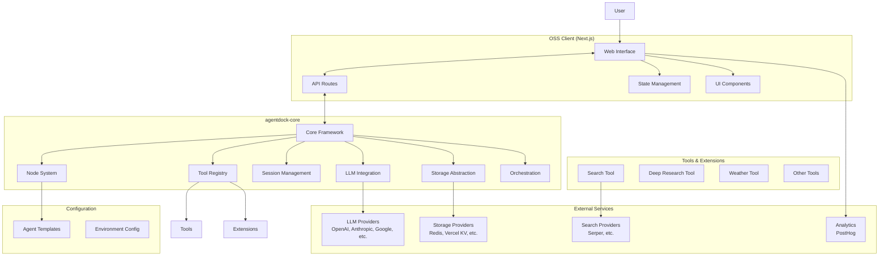

Sources: [docs/i18n/arabic/README.md:11-127](), [docs/i18n/chinese/README.md:11-115]()

## Core Concepts

### Node-Based Architecture

AgentDock is built around a node-based architecture where all capabilities are implemented as nodes:

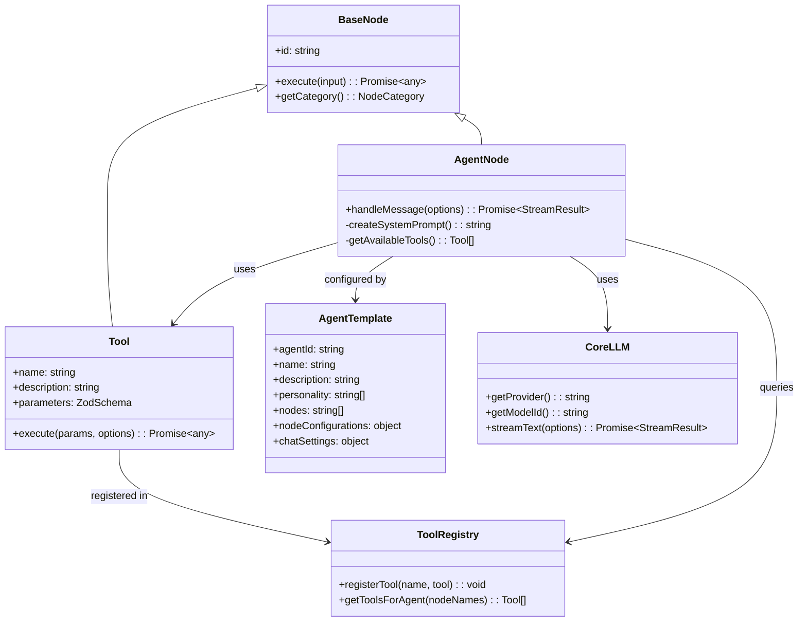

Sources: [docs/i18n/arabic/README.md:118-126](), [docs/i18n/chinese/README.md:119-127]()

### Configurable Determinism

A cornerstone of AgentDock's design philosophy is **configurable determinism**, which allows balancing creative AI capabilities with predictable system behavior:

- `AgentNode` components are inherently non-deterministic as LLMs can generate different responses each time
- Workflows can be made more deterministic through defined tool execution paths
- Developers can control the level of determinism by configuring which parts of the system use LLM inference
- Even with LLM components, overall system behavior remains predictable through structured tool interactions

This balanced approach enables both creativity and reliability in AI applications.

```mermaid
flowchart TD
    subgraph "Deterministic Workflows"
        DI["Input"] --> DP["Process"]
        DP --> DD["Database"]
        DP --> DO["Output"]
    end
    
    subgraph "Non-Deterministic Agent Behavior"
        NDI["User Query"] --> NDA["AgentNode"]
        NDA -->|"LLM Reasoning"| NDC["Tool Choice"]
        NDC -->|"Option A"| NDA1["Tool A"]
        NDC -->|"Option B"| NDA2["Tool B"]
        NDC -->|"Option C"| NDA3["Direct Response"]
        NDA1 --> NDR["Final Response"]
        NDA2 --> NDR
        NDA3 --> NDR
    end
    
    subgraph "Hybrid Approach"
        HI["User Query"] --> HA["AgentNode"]
        HA -->|"LLM Reasoning"| HC["Sub-Workflow Choice"]
        HC -->|"Decision A"| HF1["Deterministic Workflow 1"]
        HC -->|"Decision B"| HF2["Deterministic Workflow 2"]
        HC -->|"Decision C"| HDR["Generate Response"]
        
        HF1 -->|"Step 1→2→3→...→200"| HFR1["Workflow 1 Result"]
        HF2 -->|"Step 1→2→3→...→100"| HFR2["Workflow 2 Result"]
        
        HFR1 --> HR["Final Response"]
        HFR2 --> HR
        HDR --> HR
    end
```

Sources: [docs/i18n/arabic/README.md:29-115](), [docs/i18n/chinese/README.md:29-116]()

## Message Processing Pipeline

The following diagram illustrates how messages flow through the system, from user input to response:

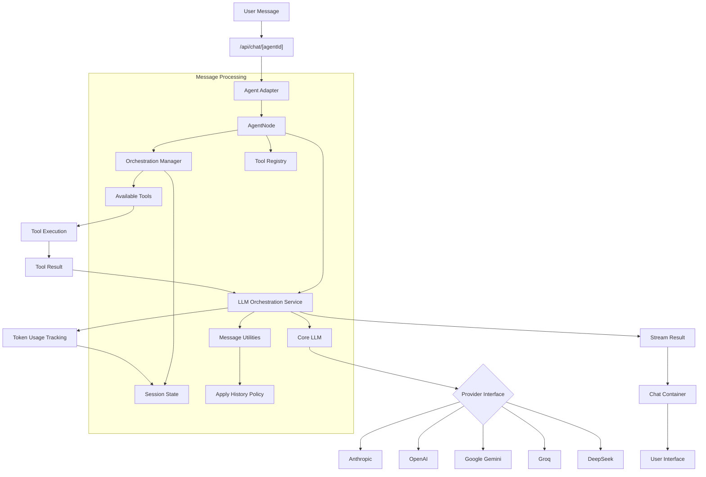

Sources: [docs/i18n/arabic/README.md:238-257](), [docs/i18n/chinese/README.md:238-257]()

## Agent Configuration and Execution Flow

The following diagram shows how agent configurations drive the execution flow in AgentDock:

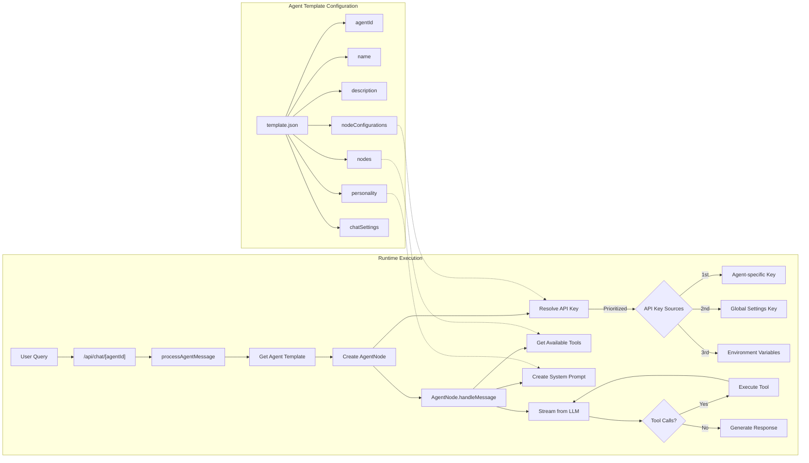

Sources: [docs/i18n/arabic/README.md:238-257](), [docs/i18n/chinese/README.md:238-257]()

## Key Components

### AgentDock Core

AgentDock Core is the foundation of the entire system, providing the following key components:

1. **Node System**: Base architecture where everything is a node
2. **LLM Integration**: Unified interface to different LLM providers (OpenAI, Anthropic, Google, etc.)
3. **Session Management**: Manages isolated state for conversations
4. **Tool Registry**: Centralized registry for all tools available to agents
5. **Storage Abstraction**: Flexible storage system with pluggable providers
6. **Orchestration**: Controls agent behavior and tool availability based on context

### Open Source Client

The Open Source Client is a Next.js application that serves as a reference implementation:

1. **Web Interface**: The frontend UI for interacting with agents
2. **API Routes**: Next.js API routes for handling requests to the core framework
3. **State Management**: Client-side state management using Zustand
4. **UI Components**: Reusable UI components built with Tailwind CSS and ShadCN/UI
5. **Chat Container**: Main component for managing chat interactions

### Environment Requirements

AgentDock requires:

- Node.js ≥ 20.11.0 (LTS)
- pnpm ≥ 9.15.0 for dependency management
- API keys for LLM providers (Anthropic, OpenAI, etc.)

Sources: [package.json:4-8](), [docs/i18n/arabic/README.md:134-137](), [docs/i18n/chinese/README.md:134-137]()

## API Key Resolution

AgentDock follows a priority order when resolving which API key to use:

1. **Agent-specific custom API key** (set via agent settings in the UI)
2. **Global settings API key** (set via the settings page in the UI)
3. **Environment variable** (from `.env.local` or deployment platform)

Required API keys include:

```
ANTHROPIC_API_KEY=sk-ant-xxxxxxx  # Anthropic API key
OPENAI_API_KEY=sk-xxxxxxx         # OpenAI API key
GEMINI_API_KEY=xxxxxxx            # Google Gemini API key
DEEPSEEK_API_KEY=xxxxxxx          # DeepSeek API key
GROQ_API_KEY=xxxxxxx              # Groq API key
```

Some tools also require their own API keys:

```
SERPER_API_KEY=                  # Required for search functionality
FIRECRAWL_API_KEY=               # Required for deeper web crawling
```

Sources: [docs/i18n/arabic/README.md:242-267](), [docs/i18n/chinese/README.md:242-267]()

## Further Reading

For more detailed information about specific components of AgentDock, please refer to the following sections:

- [Node System](#2.1) - Details about the node-based architecture
- [LLM Integration](#2.2) - How AgentDock integrates with various LLM providers
- [Orchestration System](#2.3) - The system that manages agent behavior and tool usage
- [Session Management](#2.4) - How sessions are managed to maintain state for conversations
- [Agent Templates](#5.1) - Details about pre-configured agent templates

---

# Page: Project Structure

# Project Structure

<details>
<summary>Relevant source files</summary>

The following files were used as context for generating this wiki page:

- [.gitignore](.gitignore)
- [agentdock-core/package.json](agentdock-core/package.json)
- [agentdock-core/pnpm-lock.yaml](agentdock-core/pnpm-lock.yaml)
- [agentdock-core/src/nodes/agent-node.ts](agentdock-core/src/nodes/agent-node.ts)
- [agentdock-core/tsconfig.json](agentdock-core/tsconfig.json)
- [package.json](package.json)
- [pnpm-lock.yaml](pnpm-lock.yaml)
- [scripts/clean-install.sh](scripts/clean-install.sh)
- [scripts/generate-favicons.js](scripts/generate-favicons.js)

</details>


This page provides a comprehensive overview of the AgentDock repository structure, explaining the organization of its primary components and how they relate to each other. This page focuses on the physical structure of the codebase - for conceptual understanding of the architecture, see [Architecture](#2) and for key concepts, see [Key Concepts](#1.2).

## Repository Overview

AgentDock is organized as a monorepo containing two main components:

1. **AgentDock Core** (`agentdock-core/`): The core framework implemented as a TypeScript library containing the agent infrastructure, LLM integration, and orchestration systems.

2. **OSS Web Client** (root directory): A Next.js web application that provides a user interface for interacting with AgentDock agents.

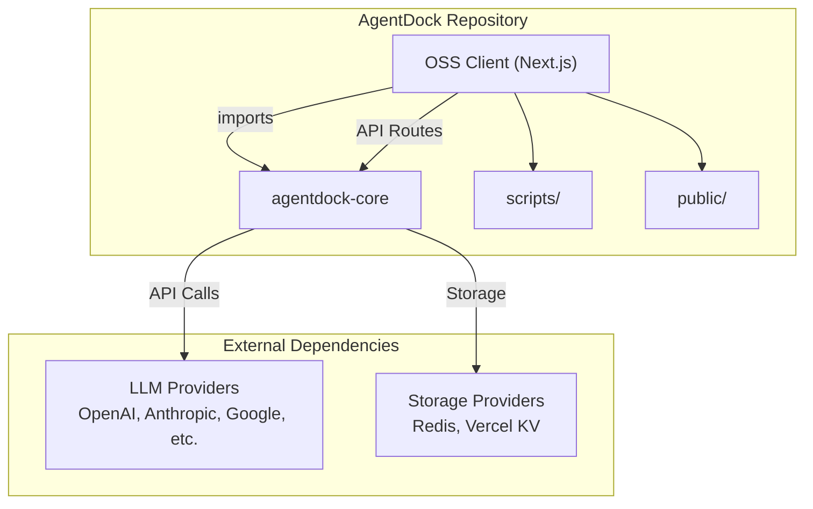

Sources: [package.json:1-173](), [agentdock-core/package.json:1-36](), [.gitignore:1-75]()

## Core Framework Structure

The `agentdock-core` directory contains the central framework that powers AgentDock's agent capabilities. It is structured as a standalone TypeScript package with its own build process and dependencies.

### Directory Structure

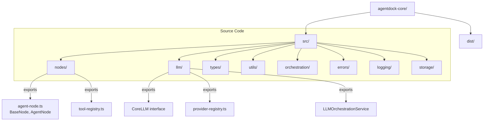

Sources: [agentdock-core/package.json:1-36](), [agentdock-core/tsconfig.json:1-21](), [agentdock-core/src/nodes/agent-node.ts:1-455]()

### Key Modules

1. **Nodes System** (`src/nodes/`): Contains the base node implementation and specialized nodes like the AgentNode.

2. **LLM Integration** (`src/llm/`): Handles integration with various LLM providers like OpenAI, Anthropic, and Google.

3. **Types** (`src/types/`): Contains TypeScript type definitions used throughout the framework.

4. **Utils** (`src/utils/`): Utility functions for message handling, prompt generation, etc.

5. **Orchestration** (`src/orchestration/`): Manages the orchestration of agents and tools.

6. **Storage** (`src/storage/`): Abstraction layer for different storage providers.

## OSS Client Structure

The OSS Client is a Next.js application that provides the web interface for AgentDock. It imports and uses the `agentdock-core` library to power its agent functionality.

### Directory Structure

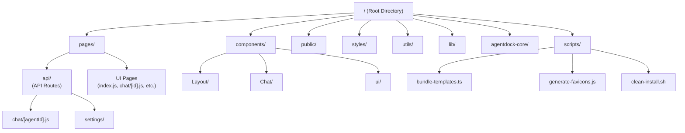

Sources: [package.json:1-173](), [scripts/generate-favicons.js:1-42](), [scripts/clean-install.sh:1-14]()

## Build System and Scripts

AgentDock uses a set of scripts to manage building, development, and deployment processes. These scripts are defined in the package.json files and some are located in the `scripts/` directory.

### Core Build Process

The `agentdock-core` library is built using `tsup`, which creates both ESM and CommonJS builds with TypeScript declarations. The build output is placed in the `agentdock-core/dist/` directory.

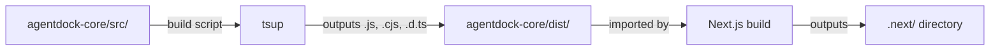

Sources: [agentdock-core/package.json:12-16](), [package.json:10-34]()

### Key Scripts

| Script Name | Purpose | Source File |
|-------------|---------|-------------|
| `build` | Builds both agentdock-core and Next.js client | [package.json:14]() |
| `dev` | Starts development server after building templates and core | [package.json:13]() |
| `bundle-templates` | Bundles agent templates for use by the application | [package.json:11]() |
| `generate-favicons` | Generates favicon files from SVG source | [scripts/generate-favicons.js:1-42]() |
| `generate-search-index` | Creates search index for documentation | [package.json:28]() |
| `clean-install` | Performs clean installation of dependencies | [scripts/clean-install.sh:1-14]() |
| `build:agentdock-core` | Builds only the core framework | [package.json:34]() |

## Dependency Management

AgentDock uses pnpm as its package manager as specified in the `package.json` engines field. The project has dependencies on various React components, UI libraries, and AI-related packages.

### Core Framework Dependencies

The core framework depends on several AI service providers:

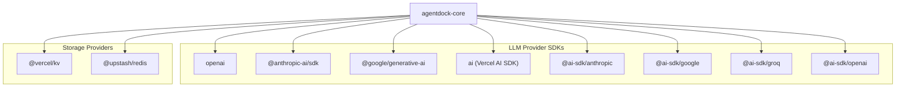

Sources: [agentdock-core/package.json:18-28](), [agentdock-core/pnpm-lock.yaml:10-41]()

### Client Dependencies

The OSS Client has dependencies on UI components, routing, state management, and other front-end technologies:

- **UI Framework**: Next.js, React, and various Radix UI components
- **Styling**: Tailwind CSS and related plugins
- **State Management**: Zustand
- **API Integration**: Various utilities and helpers for API communication

## Scripts Directory

The `scripts/` directory contains utility scripts used during the build process and development workflow:

1. **bundle-templates.ts**: Bundles agent templates into a format usable by the application
2. **generate-search-index.ts**: Generates a search index for the documentation system
3. **generate-favicons.js**: Creates favicon files in various formats from an SVG source
4. **clean-install.sh**: Shell script for performing a clean installation of dependencies
5. **generate-llms-from-docs.ts**: Generates LLM configuration files from documentation

These scripts are executed as part of the build process or can be run manually as needed.

Sources: [package.json:10-34](), [scripts/generate-favicons.js:1-42](), [scripts/clean-install.sh:1-14]()

## Project Structure Visualization

The following diagram provides a comprehensive view of the AgentDock project structure, showing the relationship between different components:

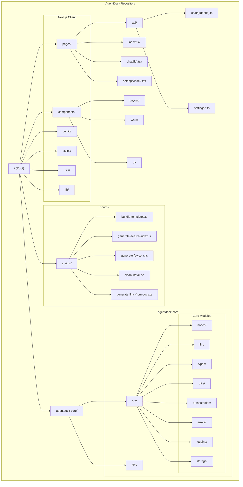

Sources: [package.json:1-173](), [agentdock-core/package.json:1-36](), [agentdock-core/src/nodes/agent-node.ts:1-455](), [scripts/generate-favicons.js:1-42](), [scripts/clean-install.sh:1-14]()

---

# Page: Key Concepts

# Key Concepts

<details>
<summary>Relevant source files</summary>

The following files were used as context for generating this wiki page:

- [docs/i18n/README.md](docs/i18n/README.md)
- [docs/i18n/arabic/README.md](docs/i18n/arabic/README.md)
- [docs/i18n/chinese/README.md](docs/i18n/chinese/README.md)
- [docs/i18n/deutsch/README.md](docs/i18n/deutsch/README.md)
- [docs/i18n/dutch/README.md](docs/i18n/dutch/README.md)
- [docs/i18n/french/README.md](docs/i18n/french/README.md)
- [docs/i18n/greek/README.md](docs/i18n/greek/README.md)
- [docs/i18n/italian/README.md](docs/i18n/italian/README.md)
- [docs/i18n/japanese/README.md](docs/i18n/japanese/README.md)
- [docs/i18n/korean/README.md](docs/i18n/korean/README.md)
- [docs/i18n/polish/README.md](docs/i18n/polish/README.md)
- [docs/i18n/russian/README.md](docs/i18n/russian/README.md)
- [docs/i18n/spanish/README.md](docs/i18n/spanish/README.md)

</details>


This document explains the foundational concepts of AgentDock, including configurable determinism, node-based architecture, and core system components. Understanding these key concepts is essential for developers who want to build and extend AI agents using the AgentDock framework. For implementation details, see [Architecture](#2).

## Configurable Determinism

AgentDock's design philosophy centers around the concept of **configurable determinism** - a balanced approach that gives developers control over the tradeoff between AI creativity and predictable behavior.

### The Determinism Spectrum

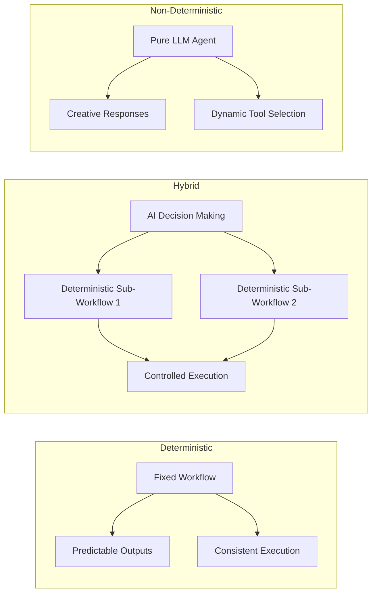

Sources: 
- docs/i18n/arabic/README.md
- docs/i18n/chinese/README.md
- docs/i18n/deutsch/README.md

AgentDock supports three main workflow paradigms:

1. **Deterministic Workflows**: Traditional workflow patterns with predictable execution paths and reliable results.

2. **Non-Deterministic Agent Behavior**: LLM-powered workflows with creative outputs that may vary, while maintaining structured interaction patterns.

3. **Hybrid Approach**: The AgentDock specialty - combining non-deterministic agent intelligence with deterministic sub-workflows for the best of both worlds.

### Hybrid Workflow Example

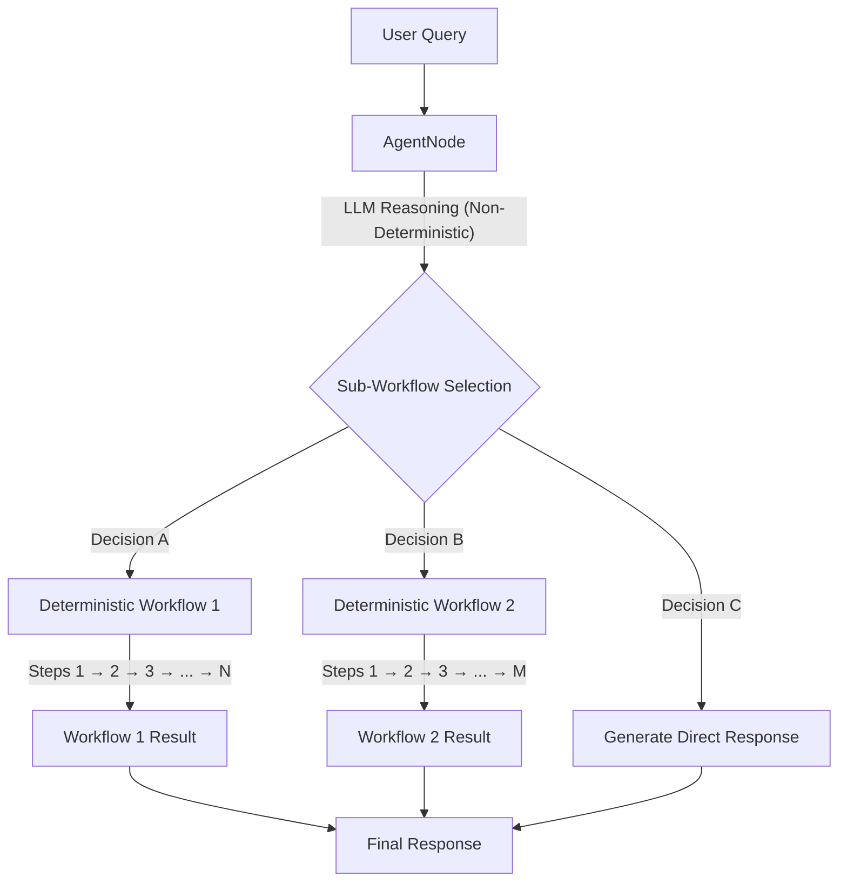

Sources:
- docs/i18n/arabic/README.md:79-107
- docs/i18n/chinese/README.md:84-107

This hybrid approach enables complex multi-step workflows to be invoked by intelligent agent decisions. Each workflow executes predictably despite being triggered by non-deterministic agent reasoning.

## Node-Based Architecture

AgentDock is built around a modular node-based system that serves as the foundation for all agent functionality. This architecture allows for flexibility and extensibility while maintaining structured interactions.

### Core Node Types

- **`BaseNode`**: The fundamental class that establishes the core interface and capabilities for all nodes
- **`AgentNode`**: A specialized node that orchestrates LLM interactions, tool usage, and agent logic
- **Tools**: Specialized nodes that implement specific capabilities

### Agent and Tool Relationship Model


Sources:
- High-Level System Architecture diagram from the input

The `AgentNode` stands at the center of the system, using configuration from `AgentTemplate` to determine its behavior. It interfaces with LLMs via `CoreLLM` and leverages tools registered in the `ToolRegistry` to perform specific tasks.

## LLM Integration and Message Processing

AgentDock provides a unified interface for interacting with different Large Language Model providers through its LLM orchestration system.

### LLM Integration and Message Processing Pipeline


Sources:
- LLM Integration and Message Processing Pipeline diagram from the input

The message processing pipeline shows how user messages flow through the system:
1. User message enters through the API route
2. Agent adapter processes the message and passes it to the appropriate AgentNode
3. The AgentNode uses LLM Orchestration, Tool Registry, and Orchestration Manager to handle the message
4. LLM Orchestration interacts with the appropriate LLM provider
5. Tool execution happens as needed based on the LLM's output
6. Results are streamed back to the user interface

## Agent Configuration and Execution Flow

AgentDock uses JSON templates to configure agents, providing a flexible way to define personality, available tools, and behavior.

### Agent Configuration and Execution Flow


Sources:
- Agent Configuration and Execution Flow diagram from the input

The flow shows:
1. Agent templates define the agent's identity and capabilities
2. At runtime, the API route processes the user query
3. The system fetches the appropriate template and creates an AgentNode
4. API keys are resolved from multiple possible sources
5. The AgentNode handles the message, getting available tools and creating a system prompt
6. The LLM processes the input and may call tools as needed
7. The final response is generated and sent back to the user

## Core System Components

AgentDock consists of several core components that work together to provide the framework's functionality:

### Component Overview

| Component | Description | Role |
|-----------|-------------|------|
| **Node System** | The foundation of all agent functionality | Provides the base architecture for all nodes |
| **LLM System** | Interfaces with various LLM providers | Handles LLM communication and response processing |
| **Tool Registry** | Manages available tools for agents | Registers and provides tools to agents |
| **Session Management** | Manages conversation state | Maintains isolated state for concurrent conversations |
| **Orchestration** | Controls agent behavior based on context | Manages tool availability and workflow execution |
| **Storage Abstraction** | Provides flexible storage options | Offers pluggable storage for various data types |

Sources:
- High-Level System Architecture diagram from the input

### High-Level System Architecture

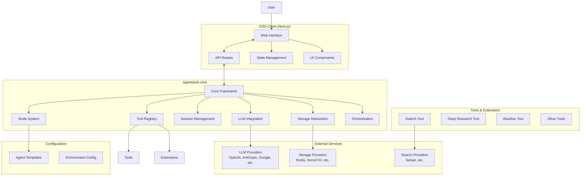

Sources:
- High-Level System Architecture diagram from the input

The high-level architecture shows how all components interact:
1. The user interacts with the web interface
2. The OSS Client built with Next.js provides the user interface and API routes
3. The `agentdock-core` framework provides the foundation with node systems, LLM integration, session management, tools, storage, and orchestration
4. Tools extend the system's capabilities
5. External services provide LLM capabilities, storage, and search functionality

## Further Reading

- For more on the node system architecture, see [Node System](#2.1)
- For details on LLM integration, see [LLM Integration](#2.2)  
- For information about orchestration, see [Orchestration System](#2.3)
- For session management details, see [Session Management](#2.4)
- For storage capabilities, see [Storage Abstraction](#2.5)
- For agent templates, see [Agent Templates](#5.1)
- For creating custom tools, see [Custom Tools](#5.2)

---

# Page: Architecture

# Architecture

<details>
<summary>Relevant source files</summary>

The following files were used as context for generating this wiki page:

- [agentdock-core/package.json](agentdock-core/package.json)
- [agentdock-core/pnpm-lock.yaml](agentdock-core/pnpm-lock.yaml)
- [agentdock-core/src/nodes/agent-node.ts](agentdock-core/src/nodes/agent-node.ts)
- [agentdock-core/tsconfig.json](agentdock-core/tsconfig.json)
- [docs/i18n/chinese/README.md](docs/i18n/chinese/README.md)
- [docs/i18n/dutch/README.md](docs/i18n/dutch/README.md)
- [docs/i18n/french/README.md](docs/i18n/french/README.md)
- [docs/i18n/greek/README.md](docs/i18n/greek/README.md)
- [scripts/clean-install.sh](scripts/clean-install.sh)

</details>


This document provides a comprehensive overview of the AgentDock system architecture, explaining the core components, their interactions, and the design principles that guide the system. For information about specific subsystems, refer to their dedicated pages: [Node System](#2.1), [LLM Integration](#2.2), [Orchestration System](#2.3), and [Session Management](#2.4).

## Core Design Philosophy

AgentDock's architecture is built around the concept of **configurable determinism**, allowing developers to balance AI creativity with predictable system behavior. The framework uses a modular, node-based design where all capabilities are implemented as nodes, with specialized nodes (tools) extending the system for agent capabilities.

Sources: [docs/i18n/chinese/README.md:28-37](), [docs/i18n/dutch/README.md:28-37]()

## High-Level System Overview

At a high level, AgentDock consists of two main components:

1. **AgentDock Core**: The backend framework that provides the foundation for building AI agents
2. **OSS Client**: A complete Next.js application that serves as a reference implementation

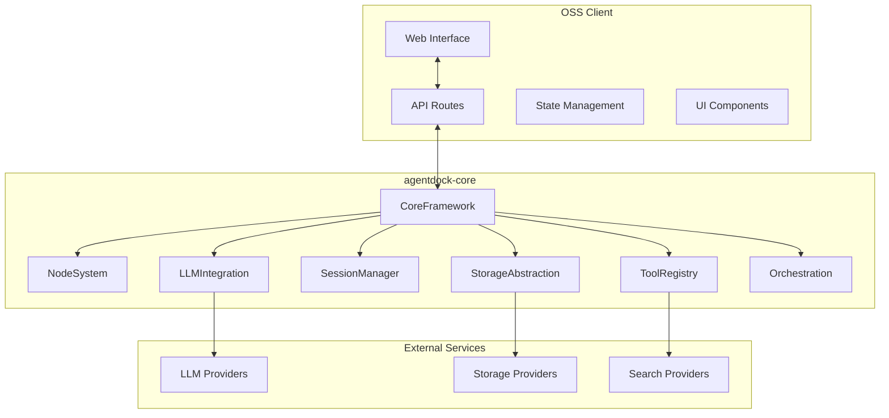

Sources: [agentdock-core/package.json:17-28](), [docs/i18n/chinese/README.md:118-126]()

## Core Framework Components

The AgentDock Core framework is built around a node-based architecture that provides the foundation for all agent functionality. The core components include:

### Node System

The Node System is the fundamental architecture of AgentDock, where all capabilities are implemented as nodes:

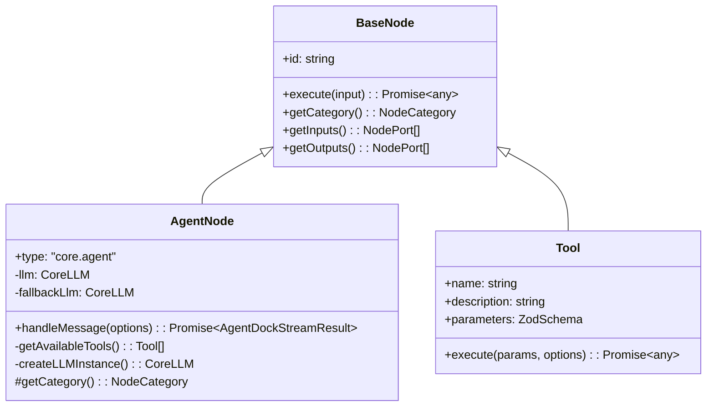

Sources: [agentdock-core/src/nodes/agent-node.ts:6-22](), [agentdock-core/src/nodes/agent-node.ts:96-127]()

### LLM Integration

The LLM Integration system manages interactions with various Large Language Model providers:

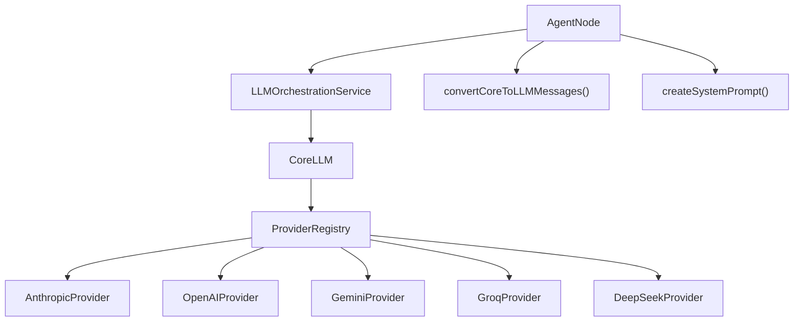

The LLM Integration system supports multiple providers through a unified interface, with automatic fallbacks and configurable settings.

Sources: [agentdock-core/src/nodes/agent-node.ts:148-224](), [agentdock-core/package.json:17-28]()

### Orchestration System

The Orchestration System controls agent behavior and tool availability based on conversation context:

```mermaid
flowchart LR
    AgentNode["AgentNode"] --> OrchestrationManager["OrchestrationManager"]
    OrchestrationManager --> ToolRegistry["ToolRegistry"]
    
    subgraph "Orchestration Flow"
        OrchestrationManager --> GetState["getState()"]
        OrchestrationManager --> GetAllowedTools["getAllowedTools()"]
        GetAllowedTools --> OrchestrateTools["Orchestrate Tools Based on Context"]
    end
    
    ToolRegistry --> GetToolsForAgent["getToolsForAgent()"]
    GetToolsForAgent --> FilterTools["Filter Tools by Orchestration"]
    FilterTools --> AvailableTools["Available Tools for Turn"]
```

The Orchestration System ensures that agents have access to the right tools at the right time based on the conversation context and orchestration configuration.

Sources: [agentdock-core/src/nodes/agent-node.ts:230-258](), [docs/i18n/chinese/README.md:194-195]()

### Session Management

The Session Management system maintains isolated state for concurrent conversations:

```mermaid
flowchart TD
    APIRoute["api/chat/[agentId]"] --> AgentAdapter["AgentAdapter"]
    AgentAdapter --> ProcessAgentMessage["processAgentMessage()"]
    ProcessAgentMessage --> OrchestrationManager["OrchestrationManager"]
    
    subgraph "Session Management"
        OrchestrationManager --> GetState["getState(sessionId)"]
        GetState --> AIOrchestrationState["AIOrchestrationState"]
        OrchestrationManager --> UpdateState["updateState(sessionId, state)"]
    end
    
    AgentNode["AgentNode"] --> OrchestrationManager
```

The Session Management system allows multiple concurrent conversations to maintain their own isolated state, ensuring that interactions don't interfere with each other.

Sources: [agentdock-core/src/nodes/agent-node.ts:272-326](), [docs/i18n/chinese/README.md:194-195]()

### Tool Registry

The Tool Registry manages the registration and discovery of tools for agents:

```mermaid
classDiagram
    class ToolRegistry {
        +registerTool(name, tool): void
        +getToolsForAgent(nodeNames): Tool[]
        +getTools(): Record<string, Tool>
    }
    
    class Tool {
        +name: string
        +description: string
        +parameters: ZodSchema
        +execute(params, options): Promise~any~
    }
    
    ToolRegistry --> Tool : manages
```

The Tool Registry is responsible for registering tools, making them available to agents, and managing tool lifecycles.

Sources: [agentdock-core/src/nodes/agent-node.ts:7-8](), [agentdock-core/src/nodes/agent-node.ts:230-258]()

### Storage Abstraction

The Storage Abstraction layer provides a unified interface for different storage providers:

```mermaid
flowchart TD
    StorageAbstraction["StorageAbstraction"] --> StorageProvider["StorageProvider Interface"]
    
    StorageProvider --> MemoryStorage["MemoryStorage"]
    StorageProvider --> RedisStorage["RedisStorage (Upstash)"]
    StorageProvider --> VercelKVStorage["VercelKVStorage"]
    
    subgraph "Storage Types"
        KeyValueStorage["KeyValueStorage"]
        SecureStorage["SecureStorage"]
        VectorStorage["VectorStorage (Planned)"]
    end
    
    StorageAbstraction --> KeyValueStorage
    StorageAbstraction --> SecureStorage
    StorageAbstraction --> VectorStorage
```

The Storage Abstraction layer supports different storage providers for various storage needs, making it easy to switch between providers without changing application code.

Sources: [agentdock-core/package.json:17-28](), [docs/i18n/chinese/README.md:196-197]()

## OSS Client Architecture

The OSS Client is a Next.js application that provides a reference implementation of a client for the AgentDock Core framework:

```mermaid
flowchart TD
    subgraph "Client Pages"
        HomePage["HomePage"]
        ChatPage["ChatPage"]
        AgentsPage["AgentsPage"]
        SettingsPage["SettingsPage"]
    end
    
    subgraph "API Routes"
        ChatAPI["api/chat/[agentId]"]
        SettingsAPI["api/settings/*"]
        AgentsAPI["api/agents/*"]
    end
    
    subgraph "Core Components"
        ChatContainer["ChatContainer"]
        ChatMessages["ChatMessages"]
        MessageInput["MessageInput"]
        AgentAdapter["AgentAdapter"]
    end
    
    ChatPage --> ChatContainer
    ChatContainer --> ChatMessages
    ChatContainer --> MessageInput
    
    ChatContainer --> useChat["useChat Hook"]
    useChat --> ChatAPI
    ChatAPI --> AgentAdapter
    AgentAdapter --> AgentNode["AgentNode (Core)"]
```

The OSS Client demonstrates how to integrate with the AgentDock Core framework, providing a complete user interface for interacting with AI agents.

Sources: [docs/i18n/chinese/README.md:212-216]()

## Message Processing Flow

The following diagram illustrates how a user message flows through the system:

```mermaid
sequenceDiagram
    participant User
    participant ChatContainer
    participant APIRoute as api/chat/[agentId]
    participant AgentAdapter
    participant AgentNode
    participant LLMOrchestration
    participant ToolRegistry
    participant LLMProvider
    
    User->>ChatContainer: Send Message
    ChatContainer->>APIRoute: POST /api/chat/[agentId]
    APIRoute->>AgentAdapter: Process Message
    AgentAdapter->>AgentNode: handleMessage(options)
    
    AgentNode->>ToolRegistry: getToolsForAgent(nodeIds)
    ToolRegistry-->>AgentNode: Available Tools
    
    AgentNode->>LLMOrchestration: streamWithOrchestration()
    LLMOrchestration->>LLMProvider: streamText()
    
    loop For each response chunk
        LLMProvider-->>LLMOrchestration: Text/Tool Call Chunk
        
        alt Is Tool Call
            LLMOrchestration->>ToolRegistry: Execute Tool
            ToolRegistry-->>LLMOrchestration: Tool Result
            LLMOrchestration->>LLMProvider: Continue with Tool Result
        else Is Text
            LLMOrchestration-->>AgentNode: Text Chunk
            AgentNode-->>AgentAdapter: Stream Chunk
            AgentAdapter-->>APIRoute: Stream Response
            APIRoute-->>ChatContainer: Stream Response
            ChatContainer-->>User: Display Response
        end
    end
```

This diagram shows the complete flow of a user message through the system, from the user interface to the LLM provider and back, including tool execution.

Sources: [agentdock-core/src/nodes/agent-node.ts:272-403]()

## Agent Configuration and Execution Flow

AgentDock uses template-based configuration for agents, with the following execution flow:

```mermaid
flowchart LR
    UserQuery["User Query"] --> ApiRoute["api/chat/[agentId]"]
    ApiRoute --> ProcessAgentMessage["processAgentMessage()"]
    ProcessAgentMessage --> GetTemplate["Get Agent Template"]
    GetTemplate --> CreateAgent["Create AgentNode"]
    
    CreateAgent --> ResolveApiKey["Resolve API Key"]
    ResolveApiKey --> ApiKeys{"API Key Sources"}
    ApiKeys -->|"1st"| AgentSpecific["Agent-specific Key"]
    ApiKeys -->|"2nd"| GlobalSettings["Global Settings Key"]
    ApiKeys -->|"3rd"| EnvVars["Environment Variables"]
    
    CreateAgent --> HandleMessage["AgentNode.handleMessage()"]
    HandleMessage --> GetTools["Get Available Tools"]
    HandleMessage --> CreatePrompt["Create System Prompt"]
    HandleMessage --> LLMStream["Stream from LLM"]
    
    LLMStream --> ToolCalls{"Tool Calls?"}
    ToolCalls -->|"Yes"| ExecuteTool["Execute Tool"]
    ToolCalls -->|"No"| GenerateResponse["Generate Response"]
    ExecuteTool --> LLMStream
```

This diagram illustrates how an agent is configured and executed, from the initial user query to the final response, including API key resolution and tool execution.

Sources: [agentdock-core/src/nodes/agent-node.ts:272-403](), [docs/i18n/chinese/README.md:234-279]()

## Integration with External Services

AgentDock integrates with several external services:

| Service Type | Providers | Integration Point |
|--------------|-----------|-------------------|
| LLM Providers | Anthropic, OpenAI, Google Gemini, Groq, DeepSeek | LLM Integration System |
| Storage Providers | Upstash Redis, Vercel KV, Memory (in-process) | Storage Abstraction Layer |
| Search Providers | Serper, FireCrawl | Tool Registry (Search Tools) |
| Analytics | PostHog | OSS Client |

These integrations are managed through provider-specific adapters, allowing for easy switching between providers without changing application code.

Sources: [agentdock-core/package.json:17-28](), [docs/i18n/chinese/README.md:234-279]()

## Development Workflow

The development workflow for AgentDock uses pnpm as the package manager and follows a monorepo structure:

```mermaid
flowchart TD
    CloneRepo["Clone Repository"] --> InstallDeps["Install Dependencies (pnpm install)"]
    InstallDeps --> ConfigEnv["Configure Environment (.env)"]
    ConfigEnv --> StartDev["Start Development Server (pnpm dev)"]
    
    subgraph "Development Tasks"
        BuildCore["Build Core (pnpm build in agentdock-core)"]
        TestCore["Test Core (pnpm test in agentdock-core)"]
        TypeCheck["Type Check (pnpm typecheck)"]
    end
    
    StartDev --> BuildCore
    StartDev --> TestCore
    StartDev --> TypeCheck
```

This diagram illustrates the development workflow for AgentDock, from cloning the repository to running development tasks.

Sources: [agentdock-core/package.json:12-15](), [scripts/clean-install.sh:1-14](), [agentdock-core/tsconfig.json:1-21]()

## Conclusion

The AgentDock architecture combines a powerful, node-based core framework with a flexible client implementation, allowing developers to build sophisticated AI agents with configurable determinism. The modular design, with clear separation of concerns between components, makes it easy to extend and customize the system for different use cases.

For more detailed information on specific components, refer to their dedicated wiki pages:
- [Node System](#2.1)
- [LLM Integration](#2.2)
- [Orchestration System](#2.3)
- [Session Management](#2.4)
- [Storage Abstraction](#2.5)

---

# Page: Node System

# Node System

<details>
<summary>Relevant source files</summary>

The following files were used as context for generating this wiki page:

- [agentdock-core/package.json](agentdock-core/package.json)
- [agentdock-core/pnpm-lock.yaml](agentdock-core/pnpm-lock.yaml)
- [agentdock-core/src/nodes/agent-node.ts](agentdock-core/src/nodes/agent-node.ts)
- [agentdock-core/src/nodes/tool-registry.ts](agentdock-core/src/nodes/tool-registry.ts)
- [agentdock-core/tsconfig.json](agentdock-core/tsconfig.json)
- [docs/analytics.md](docs/analytics.md)
- [scripts/clean-install.sh](scripts/clean-install.sh)
- [src/app/agents/all/page.tsx](src/app/agents/all/page.tsx)
- [src/app/agents/page.tsx](src/app/agents/page.tsx)
- [src/app/api/chat/[agentId]/__tests__/streaming.test.ts](src/app/api/chat/[agentId]/__tests__/streaming.test.ts)

</details>


This document explains the node-based architecture that forms the foundation of AgentDock. The Node System provides a unified abstraction for all components that can process data and perform actions within the framework, including agents and tools. For more specific information about individual agents, see [AgentNode](#3.1), and for details about the tool registry and implementation, see [Tool Registry](#3.2).

## Core Concepts

The Node System is built around a simple but powerful concept: every functional component in AgentDock is represented as a "node" with standard interfaces for configuration, execution, and metadata. This unified approach enables seamless composition of functionality and consistent patterns for extending the system.

```mermaid
classDiagram
    class BaseNode {
        +id: string
        +config: any
        +execute(input: any): Promise~any~
        +getMetadata(): NodeMetadata
        #getCategory(): NodeCategory
        #getLabel(): string
        #getDescription(): string
        #getVersion(): string
        #getCompatibility(): object
        #getInputs(): NodePort[]
        #getOutputs(): NodePort[]
    }
    
    class AgentNode {
        +type: string = "core.agent"
        -llm: CoreLLM
        -fallbackLlm: CoreLLM
        +handleMessage(options): Promise~StreamResult~
        -getAvailableTools(): Promise~Tool[]~
        -createLLMInstance(): CoreLLM
    }
    
    class Tool {
        +name: string
        +description: string
        +parameters: ZodSchema
        +execute(params, options): Promise~any~
    }
    
    class ToolRegistry {
        +registerTool(name, tool): void
        +getToolsForAgent(nodeNames): Record~string, Tool~
        -tools: Record~string, Tool~
    }
    
    BaseNode <|-- AgentNode
    BaseNode <|-- Tool
    ToolRegistry --> Tool: manages
    AgentNode --> ToolRegistry: uses
```

Sources: [agentdock-core/src/nodes/agent-node.ts:96-455](), [agentdock-core/src/nodes/tool-registry.ts:11-116]()

### Node Types

Nodes in AgentDock are classified into different categories based on their functionality:

1. **Core Nodes** - Fundamental components of the system like `AgentNode`
2. **Tool Nodes** - Specialized components that provide external functionality (search, research, weather, etc.)
3. **LLM Provider Nodes** - Components that interface with language model providers (Anthropic, OpenAI, etc.)

Each node type adheres to the same base interface while providing specialized functionality for its domain.

## BaseNode Interface

All nodes in the system extend the `BaseNode` abstract class, which defines the standard interface that all nodes must implement. This ensures consistency and interoperability between different node types.

```mermaid
flowchart TD
    subgraph "BaseNode Interface"
        A["BaseNode"] --> B["execute(input: any)"]
        A --> C["getMetadata()"]
        C --> C1["getCategory()"]
        C --> C2["getLabel()"]
        C --> C3["getDescription()"]
        C --> C4["getVersion()"]
        C --> C5["getCompatibility()"]
        C --> C6["getInputs()"]
        C --> C7["getOutputs()"]
    end
    
    subgraph "Node Categories"
        D["NodeCategory"]
        D --> D1["CORE"]
        D --> D2["TOOL"]
        D --> D3["LLM_PROVIDER"]
        D --> D4["UTILITY"]
    end
    
    subgraph "Types"
        E["NodePort"] --> E1["id: string"]
        E --> E2["type: string"]
        E --> E3["label: string"]
        E --> E4["required: boolean"]
        
        F["NodeMetadata"] --> F1["category: NodeCategory"]
        F --> F2["label: string"]
        F --> F3["description: string"]
        F --> F4["version: string"]
        F --> F5["compatibility: object"]
        F --> F6["inputs: NodePort[]"]
        F --> F7["outputs: NodePort[]"]
    end
    
    A --- D
    C --- F
```

Sources: [agentdock-core/src/nodes/agent-node.ts:6-23](), [agentdock-core/src/nodes/agent-node.ts:406-454]()

The key components of the BaseNode interface include:

1. **Node Identity**:
   - `id`: A unique identifier for the node instance
   - `config`: Configuration specific to the node type

2. **Execution**:
   - `execute(input: any)`: The primary method for executing node functionality

3. **Metadata**:
   - `getMetadata()`: Returns comprehensive metadata about the node
   - Protected methods for specific metadata aspects:
     - `getCategory()`: The node's functional category
     - `getLabel()`: Display name
     - `getDescription()`: Detailed description
     - `getVersion()`: Version identifier
     - `getCompatibility()`: Environment compatibility info
     - `getInputs()`: Input port definitions
     - `getOutputs()`: Output port definitions

## AgentNode Implementation

`AgentNode` is a core implementation of the BaseNode interface that provides the main agent functionality within AgentDock. It handles message processing, tool selection, and LLM interaction.

```mermaid
flowchart TB
    subgraph "AgentNode Components"
        A["AgentNode"] --> B["Constructor"]
        A --> C["handleMessage()"]
        A --> D["getAvailableTools()"]
        A --> E["createLLMInstance()"]
        A --> F["execute() - Not directly used"]
        
        B --> B1["Initialize LLM"]
        B --> B2["Set up fallback LLM if configured"]
        
        C --> C1["Prepare system prompt"]
        C --> C2["Get available tools"]
        C --> C3["Initialize LLMOrchestrationService"]
        C --> C4["Stream with orchestration"]
        
        D --> D1["Get tool nodes from config"]
        D --> D2["Get tools from registry"]
        D --> D3["Apply orchestration filters"]
        
        E --> E1["Determine provider"]
        E --> E2["Determine model"]
        E --> E3["Create CoreLLM instance"]
    end
```

Sources: [agentdock-core/src/nodes/agent-node.ts:96-103](), [agentdock-core/src/nodes/agent-node.ts:272-403](), [agentdock-core/src/nodes/agent-node.ts:154-224](), [agentdock-core/src/nodes/agent-node.ts:230-258]()

### AgentNode Configuration

The `AgentNode` requires specific configuration to operate properly:

```mermaid
classDiagram
    class AgentNodeConfig {
        +provider?: string
        +apiKey: string
        +fallbackApiKey?: string
        +fallbackProvider?: string
        +fallbackModel?: string
        +options?: Partial~LLMConfig~
        +agentConfig?: AgentConfig
    }
    
    class AgentConfig {
        +version: string
        +agentId: string
        +name: string
        +description: string
        +personality: string | string[]
        +nodes: string[]
        +nodeConfigurations: Record~string, any~
        +chatSettings: Record~string, any~
        +orchestration?: OrchestrationConfig
    }
    
    class AgentNodeHandleMessageOptions {
        +messages: Message[]
        +orchestrationManager: OrchestrationManager
        +sessionId: string
        +systemOverride?: string | string[]
        +useFallback?: boolean
        +config?: Partial~LLMConfig~
        +orchestrationState?: AIOrchestrationState
    }
    
    AgentNodeConfig --> AgentConfig: contains
```

Sources: [agentdock-core/src/nodes/agent-node.ts:32-50](), [agentdock-core/src/nodes/agent-node.ts:56-75]()

The configuration consists of:

1. **LLM Provider Settings**:
   - Primary and fallback provider configuration
   - API keys and model settings

2. **Agent-specific Configuration**:
   - Agent identity (ID, name, description)
   - Personality definition
   - Node references (tools, LLM providers)
   - Node-specific configurations
   - Orchestration settings

### Message Handling Flow

The primary function of `AgentNode` is to process messages and generate responses:

```mermaid
sequenceDiagram
    participant Adapter as "API Adapter"
    participant Agent as "AgentNode"
    participant Tools as "ToolRegistry"
    participant Orchestration as "OrchestrationManager"
    participant LLM as "LLMOrchestrationService"
    participant Provider as "CoreLLM"
    
    Adapter->>Agent: handleMessage(options)
    Agent->>Agent: Select active LLM
    Agent->>LLM: Create LLMOrchestrationService
    Agent->>Tools: getAvailableTools()
    Tools-->>Agent: Available tools list
    Agent->>Orchestration: Get state/allowed tools
    Orchestration-->>Agent: Current orchestration state
    Agent->>Agent: Create system prompt
    Agent->>Agent: Inject current date/time
    Agent->>LLM: streamWithOrchestration()
    LLM->>Provider: Stream text with tools
    
    loop For each tool call
        Provider-->>LLM: Tool call request
        LLM->>Tools: Execute tool
        Tools-->>LLM: Tool result
        LLM->>Provider: Continue with tool result
    end
    
    Provider-->>LLM: Generated text
    LLM-->>Agent: StreamResult
    Agent-->>Adapter: Return StreamResult
```

Sources: [agentdock-core/src/nodes/agent-node.ts:272-403]()

The flow involves:

1. **Initialization**:
   - Determining the active LLM (primary or fallback)
   - Creating an orchestration service

2. **Tool Preparation**:
   - Fetching available tools based on agent configuration
   - Filtering tools based on orchestration rules

3. **Prompt Creation**:
   - Building the system prompt from agent personality
   - Injecting dynamic state and current date/time information

4. **LLM Interaction**:
   - Streaming text from the LLM with tool calling capabilities
   - Handling tool execution and continuing the conversation

5. **Result Processing**:
   - Returning the stream result for the adapter to consume

## Tool Registry

The Tool Registry is a core component of the Node System that manages the registration and discovery of tools available to agents.

```mermaid
flowchart TD
    subgraph "Tool Registry System"
        A["getToolRegistry()"] --> B["DefaultToolRegistry"]
        C["setToolRegistry()"] --> B
        
        B --> D["registerTool()"]
        B --> E["getToolsForAgent()"]
        
        F["Global Registry Instance"] <--> B
        
        D --> G["tools: Record~string, Tool~"]
        E --> G
    end
    
    subgraph "External Systems"
        H["AgentNode"] --> A
        I["Tool Implementations"] --> D
    end
```

Sources: [agentdock-core/src/nodes/tool-registry.ts:11-116]()

### Key Features

1. **Singleton Pattern**:
   - Implemented as a global singleton accessible via `getToolRegistry()`
   - Can be customized via `setToolRegistry()`

2. **Registration Interface**:
   - `registerTool(name, tool)`: Registers a tool with a unique name
   - Each tool follows the BaseNode interface pattern

3. **Tool Discovery**:
   - `getToolsForAgent(nodeNames)`: Retrieves tools based on node names in agent configuration
   - Returns a filtered map of tools available to a specific agent

### Tool Registry Implementation

The DefaultToolRegistry implements the ToolRegistry interface:

```typescript
// Default implementation of tool registry
export class DefaultToolRegistry implements ToolRegistry {
  private tools: Record<string, any> = {};
  
  // Register a tool
  registerTool(name: string, tool: any): void {
    this.tools[name] = tool;
  }
  
  // Get tools for a specific agent based on node names
  getToolsForAgent(nodeNames: string[]): Record<string, any> {
    const result: Record<string, any> = {};
    nodeNames.forEach(name => {
      if (this.tools[name]) {
        // Make a copy of the tool and ensure its name matches its registry key
        const tool = { ...this.tools[name] };
        if (!tool.name || tool.name !== name) {
          tool.name = name;
        }
        result[name] = tool;
      }
    });
    return result;
  }
}
```

Sources: [agentdock-core/src/nodes/tool-registry.ts:26-83]()

## Node System Integration

The Node System is central to AgentDock's architecture, interconnecting with various other systems:

```mermaid
flowchart TD
    subgraph "Node System"
        A["BaseNode"] --> A1["AgentNode"]
        A --> A2["ToolNodes"]
        A --> A3["ProviderNodes"]
    end
    
    subgraph "LLM Integration"
        B["CoreLLM"] --> B1["ProviderRegistry"]
        B --> B2["LLMOrchestrationService"]
    end
    
    subgraph "Orchestration"
        C["OrchestrationManager"] --> C1["AIOrchestrationState"]
        C --> C2["OrchestrationConfig"]
    end
    
    subgraph "Session Management"
        D["SessionManager"] --> D1["SessionState"]
    end
    
    subgraph "External Integration"
        E["API Routes"] --> E1["/api/chat/[agentId]"]
        F["LLM Providers"] --> F1["Anthropic"]
        F --> F2["OpenAI"]
        F --> F3["Google"]
    end
    
    A1 <--> B2: "Uses for streaming"
    A1 <--> C: "Queries for state"
    A2 <--> A1: "Used by"
    E1 --> A1: "Creates/calls"
    B2 --> B: "Uses provider"
    B --> F: "Connects to"
    A1 --> D: "Uses session data"
```

Sources: [agentdock-core/src/nodes/agent-node.ts:8-23](), [agentdock-core/src/nodes/agent-node.ts:272-403]()

### Node System in the Request Flow

When a request comes in through the API, the Node System works as follows:

1. **API Route** (`/api/chat/[agentId]`):
   - Receives user message
   - Looks up agent template
   - Creates AgentNode instance

2. **AgentNode**:
   - Configures LLM based on agent settings
   - Gets available tools from ToolRegistry
   - Handles the message via LLMOrchestrationService

3. **Tool Execution**:
   - When LLM requests a tool, the corresponding Tool node executes
   - Tool results are returned to the LLM for further processing

4. **Response Generation**:
   - Final response is streamed back to the client
   - Token usage and other metrics are captured

## Node Relationships

The Node System establishes relationships between different components:

```mermaid
erDiagram
    AgentNode ||--o{ ToolNode : "uses"
    AgentNode ||--|| LLMProviderNode : "uses"
    AgentNode }|--|| AgentTemplate : "configured by"
    ToolRegistry ||--o{ ToolNode : "contains"
    LLMOrchestrationService ||--|| AgentNode : "serves"
    LLMOrchestrationService ||--o{ ToolNode : "executes"
    OrchestrationManager ||--|| AgentNode : "controls"
    OrchestrationManager ||--o{ ToolNode : "filters"
    
    AgentNode {
        string id
        string type
        CoreLLM llm
        AgentNodeConfig config
    }
    
    ToolNode {
        string name
        string description
        ZodSchema parameters
        function execute
    }
    
    AgentTemplate {
        string agentId
        string name
        string description
        array personality
        array nodes
        object nodeConfigurations
    }
    
    ToolRegistry {
        function registerTool
        function getToolsForAgent
    }
```

Sources: [agentdock-core/src/nodes/agent-node.ts:96-455](), [agentdock-core/src/nodes/tool-registry.ts:11-116]()

## Node Configuration

Nodes in AgentDock are configured through a combination of:

1. **Default Configuration** - Base settings provided by the node implementation
2. **Agent Template Configuration** - Settings from agent templates
3. **Runtime Configuration** - Overrides provided at execution time

This layered approach allows for flexibility while maintaining consistent behavior.

### Example Agent Template Configuration

```json
{
  "version": "1.0",
  "agentId": "example-agent",
  "name": "Example Agent",
  "description": "An example agent demonstrating node configuration",
  "personality": "I am a helpful assistant.",
  "nodes": ["llm.anthropic", "tools.search", "tools.weather"],
  "nodeConfigurations": {
    "llm.anthropic": {
      "model": "claude-3-opus-20240229",
      "temperature": 0.7,
      "maxTokens": 4096
    },
    "tools.search": {
      "provider": "serper",
      "maxResults": 5
    }
  },
  "chatSettings": {
    "historyLength": 20
  }
}
```

Sources: [src/app/api/chat/[agentId]/__tests__/streaming.test.ts:8-24]()

## Summary

The Node System provides a unified foundation for AgentDock's functionality:

1. **Abstraction** - Common interfaces for diverse components
2. **Extensibility** - Standard patterns for adding new capabilities
3. **Composition** - Ability to combine nodes into complex workflows
4. **Integration** - Seamless connection with other core systems

By implementing all functionality as nodes with standard interfaces, AgentDock achieves a flexible, maintainable, and extensible architecture that can adapt to various use cases and evolve over time.

---

# Page: LLM Integration

# LLM Integration

<details>
<summary>Relevant source files</summary>

The following files were used as context for generating this wiki page:

- [.env.example](.env.example)
- [agentdock-core/package.json](agentdock-core/package.json)
- [agentdock-core/pnpm-lock.yaml](agentdock-core/pnpm-lock.yaml)
- [agentdock-core/src/llm/index.ts](agentdock-core/src/llm/index.ts)
- [agentdock-core/src/llm/llm-orchestration-service.ts](agentdock-core/src/llm/llm-orchestration-service.ts)
- [agentdock-core/src/llm/types.ts](agentdock-core/src/llm/types.ts)
- [agentdock-core/src/nodes/agent-node.ts](agentdock-core/src/nodes/agent-node.ts)
- [agentdock-core/src/types/index.ts](agentdock-core/src/types/index.ts)
- [agentdock-core/src/utils/message-utils.ts](agentdock-core/src/utils/message-utils.ts)
- [agentdock-core/tsconfig.json](agentdock-core/tsconfig.json)
- [scripts/clean-install.sh](scripts/clean-install.sh)

</details>


## Purpose and Scope

The LLM Integration module provides a unified interface for AgentDock to interact with various Large Language Model providers. It abstracts provider-specific implementations, handles API key management, streamlines message processing, and provides robust streaming response handling with tool calling capabilities.

This module is a core component that bridges agents with different LLM services including OpenAI, Anthropic Claude, Google Gemini, DeepSeek, and Groq. For information about how LLMs integrate with the overall orchestration system, see [Orchestration System](#2.3).

## Provider Architecture

The LLM integration in AgentDock follows a layered architecture pattern that abstracts provider-specific implementations behind a unified interface.

```mermaid
graph TD
    AgentNode --> LLMOrchestrationService
    LLMOrchestrationService --> CoreLLM
    CoreLLM --> ProviderClients
    ProviderClients --> ExternalAPIs
    
    subgraph "Provider Implementations"
        ProviderClients["Provider Clients"]
        ProviderClients --> AnthropicClient["Anthropic Client"]
        ProviderClients --> OpenAIClient["OpenAI Client"]
        ProviderClients --> GeminiClient["Google Client"]
        ProviderClients --> DeepSeekClient["DeepSeek Client"] 
        ProviderClients --> GroqClient["Groq Client"]
    end
    
    subgraph "External APIs"
        ExternalAPIs["LLM APIs"]
        AnthropicClient --> Claude["Claude API"]
        OpenAIClient --> GPT["GPT API"] 
        GeminiClient --> Gemini["Gemini API"]
        DeepSeekClient --> DeepSeek["DeepSeek API"]
        GroqClient --> Groq["Groq API"]
    end
```

Sources: [agentdock-core/package.json:18-28](), [agentdock-core/src/llm/types.ts:18-19]()

## Core Components

### CoreLLM

The `CoreLLM` class provides the central abstraction that unifies interfaces to different LLM providers:

```mermaid
classDiagram
    class CoreLLM {
        +getProvider(): string
        +getModelId(): string 
        +streamText(options): Promise~StreamResult~
    }
    
    CoreLLM <|-- AnthropicModel
    CoreLLM <|-- OpenAIModel
    CoreLLM <|-- GeminiModel
    CoreLLM <|-- DeepSeekModel
    CoreLLM <|-- GroqModel
```

Sources: [agentdock-core/src/llm/index.ts:42-48]()

### LLMOrchestrationService

The `LLMOrchestrationService` manages interactions between AgentNode and the underlying LLM providers:

```mermaid
classDiagram
    class LLMOrchestrationService {
        -llm: CoreLLM
        -orchestrationManager: OrchestrationManager
        -sessionId: SessionId
        +streamWithOrchestration(options): Promise~AgentDockStreamResult~
        -updateTokenUsage(usage): void
        -performTokenUsageUpdate(usage): Promise~void~
    }
    
    LLMOrchestrationService --> CoreLLM: uses
    LLMOrchestrationService --> OrchestrationManager: uses
```

Key responsibilities of the `LLMOrchestrationService`:

1. **Streaming with orchestration**: Enhances CoreLLM streaming with tool tracking and token usage monitoring
2. **Tool context injection**: Provides LLM context to tools during execution
3. **Token usage tracking**: Updates session state with token consumption statistics
4. **Background tasks**: Uses Vercel's waitUntil when available for non-blocking operations

Sources: [agentdock-core/src/llm/llm-orchestration-service.ts:122-356]()

## Message Processing Flow

```mermaid
sequenceDiagram
    participant AN as AgentNode
    participant LOS as LLMOrchestrationService
    participant CLLM as CoreLLM
    participant PC as ProviderClient
    participant API as "LLM API"
    
    AN->>LOS: streamWithOrchestration(messages, tools)
    LOS->>CLLM: streamText(messages, tools)
    CLLM->>PC: generateStream(formattedMessages)
    PC->>API: API Request
    API-->>PC: Stream Response
    
    loop For each chunk
        PC-->>CLLM: Process chunk
        CLLM-->>LOS: onStepFinish/toolCalls
        
        alt Has Tool Calls
            LOS->>LOS: Track tools
            LOS->>CLLM: Execute tool & continue
        end
        
        LOS-->>AN: Stream result part
    end
    
    API-->>PC: Stream complete
    PC-->>CLLM: onFinish
    CLLM-->>LOS: onFinish(usage)
    LOS->>LOS: updateTokenUsage
```

Sources: [agentdock-core/src/llm/llm-orchestration-service.ts:137-303](), [agentdock-core/src/nodes/agent-node.ts:272-397]()

## Provider Support

AgentDock supports multiple LLM providers through typed configurations:

```mermaid
graph TD
    LLMConfig["LLMConfig Interface"] --> CommonProps["Common properties:
    - provider: LLMProvider
    - apiKey: string
    - model: string
    - temperature?: number
    - maxTokens?: number"]
    
    LLMConfig --> AnthropicConfig["AnthropicConfig"]
    LLMConfig --> OpenAIConfig["OpenAIConfig"]
    LLMConfig --> GeminiConfig["GeminiConfig"]
    LLMConfig --> DeepSeekConfig["DeepSeekConfig"]
    LLMConfig --> GroqConfig["GroqConfig"]
    
    GeminiConfig --> GeminiProps["Gemini-specific:
    - useSearchGrounding?: boolean
    - dynamicRetrievalConfig?: object"]
    
    DeepSeekConfig --> DeepSeekProps["DeepSeek-specific:
    - extractReasoning?: boolean"]
    
    GroqConfig --> GroqProps["Groq-specific:
    - extractReasoning?: boolean"]
```

Sources: [agentdock-core/src/llm/types.ts:18-127]()

The LLM provider types are defined in `agentdock-core/src/llm/types.ts`:

```typescript
export type LLMProvider = 'anthropic' | 'openai' | 'gemini' | 'deepseek' | 'groq';
```

Each provider implementation handles:
- API authentication
- Request formatting
- Response parsing
- Error handling

Sources: [agentdock-core/src/llm/types.ts:18]()

## Message Utilities

The message utilities handle conversational context and formatting:

```mermaid
graph TD
    subgraph "Message Utilities"
        ConvertMessages["convertCoreToLLMMessages()"]
        ApplyHistory["applyHistoryPolicy()"]
    end
    
    RawMessages["Agent Messages"] --> ConvertMessages
    ConvertMessages --> FormattedMessages["LLM-Compatible Messages"]
    
    FormattedMessages --> ApplyHistory
    HistorySettings["History Settings:
    - policy: none|lastN|all
    - length: number
    - preserveSystemMessages: boolean"] --> ApplyHistory
    ApplyHistory --> TrimmedMessages["Controlled Context Window"]
```

The `applyHistoryPolicy` function manages conversation context by implementing three policies:
- `none`: Only system messages are retained
- `all`: All messages are retained
- `lastN`: System messages plus the last N user-assistant exchanges are retained

Sources: [agentdock-core/src/utils/message-utils.ts:26-158]()

## API Key Management

API keys are resolved in a prioritized order defined in the environment configuration:

```mermaid
graph TD
    APIKeyRequest["API Key Needed"] --> CheckAgentSpecific["Check Agent-specific key"]
    CheckAgentSpecific --> HasAgentKey{"Has agent key?"}
    HasAgentKey -->|"Yes"| UseAgentKey["Use agent-specific key"]
    HasAgentKey -->|"No"| CheckGlobalSettings["Check global settings key"]
    
    CheckGlobalSettings --> HasGlobalKey{"Has global key?"}
    HasGlobalKey -->|"Yes"| UseGlobalKey["Use global settings key"]
    HasGlobalKey -->|"No"| CheckEnvVars["Check environment variables"]
    
    CheckEnvVars --> HasEnvKey{"Has env key?"}
    HasEnvKey -->|"Yes"| UseEnvKey["Use environment variable key"]
    HasEnvKey -->|"No"| NoKeyError["Throw no API key error"]
```

Sources: [.env.example:50-57](), [agentdock-core/src/nodes/agent-node.ts:96-146]()

The environment variables for API keys are defined in `.env.example`:

```
# LLM PROVIDER API KEYS
# These will be used as fallbacks if no custom key is set in settings
# Used in priority order: 1) Agent-specific custom key, 2) Global settings key, 3) Environment variable

ANTHROPIC_API_KEY=              # Anthropic API key (starts with sk-ant-)
OPENAI_API_KEY=                 # OpenAI API key (starts with sk-)
GEMINI_API_KEY=                 # Google Gemini API key
DEEPSEEK_API_KEY=               # DeepSeek API key
GROQ_API_KEY=                   # Groq API key
```

Sources: [.env.example:48-57]()

## Token Usage Tracking

Token usage is tracked through the LLMOrchestrationService:

```mermaid
sequenceDiagram
    participant LLM as CoreLLM
    participant Service as LLMOrchestrationService
    participant Manager as OrchestrationManager
    participant State as Session State
    
    LLM->>Service: onFinish(event with usage)
    Service->>Service: updateTokenUsage(usage)
    Service->>Service: runBackgroundTask(updatePromise)
    
    Service->>Manager: getState(sessionId)
    Manager->>State: fetch state
    State-->>Manager: return current state
    Manager-->>Service: return state
    
    Service->>Service: Calculate new totals
    Service->>Manager: updateState with new token usage
    Manager->>State: update stored state
```

Sources: [agentdock-core/src/llm/llm-orchestration-service.ts:309-355]()

Token usage information is structured as:

```typescript
interface TokenUsage {
  promptTokens: number;
  completionTokens: number;
  totalTokens: number;
  provider?: string;
}
```

Sources: [agentdock-core/src/llm/types.ts:8-13]()

## Integration with AgentNode

The `AgentNode` class integrates with the LLM system through its `handleMessage` method:

```mermaid
graph TD
    AgentNode --> HandleMessage["handleMessage()"]
    HandleMessage --> CreateService["Create LLMOrchestrationService"]
    CreateService --> GetTools["getAvailableTools()"]
    GetTools --> Registry["Tool Registry"]
    HandleMessage --> CreatePrompt["createSystemPrompt()"]
    CreatePrompt --> PersonalityConfig["Agent Personality Config"]
    
    HandleMessage --> CallService["orchestrationService.streamWithOrchestration()"]
    CallService --> ReturnStream["Return stream result"]
```

Sources: [agentdock-core/src/nodes/agent-node.ts:272-397]()

The `handleMessage` method is responsible for:

1. Creating an `LLMOrchestrationService` instance
2. Fetching available tools from the Tool Registry
3. Creating a system prompt with agent personality
4. Injecting current date/time information into the system prompt
5. Calling the orchestration service and returning the stream result

A notable feature is the date/time injection, ensuring agents always have access to the current time:

```typescript
// Inject current date and time information into the system prompt
const now = new Date();
const dateTimeInfo = `
Current date: ${now.toLocaleDateString('en-US', { weekday: 'long', year: 'numeric', month: 'long', day: 'numeric' })}
Current time: ${now.toLocaleTimeString('en-US', { hour: '2-digit', minute: '2-digit', timeZoneName: 'short' })}
Current timezone: ${Intl.DateTimeFormat().resolvedOptions().timeZone}
ISO timestamp: ${now.toISOString()}`;
finalSystemPrompt = `${finalSystemPrompt}\n\n${dateTimeInfo}`;
```

Sources: [agentdock-core/src/nodes/agent-node.ts:354-361]()

## Fallback Mechanism

AgentDock supports LLM fallback mechanisms for increased reliability. When configured, the system can automatically switch to a backup provider or model:

```mermaid
graph TD
    AgentConfig["AgentNodeConfig"] --> PrimaryLLM["Create Primary LLM"]
    PrimaryLLM --> CheckFallback{"Has fallback config?"}
    
    CheckFallback -->|"Yes"| IsSame{"Is same as primary?"}
    IsSame -->|"No"| CreateFallback["Create Fallback LLM"]
    IsSame -->|"Yes"| LogWarning["Log warning, skip fallback"]
    
    CheckFallback -->|"No"| NoFallback["No fallback available"]
    
    HandleMessage["handleMessage()"] --> UseFallback{"useFallback=true?"}
    UseFallback -->|"Yes"| HasFallbackLLM{"fallbackLlm exists?"}
    HasFallbackLLM -->|"Yes"| UseFallbackLLM["Use fallback LLM"]
    HasFallbackLLM -->|"No"| UsePrimaryLLM["Use primary LLM"]
    UseFallback -->|"No"| UsePrimaryLLM
```

Sources: [agentdock-core/src/nodes/agent-node.ts:128-146](), [agentdock-core/src/nodes/agent-node.ts:285-289]()

## Configuration Options

The LLM integration system can be configured through environment variables:

| Variable | Purpose | Description |
|----------|---------|-------------|
| ANTHROPIC_API_KEY | Anthropic Claude API key | Fallback API key for Anthropic models |
| OPENAI_API_KEY | OpenAI API key | Fallback API key for OpenAI models |
| GEMINI_API_KEY | Google Gemini API key | Fallback API key for Google models |
| DEEPSEEK_API_KEY | DeepSeek API key | Fallback API key for DeepSeek models |
| GROQ_API_KEY | Groq API key | Fallback API key for Groq models |
| NEXT_PUBLIC_DEFAULT_HISTORY_POLICY | Message history policy | Controls history retention (none, lastN, all) |
| NEXT_PUBLIC_DEFAULT_HISTORY_LENGTH | History length | Number of user messages to retain |

Sources: [.env.example:53-67]()

## Summary

The LLM Integration module in AgentDock provides a flexible, extensible architecture for interacting with multiple LLM providers. By abstracting provider-specific details and implementing robust fallback mechanisms, it ensures reliable agent operations across different LLM services. The integration handles token tracking, tool execution, and message history management, making it a central component in the AgentDock framework.

Sources: [agentdock-core/src/llm/llm-orchestration-service.ts](), [agentdock-core/src/nodes/agent-node.ts](), [agentdock-core/src/llm/types.ts](), [agentdock-core/src/utils/message-utils.ts]()

---

# Page: Orchestration System

# Orchestration System

<details>
<summary>Relevant source files</summary>

The following files were used as context for generating this wiki page:

- [.env.example](.env.example)
- [agentdock-core/src/llm/llm-orchestration-service.ts](agentdock-core/src/llm/llm-orchestration-service.ts)
- [src/app/api/chat/[agentId]/route.ts](src/app/api/chat/[agentId]/route.ts)
- [src/components/chat/chat-container.tsx](src/components/chat/chat-container.tsx)
- [src/components/chat/chat-status.tsx](src/components/chat/chat-status.tsx)
- [src/hooks/use-session-info.ts](src/hooks/use-session-info.ts)

</details>


The Orchestration System in AgentDock is a core subsystem that manages the workflow of agent interactions, tool execution, token usage tracking, and session state management. It serves as a critical bridge between the Agent Nodes, LLM integrations, and the tools ecosystem, enabling controlled and deterministic agent behavior.

For information about the Node System that forms the foundation of AgentDock's architecture, see [Node System](#2.1). For details on how sessions are managed to maintain state for conversations, see [Session Management](#2.4).

## 1. Orchestration Architecture

The Orchestration System consists of several interrelated components that work together to manage the flow of information and execution within the AgentDock framework.

```mermaid
classDiagram
    class OrchestrationManager {
        +getState(sessionId): Promise~AIOrchestrationState~
        +updateState(sessionId, partialState): Promise~void~
        +trackToolUsage(sessionId, toolName): Promise~void~
    }
    
    class LLMOrchestrationService {
        -llm: CoreLLM
        -orchestrationManager: OrchestrationManager
        -sessionId: SessionId
        +streamWithOrchestration(options): Promise~AgentDockStreamResult~
        -updateTokenUsage(usage): void
        -performTokenUsageUpdate(usage): Promise~void~
    }
    
    class AIOrchestrationState {
        +sessionId: string
        +recentlyUsedTools: string[]
        +activeStep: string
        +cumulativeTokenUsage: TokenUsage
    }
    
    class OrchestrationAdapter {
        +getOrchestrationState(sessionId, config): Promise~OrchestrationState~
        +trackToolUsage(sessionId, toolName, config): Promise~void~
        +addOrchestrationHeaders(response, sessionId): Promise~void~
    }
    
    class AgentNode {
        +handleMessage(options): Promise~StreamResult~
    }
    
    class CoreLLM {
        +getProvider(): string
        +getModelId(): string
        +streamText(options): Promise~StreamResult~
    }
    
    AgentNode --> LLMOrchestrationService: uses
    LLMOrchestrationService --> CoreLLM: wraps
    LLMOrchestrationService --> OrchestrationManager: updates state via
    OrchestrationManager --> AIOrchestrationState: manages
    OrchestrationAdapter --> OrchestrationManager: implements for web client
```

The Orchestration System consists of two main components:

1. **OrchestrationManager**: Core component that maintains and updates the AI orchestration state for each session.
2. **LLMOrchestrationService**: Service that bridges AgentNode and CoreLLM, injecting orchestration logic during LLM streaming.

Sources: [agentdock-core/src/llm/llm-orchestration-service.ts:122-356](), [src/lib/orchestration-adapter.ts]()

## 2. Orchestration State

The orchestration state is a central concept in the system, tracking various aspects of an agent's execution context.

```mermaid
erDiagram
    SESSION ||--|| ORCHESTRATION_STATE : has
    ORCHESTRATION_STATE {
        string sessionId
        string[] recentlyUsedTools
        string activeStep
        int currentStepIndex
        int totalSteps
        object cumulativeTokenUsage
    }
    ORCHESTRATION_STATE ||--o{ TOOL_USAGE : tracks
    TOOL_USAGE {
        string toolName
        timestamp executionTime
    }
    ORCHESTRATION_STATE ||--|| TOKEN_USAGE : includes
    TOKEN_USAGE {
        int promptTokens
        int completionTokens
        int totalTokens
    }
```

The `AIOrchestrationState` interface defines the structure of the orchestration state:

| Property | Type | Description |
|----------|------|-------------|
| sessionId | string | Unique identifier for the conversation session |
| recentlyUsedTools | string[] | Array of tool names that have been used in the session |
| activeStep | string | Current step in a multi-step orchestration workflow |
| currentStepIndex | number | Index of the current step (optional) |
| totalSteps | number | Total number of steps in the orchestration (optional) |
| cumulativeTokenUsage | object | Tracking of token usage throughout the session |

Sources: [src/components/chat/chat-container.tsx:38-45](), [agentdock-core/src/llm/llm-orchestration-service.ts:9]()

## 3. Tool Usage Tracking

One of the primary functions of the Orchestration System is to track tool usage during a conversation session. This information is used to guide agent behavior and provide context for subsequent responses.

```mermaid
sequenceDiagram
    participant User
    participant AgentNode
    participant LLMOrchestrationService
    participant CoreLLM
    participant OrchestrationManager
    participant Storage

    User->>AgentNode: Send message
    AgentNode->>LLMOrchestrationService: streamWithOrchestration()
    LLMOrchestrationService->>CoreLLM: streamText with callbacks
    CoreLLM-->>LLMOrchestrationService: onStepFinish with tool calls
    
    alt Tool execution detected
        LLMOrchestrationService->>OrchestrationManager: getState(sessionId)
        OrchestrationManager->>Storage: Fetch current state
        Storage-->>OrchestrationManager: Return state
        
        Note over LLMOrchestrationService: Update recentlyUsedTools list
        
        LLMOrchestrationService->>OrchestrationManager: updateState with new tools
        OrchestrationManager->>Storage: Store updated state
    end
    
    CoreLLM-->>LLMOrchestrationService: Stream continues
    LLMOrchestrationService-->>AgentNode: Return stream result
    AgentNode-->>User: Send response
```

The tool tracking process occurs in several places:

1. **During LLM Streaming**: When a tool call is detected in the `onStepFinish` callback, the orchestration service updates the `recentlyUsedTools` array in the session state.

2. **During Direct Tool Execution**: API routes track tool usage through the `trackToolUsage` function when tools are directly executed.

Sources: [agentdock-core/src/llm/llm-orchestration-service.ts:176-242](), [src/app/api/chat/[agentId]/route.ts:269-386]()

## 4. Token Usage Tracking

The Orchestration System tracks token usage throughout a conversation to monitor resource consumption and potentially enforce limits.

```mermaid
flowchart TD
    subgraph "Token Usage Tracking Flow"
        onFinish["LLM Stream onFinish\nCallback with token usage"]
        updateTokens["updateTokenUsage()"]
        performUpdate["performTokenUsageUpdate()"]
        getState["Get current state"]
        calculateNew["Calculate new totals"]
        updateState["Update state with new usage"]
        
        onFinish --> updateTokens
        updateTokens --> |"runBackgroundTask()"| performUpdate
        performUpdate --> getState
        getState --> calculateNew
        calculateNew --> updateState
    end
    
    subgraph "Token Usage Structure"
        tokens[("Token Usage")]
        promptTokens["promptTokens: number"]
        completionTokens["completionTokens: number"]
        totalTokens["totalTokens: number"]
        
        tokens --- promptTokens
        tokens --- completionTokens
        tokens --- totalTokens
    end
```

Token usage tracking follows this process:

1. The LLM stream's `onFinish` callback receives token usage information
2. `updateTokenUsage()` is called, which uses `runBackgroundTask()` to ensure updates complete even after streaming ends
3. `performTokenUsageUpdate()` gets the current state, calculates new totals, and updates the state

The token usage is tracked using the following structure:

| Property | Type | Description |
|----------|------|-------------|
| promptTokens | number | Tokens used in the prompt (input) |
| completionTokens | number | Tokens used in the completion (output) |
| totalTokens | number | Total tokens used (prompt + completion) |

Sources: [agentdock-core/src/llm/llm-orchestration-service.ts:147-154](), [agentdock-core/src/llm/llm-orchestration-service.ts:309-354]()

## 5. LLM Orchestration Service

The `LLMOrchestrationService` is the central component that connects the Agent Node with the underlying LLM providers, while injecting orchestration logic.

```mermaid
flowchart TD
    subgraph "LLMOrchestrationService"
        streamWithOrch["streamWithOrchestration(options)"]
        handleFinish["handleFinish(event)"]
        handleStepFinish["handleStepFinish(event)"]
        updateToken["updateTokenUsage(usage)"]
        performToken["performTokenUsageUpdate(usage)"]
    end
    
    subgraph "AgentNode"
        handleMessage["handleMessage(options)"]
    end
    
    subgraph "CoreLLM"
        streamText["streamText(options)"]
    end
    
    subgraph "OrchestrationManager"
        getState["getState(sessionId)"]
        updateState["updateState(sessionId, partialState)"]
    end
    
    handleMessage -->|"calls"| streamWithOrch
    streamWithOrch -->|"enhances options"| streamText
    streamText -->|"onFinish callback"| handleFinish
    streamText -->|"onStepFinish callback"| handleStepFinish
    handleFinish -->|"updates tokens"| updateToken
    updateToken -->|"background task"| performToken
    handleStepFinish -->|"tracks tools"| getState
    performToken -->|"updates state"| updateState
```

The main functionalities of the LLM Orchestration Service include:

1. **Streaming with Orchestration**: The `streamWithOrchestration` method wraps CoreLLM's `streamText` method, enhancing it with orchestration-related callbacks.

2. **Tool Tracking**: The service captures tool calls in the `handleStepFinish` callback and updates the orchestration state accordingly.

3. **Token Usage Tracking**: The service tracks token usage in the `handleFinish` callback and updates the cumulative token counts.

4. **Background Task Management**: For production environments, especially on Vercel, the service uses `waitUntil` for efficient background task execution.

Sources: [agentdock-core/src/llm/llm-orchestration-service.ts:137-302]()

## 6. Integration with API Routes

The Orchestration System integrates with API routes to provide a seamless experience for clients.

```mermaid
sequenceDiagram
    participant Client
    participant APIRoute as "/api/chat/[agentId]"
    participant AgentAdapter
    participant AgentNode
    participant LLMOrchestration
    participant OrchestrationAdapter
    participant Storage
    
    Client->>APIRoute: POST request
    APIRoute->>APIRoute: Extract orchestration config
    
    alt Has orchestration config
        APIRoute->>OrchestrationAdapter: getOrchestrationState(sessionId, config)
        OrchestrationAdapter->>Storage: Fetch state
        Storage-->>OrchestrationAdapter: Return state
        OrchestrationAdapter-->>APIRoute: Return orchestration state
    end
    
    APIRoute->>AgentAdapter: processAgentMessage(with orchestrationState)
    AgentAdapter->>AgentNode: handleMessage
    AgentNode->>LLMOrchestration: streamWithOrchestration
    LLMOrchestration-->>AgentNode: Stream results
    AgentNode-->>AgentAdapter: Return results
    AgentAdapter-->>APIRoute: Return response
    
    APIRoute->>OrchestrationAdapter: addOrchestrationHeaders(response, sessionId)
    APIRoute-->>Client: Return response with orchestration headers
```

The API route handler performs several orchestration-related tasks:

1. **State Initialization**: For agents with orchestration configurations, it initializes the orchestration state.

2. **State Forwarding**: Passes the orchestration state to the agent for processing.

3. **Header Addition**: Adds orchestration state headers to the response for client consumption.

4. **Tool Usage Tracking**: For direct tool execution, tracks the tool usage in the orchestration state.

Sources: [src/app/api/chat/[agentId]/route.ts:558-608](), [src/app/api/chat/[agentId]/route.ts:269-386]()

## 7. Client-Side Integration

The client-side UI components interact with the Orchestration System through response headers and streaming data.

```mermaid
flowchart TD
    subgraph "ChatContainer Component"
        receive["Receive response or data"]
        extract["Extract orchestration state"]
        update["Update local state"]
        render["Render UI with state"]
        debug["Display debug information"]
    end
    
    subgraph "Sources"
        headers["Response headers\nx-orchestration-state"]
        stream["Stream data\norchestrationState field"]
    end
    
    subgraph "State Usage"
        tools["Display used tools"]
        step["Show current step"]
        progress["Show step progress"]
    end
    
    headers -->|"JSON.parse()"| extract
    stream -->|"Parse object"| extract
    extract -->|"setOrchestrationState()"| update
    update --> render
    render --> tools
    render --> step
    render --> progress
    update --> debug
```

The `ChatContainer` component handles orchestration state in several ways:

1. **State Extraction**: Extracts orchestration state from both response headers and streaming data.

2. **State Management**: Maintains a local state representation of the orchestration information.

3. **Debugging**: When debug mode is enabled, displays orchestration information in a debug panel.

4. **State Persistence**: Saves the orchestration state (including session ID) for continuity between sessions.

Sources: [src/components/chat/chat-container.tsx:130-488](), [src/hooks/use-session-info.ts:1-101]()

## 8. Configuring Orchestration

Agent templates can include orchestration configurations that define the behavior of the orchestration system for that agent.

```mermaid
erDiagram
    AGENT_TEMPLATE ||--o| ORCHESTRATION_CONFIG : "may include"
    ORCHESTRATION_CONFIG {
        string[] steps
        boolean trackToolUsage
        number toolLimit
        object stepConfig
    }
    ORCHESTRATION_CONFIG ||--o{ STEP_CONFIG : configures
    STEP_CONFIG {
        string id
        string description
        string[] requiredTools
        string[] optionalTools
    }
```

The orchestration configuration is part of the agent template and can include:

1. **Steps Definition**: A sequence of steps the agent should follow.
2. **Tool Usage Configuration**: Settings for tracking and limiting tool usage.
3. **Step-specific Settings**: Configurations for individual steps, including required and optional tools.

When an orchestration configuration is present in an agent template, the API route initializes the orchestration state and passes it to the agent for processing.

Sources: [src/app/api/chat/[agentId]/route.ts:558-608]()

## 9. Environment Configuration

The orchestration system can be configured through environment variables to optimize its behavior in different execution environments.

| Environment Variable | Purpose | Default |
|---------------------|---------|---------|
| AGENTDOCK_EXECUTION_ENV | Identifies the execution environment (vercel, local) | local |
| SESSION_TTL_SECONDS | Time-to-live for session data in seconds | 86400 (24 hours) |

The `AGENTDOCK_EXECUTION_ENV` variable helps the orchestration system determine whether Vercel-specific features like `waitUntil` are available for background task execution.

Sources: [.env.example:94-96](), [agentdock-core/src/llm/llm-orchestration-service.ts:25-42]()

## Conclusion

The Orchestration System is a critical component of AgentDock that enables controlled and deterministic agent behavior by managing workflow, tracking tool usage, monitoring token consumption, and maintaining session state. By bridging the gap between agent nodes, LLM providers, and tools, it ensures a coherent and predictable agent experience.

---

# Page: Session Management

# Session Management

<details>
<summary>Relevant source files</summary>

The following files were used as context for generating this wiki page:

- [src/app/api/chat/[agentId]/route.ts](src/app/api/chat/[agentId]/route.ts)
- [src/components/chat/chat-container.tsx](src/components/chat/chat-container.tsx)
- [src/components/chat/chat-status.tsx](src/components/chat/chat-status.tsx)
- [src/components/layout/site-sidebar.tsx](src/components/layout/site-sidebar.tsx)
- [src/hooks/use-session-info.ts](src/hooks/use-session-info.ts)

</details>


## Introduction

Session management in AgentDock handles the persistence and state tracking of conversations between users and AI agents. It enables continuity across interactions by maintaining message history, orchestration state, and token usage metrics.

This system bridges the UI components and the agent processing backend, enabling stateful interactions with agents while supporting features like workflow orchestration and tool execution tracking.

For information about how the orchestration system uses session state to control agent behavior, see [Orchestration System](#2.3).

Sources:
- [src/app/api/chat/[agentId]/route.ts:536-538]()
- [src/components/chat/chat-container.tsx:130-133]()

## Session Lifecycle

Sessions in AgentDock follow a well-defined lifecycle from creation through usage to persistence:

```mermaid
flowchart TD
    A["User Initiates Chat"] --> B["Session Creation"]
    B --> C["Session ID Generation"]
    C --> D["State Initialization"]
    D --> E["Message Processing"]
    E -->|"User sends message"| E
    E -->|"Conversation ends"| F["Session Persistence"]
    F --> G["Session Retrieval (on return)"]
    G --> E
```

Title: Session Lifecycle Flow

Sources:
- [src/app/api/chat/[agentId]/route.ts:536-538]()
- [src/components/chat/chat-container.tsx:103-106]()
- [src/components/chat/chat-container.tsx:353-375]()

## Session Identification

### Session ID Generation

When a user starts a conversation, the system either uses a client-provided session ID or generates a new one. Session IDs follow this format:

```
session-{agentId}-{timestamp}-{random UUID}
```

The session ID generation happens in the Chat API route:

```mermaid
flowchart LR
    A["Chat API Request"] --> B{"Session ID\nProvided?"}
    B -->|"Yes"| C["Use ClientSessionId"]
    B -->|"No"| D["Generate FinalSessionId"]
    D --> E["session-{agentId}-{timestamp}-{UUID}"]
    C --> F["Create Session Context"]
    E --> F
```

Title: Session ID Generation Process

Sources:
- [src/app/api/chat/[agentId]/route.ts:536-538]()

### Session Headers

Session information is exchanged between client and server using HTTP headers:

| Header | Description | Code Reference |
|--------|-------------|----------------|
| `x-session-id` | Contains the session ID | [chat-container.tsx:175]() |
| `x-orchestration-state` | JSON-encoded orchestration state | [route.ts:255-257]() |
| `x-token-usage` | Token usage metrics | [route.ts:209-217]() |

These headers enable stateful communication within a stateless HTTP environment.

Sources:
- [src/app/api/chat/[agentId]/route.ts:222-228]()
- [src/app/api/chat/[agentId]/route.ts:255-257]()
- [src/components/chat/chat-container.tsx:174-175]()

## Session State Components

A session in AgentDock contains several types of state information:

### Session Data Structure

```mermaid
classDiagram
    class "Session" {
        sessionId: string
        messages: Message[]
        orchestrationState: OrchestrationState
        tokenUsage: TokenUsage
    }
    
    class "OrchestrationState" {
        sessionId: string
        recentlyUsedTools: string[]
        activeStep: string
        currentStepIndex: number
        totalSteps: number
    }
    
    class "TokenUsage" {
        promptTokens: number
        completionTokens: number
        totalTokens: number
        provider: string
    }
    
    class "Message" {
        id: string
        role: string
        content: string
        createdAt: number
    }
    
    "Session" *-- "OrchestrationState"
    "Session" *-- "TokenUsage"
    "Session" o-- "Message"
```

Title: Session Data Structure

Sources:
- [src/components/chat/chat-container.tsx:38-44]()
- [src/components/chat/chat-container.tsx:142-147]()
- [src/hooks/use-session-info.ts:5-15]()

### Orchestration State

Orchestration state tracks the agent's progress through its workflow:

```typescript
interface OrchestrationState {
  sessionId: string;
  recentlyUsedTools: string[];
  activeStep?: string;
  currentStepIndex?: number;
  totalSteps?: number;
}
```

This state allows agents to follow predefined workflows and track progress through multi-step sequences.

Sources:
- [src/components/chat/chat-container.tsx:38-44]()
- [src/app/api/chat/[agentId]/route.ts:560-596]()

### Token Usage Tracking

AgentDock tracks token usage within sessions:

```typescript
interface SessionTokenUsage {
  promptTokens: number;
  completionTokens: number;
  totalTokens: number;
  provider?: string;
}
```

Token usage is recorded after each LLM interaction and passed to the client through headers or stream data.

Sources:
- [src/app/api/chat/[agentId]/route.ts:209-217]()
- [src/components/chat/chat-container.tsx:142-147]()
- [src/components/chat/chat-container.tsx:234-242]()
- [src/hooks/use-session-info.ts:5-15]()

### Message History Management

Sessions include the complete conversation history. AgentDock applies history policies to manage message length:

```mermaid
flowchart LR
    A["Complete Message History"] -->|"applyHistoryPolicy()"| B["Trimmed Messages"]
    B -->|"LLM Request"| C["LLM Orchestration"]
    C -->|"Response"| D["New Message"]
    D -->|"Add to History"| A
```

Title: Message History Trimming Process

History policies prevent conversation contexts from growing too large while preserving important interactions.

Sources:
- [src/components/chat/chat-container.tsx:149-152]()
- [src/components/chat/chat-container.tsx:186-202]()

## Session Persistence

AgentDock persists sessions to enable conversations to continue across page reloads or when users return later.

### Client-Side Storage

Session data is stored in the client's localStorage:

```mermaid
flowchart TD
    A["Message Received"] --> B["Update React State"]
    B --> C{"Streaming in progress?"}
    C -->|"No"| D["saveData()"]
    D --> E["localStorage.setItem()"]
    E --> F["chat-{agentId}"]
    C -->|"Yes"| G["Wait for completion"]
```

Title: Client-Side Session Persistence Flow

This approach ensures conversation state persists across page reloads without requiring server storage.

Sources:
- [src/components/chat/chat-container.tsx:353-375]()
- [src/components/chat/chat-container.tsx:231-232]()

### Session Data Loading

When the chat interface initializes, it loads any previously saved session data:

```mermaid
flowchart LR
    A["ChatContainer Mounts"] --> B["useChatStorage.loadSavedData()"]
    B --> C["localStorage.getItem()"]
    C --> D["Parse initialMessages and initialSessionId"]
    D --> E["Initialize OrchestrationState"]
    E --> F["Resume Conversation"]
```

Title: Session Data Loading Process

Sources:
- [src/components/chat/chat-container.tsx:103-106]()
- [src/components/chat/chat-container.tsx:378-382]()

## Session Management API

### useSessionInfo Hook

AgentDock provides a `useSessionInfo` hook for retrieving session information from the server:

```typescript
function useSessionInfo(sessionId: string | null | undefined) {
  // Returns:
  // - sessionData (session information)
  // - isLoading (loading state)
  // - error (any errors)
  // - refresh (function to refresh data)
}
```

This hook fetches data from the `/api/session/{sessionId}` endpoint.

```mermaid
sequenceDiagram
    participant "Component" as C
    participant "useSessionInfo" as H
    participant "SessionAPI" as A
    
    C->>H: Call with sessionId
    H->>A: Fetch /api/session/{sessionId}
    A->>H: Return session data
    H->>C: Provide sessionData, isLoading, error
    Note over C,C: User interaction
    C->>H: Call refresh()
    H->>A: Fetch updated data
    A->>H: Return updated data
    H->>C: Update state
```

Title: useSessionInfo Hook Data Flow

Sources:
- [src/hooks/use-session-info.ts:23-101]()

### Session Reset Functionality

AgentDock allows for full session reset, clearing all history and state:

```mermaid
flowchart TD
    A["handleReset()"] --> B["stop()"]
    B --> C["setMessages([])"]
    C --> D["setTokenUsage(null)"]
    D --> E["clearSavedData()"]
    E --> F["Reset OrchestrationState"]
    F --> G["reload()"]
```

Title: Session Reset Process

Sources:
- [src/components/chat/chat-container.tsx:318-345]()

## Session State Updates

Session state is updated from two primary sources:

### Headers-Based Updates

The server includes session state in response headers:

```mermaid
flowchart LR
    A["onResponse Handler"] -->|"x-session-id"| B["setOrchestrationState()"]
    A -->|"x-orchestration-state"| C["Parse JSON"]
    C --> D["Update OrchestrationState"]
    A -->|"x-token-usage"| E["Parse JSON"]
    E --> F["setTokenUsage()"]
```

Title: Header-Based Session State Updates

Sources:
- [src/components/chat/chat-container.tsx:222-268]()

### Stream Data Updates

State updates also come through the data stream during message generation:

```mermaid
flowchart LR
    A["Data Stream"] --> B{"Contains\norchestrationState?"}
    B -->|"Yes"| C["Compare with Current State"]
    C --> D{"Has Changed?"}
    D -->|"Yes"| E["setOrchestrationState()"]
    D -->|"No"| F["Skip Update"]
    B -->|"No"| F
    A --> G{"Contains\nusage?"}
    G -->|"Yes"| H["setTokenUsage()"]
    G -->|"No"| I["No Change"]
```

Title: Stream-Based Session State Updates

Sources:
- [src/components/chat/chat-container.tsx:392-488]()

## Error Handling

AgentDock handles session-related errors with dedicated error handling:

```mermaid
flowchart TD
    A["API Call"] --> B{"Session Error?"}
    B -->|"Yes"| C["logger.error()"]
    C --> D["Return Error Response"]
    D --> E["ChatError Component"]
    B -->|"No"| F["Process Normally"]
    E --> G["User Clicks Retry"]
    G --> A
```

Title: Session Error Handling Flow

The system provides specific error handling for session ID issues and other session-related errors.

Sources:
- [src/app/api/chat/[agentId]/route.ts:629-641]()
- [src/components/chat/chat-container.tsx:524-543]()
- [src/components/chat/chat-status.tsx:26-199]()

## Integration with System Components

Session management integrates with other core AgentDock components:

```mermaid
flowchart TB
    subgraph "Client Components"
        A["ChatContainer"]
        B["useSessionInfo"]
        C["useChatStorage"]
    end
    
    subgraph "API Routes"
        D["Chat API Route"]
        E["Session API Route"]
        F["Tool Execution Route"]
    end
    
    subgraph "Core Framework"
        G["Orchestration Manager"]
        H["LLM Orchestration"]
        I["Tool Registry"]
    end
    
    A <--> B
    A <--> C
    A <--> D
    B <--> E
    D <--> G
    D <--> H
    F <--> I
    G <--> I
    H <--> I
```

Title: Session Integration with System Components

Sources:
- [src/app/api/chat/[agentId]/route.ts]()
- [src/components/chat/chat-container.tsx]()
- [src/hooks/use-session-info.ts]()

### Integration with Chat API Route

The Chat API route uses session information to maintain conversation context:

```mermaid
flowchart LR
    A["POST /api/chat/[agentId]"] --> B["Extract SessionId"]
    B --> C{"SessionId Exists?"}
    C -->|"Yes"| D["Use Existing Session"]
    C -->|"No"| E["Generate FinalSessionId"]
    D --> F["getOrchestrationState()"]
    E --> F
    F --> G["processAgentMessage()"]
    G --> H["createAgentResponse()"]
    H --> I["Add OrchestrationHeaders"]
```

Title: Session Integration with Chat API

Sources:
- [src/app/api/chat/[agentId]/route.ts:536-538]()
- [src/app/api/chat/[agentId]/route.ts:560-596]()
- [src/app/api/chat/[agentId]/route.ts:612-623]()
- [src/app/api/chat/[agentId]/route.ts:204-264]()

### Integration with Tool Execution

Session IDs track tool usage across interactions:

```mermaid
flowchart TD
    A["handleDirectToolExecution()"] --> B["Extract SessionId"]
    B --> C["Execute Tool"]
    C --> D{"Has SessionId?"}
    D -->|"Yes"| E["trackToolUsage()"]
    E --> F["Update OrchestrationState"]
    D -->|"No"| G["Skip State Update"]
    F --> H["addOrchestrationHeaders()"]
```

Title: Session Integration with Tool Execution

Sources:
- [src/app/api/chat/[agentId]/route.ts:318-348]()
- [src/app/api/chat/[agentId]/route.ts:365-366]()

### Integration with UI Components

The ChatContainer component manages session state in the UI:

```mermaid
flowchart TD
    A["ChatContainer"] --> B["loadSavedData()"]
    B --> C["Initialize OrchestrationState"]
    C --> D["useChat() with SessionId"]
    D --> E["Process Message"]
    E --> F["Update State from Headers"]
    F --> G["Update State from Stream"]
    G --> H["saveData() with Messages and SessionId"]
```

Title: Session Integration with UI Components

Sources:
- [src/components/chat/chat-container.tsx:103-106]()
- [src/components/chat/chat-container.tsx:130-133]()
- [src/components/chat/chat-container.tsx:167-182]()
- [src/components/chat/chat-container.tsx:222-268]()

## Conclusion

The session management system in AgentDock provides a robust foundation for maintaining conversation state across interactions. It enables seamless continuity for users while supporting advanced features like orchestration workflows and tool tracking. Through careful integration with other system components and client-side persistence, it creates cohesive and contextual agent experiences.

The primary interfaces for working with sessions are:
- The `x-session-id` header for API communication
- The `OrchestrationState` interface for tracking workflow state
- The `useSessionInfo` hook for retrieving session data
- The `useChatStorage` hook for client-side persistence

By leveraging these components, AgentDock creates persistent, stateful conversations in a web environment.

---

# Page: Storage Abstraction

# Storage Abstraction

<details>
<summary>Relevant source files</summary>

The following files were used as context for generating this wiki page:

- [.env.example](.env.example)
- [agentdock-core/src/llm/llm-orchestration-service.ts](agentdock-core/src/llm/llm-orchestration-service.ts)
- [src/app/settings/debug-panel.tsx](src/app/settings/debug-panel.tsx)
- [src/app/settings/model-display.tsx](src/app/settings/model-display.tsx)
- [src/app/settings/page.tsx](src/app/settings/page.tsx)
- [src/app/settings/types.ts](src/app/settings/types.ts)
- [src/lib/models/registry.ts](src/lib/models/registry.ts)
- [src/lib/services/model-service.ts](src/lib/services/model-service.ts)

</details>


The Storage Abstraction layer in AgentDock provides a unified interface for persistent data storage across different environments and deployment scenarios. It abstracts away the underlying storage implementation details, allowing the system to seamlessly work with various key-value storage providers without modifying application logic.

## Overview

The Storage Abstraction serves several critical functions within the AgentDock ecosystem:

1. Provides a consistent API for key-value storage operations
2. Supports multiple storage providers for different deployment scenarios
3. Handles secure storage of sensitive information (like API keys)
4. Manages persistence of session state and conversation history
5. Facilitates background operations for token usage tracking

For information about session state management built on top of this storage layer, see [Session Management](#2.4).

## Architecture

The Storage Abstraction follows a provider-based architecture with a consistent interface, allowing the core framework to interact with storage without knowing the specific implementation details.

### Storage Architecture Diagram

```mermaid
classDiagram
    class IStorageProvider {
        <<interface>>
        +get(key: string): Promise~any~
        +set(key: string, value: any, ttl?: number): Promise~void~
        +delete(key: string): Promise~void~
        +exists(key: string): Promise~boolean~
    }
    
    class RedisProvider {
        -client: RedisClient
        +get(key: string): Promise~any~
        +set(key: string, value: any, ttl?: number): Promise~void~
        +delete(key: string): Promise~void~
        +exists(key: string): Promise~boolean~
    }
    
    class VercelKVProvider {
        -kv: VercelKV
        +get(key: string): Promise~any~
        +set(key: string, value: any, ttl?: number): Promise~void~
        +delete(key: string): Promise~void~
        +exists(key: string): Promise~boolean~
    }
    
    class MemoryProvider {
        -store: Map~string, any~
        +get(key: string): Promise~any~
        +set(key: string, value: any, ttl?: number): Promise~void~
        +delete(key: string): Promise~void~
        +exists(key: string): Promise~boolean~
    }
    
    class SecureStorage {
        -provider: IStorageProvider
        -namespace: string
        -static instances: Map~string, SecureStorage~
        +static getInstance(namespace: string): SecureStorage
        +get~T~(key: string): Promise~T~
        +set(key: string, value: any, ttl?: number): Promise~void~
        +delete(key: string): Promise~void~
        +exists(key: string): Promise~boolean~
    }
    
    class StorageFactory {
        +createProvider(type: string, config: any): IStorageProvider
    }
    
    IStorageProvider <|.. RedisProvider
    IStorageProvider <|.. VercelKVProvider
    IStorageProvider <|.. MemoryProvider
    StorageFactory --> IStorageProvider: creates
    SecureStorage --> IStorageProvider: uses
```

Sources: [.env.example:7-11](), [src/app/settings/page.tsx:9]()

### Provider Selection Flow

The system determines which storage provider to use based on environment configuration, with graceful fallbacks in case of provider unavailability.

```mermaid
flowchart TD
    Start["System Initialization"] --> EnvCheck["Check KV_STORE_PROVIDER env variable"]
    
    EnvCheck --> Redis["KV_STORE_PROVIDER = 'redis'"]
    EnvCheck --> VercelKV["KV_STORE_PROVIDER = 'vercel-kv'"]
    EnvCheck --> Memory["KV_STORE_PROVIDER = 'memory'"]
    EnvCheck --> Undefined["Environment Variable Not Set"]
    
    Redis --> RedisEnvCheck["Check REDIS_URL & SRH_TOKEN"]
    RedisEnvCheck -->|"Valid"| RedisInit["Initialize RedisProvider"]
    RedisEnvCheck -->|"Invalid"| MemoryFallback["Fallback to MemoryProvider"]
    
    VercelKV --> VercelEnvCheck["Check KV_REST_API_URL & KV_REST_API_TOKEN"]
    VercelEnvCheck -->|"Valid"| VercelInit["Initialize VercelKVProvider"]
    VercelEnvCheck -->|"Invalid"| MemoryFallback
    
    Memory --> MemoryInit["Initialize MemoryProvider"]
    Undefined --> DefaultProvider["Use Default Provider (Memory)"]
    
    RedisInit --> StorageReady["Storage Provider Ready"]
    VercelInit --> StorageReady
    MemoryInit --> StorageReady
    DefaultProvider --> StorageReady
    MemoryFallback --> StorageReady
```

Sources: [.env.example:7-38]()

## Storage Providers

AgentDock supports three storage providers out of the box, each designed for different use cases and deployment scenarios.

### Redis Provider

Used primarily for local development with Docker Compose. This provider connects to a Redis instance (typically through a Redis HTTP proxy for browser compatibility).

**Configuration:**
- Set `KV_STORE_PROVIDER=redis`
- Configure `REDIS_URL`, `SRH_TOKEN`, and optionally `REDIS_TOKEN`
- Docker Compose setup provides a Redis instance and HTTP proxy

**Benefits:**
- Persistent storage between server restarts
- Fast key-value operations
- Well-suited for local development

Sources: [.env.example:14-21]()

### Vercel KV Provider

Optimized for production deployments on Vercel, this provider integrates with Vercel KV (powered by Upstash).

**Configuration:**
- Set `KV_STORE_PROVIDER=vercel-kv`
- When deployed on Vercel, these environment variables are injected automatically:
  - `KV_URL`
  - `KV_REST_API_URL`
  - `KV_REST_API_TOKEN`

**Benefits:**
- Fully managed serverless Redis
- Automatic scaling
- No operational overhead
- Edge-optimized for global deployments

Sources: [.env.example:24-38]()

### Memory Provider

A simple in-memory implementation for development or ephemeral usage.

**Configuration:**
- Set `KV_STORE_PROVIDER=memory`
- No additional configuration required

**Limitations:**
- Data is lost on server restart
- Not suitable for production use
- No persistence guarantees

Sources: [.env.example:10-11]()

## Secure Storage Implementation

For sensitive data such as API keys, AgentDock implements a `SecureStorage` class that provides additional security features on top of the base storage providers. This class is singleton-based and namespace-aware to prevent key collisions.

### Secure Storage Usage Pattern

```mermaid
sequenceDiagram
    participant App as Client Application
    participant SecureStorage as SecureStorage
    participant Provider as Storage Provider
    
    App->>SecureStorage: getInstance("namespace")
    SecureStorage-->>App: Instance
    
    App->>SecureStorage: set("apiKey", "sk-1234...")
    SecureStorage->>SecureStorage: Format key with namespace
    SecureStorage->>SecureStorage: Encode/encrypt value
    SecureStorage->>Provider: set("namespace:apiKey", encodedValue)
    Provider-->>SecureStorage: Confirmation
    SecureStorage-->>App: Success
    
    App->>SecureStorage: get<T>("apiKey")
    SecureStorage->>SecureStorage: Format key with namespace
    SecureStorage->>Provider: get("namespace:apiKey")
    Provider-->>SecureStorage: encodedValue
    SecureStorage->>SecureStorage: Decode/decrypt value
    SecureStorage-->>App: Decoded value as type T
```

Sources: [src/app/settings/page.tsx:9, 28](), [src/app/settings/model-display.tsx:14-17]()

## Usage Patterns

### API Key Management

The storage abstraction is used extensively for securely storing and retrieving API keys. The Settings page demonstrates this pattern:

```mermaid
flowchart TD
    SettingsPage["Settings Page"] --> SecureStorage["SecureStorage.getInstance('agentdock')"]
    SecureStorage --> LoadSettings["Load stored settings"]
    SecureStorage --> SaveSettings["Save user settings"]
    
    LoadSettings --> UpdateUI["Update UI with stored keys"]
    SaveSettings --> ValidateKeys["Validate API keys before saving"]
    ValidateKeys --> HandleSuccess["Show success message"]
    
    SettingsPage --> ModelDisplay["Model Display Component"]
    ModelDisplay --> LoadModels["Load provider models"]
    LoadModels --> UpdateModelList["Update model list UI"]
```

Sources: [src/app/settings/page.tsx:28-57, 97-111](), [src/app/settings/model-display.tsx:17, 129-131]()

### Session State and Token Usage

The LLM Orchestration Service uses the storage layer (via the Orchestration Manager) to track token usage and store session state:

```mermaid
sequenceDiagram
    participant Client
    participant LLMService as LLMOrchestrationService
    participant OrchManager as OrchestrationManager
    participant Storage as Storage Provider
    
    Client->>LLMService: streamWithOrchestration(messages, tools, etc.)
    LLMService->>LLMService: Process and stream LLM response
    
    LLMService->>LLMService: Handle step finish (tools used)
    LLMService->>OrchManager: getState(sessionId)
    OrchManager->>Storage: get(sessionKey)
    Storage-->>OrchManager: Current state
    OrchManager-->>LLMService: Current state
    
    LLMService->>OrchManager: updateState(sessionId, { recentlyUsedTools: updatedTools })
    OrchManager->>Storage: set(sessionKey, updatedState)
    Storage-->>OrchManager: Confirmation
    
    LLMService->>LLMService: Handle stream finish
    LLMService->>LLMService: updateTokenUsage(usage)
    LLMService->>LLMService: performTokenUsageUpdate(usage)
    LLMService->>OrchManager: getState(sessionId)
    OrchManager->>Storage: get(sessionKey)
    Storage-->>OrchManager: Current state
    OrchManager-->>LLMService: Current state
    
    LLMService->>OrchManager: updateState(sessionId, { cumulativeTokenUsage: newUsage })
    OrchManager->>Storage: set(sessionKey, updatedState)
    Storage-->>OrchManager: Confirmation
    
    LLMService-->>Client: Stream result
```

Sources: [agentdock-core/src/llm/llm-orchestration-service.ts:125-132, 320-349]()

## Background Task Support

The Storage Abstraction layer integrates with Vercel's `waitUntil` feature for handling background tasks, ensuring that storage operations complete even after a response has been sent to the client.

```mermaid
flowchart TD
    Fn["runBackgroundTask(promise)"] --> EnvCheck{"waitUntilFn available?"}
    EnvCheck -->|"Yes (Vercel Environment)"| VercelWait["Use waitUntil(promise)"]
    EnvCheck -->|"No (Local/Other)"| FallbackWait["Start promise (don't block)"]
    
    FallbackWait --> ErrorHandling["Catch errors and log"]
    
    Usage["updateTokenUsage(usage)"] --> CreatePromise["Create token update promise"]
    CreatePromise --> RunBg["runBackgroundTask(updatePromise)"]
    RunBg --> StorageOps["Storage operations continue in background"]
```

Sources: [agentdock-core/src/llm/llm-orchestration-service.ts:25-59, 305-315]()

## Time-to-Live (TTL) Support

The Storage Abstraction supports configuring time-to-live (TTL) for stored values, particularly useful for session management:

**Configuration:**
- `SESSION_TTL_SECONDS`: Defines the default TTL for sessions in seconds (e.g., 86400 for 24 hours)

This ensures that inactive sessions are automatically purged after the configured period, helping with resource management and compliance requirements.

Sources: [.env.example:41-44]()

## Integration with Other Components

The Storage Abstraction interfaces with multiple components in the AgentDock architecture:

```mermaid
flowchart TD
    Storage["Storage Abstraction"] --> Sessions["Session Management"]
    Storage --> OrchMan["Orchestration Manager"]
    Storage --> SecSettings["Secure Settings"]
    Storage --> ProviderReg["Provider Registry"]
    
    subgraph "Core Components"
        Sessions
        OrchMan
        SecSettings
        ProviderReg
    end
    
    subgraph "Client Components"
        SettingsPage["Settings Page"] --> SecSettings
        APIRoutes["API Routes"] --> Sessions
        APIRoutes --> OrchMan
        LLMService["LLM Service"] --> OrchMan
    end
    
    subgraph "External Providers"
        Redis[(Redis)]
        VercelKV[(Vercel KV)]
        InMemory[("In-Memory Map")]
    end
    
    Storage --> Redis
    Storage --> VercelKV
    Storage --> InMemory
```

Sources: [agentdock-core/src/llm/llm-orchestration-service.ts:125-132](), [src/app/settings/page.tsx:28](), [src/app/settings/model-display.tsx:17]()

## Security Considerations

The Storage Abstraction implements several security best practices:

1. **Namespaces:** Prevents key collisions and isolates data between different components
2. **API Key Protection:** Sensitive data is handled through SecureStorage
3. **Environment-Specific Configuration:** Different storage providers for different environments
4. **Validation Before Storage:** API keys are validated before storage
5. **Appropriate TTL Settings:** Data is not stored longer than necessary

Table comparing security aspects of different providers:

| Provider    | Persistence | Encryption at Rest | TTL Support | Production Ready |
|-------------|-------------|-------------------|-------------|-----------------|
| Redis       | Yes         | No (default)      | Yes         | For development |
| Vercel KV   | Yes         | Yes               | Yes         | Yes             |
| Memory      | No          | No                | Limited     | No              |

Sources: [src/app/settings/page.tsx:97-111](), [.env.example:41-44]()

## Conclusion

The Storage Abstraction layer provides a flexible, provider-agnostic approach to data persistence in AgentDock. By abstracting the underlying storage implementation, the system can adapt to different deployment environments while maintaining consistent functionality. This abstraction is particularly important for stateful components like session management, token usage tracking, and secure settings storage.

Understanding how to configure and use the appropriate storage provider for your deployment scenario is essential for operating AgentDock efficiently and securely.

---

# Page: AgentDock Core

# AgentDock Core

<details>
<summary>Relevant source files</summary>

The following files were used as context for generating this wiki page:

- [agentdock-core/package.json](agentdock-core/package.json)
- [agentdock-core/pnpm-lock.yaml](agentdock-core/pnpm-lock.yaml)
- [agentdock-core/src/index.ts](agentdock-core/src/index.ts)
- [agentdock-core/src/nodes/agent-node.ts](agentdock-core/src/nodes/agent-node.ts)
- [agentdock-core/tsconfig.json](agentdock-core/tsconfig.json)
- [scripts/clean-install.sh](scripts/clean-install.sh)
- [src/lib/agent-adapter.ts](src/lib/agent-adapter.ts)
- [src/lib/core/init.ts](src/lib/core/init.ts)

</details>


AgentDock Core is the central framework that provides the foundation for building AI agents in the AgentDock ecosystem. It implements the essential infrastructure for managing Language Learning Models (LLMs), handling agent behaviors, integrating tools, and orchestrating multi-step workflows. This document explains the architecture, components, and workflows within the core framework.

For information about the client-side implementation that uses this framework, see [OSS Client](#4).

## 1. Architecture Overview

AgentDock Core is designed as a modular system with several key components that work together to provide a flexible foundation for building AI agents.

### Core Components Diagram

```mermaid
flowchart TD
    subgraph "agentdock-core"
        CoreFramework["CoreFramework"]
        
        subgraph "Node System"
            BaseNode["BaseNode"]
            AgentNode["AgentNode"]
            ToolRegistry["ToolRegistry"]
        end
        
        subgraph "LLM Integration"
            CoreLLM["CoreLLM"]
            ProviderRegistry["ProviderRegistry"]
            LLMOrchestrationService["LLMOrchestrationService"]
        end
        
        subgraph "State Management"
            SessionManager["SessionManager"]
            OrchestrationManager["OrchestrationManager"]
            StorageAbstraction["StorageAbstraction"]
        end
        
        CoreFramework --> BaseNode
        CoreFramework --> CoreLLM
        CoreFramework --> SessionManager
        CoreFramework --> StorageAbstraction
        
        BaseNode --> AgentNode
        BaseNode --> ToolRegistry
        
        AgentNode --> LLMOrchestrationService
        
        LLMOrchestrationService --> CoreLLM
        LLMOrchestrationService --> OrchestrationManager
        
        CoreLLM --> ProviderRegistry
        
        OrchestrationManager --> SessionManager
        SessionManager --> StorageAbstraction
    end
    
    subgraph "External Services"
        LLMProviders["LLM Providers\n(OpenAI, Anthropic, Google, etc.)"]
        StorageProviders["Storage Providers\n(Redis, Vercel KV)"]
    end
    
    ProviderRegistry --> LLMProviders
    StorageAbstraction --> StorageProviders
```

Sources: [agentdock-core/src/index.ts](), [agentdock-core/src/nodes/agent-node.ts]()

### Position in Overall System Architecture

AgentDock Core serves as the middleware between client applications and external services like LLM providers.

```mermaid
flowchart TD
    Client["OSS Client\n(Next.js)"] --> API["API Routes"]
    API --> Adapter["Agent Adapter"]
    
    subgraph "agentdock-core"
        Adapter --> AgentNode["AgentNode"]
        AgentNode --> ToolRegistry["Tool Registry"]
        AgentNode --> LLMOrchestration["LLM Orchestration Service"]
        LLMOrchestration --> ProviderRegistry["Provider Registry"]
        ProviderRegistry --> LLMs["LLM Integration Layer"]
    end
    
    LLMs --> ExternalProviders["External LLM Providers"]
    ToolRegistry --> Tools["Tool Implementations"]
```

Sources: [agentdock-core/src/index.ts](), [src/lib/agent-adapter.ts]()

## 2. Key Components

### 2.1 Node System

The Node System provides the foundation for all components in AgentDock. It's built around the `BaseNode` abstract class, which defines the common interface that all nodes must implement.

```mermaid
classDiagram
    class BaseNode {
        +id: string
        +execute(input): Promise~any~
        +getCategory(): NodeCategory
        #getLabel(): string
        #getDescription(): string
        #getVersion(): string
        #getInputs(): NodePort[]
        #getOutputs(): NodePort[]
    }
    
    class AgentNode {
        +type: string
        -llm: CoreLLM
        -fallbackLlm: CoreLLM
        +handleMessage(options): Promise~StreamResult~
        -createLLMInstance(): CoreLLM
        -getAvailableTools(): Tool[]
    }
    
    class NodeCategory {
        <<enumeration>>
        CORE
        TOOL
        LLM
        UTILITY
    }
    
    BaseNode <|-- AgentNode
    BaseNode --> NodeCategory
```

Sources: [agentdock-core/src/nodes/agent-node.ts:6-21](), [agentdock-core/src/nodes/agent-node.ts:96-101]()

### 2.2 AgentNode

The `AgentNode` is the central component in AgentDock Core. It extends `BaseNode` and implements the core agent functionality, including message handling, tool selection, and LLM integration.

```mermaid
flowchart TD
    HandleMessage["AgentNode.handleMessage()"] --> PrepareSystem["Create System Prompt"]
    PrepareSystem --> GetTools["Get Available Tools"]
    GetTools --> CallLLM["Call LLM via Orchestration"]
    
    subgraph "Tool Selection Process"
        GetTools --> FetchAgentTools["Get All Agent Tools"]
        FetchAgentTools --> ApplyOrchestration["Apply Orchestration Rules"]
        ApplyOrchestration --> FinalToolList["Filtered Tool List"]
    end
    
    subgraph "LLM Orchestration"
        CallLLM --> StreamWithOrchestration["streamWithOrchestration()"]
        StreamWithOrchestration --> HandleToolCalls["Handle Tool Calls"]
        HandleToolCalls --> GenerateResponse["Generate Final Response"]
    end
```

Sources: [agentdock-core/src/nodes/agent-node.ts:272-403](), [agentdock-core/src/nodes/agent-node.ts:230-258]()

Key features of `AgentNode`:

- Initializes with agent configuration, API keys, and provider settings
- Supports primary and fallback LLM providers
- Integrates with the tool registry to expose relevant tools to the LLM
- Injects current date and time information into system prompts
- Streams responses directly to clients via the Vercel AI SDK
- Handles orchestration of conversations based on configured rules

Sources: [agentdock-core/src/nodes/agent-node.ts:96-147](), [agentdock-core/src/nodes/agent-node.ts:272-403]()

### 2.3 LLM Integration

AgentDock Core provides a unified interface to multiple LLM providers through its `CoreLLM` and provider registry system.

```mermaid
classDiagram
    class CoreLLM {
        +getProvider(): string
        +getModelId(): string
        +streamText(options): Promise~StreamResult~
    }
    
    class ProviderRegistry {
        +getProvider(provider): ProviderMetadata
        +getProviderFromNodes(nodes): LLMProvider
        +getNodeTypeFromProvider(provider): string
    }
    
    class LLMOrchestrationService {
        -llm: CoreLLM
        -orchestrationManager: OrchestrationManager
        -sessionId: SessionId
        +streamWithOrchestration(options): Promise~StreamResult~
    }
    
    CoreLLM <|-- AnthropicLLM
    CoreLLM <|-- OpenAILLM
    CoreLLM <|-- GoogleLLM
    CoreLLM <|-- GroqLLM
    
    LLMOrchestrationService --> CoreLLM: uses
    LLMOrchestrationService --> OrchestrationManager: uses
    ProviderRegistry --> CoreLLM: creates
```

Sources: [agentdock-core/src/index.ts:82-91](), [agentdock-core/src/nodes/agent-node.ts:8-9]()

Supported LLM providers:

| Provider  | Library           | Default Model            |
|-----------|-------------------|--------------------------|
| Anthropic | @ai-sdk/anthropic | claude-3-5-sonnet-20240620 |
| OpenAI    | @ai-sdk/openai    | gpt-4o                  |
| Google    | @ai-sdk/google    | gemini-pro              |
| Groq      | @ai-sdk/groq      | llama3-70b-8192         |
| DeepSeek  | OpenAI compatible | deepseek-coder          |

Sources: [agentdock-core/package.json:18-29](), [agentdock-core/package.json:30-32]()

### 2.4 Tool Registry

The Tool Registry manages the registration and discovery of tools that agents can use to interact with external systems and perform tasks.

```mermaid
classDiagram
    class ToolRegistry {
        +registerTool(name, tool): void
        +getToolsForAgent(nodeNames): Record~string, Tool~
    }
    
    class Tool {
        +name: string
        +description: string
        +parameters: ZodSchema
        +execute(params, options): Promise~any~
    }
    
    class CoreTool {
        +description: string
        +parameters: ZodSchema
        +execute(params, context): Promise~any~
    }
    
    AgentNode --> ToolRegistry: queries
    ToolRegistry --> Tool: manages
    Tool <|-- CoreTool
```

Sources: [agentdock-core/src/nodes/agent-node.ts:17-20](), [agentdock-core/src/nodes/agent-node.ts:230-258]()

### 2.5 Orchestration System

The Orchestration System manages the conversational flow and state of agent interactions, controlling which tools are available at different stages of a conversation.

```mermaid
flowchart TD
    subgraph "Orchestration Components"
        OM["OrchestrationManager"]
        OSM["OrchestrationStateManager"]
        SS["StepSequencer"]
        
        OM --> OSM: uses
        OM --> SS: uses
    end
    
    subgraph "Orchestration Flow"
        Start["Start Conversation"] --> InitState["Initialize State"]
        InitState --> CheckStep["Check Current Step"]
        CheckStep --> FilterTools["Filter Available Tools"]
        FilterTools --> UpdateState["Update State After Response"]
        UpdateState --> CheckStep
    end
    
    OM -.-> Start
    OSM -.-> InitState
    OSM -.-> UpdateState
    SS -.-> CheckStep
    SS -.-> FilterTools
```

Sources: [agentdock-core/src/index.ts:100-123](), [agentdock-core/src/nodes/agent-node.ts:18-19]()

### 2.6 Session Management

The Session Management system maintains conversational state across user interactions, ensuring each session has its own independent state.

```mermaid
flowchart TD
    SessionManager["SessionManager"] --> SessionStorage["Session Storage"]
    SessionStorage --> StorageProvider["Storage Provider"]
    
    StorageProvider -->|implements| StorageInterface["Storage Interface"]
    
    StorageInterface --> RedisStorage["RedisStorageProvider"]
    StorageInterface --> VercelKVStorage["VercelKVStorageProvider"]
    
    SessionManager -->|creates| Session["Session"]
    Session -->|stores| SessionData["SessionData"]
    SessionData --> Messages["Messages"]
    SessionData --> OrchestrationState["OrchestrationState"]
    SessionData --> Metadata["Metadata"]
```

Sources: [agentdock-core/src/index.ts:92-99](), [agentdock-core/src/index.ts:68-70]()

## 3. Implementation Details

### 3.1 Export Structure

AgentDock Core exports a comprehensive set of utilities, types, and classes through its main entry point.

```mermaid
flowchart LR
    subgraph "agentdock-core Exports"
        CoreTypes["Core Types"]
        NodeSystem["Node System"]
        ErrorHandling["Error Handling"]
        Configuration["Configuration"]
        Storage["Storage"]
        Logging["Logging"]
        LLMSystem["LLM System"]
        SessionManagement["Session Management"]
        Orchestration["Orchestration"]
        Utils["Utilities"]
    end
    
    CoreTypes --> AgentConfig["AgentConfig"]
    CoreTypes --> Messages["Message Types"]
    CoreTypes --> NodeCategory["NodeCategory"]
    CoreTypes --> Tools["Tool Types"]
    
    NodeSystem --> BaseNode["BaseNode"]
    NodeSystem --> AgentNode["AgentNode"]
    NodeSystem --> ToolRegistry["ToolRegistry"]
    
    LLMSystem --> CoreLLM["CoreLLM"]
    LLMSystem --> ProviderRegistry["ProviderRegistry"]
    LLMSystem --> LLMOrchestration["LLMOrchestrationService"]
    
    Utils --> MessageUtils["Message Utilities"]
    Utils --> PromptUtils["Prompt Utilities"]
```

Sources: [agentdock-core/src/index.ts:1-191]()

### 3.2 Message Processing Flow

```mermaid
sequenceDiagram
    participant Client as OSS Client
    participant API as API Route
    participant Adapter as Agent Adapter
    participant Agent as AgentNode
    participant LLM as LLMOrchestrationService
    participant Provider as LLM Provider
    
    Client->>API: POST /api/chat/[agentId]
    API->>Adapter: processAgentMessage()
    Adapter->>Adapter: ensureStateExists()
    Adapter->>Agent: new AgentNode()
    Adapter->>Agent: handleMessage()
    
    Agent->>Agent: getAvailableTools()
    Agent->>Agent: createSystemPrompt()
    Agent->>LLM: streamWithOrchestration()
    
    LLM->>Provider: streamText()
    Provider-->>LLM: Stream Response
    
    loop For Each Tool Call
        LLM->>LLM: Execute Tool
        LLM->>Provider: Continue Generation
        Provider-->>LLM: Continue Stream
    end
    
    LLM-->>Agent: Return Stream Result
    Agent-->>Adapter: Return Stream Result
    Adapter-->>API: Return Enhanced Result
    API-->>Client: StreamingTextResponse
```

Sources: [agentdock-core/src/nodes/agent-node.ts:272-403](), [src/lib/agent-adapter.ts:90-208]()

### 3.3 Configuration and Build System

AgentDock Core is built as a TypeScript library with both ESM and CommonJS output formats using tsup:

```
tsup src/index.ts --format esm,cjs --dts --external ai --external @ai-sdk/* --external @anthropic-ai/* --external @google/* --external openai --external @upstash/* --external @vercel/*
```

The build process excludes major dependencies to prevent duplication when integrated into applications.

Sources: [agentdock-core/package.json:12-16](), [agentdock-core/tsconfig.json:1-22]()

## 4. Usage Patterns

### 4.1 Creating an Agent Node

```typescript
// From the agent adapter
const agent = new AgentNode(
  agentId, 
  {
    agentConfig: fullAgentConfig, 
    apiKey,
    provider: provider as LLMProvider,
    options: runtimeOverrides, 
    ..._fallbackApiKey ? { fallbackApiKey: _fallbackApiKey } : {}
  }
);

const result = await agent.handleMessage({
  messages,
  sessionId: finalSessionId,
  orchestrationManager: manager,
  systemOverride: system, 
  ...(runtimeOverrides ? { config: runtimeOverrides } : {}),
  ...(orchestrationState ? { orchestrationState } : {})
});
```

Sources: [src/lib/agent-adapter.ts:139-163]()

### 4.2 System Initialization

The core system is initialized through a carefully managed process to prevent issues with React Server Components:

```typescript
export function initSystem(): void {
  // Skip initialization on the server to avoid RSC serialization issues
  if (isServer) {
    return;
  }
  
  const log = setupLogger();
  
  try {
    if (typeof window !== 'undefined' && (window as any).__systemInitialized) {
      logger.debug(LogCategory.SYSTEM, 'System', 'System already initialized, skipping');
      return;
    }
    
    log.info('Initializing AgentDock system');
    
    if (typeof window !== 'undefined') {
      (window as any).__systemInitialized = true;
    }
    
    log.info('System initialized successfully');
  } catch (error) {
    log.error('Failed to initialize system', error);
  }
}
```

Sources: [src/lib/core/init.ts:34-63]()

## 5. Integration with External Systems

AgentDock Core integrates with various external systems:

1. **LLM Providers**:
   - Anthropic (Claude models)
   - OpenAI (GPT models)
   - Google (Gemini models)
   - Groq (LLaMA models)
   - DeepSeek (via OpenAI-compatible interface)

2. **Storage Providers**:
   - Redis (via @upstash/redis)
   - Vercel KV (via @vercel/kv)

3. **Client Applications**:
   - Designed to work with Next.js applications
   - Provides React hooks and components through re-exports

Sources: [agentdock-core/package.json:18-28](), [agentdock-core/src/index.ts:165-191]()

## Summary

AgentDock Core provides a comprehensive framework for building AI agents with these key capabilities:

1. A modular node-based architecture centered around the `AgentNode` class
2. Multi-provider LLM integration with unified interfaces
3. Flexible tool registration and discovery
4. State management through session and orchestration systems
5. Storage abstraction for different persistence options
6. Clean integration points for client applications

For information on using these components in specific scenarios, refer to [AgentNode](#3.1), [Tool Registry](#3.2), and [LLM Orchestration Service](#3.3).

---

# Page: AgentNode

# AgentNode

<details>
<summary>Relevant source files</summary>

The following files were used as context for generating this wiki page:

- [agentdock-core/package.json](agentdock-core/package.json)
- [agentdock-core/pnpm-lock.yaml](agentdock-core/pnpm-lock.yaml)
- [agentdock-core/src/index.ts](agentdock-core/src/index.ts)
- [agentdock-core/src/nodes/agent-node.ts](agentdock-core/src/nodes/agent-node.ts)
- [agentdock-core/tsconfig.json](agentdock-core/tsconfig.json)
- [scripts/clean-install.sh](scripts/clean-install.sh)
- [src/lib/agent-adapter.ts](src/lib/agent-adapter.ts)
- [src/lib/core/init.ts](src/lib/core/init.ts)

</details>


## Overview

The AgentNode is a core component in the AgentDock framework responsible for handling conversational agent logic. It serves as the central execution engine for agents, processing user messages, interacting with language models, managing tools, and orchestrating the overall conversation flow.

This document details the AgentNode implementation, its configuration, and how it integrates with other components in the AgentDock framework. For information about the broader Node System architecture, see [Node System](#2.1).

Sources: [agentdock-core/src/nodes/agent-node.ts:96-455](), [agentdock-core/src/index.ts:36-36]()

## Class Structure and Position in System Architecture

The AgentNode extends the BaseNode class and implements core agent functionality through the Vercel AI SDK's streaming capabilities.

### Agent Node Architecture

```mermaid
classDiagram
    class BaseNode {
        +id: string
        +config: any
        +execute(input): Promise~any~
        +getMetadata(): NodeMetadata
        #getCategory(): NodeCategory
        #getLabel(): string
        #getDescription(): string
        #getVersion(): string
        #getCompatibility(): object
        #getInputs(): NodePort[]
        #getOutputs(): NodePort[]
    }
    
    class AgentNode {
        -type: string
        -llm: CoreLLM
        -fallbackLlm: CoreLLM|null
        +constructor(id: string, config: AgentNodeConfig)
        -createLLMInstance(provider, apiKey, options): CoreLLM
        -getAvailableTools(messages, sessionId, orchestrationManager): Promise~Tool[]~
        +handleMessage(options: AgentNodeHandleMessageOptions): Promise~AgentDockStreamResult~
        +execute(input): Promise~unknown~
        #getCategory(): NodeCategory
        #getLabel(): string
        #getDescription(): string
        #getVersion(): string
        #getCompatibility(): object
        #getInputs(): NodePort[]
        #getOutputs(): NodePort[]
    }
    
    BaseNode <|-- AgentNode
    
    class AgentNodeConfig {
        +provider?: string
        +apiKey: string
        +fallbackApiKey?: string
        +fallbackProvider?: string
        +fallbackModel?: string
        +options?: Partial<LLMConfig>
        +agentConfig?: AgentConfig
    }
    
    class AgentNodeHandleMessageOptions {
        +messages: Message[]
        +orchestrationManager: OrchestrationManager
        +sessionId: string
        +systemOverride?: string|string[]
        +useFallback?: boolean
        +config?: Partial<LLMConfig>
        +orchestrationState?: AIOrchestrationState
    }
    
    AgentNode --> AgentNodeConfig : "configured by"
    AgentNode ..> AgentNodeHandleMessageOptions : "processes"
```

Sources: [agentdock-core/src/nodes/agent-node.ts:32-49](), [agentdock-core/src/nodes/agent-node.ts:56-75](), [agentdock-core/src/nodes/agent-node.ts:96-455]()

### Position in System Architecture

The AgentNode sits at the core of the agent execution flow, acting as an intermediary between the API layer and the underlying LLM providers.

```mermaid
flowchart TD
    subgraph "Client Layer"
        WebClient["Web Client"]
        APIRoute["/api/chat/[agentId]"]
    end
    
    subgraph "Adapter Layer"
        AgentAdapter["Agent Adapter\nprocessAgentMessage()"]
    end
    
    subgraph "Core Framework"
        AgentNode["AgentNode\nhandleMessage()"]
        ToolRegistry["Tool Registry\ngetToolsForAgent()"]
        LLMOrchestration["LLM Orchestration Service\nstreamWithOrchestration()"]
        OrchManager["Orchestration Manager\ngetState(), getAllowedTools()"]
    end
    
    subgraph "External Services"
        LLM["Language Models\n(OpenAI, Anthropic, etc.)"]
    end
    
    WebClient --> APIRoute
    APIRoute --> AgentAdapter
    AgentAdapter --> AgentNode
    AgentNode --> ToolRegistry
    AgentNode --> LLMOrchestration
    AgentNode --> OrchManager
    LLMOrchestration --> LLM
```

Sources: [agentdock-core/src/nodes/agent-node.ts:272-403](), [src/lib/agent-adapter.ts:90-208]()

## Configuration and Initialization

The AgentNode requires configuration to determine which LLM provider to use, what API keys to apply, and which agent template to load.

### Configuration Structure

The AgentNodeConfig interface defines the configuration parameters needed to initialize an AgentNode:

| Property | Type | Required | Description |
|----------|------|----------|-------------|
| provider | string | No | LLM Provider identifier (e.g., 'anthropic', 'openai'). Derived from agentConfig if not set. |
| apiKey | string | Yes | Primary API key for the LLM provider. |
| fallbackApiKey | string | No | Optional fallback API key. |
| fallbackProvider | string | No | Optional fallback provider identifier. |
| fallbackModel | string | No | Optional fallback model identifier. |
| options | Partial\<LLMConfig\> | No | Optional LLM configuration options. |
| agentConfig | AgentConfig | No | The full, validated Agent Configuration object. |

Sources: [agentdock-core/src/nodes/agent-node.ts:32-49]()

### Initialization Process

When an AgentNode is constructed, it:

1. Validates that an API key is provided
2. Creates the primary LLM instance via `createLLMInstance()`
3. Sets up a fallback LLM (if configured)

The `createLLMInstance()` method:

1. Determines the appropriate provider (from config, agent nodes, or default)
2. Determines the model to use (from config, agent nodes, or provider defaults) 
3. Creates the LLM instance using the provided credentials

```mermaid
flowchart TB
    Start["Constructor Call\nnew AgentNode(id, config)"] --> ValidateConfig["Validate Config\n(API key required)"]
    ValidateConfig --> CreatePrimaryLLM["Create Primary LLM\ncreate LLM Instance(provider, apiKey, options)"]
    
    CreatePrimaryLLM --> CheckFallback{"Fallback\nConfigured?"}
    CheckFallback -->|"Yes"| CreateFallbackLLM["Create Fallback LLM\ncreate identical fallback if needed"]
    CheckFallback -->|"No"| Complete["AgentNode Ready"]
    CreateFallbackLLM --> Complete
    
    subgraph "createLLMInstance method flow"
        DetermineProvider["Determine Provider\n1. From config\n2. From agent nodes\n3. Default (anthropic)"]
        DetermineModel["Determine Model\n1. From config\n2. From agent nodes\n3. From provider defaults"]
        CreateLLM["Call createLLM\nwith provider, apiKey,\nmodel, and options"]
    end
    
    CreatePrimaryLLM -.-> DetermineProvider
    DetermineProvider --> DetermineModel
    DetermineModel --> CreateLLM
```

Sources: [agentdock-core/src/nodes/agent-node.ts:96-147](), [agentdock-core/src/nodes/agent-node.ts:154-224]()

## Message Processing Flow

The `handleMessage` method is the primary execution method for the AgentNode and orchestrates the entire conversation flow. It:

1. Sets up the LLM orchestration service
2. Fetches available tools based on orchestration state
3. Prepares the system prompt with dynamic state and current date/time
4. Streams responses from the LLM via the AI SDK

### handleMessage Flow

```mermaid
sequenceDiagram
    participant AA as AgentAdapter
    participant AN as AgentNode
    participant TR as ToolRegistry
    participant OM as OrchestrationManager
    participant LOS as LLMOrchestrationService
    participant LLM as LLM Provider
    
    AA->>AN: handleMessage(messages, sessionId, orchestrationManager, ...)
    
    AN->>OM: getState(sessionId)
    OM-->>AN: orchestrationState
    
    AN->>TR: getToolsForAgent(agentToolNodeIds)
    TR-->>AN: allAgentTools
    
    AN->>OM: getAllowedTools(orchestrationConfig, messages, sessionId, allToolIds)
    OM-->>AN: allowedToolNames
    
    Note over AN: Create system prompt with dynamic state
    Note over AN: Add current date/time to system prompt
    
    AN->>LOS: new LLMOrchestrationService(activeLLM, orchestrationManager, sessionId)
    
    AN->>LOS: streamWithOrchestration(systemPrompt, messages, tools, config)
    LOS->>LLM: Call LLM with messages and tools
    LLM-->>LOS: Stream response
    LOS-->>AN: Return stream result object
    
    AN-->>AA: Return stream result immediately
```

Sources: [agentdock-core/src/nodes/agent-node.ts:272-403](), [src/lib/agent-adapter.ts:139-185]()

### Key Components in Message Processing

1. **OrchestrationManager**: Controls the agent's behavior flow and maintains conversation state
2. **LLMOrchestrationService**: Handles the interaction with the language model, including token tracking and tool call handling
3. **ToolRegistry**: Provides access to the available tools for the agent

Sources: [agentdock-core/src/nodes/agent-node.ts:290-296](), [agentdock-core/src/nodes/agent-node.ts:304-304]()

## Tool Integration

The AgentNode integrates with the Tool Registry to dynamically determine which tools should be available to the agent during a conversation turn.

### Tool Selection Process

```mermaid
flowchart TD
    Start["getAvailableTools(messages, sessionId, orchestrationManager)"] --> HasNodes{"Agent has\ntool nodes?"}
    
    HasNodes -->|"No"| ReturnEmpty["Return empty array"]
    HasNodes -->|"Yes"| GetRegistry["Get Tool Registry"]
    
    GetRegistry --> FetchTools["Get tools for agent\nregistry.getToolsForAgent(agentToolNodeIds)"]
    FetchTools --> HasOrchestration{"Has orchestration\nconfig steps?"}
    
    HasOrchestration -->|"No"| ReturnAll["Return all agent tools"]
    HasOrchestration -->|"Yes"| ConvertMessages["Convert messages for LLM"]
    
    ConvertMessages --> GetAllowedTools["Get allowed tools from orchestration\norchestrationManager.getAllowedTools()"]
    GetAllowedTools --> FilterTools["Filter tools by allowed names"]
    
    FilterTools --> ReturnFiltered["Return filtered tools"]
```

Sources: [agentdock-core/src/nodes/agent-node.ts:230-258]()

### Tool Format for LLM

The AgentNode transforms the tools from the registry into the format expected by the LLM service:

```mermaid
flowchart LR
    subgraph "Tool Registry Format"
        RegistryTool["Tool Object"]
        RegistryTool --> Name["name: string"]
        RegistryTool --> Desc["description: string"]
        RegistryTool --> Params["parameters: ZodSchema"]
        RegistryTool --> Exec["execute: function"]
    end
    
    subgraph "LLM Format"
        CoreTool["CoreTool Object"]
        CoreTool --> TDesc["description: string"]
        CoreTool --> TParams["parameters: ZodSchema"]
        CoreTool --> TExec["execute: function"]
    end
    
    Transform["Transform in handleMessage"]
    
    RegistryTool --> Transform
    Transform --> CoreTool
```

Sources: [agentdock-core/src/nodes/agent-node.ts:306-319]()

## LLM Integration and Fallback Mechanism

The AgentNode integrates with various LLM providers and supports a fallback mechanism for resilience.

### LLM Selection Logic

```mermaid
flowchart TD
    Start["handleMessage called"] --> CheckFallback{"useFallback and\nfallbackLlm exists?"}
    
    CheckFallback -->|"Yes"| UseFallback["Use fallbackLlm"]
    CheckFallback -->|"No"| UsePrimary["Use primary llm"]
    
    UseFallback --> CheckActive{"activeLLM\nexists?"}
    UsePrimary --> CheckActive
    
    CheckActive -->|"No"| ThrowError["Throw 'No active LLM available' error"]
    CheckActive -->|"Yes"| CreateService["Create LLMOrchestrationService\nwith activeLLM"]
```

Sources: [agentdock-core/src/nodes/agent-node.ts:285-295]()

### LLM API Key Resolution

The AgentNode's constructor accepts both primary and fallback API keys, which are used to create LLM instances:

```mermaid
flowchart LR
    AgentNodeConfig["AgentNodeConfig"] --> PrimaryKey["apiKey (required)"]
    AgentNodeConfig --> FallbackKey["fallbackApiKey (optional)"]
    
    PrimaryKey --> PrimaryLLM["Primary LLM Instance"]
    FallbackKey --> FallbackCheck{"fallbackProvider or\nfallbackModel exists?"}
    
    FallbackCheck -->|"Yes"| CompareConfig{"Same as primary?"}
    FallbackCheck -->|"No"| NoFallback["No fallback LLM created"]
    
    CompareConfig -->|"Yes"| LogWarning["Log warning and skip fallback"]
    CompareConfig -->|"No"| CreateFallback["Create fallback LLM Instance"]
```

Sources: [agentdock-core/src/nodes/agent-node.ts:127-146]()

## System Prompt Creation

The AgentNode is responsible for creating the system prompt that guides the LLM's behavior:

### System Prompt Generation

```mermaid
flowchart TD
    Start["System Prompt Creation"] --> HasOverride{"systemOverride\nprovided?"}
    
    HasOverride -->|"Yes"| CreateOverride["Create temp AgentConfig with\noverride as personality"]
    HasOverride -->|"No"| UseConfig["Use existing agentConfig"]
    
    CreateOverride --> AddDynamic["Add dynamic orchestration state\n(active step, recently used tools)"]
    UseConfig --> AddDynamic
    
    AddDynamic --> AddDateTime["Add current date and time information"]
    
    AddDateTime --> FinalPrompt["Final system prompt ready"]
```

Sources: [agentdock-core/src/nodes/agent-node.ts:342-361]()

### Date and Time Injection

The AgentNode injects current date and time information into all system prompts to ensure the agent always has up-to-date temporal awareness:

```
Current date: [formatted date]
Current time: [formatted time]
Current timezone: [system timezone]
ISO timestamp: [ISO timestamp]
```

Sources: [agentdock-core/src/nodes/agent-node.ts:354-361]()

## BaseNode Implementation

As a subclass of BaseNode, AgentNode must implement several abstract methods to provide metadata and interface descriptions.

### Key Methods

| Method | Return Type | Description |
|--------|-------------|-------------|
| execute | Promise\<unknown\> | Basic execution method (not used; throws error) |
| getCategory | NodeCategory | Returns CORE as the node category |
| getLabel | string | Returns the agent's name or "Agent Node" |
| getDescription | string | Returns the agent's description or default text |
| getVersion | string | Returns "1.0.0" as the node version |
| getCompatibility | object | Returns compatibility information |
| getInputs | NodePort[] | Defines the expected inputs |
| getOutputs | NodePort[] | Defines the expected outputs |

Sources: [agentdock-core/src/nodes/agent-node.ts:410-454]()

## Integration with Agent Adapter

The AgentNode is integrated with the rest of the system via the Agent Adapter, which serves as a bridge between the API routes and the node system.

```mermaid
sequenceDiagram
    participant AR as API Route
    participant AA as Agent Adapter
    participant AN as AgentNode
    participant OM as Orchestration Manager
    
    AR->>AA: processAgentMessage(options)
    AA->>AA: initializeAdapter()
    AA->>OM: getOrchestrationManagerInstance()
    
    AA->>OM: ensureStateExists(sessionId)
    
    AA->>AN: new AgentNode(agentId, config)
    AA->>AN: handleMessage(options)
    
    AN-->>AA: Return stream result object
    
    AA->>AA: Add _adapterContext and toDataStreamResponse
    
    AA-->>AR: Return enhanced result
```

Sources: [src/lib/agent-adapter.ts:90-208]()

## Error Handling

The AgentNode implements comprehensive error handling throughout its methods:

1. **Constructor Errors**: Validates required parameters and throws descriptive errors
2. **createLLMInstance Errors**: Detailed logging and creation of standardized errors with codes
3. **getAvailableTools Errors**: Catches and logs errors but returns an empty array to allow operation to continue
4. **handleMessage Errors**: Logs errors and re-throws them for handling by the caller

Sources: [agentdock-core/src/nodes/agent-node.ts:209-223](), [agentdock-core/src/nodes/agent-node.ts:254-257](), [agentdock-core/src/nodes/agent-node.ts:398-402]()

## Performance Considerations

The AgentNode is designed to return the stream result object immediately, without waiting for the entire response to be generated. This allows for real-time streaming of responses to the user interface while the LLM continues to generate content.

The `onFinish` callback mechanism is used to handle post-stream tasks like updating token counts, without blocking the initial response.

Sources: [agentdock-core/src/nodes/agent-node.ts:385-397]()

## Conclusion

The AgentNode is a critical component in the AgentDock framework, serving as the execution engine for conversational agents. It handles:

1. Language model selection and integration
2. Tool discovery and integration
3. System prompt creation with dynamic state
4. Message streaming and error handling
5. Fallback mechanisms for resilience

Through its integration with the OrchestrationManager and ToolRegistry, it provides a flexible and extensible foundation for building powerful AI agents.

---

# Page: Tool Registry

# Tool Registry

<details>
<summary>Relevant source files</summary>

The following files were used as context for generating this wiki page:

- [agentdock-core/src/nodes/tool-registry.ts](agentdock-core/src/nodes/tool-registry.ts)
- [docs/analytics.md](docs/analytics.md)
- [src/app/agents/all/page.tsx](src/app/agents/all/page.tsx)
- [src/app/agents/page.tsx](src/app/agents/page.tsx)
- [src/app/api/chat/[agentId]/__tests__/streaming.test.ts](src/app/api/chat/[agentId]/__tests__/streaming.test.ts)
- [src/nodes/init.ts](src/nodes/init.ts)
- [src/nodes/registry.ts](src/nodes/registry.ts)
- [src/nodes/types.ts](src/nodes/types.ts)
- [src/nodes/weather/components.ts](src/nodes/weather/components.ts)

</details>


The Tool Registry is a core component of the AgentDock framework responsible for managing the registration, validation, and discovery of tools that can be used by AI agents. Tools in AgentDock are specialized nodes that provide agents with capabilities like searching the web, checking weather, researching topics, and interacting with various APIs.

This document explains the architecture and usage of the Tool Registry system. For information about specific tool implementations, see [Custom Tools](#5.2).

## Overview

The Tool Registry serves as a centralized registry for all tools available in the system. It provides mechanisms to:

1. Register tools with the system
2. Validate tools to ensure they meet required specifications
3. Retrieve tools for specific agents based on their configuration

The Tool Registry is designed as a singleton service within the AgentDock core framework, ensuring consistent access to tools throughout the application.

```mermaid
flowchart TD
    subgraph "Tool Registry System"
        TR["ToolRegistry Interface"]
        DTR["DefaultToolRegistry"]
        AT["allTools Collection"]
        Init["initToolRegistry()"]
        Validate["validateTool()"]
    end

    Agent["AgentNode"] -->|"getToolsForAgent()"| TR
    TR -->|"implements"| DTR
    AT -->|"registered in"| DTR
    Init -->|"initializes"| DTR
    Init -->|"uses"| Validate
    Init -->|"registers"| AT

    WT["Weather Tools"] -->|"collected in"| AT
    ST["Search Tools"] -->|"collected in"| AT
    DRT["Deep Research Tools"] -->|"collected in"| AT
    OT["Other Tools"] -->|"collected in"| AT
```

Sources: [agentdock-core/src/nodes/tool-registry.ts:11-104](), [src/nodes/registry.ts:1-42](), [src/nodes/init.ts:9-149]()

## Architecture

The Tool Registry system consists of several key components that work together to provide tool management capabilities.

### Core Components

```mermaid
classDiagram
    class "ToolRegistry" {
        <<interface>>
        +registerTool(name, tool)
        +getToolsForAgent(nodeNames)
    }
    
    class "DefaultToolRegistry" {
        -tools: Record~string, any~
        +registerTool(name, tool)
        +getToolsForAgent(nodeNames)
    }
    
    class "Tool" {
        <<interface>>
        +name: string
        +description: string
        +parameters: ZodSchema
        +execute(params, options)
    }
    
    class "ToolExecutionOptions" {
        +toolCallId: string
        +sessionId: string
        +messages?: any[]
        +apiKey?: string
        +llmContext?: LLMContext
        +updateUsageHandler?()
    }
    
    class "LLMContext" {
        +apiKey: string
        +provider: string
        +model: string
        +llm?: any
        +onUsageAvailable?()
    }
    
    class "ToolCollection" {
        <<type>>
        Record~string, Tool~
    }
    
    "ToolRegistry" <|.. "DefaultToolRegistry" : implements
    "DefaultToolRegistry" o-- "Tool" : contains
    "Tool" ..> "ToolExecutionOptions" : uses
    "ToolExecutionOptions" o-- "LLMContext" : contains
    "ToolCollection" o-- "Tool" : contains
```

Sources: [agentdock-core/src/nodes/tool-registry.ts:11-28](), [src/nodes/types.ts:11-58]()

### Tool Registry Interface

The `ToolRegistry` interface defines the contract for tool registration and retrieval:

```typescript
export interface ToolRegistry {
  /**
   * Register a tool with the registry
   */
  registerTool(name: string, tool: any): void;
  
  /**
   * Get tools for a specific agent based on node names
   */
  getToolsForAgent(nodeNames: string[]): Record<string, any>;
}
```

Sources: [agentdock-core/src/nodes/tool-registry.ts:11-21]()

### DefaultToolRegistry Implementation

The `DefaultToolRegistry` class implements the `ToolRegistry` interface and provides the actual functionality:

```typescript
export class DefaultToolRegistry implements ToolRegistry {
  private tools: Record<string, any> = {};
  
  // Register a tool
  registerTool(name: string, tool: any): void {
    this.tools[name] = tool;
  }
  
  // Get tools for a specific agent based on node names
  getToolsForAgent(nodeNames: string[]): Record<string, any> {
    const result: Record<string, any> = {};
    nodeNames.forEach(name => {
      if (this.tools[name]) {
        // Make a copy of the tool and ensure its name matches its registry key
        const tool = { ...this.tools[name] };
        if (!tool.name || tool.name !== name) {
          tool.name = name;
        }
        result[name] = tool;
      }
    });
    return result;
  }
}
```

Sources: [agentdock-core/src/nodes/tool-registry.ts:26-83]()

### Singleton Pattern

The Tool Registry is implemented as a singleton to ensure a single instance is available throughout the application:

```mermaid
sequenceDiagram
    participant App as "Application"
    participant GlobalThis as "globalThis"
    participant Factory as "getToolRegistry()"
    participant Registry as "DefaultToolRegistry"
    
    App->>Factory: getToolRegistry()
    Factory->>GlobalThis: check __agentdockToolRegistryInstance
    
    alt Instance exists
        GlobalThis-->>Factory: return existing instance
    else No instance yet
        Factory->>Registry: new DefaultToolRegistry()
        Registry-->>Factory: registry instance
        Factory->>GlobalThis: store in __agentdockToolRegistryInstance
    end
    
    Factory-->>App: return registry instance
```

Sources: [agentdock-core/src/nodes/tool-registry.ts:85-104]()

## Tool Structure

Tools in AgentDock follow a standardized interface that ensures compatibility with both the core framework and external systems like the Vercel AI SDK.

### Tool Interface

Each tool must implement the following interface:

```typescript
export interface Tool<TParams = any, TResult = any> {
  name: string;
  description: string;
  parameters: z.ZodSchema;
  execute(params: TParams, options: ToolExecutionOptions): Promise<TResult>;
}
```

Key components:
- `name`: Unique identifier for the tool
- `description`: Human-readable description of what the tool does
- `parameters`: Zod schema defining the expected input parameters
- `execute()`: Method that performs the tool's functionality

Sources: [src/nodes/types.ts:48-53]()

### Tool Execution Context

Tools receive execution options that provide context for their operation:

```typescript
export interface ToolExecutionOptions {
  toolCallId: string;
  sessionId: string;
  messages?: any[];
  apiKey?: string;
  llmContext?: LLMContext;
  updateUsageHandler?: (usage: TokenUsage) => Promise<void>;
}
```

The `llmContext` is particularly important as it gives tools access to LLM capabilities:

```typescript
export interface LLMContext {
  apiKey: string;
  provider: string;
  model: string;
  llm?: any;
  onUsageAvailable?: (usage: TokenUsage) => void;
}
```

Sources: [src/nodes/types.ts:17-43]()

## Tool Registration Process

The tool registration process is managed by the `initToolRegistry()` function, which validates and registers all available tools with the core registry.

```mermaid
flowchart TD
    Start["initToolRegistry()"] --> Check{"Already initialized?"}
    Check -->|"Yes"| End["Skip initialization"]
    Check -->|"No"| GetRegistry["Get tool registry instance"]
    
    GetRegistry --> ValidateLoop["For each tool in allTools"]
    ValidateLoop --> Validate["validateTool(name, tool)"]
    
    Validate -->|"Valid"| Register["registry.registerTool(name, tool)"]
    Validate -->|"Invalid"| Skip["Skip registration"]
    
    Register --> NextTool{"More tools?"}
    Skip --> NextTool
    
    NextTool -->|"Yes"| ValidateLoop
    NextTool -->|"No"| MarkInitialized["Mark as initialized globally"]
    
    MarkInitialized --> Verify["Verify registration by retrieving tools"]
    Verify --> LogComplete["Log completion"]
    LogComplete --> End
```

Sources: [src/nodes/init.ts:86-149]()

### Tool Validation

Before registration, each tool is validated to ensure it meets the required specifications:

```typescript
function validateTool(name: string, tool: any): boolean {
  if (!tool) {
    logger.error(LogCategory.NODE, '[NodeRegistry]', `Tool ${name} is undefined or null`);
    return false;
  }
  
  // Check for required properties
  const requiredProps = ['description', 'parameters', 'execute'];
  const missingProps = requiredProps.filter(prop => !(prop in tool));
  
  if (missingProps.length > 0) {
    logger.error(
      LogCategory.NODE, 
      '[NodeRegistry]', 
      `Tool ${name} is missing required properties: ${missingProps.join(', ')}`
    );
    return false;
  }
  
  // Ensure tool.name matches the registry key
  if (!tool.name || tool.name !== name) {
    // Force the name to match the registry key
    tool.name = name;
  }
  
  return true;
}
```

Sources: [src/nodes/init.ts:24-80]()

## Tool Collection

All available tools are collected in a central registry defined in `registry.ts`. This provides a single point of reference for all tools in the system.

```typescript
// Combined tools registry
export const allTools: ToolCollection = {
  ...stockTools,
  ...weatherTools,
  ...searchTools,
  ...deepResearchTools,
  ...firecrawlTools,
  ...snowtracerTools,
  ...imageGenerationTools,
  ...cognitiveTools,
  ...scienceTools,
  crypto_price: cryptoPriceTool,
  trending_cryptos: trendingCryptosTool
};
```

Sources: [src/nodes/registry.ts:22-34]()

### Available Tool Categories

The registry includes tools from various categories:

| Category | Description | Source Import |
|----------|-------------|---------------|
| Stock Price | Financial market data tools | `import { tools as stockTools } from './stock-price';` |
| Weather | Weather forecast tools | `import { tools as weatherTools } from './weather';` |
| Search | Web search tools | `import { tools as searchTools } from './search';` |
| Deep Research | Advanced research tools | `import { tools as deepResearchTools } from './deep-research';` |
| Firecrawl | Web crawling tools | `import { tools as firecrawlTools } from './firecrawl';` |
| Crypto | Cryptocurrency price tools | `import { cryptoPriceTool, trendingCryptosTool } from './crypto-price';` |
| Snowtracer | Data analysis tools | `import { tools as snowtracerTools } from './snowtracer/index';` |
| Image Generation | AI image creation tools | `import { tools as imageGenerationTools } from './image-generation';` |
| Cognitive Tools | Reasoning and analysis tools | `import { tools as cognitiveTools } from './cognitive-tools';` |
| Science | Scientific computation tools | `import { tools as scienceTools } from './science';` |

Sources: [src/nodes/registry.ts:8-18]()

## Usage in Agent System

The Tool Registry plays a crucial role in the agent execution flow, providing the tools that agents need to fulfill their tasks.

```mermaid
sequenceDiagram
    participant User as "User"
    participant API as "API Route"
    participant Agent as "AgentNode"
    participant TR as "ToolRegistry"
    participant LLM as "LLM Provider"
    
    User->>API: Send query to /api/chat/[agentId]
    API->>Agent: Create AgentNode with template
    
    Agent->>TR: getToolsForAgent(nodeNames from template)
    TR-->>Agent: Return available tools
    
    Agent->>LLM: Generate response with tools info
    
    alt Tool execution required
        LLM-->>Agent: Return with tool call
        Agent->>Agent: Execute tool
        Agent->>LLM: Send tool result
        LLM-->>Agent: Generate final response
    end
    
    Agent-->>API: Stream response
    API-->>User: Stream to user
```

Sources: [src/app/api/chat/[agentId]/__tests__/streaming.test.ts:31-78]()

### Tool Retrieval for Agents

When an agent is created, it retrieves the tools specified in its template:

```typescript
// Function to get tools for a specific agent
export function getToolsForAgent(nodeNames: string[]): ToolCollection {
  const tools: ToolCollection = {};
  nodeNames.forEach(name => {
    if (allTools[name]) {
      tools[name] = allTools[name];
    }
  });
  return tools;
}
```

Sources: [src/nodes/registry.ts:47-67]()

## Example Tool: Weather

As an example of a tool implementation, the Weather tool demonstrates the standard structure that all tools should follow:

```typescript
// Tool implementation example (simplified)
export const getWeatherTool: Tool = {
  name: 'get_weather',
  description: 'Get current weather and forecast for a location',
  parameters: z.object({
    location: z.string().describe('The city and country, e.g., "London, UK"')
  }),
  async execute(params, options) {
    const { location } = params;
    const { llmContext } = options;
    
    // Fetch weather data
    const weatherData = await fetchWeatherData(location);
    
    // Return formatted weather data
    return createWeatherCard(weatherData);
  }
};
```

Sources: [src/nodes/weather/components.ts:18-320]()

## Debugging and Utility Functions

The Tool Registry system provides utility functions for debugging and error handling.

### Error Handling

The `errorHandler` function standardizes error messages from tools:

```typescript
export function errorHandler(error: unknown) {
  if (error == null) return 'unknown error';
  if (typeof error === 'string') return error;
  if (error instanceof Error) return error.message;
  return JSON.stringify(error);
}
```

Sources: [src/nodes/registry.ts:88-93]()

### Debug Helpers

Debug utilities help troubleshoot LLM context issues in tools:

```typescript
export function debugToolWithLLMContext(toolName: string, context: any) {
  if (!context) {
    logger.warn(LogCategory.NODE, `[${toolName}]`, 'No context provided to tool');
    return;
  }
  
  // Check for llmContext and LLM availability
  // Log helpful diagnostics
}
```

Sources: [src/nodes/registry.ts:99-172]()

## Integration with Agent Templates

Agent templates specify the tools available to an agent through the `nodes` array in their configuration:

```json
{
  "version": "1.0",
  "name": "Test Agent",
  "description": "Test agent for streaming",
  "personality": "Helpful test assistant",
  "nodes": ["llm.anthropic", "get_weather", "web_search"],
  "nodeConfigurations": {
    "llm.anthropic": {
      "model": "claude-3-opus-20240229",
      "temperature": 0.7,
      "maxTokens": 4096
    }
  }
}
```

The Tool Registry retrieves only the tools specified in the agent's `nodes` array, ensuring each agent has access only to the tools it needs.

Sources: [src/app/api/chat/[agentId]/__tests__/streaming.test.ts:7-24]()

## Conclusion

The Tool Registry system is a core component of the AgentDock framework that enables flexible and extensible agent capabilities. By providing a standardized mechanism for registering, validating, and retrieving tools, it allows agents to access a wide range of functionalities while maintaining a consistent interface.

For information on creating custom tools, see [Custom Tools](#5.2) and for details on how agents use tools, see [Orchestration System](#2.3).

---

# Page: LLM Orchestration Service

# LLM Orchestration Service

<details>
<summary>Relevant source files</summary>

The following files were used as context for generating this wiki page:

- [.env.example](.env.example)
- [agentdock-core/src/llm/index.ts](agentdock-core/src/llm/index.ts)
- [agentdock-core/src/llm/llm-orchestration-service.ts](agentdock-core/src/llm/llm-orchestration-service.ts)
- [agentdock-core/src/llm/types.ts](agentdock-core/src/llm/types.ts)
- [agentdock-core/src/types/index.ts](agentdock-core/src/types/index.ts)
- [agentdock-core/src/utils/message-utils.ts](agentdock-core/src/utils/message-utils.ts)

</details>


## Purpose and Scope

The LLM Orchestration Service acts as a bridge between AgentNode and CoreLLM, managing the orchestration logic during LLM streaming. It provides a centralized mechanism for handling language model interactions, tracking token usage, and integrating tools with LLM contexts. This service is responsible for maintaining session state throughout the conversation flow, ensuring proper resource tracking, and facilitating the execution of AI agent tools.

For information about the broader Orchestration System, see [Orchestration System](#2.3). For information about the Provider Registry that manages LLM providers, see [Provider Registry](#3.4).

## Architecture Overview

The LLM Orchestration Service sits at a critical junction in the AgentDock system, connecting the agent logic with language model capabilities.

```mermaid
flowchart TB
    subgraph "AgentNode"
        handleMessage["handleMessage()"]
    end

    subgraph "LLMOrchestrationService"
        streamWithOrchestration["streamWithOrchestration()"]
        updateTokenUsage["updateTokenUsage()"]
        performTokenUsageUpdate["performTokenUsageUpdate()"]
    end

    subgraph "CoreLLM"
        streamText["streamText()"]
    end

    subgraph "OrchestrationManager"
        getState["getState()"]
        updateState["updateState()"]
    end

    handleMessage --> streamWithOrchestration
    streamWithOrchestration --> streamText
    streamText -- "onFinish" --> updateTokenUsage
    streamText -- "onStepFinish" --> LLMOrchestrationService
    updateTokenUsage --> performTokenUsageUpdate
    performTokenUsageUpdate --> getState
    performTokenUsageUpdate --> updateState
```

Sources: [agentdock-core/src/llm/llm-orchestration-service.ts:122-356]()

## Service Initialization

The LLM Orchestration Service requires three components for initialization:

1. **CoreLLM**: The language model implementation
2. **OrchestrationManager**: For managing session state
3. **SessionId**: A unique identifier for the conversation session

```mermaid
classDiagram
    class LLMOrchestrationService {
        -llm: CoreLLM
        -orchestrationManager: OrchestrationManager
        -sessionId: SessionId
        +constructor(llm, orchestrationManager, sessionId)
        +streamWithOrchestration(options): Promise~AgentDockStreamResult~
        -updateTokenUsage(usage): void
        -performTokenUsageUpdate(usage): Promise~void~
    }

    class CoreLLM {
        +streamText(options): Promise~StreamResult~
        +getProvider(): string
        +getModelId(): string
    }

    class OrchestrationManager {
        +getState(sessionId): Promise~AIOrchestrationState~
        +updateState(sessionId, update): Promise~void~
    }

    LLMOrchestrationService --> CoreLLM: uses
    LLMOrchestrationService --> OrchestrationManager: updates state via
```

Sources: [agentdock-core/src/llm/llm-orchestration-service.ts:122-132]()

## Core Functionality

### Stream Orchestration

The primary method `streamWithOrchestration` orchestrates the interaction with language models by:

1. Wrapping the CoreLLM's `streamText` method
2. Injecting orchestration logic into callbacks
3. Enhancing tools with LLM context
4. Tracking tool usage
5. Managing token consumption

```mermaid
sequenceDiagram
    participant AN as AgentNode
    participant LOS as LLMOrchestrationService
    participant CLLM as CoreLLM
    participant OM as OrchestrationManager
    
    AN->>LOS: streamWithOrchestration(options)
    LOS->>LOS: Enhance tools with LLM context
    LOS->>CLLM: streamText(enhancedOptions)
    
    alt Tool Calls
        CLLM-->>LOS: onStepFinish with toolNames
        LOS->>OM: getState(sessionId)
        LOS->>OM: updateState with recentlyUsedTools
    end
    
    CLLM-->>LOS: onFinish with usage data
    LOS->>LOS: updateTokenUsage(usage)
    LOS->>OM: getState(sessionId) 
    LOS->>OM: updateState with cumulativeTokenUsage
    
    LOS-->>AN: Return AgentDockStreamResult
```

Sources: [agentdock-core/src/llm/llm-orchestration-service.ts:137-303]()

#### Tool Enhancement

The service automatically enhances tools with LLM context, providing them with:

- Reference to the CoreLLM instance
- Provider information (e.g., 'openai', 'anthropic')
- Model ID (e.g., 'gpt-4', 'claude-3')

This allows tools to make LLM-aware decisions during execution.

```typescript
// Tool enhancement with LLM context
wrappedTools[name] = {
  ...tool,
  execute: async (params, execOptions) => {
    const enhancedExecOptions = {
      ...execOptions,
      llmContext: {
        ...(execOptions.llmContext || {}),
        llm: this.llm,
        provider: this.llm.getProvider(),
        model: this.llm.getModelId()
      }
    };
    return tool.execute(params, enhancedExecOptions);
  }
};
```

Sources: [agentdock-core/src/llm/llm-orchestration-service.ts:251-284]()

### Token Usage Tracking

The service maintains a cumulative count of tokens used throughout a session:

```mermaid
flowchart TD
    subgraph "Token Usage Flow"
        onFinish["onFinish event\nwith usage data"]
        updateTokenUsage["updateTokenUsage()\nGet usage metrics"]
        runBackgroundTask["runBackgroundTask()\nUse waitUntil if available"]
        performUpdate["performTokenUsageUpdate()\nUpdate session state"]
        getState["Get current usage state"]
        calcNew["Calculate new usage totals"]
        saveState["Save updated usage state"]
    end
    
    onFinish --> updateTokenUsage
    updateTokenUsage --> runBackgroundTask
    runBackgroundTask --> performUpdate
    performUpdate --> getState
    getState --> calcNew
    calcNew --> saveState
```

The token usage tracking system:

1. Captures token metrics from LLM responses
2. Accumulates prompt, completion, and total tokens
3. Stores the data in session state via the OrchestrationManager
4. Uses Vercel's `waitUntil` function in production environments for background processing

Sources: [agentdock-core/src/llm/llm-orchestration-service.ts:309-354]()

### Background Task Handling

The service implements a smart background task system that:

1. Uses Vercel's `waitUntil` function in production environments to ensure background tasks complete
2. Falls back to a simple promise-based approach for local development
3. Handles errors gracefully without blocking the main response stream

```mermaid
flowchart LR
    subgraph "Background Task Decision"
        start["runBackgroundTask()"]
        check{"waitUntilFn\navailable?"}
        vercel["Use Vercel waitUntil\nfor background task"]
        fallback["Start promise\nwithout blocking"]
        error["Log errors\non failure"]
    end
    
    start --> check
    check -- "Yes" --> vercel
    check -- "No" --> fallback
    fallback --> error
```

Sources: [agentdock-core/src/llm/llm-orchestration-service.ts:22-59]()

## Tool Usage Tracking

The service automatically tracks which tools are used during a conversation by:

1. Detecting tool calls in the `onStepFinish` event
2. Extracting tool names from the event data
3. Updating the session's `recentlyUsedTools` array
4. Storing the updated list via the OrchestrationManager

This information can be used to understand agent behavior patterns and optimize tool configurations.

```mermaid
flowchart TD
    subgraph "Tool Tracking Process"
        stepFinish["onStepFinish event"]
        checkTools{"Contains\ntoolNames?"}
        getCurrentState["Get current state\nwith recentlyUsedTools"]
        updateTools["Add new tools\nto tracking list"]
        saveUpdatedState["Save updated tool list\nto session state"]
        skipTracking["Skip tool tracking"]
    end
    
    stepFinish --> checkTools
    checkTools -- "Yes" --> getCurrentState
    checkTools -- "No" --> skipTracking
    getCurrentState --> updateTools
    updateTools --> saveUpdatedState
```

Sources: [agentdock-core/src/llm/llm-orchestration-service.ts:177-230]()

## Integration with Messages and History

The LLM Orchestration Service works with message utilities to manage conversation history according to configured policies.

```mermaid
flowchart LR
    subgraph "Message Processing"
        AgentNode --> LLMOrchestration["LLM Orchestration Service"]
        LLMOrchestration --> MessageUtils["Message Utilities"]
        MessageUtils --> HistoryPolicy["Apply History Policy"]
        HistoryPolicy -- "System\nMessages" --> FinalPrompt
        HistoryPolicy -- "User/Assistant\nMessages" --> FinalPrompt["Final Prompt to LLM"]
    end
```

The history policy controls how many messages are retained and sent to the LLM:

| Policy | Description | Use Case |
|--------|-------------|----------|
| `none` | Only system messages are retained | When no conversation context is needed |
| `lastN` | System messages + last N user messages | Normal conversational agents |
| `all` | All messages are retained | When full history is critical |

Sources: [agentdock-core/src/utils/message-utils.ts:81-158]()

## Token Usage Structure

The service tracks token usage with a standardized structure:

```typescript
interface TokenUsage {
  promptTokens: number;   // Tokens in the prompt/input
  completionTokens: number;  // Tokens in the completion/response
  totalTokens: number;    // Total tokens used
  provider?: string;      // Optional provider information
}
```

This information is tracked per request and cumulatively across the session.

Sources: [agentdock-core/src/llm/types.ts:8-13]()

## Environment Configuration

The service supports different execution environments through environment variables:

| Environment Variable | Purpose | Impact on Orchestration |
|---------------------|---------|-------------------------|
| `AGENTDOCK_EXECUTION_ENV` | Identifies execution environment | Determines if `waitUntil` is available |
| `NODE_ENV` | Development/production mode | Controls logging verbosity |

The service auto-detects Vercel environments to use platform-specific features like `waitUntil` for background tasks.

Sources: [.env.example:94-96](), [agentdock-core/src/llm/llm-orchestration-service.ts:25-42]()

---

# Page: Provider Registry

# Provider Registry

<details>
<summary>Relevant source files</summary>

The following files were used as context for generating this wiki page:

- [agentdock-core/src/llm/index.ts](agentdock-core/src/llm/index.ts)
- [agentdock-core/src/llm/types.ts](agentdock-core/src/llm/types.ts)
- [agentdock-core/src/types/index.ts](agentdock-core/src/types/index.ts)
- [agentdock-core/src/utils/message-utils.ts](agentdock-core/src/utils/message-utils.ts)
- [src/app/settings/debug-panel.tsx](src/app/settings/debug-panel.tsx)
- [src/app/settings/model-display.tsx](src/app/settings/model-display.tsx)
- [src/app/settings/page.tsx](src/app/settings/page.tsx)
- [src/app/settings/types.ts](src/app/settings/types.ts)
- [src/lib/models/registry.ts](src/lib/models/registry.ts)
- [src/lib/services/model-service.ts](src/lib/services/model-service.ts)

</details>


The Provider Registry is a core component of the AgentDock framework responsible for managing different Large Language Model (LLM) providers. It maintains a centralized registry of LLM providers (OpenAI, Anthropic, Google Gemini, DeepSeek, Groq), handles provider-specific configurations, and facilitates API key validation. This enables a uniform interface for the rest of the system to interact with different LLM services while abstracting away provider-specific implementation details.

For information about the LLM Orchestration Service which uses the Provider Registry, see [LLM Orchestration Service](#3.3).

## Architecture Overview

The Provider Registry operates as a bridge between the AgentDock framework and external LLM provider APIs. It manages provider metadata, implements provider-specific logic, and works closely with the Model Registry to maintain available models for each provider.

### Provider Registry System Architecture

```mermaid
classDiagram
    class ProviderRegistry {
        -providers: Map<LLMProvider, ProviderMetadata>
        +registerProvider(provider: ProviderMetadata): void
        +getProvider(providerId: LLMProvider): ProviderMetadata
        +getAllProviders(): ProviderMetadata[]
        +validateApiKey(providerId: LLMProvider, apiKey: string): boolean
    }
    
    class ProviderMetadata {
        +id: LLMProvider
        +displayName: string
        +description: string
        +validateApiKey(key: string): boolean
        +defaultModel: string
        +applyConfig(baseConfig, modelConfig, options): void
    }
    
    class LLMProviderInterface {
        +generateStream(messages, config, tools): Promise~ReadableStream~
        +generateText(messages, config, tools): Promise~string~
    }
    
    class ModelRegistry {
        +registerModel(provider, model): void
        +getModels(provider): ModelMetadata[]
        +getModel(provider, modelId): ModelMetadata
    }
    
    class CoreLLM {
        +provider: LLMProvider
        +modelId: string
        +streamText(options): Promise~StreamResult~
        +getText(options): Promise~string~
    }
    
    ProviderRegistry --> "n" ProviderMetadata : "manages"
    ProviderMetadata ..> LLMProviderInterface : "implements"
    ProviderRegistry --> ModelRegistry : "works with"
    CoreLLM --> ProviderRegistry : "uses"
```

Sources:
- [agentdock-core/src/llm/index.ts:54-54]()
- [agentdock-core/src/llm/types.ts:18-18]()
- [agentdock-core/src/llm/types.ts:132-135]()
- [agentdock-core/src/llm/types.ts:160-168]()

## Integration with AgentDock Core

The Provider Registry is a key component in the LLM subsystem of AgentDock, facilitating communication between different parts of the system and external LLM services.

### LLM Integration Flow

```mermaid
flowchart TD
    User["User"] --> SettingsPage["Settings Page"]
    SettingsPage --> ModelService["ModelService"]
    ModelService --> ProviderRegistry["ProviderRegistry"]
    SettingsPage --> ApiKeyStorage["SecureStorage"]
    
    AgentNode["AgentNode"] --> LLMOrchestration["LLMOrchestrationService"]
    LLMOrchestration --> CoreLLM["CoreLLM"]
    CoreLLM --> ProviderRegistry
    
    subgraph "Provider Implementations"
        ProviderRegistry --> AnthropicProvider["Anthropic Provider"]
        ProviderRegistry --> OpenAIProvider["OpenAI Provider"]
        ProviderRegistry --> GeminiProvider["Google Gemini Provider"]
        ProviderRegistry --> DeepSeekProvider["DeepSeek Provider"]
        ProviderRegistry --> GroqProvider["Groq Provider"]
    end
    
    ProviderRegistry --> ModelRegistry["ModelRegistry"]
    ModelRegistry --> ModelService
```

Sources:
- [src/app/settings/page.tsx:31-37]()
- [agentdock-core/src/llm/index.ts:41-55]()
- [src/lib/services/model-service.ts:6-6]()

## Supported LLM Providers

The Provider Registry currently supports the following LLM providers:

| Provider ID | Display Name | Description |
|-------------|--------------|-------------|
| `anthropic` | Anthropic | Provider for Claude models |
| `openai` | OpenAI | Provider for GPT models |
| `gemini` | Google Gemini | Provider for Google's Gemini models |
| `deepseek` | DeepSeek | Provider for DeepSeek models including DeepSeek-V3 and DeepSeek-R1 |
| `groq` | Groq | Provider for hosted models like Llama 3 and Mixtral |

Each provider has its own specific configuration requirements and capabilities, which are encapsulated in their respective provider metadata.

Sources:
- [agentdock-core/src/llm/types.ts:18-18]()
- [src/app/settings/page.tsx:31-37]()

## Provider Metadata

Each LLM provider in the registry has associated metadata that includes:

```typescript
export interface ProviderMetadata {
  id: LLMProvider;
  displayName: string;
  description?: string;
  validateApiKey: (key: string) => boolean;
  defaultModel: string;
  applyConfig?: (baseConfig: any, modelConfig: any, options?: any) => void;
}
```

These metadata entries serve several important purposes:
1. Identify and describe the provider
2. Provide API key validation functionality
3. Specify default models
4. Apply provider-specific configurations

Sources:
- [agentdock-core/src/llm/types.ts:160-168]()

## Provider-Specific Configurations

Each provider can have unique configuration requirements:

### Configuration Types

```mermaid
classDiagram
    class LLMConfig {
        +provider: LLMProvider
        +apiKey: string
        +model: string
        +temperature?: number
        +maxTokens?: number
        +options?: Record~string, any~
    }
    
    class AnthropicConfig {
        +provider: "anthropic"
    }
    
    class OpenAIConfig {
        +provider: "openai"
    }
    
    class GeminiConfig {
        +provider: "gemini"
        +useSearchGrounding?: boolean
        +dynamicRetrievalConfig?: object
        +safetySettings?: Array
        +structuredOutputs?: boolean
    }
    
    class DeepSeekConfig {
        +provider: "deepseek"
        +safetySettings?: Array
        +extractReasoning?: boolean
    }
    
    class GroqConfig {
        +provider: "groq"
        +extractReasoning?: boolean
    }
    
    LLMConfig <|-- AnthropicConfig
    LLMConfig <|-- OpenAIConfig
    LLMConfig <|-- GeminiConfig
    LLMConfig <|-- DeepSeekConfig
    LLMConfig <|-- GroqConfig
```

Sources:
- [agentdock-core/src/llm/types.ts:23-31]()
- [agentdock-core/src/llm/types.ts:66-125]()

## API Key Management

The Provider Registry works together with the ModelService to handle API key validation and storage:

### API Key Validation Flow

```mermaid
sequenceDiagram
    User->>SettingsPage: Enter API key for provider
    SettingsPage->>ModelService: validateApiKey(provider, key)
    ModelService->>API Endpoint: Fetch /api/providers/{provider}/models
    API Endpoint->>Provider API: Validate key
    Provider API-->>API Endpoint: Validation result
    API Endpoint-->>ModelService: {valid: true/false}
    ModelService-->>SettingsPage: isValid (boolean)
    
    alt API key is valid
        SettingsPage->>SecureStorage: store API key
        SettingsPage->>ModelService: fetchAndRegisterModels(provider, key)
        ModelService->>ModelRegistry: Register available models
        ModelRegistry-->>ModelService: Model metadata
        ModelService-->>SettingsPage: Available models
        SettingsPage->>User: Display models table
    else API key is invalid
        SettingsPage->>User: Show error toast
    end
```

Sources:
- [src/app/settings/page.tsx:76-157]()
- [src/lib/services/model-service.ts:49-64]()
- [src/app/settings/model-display.tsx:124-187]()

## Model Registry Integration

The Provider Registry works closely with the Model Registry to track available models for each provider:

### Model Fetching and Registration

```mermaid
flowchart TD
    SettingsPage["Settings Page"] -->|"API key entered"| ModelService["ModelService.fetchAndRegisterModels()"]
    ModelService -->|"Fetch models"| ProviderEndpoint["/api/providers/{provider}/models"]
    ProviderEndpoint -->|"Validate & fetch"| ProviderAPI["Provider API"]
    ProviderAPI -->|"Model list"| ProviderEndpoint
    ProviderEndpoint -->|"Models data"| ModelService
    ModelService -->|"Register models"| ModelRegistry["ModelRegistry"]
    
    ModelDisplay["ModelDisplay Component"] -->|"Request models"| RegistryEndpoint["/api/providers/models?provider={provider}"]
    RegistryEndpoint -->|"Query models"| ModelRegistry
    ModelRegistry -->|"Provider models"| RegistryEndpoint
    RegistryEndpoint -->|"Model metadata"| ModelDisplay
```

Sources:
- [src/app/settings/model-display.tsx:118-248]()
- [src/lib/services/model-service.ts:17-43]()
- [src/lib/models/registry.ts:5-5]()

## Implementation Details

### LLM Provider Interface

All provider implementations must conform to the LLMProviderInterface:

```typescript
export interface LLMProviderInterface {
  generateStream(messages: LLMMessage[], config: LLMConfig, tools?: any): Promise<ReadableStream>;
  generateText(messages: LLMMessage[], config: LLMConfig, tools?: any): Promise<string>;
}
```

This interface ensures that all providers support both streaming and non-streaming text generation, which is essential for the unified experience across different LLM services.

Sources:
- [agentdock-core/src/llm/types.ts:132-135]()

### Message Processing Flow

When an agent needs to generate text using an LLM, it goes through the following flow:

```mermaid
sequenceDiagram
    AgentNode->>LLMOrchestrationService: handleMessage()
    LLMOrchestrationService->>MessageUtils: applyHistoryPolicy()
    LLMOrchestrationService->>CoreLLM: streamText(messages)
    CoreLLM->>ProviderRegistry: Get provider implementation
    ProviderRegistry-->>CoreLLM: Provider instance
    CoreLLM->>Provider: generateStream(messages, config)
    Provider->>External LLM API: API request with messages
    External LLM API-->>Provider: Stream response
    Provider-->>CoreLLM: ReadableStream
    CoreLLM-->>LLMOrchestrationService: StreamResult
    LLMOrchestrationService->>TokenUsage: Track usage
    LLMOrchestrationService-->>AgentNode: Return response
```

Sources:
- [agentdock-core/src/utils/message-utils.ts:81-158]()
- [agentdock-core/src/llm/types.ts:8-13]()

## Settings UI Integration

The Provider Registry integrates with the Settings UI in the OSS client, allowing users to:

1. Enter and validate API keys for each provider
2. View available models for each provider
3. Configure provider-specific settings

### Settings Page API Key Management

The Settings page provides separate input fields for each supported provider:

```typescript
// Memoize API key providers to prevent recreation on each render
const API_KEY_PROVIDERS: ApiKeyProvider[] = [
  { key: 'openai', label: 'OpenAI API Key', icon: KeyRound, description: 'Used for OpenAI models like GPT-4 and GPT-3.5' },
  { key: 'anthropic', label: 'Anthropic API Key', icon: KeyRound, description: 'Used for Anthropic Claude models' },
  { key: 'gemini', label: 'Google Gemini API Key', icon: KeyRound, description: 'Used for Google Gemini models' },
  { key: 'deepseek', label: 'DeepSeek API Key', icon: KeyRound, description: 'Used for DeepSeek models including DeepSeek-V3 and DeepSeek-R1' },
  { key: 'groq', label: 'Groq API Key', icon: KeyRound, description: 'Used for Groq models like Llama 3 and Mixtral' }
];
```

When an API key is entered and validated, the system:
1. Stores the key securely
2. Fetches available models from the provider
3. Registers these models in the ModelRegistry
4. Displays available models to the user

Sources:
- [src/app/settings/page.tsx:31-37]()
- [src/app/settings/page.tsx:76-196]()
- [src/app/settings/model-display.tsx:118-248]()

## BYOK (Bring Your Own Key) Mode

The Provider Registry supports a "BYOK Only" mode which requires users to provide their own API keys:

```typescript
// Handle BYOK only mode toggle
const handleByokOnlyChange = useCallback((checked: boolean) => {
  // Update the state
  setSettings(prev => ({
    ...prev,
    core: {
      ...prev.core,
      byokOnly: checked
    }
  }))
  setError(null)
  
  // Store BYOK setting in localStorage ONLY
  try {
    localStorage.setItem('byokOnly', checked ? 'true' : 'false')
  } catch (error) {
    console.warn("Failed to save BYOK setting to localStorage", error)
  }
  
  // Show appropriate toast message
  if (checked) {
    toast.info("BYOK Mode enabled - Only user-provided API keys will be used")
  } else {
    toast.info("BYOK Mode disabled - System will fall back to environment variables if needed")
  }
}, [])
```

When enabled, this mode ensures that only user-provided API keys are used, and the system will not fall back to environment variables for API keys.

Sources:
- [src/app/settings/page.tsx:199-223]()
- [agentdock-core/src/types/index.ts:11-24]()

## Conclusion

The Provider Registry is a crucial component of AgentDock's LLM integration system, providing a flexible and extensible architecture for supporting multiple LLM providers. It abstracts away provider-specific details while offering a unified interface for the rest of the system, making it easier to add new providers and models as they become available.

---

# Page: OSS Client

# OSS Client

<details>
<summary>Relevant source files</summary>

The following files were used as context for generating this wiki page:

- [package.json](package.json)
- [pnpm-lock.yaml](pnpm-lock.yaml)
- [scripts/generate-favicons.js](scripts/generate-favicons.js)
- [src/app/layout.tsx](src/app/layout.tsx)
- [src/components/layout/layout-content.tsx](src/components/layout/layout-content.tsx)
- [src/components/providers/posthog-provider.tsx](src/components/providers/posthog-provider.tsx)
- [src/lib/analytics.ts](src/lib/analytics.ts)
- [tailwind.config.ts](tailwind.config.ts)

</details>


The AgentDock OSS (Open Source Software) Client is a modern web application built with Next.js that provides the user interface for interacting with the AgentDock framework. It serves as the primary interface between users and the core functionality, offering a responsive, accessible, and feature-rich experience for working with AI agents.

## Overview

The OSS Client implements a complete web interface to access AgentDock's capabilities, with a focus on usability and developer experience. It connects to the `agentdock-core` framework and provides API routes, UI components, state management, and integration with external services.

```mermaid
flowchart TD
    subgraph "OSS Client Architecture"
        WebUI["Web Interface"]
        APIRoutes["API Routes Layer"]
        StateLayer["State Management"]
        UIComponents["UI Component System"]
        ThemeEngine["Theme System"]
        AnalyticsSystem["Analytics System"]
        
        WebUI --> UIComponents
        WebUI --> StateLayer
        WebUI --> APIRoutes
        WebUI --> ThemeEngine
        WebUI --> AnalyticsSystem
    end
    
    subgraph "External Dependencies"
        NextJS["Next.js 15.x"]
        ReactLib["React 18.x"]
        RadixUI["Radix UI Components"]
        TailwindCSS["Tailwind CSS"]
        PostHogAnalytics["PostHog Analytics"]
    end
    
    subgraph "AgentDock Core"
        CoreFramework["Core Framework"]
        NodeSystem["Node System"]
        LLMIntegration["LLM Integration"]
        ToolRegistry["Tool Registry"]
    end
    
    WebUI --> NextJS
    UIComponents --> RadixUI
    UIComponents --> TailwindCSS
    AnalyticsSystem --> PostHogAnalytics
    APIRoutes --> CoreFramework
    
    CoreFramework --> NodeSystem
    CoreFramework --> LLMIntegration
    CoreFramework --> ToolRegistry
```

Sources: [package.json:1-173](), [src/app/layout.tsx:1-58]()

## Technology Stack

The OSS Client is built on a modern web technology stack:

| Component | Technology | Purpose |
|-----------|------------|---------|
| Framework | Next.js 15.x | Server-side rendering, routing, API routes |
| UI Library | React 18.x | Component-based UI development |
| Component Library | Radix UI | Accessible, composable UI primitives |
| Styling | Tailwind CSS | Utility-first CSS framework |
| State Management | Zustand | Lightweight state management |
| Icons | Lucide React | SVG icon library |
| Analytics | PostHog | User analytics and tracking |
| Fonts | Geist Sans/Mono, Inter | Typography |

Sources: [package.json:36-127]()

## Client Architecture

The OSS Client follows a hierarchical architecture with clear separation of concerns:

```mermaid
classDiagram
    class RootLayout {
        +GeistSans font
        +GeistMono font
        +Inter font
        +PostHogProvider
        +EnvOverrideProvider
        +LayoutContent
    }
    
    class LayoutContent {
        +SidebarContext
        +ThemeProvider
        +FontProvider
        +CoreInitializer
        +SiteSidebar
        +SiteHeader
    }
    
    class PostHogProvider {
        +apiKey: string
        +apiHost: string
        +enabled: boolean
        +capture(event, properties)
    }
    
    class PageRoutes {
        +HomePage
        +ChatPage
        +AgentsPage
        +SettingsPage
        +DocsPage
    }
    
    class APIRoutes {
        +/api/chat/[agentId]
        +/api/agents
        +/api/settings
        +/api/tools/*
    }
    
    RootLayout --> PostHogProvider
    RootLayout --> LayoutContent
    LayoutContent --> PageRoutes
    LayoutContent --> "UI Components"
    LayoutContent --> "State Management"
    PageRoutes --> APIRoutes
    APIRoutes --> "agentdock-core"
```

Sources: [src/app/layout.tsx:1-58](), [src/components/layout/layout-content.tsx:1-81]()

## Layout System

The layout system provides the structure for the application with the following components:

- **RootLayout**: The top-level layout that sets up fonts, analytics, and global providers
- **LayoutContent**: Manages the main layout structure with responsive sidebar and content area
- **SiteSidebar**: Navigation sidebar that can be collapsed/expanded
- **SiteHeader**: Top navigation bar with theme toggle and mobile controls

The layout system is responsive and adapts to different screen sizes, with special considerations for mobile devices.

```mermaid
flowchart TD
    subgraph "Layout Component Hierarchy"
        RootLayout["RootLayout<br>src/app/layout.tsx"]
        PostHogProvider["PostHogProvider<br>Analytics Integration"]
        EnvProvider["EnvOverrideProvider<br>Environment Config"]
        LayoutContent["LayoutContent<br>Main Layout Structure"]
        
        ThemeProvider["ThemeProvider<br>Dark/Light Mode"]
        FontProvider["FontProvider<br>Font Configuration"]
        CoreInit["CoreInitializer<br>Core System Setup"]
        SidebarContext["SidebarContext<br>Collapse State"]
        
        Sidebar["SiteSidebar<br>Navigation Menu"]
        Header["SiteHeader<br>App Header"]
        MainContent["Main Content Area<br>Page Content"]
        
        RootLayout --> PostHogProvider
        RootLayout --> EnvProvider
        EnvProvider --> LayoutContent
        
        LayoutContent --> ThemeProvider
        LayoutContent --> FontProvider
        LayoutContent --> CoreInit
        LayoutContent --> SidebarContext
        
        SidebarContext --> Sidebar
        SidebarContext --> Header
        SidebarContext --> MainContent
    end
```

Sources: [src/components/layout/layout-content.tsx:1-81](), [src/app/layout.tsx:1-58]()

## Analytics Integration

The OSS Client integrates PostHog for analytics tracking with careful consideration for performance and privacy. It includes both client-side and server-side implementations:

### Client-Side Analytics

The client-side analytics system uses the PostHog JavaScript SDK with specific configurations to avoid interfering with tool calling functionality:

```mermaid
flowchart TD
    subgraph "Client-Side Analytics"
        PostHogProvider["PostHogProvider<br>src/components/providers/posthog-provider.tsx"]
        PostHogContext["PostHogContext<br>React Context"]
        PageViewTracker["PageViewTracker<br>Automatic Page Tracking"]
        CaptureFunc["capture()<br>Event Tracking Function"]
        
        PostHogProvider --> PostHogContext
        PostHogProvider --> PageViewTracker
        PostHogContext --> CaptureFunc
        
        CaptureFunc --> PostHogJS["PostHog JS SDK"]
        PageViewTracker --> PostHogJS
    end
    
    subgraph "Server-Side Analytics"
        ServerAnalytics["analytics.ts<br>Server-Side Module"]
        PHInstance["PostHog Node Instance"]
        CaptureEvent["captureEvent()<br>Server Event Tracking"]
        IdentifyUser["identifyUser()<br>User Identification"]
        FlushAnalytics["flushAnalytics()<br>Force Send Events"]
        
        ServerAnalytics --> PHInstance
        ServerAnalytics --> CaptureEvent
        ServerAnalytics --> IdentifyUser
        ServerAnalytics --> FlushAnalytics
        
        CaptureEvent --> PHInstance
        IdentifyUser --> PHInstance
        FlushAnalytics --> PHInstance
    end
    
    PostHogJS <--> "PostHog Cloud"
    PHInstance <--> "PostHog Cloud"
```

The analytics system is designed with the following principles:

1. Non-blocking: Analytics operations never block the main thread
2. Fail-safe: Errors in analytics never affect the application
3. Configurable: Can be disabled in development or based on user preferences
4. Privacy-focused: Only collects necessary information

Sources: [src/components/providers/posthog-provider.tsx:1-137](), [src/lib/analytics.ts:1-175]()

## UI Component System

The UI component system uses a combination of Radix UI primitives and custom components styled with Tailwind CSS. The components are organized into categories:

1. **Layout Components**: Define the structure of the application
2. **Form Components**: Input elements and form controls
3. **Display Components**: Content presentation components
4. **Interactive Components**: Dialog, dropdown, and action components
5. **Feedback Components**: Loading indicators, notifications, etc.

The UI system leverages Tailwind's utility classes for styling, with custom theme extensions for colors, spacing, and animations.

```mermaid
flowchart TD
    subgraph "UI Component Architecture"
        RadixUI["Radix UI Primitives"]
        TailwindCSS["Tailwind CSS Styling"]
        ComponentLib["Custom Component Library"]
        
        RadixUI --> ComponentLib
        TailwindCSS --> ComponentLib
        
        ComponentLib --> Layout["Layout Components"]
        ComponentLib --> Form["Form Components"]
        ComponentLib --> Display["Display Components"]
        ComponentLib --> Interactive["Interactive Components"]
        ComponentLib --> Feedback["Feedback Components"]
        
        Layout --> Pages["Page Layouts"]
        Form --> Dialogs["Dialog Forms"]
        Display --> "Content Views"
        Interactive --> "User Actions"
        Feedback --> "User Notifications"
    end
```

The theme system supports both light and dark modes, with custom color schemes defined in the Tailwind configuration.

Sources: [package.json:36-73](), [tailwind.config.ts:1-239]()

## Build and Development System

The OSS Client includes comprehensive build and development tooling:

```mermaid
flowchart LR
    subgraph "Development Workflow"
        DevCommand["pnpm dev<br>Development Server"]
        BuildCommand["pnpm build<br>Production Build"]
        TypeCheck["pnpm typecheck<br>Type Checking"]
        Lint["pnpm lint<br>Linting"]
        Test["pnpm test<br>Testing"]
    end
    
    subgraph "Build Steps"
        PreBuild["prebuild<br>Bundle Templates"]
        NextBuild["next build<br>Next.js Build"]
        PostBuild["postbuild<br>Generate Assets"]
        
        SearchIndex["generate-search-index<br>Search Indexing"]
        Favicons["generate-favicons<br>Generate Icons"]
        LLMDocs["generate-llms-from-docs<br>LLM Documentation"]
    end
    
    DevCommand --> PreBuild
    BuildCommand --> PreBuild
    PreBuild --> NextBuild
    NextBuild --> PostBuild
    
    PostBuild --> SearchIndex
    PostBuild --> Favicons
    PostBuild --> LLMDocs
```

Key build processes include:

1. **Template Bundling**: Compiles agent templates before build
2. **Asset Generation**: Creates favicons, search indices, and LLM documentation
3. **Type Checking**: Ensures type safety across the codebase
4. **Linting**: Enforces code quality and consistency

Sources: [package.json:10-34](), [scripts/generate-favicons.js:1-44]()

## Integration with AgentDock Core

The OSS Client integrates with the `agentdock-core` framework through:

1. **API Routes**: Next.js API endpoints that communicate with the core
2. **Core Initializer**: Component that initializes the core system
3. **Agent Adapters**: Adapters for specific agent types and capabilities

```mermaid
flowchart TD
    subgraph "OSS Client"
        APIRoutes["API Routes<br>/api/chat/[agentId]<br>/api/agents<br>/api/tools/*"]
        CoreInit["CoreInitializer<br>Component"]
        UILayer["UI Components"]
        StateManagement["State Management"]
    end
    
    subgraph "agentdock-core"
        CoreFramework["Core Framework"]
        AgentNode["AgentNode"]
        LLMService["LLM Orchestration"]
        ToolReg["Tool Registry"]
    end
    
    APIRoutes --> CoreFramework
    CoreInit --> CoreFramework
    UILayer --> StateManagement
    StateManagement --> APIRoutes
    
    CoreFramework --> AgentNode
    CoreFramework --> LLMService
    CoreFramework --> ToolReg
    
    AgentNode --> "Agent Templates"
    ToolReg --> "Available Tools"
    LLMService --> "LLM Providers"
```

The integration is designed to provide a seamless experience, with the OSS Client handling UI concerns while delegating core functionality to `agentdock-core`.

Sources: [src/components/layout/layout-content.tsx:57-58]()

## Summary

The OSS Client delivers a complete web interface for AgentDock, combining a modern web technology stack with the powerful capabilities of the `agentdock-core` framework. Its modular architecture, component-based UI system, and comprehensive build tooling make it both powerful for users and approachable for developers.

For more information about specific subsystems, refer to:
- [UI Components](#4.1) for details on the UI component system
- [Chat Interface](#4.2) for the chat functionality
- [API Routes](#4.3) for server-side API integration
- [Layout System](#4.4) for more on the application structure

---

# Page: UI Components

# UI Components

<details>
<summary>Relevant source files</summary>

The following files were used as context for generating this wiki page:

- [src/app/globals.css](src/app/globals.css)
- [src/app/layout.tsx](src/app/layout.tsx)
- [src/app/settings/core-settings.tsx](src/app/settings/core-settings.tsx)
- [src/components/layout/layout-content.tsx](src/components/layout/layout-content.tsx)
- [src/components/layout/mobile-nav.tsx](src/components/layout/mobile-nav.tsx)
- [src/components/layout/site-sidebar.tsx](src/components/layout/site-sidebar.tsx)
- [src/components/providers/posthog-provider.tsx](src/components/providers/posthog-provider.tsx)
- [src/lib/analytics.ts](src/lib/analytics.ts)
- [tailwind.config.ts](tailwind.config.ts)

</details>


This page documents the UI component architecture within the AgentDock Open Source Client. The client is built with Next.js and uses a composable component-based approach. This documentation covers the layout structure, key components, theming system, and how these components interact to create the user interface.

For information on the Chat Interface specifically, see [Chat Interface](#4.2). For details on the Layout System, see [Layout System](#4.4).

## Component Hierarchy and Architecture

The AgentDock UI follows a structured hierarchy of components, starting from the root layout and flowing down to specific components for different functionality areas.

```mermaid
graph TD
    subgraph "Root Layout Structure"
        RootLayout["RootLayout\n(app/layout.tsx)"] --> PostHogProvider["PostHogProvider\n(analytics)"]
        PostHogProvider --> EnvOverrideProvider["EnvOverrideProvider"]
        EnvOverrideProvider --> LayoutContent["LayoutContent\n(layout-content.tsx)"]
    end
    
    subgraph "Layout Components"
        LayoutContent --> ThemeProvider["ThemeProvider"]
        LayoutContent --> FontProvider["FontProvider"]
        LayoutContent --> CoreInitializer["CoreInitializer"]
        LayoutContent --> SidebarContext["SidebarContext\n(isCollapsed state)"]
        
        SidebarContext --> |"child components"| SiteSidebar["SiteSidebar"]
        SidebarContext --> |"child components"| SiteHeader["SiteHeader"]
        SiteHeader --> MobileNav["MobileNav"]
        SiteHeader --> ThemeToggle["ThemeToggle"]
        
        SidebarContext --> |"child components"| MainContent["MainContent\n(Page Container)"]
    end
    
    subgraph "Page Components"
        MainContent --> |"routes to"| HomePage["HomePage"]
        MainContent --> |"routes to"| ChatPage["ChatPage"]
        MainContent --> |"routes to"| AgentsPage["AgentsPage"]
        MainContent --> |"routes to"| SettingsPage["SettingsPage"]
        MainContent --> |"routes to"| DocsPage["DocsPage"]
    end
    
    subgraph "Settings Components"
        SettingsPage --> CoreSettings["CoreSettings\n(core-settings.tsx)"]
        SettingsPage --> ModelSettings["ModelSettings"]
        SettingsPage --> ApiKeyInputs["ApiKeyInputs"]
    end
    
    style RootLayout font-weight:bold
    style LayoutContent font-weight:bold
    style SidebarContext font-weight:bold
```

Sources: [src/app/layout.tsx:26-58](), [src/components/layout/layout-content.tsx:30-81]()

The UI component architecture follows a hierarchical structure where the `RootLayout` sets up the basic structure, including analytics via `PostHogProvider`. The `LayoutContent` component serves as the main structural component, providing context for sidebar state and positioning the main layout elements.

## Layout System

The layout system consists of three main components: the `SiteSidebar`, `SiteHeader`, and the main content area. These components work together to create a responsive layout that adapts to different screen sizes.

```mermaid
flowchart LR
    subgraph "LayoutContent Component"
        SidebarContextProvider["SidebarContext.Provider\n(collapse state)"]
        
        subgraph "Layout Structure"
            Sidebar["SiteSidebar\n(site-sidebar.tsx)"]
            MainArea["MainArea\n(page content container)"]
            Header["SiteHeader\n(site-header.tsx)"]
            
            MainArea --> Header
            MainArea --> Content["Content\n(children prop)"]
        end
        
        SidebarContextProvider --> Layout["Layout Structure"]
    end
    
    subgraph "Sidebar States"
        Expanded["Expanded State\n(240px width)"]
        Collapsed["Collapsed State\n(70px width)"]
    end
    
    Sidebar --> |"transitions between"| Expanded
    Sidebar --> |"transitions between"| Collapsed
    
    subgraph "Responsive Behavior"
        Desktop["Desktop View\n(sidebar visible)"]
        Mobile["Mobile View\n(sidebar hidden, mobile nav in header)"]
    end
```

Sources: [src/components/layout/layout-content.tsx:30-81](), [src/components/layout/site-sidebar.tsx:78-272]()

The layout system uses a context-based approach to manage the sidebar's collapsed state. The `SidebarContext` provides state and handlers that allow components to check and modify the sidebar state:

```typescript
interface SidebarContextType {
  isCollapsed: boolean;
  setIsCollapsed: (value: boolean) => void;
  toggleSidebar: () => void;
  expandSidebar: () => void;
}
```

Key features of the layout system:
- Automatic sidebar collapsing on documentation pages
- Responsive transitions between collapsed (70px) and expanded (240px) states
- Mobile-specific layout handling that hides the sidebar and shows a mobile navigation
- CSS transitions for smooth state changes

## Navigation Components

AgentDock implements two main navigation components:

1. `SiteSidebar` - Desktop navigation sidebar
2. `MobileNav` - Mobile navigation overlay

Both components share a similar structure and data source but are optimized for different screen sizes.

```mermaid
classDiagram
    class NavigationItemData {
        +name: string
        +href: string
        +icon?: LucideIcon
        +children?: NavigationItemData[]
        +autoCollapse?: boolean
    }
    
    class SiteSidebar {
        -isCollapsed: boolean
        -expandedItems: string[]
        +toggleExpanded(name: string)
        +isActive(itemPath: string, itemName?: string): boolean
        +renderItem(item: NavigationItemData)
    }
    
    class MobileNav {
        -expandedItems: string[]
        +toggleExpanded(name: string)
        +isActive(itemPath: string, itemName?: string): boolean
        +renderItem(item: NavigationItemData)
    }
    
    NavigationItemData "1" *-- "0..*" NavigationItemData : contains
    SiteSidebar "1" o-- "many" NavigationItemData : renders
    MobileNav "1" o-- "many" NavigationItemData : renders
```

Sources: [src/components/layout/site-sidebar.tsx:13-272](), [src/components/layout/mobile-nav.tsx:12-240]()

The navigation structure is defined using the `NavigationItemData` interface, which allows for nested navigation items. The navigation sections include:

1. Core navigation items (Agents, Settings, Docs)
2. Additional platform features (Image Generation)

Navigation items can have children, creating expandable sections, such as the Agents section which contains categories populated from `AGENT_TAGS`.

## Theming System

AgentDock implements a comprehensive theming system with light and dark mode support. The theme variables are defined in CSS and managed through a combination of Next.js and React components.

```mermaid
flowchart TD
    subgraph "Theme Structure"
        ThemeVariables["CSS Custom Properties\n(globals.css)"]
        TailwindConfig["Tailwind Configuration\n(tailwind.config.ts)"]
        ThemeProvider["ThemeProvider\n(theme-provider.tsx)"]
    end
    
    subgraph "Theme Components"
        ThemeToggle["ThemeToggle Button"]
        DarkModeState["Dark Mode State"]
        SystemPreference["System Preference Detection"]
        LocalStorage["localStorage Theme Persistence"]
    end
    
    ThemeVariables --> |"defines"| LightTheme["Light Theme Variables"]
    ThemeVariables --> |"defines"| DarkTheme["Dark Theme Variables"]
    
    TailwindConfig --> |"references"| ThemeVariables
    
    ThemeProvider --> |"manages"| DarkModeState
    DarkModeState --> |"applies"| HtmlClassAttribute["HTML class='dark' or 'light'"]
    
    ThemeToggle --> |"toggles"| DarkModeState
    SystemPreference --> |"influences"| DarkModeState
    DarkModeState --> |"persists to"| LocalStorage
    LocalStorage --> |"restores"| DarkModeState
```

Sources: [src/app/globals.css:5-648](), [tailwind.config.ts:1-238]()

The theming system uses CSS variables (custom properties) defined in `globals.css` to control colors, spacing, and other design aspects. Key features include:

- Semantic color variables (primary, secondary, muted, etc.)
- Dark and light mode variants for all color variables
- Special sidebar-specific variables
- Animation properties
- Font family variables

Example of theme variable definition:

```css
:root {
  --background: 0 0% 100%;
  --foreground: 240 10% 3.9%;
  --primary: 217 91% 60%;
  --primary-foreground: 0 0% 98%;
  /* ... more variables ... */
}

.dark {
  --background: 240 10% 3.9%;
  --foreground: 0 0% 98%;
  --primary: 217 91% 65%;
  --primary-foreground: 0 0% 98%;
  /* ... dark mode variables ... */
}
```

## Analytics Integration

AgentDock integrates PostHog for analytics at both client-side and server-side levels.

```mermaid
flowchart LR
    subgraph "Client-Side Analytics"
        PostHogProvider["PostHogProvider\n(posthog-provider.tsx)"]
        UsePostHog["usePostHog() Hook"]
        PageViewTracker["PageViewTracker Component"]
    end
    
    subgraph "Server-Side Analytics"
        AnalyticsModule["analytics.ts Module"]
        CaptureEvent["captureEvent() Function"]
        IdentifyUser["identifyUser() Function"]
    end
    
    subgraph "Configuration"
        EnvVars["Environment Variables\nNEXT_PUBLIC_POSTHOG_*"]
    end
    
    PostHogProvider --> |"initializes"| PostHogInstance["posthog-js Instance"]
    UsePostHog --> |"provides"| CaptureMethod["capture() Method"]
    
    EnvVars --> PostHogProvider
    EnvVars --> AnalyticsModule
    
    AnalyticsModule --> |"initializes"| ServerPostHogInstance["posthog-node Instance"]
    
    PostHogProvider --> PageViewTracker
    PageViewTracker --> |"captures"| PageViews["$pageview Events"]
```

Sources: [src/components/providers/posthog-provider.tsx:1-137](), [src/lib/analytics.ts:1-175]()

The analytics integration is carefully designed to avoid interference with core functionality:

- Client-side analytics use `posthog-js` with configuration to prevent interference with tool calling
- Server-side analytics use `posthog-node` for event tracking without affecting request processing
- Key analytics features include:
  - Page view tracking
  - Custom event capturing
  - User identification
  - Debug mode in development
  - Configurable enabling/disabling

## Core UI Components

AgentDock's UI is built using a set of reusable components that provide consistent styling and behavior across the application.

```mermaid
classDiagram
    class UIComponentLibrary {
        +Button
        +Card
        +Switch
        +Label
        +Input
        +Separator
        +Dialog
        +Dropdown
        +Toast
        +...more components
    }
    
    class FeatureComponents {
        +CoreSettings
        +ModelDisplay
        +ApiKeyInputs
        +FontSettings
    }
    
    class LayoutComponents {
        +SiteSidebar
        +SiteHeader
        +MobileNav
        +Logo
    }
    
    class ThemingComponents {
        +ThemeProvider
        +ThemeToggle
        +FontProvider
    }
    
    FeatureComponents --> UIComponentLibrary : uses
    LayoutComponents --> UIComponentLibrary : uses
    ThemingComponents --> UIComponentLibrary : affects
```

Sources: [src/app/settings/core-settings.tsx:1-105]()

The UI components follow a consistent pattern of composition, where more complex components are built from simpler ones. For example, the `CoreSettings` component combines:

- `Card` for containing the settings section
- `Label` for labeling controls
- `Switch` for toggle inputs
- `Separator` for visual separation
- Icons from the Lucide library

This composition approach allows for consistent styling and behavior across the application.

## Mobile Responsiveness

AgentDock's UI is designed to be responsive across different screen sizes. The responsive design is implemented through a combination of CSS media queries, conditional rendering, and specialized mobile components.

```mermaid
flowchart TD
    subgraph "Responsive Strategy"
        Breakpoints["Tailwind Breakpoints\n(sm, md, lg, xl, 2xl)"]
        MobileSpecific["Mobile-Specific Components"]
        ConditionalClasses["Conditional CSS Classes"]
    end
    
    subgraph "Desktop UI"
        SiteSidebar["SiteSidebar\n(visible on desktop)"]
        ExpandedLayout["Expanded Layout\n(with sidebar)"]
    end
    
    subgraph "Mobile UI"
        MobileNav["MobileNav\n(overlay menu)"]
        CompactLayout["Compact Layout\n(without sidebar)"]
    end
    
    Breakpoints --> |"controls visibility of"| SiteSidebar
    MobileSpecific --> MobileNav
    ConditionalClasses --> |"applies to"| LayoutContent["LayoutContent"]
    
    LayoutContent --> |"renders on desktop"| ExpandedLayout
    LayoutContent --> |"renders on mobile"| CompactLayout
    
    style Desktop UI font-weight:bold
    style Mobile UI font-weight:bold
```

Sources: [src/components/layout/layout-content.tsx:30-81](), [src/components/layout/site-sidebar.tsx:230-272](), [src/components/layout/mobile-nav.tsx:72-240]()

Key features of the mobile responsive implementation:

1. **Conditional Visibility**: The sidebar is hidden on mobile (`hidden md:block` class) and replaced with a mobile navigation component.

2. **Adaptive Layout**: The main content area adjusts its margins based on the sidebar state:
   ```tsx
   className={cn(
     "flex min-h-screen flex-col transition-all duration-300 ease-in-out",
     isCollapsed ? "md:ml-[70px]" : "md:ml-[240px]"
   )}
   ```

3. **Specialized Mobile Components**: The `MobileNav` component is optimized for touch interaction and smaller screens.

4. **Responsive Adjustments**: Padding, spacing, and font sizes adjust based on screen size using Tailwind's responsive utility classes.

## Summary

The UI component architecture of AgentDock provides a flexible, modular system for building the user interface. The components are organized in a hierarchy, with layout components at the top, followed by navigation, content, and feature-specific components.

The use of context providers for state management, CSS variables for theming, and responsive design techniques ensures a consistent and adaptable user experience across different devices and screen sizes.

Sources: [src/app/layout.tsx:26-58](), [src/components/layout/layout-content.tsx:30-81](), [src/components/providers/posthog-provider.tsx:77-137]()

---

# Page: Chat Interface

# Chat Interface

<details>
<summary>Relevant source files</summary>

The following files were used as context for generating this wiki page:

- [src/app/api/chat/[agentId]/route.ts](src/app/api/chat/[agentId]/route.ts)
- [src/app/chat/page.tsx](src/app/chat/page.tsx)
- [src/app/page.tsx](src/app/page.tsx)
- [src/components/chat/chat-container.tsx](src/components/chat/chat-container.tsx)
- [src/components/chat/chat-status.tsx](src/components/chat/chat-status.tsx)
- [src/components/layout/site-header.tsx](src/components/layout/site-header.tsx)
- [src/components/layout/site-sidebar.tsx](src/components/layout/site-sidebar.tsx)
- [src/hooks/use-session-info.ts](src/hooks/use-session-info.ts)

</details>


This document provides a technical overview of the Chat Interface in AgentDock. The Chat Interface is the primary user interaction point for conversing with AI agents in the OSS Client application. This page covers the client-side components, message flow, and integration with the backend API.

For information about the API Routes that power the chat functionality, see [API Routes](#4.3).

## Overview

The Chat Interface provides a streamlined way for users to interact with AI agents configured in the AgentDock system. It handles message rendering, input management, error states, and orchestrates the flow of information between the user and the agent nodes in the core framework.

```mermaid
flowchart TB
    User["User"] --> ChatInterface["Chat Interface"]
    ChatInterface <--> APIRoutes["API Routes"]
    APIRoutes <--> AgentdockCore["agentdock-core"]
    
    subgraph "Chat Interface Components"
        ChatInterface --> ChatContainer["ChatContainer"]
        ChatContainer --> Chat["Chat Component"]
        ChatContainer --> ChatStatus["ChatStatus Component"]
        ChatContainer --> MessageInput["Message Input"]
        ChatContainer --> ChatDebug["Debug Panel"]
    end
    
    subgraph "Core Processing"
        AgentdockCore --> AgentNode["Agent Node"]
        AgentNode --> LLMOrchestration["LLM Orchestration"]
        AgentNode --> ToolRegistry["Tool Registry"]
    end
    
    MessageInput --> UserMessage["User Message"]
    UserMessage --> APIRoutes
    APIRoutes --> StreamedResponse["Streamed Response"]
    StreamedResponse --> Chat
```

Sources: [src/components/chat/chat-container.tsx:83-590](), [src/app/api/chat/[agentId]/route.ts:1-683]()

## Chat Container Component

The `ChatContainer` is the main component that orchestrates the chat interface. It manages the chat state, handles message processing, and renders the chat UI components.

### Key Responsibilities

- Initializes and maintains chat sessions
- Manages message state
- Handles message submissions
- Processes streamed responses
- Manages error states
- Tracks orchestration state
- Provides debugging information

```mermaid
classDiagram
    class ChatContainer {
        +messages: Message[]
        +input: string
        +isLoading: boolean
        +orchestrationState: OrchestrationState
        +handleReset(): Promise~void~
        +handleSubmit(): void
    }
    
    class Chat {
        +messages: Message[]
        +input: string
        +handleInputChange(): void
        +handleSubmit(): void
        +isGenerating: boolean
    }
    
    class ChatStatus {
        +ChatLoading(): JSX.Element
        +ChatError(error, onRetry): JSX.Element
    }
    
    class OrchestrationState {
        +sessionId: string
        +recentlyUsedTools: string[]
        +activeStep?: string
        +currentStepIndex?: number
        +totalSteps?: number
    }
    
    class useChat {
        +messages: Message[]
        +input: string
        +handleInputChange(): void
        +handleSubmit(): void
        +isLoading: boolean
        +stop(): void
        +error: Error
        +append(): void
        +setMessages(): void
        +reload(): void
    }
    
    ChatContainer --> Chat: renders
    ChatContainer --> ChatStatus: renders on error/loading
    ChatContainer --> useChat: uses for state management
    ChatContainer --> OrchestrationState: maintains
```

Sources: [src/components/chat/chat-container.tsx:83-590]()

### Configuration and Initialization

The `ChatContainer` component uses several custom hooks to initialize and configure the chat interface:

1. `useChatSettings` - Loads agent-specific chat settings
2. `useChatInitialization` - Handles API key initialization
3. `useChatStorage` - Manages persisting chat state to local storage

The component accepts the following props:

```typescript
export interface ChatContainerProps {
  agentId?: string;
  className?: string;
  header?: React.ReactNode;
  onStateUpdate?: (state: {
    messagesCount?: number;
    orchestration?: OrchestrationState;
  }) => void;
  onChatTurnComplete?: () => void;
}
```

Sources: [src/components/chat/chat-container.tsx:54-63](), [src/components/chat/chat-container.tsx:91-100]()

## Message Flow Process

The message flow in the Chat Interface follows a specific sequence from user input to AI response. The following diagram illustrates this process:

```mermaid
sequenceDiagram
    participant User as "User"
    participant ChatContainer as "ChatContainer"
    participant useChat as "useChat Hook"
    participant APIRoute as "/api/chat/[agentId]"
    participant AgentAdapter as "Agent Adapter"
    participant AgentNode as "AgentNode"
    participant LLM as "LLM Provider"
    
    User->>ChatContainer: Enter message
    ChatContainer->>useChat: handleSubmit()
    useChat->>APIRoute: POST request
    
    Note over useChat,APIRoute: Headers include:<br/>x-api-key (if available)<br/>x-byok-mode<br/>x-session-id
    
    APIRoute->>AgentAdapter: processAgentMessage()
    AgentAdapter->>AgentNode: create & execute
    AgentNode->>LLM: Generate response
    
    LLM-->>AgentNode: Stream tokens
    
    opt Tool Execution
        AgentNode->>AgentNode: Execute tools
        AgentNode->>LLM: Continue with tool results
    end
    
    AgentNode-->>AgentAdapter: Stream result
    AgentAdapter-->>APIRoute: Stream response
    APIRoute-->>useChat: Stream data
    useChat-->>ChatContainer: Update messages
    ChatContainer-->>User: Display response
    
    Note over APIRoute,ChatContainer: Response headers include:<br/>x-token-usage<br/>x-orchestration-state<br/>x-session-id
```

Sources: [src/components/chat/chat-container.tsx:167-309](), [src/app/api/chat/[agentId]/route.ts:391-682]()

### Client-Side Processing

On the client side, the `useChat` hook from agentdock-core handles the majority of the chat functionality:

1. Manages the chat state (messages, input, loading)
2. Sends requests to the API
3. Processes streamed responses
4. Handles tool calls
5. Provides error handling

The hook is configured with several options:

```typescript
const {
  messages,
  input,
  handleInputChange: setInput,
  handleSubmit,
  isLoading,
  stop,
  error: chatError,
  append,
  setMessages,
  reload,
  data
} = useChat({
  id: agentId,
  api: `/api/chat/${agentId}`,
  initialMessages: trimmedInitialMessages,
  streamProtocol: 'data',
  headers: {
    ...(apiKey ? { 'x-api-key': apiKey } : {}),
    'x-byok-mode': byokMode ? 'true' : 'false',
    ...(orchestrationState.sessionId ? { 'x-session-id': orchestrationState.sessionId } : {})
  },
  body: {
    system: chatSettings?.personality,
    temperature: chatSettings?.temperature,
    maxTokens: chatSettings?.maxTokens,
    sessionId: orchestrationState.sessionId || undefined
  },
  // Additional options...
});
```

Sources: [src/components/chat/chat-container.tsx:155-309]()

### Server-Side Processing

The server-side processing occurs in the API route at `src/app/api/chat/[agentId]/route.ts`. This route:

1. Receives the chat request from the client
2. Resolves API keys for the appropriate LLM provider
3. Loads the agent configuration
4. Processes the message using the agent adapter
5. Streams the response back to the client

The core message processing happens in the `processAgentMessage` function:

```typescript
const result = await processAgentMessage({
  agentId,
  messages: messages as Message[],
  sessionId: finalSessionId,
  apiKey,
  provider: llmInfo.provider,
  system,
  config: runtimeOverrides,
  _fallbackApiKey: fallbackApiKey,
  fullAgentConfig: config,
  orchestrationState: orchestrationState
});
```

Sources: [src/app/api/chat/[agentId]/route.ts:610-623]()

## Orchestration State Management

The Chat Interface tracks the orchestration state to manage complex agent behaviors and tool usage. This state is maintained in the `ChatContainer` component and includes:

```typescript
export interface OrchestrationState {
  sessionId: string;
  recentlyUsedTools: string[];
  activeStep?: string;
  currentStepIndex?: number;
  totalSteps?: number;
}
```

The orchestration state is updated from:

1. Response headers (`x-orchestration-state`)
2. Stream data (`data.orchestrationState`)

```mermaid
flowchart LR
    subgraph "Client"
        ChatContainer["ChatContainer"]
        OrchestrationState["Orchestration State"]
    end
    
    subgraph "Server"
        APIRoute["/api/chat/[agentId]"]
        OrchestrationAdapter["Orchestration Adapter"]
        OrchestrationManager["Orchestration Manager"]
    end
    
    ChatContainer --> APIRoute: "Request (sessionId)"
    APIRoute --> OrchestrationAdapter: "Get/Update State"
    OrchestrationAdapter --> OrchestrationManager: "Manage State"
    OrchestrationManager --> OrchestrationAdapter: "Updated State"
    OrchestrationAdapter --> APIRoute: "Add Headers"
    APIRoute --> ChatContainer: "Response (x-orchestration-state)"
    ChatContainer --> OrchestrationState: "Update State"
```

Sources: [src/components/chat/chat-container.tsx:38-44](), [src/components/chat/chat-container.tsx:245-268](), [src/components/chat/chat-container.tsx:392-488]()

## Error Handling and Loading States

The Chat Interface provides robust error handling and loading states to ensure a smooth user experience.

### Loading States

Loading states are managed using:

1. `isLoading` from the `useChat` hook
2. `isInitializing` and `isSettingsLoading` from custom hooks
3. The `ChatLoading` component for visual feedback

```typescript
if (isInitializing || isSettingsLoading) {
  return <ChatLoading />;
}
```

Sources: [src/components/chat/chat-status.tsx:17-24](), [src/components/chat/chat-container.tsx:502-504]()

### Error Handling

Errors are handled at multiple levels:

1. API errors during message processing
2. Initialization errors (API keys, settings)
3. Stream errors from the LLM response

The `ChatError` component displays user-friendly error messages with appropriate actions:

```mermaid
flowchart TD
    Error["Error Detected"] --> ErrorType{"Error Type?"}
    
    ErrorType -->|"API Key Error"| KeyError["API Key Required"]
    ErrorType -->|"Rate Limit"| RateError["Rate Limit Exceeded"]
    ErrorType -->|"Connection"| ConnError["Connection Error"]
    ErrorType -->|"Service"| ServiceError["Service Unavailable"]
    ErrorType -->|"Other"| GenericError["Generic Error"]
    
    KeyError --> Settings["Go to Settings Button"]
    RateError --> Retry["Try Again Button"]
    ConnError --> RetryReload["Try Again + Reload Buttons"]
    ServiceError --> RetryLater["Try Again Button"]
    GenericError --> RetryGeneric["Try Again Button"]
```

Sources: [src/components/chat/chat-status.tsx:26-199](), [src/components/chat/chat-container.tsx:525-543]()

The error component provides different actions based on the error type:

- API Key errors: Navigate to Settings
- Connection errors: Try Again + Reload Page
- Rate limit/Service errors: Try Again
- Generic errors: Try Again

## Session Management

Sessions are a critical part of the Chat Interface, ensuring conversation context is maintained between interactions. Session management includes:

1. Generating and tracking session IDs
2. Persisting messages to local storage
3. Retrieving session state from the server

The session ID is stored in the orchestration state and included in API requests:

```typescript
headers: {
  ...(apiKey ? { 'x-api-key': apiKey } : {}),
  'x-byok-mode': byokMode ? 'true' : 'false',
  ...(orchestrationState.sessionId ? { 'x-session-id': orchestrationState.sessionId } : {})
},
```

The `useSessionInfo` hook can be used to retrieve additional session information:

```typescript
export interface SessionInfoData {
  sessionId: string;
  activeStep?: string;
  recentlyUsedTools?: string[];
  cumulativeTokenUsage: {
    promptTokens: number;
    completionTokens: number;
    totalTokens: number;
  };
}
```

Sources: [src/hooks/use-session-info.ts:1-101](), [src/components/chat/chat-container.tsx:174-176]()

## Debug Panel

The Chat Interface includes a debug panel that provides additional information about the current chat session. This panel is only visible when debug mode is enabled (via URL parameter or settings).

The debug panel displays:
- Session ID
- Message count
- Model information
- Temperature
- Max tokens
- Provider
- Active orchestration step

```typescript
<ChatDebug
  visible={isDebugEnabled}
  sessionId={orchestrationState.sessionId}
  messagesCount={messagesCount}
  model={chatSettings?.model}
  temperature={chatSettings?.temperature}
  maxTokens={chatSettings?.maxTokens}
  agentId={agentId}
  provider={provider}
  activeStep={orchestrationState.activeStep}
  currentStepIndex={orchestrationState.currentStepIndex}
  totalSteps={orchestrationState.totalSteps}
/>
```

Sources: [src/components/chat/chat-container.tsx:570-586]()

## Chat Page Component

The Chat Interface is used within the Chat Page component, which provides the overall page structure and metadata.

```mermaid
flowchart TD
    ChatPage["Chat Page (Server Component)"] --> Suspense["Suspense"]
    Suspense --> ChatClientPage["Chat Client Page"]
    ChatClientPage --> ChatContainer["ChatContainer"]
    
    ChatPage -->|"Generates"| Metadata["Dynamic Metadata"]
    Metadata -->|"Based on"| AgentTemplate["Agent Template"]
```

The page determines the agent to use from URL search parameters and provides appropriate metadata:

```typescript
export async function generateMetadata({
  searchParams,
}: {
  params: Promise<PageParams>;
  searchParams: Promise<SearchParams>;
}): Promise<Metadata> {
  const resolvedSearchParams = await searchParams;
  const agentId = resolvedSearchParams?.agent as string | undefined;
  const template = agentId && templates[agentId as TemplateId] 
    ? templates[agentId as TemplateId] as unknown as AgentTemplate 
    : null;
  
  // Generate metadata based on the template
}
```

Sources: [src/app/chat/page.tsx:1-60]()

## Conclusion

The Chat Interface in AgentDock provides a flexible and powerful way for users to interact with AI agents. It handles the complexity of message processing, streaming, error handling, and session management, allowing developers to create sophisticated AI experiences with minimal effort.

The modular design makes it easy to customize and extend the interface to support additional features and agent capabilities, while the integration with the agentdock-core framework ensures consistent behavior across different LLM providers.

---

# Page: API Routes

# API Routes

<details>
<summary>Relevant source files</summary>

The following files were used as context for generating this wiki page:

- [src/app/api/chat/[agentId]/route.ts](src/app/api/chat/[agentId]/route.ts)
- [src/app/api/og/route.tsx](src/app/api/og/route.tsx)
- [src/components/chat/chat-container.tsx](src/components/chat/chat-container.tsx)
- [src/components/chat/chat-status.tsx](src/components/chat/chat-status.tsx)
- [src/components/ui/markdown-renderer.tsx](src/components/ui/markdown-renderer.tsx)
- [src/hooks/use-session-info.ts](src/hooks/use-session-info.ts)
- [src/lib/config.ts](src/lib/config.ts)

</details>


This document provides a comprehensive overview of API routes in the AgentDock OSS Client. API routes are server-side endpoints that handle communication between the client interface and the core framework, supporting functionalities such as agent chat, session management, and image generation. For information about UI components that use these routes, see [UI Components](#4.1).

## API Routes Architecture

API routes in AgentDock are implemented using Next.js API routes, which allow server-side code execution in a serverless environment. These routes serve as the bridge between the client-side UI components and the underlying agentdock-core framework.

```mermaid
flowchart TD
    subgraph "Client Components"
        CC["ChatContainer"] --> ChatHook["useChat Hook"]
        SC["SessionInfo"] --> SessionHook["useSessionInfo Hook"]
    end
    
    subgraph "API Routes"
        CR["/api/chat/[agentId]"]
        TR["/api/chat/[agentId]/tools"]
        SR["/api/session/[sessionId]"]
        OR["/api/og"]
    end
    
    subgraph "Core Services"
        AA["Agent Adapter"]
        TO["Tool Orchestration"]
        CM["Core Middleware"]
        PR["Provider Registry"]
    end
    
    ChatHook -- "POST with messages" --> CR
    SessionHook -- "GET session data" --> SR
    CR -- "Process agent message" --> AA
    CR -- "Execute tool" --> TO
    CR -- "Stream response" --> ChatHook
    OR -- "Generate OG image" --> ImageResponse["Next.js ImageResponse"]
```

Sources: [src/app/api/chat/[agentId]/route.ts:1-45](), [src/app/api/og/route.tsx:1-20](), [src/components/chat/chat-container.tsx:167-177](), [src/hooks/use-session-info.ts:22-82]()

## Chat API Routes

The primary API route for agent interaction is `/api/chat/[agentId]`, which processes messages sent to specific agents and returns streamed responses.

### Request Flow

The chat API route processes requests through a well-defined sequence of operations:

```mermaid
sequenceDiagram
    participant Client as "Client (useChat Hook)"
    participant API as "/api/chat/[agentId]"
    participant Tools as "Agent Tools"
    participant Core as "AgentDock Core"
    participant LLM as "LLM Provider"
    
    Client->>API: POST request with messages array
    Note over API: Validate agent template
    Note over API: Resolve API key
    API->>Core: processAgentMessage()
    Core->>LLM: Stream request to LLM
    loop Message Generation
        LLM-->>Core: Stream tokens
        Core-->>API: Process stream
        API-->>Client: Stream response parts
        
        alt Tool Call Detected
            Core->>Tools: Execute tool
            Tools-->>Core: Tool result
            Core->>LLM: Continue with tool result
        end
    end
    
    API->>Client: Set orchestration headers
    API->>Client: Add token usage headers
    Note over Client: Update UI with streamed response
```

Sources: [src/app/api/chat/[agentId]/route.ts:390-682](), [src/components/chat/chat-container.tsx:165-309]()

### API Route Implementation Details

The chat API route is implemented with the following key components:

1. **Route Configuration**:
   - Uses Node.js runtime for reliable background processing
   - Configured for dynamic content generation
   - Sets appropriate maxDuration for long-running requests

2. **API Key Resolution Logic**:
   The route implements a prioritized logic for API key resolution:

```mermaid
flowchart TD
    Start["Resolve API Key"] --> CheckHeader["Check request header 'x-api-key'"]
    CheckHeader -- "API key found" --> UseHeaderKey["Use API key from header"]
    CheckHeader -- "No API key" --> CheckGlobal["Check global settings"]
    CheckGlobal -- "API key found" --> UseGlobalKey["Use API key from global settings"]
    CheckGlobal -- "No API key" --> CheckBYOK{"Is BYOK only mode?"}
    
    CheckBYOK -- "Yes" --> ThrowError["Throw API key required error"]
    CheckBYOK -- "No" --> CheckEnv["Check environment variables"]
    
    CheckEnv -- "API key found" --> UseEnvKey["Use API key from environment"]
    CheckEnv -- "No API key" --> NoKey["Return null (no API key found)"]
    
    UseHeaderKey --> Return["Return API key"]
    UseGlobalKey --> Return
    UseEnvKey --> Return
    NoKey --> Return
```

Sources: [src/app/api/chat/[agentId]/route.ts:102-199]()

3. **Error Handling**:
   The route implements robust error handling, including:
   - Provider-specific error parsing
   - Normalization of errors for consistent client responses
   - Special handling for API key errors

4. **Direct Tool Execution**:
   The route supports direct tool execution through a dedicated function:

Sources: [src/app/api/chat/[agentId]/route.ts:269-386]()

### Response Handling

The API route sends responses with important metadata in headers:

| Header | Purpose |
|--------|---------|
| `x-token-usage` | JSON with prompt, completion, and total token counts |
| `x-orchestration-state` | JSON with session state, active step, and tool usage |
| `x-session-id` | Session identifier for maintaining conversation state |
| `Cache-Control: no-cache` | Prevents caching for streaming responses |
| `Connection: keep-alive` | Ensures streaming isn't terminated early |

Sources: [src/app/api/chat/[agentId]/route.ts:204-264](), [src/components/chat/chat-container.tsx:214-268]()

## OG Image API Route

The `/api/og` route generates Open Graph images dynamically for the application:

```mermaid
flowchart LR
    Request["GET /api/og"] --> ParseParams["Parse search params"]
    ParseParams --> GetTitle["Get title or default"]
    ParseParams --> GetColors["Get gradient colors"]
    GetTitle --> CreateImage["Create Image Response"]
    GetColors --> CreateImage
    CreateImage --> Response["Return OG Image"]
```

Key features:
- Uses Next.js Edge runtime for performance
- Dynamically sizes elements based on content length
- Uses SVG logo embedded as base64
- Supports custom gradient colors via URL parameters

Sources: [src/app/api/og/route.tsx:1-121](), [src/lib/config.ts:5-14]()

## Session API Route

The `/api/session/[sessionId]` route provides session information for a given session ID:

```mermaid
flowchart TD
    Client["Client (useSessionInfo Hook)"] --> FetchSession["Fetch /api/session/{sessionId}"]
    FetchSession -- "Session data" --> Client
    FetchSession -- "Error" --> HandleError["Handle error response"]
```

The session API returns data including:
- Session ID
- Active orchestration step
- Recently used tools
- Cumulative token usage statistics

Sources: [src/hooks/use-session-info.ts:1-101]()

## Integration with Client Components

The API routes are primarily consumed by React components and hooks:

### ChatContainer Integration

The `ChatContainer` component uses the `useChat` hook to interact with the chat API:

1. Initializes with agent configuration
2. Adds headers for API keys, BYOK mode, and session ID  
3. Includes system messages and temperature settings
4. Processes response headers for orchestration state
5. Handles errors with appropriate UI feedback

Sources: [src/components/chat/chat-container.tsx:155-309](), [src/components/chat/chat-status.tsx:26-199]()

### API Error Handling

The client provides robust error handling for API responses:

| Error Type | Client Handling |
|------------|----------------|
| Missing API Key | Direct to settings page |
| Rate Limit Error | Suggest retry after waiting |
| Service Unavailable | Display friendly message |
| Connection Error | Suggest checking connection or page reload |
| Streaming Error | Display overlay with error details |

Sources: [src/components/chat/chat-status.tsx:26-199]()

## Markdown Rendering for API Responses

The application includes a dedicated `MarkdownRenderer` component to handle rich text output from API responses:

- Renders Markdown with syntax highlighting
- Supports code blocks with language detection
- Renders diagrams from Mermaid syntax
- Provides copy buttons for code snippets

This enables API routes to return rich, structured content that can be displayed appropriately in the UI.

Sources: [src/components/ui/markdown-renderer.tsx:1-358]()

---

This document covers the key API routes in the AgentDock application. For information about the UI components that use these routes, see [Chat Interface](#4.2), and for details about the core framework that powers these routes, see [AgentDock Core](#3).

---

# Page: Layout System

# Layout System

<details>
<summary>Relevant source files</summary>

The following files were used as context for generating this wiki page:

- [src/app/globals.css](src/app/globals.css)
- [src/app/layout.tsx](src/app/layout.tsx)
- [src/app/settings/core-settings.tsx](src/app/settings/core-settings.tsx)
- [src/components/layout/layout-content.tsx](src/components/layout/layout-content.tsx)
- [src/components/layout/mobile-nav.tsx](src/components/layout/mobile-nav.tsx)
- [src/components/layout/site-sidebar.tsx](src/components/layout/site-sidebar.tsx)
- [src/components/providers/posthog-provider.tsx](src/components/providers/posthog-provider.tsx)
- [src/lib/analytics.ts](src/lib/analytics.ts)
- [tailwind.config.ts](tailwind.config.ts)

</details>


The Layout System in AgentDock provides the structural foundation for the user interface. This system manages the application's overall layout architecture, responsive behavior, navigation components, and integration with theme and analytics systems. This page documents the key components, relationships, and behaviors of the layout system.

For information about specific UI components that appear within this layout, see [UI Components](#4.1).

## Architecture Overview

The layout system follows a hierarchical structure with multiple interconnected components that create a consistent, responsive user interface.

```mermaid
graph TD
    User("User") --> RootLayout

    subgraph "Layout Hierarchy"
        RootLayout["RootLayout\n(app/layout.tsx)"] --> PostHogProvider["PostHogProvider\n(analytics)"]
        PostHogProvider --> EnvOverrideProvider["EnvOverrideProvider"]
        EnvOverrideProvider --> LayoutContent["LayoutContent\n(layout-content.tsx)"]
        
        LayoutContent --> ThemeProvider["ThemeProvider"]
        LayoutContent --> FontProvider["FontProvider"]
        LayoutContent --> CoreInitializer["CoreInitializer"]
        
        LayoutContent --> SidebarContext["SidebarContext\n(collapse state management)"]
        SidebarContext -.-> SiteSidebar["SiteSidebar\n(site-sidebar.tsx)"]
        SidebarContext -.-> SiteHeader["SiteHeader\n(site-header.tsx)"]
        
        LayoutContent --> MainContent["Main Content Area\n(children)"]
        
        SiteHeader --> MobileNav["MobileNav\n(mobile-nav.tsx)"]
        SiteHeader --> ThemeToggle["ThemeToggle"]
        SiteHeader --> CollapseButton["Sidebar Toggle"]
    end
    
    MainContent --> PageRoutes["Page Routes\n(/agents, /settings, /docs, etc.)"]
```

Sources: [src/app/layout.tsx:26-58](), [src/components/layout/layout-content.tsx:30-81]()

## Core Layout Components

### RootLayout

The `RootLayout` component in `app/layout.tsx` serves as the top-level layout wrapper for the entire application:

- Loads and configures fonts (GeistSans, GeistMono, Inter)
- Imports global CSS styles
- Sets up document metadata
- Initializes PostHog analytics provider
- Configures the environment override provider
- Wraps the entire application in the main `LayoutContent` component

Sources: [src/app/layout.tsx:26-58]()

### LayoutContent

The `LayoutContent` component is the primary layout container that:

- Provides the `SidebarContext` for sidebar state management
- Creates the main application layout structure
- Handles sidebar collapse logic based on the current route
- Manages responsive behavior for different screen sizes

```mermaid
classDiagram
    class LayoutContent {
        +children: React.ReactNode
        -pathname: string
        -shouldBeCollapsed: boolean
        -isCollapsed: boolean
        -toggleSidebar(): void
        -expandSidebar(): void
    }
    
    class SidebarContext {
        +isCollapsed: boolean
        +setIsCollapsed(value: boolean): void
        +toggleSidebar(): void
        +expandSidebar(): void
    }
    
    class SiteSidebar {
        +isCollapsed: boolean
        -renderItem(item): JSX.Element
    }
    
    class SiteHeader {
        +isCollapsed: boolean
        +onCollapse(): void
    }
    
    LayoutContent --> SidebarContext: creates
    SiteSidebar --> SidebarContext: consumes
    SiteHeader --> SidebarContext: consumes
    LayoutContent --> SiteSidebar: includes
    LayoutContent --> SiteHeader: includes
```

The `LayoutContent` component implements auto-collapsing behavior for the sidebar based on the current route. For example, it automatically collapses the sidebar when the user visits documentation pages.

Sources: [src/components/layout/layout-content.tsx:14-80]()

## Sidebar Context

The layout system uses React's Context API to manage sidebar state through the `SidebarContext`, which provides:

```typescript
interface SidebarContextType {
  isCollapsed: boolean;
  setIsCollapsed: (value: boolean) => void;
  toggleSidebar: () => void;
  expandSidebar: () => void;
}
```

This context is created in the `LayoutContent` component and consumed by both the `SiteSidebar` and `SiteHeader` components, enabling consistent sidebar state management across the application.

Sources: [src/components/layout/layout-content.tsx:14-28]()

## Navigation Components

### SiteSidebar

The `SiteSidebar` component provides the main navigation interface for the application:

- Renders the main navigation structure
- Supports collapsible display modes (full and icon-only)
- Provides hierarchical navigation with expandable sections
- Highlights the active route
- Integrates with agent categories from `AGENT_TAGS`

```mermaid
graph TD
    SiteSidebar["SiteSidebar"] --> NavSections["Navigation Sections"]
    
    NavSections --> CoreSection["Core Section"]
    NavSections --> FeaturesSection["Features Section"]
    
    CoreSection --> AgentsNav["Agents\n(expandable)"]
    CoreSection --> SettingsNav["Settings"]
    CoreSection --> DocsNav["Docs"]
    
    AgentsNav --> FeaturedAgents["Featured"]
    AgentsNav --> AllAgents["All Agents"]
    AgentsNav --> DynamicTags["Dynamic Agent Tags"]
    
    FeaturesSection --> ImageGeneration["Image Generation"]
    
    SiteSidebar --> SidebarContext["SidebarContext"]
    SiteSidebar --> Logo["Logo Component"]
```

When the sidebar is collapsed, it displays only icons for navigation items to conserve space.

Sources: [src/components/layout/site-sidebar.tsx:14-272]()

### MobileNav

The `MobileNav` component provides a mobile-optimized navigation interface:

- Shares the same navigation structure as `SiteSidebar`
- Optimized for touch interfaces and smaller screens
- Includes callback for closing after navigation
- Fully expandable navigation sections

The component renders the same navigation items as the sidebar but with a different layout and interaction patterns optimized for mobile devices.

Sources: [src/components/layout/mobile-nav.tsx:13-239]()

## Responsive Behavior

The layout system implements responsive design through:

1. **Sidebar States**:
   - Expanded mode (240px width) - shows full navigation text and icons
   - Collapsed mode (70px width) - shows only icons
   - Hidden on mobile devices (replaced by mobile navigation)

2. **Adaptive Layout**:
   - Main content area shifts based on sidebar state
   - Transitions smoothly between states with CSS animations
   - Adapts padding and spacing based on screen size

3. **Route-based Behavior**:
   - Automatically collapses sidebar on documentation pages
   - Maintains state during navigation
   - Provides toggle controls in the header

```mermaid
sequenceDiagram
    participant User
    participant LayoutContent
    participant SidebarContext
    participant SiteSidebar
    participant MainContent

    User->>LayoutContent: Navigate to docs page
    LayoutContent->>SidebarContext: Set isCollapsed to true
    SidebarContext->>SiteSidebar: Update with collapsed state
    SiteSidebar->>SiteSidebar: Render in collapsed mode
    MainContent->>MainContent: Adjust margin-left (ml-[70px])

    User->>LayoutContent: Toggle sidebar
    LayoutContent->>SidebarContext: Toggle isCollapsed
    SidebarContext->>SiteSidebar: Update with new state
    SiteSidebar->>SiteSidebar: Render in new mode
    MainContent->>MainContent: Adjust margin-left
```

Sources: [src/components/layout/layout-content.tsx:34-52](), [src/components/layout/layout-content.tsx:61-65]()

## Theme Integration

The layout system integrates with the application's theme system through:

1. **ThemeProvider**:
   - Wraps the layout content in the `LayoutContent` component
   - Enables light/dark mode switching
   - Persists theme preferences

2. **CSS Variables**:
   - Defined in `globals.css` for consistent theming
   - Support both light and dark modes
   - Include color schemes, typography, and UI element styles

3. **Tailwind Integration**:
   - Uses Tailwind's utility classes for styling
   - Custom theme extension in `tailwind.config.ts`
   - Consistent color and spacing system

Sources: [src/components/layout/layout-content.tsx:55](), [src/app/globals.css:5-198]()

## Analytics Integration

The layout system integrates analytics through the `PostHogProvider`:

```mermaid
sequenceDiagram
    participant User
    participant RootLayout
    participant PostHogProvider
    participant PageViewTracker
    participant PostHogAPI

    User->>RootLayout: Visit application
    RootLayout->>PostHogProvider: Initialize with API key
    PostHogProvider->>PostHogProvider: Configure with safe options
    PostHogProvider->>PageViewTracker: Create with current route

    User->>User: Navigate to new page
    PageViewTracker->>PageViewTracker: Detect path change
    PageViewTracker->>PostHogAPI: Safely capture pageview
    
    Note over PostHogProvider,PostHogAPI: Configured to avoid interfering<br>with tool calling functionality
```

The `PostHogProvider` component is specifically configured to work alongside AgentDock's tool calling functionality by:

- Using a package-based implementation instead of script-based
- Disabling automatic event capture that could interfere with tools
- Manually tracking page views with appropriate timing
- Providing a context for custom event tracking

Sources: [src/app/layout.tsx:45-49](), [src/components/providers/posthog-provider.tsx:8-17](), [src/components/providers/posthog-provider.tsx:42-74]()

## CSS and Styling System

The layout system's styling is powered by:

1. **TailwindCSS**:
   - Utility-first approach for consistent styling
   - Responsive breakpoints for different screen sizes
   - Extended with custom animations and transitions

2. **CSS Variables**:
   - Defined in `globals.css`
   - Support both light and dark mode
   - Control colors, spacing, animations, and transitions

3. **Animation System**:
   - Custom keyframe animations defined in `globals.css`
   - Smooth transitions between sidebar states
   - Loading and visual feedback animations

The system carefully manages theme transitions to prevent flickering, especially during initial load and theme changes.

Sources: [src/app/globals.css:99-102](), [src/app/globals.css:610-673](), [tailwind.config.ts:11-236]()

## Key Interaction Flows

### Sidebar Collapse Logic

```mermaid
flowchart TD
    Start[User loads page] --> CheckPath{Is path /docs/*?}
    CheckPath -->|Yes| CollapseSidebar[Collapse sidebar]
    CheckPath -->|No| ExpandSidebar[Keep sidebar expanded]
    
    UserToggle[User clicks toggle] --> ToggleSidebar[Toggle sidebar state]
    ToggleSidebar --> UpdateContext[Update SidebarContext]
    UpdateContext --> AdjustLayout[Adjust main content margins]
    AdjustLayout --> ApplyTransition[Apply CSS transition]
    
    DocNav[Navigate to docs] --> AutoCollapse[Auto-collapse sidebar]
    LeaveDoc[Leave docs] --> RemainCollapsed{Was manually collapsed?}
    RemainCollapsed -->|Yes| StayCollapsed[Keep sidebar collapsed]
    RemainCollapsed -->|No| AutoExpand[Auto-expand sidebar]
```

Sources: [src/components/layout/layout-content.tsx:34-52]()

### Navigation Interaction

```mermaid
flowchart TD
    User[User clicks nav item] --> IsCollapsed{Is sidebar collapsed?}
    IsCollapsed -->|Yes| ExpandFirst[Expand sidebar first]
    ExpandFirst --> ExpandSection[Expand section if needed]
    
    IsCollapsed -->|No| HasChildren{Has children?}
    HasChildren -->|Yes| IsExpanded{Is section expanded?}
    IsExpanded -->|No| ExpandSection[Expand section]
    IsExpanded -->|Yes| Navigate[Navigate to path]
    HasChildren -->|No| Navigate
    
    ExpandSection --> PreventNav[Prevent navigation]
```

Sources: [src/components/layout/site-sidebar.tsx:148-162]()

## Conclusion

The Layout System provides the structural foundation for the AgentDock user interface. It manages the application's overall layout architecture, responsive behavior, navigation components, and integration with theme and analytics systems.

The system is designed to be flexible and responsive, with components that adapt to different screen sizes and user preferences. It provides consistent navigation and structural elements across the application, creating a cohesive user experience.

For information on specific UI components that appear within this layout, see [UI Components](#4.1).

---

# Page: Settings Page

# Settings Page

<details>
<summary>Relevant source files</summary>

The following files were used as context for generating this wiki page:

- [src/app/globals.css](src/app/globals.css)
- [src/app/settings/core-settings.tsx](src/app/settings/core-settings.tsx)
- [src/app/settings/debug-panel.tsx](src/app/settings/debug-panel.tsx)
- [src/app/settings/model-display.tsx](src/app/settings/model-display.tsx)
- [src/app/settings/page.tsx](src/app/settings/page.tsx)
- [src/app/settings/types.ts](src/app/settings/types.ts)
- [src/components/layout/mobile-nav.tsx](src/components/layout/mobile-nav.tsx)
- [src/lib/models/registry.ts](src/lib/models/registry.ts)
- [src/lib/services/model-service.ts](src/lib/services/model-service.ts)

</details>


The Settings Page is a core component of the AgentDock OSS Client that enables users to configure API keys for large language model providers, customize application preferences, and manage core system behaviors. This page serves as the central control panel for personalizing the AgentDock experience and connecting to external LLM services.

For information about the general layout system, see [Layout System](#4.4). For API route integration details, see [API Routes](#4.3).

## Page Structure and Components

The Settings Page is structured as a React component with several sub-components handling different aspects of the settings functionality. The page uses SecureStorage from the agentdock-core package to persistently store configuration data.

```mermaid
flowchart TD
    SettingsPageWithErrorBoundary["SettingsPageWithErrorBoundary"]
    SettingsPage["SettingsPage"]
    CoreSettings["CoreSettings"]
    FontSettings["FontSettings"]
    ModelDisplay["ModelDisplay"]
    DebugPanel["DebugPanel"]
    Storage["SecureStorage"]
    ModelService["ModelService"]
    
    SettingsPageWithErrorBoundary --> |"wraps"| SettingsPage
    SettingsPage --> |"uses"| Storage
    SettingsPage --> |"renders"| CoreSettings
    SettingsPage --> |"renders"| FontSettings
    SettingsPage --> |"for each provider"| ModelDisplay
    SettingsPage --> |"when debugMode=true"| DebugPanel
    ModelDisplay --> |"uses"| ModelService
    ModelService --> |"validates keys and fetches models"| ExternalAPIs["External LLM Provider APIs"]
```

Sources: 
- [src/app/settings/page.tsx:39-476]()
- [src/app/settings/page.tsx:28]()
- [src/app/settings/model-display.tsx:118-248]()

## Settings Data Structure

The Settings Page manages a `GlobalSettings` object that contains all user configuration preferences. This structure is defined in the types.ts file and contains sections for API keys, core settings, and font preferences.

```mermaid
classDiagram
    class GlobalSettings {
        apiKeys: Record~string, string~
        core: CoreSettings
        fonts: FontSettings
    }
    
    class CoreSettings {
        byokOnly: boolean
        debugMode: boolean
    }
    
    class FontSettings {
        primary: FontFamily
        mono: string
    }
    
    GlobalSettings *-- CoreSettings
    GlobalSettings *-- FontSettings
    
    note for GlobalSettings "Main settings container"
    note for CoreSettings "Core application behavior"
    note for FontSettings "Typography preferences"
```

Sources:
- [src/app/settings/types.ts:4-21]()
- [src/app/settings/types.ts:23-39]()

## Key Features

### API Key Management

The Settings Page manages API keys for multiple LLM providers:

| Provider | Purpose | Description |
|----------|---------|-------------|
| OpenAI | GPT models | Used for models like GPT-4 and GPT-3.5 |
| Anthropic | Claude models | Provides access to Claude models |
| Google Gemini | Gemini models | Access to Google's Gemini models |
| DeepSeek | DeepSeek models | For DeepSeek-V3 and DeepSeek-R1 |
| Groq | Fast inference | Used for Llama 3 and Mixtral models |

Each API key can be entered, validated, and saved independently. When a valid key is provided, the system fetches and displays available models from that provider.

```mermaid
sequenceDiagram
    participant User
    participant SettingsPage
    participant ModelService
    participant APIRoutes
    participant LLMProvider
    
    User->>SettingsPage: Enter API key
    User->>SettingsPage: Blur field or press Enter
    SettingsPage->>ModelService: validateApiKey(provider, key)
    ModelService->>APIRoutes: Fetch /api/providers/{provider}/models
    APIRoutes->>LLMProvider: Validate key with provider API
    LLMProvider-->>APIRoutes: Return validation result
    APIRoutes-->>ModelService: Return validation result
    
    alt API key is valid
        ModelService-->>SettingsPage: Return true
        SettingsPage->>SecureStorage: Save valid key
        SettingsPage->>ModelService: Fetch provider models
        ModelService->>APIRoutes: Get models for provider
        APIRoutes-->>ModelService: Return available models
        ModelService-->>SettingsPage: Return models data
        SettingsPage-->>User: Display success toast and models table
    else API key is invalid
        ModelService-->>SettingsPage: Return false
        SettingsPage-->>User: Display error toast
    end
```

Sources:
- [src/app/settings/page.tsx:31-37]()
- [src/app/settings/page.tsx:76-140]()
- [src/lib/services/model-service.ts:49-64]()

### Core Settings

The CoreSettings component provides toggles for fundamental application behaviors:

1. **BYOK (Bring Your Own Keys) Mode**:
   - When enabled: The application will only use user-provided API keys
   - When disabled: The system can fall back to environment variables for API keys
   - This setting is stored in both SecureStorage and localStorage for redundancy

2. **Debug Mode**:
   - When enabled: Shows additional debugging information
   - Enables the DebugPanel component which displays raw settings data

Sources:
- [src/app/settings/core-settings.tsx:21-102]()
- [src/app/settings/page.tsx:199-223]()

### Font Settings

The FontSettings component allows customization of typography:

1. **Primary Font**: Controls the main text font throughout the application
2. **Monospace Font**: Controls the font used for code blocks and technical content

These settings are stored in the GlobalSettings object and applied via CSS variables.

Sources:
- [src/app/settings/page.tsx:242-288]()
- [src/app/globals.css:11-14]()
- [src/app/globals.css:201-207]()

### Model Display

The ModelDisplay component fetches and displays available models for each provider with a valid API key. It includes:

- A table showing model IDs, descriptions, and context window sizes
- A refresh button to update the model list
- Loading states and empty states for better UX

```mermaid
flowchart TD
    ModelDisplay["ModelDisplay Component"]
    FetchModels["fetchModels() Function"]
    HandleRefresh["handleRefresh() Function"]
    LoadingSkeleton["Loading Skeleton"]
    NoKey["No Key Message"]
    ModelsTable["Models Table"]
    NoModels["No Models Message"]
    
    ModelDisplay --> |"initial state"| LoadingSkeleton
    ModelDisplay --> |"no API key"| NoKey
    ModelDisplay --> |"fetching models"| LoadingSkeleton
    ModelDisplay --> |"models available"| ModelsTable
    ModelDisplay --> |"no models found"| NoModels
    
    ModelDisplay --> FetchModels
    ModelDisplay --> HandleRefresh
    
    FetchModels --> |"calls"| ModelService["ModelService.fetchAndRegisterModels()"]
    HandleRefresh --> |"triggers"| FetchModels
```

Sources:
- [src/app/settings/model-display.tsx:28-110]()
- [src/app/settings/model-display.tsx:118-248]()
- [src/lib/services/model-service.ts:17-43]()

## Implementation Details

### Storage and Persistence

The Settings Page uses `SecureStorage` from the agentdock-core package to persistently store settings:

```javascript
const storage = SecureStorage.getInstance('agentdock');
```

This provides:
- Secure storage of sensitive information like API keys
- Persistent settings between sessions
- A consistent interface for reading and writing settings

Key operations include:
- Loading settings: `await storage.get<GlobalSettings>("global_settings")`
- Saving settings: `await storage.set("global_settings", updatedSettings)`

Sources:
- [src/app/settings/page.tsx:28]()
- [src/app/settings/page.tsx:47-73]()
- [src/app/settings/page.tsx:160-196]()

### Error Handling

The Settings Page implements comprehensive error handling:

1. **Error Boundary**: The entire component is wrapped in an ErrorBoundary to catch rendering errors
2. **Try-Catch blocks**: Surround all asynchronous operations to prevent crashes
3. **Toast notifications**: Provide user feedback for successes and failures
4. **Loading states**: Visual indicators during asynchronous operations

Sources:
- [src/app/settings/page.tsx:478-489]()
- [src/app/settings/page.tsx:64-66]()
- [src/app/settings/page.tsx:132-137]()

### ModelService Integration

The Settings Page integrates with the ModelService to validate API keys and fetch model information:

```mermaid
flowchart TD
    SettingsPage["Settings Page"]
    ModelService["ModelService"]
    ValidateKey["validateApiKey()"]
    FetchModels["fetchAndRegisterModels()"]
    APIRoutes["API Routes"]
    
    SettingsPage --> |"uses"| ModelService
    ModelService --> ValidateKey
    ModelService --> FetchModels
    
    ValidateKey --> |"calls"| APIRoutes
    FetchModels --> |"calls"| APIRoutes
    
    APIRoutes --> |"connect to"| ExternalAPIs["External LLM Provider APIs"]
```

The ModelService provides two key methods:
- `validateApiKey(provider, key)`: Tests if an API key is valid for a specific provider
- `fetchAndRegisterModels(provider, key)`: Retrieves and registers available models for a provider

Sources:
- [src/lib/services/model-service.ts:17-64]()
- [src/app/settings/page.tsx:155-157]()
- [src/app/settings/model-display.tsx:124-187]()

## User Interface Flow

The Settings Page user interface is organized into logical sections for easy navigation:

1. **Header**: Title, description, and Save Changes button
2. **Core Settings**: BYOK mode and Debug mode toggles
3. **Font Settings**: Primary and Monospace font selection
4. **API Keys**: Input fields for various LLM provider API keys with model displays
5. **Debug Panel**: (Visible when Debug mode is enabled) Shows raw settings data

```mermaid
flowchart TD
    Header["Header Section"]
    CoreFontSection["Core & Font Settings Grid"]
    CoreSettings["Core Settings Card"]
    FontSettings["Font Settings Card"]
    APIKeysSection["API Keys Section"]
    
    Header --> CoreFontSection
    CoreFontSection --> CoreSettings
    CoreFontSection --> FontSettings
    CoreFontSection --> APIKeysSection
    
    APIKeysSection --> |"for each provider"| ProviderSection["Provider Section"]
    ProviderSection --> KeyInput["API Key Input"]
    ProviderSection --> |"if valid key"| ModelDisplay["Model Display"]
    
    APIKeysSection --> |"if debugMode=true"| DebugPanel["Debug Panel"]
```

Sources:
- [src/app/settings/page.tsx:313-474]()
- [src/app/settings/page.tsx:351-363]()
- [src/app/settings/page.tsx:366-464]()
- [src/app/settings/page.tsx:467-471]()

## Conclusion

The Settings Page serves as the central configuration hub for the AgentDock application, enabling users to customize their experience and connect to external LLM providers. Through its intuitive interface and comprehensive options, it allows for fine-grained control over application behavior, API key management, and visual preferences.

---

# Page: Documentation System

# Documentation System

<details>
<summary>Relevant source files</summary>

The following files were used as context for generating this wiki page:

- [src/app/agents/[category]/page.tsx](src/app/agents/[category]/page.tsx)
- [src/app/api/og/route.tsx](src/app/api/og/route.tsx)
- [src/app/docs/[[...slug]]/page.tsx](src/app/docs/[[...slug]]/page.tsx)
- [src/app/robots.ts](src/app/robots.ts)
- [src/app/sitemap.ts](src/app/sitemap.ts)
- [src/assets/fonts/Inter-SemiBold.ttf](src/assets/fonts/Inter-SemiBold.ttf)
- [src/components/ui/markdown-renderer.tsx](src/components/ui/markdown-renderer.tsx)
- [src/lib/config.ts](src/lib/config.ts)
- [src/lib/metadata-utils.ts](src/lib/metadata-utils.ts)

</details>


The Documentation System in AgentDock provides a way to render and serve markdown-based documentation through the web interface. This system enables users to access and navigate documentation content with enhanced features like syntax highlighting, diagrams rendering, and SEO optimization.

## Overview

The Documentation System is built on Next.js and consists of several key components that work together to provide a seamless documentation experience. It supports both static and dynamic routes, markdown rendering with extended capabilities, and SEO optimizations.

```mermaid
flowchart TD
    subgraph "User Interaction"
        User["User"] --> |"Visits /docs/[path]"| DocRoute["Documentation Route"]
    end

    subgraph "Page Component"
        DocRoute --> DocsPage["DocsPage Component"]
        DocsPage --> GetMarkdown["getMarkdownContent()"]
        DocsPage --> ExtractTitle["extractTitle()"]
        DocsPage --> GenMetadata["generateMetadata()"]
        DocsPage --> NavLinks["getPrevNextPages()"]
    end

    subgraph "File System"
        GetMarkdown --> |"Reads from"| DocsFolder["docs/ Directory"]
        DocsFolder --> MDFiles["Markdown Files"]
    end

    subgraph "Rendering"
        DocsPage --> |"Renders"| DocsMarkdown["DocsMarkdown"]
        DocsMarkdown --> MarkdownRenderer["MarkdownRenderer"]
        MarkdownRenderer --> CodeBlock["CodeBlock"]
        MarkdownRenderer --> MermaidDiagram["MermaidDiagram"]
    end

    subgraph "SEO Components"
        GenMetadata --> OGImage["OG Image Generation"]
        GenMetadata --> SiteMetadata["Site Metadata"]
        SiteConfig["siteConfig"] --> SiteMetadata
    end

    DocsPage --> |"Shows"| PrevNextNav["PrevNextNav"]
```

Sources: [src/app/docs/[[...slug]]/page.tsx:1-231](), [src/components/ui/markdown-renderer.tsx:1-359]()

## Documentation File Structure and Resolution

The system reads markdown files directly from the filesystem, supporting multiple file organization patterns.

```mermaid
flowchart TD
    UrlRequest["URL Request\n/docs/[path]"] --> CleanUrl["Clean URL\nRemove .md extension"]
    
    CleanUrl --> ResolveFile["Resolve File Path"]
    
    ResolveFile --> DirectMD["1. Direct .md file\n/docs/path.md"]
    ResolveFile --> DirReadme["2. Directory README\n/docs/path/README.md"]
    ResolveFile --> AnyMD["3. Any .md in directory\n/docs/path/*.md"]
    
    DirectMD --> |"If exists"| ServeContent["Serve Content"]
    DirReadme --> |"If exists"| ServeContent
    AnyMD --> |"If exists"| ServeContent
    
    ServeContent --> |"Process relative links"| FixLinks["Fix Relative Links"]
    FixLinks --> RenderMarkdown["Render Markdown"]
```

The documentation file resolution process:

1. For root path `/docs`, the system displays the main README.md file
2. For specific paths like `/docs/section/page`, it looks for:
   - `docs/section/page.md` (direct match)
   - `docs/section/page/README.md` (directory README)
   - First markdown file in `docs/section/page/` directory
3. URLs with `.md` extensions are automatically redirected to clean URLs
4. README.md files in directories are mapped to the directory URL

Sources: [src/app/docs/[[...slug]]/page.tsx:12-122]()

## Markdown Rendering

The documentation system uses a customized markdown renderer that extends the capabilities of standard markdown.

```mermaid
flowchart TD
    MDContent["Markdown Content"] --> MarkdownRenderer["MarkdownRenderer Component"]
    
    MarkdownRenderer --> RemarkGFM["remark-gfm\nTable/List Support"]
    MarkdownRenderer --> RehypeSanitize["rehype-sanitize\nSecurity"]
    
    MarkdownRenderer --> CustomComponents["Custom Components"]
    
    CustomComponents --> CodeHandler["Code Handler"]
    CustomComponents --> LinkHandler["Link Handler"]
    CustomComponents --> MermaidHandler["Mermaid Handler"]
    
    CodeHandler --> |"Code block"| CodeBlock["CodeBlock"]
    CodeHandler --> |"Inline code"| InlineCode["Inline Code"]
    
    CodeBlock --> SyntaxHighlighter["Syntax Highlighter\n(shiki)"]
    
    LinkHandler --> |"Internal link"| NextLink["Next.js Link"]
    LinkHandler --> |"External link"| AnchorTag["<a> Tag"]
    
    MermaidHandler --> MermaidDiagram["MermaidDiagram"]
```

Key features of the markdown renderer:

1. **Syntax highlighting**: Code blocks are highlighted using Shiki
2. **Mermaid diagrams**: Automatic rendering of mermaid syntax diagrams
3. **Link processing**: Transforms markdown links for better navigation
   - Removes `.md` extensions from links
   - Converts internal links to Next.js `Link` components
   - Formats link text for better readability
4. **Custom styling**: Enhanced styling for headings, lists, code blocks, etc.
5. **Copy button**: Code blocks include a copy-to-clipboard button

Sources: [src/components/ui/markdown-renderer.tsx:1-359]()

## SEO and Metadata

The Documentation System includes comprehensive SEO optimizations to ensure content is discoverable and shareable.

```mermaid
flowchart TD
    DocPage["Documentation Page"] --> GenerateMetadata["generateMetadata()"]
    
    GenerateMetadata --> ExtractTitle["Extract Title from MD"]
    GenerateMetadata --> ExtractDesc["Extract Description"]
    
    ExtractTitle --> BuildMeta["Build Metadata Object"]
    ExtractDesc --> BuildMeta
    
    BuildMeta --> GenerateOGImageURL["generateOGImageURL()"]
    SiteConfig["siteConfig"] --> BuildMeta
    
    GenerateOGImageURL --> OGImageAPI["OG Image API\n/api/og"]
    
    BuildMeta --> PageMetadata["Page Metadata"]
    
    PageMetadata --> OpenGraph["OpenGraph Tags"]
    PageMetadata --> TwitterCard["Twitter Card Tags"]
    PageMetadata --> StdMetaTags["Standard Meta Tags"]
    
    DocSystem["Documentation System"] --> Sitemap["Sitemap Generation"]
    DocSystem --> Robots["Robots.txt"]
```

The SEO components include:

1. **Metadata generation**: Extracting titles and descriptions from markdown content
2. **OpenGraph images**: Dynamic generation of social media preview images
   - Custom title and gradient colors for visual distinction
   - Generated via the `/api/og` endpoint
3. **Site-wide metadata**: Consistent branding and descriptions
4. **Sitemap generation**: Automatic inclusion of documentation pages in sitemap.xml
5. **Robots.txt configuration**: Proper crawling directives for search engines

Sources: [src/lib/metadata-utils.ts:1-93](), [src/app/api/og/route.tsx:1-121](), [src/app/sitemap.ts:1-80](), [src/app/robots.ts:1-13]()

## Navigation and User Experience

The documentation system includes features to improve navigation and user experience.

```mermaid
flowchart LR
    DocStructure["Documentation Structure"] --> DocSections["docSections Configuration"]
    
    DocSections --> NavSystem["Navigation System"]
    
    NavSystem --> PrevNextLinks["Previous/Next Links"]
    NavSystem --> Breadcrumbs["Breadcrumb Navigation"]
    
    PrevNextLinks --> UserNavigation["User Navigation"]
    Breadcrumbs --> UserNavigation
    
    DocPage["Documentation Page"] --> PrevNextNav["PrevNextNav Component"]
    PrevNextNav --> GetPrevNext["getPrevNextPages()"]
    GetPrevNext --> DocSections
```

Navigation features include:

1. **Previous/Next navigation**: Links to adjacent pages in the documentation structure
2. **Clean URLs**: Automatic redirection of `.md` extensions to clean URLs
3. **Link formatting**: Automatic processing of markdown links to maintain navigability
4. **Consistent layout**: Integration with the site's layout system

Sources: [src/app/docs/[[...slug]]/page.tsx:219-230]()

## URL Processing

The documentation system includes sophisticated URL processing to ensure a clean and user-friendly experience.

```mermaid
flowchart TD
    RequestURL["Request URL"] --> NeedsRedirection["needsRedirection()"]
    
    NeedsRedirection --> |"Yes"| GetCleanUrl["getCleanUrl()"]
    NeedsRedirection --> |"No"| ProcessRequest["Process Request"]
    
    GetCleanUrl --> Redirect["redirect()"]
    
    subgraph "URL Cleaning Logic"
        CheckMDExt["Check for .md extension"]
        CheckReadme["Check for README.md"]
        RemoveExt["Remove extensions"]
        RemoveReadme["Remove README from path"]
    end
    
    GetCleanUrl --> CheckMDExt
    GetCleanUrl --> CheckReadme
    CheckMDExt --> RemoveExt
    CheckReadme --> RemoveReadme
```

Key URL processing features:

1. **Extension removal**: Automatic removal of `.md` extensions from URLs
2. **README handling**: URLs ending with `README.md` redirect to the directory path
3. **Case insensitivity**: Support for case-insensitive file access
4. **Clean links in content**: Processing relative links within markdown content

Sources: [src/app/docs/[[...slug]]/page.tsx:137-162](), [src/app/docs/[[...slug]]/page.tsx:207-211]()

## Integration with Site Architecture

The Documentation System is integrated with the broader site architecture and components.

```mermaid
flowchart TD
    User["User"] --> |"Visits"| DocPage["Documentation Page"]
    
    DocPage --> CoreComponents["Core Components"]
    
    CoreComponents --> DocsMarkdown["DocsMarkdown"]
    CoreComponents --> PrevNextNav["PrevNextNav"]
    CoreComponents --> SiteLayout["Site Layout"]
    
    SiteLayout --> SiteSidebar["Site Sidebar"]
    SiteLayout --> SiteHeader["Site Header"]
    
    DocPage --> |"Uses"| MetadataUtils["Metadata Utilities"]
    DocPage --> |"Uses"| ConfigSettings["Site Configuration"]
    
    MetadataUtils --> OGImage["OG Image Generation"]
```

Integration points:

1. **Site layout**: Documentation pages use the site's common layout components
2. **Configuration**: Shared site configuration for consistent branding and metadata
3. **SEO utilities**: Common metadata generation utilities used across the site
4. **Component reuse**: Markdown rendering components that can be used in other contexts

Sources: [src/lib/config.ts:1-71](), [src/app/docs/[[...slug]]/page.tsx:5-11]()

## Document Processing Pipeline

This diagram represents the end-to-end processing pipeline for a documentation request.

```mermaid
sequenceDiagram
    participant User
    participant NextRouter as "Next.js Router"
    participant DocsPage as "Docs Page Component"
    participant FileSystem as "File System"
    participant MarkdownRenderer as "Markdown Renderer"
    participant OGImage as "OG Image API"
    
    User->>NextRouter: Request /docs/path
    NextRouter->>DocsPage: Route to page component
    
    DocsPage->>DocsPage: Clean URL if needed
    
    DocsPage->>FileSystem: getMarkdownContent(path)
    FileSystem-->>DocsPage: Raw markdown content
    
    DocsPage->>DocsPage: extractTitle()
    DocsPage->>DocsPage: generateMetadata()
    DocsPage->>OGImage: Generate OG image URL
    
    DocsPage->>DocsPage: getPrevNextPages()
    
    DocsPage->>MarkdownRenderer: Render markdown
    MarkdownRenderer-->>DocsPage: Rendered HTML content
    
    DocsPage-->>User: Complete page with navigation
```

Sources: [src/app/docs/[[...slug]]/page.tsx:199-231]()

## Sitemap and SEO Integration

The documentation system is fully integrated with sitemap generation and SEO configurations.

```mermaid
flowchart TD
    DocsSystem["Documentation System"] --> SitemapGeneration["Sitemap Generation"]
    
    SitemapGeneration --> ScanDocsDir["Scan docs/ Directory"]
    ScanDocsDir --> FilterReadme["Filter README.md files"]
    ScanDocsDir --> BuildPaths["Build URL paths"]
    
    BuildPaths --> GenerateSitemap["Generate sitemap.xml"]
    
    DocsSystem --> RobotsConfig["robots.txt Configuration"]
    
    SitemapGeneration --> SEOMetadata["SEO Metadata"]
    RobotsConfig --> SEOMetadata
    
    SEOMetadata --> SearchEngines["Search Engines"]
```

The sitemap generation process scans the documentation directory and:

1. Identifies all markdown files
2. Excludes README.md files (as they map to directory paths)
3. Converts file paths to URL paths
4. Adds them to the sitemap with appropriate priority and change frequency
5. Integrates with robots.txt to ensure proper crawling directives

Sources: [src/app/sitemap.ts:8-35](), [src/app/sitemap.ts:70-76](), [src/app/robots.ts:1-13]()

---

# Page: Analytics Integration

# Analytics Integration

<details>
<summary>Relevant source files</summary>

The following files were used as context for generating this wiki page:

- [agentdock-core/src/nodes/tool-registry.ts](agentdock-core/src/nodes/tool-registry.ts)
- [docs/analytics.md](docs/analytics.md)
- [src/app/agents/all/page.tsx](src/app/agents/all/page.tsx)
- [src/app/agents/page.tsx](src/app/agents/page.tsx)
- [src/app/api/chat/[agentId]/__tests__/streaming.test.ts](src/app/api/chat/[agentId]/__tests__/streaming.test.ts)
- [src/app/layout.tsx](src/app/layout.tsx)
- [src/components/layout/layout-content.tsx](src/components/layout/layout-content.tsx)
- [src/components/providers/posthog-provider.tsx](src/components/providers/posthog-provider.tsx)
- [src/lib/analytics.ts](src/lib/analytics.ts)
- [tailwind.config.ts](tailwind.config.ts)

</details>


This document provides a comprehensive overview of the analytics integration within AgentDock. The system uses PostHog for tracking usage patterns and events, with a dual implementation approach (client-side and server-side) designed to gather valuable insights without interfering with core functionality.

## Overview

AgentDock integrates analytics primarily through PostHog, with an architecture designed to:

1. Track pageviews and user interactions on the client-side
2. Capture critical server-side events (e.g., chat completions)
3. Avoid interference with tool calling and other core functionality
4. Respect performance considerations with non-blocking implementations
5. Provide conditional enablement based on environment

```mermaid
flowchart TD
    User["User"] --> ClientApp["Client App"]
    ClientApp --> ClientAnalytics["PostHogProvider\n(posthog-js)"]
    ClientAnalytics --> PostHog["PostHog Service"]
    
    API["API Routes"] --> ServerAnalytics["Server Analytics\n(posthog-node)"]
    ServerAnalytics --> PostHog
    
    EnvVars["Environment Variables\nNEXT_PUBLIC_POSTHOG_API_KEY\nNEXT_PUBLIC_POSTHOG_HOST\nNEXT_PUBLIC_ANALYTICS_ENABLED"] --> ClientAnalytics
    EnvVars --> ServerAnalytics
```

Sources: [src/components/providers/posthog-provider.tsx](), [src/lib/analytics.ts](), [src/app/layout.tsx]()

## Implementation Architecture

The analytics integration consists of two main components:

1. **Client-Side Tracking**: Implemented using `posthog-js` through a custom React provider
2. **Server-Side Tracking**: Implemented using `posthog-node` with a non-blocking design

```mermaid
classDiagram
    class PostHogProvider {
        +children: ReactNode
        +apiKey: string
        +apiHost: string
        +enabled: boolean
        +init()
        +capture()
    }
    
    class PostHogContext {
        +posthog: PostHog|null
        +capture: function
    }
    
    class PageViewTracker {
        +enabled: boolean
        +apiKey: string
        +trackPageViews()
    }
    
    class ServerAnalytics {
        +captureEvent()
        +identifyUser()
        +flushAnalytics()
        -getPostHogInstance()
    }
    
    class RootLayout {
        +children: ReactNode
        +render()
    }
    
    RootLayout --> PostHogProvider: uses
    PostHogProvider --> PostHogContext: provides
    PostHogProvider --> PageViewTracker: includes
    PostHogContext --> "usePostHog()": consumed by
    ServerAnalytics --> "posthog-node": uses
```

Sources: [src/components/providers/posthog-provider.tsx](), [src/lib/analytics.ts](), [src/app/layout.tsx]()

## Client-Side Implementation

The client-side analytics is implemented through a custom `PostHogProvider` component that wraps the application. This provider initializes PostHog with specific configurations to prevent interference with tool calling functionality.

### PostHog Provider

The provider component:
- Initializes PostHog with the API key from environment variables
- Configures options to prevent interference with tool calling
- Provides a context for accessing PostHog functions
- Includes a dedicated component for tracking page views

Key configuration settings:

```typescript
const posthogOptions = {
  api_host: process.env.NEXT_PUBLIC_POSTHOG_HOST || 'https://us.i.posthog.com',
  capture_pageview: false,     // Manual tracking
  autocapture: false,          // Disabled to prevent interference
  disable_session_recording: true, // Disabled
  persistence: 'localStorage' as const,
  // ...other settings
}
```

### Integration in Root Layout

The PostHog provider is integrated at the root layout level, wrapping the entire application:

```mermaid
flowchart TD
    RootLayout["RootLayout"] --> PostHogProvider["PostHogProvider"]
    PostHogProvider --> EnvOverrideProvider["EnvOverrideProvider"]
    EnvOverrideProvider --> LayoutContent["LayoutContent"]
    LayoutContent --> SidebarContext["SidebarContext.Provider"]
    SidebarContext --> AppContent["Application Content"]
    
    subgraph "Analytics Components"
        PostHogProvider --> PageViewTracker["PageViewTracker (Suspense)"]
        PostHogProvider --> PostHogContext["PostHogContext.Provider"]
    end
```

Sources: [src/app/layout.tsx:45-53](), [src/components/providers/posthog-provider.tsx:77-137]()

### Usage Through Hook

Components can access analytics functionality through the `usePostHog` hook:

```typescript
// Example usage of the usePostHog hook
const { capture } = usePostHog();
capture('button_clicked', { buttonId: 'submit' });
```

Sources: [src/components/providers/posthog-provider.tsx:39]()

## Server-Side Implementation

The server-side analytics module provides non-blocking functions for capturing events, identifying users, and flushing analytics data.

### Key Components

1. **PostHog Instance Management**: Singleton pattern for managing the PostHog instance
2. **Non-Blocking Capture**: Events are captured asynchronously to avoid blocking API responses
3. **Standard Properties**: Environment and timestamp are automatically added to events

```mermaid
flowchart TD
    API["API Routes"] --> captureEvent["captureEvent()"]
    API --> identifyUser["identifyUser()"]
    API --> flushAnalytics["flushAnalytics()"]
    
    captureEvent --> getPostHogInstance["getPostHogInstance()"]
    identifyUser --> getPostHogInstance
    flushAnalytics --> getPostHogInstance
    
    getPostHogInstance --> PostHogSingleton["PostHog Singleton"]
    PostHogSingleton --> PostHogAPI["PostHog API"]
    
    EnvVars["Environment Variables"] --> getPostHogInstance
```

Sources: [src/lib/analytics.ts:12-54](), [src/lib/analytics.ts:66-102]()

### Non-Blocking Design

The server-side analytics implementation uses promises to ensure API routes are not blocked by analytics operations:

```typescript
export function captureEvent(
  eventName: string,
  properties: EventProperties = {},
  distinctId: string = 'anonymous'
): void {
  // Run in a non-blocking way
  Promise.resolve().then(() => {
    try {
      const client = getPostHogInstance();
      if (!client) return;

      // Add timestamp if not already present
      const propsWithTimestamp = {
        ...properties,
        timestamp: properties.timestamp || new Date().toISOString(),
        environment: process.env.NODE_ENV || 'development'
      };

      client.capture({
        distinctId,
        event: eventName,
        properties: propsWithTimestamp,
      });
    } catch (error) {
      // Just log and continue - never block or throw
      logger.warn(/*...*/);
    }
  });
}
```

Sources: [src/lib/analytics.ts:66-102]()

## Configuration

Analytics is controlled through environment variables:

| Variable | Description | Default |
|----------|-------------|---------|
| `NEXT_PUBLIC_POSTHOG_API_KEY` | Your PostHog Project API Key | Required |
| `NEXT_PUBLIC_POSTHOG_HOST` | The PostHog instance host | `https://us.i.posthog.com` |
| `NEXT_PUBLIC_ANALYTICS_ENABLED` | Enables/disables analytics | `true` in production |

By default, analytics is only enabled in production environments unless explicitly enabled in development:

```typescript
// From src/app/layout.tsx
const analyticsEnabled = process.env.NODE_ENV === 'production' || 
                         process.env.NEXT_PUBLIC_ANALYTICS_ENABLED === 'true';
```

Sources: [src/app/layout.tsx:32-34](), [src/components/providers/posthog-provider.tsx:8-25](), [src/lib/analytics.ts:19-21]()

## Event Flow

The following diagram illustrates how events flow through the system:

```mermaid
sequenceDiagram
    participant User
    participant Client as Client App
    participant PageTracker as PageViewTracker
    participant API as API Routes
    participant ServerAnalytics
    participant PostHog as PostHog Service
    
    User->>Client: Navigates to page
    Client->>PageTracker: Route change detected
    Note over PageTracker: Waits 1 second
    PageTracker->>PostHog: capture('$pageview')
    
    User->>Client: Interacts with UI
    Client->>PostHog: capture(event)
    
    User->>Client: Sends chat message
    Client->>API: POST /api/chat/[agentId]
    API->>ServerAnalytics: captureEvent('chat_completion_success')
    Note over ServerAnalytics: Non-blocking operation
    ServerAnalytics-->>PostHog: Send event
    API->>Client: Stream response
```

Sources: [src/components/providers/posthog-provider.tsx:42-74](), [src/lib/analytics.ts:66-102]()

## Tracked Events

By default, the following events are tracked:

### Client-Side Events

1. **`$pageview`**: Manually tracked when a user navigates to a new page
   - Properties: `current_url`

2. **Custom Events**: Components can use the `usePostHog()` hook to track custom events

### Server-Side Events

1. **`chat_completion_success`**: Tracked after a successful agent response
   - Properties:
     - `agentId`: The agent used for the chat
     - `sessionId`: A masked version of the session ID
     - `durationMs`: Time taken for the request/response cycle
     - `provider`: The LLM provider used
     - `model`: The specific model used
     - `environment`: Node environment
     - `timestamp`: Event timestamp

Sources: [src/components/providers/posthog-provider.tsx:53-68](), [docs/analytics.md:31-45]()

## Extending Analytics

### Adding Client-Side Events

To add custom client-side events, use the `usePostHog()` hook:

```typescript
import { usePostHog } from '@/components/providers/posthog-provider';

function MyComponent() {
  const { capture } = usePostHog();
  
  const handleClick = () => {
    capture('feature_used', {
      featureId: 'my-feature',
      // Additional properties
    });
  };
  
  return <button onClick={handleClick}>Use Feature</button>;
}
```

### Adding Server-Side Events

To add server-side events, import and use the `captureEvent` function:

```typescript
import { captureEvent } from '@/lib/analytics';

// In an API route or server action
export async function POST(request) {
  // Process request
  
  // Track an event
  captureEvent('api_endpoint_called', {
    endpoint: '/api/my-endpoint',
    durationMs: duration,
    success: true,
  }, 'user-id-or-session-id');
  
  return Response.json({ success: true });
}
```

Sources: [src/components/providers/posthog-provider.tsx:27-39](), [src/lib/analytics.ts:66-102]()

## Debugging

Analytics debugging is easier in development mode:

### Client-Side Debugging

In development:
- PostHog instance is available at `window.posthog` for console inspection
- Debug mode is enabled with `posthog.debug()`
- Events are logged to the console

```javascript
// Example of inspecting client-side PostHog in browser console
window.posthog.capture('test_event', { property: 'value' });
```

### Server-Side Debugging

Server-side events and errors are logged using the AgentDock logger system:

```
[INFO] [SYSTEM] [Analytics] PostHog analytics initialized on server
[DEBUG] [SYSTEM] [Analytics] Flushed analytics events
```

Sources: [src/components/providers/posthog-provider.tsx:65-67](), [src/components/providers/posthog-provider.tsx:100-104](), [src/lib/analytics.ts:38-42]()

## Best Practices

1. **Avoid Blocking Operations**: Always ensure analytics calls are non-blocking, especially in API routes
2. **Protect User Privacy**: Don't track personally identifiable information
3. **Descriptive Event Names**: Use clear, descriptive event names in snake_case
4. **Minimal Properties**: Include only necessary properties in events
5. **Error Handling**: Always catch errors in analytics code to prevent application failures

Sources: [src/lib/analytics.ts:66-102](), [docs/analytics.md:72-78]()

---

# Page: Agents and Tools

# Agents and Tools

<details>
<summary>Relevant source files</summary>

The following files were used as context for generating this wiki page:

- [agents/chandler-bing/README.md](agents/chandler-bing/README.md)
- [agents/chandler-bing/template.json](agents/chandler-bing/template.json)
- [agents/harvey-specter/template.json](agents/harvey-specter/template.json)
- [agents/marketing-prompt-library/README.md](agents/marketing-prompt-library/README.md)
- [agents/marketing-prompt-library/template.json](agents/marketing-prompt-library/template.json)
- [agents/mental-health-guide/template.json](agents/mental-health-guide/template.json)
- [agents/research-agent/template.json](agents/research-agent/template.json)
- [agents/sigmund-freud/README.md](agents/sigmund-freud/README.md)
- [agents/sigmund-freud/template.json](agents/sigmund-freud/template.json)
- [src/app/docs/layout.tsx](src/app/docs/layout.tsx)
- [src/config/agent-tags.ts](src/config/agent-tags.ts)
- [src/nodes/search/index.ts](src/nodes/search/index.ts)

</details>


This document provides an overview of agent templates and tool implementations in the AgentDock framework. It explains how agents are configured, what tools are available, and how they interact with each other. For details on creating custom agents, see [Agent Templates](#5.1), and for creating custom tools, see [Custom Tools](#5.2).

## Introduction to Agents and Tools

AgentDock's architecture is built around two core concepts:

1. **Agents**: AI personalities with specific capabilities, defined through template configurations
2. **Tools**: Functional extensions that agents can use to interact with external systems and perform tasks

Together, agents and tools form the foundation of AgentDock's flexible and extensible AI assistant framework.

```mermaid
flowchart TD
    User("User") --> UserQuery("User Query")
    UserQuery --> ApiRoute("/api/chat/[agentId]")
    ApiRoute --> AgentNode("AgentNode")
    
    subgraph "AgentDock Core"
        AgentNode --> LLMService("LLM Orchestration Service")
        AgentNode --> ToolRegistry("Tool Registry")
        
        LLMService --> LLMProvider("LLM Provider\n(OpenAI, Anthropic, etc.)")
        
        ToolRegistry --> ToolA("Search Tool")
        ToolRegistry --> ToolB("Deep Research Tool") 
        ToolRegistry --> ToolC("Other Tools...")
        
        LLMService --> ToolCall{"Tool Call?"}
        ToolCall -->|"Yes"| ExecuteTool("Execute Tool")
        ExecuteTool --> ToolResult("Tool Result")
        ToolResult --> LLMService
        
        ToolCall -->|"No"| GenerateResponse("Generate Response")
    end
    
    GenerateResponse --> Response("Response to User")
    Response --> User
```

Sources:
- [agents/marketing-prompt-library/template.json]()
- [agents/research-agent/template.json]()
- [src/nodes/search/index.ts]()

## Agent Templates

Agents in AgentDock are defined through structured JSON configuration files called templates. Each agent template specifies the agent's identity, capabilities, and behavior.

### Template Structure

```mermaid
classDiagram
    class "AgentTemplate" {
        +version: string
        +agentId: string
        +name: string
        +description: string
        +tags: string[]
        +priority: number
        +personality: string[]
        +nodes: string[]
        +nodeConfigurations: object
        +options: object
        +chatSettings: object
        +isEnabled: boolean
    }
    
    class "chatSettings" {
        +initialMessages: string[]
        +historyPolicy: string
        +historyLength: number
        +chatPrompts: string[]
        +placeholderText: string
    }
    
    class "nodeConfigurations" {
        +modelName: string
        +temperature: number
        +maxTokens: number
        +useCustomApiKey: boolean
        +useSearchGrounding: boolean
    }
    
    "AgentTemplate" --> "chatSettings"
    "AgentTemplate" --> "nodeConfigurations"
```

Sources:
- [agents/marketing-prompt-library/template.json]()
- [agents/chandler-bing/template.json]()
- [agents/sigmund-freud/template.json]()

### Key Template Properties

| Property | Type | Description |
|----------|------|-------------|
| `agentId` | string | Unique identifier for the agent |
| `name` | string | Display name of the agent |
| `description` | string | Brief description of the agent's purpose |
| `tags` | string[] | Categories the agent belongs to (for UI organization) |
| `priority` | number | Optional display priority (lower numbers = higher priority) |
| `personality` | string[] | Array of instructions that define the agent's behavior |
| `nodes` | string[] | List of node types the agent can use (LLMs, tools) |
| `nodeConfigurations` | object | Configuration options for specific nodes |
| `chatSettings` | object | Settings for chat interface behavior |

Sources:
- [agents/mental-health-guide/template.json]()
- [agents/harvey-specter/template.json]()
- [agents/research-agent/template.json]()

### Agent Personality

The `personality` array is central to defining an agent's behavior. Each element provides instructions that shape how the agent responds, its tone, and its capabilities. Here's how different agents define their personalities:

#### Character-Based Agents

Character-based agents like Chandler Bing and Sigmund Freud include personality traits that mimic their real or fictional counterparts:

```
"You are Chandler Bing from the TV show Friends, known for your sarcasm, self-deprecating humor, and witty one-liners."
```

#### Utility-Focused Agents

Utility agents like the Research Assistant focus on functionalities:

```
"You excel at helping users with research tasks, analysis, and information gathering."
"You have access to search and deep_research tools to help with your research."
```

Sources:
- [agents/chandler-bing/template.json:7-21]()
- [agents/sigmund-freud/template.json:8-22]()
- [agents/research-agent/template.json:8-16]()

### Agent Categories

Agents are organized by tags for easier discovery in the UI. AgentDock includes several predefined categories:

| Category | Description | Example Agents |
|----------|-------------|----------------|
| Featured | Highlighted agents | Research Assistant, Mental Health Guide |
| Health | Health and medical assistants | Mental Health Guide, Sigmund Freud |
| Legal | Legal assistants and advisors | Harvey Specter |
| Characters | Character-based assistants | Chandler Bing, Sigmund Freud |
| Research | Research assistants | Research Assistant |
| Marketing | Marketing assistants | Marketing Prompt Library Generator |

Sources:
- [src/config/agent-tags.ts:15-84]()
- [agents/chandler-bing/template.json:6]()
- [agents/sigmund-freud/template.json:6]()
- [agents/marketing-prompt-library/template.json:6]()

## Tools and Their Implementation

Tools extend agents' capabilities by allowing them to perform specific tasks, such as searching the web or conducting in-depth research.

### Tool Structure

```mermaid
classDiagram
    class "Tool" {
        +name: string
        +description: string
        +parameters: ZodSchema
        +execute(params, options): Promise~any~
    }
    
    class "SearchTool" {
        +name: "search"
        +description: "Search the web for information on any topic"
        +parameters: ZodSchema
        +execute({query, limit}, options): Promise~SearchResults~
    }
    
    class "DeepResearchTool" {
        +name: "deep_research"
        +description: "Perform comprehensive research on a topic with multiple sources"
        +parameters: ZodSchema
        +execute({topic, depth}, options): Promise~ResearchResults~
    }
    
    Tool <|-- "SearchTool"
    Tool <|-- "DeepResearchTool"
```

Sources:
- [src/nodes/search/index.ts:29-86]()
- [agents/research-agent/template.json:17-21]()

### Tool Implementation

Tools in AgentDock follow a consistent pattern:

1. Define a Zod schema for parameters
2. Implement the tool interface with name, description, parameters, and execute function
3. Register the tool in the tool registry

Here's an example from the search tool implementation:

```typescript
// Schema for parameters
const searchSchema = z.object({
  query: z.string().describe('Search query to look up'),
  limit: z.coerce.number().optional().default(8).describe('Maximum number of results to return')
});

// Tool implementation
export const searchTool: Tool = {
  name: 'search',
  description: 'Search the web for information on any topic',
  parameters: searchSchema,
  async execute({ query, limit = 5 }, options) {
    // Implementation...
  }
};
```

Sources:
- [src/nodes/search/index.ts:16-86]()

### Available Tools

AgentDock includes several built-in tools that agents can utilize:

| Tool Name | Description | Used By Agents |
|-----------|-------------|----------------|
| `search` | Web search functionality using Serper API | Research Assistant, Harvey Specter, Chandler Bing, Sigmund Freud |
| `deep_research` | In-depth research with document processing | Research Assistant |

Sources:
- [agents/research-agent/template.json:17-21]()
- [agents/harvey-specter/template.json:17-20]()
- [agents/chandler-bing/template.json:23-25]()
- [agents/sigmund-freud/template.json:23-25]()
- [src/nodes/search/index.ts:29-86]()

## Agent-Tool Interaction

Agents interact with tools through a well-defined process orchestrated by the AgentNode and Tool Registry.

### Tool Registry

The Tool Registry is responsible for registering tools and making them available to agents:

```mermaid
sequenceDiagram
    participant Agent as "AgentNode"
    participant Registry as "ToolRegistry"
    participant Tool as "Tool Implementation"
    participant External as "External Service"
    
    Agent->>Registry: getToolsForAgent(nodes)
    Registry-->>Agent: Available Tools[]
    
    Agent->>Agent: handleMessage()
    Agent->>Agent: LLM generates tool call
    
    Agent->>Tool: execute(params, options)
    Tool->>External: API request
    External-->>Tool: Response
    Tool-->>Agent: Formatted results
    
    Agent->>Agent: Continue LLM processing with tool results
```

Sources:
- [src/nodes/search/index.ts:33-84]()
- [agents/research-agent/template.json:17-21]()

### Message Processing Flow with Tools

When an agent receives a message that requires tool usage:

1. The agent processes the message using its configured LLM
2. If the LLM determines a tool is needed, it generates a tool call
3. The agent executes the tool with the provided parameters
4. The tool results are passed back to the LLM for further processing
5. The final response is generated and returned to the user

This flow allows agents to dynamically use tools as needed to fulfill user requests.

```mermaid
flowchart TD
    Start("User Message") --> AgentNode
    AgentNode --> LLM("LLM Processing")
    LLM --> Decision{"Needs Tool?"}
    
    Decision -->|"No"| DirectResponse("Generate Direct Response")
    Decision -->|"Yes"| ToolCall("Generate Tool Call")
    
    ToolCall --> Registry("Tool Registry")
    Registry --> FindTool("Find Tool by Name")
    FindTool --> ExecuteTool("Execute Tool")
    
    ExecuteTool --> ToolResult("Tool Result")
    ToolResult --> LLM
    
    DirectResponse --> Response("Final Response")
    LLM --> Response
    
    Response --> User("To User")
```

Sources:
- [agents/research-agent/template.json:8-16]()
- [src/nodes/search/index.ts:33-84]()

## Example Integrations

Let's look at some example integrations of agents and tools in AgentDock.

### Research Assistant

The Research Assistant agent demonstrates the integration of multiple tools to provide comprehensive research capabilities:

```
{
    "nodes": [
        "llm.anthropic",
        "search",
        "deep_research"
    ],
    "personality": [
        "You are a helpful AI research assistant.",
        "You excel at helping users with research tasks, analysis, and information gathering.",
        "Use the search tool for quick lookups and the deep_research tool for more comprehensive analysis."
    ]
}
```

This agent can use both the search tool for quick information retrieval and the deep_research tool for more in-depth analysis.

Sources:
- [agents/research-agent/template.json:8-21]()

### Marketing Prompt Library Generator

The Marketing Prompt Library Generator agent uses the Gemini LLM with search grounding to generate comprehensive prompt libraries for marketers:

```
{
    "nodes": [
        "llm.gemini"
    ],
    "nodeConfigurations": {
        "llm.gemini": {
            "model": "gemini-2.5-pro-exp-03-25",
            "useSearchGrounding": true
        }
    },
    "personality": [
        "Act as: a Prompt Engineer, Expert Marketer, and Strategic Operator.",
        "Task: When I give you a marketing discipline (e.g. SEO, Paid Media, Lifecycle), create a Prompt Library designed by an elite marketer in that field."
    ]
}
```

This agent leverages the built-in search capabilities of the Gemini model to ground its responses in current marketing knowledge.

Sources:
- [agents/marketing-prompt-library/template.json:8-50]()
- [agents/marketing-prompt-library/README.md:1-43]()

## Conclusion

Agents and tools form the core of AgentDock's extensible AI assistant framework. Agents, defined through template JSON files, provide the personality and configuration, while tools extend their capabilities with specific functionalities like web search or deep research.

This modular architecture allows for easy creation of new agents with different personalities and purposes, as well as the development of custom tools that agents can leverage to provide more value to users.

For more details on creating custom agents, see [Agent Templates](#5.1), and for creating custom tools, see [Custom Tools](#5.2).

---

# Page: Agent Templates

# Agent Templates

<details>
<summary>Relevant source files</summary>

The following files were used as context for generating this wiki page:

- [agents/chandler-bing/README.md](agents/chandler-bing/README.md)
- [agents/chandler-bing/template.json](agents/chandler-bing/template.json)
- [agents/harvey-specter/template.json](agents/harvey-specter/template.json)
- [agents/mental-health-guide/template.json](agents/mental-health-guide/template.json)
- [agents/research-agent/template.json](agents/research-agent/template.json)
- [agents/sigmund-freud/README.md](agents/sigmund-freud/README.md)
- [agents/sigmund-freud/template.json](agents/sigmund-freud/template.json)
- [src/app/docs/layout.tsx](src/app/docs/layout.tsx)
- [src/nodes/search/index.ts](src/nodes/search/index.ts)

</details>


Agent Templates are configuration files that define the behaviors, capabilities, and personality of AI agents in the AgentDock framework. They serve as blueprints that determine how an agent responds to user inputs, which tools it can access, and how it presents information.

This page covers the structure and configuration of agent templates, their relationship to the core framework, and how to create or modify them. For information about implementing custom tools that agents can use, see [Custom Tools](#5.2).

## Agent Template Overview

Agent templates in AgentDock are defined as JSON files that specify all aspects of an agent's functionality and behavior. Each template includes metadata, personality traits, available nodes (capabilities), configuration settings, and conversation parameters.

Templates are stored in the `agents/` directory, with each agent having its own subdirectory containing at least:
- `template.json` - The core configuration file
- `README.md` - Documentation about the agent (optional but recommended)

```mermaid
graph TD
    subgraph "Agent Template Structure"
        TemplateJSON["template.json"] --> Metadata["Agent Metadata"]
        TemplateJSON --> Personality["Personality Definition"]
        TemplateJSON --> Nodes["Node References"]
        TemplateJSON --> NodeConfigs["Node Configurations"]
        TemplateJSON --> ChatSettings["Chat Settings"]
        TemplateJSON --> Options["Options"]
        
        ReadmeMD["README.md (optional)"] --> Documentation["Agent Documentation"]
        Documentation --> Overview["Overview"]
        Documentation --> KeyFeatures["Key Features"]
        Documentation --> SamplePrompts["Sample Prompts"]
        Documentation --> UsageNotes["Usage Notes"]
    end
```

Sources: 
- [agents/chandler-bing/template.json]()
- [agents/chandler-bing/README.md]()
- [agents/sigmund-freud/template.json]()
- [agents/sigmund-freud/README.md]()

## Template JSON Structure

The `template.json` file follows a specific schema that defines all aspects of an agent. Below is a breakdown of its core components:

### Metadata Fields

These fields provide basic information about the agent:

| Field | Type | Required | Description |
|-------|------|----------|-------------|
| `version` | string | Yes | Template version (e.g., "1.0") |
| `agentId` | string | Yes | Unique identifier used in API routes and storage |
| `name` | string | Yes | Display name shown in the UI |
| `description` | string | Yes | Brief description of the agent's purpose |
| `tags` | string[] | Yes | Categories for filtering and organization |
| `priority` | number | No | Optional display priority value |

Sources:
- [agents/chandler-bing/template.json:1-6]()
- [agents/mental-health-guide/template.json:1-7]()
- [agents/harvey-specter/template.json:1-7]()

### Personality Definition

The `personality` field contains an array of strings that define the agent's behavior, tone, and knowledge constraints. This is directly used in constructing the system prompt for the LLM:

```json
"personality": [
    "You are Chandler Bing from the TV show Friends, known for your sarcasm, self-deprecating humor, and witty one-liners.",
    "You deflect emotional situations with humor and often use rhetorical questions in your responses.",
    "You frequently emphasize words with unusual inflection - could you BE any more Chandler?",
    // Additional personality instructions...
]
```

The first item typically establishes the core identity ("You are..."), while subsequent items provide detailed behavioral instructions.

Sources:
- [agents/chandler-bing/template.json:7-22]()
- [agents/sigmund-freud/template.json:8-22]()
- [agents/mental-health-guide/template.json:8-18]()

### Nodes and Node Configuration

The `nodes` array lists the capabilities the agent can use, referencing node identifiers registered in the system:

```json
"nodes": [
    "llm.anthropic",
    "search"
],
"nodeConfigurations": {
    "llm.anthropic": {
        "model": "claude-3-7-sonnet-20250219",
        "temperature": 0.8,
        "maxTokens": 4096,
        "useCustomApiKey": false
    }
}
```

Common node types include:
- LLM providers (`llm.anthropic`, `llm.gemini`, etc.)
- Tool nodes (`search`, `deep_research`, etc.)

The `nodeConfigurations` object contains specific settings for each node, such as model selection, temperature, and token limits for LLMs.

Sources:
- [agents/chandler-bing/template.json:23-34]()
- [agents/research-agent/template.json:17-29]()
- [agents/mental-health-guide/template.json:19-48]()

### Chat Settings

Chat settings control the conversation experience:

```json
"chatSettings": {
    "historyPolicy": "lastN",
    "historyLength": 3,
    "initialMessages": [
        "Hey there! Chandler Bing here. So, uh, what's up? I mean, I could be at home watching TV, but instead I'm here talking to you..."
    ],
    "chatPrompts": [
        "What can you help me with?",
        "Tell me your best joke",
        // Additional prompt suggestions...
    ]
}
```

Key chat settings include:
- `historyPolicy`: How conversation history is managed (e.g., "lastN", "all")
- `historyLength`: Number of messages to retain when using "lastN" policy
- `initialMessages`: First messages shown to the user
- `chatPrompts`: Suggested conversation starters in the UI

Sources:
- [agents/chandler-bing/template.json:35-48]()
- [agents/harvey-specter/template.json:51-64]()
- [agents/mental-health-guide/template.json:50-66]()

### Options

Additional configuration options that affect agent behavior:

```json
"options": {
    "maxSteps": 5
}
```

Currently, the main option is `maxSteps`, which limits the number of recursive steps (tool calls) an agent can take when processing a request.

Sources:
- [agents/chandler-bing/template.json:50-52]()
- [agents/research-agent/template.json:30-32]()
- [agents/harvey-specter/template.json:48-50]()

## System Integration

Agent templates are central to the AgentDock architecture, connecting multiple subsystems. The following diagram shows how templates integrate with other components:

```mermaid
flowchart TD
    subgraph "User Interface"
        WebClient["Web Client"]
        ChatInterface["Chat Interface"]
    end
    
    subgraph "Configuration"
        AgentTemplate["Agent Template JSON"]
    end
    
    subgraph "Core Framework"
        AgentNode["AgentNode"]
        ToolRegistry["Tool Registry"]
        LLMOrchestration["LLM Orchestration"]
        SessionManager["Session Manager"]
    end
    
    subgraph "External Services"
        LLMProviders["LLM Providers"]
        ToolImplementations["Tool Implementations"]
    end
    
    WebClient --> ChatInterface
    ChatInterface -->|"/api/chat/[agentId]"| AgentNode
    AgentTemplate -->|"Configure"| AgentNode
    AgentNode -->|"Get tools"| ToolRegistry
    AgentNode -->|"Generate responses"| LLMOrchestration
    AgentNode -->|"Maintain state"| SessionManager
    ToolRegistry -->|"Execute"| ToolImplementations
    LLMOrchestration -->|"Query"| LLMProviders
    
    AgentTemplate -.->|"personality"| LLMOrchestration
    AgentTemplate -.->|"nodes"| ToolRegistry
    AgentTemplate -.->|"nodeConfigurations"| LLMProviders
    AgentTemplate -.->|"chatSettings"| SessionManager
```

Sources:
- System Architecture Diagrams
- [agents/chandler-bing/template.json]()
- [agents/research-agent/template.json]()
- [src/nodes/search/index.ts]()

## Template Processing Flow

When a user interacts with an agent, the template is processed through multiple stages:

```mermaid
sequenceDiagram
    participant User
    participant APIRoute as "/api/chat/[agentId]"
    participant AgentNode
    participant ToolRegistry
    participant LLMService
    participant Tools
    
    User->>APIRoute: Send message
    APIRoute->>AgentNode: processAgentMessage()
    AgentNode->>AgentNode: Load template by agentId
    
    Note over AgentNode: Configure from template
    
    AgentNode->>ToolRegistry: getToolsForAgent(template.nodes)
    ToolRegistry-->>AgentNode: Available tools
    
    AgentNode->>LLMService: createSystemPrompt(template.personality)
    AgentNode->>LLMService: streamText(message, prompt)
    
    alt LLM requests tool use
        LLMService->>Tools: execute tool
        Tools-->>LLMService: tool results
        LLMService->>LLMService: Continue generation with results
    end
    
    LLMService-->>AgentNode: Generated response
    AgentNode-->>APIRoute: Stream response
    APIRoute-->>User: Display response
```

Sources:
- System Architecture Diagrams
- [agents/chandler-bing/template.json]()
- [agents/research-agent/template.json]()

## Example Templates

Let's examine key components from existing agent templates to understand their implementation:

### Character-Based Agent

The Chandler Bing agent illustrates how to create a character-based assistant with a distinct personality and speech patterns:

```json
// Personality definition focuses on character traits and speech patterns
"personality": [
    "You are Chandler Bing from the TV show Friends, known for your sarcasm, self-deprecating humor, and witty one-liners.",
    "You deflect emotional situations with humor and often use rhetorical questions in your responses.",
    "You frequently emphasize words with unusual inflection - could you BE any more Chandler?"
    // Additional character-specific instructions...
],

// Simple node configuration with LLM and search capability
"nodes": [
    "llm.anthropic",
    "search"
],

// Higher temperature for more creative, character-driven responses
"nodeConfigurations": {
    "llm.anthropic": {
        "model": "claude-3-7-sonnet-20250219",
        "temperature": 0.8,
        "maxTokens": 4096
    }
}
```

Sources:
- [agents/chandler-bing/template.json:7-34]()

### Research-Focused Agent

The Research Assistant template demonstrates how to configure a tool-heavy agent designed for complex information gathering:

```json
// Personality focused on research capabilities
"personality": [
    "You are a helpful AI research assistant.",
    "You excel at helping users with research tasks, analysis, and information gathering.",
    "Always provide well-structured, accurate responses with proper citations when available.",
    "You have access to search and deep_research tools to help with your research."
    // Additional research-focused instructions...
],

// Multiple tool nodes for comprehensive research capabilities
"nodes": [
    "llm.anthropic",
    "search",
    "deep_research"
],

// More steps allowed for complex research flows
"options": {
    "maxSteps": 10
},

// Longer history retention for maintaining context in complex research
"chatSettings": {
    "historyPolicy": "lastN",
    "historyLength": 100
    // Other settings...
}
```

Sources:
- [agents/research-agent/template.json:8-47]()

### Safety-Conscious Agent

The Mental Health Guide template shows how to implement safety settings and responsible AI practices:

```json
// Personality with clear scope limitations and safety guidance
"personality": [
    "You are a compassionate and knowledgeable Mental Health Guide. Your role is to offer supportive guidance, information, and resources related to mental well-being.",
    "You emphasize that you are an AI assistant and NOT a substitute for professional diagnosis, therapy, or crisis intervention.",
    "You strictly avoid providing medical advice, diagnoses, or treatment plans. Instead, you focus on general wellness strategies and resource navigation."
    // Additional safety instructions...
],

// Gemini configuration with explicit safety settings
"nodeConfigurations": {
    "llm.gemini": {
        "model": "gemini-2.5-pro-exp-03-25",
        "temperature": 0.7,
        "maxTokens": 8192,
        "safetySettings": [
            {
                "category": "HARM_CATEGORY_HATE_SPEECH",
                "threshold": "BLOCK_ONLY_HIGH"
            },
            {
                "category": "HARM_CATEGORY_DANGEROUS_CONTENT",
                "threshold": "BLOCK_MEDIUM_AND_ABOVE"
            }
            // Additional safety settings...
        ]
    }
}
```

Sources:
- [agents/mental-health-guide/template.json:8-47]()

## Creating Custom Agent Templates

To create a new agent template:

1. Create a new directory under `agents/` with your agent's identifier (e.g., `agents/my-custom-agent/`)
2. Create a `template.json` file following the structure outlined above
3. Optionally add a `README.md` file with documentation
4. Configure the agent with appropriate personality instructions, nodes, and settings

### Template Development Tips

- **Start from an example**: Use an existing agent template as a starting point
- **Focus on personality**: The personality instructions are the primary factor in determining agent behavior
- **Test with different models**: Different LLM models may respond differently to the same instructions
- **Security considerations**: Avoid creating agents that could generate harmful content or bypass safety measures
- **Tool selection**: Choose appropriate tools based on the agent's purpose

## Conclusion

Agent Templates provide a flexible, configuration-driven approach to creating diverse AI agents in the AgentDock framework. By adjusting the template JSON, developers can create agents with different personalities, capabilities, and behaviors without changing the underlying code.

For information on extending agent capabilities with custom tools, see [Custom Tools](#5.2).

Sources:
- [agents/chandler-bing/template.json]()
- [agents/sigmund-freud/template.json]()
- [agents/mental-health-guide/template.json]()
- [agents/harvey-specter/template.json]()
- [agents/research-agent/template.json]()

---

# Page: Custom Tools

# Custom Tools

<details>
<summary>Relevant source files</summary>

The following files were used as context for generating this wiki page:

- [src/nodes/deep-research/README.md](src/nodes/deep-research/README.md)
- [src/nodes/deep-research/components.ts](src/nodes/deep-research/components.ts)
- [src/nodes/deep-research/index.ts](src/nodes/deep-research/index.ts)
- [src/nodes/init.ts](src/nodes/init.ts)
- [src/nodes/registry.ts](src/nodes/registry.ts)
- [src/nodes/types.ts](src/nodes/types.ts)
- [src/nodes/weather/components.ts](src/nodes/weather/components.ts)

</details>


Custom Tools in AgentDock provide a flexible architecture for extending agent capabilities through specialized functions that can be invoked by AI agents. This page explains how to create, register, and use custom tools within the framework. For information about specific built-in tools, see [Deep Research Tool](#5.3) and [Search and API Tools](#5.4).

## Overview of the Tool System

Custom tools in AgentDock are specialized nodes that agents can invoke to perform specific tasks like searching the web, processing data, or accessing external APIs. The tool system consists of several key components:

1. **Tool Registry** - Manages registration and lookup of available tools
2. **Tool Interface** - Defines the contract for creating compatible tools
3. **Parameter Schemas** - Structured validation for tool inputs using Zod
4. **Tool Execution** - Process for invoking tools with appropriate context

Tools can be made available to specific agents by including them in the agent's node configuration as defined in agent templates.

Sources: [src/nodes/init.ts:1-13](), [src/nodes/registry.ts:1-7](), [src/nodes/types.ts:1-7]()

### Tool System Architecture

```mermaid
flowchart TD
    subgraph "Agent Framework"
        AgentNode["AgentNode"]
        ToolRegistry["ToolRegistry"]
        LLMOrchestration["LLMOrchestrationService"]
    end
    
    subgraph "Tool Registration"
        Init["initToolRegistry()"]
        Registry["registry.ts"]
        ToolDefs["Tool Definitions"]
    end
    
    subgraph "Tool Implementation"
        ToolInterface["Tool Interface"]
        Parameters["Zod Parameters"]
        ExecuteFunction["execute() Function"]
        UIComponents["UI Components"]
    end
    
    AgentNode -->|"uses"| ToolRegistry
    AgentNode -->|"invokes via"| LLMOrchestration
    LLMOrchestration -->|"executes"| ToolRegistry
    Init -->|"initializes"| ToolRegistry
    Registry -->|"provides"| ToolDefs
    ToolDefs -->|"registered in"| ToolRegistry
    ToolInterface -->|"defines"| ExecuteFunction
    ToolInterface -->|"requires"| Parameters
    ExecuteFunction -->|"can render"| UIComponents
```

Sources: [src/nodes/init.ts:86-149](), [src/nodes/registry.ts:21-42]()

## Tool Registry System

The tool registry system handles the initialization and management of all custom tools. Tools are registered once at system startup to make them available throughout the application.

### Registration Process

1. The `initToolRegistry()` function initializes the registry at application startup
2. Tools are imported from various domains in `registry.ts`
3. Each tool is validated to ensure it meets the required interface
4. All validated tools are registered with the core registry
5. The registry maintains a map of tool names to tool implementations

This centralized registration approach ensures that all tools are available via a single entry point and can be discovered by agents.

Sources: [src/nodes/init.ts:86-149](), [src/nodes/registry.ts:21-42]()

### Tool Validation

Before a tool is registered, it undergoes validation to ensure it meets the required interface:

```mermaid
flowchart TD
    ValidateTool["validateTool(name, tool)"] -->|"Start"| CheckNull["Check if tool exists"]
    CheckNull -->|"No"| Error1["Log error and return false"]
    CheckNull -->|"Yes"| CheckProps["Check required properties"]
    CheckProps -->|"Missing properties"| Error2["Log error and return false"]
    CheckProps -->|"Properties OK"| CheckName["Check name consistency"]
    CheckName -->|"Name mismatch"| FixName["Force name to match registry key"]
    CheckName -->|"Name OK"| CheckLLM["Check LLM usage pattern"]
    FixName --> CheckLLM
    CheckLLM --> Return["Return true"]
```

Required properties for a valid tool:
- `description` - Text describing what the tool does
- `parameters` - A Zod schema defining input parameters
- `execute` - Function that implements the tool's functionality

The system also verifies that the tool's name property matches its registry key and analyzes its LLM usage pattern for debugging purposes.

Sources: [src/nodes/init.ts:24-80]()

## Tool Interface

The core interface for all tools is defined in `src/nodes/types.ts`. This interface ensures that all tools have a consistent structure and can be used interchangeably by agents.

```typescript
interface Tool<TParams = any, TResult = any> {
  name: string;
  description: string;
  parameters: z.ZodSchema;
  execute(params: TParams, options: ToolExecutionOptions): Promise<TResult>;
}
```

The `ToolExecutionOptions` interface provides context for tool execution, including:

| Property | Type | Description |
|----------|------|-------------|
| `toolCallId` | string | Unique identifier for the tool call |
| `sessionId` | string | Identifier for the conversation session |
| `messages` | any[] | Optional array of previous messages |
| `apiKey` | string | Optional API key provided by the agent |
| `llmContext` | LLMContext | Optional context for LLM access |
| `updateUsageHandler` | function | Optional handler for updating token usage |

Sources: [src/nodes/types.ts:46-53](), [src/nodes/types.ts:33-43]()

### LLM Context for Tools

Tools can optionally access LLM capabilities through the `llmContext` property in their execution options. This enables tools to perform additional AI processing when needed.

```mermaid
classDiagram
    class Tool {
        +name: string
        +description: string
        +parameters: ZodSchema
        +execute(params, options): Promise~any~
    }
    
    class ToolExecutionOptions {
        +toolCallId: string
        +sessionId: string
        +messages?: any[]
        +apiKey?: string
        +llmContext?: LLMContext
        +updateUsageHandler?: function
    }
    
    class LLMContext {
        +apiKey: string
        +provider: string
        +model: string
        +llm?: any
        +onUsageAvailable?: function
    }
    
    Tool ..> ToolExecutionOptions : uses
    ToolExecutionOptions o-- LLMContext : contains
```

When a tool requires AI capabilities, it should check for the presence of `llmContext` and handle cases where it might be unavailable.

Sources: [src/nodes/types.ts:17-28](), [src/nodes/registry.ts:99-172]()

## Creating Custom Tools

Creating a custom tool involves several key steps:

1. Define a Zod schema for the tool's parameters
2. Implement the tool interface with name, description, and parameters
3. Create the execute function that performs the tool's functionality
4. Register the tool in the registry

### Tool Parameter Definition

Parameters are defined using Zod schemas, providing runtime validation of inputs:

```typescript
const myToolParamsSchema = z.object({
  query: z.string().describe('The input query'),
  limit: z.number().int().min(1).max(10).default(5).describe('Number of results'),
  // Additional parameters as needed
});
```

The parameter descriptions are important as they will be used by the LLM to understand how to use the tool.

Sources: [src/nodes/deep-research/index.ts:19-23]()

### Execute Function Implementation

The execute function contains the tool's core logic:

```typescript
async execute(params, options) {
  // 1. Extract parameters
  const { param1, param2 } = params;
  
  // 2. Initialize variables and prepare resources
  
  // 3. Perform the main functionality
  
  // 4. Format and return results
  return createToolResult('result_type', formattedContent);
}
```

Best practices for the execute function:
- Validate input parameters beyond Zod schema validation
- Implement proper error handling with informative messages
- Log key steps for debugging
- Check for LLM context availability when needed
- Format results for optimal agent consumption

Sources: [src/nodes/deep-research/index.ts:380-462]()

### Result Formatting

Most tools should format their results using component functions that create consistent, readable outputs:

```mermaid
flowchart LR
    Execute["Tool.execute()"] -->|"performs task"| RawData["Raw Data"]
    RawData -->|"formats using"| Component["Component Function"]
    Component -->|"produces"| Markdown["Markdown Result"]
    Markdown -->|"consumed by"| Agent["Agent"]
```

Components help ensure that results are:
- Well-structured for both agent understanding and user reading
- Consistently formatted across different tools
- Visually informative with appropriate headers and sections

Sources: [src/nodes/deep-research/components.ts:28-96](), [src/nodes/weather/components.ts:179-192]()

## Tool Execution Flow

When an agent invokes a tool, the execution follows a specific flow:

```mermaid
sequenceDiagram
    participant Agent as "AgentNode"
    participant LLM as "LLMOrchestrationService"
    participant Registry as "ToolRegistry"
    participant Tool as "Custom Tool"
    
    Agent->>LLM: Request tool execution
    LLM->>Registry: Get tool by name
    Registry-->>LLM: Return tool implementation
    LLM->>Tool: Call execute(params, options)
    Note over LLM,Tool: Passes LLM context if available
    Tool->>Tool: Process request
    Tool-->>LLM: Return formatted result
    LLM-->>Agent: Stream result to agent
    Agent->>Agent: Incorporate tool result in conversation
```

During execution:
1. The agent identifies a tool to use based on the LLM's tool selection
2. The orchestration service retrieves the tool from the registry
3. The tool executes with the provided parameters and options
4. The result is formatted and returned to the agent
5. The agent incorporates the result in its response

Sources: [src/nodes/registry.ts:47-67](), [src/nodes/deep-research/index.ts:380-462]()

## LLM Integration in Tools

Tools can use LLM capabilities for enhanced processing, like summarization or analysis of complex data. This is achieved through the `llmContext` provided in tool execution options.

### Using LLM Within Tools

Here's how tools can leverage LLM capabilities:

```mermaid
flowchart TD
    Execute["Tool.execute()"] -->|"checks for"| LLMContext["options.llmContext"]
    LLMContext -->|"available"| UseLLM["Use LLM for processing"]
    LLMContext -->|"unavailable"| Fallback["Use fallback mechanism"]
    UseLLM --> GenerateText["llmContext.llm.generateText()"]
    GenerateText --> ProcessResult["Process LLM result"]
    Fallback --> BasicProcessing["Basic processing without LLM"]
    ProcessResult --> ReturnResult["Return formatted result"]
    BasicProcessing --> ReturnResult
```

Tools should implement fallback mechanisms for cases where LLM context is unavailable, ensuring they can still provide useful results. This is especially important for tools that might be used in development environments or in situations with limited API access.

Sources: [src/nodes/deep-research/index.ts:245-374](), [src/nodes/registry.ts:99-172]()

### LLM Context Debugging

The registry provides a helper function `debugToolWithLLMContext` to assist with troubleshooting LLM context issues:

```typescript
// Example usage in a tool's execute function
debugToolWithLLMContext('my_tool_name', options);
```

This function logs detailed information about the LLM context, helping developers identify issues when tools aren't receiving the expected context.

Sources: [src/nodes/registry.ts:99-172]()

## Example: Deep Research Tool

The Deep Research tool provides a comprehensive example of a well-implemented custom tool. It performs in-depth research on a topic with search and content extraction.

### Structure and Components

The tool consists of:
1. Main implementation in `src/nodes/deep-research/index.ts`
2. UI components in `src/nodes/deep-research/components.ts`
3. Documentation in `src/nodes/deep-research/README.md`

### Parameter Schema

```typescript
const deepResearchParamsSchema = z.object({
  query: z.string().describe('The research query to investigate'),
  depth: z.number().int().min(1).max(3).default(1).describe('Depth of research (1-3)'),
  breadth: z.number().int().min(3).max(15).default(5).describe('Number of sources to search (3-15)'),
});
```

Sources: [src/nodes/deep-research/index.ts:19-23]()

### Execution Flow

```mermaid
flowchart TD
    Execute["deepResearchTool.execute()"] --> ValidateParams["Validate parameters"]
    ValidateParams --> Search["Perform search"]
    Search --> ExtractSources["Extract sources from search results"]
    ExtractSources --> CheckDepth{"depth > 1?"}
    CheckDepth -->|"Yes"| ScrapeContent["Scrape deeper content"]
    CheckDepth -->|"No"| SkipScraping["Skip content scraping"]
    ScrapeContent --> ErrorCheck{"Errors?"}
    ErrorCheck -->|"Yes"| SetFlags["Set error flags"]
    ErrorCheck -->|"No"| ExtractFindings["Extract basic findings"]
    SkipScraping --> ExtractFindings
    SetFlags --> ExtractFindings
    ExtractFindings --> GenerateLLMAnalysis["Generate LLM analysis"]
    GenerateLLMAnalysis --> FormatResult["Format result using component"]
    FormatResult --> Return["Return formatted report"]
```

The tool showcases several important patterns:
1. Structured error handling at each step
2. Fallback mechanisms when components fail
3. LLM integration for enhanced processing
4. UI component-based result formatting

Sources: [src/nodes/deep-research/index.ts:380-462](), [src/nodes/deep-research/README.md:24-37]()

### UI Component Usage

The Deep Research tool uses a dedicated component to format its results:

```typescript
// In the execute function
return DeepResearchReport(resultForComponent);

// Component function signature
function DeepResearchReport(props: DeepResearchResult) {
  // Format title, findings, sources, etc.
  // Return markdown content
}
```

The component ensures that the research results are consistently formatted with:
- A clear title based on the query
- Status information about any processing issues
- Numbered key findings
- Research statistics (depth, breadth, sources)
- Source attribution with links

Sources: [src/nodes/deep-research/components.ts:28-96]()

## Best Practices for Custom Tools

When creating custom tools, follow these guidelines for optimal integration with the AgentDock framework:

### Input Validation

- Use Zod schemas with descriptive comments
- Include reasonable min/max values and defaults
- Perform additional validation in the execute function

### Error Handling

- Catch errors at each processing step
- Provide informative error messages
- Log errors with appropriate context
- Return gracefully formatted error messages

### Performance Considerations

- Implement batch processing for resource-intensive operations
- Add rate limiting awareness for external API calls
- Include timeouts for network operations
- Cache results when appropriate

### Result Formatting

- Create dedicated component functions for result formatting
- Use consistent header hierarchy (h1, h2, h3)
- Include structured data (lists, tables) when appropriate
- Format numbers, dates, and technical values consistently

### Documentation

- Include a README.md with the tool's features and usage
- Document parameters with examples
- Explain integration patterns with agents
- Include flow diagrams for complex tools

Sources: [src/nodes/deep-research/README.md:61-70]()

## Tool Registration and Deployment

After creating a custom tool, it must be registered to make it available to agents:

1. Add your tool to the appropriate domain-specific file (e.g., `src/nodes/my-domain/index.ts`)
2. Export your tool as part of the `tools` object
3. Import your domain's tools in `src/nodes/registry.ts`
4. Add your tools to the `allTools` object in the registry

```typescript
// In src/nodes/my-domain/index.ts
export const tools = {
  'my_tool_name': myToolImplementation
};

// In src/nodes/registry.ts
import { tools as myDomainTools } from './my-domain';

export const allTools: ToolCollection = {
  ...existingTools,
  ...myDomainTools
};
```

Sources: [src/nodes/registry.ts:21-34](), [src/nodes/deep-research/index.ts:468-470]()

## Conclusion

Custom Tools provide a powerful extension mechanism for AgentDock agents. By following the patterns and practices outlined in this document, you can create tools that seamlessly integrate with the agent framework to provide specialized capabilities.

For specific implementations, refer to the existing tools in the repository, particularly the Deep Research tool which demonstrates many best practices for tool development.

Sources: [src/nodes/init.ts:1-13](), [src/nodes/registry.ts:1-7](), [src/nodes/types.ts:1-7]()

---

# Page: Deep Research Tool

# Deep Research Tool

<details>
<summary>Relevant source files</summary>

The following files were used as context for generating this wiki page:

- [agents/harvey-specter/template.json](agents/harvey-specter/template.json)
- [agents/mental-health-guide/template.json](agents/mental-health-guide/template.json)
- [agents/research-agent/template.json](agents/research-agent/template.json)
- [src/app/docs/layout.tsx](src/app/docs/layout.tsx)
- [src/nodes/deep-research/README.md](src/nodes/deep-research/README.md)
- [src/nodes/deep-research/components.ts](src/nodes/deep-research/components.ts)
- [src/nodes/deep-research/index.ts](src/nodes/deep-research/index.ts)
- [src/nodes/search/index.ts](src/nodes/search/index.ts)

</details>


The Deep Research Tool is a specialized component within the AgentDock framework that provides comprehensive research capabilities by combining web search, content extraction, and intelligent analysis. It enables agents to perform thorough investigations on topics, extracting key findings from multiple sources and presenting them in a structured format. This document explains the tool's architecture, functionality, implementation details, and integration points.

For information about simpler web search capabilities, see [Search and API Tools](#5.4).

## Overview

The Deep Research Tool extends beyond basic search by providing deeper content extraction and analysis. It follows a multi-step process that includes searching for relevant sources, extracting detailed content from those sources, analyzing the information to identify key findings, and generating a comprehensive research report.

```mermaid
flowchart TD
    A["Query Input"] --> B["Initial Search"]
    B --> C["Extract Sources"]
    C --> D{"Depth > 1?"}
    D -->|Yes| E["Deep Content Extraction"]
    D -->|No| F["Basic Content"]
    E --> G["Combined Content"]
    F --> G
    G --> H{"LLM Available?"}
    H -->|Yes| I["LLM Analysis"]
    H -->|No| J["Basic Extraction"]
    I --> K["Final Report"]
    J --> K
```

Sources: [src/nodes/deep-research/README.md:71-87]()

## Architecture and Integration

The Deep Research Tool is a node in the AgentDock system that integrates with the Tool Registry. It leverages the Firecrawl tools for search and content scraping, while optionally using the agent's LLM for enhanced analysis.

```mermaid
graph TD
    subgraph "AgentDock Core"
        AgentNode["AgentNode"] -- "executes" --> ToolRegistry["ToolRegistry"]
        ToolRegistry -- "registers" --> DeepResearchTool["deepResearchTool"]
    end
    
    subgraph "Deep Research Tool"
        DeepResearchTool -- "calls" --> FirecrawlSearch["firecrawlSearchTool"]
        DeepResearchTool -- "calls" --> FirecrawlScrape["firecrawlScrapeTool"]
        DeepResearchTool -- "uses" --> LLMAnalysis["generateLLMAnalysis()"]
        DeepResearchTool -- "formats output" --> DeepResearchReport["DeepResearchReport()"]
    end
    
    subgraph "External Services"
        FirecrawlSearch -- "uses" --> SearchAPI["Serper API"]
        FirecrawlScrape -- "uses" --> ScrapeAPI["Web Scraping API"]
    end
    
    User["User"] -- "interacts with" --> AgentNode
    AgentNode -- "returns" --> User
```

Sources: [src/nodes/deep-research/index.ts:6-13](), [src/nodes/deep-research/index.ts:380-470]()

## Tool Parameters

The Deep Research Tool accepts the following parameters:

| Parameter | Type | Description | Default | Range |
|-----------|------|-------------|---------|-------|
| query | string | The research query to investigate | (required) | - |
| depth | number | Depth of research | 1 | 1-3 |
| breadth | number | Number of sources to search | 5 | 3-15 |

Depth levels represent:
- **1**: Basic search only
- **2**: Search + content extraction from top sources
- **3**: Comprehensive research with more extensive content extraction

Sources: [src/nodes/deep-research/index.ts:19-26](), [src/nodes/deep-research/README.md:15-22]()

## Implementation Details

### Core Components

The Deep Research Tool is implemented with the following key components:

1. **Main Tool Implementation**: `deepResearchTool` - Handles the execution flow and orchestrates the research process.
2. **UI Component**: `DeepResearchReport` - Formats the research results into a structured report.
3. **Helper Functions**:
   - `performSearch`: Executes web searches using Firecrawl
   - `getDeepContent`: Retrieves and processes content from sources
   - `extractKeyFindings`: Extracts important information from content
   - `generateLLMAnalysis`: Uses LLM to enhance findings
   - `safelyHandleError`: Provides consistent error handling

Sources: [src/nodes/deep-research/index.ts:380-463](), [src/nodes/deep-research/components.ts:28-96]()

### Research Workflow

The tool follows a carefully designed workflow:

```mermaid
sequenceDiagram
    participant Agent as AgentNode
    participant DRT as deepResearchTool
    participant Search as firecrawlSearchTool
    participant Scrape as firecrawlScrapeTool
    participant LLM as LLM Analysis
    participant Report as DeepResearchReport

    Agent->>DRT: execute({query, depth, breadth}, options)
    DRT->>Search: execute({query, limit})
    Search-->>DRT: searchResult
    
    Note over DRT: Extract sources from search results
    
    alt depth > 1
        loop For each source (in batches)
            DRT->>Scrape: execute({url, formats: ['markdown']})
            Scrape-->>DRT: scrapedContent
        end
    end
    
    Note over DRT: Extract initial findings
    
    alt LLM available
        DRT->>LLM: generateLLMAnalysis(...)
        LLM-->>DRT: analyzedFindings
    else
        Note over DRT: Use basic extraction
    end
    
    DRT->>Report: DeepResearchReport(resultForComponent)
    Report-->>DRT: formattedReport
    DRT-->>Agent: toolResult
```

Sources: [src/nodes/deep-research/index.ts:384-458]()

### Error Handling and Rate Limiting

The tool implements robust error handling throughout the research process:

1. **Input Validation**: Ensures query is not empty and parameters are within acceptable ranges.
2. **Search Errors**: Catches and reports errors during the search phase.
3. **Scraping Failures**: Handles failures when extracting content from sources.
4. **Rate Limiting Detection**: Detects and reports when API rate limits are reached.
5. **LLM Fallback**: Falls back to basic extraction if LLM analysis is unavailable or fails.

Sources: [src/nodes/deep-research/index.ts:31-34](), [src/nodes/deep-research/index.ts:427-435](), [src/nodes/deep-research/index.ts:268-273]()

## LLM Integration

The tool leverages the agent's LLM capabilities to enhance research quality when available:

### Analysis Process

The `generateLLMAnalysis` function is central to the LLM integration:

1. It checks if the LLM context is available in the provided options.
2. If available, it cleans the collected content and prepares a prompt for analysis.
3. It asks the LLM to extract key factual findings from the research content.
4. It processes the LLM response to remove headers and formatting.
5. If LLM analysis fails or is unavailable, it falls back to basic extraction.

Sources: [src/nodes/deep-research/index.ts:245-374]()

### LLM Prompt Design

The tool uses a specialized prompt to guide the LLM in extracting findings:

```
Analyze the following RESEARCH CONTENT regarding "${query}". 
          
Extract 10-15 key factual findings about this topic. Focus on the most significant information including:
- Important facts, statistics, and data points
- Key concepts, theories, or methodologies 
- Significant developments, trends, or innovations
- Expert opinions or consensus views
- Challenges, limitations, or controversies

IMPORTANT INSTRUCTIONS:
- Present each finding as a complete, standalone sentence with specific information
- Start each finding directly with the actual information (no titles or labels)
- DO NOT include headings like "Key Findings" or "Factual Findings" in your response
- DO NOT number your findings - I will add the numbers later
- DO NOT include introductory text like "Here are the findings" or "Based on the research"
- Each finding should be on its own line
```

Sources: [src/nodes/deep-research/index.ts:289-305]()

### Fallback Mechanism

The tool implements a robust fallback mechanism when LLM analysis is unavailable:

```mermaid
flowchart TD
    A["Start Analysis"] --> B{"LLM Context Available?"}
    B -->|No| C["Log Warning"]
    B -->|Yes| D{"Scraping Failed?"}
    C --> E["Set llmSkipped = true"]
    D -->|Yes| E
    D -->|No| F["Attempt LLM Analysis"]
    F --> G{"Analysis Successful?"}
    G -->|Yes| H["Use LLM Findings"]
    G -->|No| I["Log Error"]
    I --> J{"Initial Findings Available?"}
    E --> J
    J -->|Yes| K["Use Basic Extracted Findings"]
    J -->|No| L["Return Error Status"]
    H --> M["Return Final Findings"]
    K --> M
    L --> M
```

Sources: [src/nodes/deep-research/index.ts:254-373]()

## Report Structure

The Deep Research Report generates a structured output with the following sections:

1. **Title**: Shows the research query
2. **Status Notes**: Optional notifications about rate limits or errors
3. **Key Findings**: Numbered list of important facts and information
4. **Research Statistics**: Metadata about depth, breadth, and sources analyzed
5. **Sources**: List of all sources referenced in the research

Example report format:

```
# Deep Research Report: "Your Query"

[Optional Status Notes]

## Key Findings

1. First important finding about the topic
2. Second important finding about the topic
...

## Research Statistics

- **Depth**: 2 (Search + content extraction)
- **Breadth**: 5 sources requested
- **Sources analyzed**: 4 unique sources
- **Findings extracted**: 10 key points

## Sources

1. [Source Title 1](URL) (domain.com)
2. [Source Title 2](URL) (domain.com)
...
```

Sources: [src/nodes/deep-research/components.ts:28-96](), [src/nodes/deep-research/README.md:51-60]()

## Usage in Agent Templates

The Deep Research Tool can be integrated into any agent template by including `"deep_research"` in the template's `nodes` array. This is exemplified in the Research Assistant agent template:

```json
{
    "nodes": [
        "llm.anthropic",
        "search",
        "deep_research"
    ]
}
```

The Research Assistant agent is specifically configured to leverage the Deep Research Tool alongside basic search capabilities and uses Claude as its LLM.

Sources: [agents/research-agent/template.json:17-21]()

## Performance Considerations

### Batch Processing

To optimize performance and manage API rate limits, the tool processes sources in batches:

```typescript
// Process sources in batches to avoid overwhelming the system
const batchSize = 5;
const batches = Math.ceil(sourcesToScrape.length / batchSize);
  
for (let batchIndex = 0; batchIndex < batches; batchIndex++) {
  const batchStart = batchIndex * batchSize;
  const batchEnd = Math.min(batchStart + batchSize, sourcesToScrape.length);
  const currentBatch = sourcesToScrape.slice(batchStart, batchEnd);
  
  // Process each source in current batch with Promise.all
  const batchPromises = currentBatch.map(async (source) => {
    // Scraping logic...
  });
    
  // Wait for all promises in the batch to resolve
  const batchResults = await Promise.all(batchPromises);
}
```

This approach prevents overwhelming external APIs while still maintaining parallel processing within each batch.

Sources: [src/nodes/deep-research/index.ts:137-237]()

### Content Cleaning and Extraction

The tool employs multiple content cleaning strategies to ensure high-quality findings:

1. **Error Removal**: Strips error messages and formatting artifacts
2. **Content Extraction**: Identifies and extracts the most relevant content sections
3. **Link Cleaning**: Removes link markdown syntax while preserving text
4. **Duplicate Prevention**: Ensures each source is only listed once in the final report

Sources: [src/nodes/deep-research/index.ts:39-87](), [src/nodes/deep-research/components.ts:101-124]()

## Example Tool Execution

Here's a simplified example of using the Deep Research Tool from code:

```typescript
const result = await deepResearchTool.execute({
  query: "Latest advancements in quantum computing",
  depth: 2,
  breadth: 5
}, {
  toolCallId: "research-123",
  sessionId: "session-456",
  llmContext: { llm: myLLMInstance }
});
```

When integrated with an agent, the agent handles calling the tool and incorporating the results into its reasoning process.

Sources: [src/nodes/deep-research/README.md:41-49]()

## Integration with Agents

The Deep Research Tool is designed for iterative, agent-driven research workflows:

1. The agent calls the tool with an initial query
2. The tool returns structured findings and sources
3. The agent analyzes the findings and decides on follow-up queries
4. The agent makes additional tool calls with refined queries

This approach allows for sophisticated research patterns rather than trying to handle all research recursion internally.

Sources: [src/nodes/deep-research/README.md:97-106]()

---

# Page: Search and API Tools

# Search and API Tools

<details>
<summary>Relevant source files</summary>

The following files were used as context for generating this wiki page:

- [agents/harvey-specter/template.json](agents/harvey-specter/template.json)
- [agents/mental-health-guide/template.json](agents/mental-health-guide/template.json)
- [agents/research-agent/template.json](agents/research-agent/template.json)
- [src/app/docs/layout.tsx](src/app/docs/layout.tsx)
- [src/nodes/init.ts](src/nodes/init.ts)
- [src/nodes/registry.ts](src/nodes/registry.ts)
- [src/nodes/search/index.ts](src/nodes/search/index.ts)
- [src/nodes/types.ts](src/nodes/types.ts)
- [src/nodes/weather/components.ts](src/nodes/weather/components.ts)

</details>


This document provides a detailed overview of the search tools and API-based tools in the AgentDock system. It covers the implementation of web search capabilities, the architecture of external API integration, and how these tools are registered, configured, and used by agents in the system. For information about the Deep Research tool, see [Deep Research Tool](#5.3).

## 1. Search Tool Architecture

The Search tool in AgentDock provides web search capabilities via the Serper API, allowing agents to retrieve information from the internet. This is one of the most frequently used tools in the system, enabling agents to access up-to-date information beyond their training data.

### Search Tool Components

```mermaid
flowchart TD
    UserQuery["User Query"] --> AgentNode["AgentNode"]
    AgentNode -->|"Identifies Search Need"| ToolRegistry["Tool Registry"]
    ToolRegistry -->|"Gets Search Tool"| SearchTool["Search Tool"]
    
    subgraph "Search Tool Execution"
        SearchTool -->|"Validates Query"| SerperAPI["Serper API"]
        SerperAPI -->|"Returns Results"| ResultsFormatter["Results Formatter"]
        ResultsFormatter --> FormattedOutput["Formatted Markdown"]
    end
    
    FormattedOutput --> AgentNode
    AgentNode -->|"Incorporates Results"| ResponseToUser["Response to User"]
```

The search tool follows these steps:
1. An agent identifies the need to search for information
2. The agent requests the search tool from the registry
3. The search tool validates the query and formats the request
4. The query is sent to the Serper API
5. Results are returned and formatted into markdown for the agent
6. The agent incorporates the search results into its response

Sources: [src/nodes/search/index.ts:1-93]()

### Search Tool Integration

```mermaid
classDiagram
    class searchTool {
        +name: "search"
        +description: string
        +parameters: ZodSchema
        +execute(params, options): Promise
    }
    
    class searchSchema {
        +query: string
        +limit: number
    }
    
    class SearchResults {
        +query: string
        +results: array
    }
    
    class searchWeb {
        +function(query, limit): Promise
    }
    
    searchTool --> searchSchema: uses
    searchTool --> searchWeb: calls
    searchTool --> SearchResults: formats with
```

The search tool architecture follows the standard tool pattern in AgentDock:
- A schema defines the required parameters (query string and optional result limit)
- The execute function handles input validation and error management
- External API calls are abstracted through utility functions
- Results are formatted in a standardized way for agent consumption

Sources: [src/nodes/search/index.ts:16-93]()

## 2. Tool Registration System

The Tool Registration system manages the lifecycle of all tools, including search and API tools, making them available to agents in a standardized way.

### Tool Registry Architecture

```mermaid
flowchart TD
    InitTool["initToolRegistry()"] -->|"Initializes"| Registry["Tool Registry"]
    Registry -->|"Stores"| AllTools["allTools Collection"]
    
    subgraph "Tool Collection" 
        AllTools -->|"Contains"| SearchTools["Search Tools"]
        AllTools -->|"Contains"| WeatherTools["Weather Tools"]
        AllTools -->|"Contains"| DeepResearchTools["Deep Research Tools"]
        AllTools -->|"Contains"| StockTools["Stock Tools"]
        AllTools -->|"Contains"| OtherTools["Other API Tools"]
    end
    
    Agent["Agent Template"] -->|"Requests Tools"| GetToolsForAgent["getToolsForAgent()"]
    GetToolsForAgent -->|"Filters"| AllTools
    GetToolsForAgent -->|"Returns Subset"| AgentTools["Agent-Specific Tools"]
```

The Tool Registry system consists of:
1. A centralized registry that stores all available tools
2. An initialization process that registers tools only once
3. Validation to ensure tools meet the required interface
4. Functions to retrieve specific tools for agents based on their configuration

Sources: [src/nodes/init.ts:1-152](), [src/nodes/registry.ts:1-178]()

### Tool Validation Process

```mermaid
flowchart TB
    Tool["Tool Object"] --> ValidateTool["validateTool()"]
    
    subgraph "Validation Checks"
        ValidateTool -->|"Check"| ExistenceCheck["Tool Exists?"]
        ExistenceCheck -->|"No"| ValidationFailed["✗ Validation Failed"]
        ExistenceCheck -->|"Yes"| PropertiesCheck["Required Properties Exist?"]
        
        PropertiesCheck -->|"No"| ValidationFailed
        PropertiesCheck -->|"Yes"| NameCheck["Name Matches Registry Key?"]
        
        NameCheck -->|"No"| FixName["Fix Name"]
        NameCheck -->|"Yes"| LLMCheck["Analyze LLM Usage"]
        FixName --> LLMCheck
        
        LLMCheck --> ValidationPassed["✓ Validation Passed"]
    end
    
    ValidationPassed -->|"Register"| ToolRegistry["Tool Registry"]
    ValidationFailed -->|"Skip"| LogWarning["Log Warning"]
```

Each tool undergoes validation before registration:
- Checks if the tool exists and is not null
- Verifies required properties: description, parameters, execute
- Ensures the tool name matches its registry key
- Analyzes and logs LLM usage patterns for debugging

Sources: [src/nodes/init.ts:24-80]()

## 3. Search Tool Implementation

The Search tool implementation handles query execution, error management, and result formatting, providing a seamless interface for agents to retrieve information from the web.

### Core Components

```mermaid
classDiagram
    class SearchParams {
        +query: string
        +limit: number
    }
    
    class searchTool {
        +name: "search"
        +description: string
        +parameters: ZodSchema
        +execute(params, options): Promise
    }
    
    class searchWeb {
        +function(query, limit): Promise~SearchResults~
    }
    
    class SearchResults {
        +function(props): ToolResult
    }
    
    class createToolResult {
        +function(type, content): ToolResult
    }
    
    searchTool ..> SearchParams: uses
    searchTool --> searchWeb: calls
    searchWeb --> SearchResults: outputs to
    SearchResults --> createToolResult: uses
```

The search tool consists of:
- A parameter schema defining required search parameters
- The core execution function that processes queries
- Error handling and validation logic
- Formatting utilities to present results consistently

Sources: [src/nodes/search/index.ts:16-93]()

### Error Handling

The search tool implements robust error handling to provide meaningful feedback when searches fail:

| Error Type | Description | Suggested Resolution |
|------------|-------------|----------------------|
| Empty Query | User provided an empty search query | Prompt for a non-empty query |
| Missing API Key | SERPER_API_KEY environment variable not found | Configure Serper API key in environment |
| API Error | Error from the Serper API service | Check for rate limiting, invalid key, or service outage |
| Generic Error | Any other unexpected error | Retry with a different query |

Each error type is formatted consistently and includes a descriptive message and resolution guidance.

Sources: [src/nodes/search/index.ts:54-84]()

## 4. Usage in Agent Templates

Agent templates define which tools are available to an agent and how they are configured. The search tool is commonly used across multiple agent templates.

### Example Configurations

```mermaid
flowchart LR
    subgraph "Mental Health Guide"
        MHG_Agent["Agent Configuration"] -->|"Uses"| MHG_Nodes["nodes: ['llm.gemini', 'search']"]
    end
    
    subgraph "Harvey Specter"
        HS_Agent["Agent Configuration"] -->|"Uses"| HS_Nodes["nodes: ['llm.gemini', 'search']"]
    end
    
    subgraph "Research Agent"
        RA_Agent["Agent Configuration"] -->|"Uses"| RA_Nodes["nodes: ['llm.anthropic', 'search', 'deep_research']"]
    end
    
    MHG_Nodes -->|"Registered"| ToolRegistry["Tool Registry"]
    HS_Nodes -->|"Registered"| ToolRegistry
    RA_Nodes -->|"Registered"| ToolRegistry
    
    ToolRegistry -->|"Provides"| SearchTool["searchTool"]
    ToolRegistry -->|"Provides"| DeepResearchTool["deep_research"]
```

Agent templates specify:
- Which tools the agent can access (e.g., 'search' and 'deep_research')
- Which LLM provider and model to use
- Personality guidance for how to use the tools
- Configuration settings for the agent

Sources: [agents/mental-health-guide/template.json:1-71](), [agents/harvey-specter/template.json:1-65](), [agents/research-agent/template.json:1-49]()

### Tool Configuration Examples

| Agent | Tools | LLM Provider | Primary Use |
|-------|-------|-------------|------------|
| Mental Health Guide | search | Gemini | Finding mental health resources and information |
| Harvey Specter | search | Gemini | Legal research and case building |
| Research Assistant | search, deep_research | Claude | Comprehensive research tasks |

Each agent is configured to use the search tool in ways that complement its role and personality.

Sources: [agents/mental-health-guide/template.json:17-24](), [agents/harvey-specter/template.json:14-22](), [agents/research-agent/template.json:12-21]()

## 5. Tool Interface and Types

All tools in AgentDock, including search and API tools, implement a standardized interface defined by the `Tool` type, ensuring consistency across the system.

### Tool Interface

```mermaid
classDiagram
    class Tool {
        +name: string
        +description: string
        +parameters: ZodSchema
        +execute(params, options): Promise~any~
    }
    
    class ToolExecutionOptions {
        +toolCallId: string
        +sessionId: string
        +messages?: any[]
        +apiKey?: string
        +llmContext?: LLMContext
        +updateUsageHandler?: function
    }
    
    class LLMContext {
        +apiKey: string
        +provider: string
        +model: string
        +llm?: any
        +onUsageAvailable?: function
    }
    
    Tool ..> ToolExecutionOptions: requires
    ToolExecutionOptions o-- LLMContext: may include
```

Key components of the tool interface:
- `name`: Unique identifier for the tool
- `description`: Human-readable description for the LLM to understand
- `parameters`: Zod schema defining required and optional parameters
- `execute`: Function that performs the tool's action with the given parameters

Sources: [src/nodes/types.ts:1-80]()

## 6. Creating Custom API Tools

Developers can create custom API tools by following the standardized pattern used by existing tools like the search tool.

### Custom Tool Implementation Pattern

```mermaid
flowchart TD
    CreateTool["Create Tool Object"] -->|"Define"| Name["Name"]
    CreateTool -->|"Define"| Description["Description"]
    CreateTool -->|"Define"| Parameters["Parameters Schema"]
    CreateTool -->|"Implement"| Execute["Execute Function"]
    
    subgraph "Execute Implementation"
        Execute -->|"1. Validate"| ValidateInput["Validate Input"]
        ValidateInput -->|"2. Call"| CallAPI["Call External API"]
        CallAPI -->|"3. Process"| ProcessResults["Process Results"]
        ProcessResults -->|"4. Format"| FormatOutput["Format Output"]
        FormatOutput -->|"5. Return"| ReturnResult["Return Result"]
    end
    
    Register["Register in Tool Registry"] -->|"Import"| CreateTool
    Register -->|"Add to"| AllTools["allTools Collection"]
```

Steps to create a custom API tool:
1. Define a Zod schema for the tool's parameters
2. Create a tool object with name, description, and parameters
3. Implement the execute function to handle the API call
4. Format the results using utility functions
5. Register the tool in the registry

Sources: [src/nodes/search/index.ts:16-93](), [src/nodes/registry.ts:22-34]()

### Tool Result Formatting

Custom tools should format their results consistently using utility functions like `createToolResult`:

```typescript
return createToolResult(
  'search_results',   // Unique type identifier
  formattedContent    // Markdown-formatted content
);
```

This consistent formatting ensures that results are presented uniformly to agents and users.

Sources: [src/nodes/search/index.ts:50-53](), [src/nodes/weather/components.ts:271-277]()

## Summary

The Search and API Tools in AgentDock provide a standardized way for agents to interact with external data sources and services. The search tool specifically allows agents to retrieve up-to-date information from the web, while the tool registration system ensures that all tools follow a consistent pattern and can be easily used by different agents.

Key components include:
- The search tool implementation that interfaces with the Serper API
- The tool registration system that manages tool lifecycle
- Agent templates that configure which tools are available
- Standardized interfaces that ensure consistency across tools

These components work together to provide agents with the ability to access and process external information, significantly enhancing their capabilities beyond their pre-trained knowledge.

---

# Page: Development Guide

# Development Guide

<details>
<summary>Relevant source files</summary>

The following files were used as context for generating this wiki page:

- [.gitignore](.gitignore)
- [package.json](package.json)
- [pnpm-lock.yaml](pnpm-lock.yaml)
- [scripts/generate-favicons.js](scripts/generate-favicons.js)

</details>


This guide provides comprehensive instructions for developers working with the AgentDock repository. It covers environment setup, API key management, build system details, and contributing guidelines to help you get started with development, testing, and contributing to the project.

For information about agent templates and configuration, see [Agents and Tools](#5). For core framework architecture details, see [AgentDock Core](#3).

## Environment Setup

Before you begin development, ensure your system meets the following requirements:

```mermaid
flowchart LR
    subgraph "Prerequisites"
        node["Node.js ≥20.11.0"]
        pnpm["pnpm ≥9.15.0"]
        git["Git"]
    end

    subgraph "Repository Setup"
        clone["Clone Repository"]
        install["Install Dependencies"]
        env["Configure Environment"]
    end

    subgraph "Development"
        dev["Start Dev Server"]
        build["Build Project"]
        test["Run Tests"]
    end

    Prerequisites --> clone
    clone --> install
    install --> env
    env --> Development
```

### System Requirements

AgentDock requires the following environment:

- **Node.js**: Version 20.11.0 or higher
- **Package Manager**: pnpm 9.15.0 or higher
- **Operating System**: macOS, Windows, or Linux

You can verify your Node.js and pnpm versions with:

```bash
node --version
pnpm --version
```

### Installation Steps

1. Clone the repository:
   ```bash
   git clone https://github.com/AgentDock/AgentDock.git
   cd AgentDock
   ```

2. Install dependencies:
   ```bash
   pnpm install
   ```
   
   For a clean installation (removing node_modules and reinstalling):
   ```bash
   pnpm clean-install
   ```

3. Create a local environment file by copying the example:
   ```bash
   cp .env.example .env
   ```

4. Configure your environment variables (see API Keys Management section)

Sources: [package.json:5-8](), [package.json:10-34](), [.gitignore:39-41]()

## API Keys Management

The AgentDock framework integrates with various LLM providers that require API keys. The system uses a prioritized approach to resolve API keys.

```mermaid
flowchart TD
    req["API Key Request"] --> resolve["Resolve API Key"]
    resolve --> priority{Key Resolution Priority}
    
    priority -->|1st| agent["Agent-specific Key"]
    priority -->|2nd| global["Global Settings Key"]
    priority -->|3rd| env["Environment Variables"]
    
    agent -- "Not Found" --> global
    global -- "Not Found" --> env
    env --> result["Return API Key or Error"]
```

### API Key Configuration

API keys can be configured in multiple ways:

1. **Environment Variables**: Set in `.env` file at the project root
   ```
   OPENAI_API_KEY=sk-...
   ANTHROPIC_API_KEY=sk-...
   GOOGLE_API_KEY=...
   ```

2. **Global Settings**: Configured in the application UI Settings page

3. **Agent-specific Keys**: Configured in agent template's `nodeConfigurations` section

### Supported API Keys

The following API keys are supported:

| Provider     | Environment Variable   | Purpose                           |
|--------------|------------------------|-----------------------------------|
| OpenAI       | `OPENAI_API_KEY`       | Access to GPT models              |
| Anthropic    | `ANTHROPIC_API_KEY`    | Access to Claude models           |
| Google       | `GOOGLE_API_KEY`       | Access to Gemini models           |
| Groq         | `GROQ_API_KEY`         | Access to Groq inference API      |
| Serper       | `SERPER_API_KEY`       | Web search capabilities           |

### API Key Resolution Order

When the system needs an API key, it follows this resolution order:
1. Check for agent-specific key in the template configuration
2. Check global settings stored in the application
3. Fall back to environment variables

Sources: [.gitignore:39-41]()

## Build System

AgentDock uses Next.js for the client application and has a custom core framework. The build process includes several stages and scripts.

```mermaid
flowchart TD
    subgraph "Build Process"
        direction TB
        pre["Pre-build Tasks"]
        core["Build agentdock-core"]
        next["Next.js Build"]
        post["Post-build Tasks"]
        
        pre --> core
        core --> next
        next --> post
    end
    
    subgraph "Pre-build Tasks"
        direction TB
        templates["Bundle Templates"]
    end
    
    subgraph "Post-build Tasks"
        direction TB
        searchIndex["Generate Search Index"]
        favicons["Generate Favicons"]
        llms["Generate LLMs from Docs"]
    end
    
    pre --> templates
    post --> searchIndex
    post --> favicons
    post --> llms
```

### Development Scripts

The project includes several npm scripts to facilitate development:

| Command             | Description                                                   |
|---------------------|---------------------------------------------------------------|
| `pnpm dev`          | Start the development server                                  |
| `pnpm build`        | Build the project for production                              |
| `pnpm start`        | Start the production server                                   |
| `pnpm lint`         | Run ESLint to check code quality                              |
| `pnpm lint:fix`     | Run ESLint and automatically fix issues                       |
| `pnpm typecheck`    | Run TypeScript type checking                                  |
| `pnpm test`         | Run all tests                                                 |
| `pnpm validate`     | Run pre-deployment validation                                 |

### Build Process Explained

1. **Pre-build**:
   - Bundles agent templates with `scripts/bundle-templates.ts`

2. **Core Library Build**:
   - Builds the agentdock-core package

3. **Next.js Build**:
   - Compiles and optimizes the Next.js application

4. **Post-build**:
   - Generates search index with `scripts/generate-search-index.ts`
   - Creates favicons with `scripts/generate-favicons.js`
   - Generates LLM definitions with `scripts/generate-llms-from-docs.ts`

### Generated Artifacts

The build process generates several artifacts:

| Path                      | Description                          |
|---------------------------|--------------------------------------|
| `.next/`                  | Next.js build output                 |
| `agentdock-core/dist/`    | Compiled core framework              |
| `public/search-index.json`| Search index for documentation       |
| `public/llms.txt`         | LLM definitions                      |
| `public/favicon*.png`     | Various favicon sizes                |

Sources: [package.json:10-34](), [scripts/generate-favicons.js:1-44](), [.gitignore:65-75]()

## Project Structure

The AgentDock repository is structured as a monorepo with two main components:

```mermaid
graph TD
    subgraph "Repository Structure"
        root["AgentDock Repository"]
        client["OSS Client (Next.js)"]
        core["agentdock-core"]
        scripts["Build Scripts"]
        public["Public Assets"]
        templates["Agent Templates"]
    end
    
    root --> client
    root --> core
    root --> scripts
    root --> public
    root --> templates
    
    subgraph "agentdock-core"
        coreFramework["Core Framework"]
        nodeSystem["Node System"]
        llm["LLM Integration"]
        tools["Tool Registry"]
        storage["Storage Abstraction"]
    end
    
    core --> coreFramework
    coreFramework --> nodeSystem
    coreFramework --> llm
    coreFramework --> tools
    coreFramework --> storage
```

### Key Directories

- `/` - Project root containing configuration files
- `/src` - Next.js application source code
- `/agentdock-core` - Core framework package
- `/scripts` - Build and utility scripts
- `/public` - Static assets and generated files
- `/templates` - Agent template configuration files

Sources: [package.json:1-173](), [.gitignore:1-75]()

## Development Workflow

The typical development workflow involves running the development server, making changes, and testing:

```mermaid
sequenceDiagram
    participant D as Developer
    participant E as Environment
    participant S as Dev Server
    participant B as Build Process
    participant T as Test Runner
    
    D->>E: Set up environment
    D->>E: Configure API keys
    D->>S: Start dev server (pnpm dev)
    activate S
    
    loop Development Cycle
        D->>S: Make code changes
        S->>D: Hot reload changes
        D->>T: Run tests (pnpm test)
        T->>D: Test results
    end
    
    D->>S: Stop dev server
    deactivate S
    
    D->>B: Build for production (pnpm build)
    B->>D: Build output
```

### Development Server

Start the development server:

```bash
pnpm dev
```

This will:
1. Run pre-build tasks (bundle templates)
2. Build the agentdock-core package
3. Start the Next.js development server
4. Watch for changes and reload as needed

### Testing

Run tests to verify your changes:

```bash
pnpm test          # Run all tests
pnpm test:unit     # Run unit tests only
pnpm test:watch    # Run tests in watch mode
```

Sources: [package.json:10-34]()

## Contributing Guidelines

When contributing to AgentDock, follow these guidelines:

### Code Quality

- Run linting and type checking before submitting changes:
  ```bash
  pnpm lint
  pnpm typecheck
  ```

- Use ESLint and Prettier to maintain code style consistency

### Git Workflow

1. Create a branch for your feature or bugfix
2. Make your changes with descriptive commit messages
3. Ensure all tests pass
4. Submit a pull request

### Pre-commit Hooks

The repository uses Husky for pre-commit hooks to ensure code quality:

```bash
pnpm git-hooks-validate
```

This script runs before commits to validate code quality.

Sources: [package.json:10-34](), [.gitignore:50-56]()

## Dependency Management

The project uses pnpm for dependency management, with specific version requirements defined in package.json.

### Adding Dependencies

```bash
pnpm add <package-name>          # Add as regular dependency
pnpm add -D <package-name>       # Add as dev dependency
```

### Updating Dependencies

```bash
pnpm update                      # Update all dependencies
pnpm update <package-name>       # Update specific dependency
```

### Dependency Overrides

The project uses overrides for certain packages to ensure compatibility and security. These are defined in package.json:

```json
"overrides": {
  "@types/react": "19.0.10",
  "@types/react-dom": "19.0.4",
  "undici": ">=5.28.5",
  "esbuild": ">=0.25.0"
}
```

Sources: [package.json:163-172]()

## Troubleshooting

### Common Issues

1. **Missing API keys**
   - Check that your API keys are properly configured in the .env file
   - Verify the keys have the correct permissions

2. **Build failures**
   - Ensure Node.js and pnpm versions meet requirements
   - Try cleaning node_modules with `pnpm clean-install`

3. **Core package issues**
   - Rebuild the core package manually: `pnpm build:agentdock-core`

4. **Type errors**
   - Run `pnpm typecheck` to identify type issues
   - Check for mismatches between package versions

Sources: [package.json:10-34](), [.gitignore:39-41]()

---

# Page: Environment Setup

# Environment Setup

<details>
<summary>Relevant source files</summary>

The following files were used as context for generating this wiki page:

- [.env.example](.env.example)
- [.gitignore](.gitignore)
- [agentdock-core/src/llm/llm-orchestration-service.ts](agentdock-core/src/llm/llm-orchestration-service.ts)
- [package.json](package.json)
- [pnpm-lock.yaml](pnpm-lock.yaml)
- [scripts/generate-favicons.js](scripts/generate-favicons.js)

</details>


This document provides a comprehensive guide for setting up your development environment to work with the AgentDock repository. It covers system requirements, installation steps, environment configuration, and running the application in development mode.

For information about API keys management specifically, see [API Keys Management](#6.2).

## System Requirements

Before getting started, make sure your development environment meets these requirements:

| Requirement | Minimum Version | Notes |
|-------------|-----------------|-------|
| Node.js     | 20.11.0         | LTS version recommended |
| pnpm        | 9.15.0          | Package manager required for this project |
| Git         | Any recent      | For version control |
| Docker      | Latest          | Optional: for Redis if using local development |

```mermaid
flowchart TD
    subgraph "Development Environment"
        NodeJS["Node.js >= 20.11.0"] --> PNPM["pnpm >= 9.15.0"]
        PNPM --> AgentDock["AgentDock Repository"]
        
        subgraph "Optional Components"
            Docker["Docker"] --> Redis["Redis Container"]
            Redis --> RedisProxy["redis-http-proxy"]
        end
        
        RedisProxy -- "Used when" --> KVStorage["KV_STORE_PROVIDER=redis"]
    end
```

Sources: [package.json:5-8]()

## Installation Process

### 1. Clone the Repository

```bash
git clone https://github.com/AgentDock/AgentDock.git
cd AgentDock
```

### 2. Install Dependencies

The project uses pnpm for package management. Run the following commands to install all dependencies:

```bash
# Install pnpm if you don't have it
npm install -g pnpm@9.15.0

# Install dependencies
pnpm install
```

Alternatively, you can use the provided clean-install script:

```bash
./scripts/clean-install.sh
```

This script helps ensure a clean installation by removing existing node_modules folders before installing dependencies.

```mermaid
flowchart TD
    subgraph "Installation Process"
        Clone["Clone Repository"] --> Install["Run pnpm install"]
        Install --> CoreInstall["Install agentdock-core dependencies"]
        CoreInstall --> GenerateLLMs["Generate LLM files"]
        GenerateLLMs --> ReadyToRun["Ready to Run"]
        
        CleanInstall["./scripts/clean-install.sh"] -.-> Install
    end
    
    class CoreInstall,GenerateLLMs "autoExecuted"
    classDef autoExecuted fill:#f9f,stroke:#333
```

Sources: [package.json:10-34](), [package.json:32]()

## Environment Configuration

### Setting Up Environment Variables

1. Create a `.env.local` file in the root directory by copying the provided example:

```bash
cp .env.example .env.local
```

2. Edit `.env.local` and configure the required environment variables.

### Key Environment Variables

| Variable Group | Key Variables | Purpose |
|----------------|--------------|---------|
| Storage        | `KV_STORE_PROVIDER` | Select storage backend (redis, vercel-kv, memory) |
| LLM Providers  | `ANTHROPIC_API_KEY`, `OPENAI_API_KEY`, etc. | API keys for language models |
| Tools          | `SERPER_API_KEY`, `FIRECRAWL_API_KEY`, etc. | API keys for various tools |
| Deployment     | `NODE_ENV`, `AGENTDOCK_EXECUTION_ENV` | Environment configuration |
| Analytics      | `NEXT_PUBLIC_POSTHOG_API_KEY` | Optional analytics tracking |

```mermaid
flowchart TD
    subgraph "Environment Configuration"
        ENVFile[".env.local"] --> Storage["Storage Provider Configuration"]
        ENVFile --> LLMKeys["LLM Provider API Keys"]
        ENVFile --> ToolKeys["Tool-specific API Keys"]
        ENVFile --> DeployConfig["Deployment Configuration"]
        ENVFile --> Analytics["Analytics Configuration"]
        
        Storage --> StorageOptions{"KV_STORE_PROVIDER"}
        StorageOptions -->|"redis"| RedisConfig["REDIS_URL, SRH_TOKEN"]
        StorageOptions -->|"vercel-kv"| VercelKVConfig["KV_REST_API_URL, KV_REST_API_TOKEN"]
        StorageOptions -->|"memory"| InMemory["In-memory (no persistence)"]
        
        LLMKeys --> LLMProviders["ANTHROPIC_API_KEY
        OPENAI_API_KEY
        GEMINI_API_KEY
        DEEPSEEK_API_KEY
        GROQ_API_KEY"]
    end
```

Sources: [.env.example:1-147]()

### Storage Configuration

The project supports three storage providers:

1. **Redis (Local Development)**
   - Set `KV_STORE_PROVIDER=redis`
   - Configure `REDIS_URL` (default: http://localhost:8079)
   - Configure `SRH_TOKEN` for authentication with the Redis HTTP proxy

2. **Vercel KV (Vercel Deployment or Local Testing)**
   - Set `KV_STORE_PROVIDER=vercel-kv`
   - Configure `KV_REST_API_URL` and `KV_REST_API_TOKEN`
   - These are automatically injected by Vercel when deployed

3. **In-Memory Storage (No Persistence)**
   - Set `KV_STORE_PROVIDER=memory`
   - Data is lost when the application restarts

```mermaid
flowchart TD
    subgraph "Storage Provider Setup"
        Config[".env.local"] --> Provider["KV_STORE_PROVIDER"]
        
        Provider -->|"redis"| Redis["Local Redis Setup"]
        Provider -->|"vercel-kv"| VercelKV["Vercel KV Setup"]
        Provider -->|"memory"| Memory["In-Memory Storage"]
        
        Redis --> DockerSetup["Run Docker Compose"]
        Redis --> ConfigureRedis["Set REDIS_URL & SRH_TOKEN"]
        
        VercelKV --> VercelProject["Link to Vercel Project"]
        VercelKV --> ConfigureVercelKV["Set KV_* environment variables"]
    end
```

Sources: [.env.example:4-44]()

### Setting Up Redis for Local Development

If you choose Redis as your storage provider, you'll need to run a Redis instance and an HTTP proxy:

1. Create a `docker-compose.yml` file with Redis and redis-http-proxy services
2. Run `docker-compose up -d` to start the services
3. Ensure your `.env.local` has:
   ```
   KV_STORE_PROVIDER=redis
   REDIS_URL=http://localhost:8079
   SRH_TOKEN=test_token
   ```

## Running the Application

### Development Mode

To run the application in development mode:

```bash
pnpm dev
```

This command:
1. Runs the `bundle-templates.ts` script to prepare agent templates
2. Builds the `agentdock-core` package
3. Starts the Next.js development server

```mermaid
flowchart LR
    subgraph "Development Startup Process"
        Dev["pnpm dev"] --> BundleTemplates["bundle-templates.ts"]
        BundleTemplates --> BuildCore["build:agentdock-core"]
        BuildCore --> StartNext["next dev"]
    end
```

Sources: [package.json:12-13]()

### Building for Production

To build the application for production:

```bash
pnpm build
```

This command:
1. Builds the `agentdock-core` package
2. Builds the Next.js application
3. Generates search index and favicons
4. Generates LLM provider information from documentation

```mermaid
flowchart TD
    subgraph "Build Process"
        Build["pnpm build"] --> BundleTemplates["bundle-templates.ts"]
        BundleTemplates --> BuildCore["build:agentdock-core"]
        BuildCore --> BuildNext["next build"]
        BuildNext --> PostBuild["Post-build tasks"]
        
        PostBuild --> SearchIndex["generate-search-index.ts"]
        PostBuild --> Favicons["generate-favicons.js"]
        PostBuild --> LLMs["generate-llms-from-docs.ts"]
    end
```

Sources: [package.json:11-15](), [scripts/generate-favicons.js:1-44]()

## Project Structure

The AgentDock repository consists of two main parts:

1. **agentdock-core**: The core framework that provides the foundation for building AI agents
2. **OSS Client**: A Next.js-based web interface

```mermaid
graph TD
    subgraph "AgentDock Repository"
        direction TB
        
        subgraph "agentdock-core"
            CoreFramework["core-framework.ts"] --- NodeSystem["node-system.ts"]
            CoreFramework --- LLMSystem["llm-orchestration-service.ts"]
            CoreFramework --- SessionManager["session-manager.ts"]
            CoreFramework --- ToolRegistry["tool-registry.ts"]
        end
        
        subgraph "OSS Client (Next.js)"
            WebClient["web-interface.tsx"] --- APIRoutes["api-routes.ts"]
            WebClient --- State["state-management.ts"]
            WebClient --- Components["ui-components.tsx"]
        end
        
        AgentTemplates["agent-templates/"] --- NodeSystem
        Tools["tools/"] --- ToolRegistry
    end
```

Sources: [agentdock-core/src/llm/llm-orchestration-service.ts:1-359]()

## Configuration Files

The repository includes several important configuration files:

| File | Purpose |
|------|---------|
| `.env.local` | Local environment configuration (created from `.env.example`) |
| `package.json` | Project dependencies and scripts |
| `pnpm-lock.yaml` | Lock file for dependencies |
| `.gitignore` | Files and directories excluded from git |

The `.gitignore` file helps keep sensitive information out of the repository:

```mermaid
flowchart TD
    subgraph "Files Not Tracked by Git"
        GitIgnore[".gitignore"] --> Env["Environment Files (.env*)"]
        GitIgnore --> NodeModules["node_modules/"]
        GitIgnore --> Build["Build Output (.next/, build/)"]
        GitIgnore --> IDE["IDE Files (.vscode/, .idea/)"]
        GitIgnore --> Generated["Generated Files (search-index.json, llms.txt)"]
        GitIgnore --> CoreDist["agentdock-core/dist/"]
    end
```

Sources: [.gitignore:1-76]()

## Asset Generation

The project includes scripts to generate various assets:

### Favicon Generation

The `generate-favicons.js` script creates favicons in different sizes from an SVG source:

```mermaid
flowchart TD
    subgraph "Favicon Generation Process"
        SVG["public/favicon.svg"] --> Sharp["sharp Library"]
        Sharp --> PNG["Generate PNGs (Multiple Sizes)"]
        PNG --> ICO["Generate favicon.ico"]
        
        PNG --> Sizes["favicon-16x16.png
        favicon-32x32.png
        apple-touch-icon.png
        android-chrome-192x192.png
        android-chrome-512x512.png"]
    end
```

Sources: [scripts/generate-favicons.js:1-44]()

## Troubleshooting

### Common Issues and Solutions

| Issue | Solution |
|-------|----------|
| Redis connection errors | Ensure Docker is running and the Redis container is up |
| Missing API keys | Check `.env.local` for required API keys |
| Build errors | Run `pnpm clean-install` to start fresh |

### Clearing Generated Files

If you encounter issues with the build, you can clear generated files:

```bash
# Remove build output
rm -rf .next/
rm -rf agentdock-core/dist/

# Remove generated assets
rm -f public/search-index.json
rm -f public/llms.txt
rm -f public/llms-full.txt
```

Sources: [.gitignore:67-76]()

## Next Steps

After setting up your environment, you can:

1. Configure API keys for LLM providers (see [API Keys Management](#6.2))
2. Explore the build system (see [Build System](#6.3))
3. Learn about the contribution process (see [Contributing Guidelines](#6.4))

---

# Page: API Keys Management

# API Keys Management

<details>
<summary>Relevant source files</summary>

The following files were used as context for generating this wiki page:

- [.env.example](.env.example)
- [agentdock-core/src/llm/llm-orchestration-service.ts](agentdock-core/src/llm/llm-orchestration-service.ts)
- [src/app/api/chat/[agentId]/route.ts](src/app/api/chat/[agentId]/route.ts)
- [src/app/settings/debug-panel.tsx](src/app/settings/debug-panel.tsx)
- [src/app/settings/model-display.tsx](src/app/settings/model-display.tsx)
- [src/app/settings/page.tsx](src/app/settings/page.tsx)
- [src/app/settings/types.ts](src/app/settings/types.ts)
- [src/components/chat/chat-container.tsx](src/components/chat/chat-container.tsx)
- [src/components/chat/chat-status.tsx](src/components/chat/chat-status.tsx)
- [src/hooks/use-session-info.ts](src/hooks/use-session-info.ts)
- [src/lib/models/registry.ts](src/lib/models/registry.ts)
- [src/lib/services/model-service.ts](src/lib/services/model-service.ts)

</details>


This document explains how API keys are managed within the AgentDock framework, covering the hierarchical resolution system, supported providers, configuration interfaces, and security considerations. For information about creating custom tools that require API keys, see [Custom Tools](#5.2).

## Overview

AgentDock uses a prioritized system for managing API keys for various AI and tool providers. This system allows flexibility in configuration while maintaining security best practices. Keys can be provided at different levels with a clear resolution precedence.

```mermaid
flowchart TD
    UserQuery[User Query] --> AgentNode[Agent Node]
    AgentNode --> LLMService[LLM Orchestration Service]
    LLMService --> ApiKeyResolution[API Key Resolution]
    
    subgraph "API Key Sources (In Priority Order)"
        ApiKeyResolution --> AgentSpecific["1. Agent-specific Key"]
        AgentSpecific --> GlobalSettings["2. Global Settings Key"]
        GlobalSettings --> EnvVars["3. Environment Variables"]
    end
    
    ApiKeyResolution --> ValidKey{Valid Key?}
    ValidKey -->|Yes| Provider[LLM Provider]
    ValidKey -->|No| ErrorMessage["API Key Error"]
    
    Provider --> Response[AI Response]
```

Sources: [src/app/api/chat/[agentId]/route.ts:103-199]()

## Key Resolution Process

AgentDock resolves API keys using a hierarchical approach that prioritizes more specific configurations:

1. **Agent-specific custom key** - Keys provided for a specific agent
2. **Global settings key** - Keys configured in the global settings page
3. **Environment variables** - Keys set in the deployment environment

This resolution happens in the `resolveApiKey` function which is called during chat processing.

### Resolution Function

The system attempts to find a valid API key by:
1. Checking request headers for an `x-api-key` header
2. Looking up keys in the global settings storage
3. Falling back to environment variables if BYOK mode is not enabled

The function returns the first valid key found or `null` if no key is available.

Sources: [src/app/api/chat/[agentId]/route.ts:103-199]()

## Supported API Key Providers

AgentDock supports multiple LLM and tool providers that require API keys:

| Provider | Environment Variable | Purpose |
|----------|---------------------|---------|
| OpenAI | `OPENAI_API_KEY` | For OpenAI models like GPT-4 and GPT-3.5 |
| Anthropic | `ANTHROPIC_API_KEY` | For Anthropic Claude models |
| Google Gemini | `GEMINI_API_KEY` | For Google Gemini models |
| DeepSeek | `DEEPSEEK_API_KEY` | For DeepSeek models |
| Groq | `GROQ_API_KEY` | For Groq models like Llama 3 and Mixtral |
| Serper | `SERPER_API_KEY` | For search functionality |
| Firecrawl | `FIRECRAWL_API_KEY` | For deeper web search |
| Various scientific APIs | Multiple | For scientific research tools |

Sources: [.env.example:47-74](), [src/app/settings/page.tsx:31-37]()

## API Key Configuration Flow

```mermaid
sequenceDiagram
    participant User
    participant Settings as "Settings Page"
    participant SecureStorage as "SecureStorage"
    participant ModelService as "Model Service"
    participant LLMProvider as "LLM Provider"
    
    User->>Settings: Enter API key
    Settings->>ModelService: validateApiKey(provider, key)
    ModelService->>LLMProvider: Test API key validity
    LLMProvider-->>ModelService: Validation response
    ModelService-->>Settings: Validation result
    
    alt Key is valid
        Settings->>SecureStorage: store key in global_settings
        Settings->>ModelService: fetchAndRegisterModels(provider, key)
        ModelService->>LLMProvider: Request available models
        LLMProvider-->>ModelService: Return models list
        ModelService-->>Settings: Display available models
    else Key is invalid
        Settings-->>User: Show error message
    end
```

Sources: [src/app/settings/page.tsx:76-140](), [src/lib/services/model-service.ts:1-65]()

## Settings Page Interface

The Settings page provides a user interface for managing API keys with:

1. Input fields for each supported provider
2. Real-time validation of entered keys
3. Display of available models when a valid key is provided
4. Clear button to remove stored keys
5. Toggle for BYOK mode

When a valid API key is entered and validated, the system fetches and displays available models from that provider to confirm successful configuration.

### Model Display Component

The ModelDisplay component shows available models for a provider when a valid API key is configured. This provides immediate feedback to users about their API key's validity and the models they can access.

Sources: [src/app/settings/page.tsx:1-489](), [src/app/settings/model-display.tsx:1-251]()

## BYOK (Bring Your Own Keys) Mode

BYOK Mode enforces stricter API key requirements:

- When enabled, environment variables are ignored completely
- Users must provide their own API keys in settings
- Requests will fail with a clear error message if no user-provided key is available

This mode is useful for:
- Deployments where you don't want to share API keys
- Ensuring users only use their own keys for billing purposes
- Enforcing separation between user resources

BYOK mode is stored in localStorage and included in API requests via the `x-byok-mode` header.

Sources: [src/app/settings/page.tsx:198-223](), [src/app/api/chat/[agentId]/route.ts:434-441]()

## API Key Storage Architecture

```mermaid
flowchart TD
    subgraph "Client Components"
        SettingsPage["Settings Page"]
        ChatContainer["ChatContainer"]
    end
    
    subgraph "Storage Systems"
        SecureStorage["SecureStorage.getInstance('agentdock')"]
        LocalStorage["localStorage (BYOK setting only)"]
    end
    
    subgraph "API Routes"
        ChatRoute["/api/chat/[agentId]"]
        ProviderRoute["/api/providers/[provider]/models"]
    end
    
    subgraph "External APIs" 
        AnthropicAPI["Anthropic API"]
        OpenAIAPI["OpenAI API"]
        GeminiAPI["Google Gemini API"]
        DeepSeekAPI["DeepSeek API"]
        GroqAPI["Groq API"]
    end
    
    SettingsPage -->|"Stores keys"| SecureStorage
    SettingsPage -->|"Stores BYOK flag"| LocalStorage
    
    ChatContainer -->|"Adds x-api-key and x-byok-mode headers"| ChatRoute
    ChatContainer -->|"Retrieves BYOK setting"| LocalStorage
    
    ChatRoute -->|"Resolves key"| SecureStorage
    ChatRoute -->|"Makes request with key"| ExternalAPIs
    
    ProviderRoute -->|"Validates keys"| ExternalAPIs
    
    ExternalAPIs --> AnthropicAPI
    ExternalAPIs --> OpenAIAPI
    ExternalAPIs --> GeminiAPI
    ExternalAPIs --> DeepSeekAPI
    ExternalAPIs --> GroqAPI
```

Sources: [src/app/settings/page.tsx:28](), [src/components/chat/chat-container.tsx:109-119](), [src/app/api/chat/[agentId]/route.ts:103-199]()

## API Key Validation

API keys are validated through the ModelService, which makes requests to the appropriate provider API to check their validity. The validation process:

1. Makes a request to the provider's model listing endpoint
2. Checks if the provider accepts the key
3. Returns `true` if the key is valid, `false` otherwise

The system also fetches available models when a key is validated, providing feedback to users on what models they can access.

Sources: [src/lib/services/model-service.ts:49-64]()

## Token Usage and API Key Relationship

When a valid API key is used, the system tracks token usage per session:

```mermaid
flowchart TD
    ChatRequest["Chat Request with API Key"] --> LLMOrchestrationService["LLMOrchestrationService"]
    
    LLMOrchestrationService --> CoreLLM["CoreLLM (Provider-specific implementation)"]
    
    CoreLLM --> ProviderAPI["LLM Provider API"]
    ProviderAPI -->|"Response with token usage"| CoreLLM
    
    CoreLLM -->|"onFinish with usage"| LLMOrchestrationService
    
    LLMOrchestrationService -->|"updateTokenUsage()"| TokenStore["Session Token Storage"]
    
    TokenStore --> OrchestrationManager["OrchestrationManager.updateState()"]
```

The system stores cumulative token usage associated with the API key, providing:
- Tracking of tokens used in the session
- Headers in API responses with token usage information
- Display of usage in debug mode

Sources: [agentdock-core/src/llm/llm-orchestration-service.ts:305-356](), [src/components/chat/chat-container.tsx:234-242]()

## Error Handling for API Key Issues

The system handles API key errors gracefully with user-friendly messages:

1. If a required API key is missing, a clear error is shown with a link to the settings page
2. If a key is invalid, an appropriate error message is displayed
3. If BYOK mode is enabled but no key is provided, a specific error explains the requirement

The ChatError component displays these messages in a user-friendly format with actionable next steps.

Sources: [src/components/chat/chat-status.tsx:26-199](), [src/app/api/chat/[agentId]/route.ts:144-152]()

## Security Considerations

API keys are sensitive credentials that must be handled securely:

1. **Storage Security**: Keys are stored in SecureStorage, an abstraction that provides secure storage
2. **Logging Protection**: Keys are masked in logs using the `maskSensitiveData` function
3. **UI Security**: Keys are displayed as password fields in the UI
4. **Request Handling**: Keys are passed via headers rather than URL parameters
5. **Environment Variables**: In production, keys should be set as secure environment variables

Source: [src/app/api/chat/[agentId]/route.ts:66-69](), [src/app/settings/page.tsx:1-489]()

## Troubleshooting

Common API key issues and their solutions:

| Issue | Possible Cause | Solution |
|-------|---------------|----------|
| "API key is required" error | No key provided at any level | Add a key in settings or environment variables |
| "Invalid API key format" error | Key doesn't match expected format | Check key format for the specific provider |
| "Rate limit exceeded" error | Too many requests with your key | Wait and retry or use a different key |
| Models not showing after adding key | Key may be invalid or not have proper permissions | Verify key has correct permissions and scopes |
| "BYOK mode is enabled" error | No user-provided key with BYOK mode on | Add a key in settings or disable BYOK mode |

Sources: [src/components/chat/chat-status.tsx:93-97](), [src/app/api/chat/[agentId]/route.ts:144-152]()

---

# Page: Build System

# Build System

<details>
<summary>Relevant source files</summary>

The following files were used as context for generating this wiki page:

- [agentdock-core/package.json](agentdock-core/package.json)
- [agentdock-core/pnpm-lock.yaml](agentdock-core/pnpm-lock.yaml)
- [agentdock-core/src/nodes/agent-node.ts](agentdock-core/src/nodes/agent-node.ts)
- [agentdock-core/tsconfig.json](agentdock-core/tsconfig.json)
- [package.json](package.json)
- [pnpm-lock.yaml](pnpm-lock.yaml)
- [scripts/clean-install.sh](scripts/clean-install.sh)
- [scripts/generate-favicons.js](scripts/generate-favicons.js)

</details>


This document outlines the build system used in AgentDock, detailing the tools, scripts, and processes that transform source code into deployable artifacts. It covers build configuration, dependency management, and the automated steps involved in building both the core library and the Next.js web application.

For environment setup information, see [Environment Setup](#6.1).
For contributing guidelines, see [Contributing Guidelines](#6.4).

## Package Manager and Environment Requirements

AgentDock uses PNPM as its package manager with strict version requirements to ensure consistent builds across development environments.

| Requirement | Minimum Version |
|-------------|----------------|
| Node.js     | 20.11.0        |
| PNPM        | 9.15.0         |

```mermaid
graph TD
    subgraph "Environment Requirements"
        node["Node.js ≥20.11.0"]
        pnpm["PNPM ≥9.15.0"]
    end
    
    subgraph "Package Management"
        lockFiles["Lock Files\npnpm-lock.yaml"]
        depManagement["Dependency Management"]
        workspace["Workspace Setup\n(Root + agentdock-core)"]
    end
    
    node --> depManagement
    pnpm --> depManagement
    depManagement --> lockFiles
    depManagement --> workspace
```

Sources: [package.json:4-8](), [pnpm-lock.yaml:1-16]()

## Project Structure and Build Components

AgentDock consists of two main components that require building:

1. **agentdock-core**: A TypeScript library bundled using tsup
2. **Next.js client**: The web application using Next.js framework

### Build Tools

```mermaid
flowchart LR
    subgraph "Build Tools"
        tsup["tsup\nTS bundler for core library"]
        next["Next.js Build System"]
        tsc["TypeScript Compiler"]
        tsx["TSX\nScript Runner"]
    end
    
    subgraph "Configuration Files"
        tsconfig["tsconfig.json"]
        packageJSON["package.json"]
        corePackageJSON["agentdock-core/package.json"]
    end
    
    tsconfig --> tsc
    packageJSON --> next
    corePackageJSON --> tsup
```

Sources: [package.json:10-35](), [agentdock-core/package.json:12-16](), [agentdock-core/tsconfig.json:1-21]()

## Core Library Build

The `agentdock-core` library is built using `tsup`, which provides a streamlined bundling process for TypeScript libraries.

```mermaid
flowchart TD
    subgraph "agentdock-core Build Process"
        srcIndex["src/index.ts\nEntry Point"]
        tsup["tsup Bundler"]
        external["External Dependencies\nExcluded from Bundle"]
        
        output1["dist/index.js\n(ESM Format)"]
        output2["dist/index.cjs\n(CommonJS Format)"]
        outputDts["dist/index.d.ts\n(Type Definitions)"]
    end
    
    srcIndex --> tsup
    external --> tsup
    
    tsup --> output1
    tsup --> output2
    tsup --> outputDts
```

**Build Command:**
```
tsup src/index.ts --format esm,cjs --dts --external ai --external @ai-sdk/* --external @anthropic-ai/* --external @google/* --external openai --external @upstash/* --external @vercel/*
```

This command:
- Uses `src/index.ts` as the entry point
- Outputs both ESM and CommonJS formats
- Generates TypeScript declaration files
- Excludes specified dependencies from the bundle

Sources: [agentdock-core/package.json:13-13]()

## Build Process Flow

The complete build process includes several steps that run in sequence:

```mermaid
flowchart TD
    start["Build Start"]
    
    subgraph "Pre-build Steps"
        bundleTemplates["Bundle Templates\nbundle-templates.ts"]
        buildCore["Build agentdock-core"]
    end
    
    subgraph "Main Build"
        nextBuild["Next.js Build"]
    end
    
    subgraph "Post-build Steps"
        searchIndex["Generate Search Index"]
        favicons["Generate Favicons"]
        llmDocs["Generate LLMs from Docs"]
    end
    
    start --> bundleTemplates
    bundleTemplates --> buildCore
    buildCore --> nextBuild
    nextBuild --> searchIndex
    searchIndex --> favicons
    favicons --> llmDocs
    
    llmDocs --> finish["Build Complete"]
```

Sources: [package.json:11-15]()

### Pre-build Steps

1. **Bundle Templates**: The `bundle-templates.ts` script processes agent templates, preparing them for use in the application.

2. **Build Core Library**: The `agentdock-core` library is built before the main application to ensure dependencies are available.

### Main Build

The Next.js application is built using the standard Next.js build process, which includes:
- Transpiling TypeScript/JavaScript
- Bundling modules
- Optimizing assets
- Generating static pages where applicable

### Post-build Steps

1. **Generate Search Index**: Creates a search index for documentation and content.

2. **Generate Favicons**: Processes SVG favicon source and generates various sizes and formats of favicons for different platforms.

3. **Generate LLMs from Docs**: Extracts and processes LLM-related documentation.

## Script Dependency Graph

The following diagram shows the relationships between build scripts:

```mermaid
flowchart TD
    predev["predev\nBundle templates & build core"]
    dev["dev\nStart development server"]
    
    prebuild["prebuild\nBundle templates"]
    build["build\nBuild core & Next.js app"]
    postbuild["postbuild\nGenerate indices & assets"]
    
    postinstall["postinstall\nInstall core deps & generate LLMs"]
    
    buildCore["build:agentdock-core\nBuild core library"]
    
    predev --> dev
    prebuild --> build --> postbuild
    
    predev --> buildCore
    build --> buildCore
    
    postinstall --> buildCore
```

Sources: [package.json:11-35]()

## Favicon Generation Process

The `generate-favicons.js` script processes an SVG source file to create various favicon formats:

```mermaid
flowchart LR
    svgSource["public/favicon.svg"]
    script["generate-favicons.js"]
    
    subgraph "Output Files"
        ico["favicon.ico"]
        small["favicon-16x16.png\nfavicon-32x32.png"]
        apple["apple-touch-icon.png\n(180×180)"]
        android["android-chrome-192x192.png\nandroid-chrome-512x512.png"]
    end
    
    svgSource --> script
    script --> ico
    script --> small
    script --> apple
    script --> android
```

The script uses `sharp` for image processing and `to-ico` for ICO file generation.

Sources: [scripts/generate-favicons.js:1-44]()

## Clean Installation Process

The `clean-install.sh` script provides a way to completely reset the project dependencies and perform a fresh installation:

```mermaid
flowchart TD
    start["clean-install.sh"]
    
    removeNodeModules["Remove node_modules directories"]
    removeLockFiles["Remove pnpm-lock.yaml files"]
    removeDistFolder["Remove agentdock-core/dist"]
    
    install["pnpm install"]
    
    start --> removeNodeModules
    start --> removeLockFiles
    start --> removeDistFolder
    
    removeNodeModules --> install
    removeLockFiles --> install
    removeDistFolder --> install
    
    install --> finish["Installation Complete"]
```

Sources: [scripts/clean-install.sh:1-13]()

## Development Build Process

For development, AgentDock uses a separate workflow to enable fast feedback:

| Command | Description |
|---------|-------------|
| `pnpm dev` | Runs pre-dev scripts and starts Next.js dev server |
| `pnpm predev` | Bundles templates and builds core library |

The development build process:
1. Ensures templates are bundled
2. Builds the core library
3. Starts the Next.js development server with hot reloading

Sources: [package.json:13-13]()

## TypeScript Configurations

### Core Library TypeScript Configuration

The `agentdock-core` library uses the following TypeScript configuration:

| Option | Value | Purpose |
|--------|-------|---------|
| target | es2020 | Specify ECMAScript target version |
| module | esnext | Use ES modules |
| moduleResolution | bundler | Modern module resolution |
| outDir | ./dist | Output directory for compiled files |
| declaration | true | Generate declaration files |

Sources: [agentdock-core/tsconfig.json:2-17]()

## Dependency Management

```mermaid
graph TD
    subgraph "Project Dependencies"
        prodDeps["Production Dependencies"]
        devDeps["Development Dependencies"]
        peerDeps["Peer Dependencies"]
        resolutions["Dependency Resolutions"]
    end
    
    subgraph "Core Library Dependencies"
        aiSDK["AI SDK (@ai-sdk/*)"]
        anthropic["Anthropic SDK"]
        googleAI["Google Generative AI"]
        openAI["OpenAI SDK"]
        storage["Storage (@upstash/redis, @vercel/kv)"]
    end
    
    prodDeps --> nextJS["Next.js 15.3.1"]
    prodDeps --> reactDeps["React 18.2.0 & React DOM"]
    prodDeps --> uiLibs["UI Libraries\n(Radix UI, Lucide, etc.)"]
    prodDeps --> coreDep["agentdock-core (local)"]
    
    coreDep --> aiSDK
    coreDep --> anthropic
    coreDep --> googleAI
    coreDep --> openAI
    coreDep --> storage
    
    devDeps --> buildTools["Build Tools\n(TypeScript, ESLint, etc.)"]
    devDeps --> testTools["Testing Tools\n(Jest)"]
```

Sources: [package.json:36-127](), [package.json:128-162](), [agentdock-core/package.json:18-28]()

## Troubleshooting Build Issues

| Issue | Solution |
|-------|----------|
| Dependency conflicts | Run `pnpm clean-install` to reset dependencies |
| TypeScript errors | Run `pnpm typecheck` to identify type issues |
| Build failures | Check console output for specific errors and verify Node/PNPM versions |
| Core library issues | Try building core separately with `pnpm build:agentdock-core` |

Sources: [scripts/clean-install.sh:1-13](), [package.json:19-19]()

## Build Command Reference

| Command | Description |
|---------|-------------|
| `pnpm build` | Complete production build |
| `pnpm dev` | Development build with hot reloading |
| `pnpm typecheck` | Type-check without emitting files |
| `pnpm lint` | Run ESLint on the codebase |
| `pnpm test` | Run Jest tests |
| `pnpm clean-install` | Reset and reinstall dependencies |
| `pnpm build:agentdock-core` | Build only the core library |

Sources: [package.json:10-35]()

---

# Page: Contributing Guidelines

# Contributing Guidelines

<details>
<summary>Relevant source files</summary>

The following files were used as context for generating this wiki page:

- [docs/i18n/README.md](docs/i18n/README.md)
- [docs/i18n/arabic/README.md](docs/i18n/arabic/README.md)
- [docs/i18n/deutsch/README.md](docs/i18n/deutsch/README.md)

</details>


This document outlines the process and standards for contributing to the AgentDock repository. It provides guidance on workflow, code standards, and best practices to ensure a smooth contribution experience.

For setting up your development environment, please refer to [Environment Setup](#6.1). For API key management, see [API Keys Management](#6.2), and for build system details, see [Build System](#6.3).

## Contribution Workflow

The AgentDock project follows a standard GitHub workflow for contributions. This section outlines the process from creating an issue to getting your pull request merged.

### Issue First Approach

Before writing any code, we recommend creating or finding an issue that describes the bug you're fixing or the feature you're implementing. This ensures that:

1. The maintainers are aware of the work you plan to do
2. You don't duplicate work someone else is already doing
3. The feature or fix aligns with the project's roadmap

### Contribution Process

```mermaid
flowchart TD
    A["Create/Find Issue"] --> B["Fork Repository"]
    B --> C["Create Feature Branch"]
    C --> D["Make Changes"]
    D --> E["Run Tests"]
    E --> F["Commit Changes"]
    F --> G["Push to Your Fork"]
    G --> H["Create Pull Request"]
    H --> I["Code Review"]
    I --> J["Address Feedback"]
    J --> K["PR Merged"]
```

Sources: N/A (Standard GitHub workflow)

### Branch Naming Conventions

When creating a branch for your contribution, use the following naming convention:

- `feature/<issue-number>-brief-description` - For new features
- `fix/<issue-number>-brief-description` - For bug fixes
- `docs/<issue-number>-brief-description` - For documentation changes
- `refactor/<issue-number>-brief-description` - For code refactoring

Example: `feature/123-add-weather-tool`

### Commit Message Guidelines

Write clear, concise commit messages that explain what changes were made and why. Use the following format:

```
<type>(<scope>): <subject>

<body>

<footer>
```

Where:
- `<type>` is one of: feat, fix, docs, style, refactor, test, chore
- `<scope>` is optional and indicates the part of the codebase affected
- `<subject>` is a short description of the change
- `<body>` provides detailed explanation (optional)
- `<footer>` references issues and breaking changes (optional)

Example:
```
feat(tools): add weather information tool

Implements a new tool that fetches current weather data using OpenWeatherMap API.

Closes #123
```

## Contribution Areas

AgentDock has several key areas where contributions are welcome. Understanding the project structure will help you locate where your contributions should go.

### Project Structure and Contribution Areas

```mermaid
flowchart TD
    subgraph "Contribution Areas"
        ContribCore["Core Contributions"]
        ContribClient["Client Contributions"]
        ContribTools["Tool Contributions"]
        ContribDocs["Documentation"]
        ContribI18n["Internationalization"]
    end
    
    subgraph "AgentDock Repository"
        subgraph "agentdock-core"
            CoreFramework["CoreFramework"]
            NodeSystem["NodeSystem"]
            LLMSystem["LLMSystem"]
            SessionManager["SessionManager"]
            ToolRegistry["ToolRegistry"]
            StorageAbs["StorageAbstraction"]
            Orchestration["Orchestration"]
        end
        
        subgraph "OSS Client (Next.js)"
            WebClient["WebInterface"]
            APIRoutes["APIRoutes"]
            State["StateManagement"]
            Components["UIComponents"]
        end
        
        subgraph "Tools & Extensions"
            Tools["CustomTools"]
        end
        
        subgraph "Documentation"
            Docs["Documentation Files"]
            I18n["i18n Translations"]
        end
    end
    
    ContribCore --> agentdock-core
    ContribClient --> "OSS Client (Next.js)"
    ContribTools --> Tools
    ContribDocs --> Documentation
    ContribI18n --> I18n
```

Sources: High-Level System Architecture diagram in the prompt

### Core Framework Contributions

Contributions to the core framework (`agentdock-core`) can include:

- Enhancing the Node System
- Improving LLM integration
- Optimizing session management
- Extending storage abstractions
- Enhancing orchestration capabilities

When contributing to the core framework, make sure you understand the relationships between components:

```mermaid
classDiagram
    class BaseNode {
        +id: string
        +execute(input): Promise~any~
        +getCategory(): NodeCategory
    }
    
    class AgentNode {
        +handleMessage(options): Promise~StreamResult~
        -createSystemPrompt(): string
        -getAvailableTools(): Tool[]
    }
    
    class Tool {
        +name: string
        +description: string
        +parameters: ZodSchema
        +execute(params, options): Promise~any~
    }
    
    class ToolRegistry {
        +registerTool(name, tool): void
        +getToolsForAgent(nodeNames): Tool[]
    }
    
    class CoreLLM {
        +getProvider(): string
        +getModelId(): string
        +streamText(options): Promise~StreamResult~
    }
    
    BaseNode <|-- AgentNode
    BaseNode <|-- Tool
    AgentNode --> CoreLLM: uses
    AgentNode --> Tool: uses
    AgentNode --> ToolRegistry: queries
    Tool --> ToolRegistry: registered in
```

Sources: Agent and Tool Relationship Model diagram in the prompt

### Client Contributions

The OSS Client is built with Next.js and includes:

- Web interface components
- API routes
- State management
- UI components

When contributing to the client, understand the component hierarchy:

```mermaid
flowchart TD
    WebClient["WebInterface"] --> APIRoutes["APIRoutes"]
    WebClient --> Components["UIComponents"]
    WebClient --> State["StateManagement"]
    
    APIRoutes --> CoreFramework["CoreFramework"]
```

Sources: High-Level System Architecture diagram in the prompt

### Tool Contributions

One of the most valuable contributions is creating custom tools that extend agent capabilities. Tools in AgentDock are specialized nodes that implement specific functionality.

When contributing a new tool:

1. Create a new file in the appropriate tools directory
2. Extend the `BaseNode` class
3. Implement the required methods and properties
4. Register the tool in the `ToolRegistry`
5. Update documentation to describe the tool's purpose and usage

### Documentation Contributions

Documentation improvements are always welcome. This includes:

- Updating or adding API documentation
- Creating tutorials or examples
- Fixing typos or clarifying existing content
- Adding diagrams to illustrate concepts

## Code Standards

### TypeScript Guidelines

AgentDock is built with TypeScript and values type safety throughout the codebase:

- Ensure all functions have proper return types
- Use interfaces and types to define data structures
- Avoid using `any` type when possible
- Leverage TypeScript's utility types when appropriate

### Documentation Standards

When documenting code:

- Use JSDoc comments for functions and classes
- Explain the purpose, parameters, and return values
- Include examples where helpful
- Keep comments up-to-date when changing code

### Testing Requirements

Each contribution should include appropriate tests:

- Unit tests for individual functions and components
- Integration tests for component interactions
- Update existing tests when behavior changes

## Pull Request Review Process

When you submit a pull request, here's what happens:

```mermaid
sequenceDiagram
    participant Contributor
    participant CI as "Continuous Integration"
    participant Reviewer
    participant Maintainer
    
    Contributor->>CI: Submit PR
    CI->>CI: Run Tests & Checks
    alt Tests Pass
        CI->>Reviewer: Ready for Review
        Reviewer->>Contributor: Provide Feedback
        loop Until Approved
            Contributor->>Reviewer: Address Feedback
            Reviewer->>Contributor: Additional Feedback
        end
        Reviewer->>Maintainer: Approve PR
        Maintainer->>Contributor: Merge PR
    else Tests Fail
        CI->>Contributor: Fix Failed Tests
    end
```

Sources: N/A (Standard pull request workflow)

### Review Criteria

Pull requests are reviewed for:

1. Code quality and adherence to project standards
2. Test coverage
3. Documentation completeness
4. Performance considerations
5. Security implications

### Addressing Feedback

When receiving feedback on your PR:

1. Address all comments and suggestions
2. Mark comments as resolved once addressed
3. Ask clarifying questions if the feedback is unclear
4. Push additional commits to your branch as needed

## Community Guidelines

### Communication Channels

- GitHub Issues: For bug reports and feature requests
- Pull Request discussions: For code-related feedback
- Community forums or chat platforms (if applicable)

### Code of Conduct

All contributors are expected to:

- Be respectful and inclusive
- Provide constructive feedback
- Assume good intentions from other contributors
- Focus on the code, not the person

## Internationalization Contributions

AgentDock supports multiple languages through its internationalization (i18n) system. Contributing translations is a valuable way to help make the project accessible to more users.

For detailed information on the i18n structure and process, see [i18n Structure](#7.1) and [Adding New Translations](#7.2).

```mermaid
flowchart LR
    subgraph "i18n Process"
        A["Find Untranslated Content"] --> B["Create Translation Files"]
        B --> C["Submit PR"]
        C --> D["Review & Merge"]
    end
    
    subgraph "i18n Structure"
        E["docs/i18n/[language]/README.md"]
        F["UI Translation Files"]
    end
    
    A -.-> E
    B -.-> F
```

Sources: [docs/i18n/README.md]() and [docs/i18n/arabic/README.md](), [docs/i18n/deutsch/README.md]()

### Translation Guidelines

When contributing translations:

1. Check if your target language already exists in the `docs/i18n/` directory
2. Maintain the same file structure and formatting as the original
3. Translate the content, not the technical elements (like HTML tags, code blocks, or variable names)
4. Test your translations in the UI when applicable

## FAQ for Contributors

**Q: I'm new to open source. How can I start contributing?**  
A: Start with issues labeled "good first issue" or help with documentation and translations.

**Q: How long does the PR review process typically take?**  
A: The review process can vary depending on the complexity of the contribution and maintainer availability, but we aim to provide initial feedback within a week.

**Q: Can I contribute to documentation without coding skills?**  
A: Absolutely! Documentation improvements are valuable contributions and don't necessarily require coding skills.

**Q: What if my contribution doesn't align with an existing issue?**  
A: Create a new issue describing what you want to contribute and why before starting work.

**Q: How can I get help if I'm stuck while working on a contribution?**  
A: Ask questions in the related issue or PR. The maintainers and community are there to help.

---

# Page: Internationalization

# Internationalization

<details>
<summary>Relevant source files</summary>

The following files were used as context for generating this wiki page:

- [docs/i18n/README.md](docs/i18n/README.md)
- [docs/i18n/arabic/README.md](docs/i18n/arabic/README.md)
- [docs/i18n/chinese/README.md](docs/i18n/chinese/README.md)
- [docs/i18n/deutsch/README.md](docs/i18n/deutsch/README.md)
- [docs/i18n/dutch/README.md](docs/i18n/dutch/README.md)
- [docs/i18n/french/README.md](docs/i18n/french/README.md)
- [docs/i18n/greek/README.md](docs/i18n/greek/README.md)
- [docs/i18n/italian/README.md](docs/i18n/italian/README.md)
- [docs/i18n/japanese/README.md](docs/i18n/japanese/README.md)
- [docs/i18n/korean/README.md](docs/i18n/korean/README.md)
- [docs/i18n/polish/README.md](docs/i18n/polish/README.md)
- [docs/i18n/russian/README.md](docs/i18n/russian/README.md)
- [docs/i18n/spanish/README.md](docs/i18n/spanish/README.md)

</details>


This document outlines the internationalization (i18n) approach in the AgentDock repository, focusing on how multilingual support is implemented and how to add new translations to the project. For information about API keys management, see [API Keys Management](#6.2).

## Overview

AgentDock supports multiple languages through a documentation-based internationalization approach. Currently, the project provides translated versions of the main README file in various languages, allowing non-English speaking developers to understand the core concepts and setup instructions in their preferred language.

The internationalization strategy focuses on making essential documentation accessible to a global audience while maintaining a consistent developer experience across languages.

```mermaid
graph TD
    A["Main English Documentation"] --> B["Translation System"]
    B --> C["Multiple Language Versions"]
    C --> D1["Arabic"]
    C --> D2["Chinese"]
    C --> D3["French"]
    C --> D4["German"]
    C --> D5["Japanese"]
    C --> D6["Korean"]
    C --> D7["Spanish"]
    C --> D8["10+ Other Languages"]
```

Sources: [docs/i18n/README.md:1-23]()

## i18n Structure

The internationalization system is built around a simple and maintainable file structure, where each language has its own dedicated directory containing translated documentation files.

### Directory Organization

The translation files are organized in a language-specific directory structure under the `docs/i18n` path.

```mermaid
flowchart TD
    root["docs/"]
    i18n["i18n/"]
    index["README.md (Translation Index)"]
    
    lang1["arabic/"]
    lang2["chinese/"]
    lang3["dutch/"]
    lang4["french/"]
    lang5["german/"]
    langN["... other languages ..."]
    
    content1["README.md (Arabic)"]
    content2["README.md (Chinese)"]
    content3["README.md (Dutch)"]
    content4["README.md (French)"]
    content5["README.md (German)"]
    
    root --> i18n
    i18n --> index
    i18n --> lang1
    i18n --> lang2
    i18n --> lang3
    i18n --> lang4
    i18n --> lang5
    i18n --> langN
    
    lang1 --> content1
    lang2 --> content2
    lang3 --> content3
    lang4 --> content4
    lang5 --> content5
```

Sources: [docs/i18n/README.md:1-23](), [docs/i18n/arabic/README.md:1-5](), [docs/i18n/chinese/README.md:1-5](), [docs/i18n/deutsch/README.md:1-5](), [docs/i18n/dutch/README.md:1-5]()

### Navigation Between Translations

Each translated README file contains a language navigation section at the top, providing direct links to all available translations. This allows users to easily switch between language versions.

```mermaid
graph LR
    A["Translation Selector
    (Present in every README)"] --> B1["Link to French Version"]
    A --> B2["Link to Japanese Version"]
    A --> B3["Link to Korean Version"]
    A --> B4["Link to Chinese Version"]
    A --> B5["Link to Spanish Version"]
    A --> B6["... Other Languages ..."]
    
    B1 --> C1["/docs/i18n/french/README.md"]
    B2 --> C2["/docs/i18n/japanese/README.md"]
    B3 --> C3["/docs/i18n/korean/README.md"]
    B4 --> C4["/docs/i18n/chinese/README.md"]
    B5 --> C5["/docs/i18n/spanish/README.md"]
    B6 --> C6["Respective Language Files"]
```

Sources: [docs/i18n/arabic/README.md:5-7](), [docs/i18n/chinese/README.md:5-7](), [docs/i18n/deutsch/README.md:5-7](), [docs/i18n/dutch/README.md:5-7]()

### Translation Index File

A central `README.md` file in the `docs/i18n` directory serves as the translation index, listing all available languages with links to their respective translations.

| Feature | Description |
|---------|-------------|
| Index File | Located at `/docs/i18n/README.md` |
| Language List | Lists all available translations with links |
| Navigation | Provides easy access to all language versions |
| Versioning Note | Indicates possible lag behind main English README |

Sources: [docs/i18n/README.md:1-23]()

## Adding New Translations

The process for adding new translations to the AgentDock project involves creating language-specific files following the established structure and conventions.

### Translation Process

```mermaid
flowchart TD
    A["Identify Missing Translation"] --> B["Fork the Repository"]
    B --> C["Create New Language Directory"]
    C --> D["Copy English README Structure"]
    D --> E["Translate Content"]
    E --> F["Ensure Consistent Formatting"]
    F --> G["Add Language to Navigation Links"]
    G --> H["Update Translation Index"]
    H --> I["Submit Pull Request"]
```

Sources: [docs/i18n/README.md:1-23](), [docs/i18n/arabic/README.md:5-7](), [docs/i18n/chinese/README.md:5-7]()

### Translation Guidelines

When creating a new translation, it's important to follow these guidelines:

1. **Directory Structure**: Create a new directory under `docs/i18n/` named after the language (use the language name in English, lowercase)
2. **File Naming**: Use the same file names as the English version
3. **Content Structure**: Maintain the same structure, headings, and organization as the original English version
4. **Links**: Update internal links to point to the correct translated files
5. **Language Navigation**: Include the standard language navigation section at the top
6. **Images and Code**: Keep code snippets, file paths, and images unchanged
7. **Mermaid Diagrams**: Translate the text in diagrams but keep the structure intact

Sources: [docs/i18n/arabic/README.md:1-374](), [docs/i18n/chinese/README.md:1-374](), [docs/i18n/deutsch/README.md:1-374]()

### File Structure Template

When adding a new translation, each translated README.md should follow this general structure:

```
<logo image>

## 🌐 README Translations
[List of all language links]

# AgentDock: [Translated Title]

[Translated introduction and main content]

...

---
[Back to Translation Index](/docs/i18n/README.md)
```

Sources: [docs/i18n/arabic/README.md:1-374](), [docs/i18n/chinese/README.md:1-374]()

## i18n Implementation Details

The current internationalization implementation focuses on documentation translations rather than runtime application translations. This approach allows for multilingual documentation support while maintaining a simpler codebase.

### Documentation vs. Application i18n

```mermaid
graph TD
    subgraph "Current Implementation"
        A1["Documentation i18n"] --> B1["Translated README Files"]
        B1 --> C1["Static Translation Files"]
        C1 --> D1["Manual Translation Process"]
    end
    
    subgraph "Future Potential"
        A2["Application i18n"] --> B2["UI Component Translations"]
        B2 --> C2["Dynamic Language Loading"]
        C2 --> D2["Translation Management System"]
    end
```

Sources: [docs/i18n/README.md:1-23](), [docs/i18n/arabic/README.md:1-374](), [docs/i18n/chinese/README.md:1-374]()

### Translation Consistency Mechanisms

To maintain consistency across translations:

1. **Structure Alignment**: All translations follow the same section structure as the English version
2. **Link Standardization**: Navigation links at the top of each file use a consistent format
3. **Content Synchronization**: Critical elements like code examples, configuration instructions, and diagrams are preserved across translations
4. **Visual Formatting**: Formatting like tables, lists, and emphasis are kept consistent

Sources: [docs/i18n/arabic/README.md:1-374](), [docs/i18n/chinese/README.md:1-374]()

## Current Language Support

AgentDock documentation currently supports the following languages:

| Language | File Path | Status |
|----------|-----------|--------|
| Arabic | `/docs/i18n/arabic/README.md` | Available |
| Chinese | `/docs/i18n/chinese/README.md` | Available |
| Dutch | `/docs/i18n/dutch/README.md` | Available |
| French | `/docs/i18n/french/README.md` | Available |
| German | `/docs/i18n/deutsch/README.md` | Available |
| Greek | `/docs/i18n/greek/README.md` | Available |
| Italian | `/docs/i18n/italian/README.md` | Available |
| Japanese | `/docs/i18n/japanese/README.md` | Available |
| Korean | `/docs/i18n/korean/README.md` | Available |
| Polish | `/docs/i18n/polish/README.md` | Available |
| Russian | `/docs/i18n/russian/README.md` | Available |
| Spanish | `/docs/i18n/spanish/README.md` | Available |
| Turkish | `/docs/i18n/turkish/README.md` | Available |
| Ukrainian | `/docs/i18n/ukrainian/README.md` | Available |

Sources: [docs/i18n/README.md:7-20]()

## Contribution Process

Contributing a new translation or updating an existing one follows the standard GitHub workflow:

```mermaid
sequenceDiagram
    participant Contributor
    participant Repository as "AgentDock Repository"
    participant Maintainers
    
    Contributor->>Repository: Fork Repository
    Contributor->>Contributor: Create/Update Translation
    Contributor->>Repository: Submit Pull Request
    Maintainers->>Repository: Review Translation
    Maintainers->>Repository: Request Changes (if needed)
    Contributor->>Repository: Address Feedback
    Maintainers->>Repository: Approve and Merge
    Repository->>Repository: Update Translation Index
```

Sources: [docs/i18n/README.md:1-23]()

## Future i18n Considerations

While the current i18n implementation focuses on documentation, future expansions could include:

1. **UI Component Translation**: Implementing dynamic language switching for the UI
2. **Translation Management System**: Adding tools to manage, update, and synchronize translations
3. **Automated Translation Workflows**: Creating systems to help maintain translations as the main documentation evolves
4. **Translation Contribution Interface**: Developing a more streamlined process for translation contributions

Sources: [docs/i18n/README.md:22-23]()

## Related Resources

- [API Keys Management](#6.2): Information about managing API keys across different environments
- [Contributing Guidelines](#6.4): General guidelines for contributing to the repository
- [Build System](#6.3): Details about the build system and scripts

---

# Page: i18n Structure

# i18n Structure

<details>
<summary>Relevant source files</summary>

The following files were used as context for generating this wiki page:

- [docs/i18n/README.md](docs/i18n/README.md)
- [docs/i18n/arabic/README.md](docs/i18n/arabic/README.md)
- [docs/i18n/chinese/README.md](docs/i18n/chinese/README.md)
- [docs/i18n/deutsch/README.md](docs/i18n/deutsch/README.md)
- [docs/i18n/dutch/README.md](docs/i18n/dutch/README.md)
- [docs/i18n/french/README.md](docs/i18n/french/README.md)
- [docs/i18n/greek/README.md](docs/i18n/greek/README.md)
- [docs/i18n/italian/README.md](docs/i18n/italian/README.md)
- [docs/i18n/japanese/README.md](docs/i18n/japanese/README.md)
- [docs/i18n/korean/README.md](docs/i18n/korean/README.md)
- [docs/i18n/polish/README.md](docs/i18n/polish/README.md)
- [docs/i18n/russian/README.md](docs/i18n/russian/README.md)
- [docs/i18n/spanish/README.md](docs/i18n/spanish/README.md)

</details>


This document outlines the internationalization (i18n) structure within the AgentDock repository. It describes how translations are organized, the directory structure, language support, and navigation between translated documentation. For information about adding new translations, see [Adding New Translations](#7.2).

## Overview

The AgentDock project implements internationalization through a directory-based approach focused primarily on documentation translation. Currently, the main README document has been translated into multiple languages, allowing global users to understand the project's purpose, architecture, and usage instructions in their preferred language.

## Directory Structure

The i18n system is organized in a hierarchical directory structure within the `docs` folder.

```mermaid
graph TD
    docs["docs/"]
    i18n["i18n/"]
    index["README.md (Language Index)"]
    langDirs["Language-specific directories"]
    langFiles["README.md (Translated content)"]
    
    docs --> i18n
    i18n --> index
    i18n --> langDirs
    langDirs --> langFiles
```

Sources: [docs/i18n/README.md]()

Each language has its own dedicated directory within the `i18n` folder, containing the translated documentation files.

## Language Support

The AgentDock project currently supports the following languages:

| Language | Directory | File Path |
|----------|-----------|-----------|
| Arabic | arabic | docs/i18n/arabic/README.md |
| Chinese | chinese | docs/i18n/chinese/README.md |
| German | deutsch | docs/i18n/deutsch/README.md |
| Dutch | dutch | docs/i18n/dutch/README.md |
| French | french | docs/i18n/french/README.md |
| Greek | greek | docs/i18n/greek/README.md |
| Italian | italian | docs/i18n/italian/README.md |
| Japanese | japanese | docs/i18n/japanese/README.md |
| Korean | korean | docs/i18n/korean/README.md |
| Polish | polish | docs/i18n/polish/README.md |
| Russian | russian | docs/i18n/russian/README.md |
| Spanish | spanish | docs/i18n/spanish/README.md |
| Turkish | turkish | docs/i18n/turkish/README.md |
| Ukrainian | ukrainian | docs/i18n/ukrainian/README.md |

Sources: [docs/i18n/README.md](), [docs/i18n/arabic/README.md](), [docs/i18n/chinese/README.md](), [docs/i18n/deutsch/README.md](), [docs/i18n/dutch/README.md](), [docs/i18n/greek/README.md]()

## Translation Index

The main entry point for all translations is the `docs/i18n/README.md` file, which serves as an index listing all available language translations with direct links to each.

```mermaid
graph TD
    Index["docs/i18n/README.md"]
    ar["Arabic (arabic/README.md)"]
    zh["Chinese (chinese/README.md)"]
    de["German (deutsch/README.md)"]
    nl["Dutch (dutch/README.md)"]
    fr["French (french/README.md)"]
    el["Greek (greek/README.md)"]
    it["Italian (italian/README.md)"]
    ja["Japanese (japanese/README.md)"]
    ko["Korean (korean/README.md)"]
    pl["Polish (polish/README.md)"]
    ru["Russian (russian/README.md)"]
    es["Spanish (spanish/README.md)"]
    tr["Turkish (turkish/README.md)"]
    uk["Ukrainian (ukrainian/README.md)"]
    
    Index --> ar
    Index --> zh
    Index --> de
    Index --> nl
    Index --> fr
    Index --> el
    Index --> it
    Index --> ja
    Index --> ko
    Index --> pl
    Index --> ru
    Index --> es
    Index --> tr
    Index --> uk
```

Sources: [docs/i18n/README.md]()

## Translation Content Structure

All translated README files follow the same structure as the original English README, containing the following key sections:

1. **Header** - Project logo and language navigation links
2. **Introduction** - Overview of AgentDock
3. **Design Principles** - Philosophical foundations including configurable determinism
4. **Core Architecture** - Technical structure explanation
5. **Getting Started** - Installation and setup instructions
6. **Advanced Features** - Detailed capabilities
7. **Documentation** - Information about available documentation
8. **Repository Structure** - Organization of the codebase
9. **Features, Roadmap, and Contributing** - Additional project information

Sources: [docs/i18n/arabic/README.md:9-371](), [docs/i18n/chinese/README.md:9-371](), [docs/i18n/deutsch/README.md:9-371]()

## Cross-Language Navigation

Each translated README contains a navigation section at the top that allows users to quickly switch between languages. This navigation mechanism uses relative links to other language versions.

```mermaid
flowchart TD
    subgraph "docs/i18n"
        LangReadme["Any Language README.md"]
        NavLinks["Navigation Links Section"]
        ArabicLink["Arabic Link"]
        ChineseLink["Chinese Link"]
        GermanLink["German Link"]
        DutchLink["Dutch Link"]
        FrenchLink["French Link"]
        GreekLink["Greek Link"]
        ItalianLink["Italian Link"]
        JapaneseLink["Japanese Link"]
        KoreanLink["Korean Link"]
        PolishLink["Polish Link"]
        RussianLink["Russian Link"]
        SpanishLink["Spanish Link"]
        TurkishLink["Turkish Link"]
        UkrainianLink["Ukrainian Link"]
        
        LangReadme --> NavLinks
        NavLinks --> ArabicLink
        NavLinks --> ChineseLink
        NavLinks --> GermanLink
        NavLinks --> DutchLink
        NavLinks --> FrenchLink
        NavLinks --> GreekLink
        NavLinks --> ItalianLink
        NavLinks --> JapaneseLink
        NavLinks --> KoreanLink
        NavLinks --> PolishLink
        NavLinks --> RussianLink
        NavLinks --> SpanishLink
        NavLinks --> TurkishLink
        NavLinks --> UkrainianLink
    end
    
    ArabicLink --> ArabicReadme["arabic/README.md"]
    ChineseLink --> ChineseReadme["chinese/README.md"]
    GermanLink --> GermanReadme["deutsch/README.md"]
    DutchLink --> DutchReadme["dutch/README.md"]
    FrenchLink --> FrenchReadme["french/README.md"]
    GreekLink --> GreekReadme["greek/README.md"]
    ItalianLink --> ItalianReadme["italian/README.md"]
    JapaneseLink --> JapaneseReadme["japanese/README.md"]
    KoreanLink --> KoreanReadme["korean/README.md"]
    PolishLink --> PolishReadme["polish/README.md"]
    RussianLink --> RussianReadme["russian/README.md"]
    SpanishLink --> SpanishReadme["spanish/README.md"]
    TurkishLink --> TurkishReadme["turkish/README.md"]
    UkrainianLink --> UkrainianReadme["ukrainian/README.md"]
```

Sources: [docs/i18n/arabic/README.md:7](), [docs/i18n/chinese/README.md:7](), [docs/i18n/deutsch/README.md:7]()

## Translation Pattern

The navigation link pattern used in all README files follows this consistent format:

```
[Français](/docs/i18n/french/README.md) • [日本語](/docs/i18n/japanese/README.md) • [한국어](/docs/i18n/korean/README.md) • [中文](/docs/i18n/chinese/README.md) • [Español](/docs/i18n/spanish/README.md) • [Italiano](/docs/i18n/italian/README.md) • [Nederlands](/docs/i18n/dutch/README.md) • [Deutsch](/docs/i18n/deutsch/README.md) • [Polski](/docs/i18n/polish/README.md) • [Türkçe](/docs/i18n/turkish/README.md) • [Українська](/docs/i18n/ukrainian/README.md) • [Ελληνικά](/docs/i18n/greek/README.md) • [Русский](/docs/i18n/russian/README.md) • [العربية](/docs/i18n/arabic/README.md)
```

Sources: [docs/i18n/arabic/README.md:7](), [docs/i18n/chinese/README.md:7](), [docs/i18n/deutsch/README.md:7]()

## Translation End Reference

Each translated README ends with a link back to the language index:

```
[Back to Translation Index](/docs/i18n/README.md)
```

Sources: [docs/i18n/arabic/README.md:374](), [docs/i18n/chinese/README.md:374](), [docs/i18n/dutch/README.md:374]()

## Code-to-Documentation Mapping

The internationalization structure primarily focuses on documentation rather than code-level internationalization. The relationship between the documentation translations and the codebase is illustrated below:

```mermaid
graph TD
    subgraph "Documentation System"
        MainDocs["Main Documentation"]
        TranslationSystem["i18n Translation System"]
        LanguageDocs["Language-specific Documentation"]
    end
    
    subgraph "Codebase"
        RepositoryRoot["AgentDock Repository"]
        CoreSrc["agentdock-core"]
        ClientSrc["Next.js Client"]
        DocsDir["docs/"]
    end
    
    RepositoryRoot --> CoreSrc
    RepositoryRoot --> ClientSrc
    RepositoryRoot --> DocsDir
    
    DocsDir --> MainDocs
    MainDocs --> TranslationSystem
    TranslationSystem --> LanguageDocs
```

Sources: [docs/i18n/README.md]()

## Translation Workflow

The process of creating and accessing translations follows this workflow:

```mermaid
flowchart LR
    OriginalDoc["English Documentation"] --> Translate["Translation Process"]
    Translate --> I18nDir["i18n Directory"]
    I18nDir --> LangDir["Language-specific Directory"]
    LangDir --> TranslatedDoc["Translated README.md"]
    
    User["User"] --> Access["Access Documentation"]
    Access --> SelectLang["Select Language"]
    SelectLang --> ViewTranslation["View Translation"]
```

Sources: [docs/i18n/README.md](), [docs/i18n/arabic/README.md](), [docs/i18n/chinese/README.md]()

## Conclusion

The AgentDock internationalization structure provides a straightforward approach to documentation translation, enabling global users to access project information in their preferred language. The current system is documentation-focused, with comprehensive translations of the main README file. Each translation maintains the same content structure and includes a consistent cross-language navigation mechanism.

---

# Page: Adding New Translations

# Adding New Translations

<details>
<summary>Relevant source files</summary>

The following files were used as context for generating this wiki page:

- [docs/i18n/README.md](docs/i18n/README.md)
- [docs/i18n/arabic/README.md](docs/i18n/arabic/README.md)
- [docs/i18n/deutsch/README.md](docs/i18n/deutsch/README.md)
- [docs/i18n/italian/README.md](docs/i18n/italian/README.md)
- [docs/i18n/japanese/README.md](docs/i18n/japanese/README.md)
- [docs/i18n/korean/README.md](docs/i18n/korean/README.md)
- [docs/i18n/polish/README.md](docs/i18n/polish/README.md)
- [docs/i18n/russian/README.md](docs/i18n/russian/README.md)
- [docs/i18n/spanish/README.md](docs/i18n/spanish/README.md)

</details>


This document provides step-by-step instructions for adding new language translations to the AgentDock repository. The internationalization (i18n) system allows the project documentation to be accessible in multiple languages, focusing primarily on the README file.

## Translation Directory Structure

The AgentDock repository organizes translations in language-specific directories:

```mermaid
graph TD
    root["Repository Root"]
    docs["docs/"]
    i18n["i18n/"]
    index["README.md (Translation Index)"]
    arabic["arabic/"]
    deutsch["deutsch/"]
    spanish["spanish/"]
    newlang["your-language/"]
    ar_readme["README.md"]
    de_readme["README.md"]
    es_readme["README.md"]
    new_readme["README.md"]
    
    root --> docs
    docs --> i18n
    i18n --> index
    i18n --> arabic
    i18n --> deutsch
    i18n --> spanish
    i18n --> newlang
    arabic --> ar_readme
    deutsch --> de_readme
    spanish --> es_readme
    newlang --> new_readme
```

Sources:
- `docs/i18n/README.md`
- `docs/i18n/arabic/README.md`
- `docs/i18n/deutsch/README.md`
- `docs/i18n/spanish/README.md`

## Step-by-Step Translation Process

### 1. Create Language Directory

Create a new directory for your language under `docs/i18n/`. Use the English name of the language in lowercase:

```bash
mkdir docs/i18n/french
```

### 2. Create Translated README

Create a `README.md` file in your language directory with the following structure:

#### a. Logo Header

```markdown
<p align="center">
  
</p>
```

#### b. Translation Navigation

```markdown
## 🌐 README Translations

[Français](/docs/i18n/french/README.md) • [日本語](/docs/i18n/japanese/README.md) • [한국어](/docs/i18n/korean/README.md) • [中文](/docs/i18n/chinese/README.md) • [Español](/docs/i18n/spanish/README.md) • [Italiano](/docs/i18n/italian/README.md) • [Nederlands](/docs/i18n/dutch/README.md) • [Deutsch](/docs/i18n/deutsch/README.md) • [Polski](/docs/i18n/polish/README.md) • [Türkçe](/docs/i18n/turkish/README.md) • [Українська](/docs/i18n/ukrainian/README.md) • [Ελληνικά](/docs/i18n/greek/README.md) • [Русский](/docs/i18n/russian/README.md) • [العربية](/docs/i18n/arabic/README.md)
```

**Important:** Include your language in this list and ensure all language links are correctly formatted.

#### c. Translated Content

Translate the main content while preserving all formatting, code blocks, and diagrams.

#### d. Footer Link

```markdown
---
[Back to Translation Index](/docs/i18n/README.md)
```

Note: Translate the "Back to Translation Index" text to your language.

### 3. Update Translation Index

Add your language to the main translation index in `docs/i18n/README.md`:

```markdown
*   [Your Language](./your-language/README.md) (Native Name)
```

Example:
```markdown
*   [French](./french/README.md) (Français)
```

Sources:
- `docs/i18n/README.md`

### 4. Update All Existing Translations

Add your language to the translation navigation section in **all** existing README files.

## Translation Reference Network

The translation system creates an interconnected network of references:

```mermaid
flowchart TD
    index["TranslationIndex\ndocs/i18n/README.md"]
    
    ar["Arabic README"]
    de["German README"]
    es["Spanish README"]
    fr["New Translation"]
    
    index -->|"Lists"| ar
    index -->|"Lists"| de
    index -->|"Lists"| es
    index -->|"Lists"| fr
    
    subgraph "Cross-References"
        ar -->|"Navigation"| de
        ar -->|"Navigation"| es
        ar -->|"Navigation"| fr
        
        de -->|"Navigation"| ar
        de -->|"Navigation"| es
        de -->|"Navigation"| fr
        
        es -->|"Navigation"| ar
        es -->|"Navigation"| de
        es -->|"Navigation"| fr
        
        fr -->|"Navigation"| ar
        fr -->|"Navigation"| de
        fr -->|"Navigation"| es
    end
    
    ar -->|"Footer"| index
    de -->|"Footer"| index
    es -->|"Footer"| index
    fr -->|"Footer"| index
```

Sources:
- `docs/i18n/README.md`
- `docs/i18n/arabic/README.md`
- `docs/i18n/deutsch/README.md`
- `docs/i18n/spanish/README.md`

## Translation Guidelines

### What to Translate vs. What to Preserve

| Translate | Do Not Translate |
|-----------|------------------|
| Descriptive text | Code blocks and commands |
| Section headings | Technical variable/function names |
| Table content (except technical terms) | Mermaid diagram code structure |
| Navigation and footer text | File paths and URLs |

### Formatting Requirements

1. Maintain identical markdown formatting to the original
2. Preserve all links, ensuring they point to the correct destinations
3. Keep all images and their references intact
4. Maintain all code blocks and their syntax highlighting

## Example: Section Translation

**Original (English):**
```markdown
## 🧠 Design Principles
```

**Translated (Spanish):**
```markdown
## 🧠 Principios de Diseño
```

Sources:
- `docs/i18n/spanish/README.md`

## Translation Workflow

```mermaid
sequenceDiagram
    participant Developer
    participant LangDir as "Language Directory"
    participant TransIndex as "Translation Index"
    participant OtherREADMEs as "Other READMEs"
    
    Developer->>LangDir: Create directory
    Developer->>LangDir: Create and translate README.md
    Developer->>TransIndex: Add language entry
    Developer->>OtherREADMEs: Add to navigation in all READMEs
    Developer->>Developer: Test all links
    Note over Developer: Submit PR
```

Sources:
- `docs/i18n/README.md`
- `docs/i18n/arabic/README.md`
- `docs/i18n/deutsch/README.md`

## Complete Checklist

When adding a new translation:

- [ ] Create directory `docs/i18n/your-language/`
- [ ] Create `README.md` with properly formatted header, navigation, and footer
- [ ] Translate all text content while preserving formatting
- [ ] Add your language to `docs/i18n/README.md` index
- [ ] Update navigation sections in all existing language README files
- [ ] Test all links to ensure they work correctly

Following these steps will ensure your translation is properly integrated into the AgentDock documentation system, making the project more accessible to users of your language.