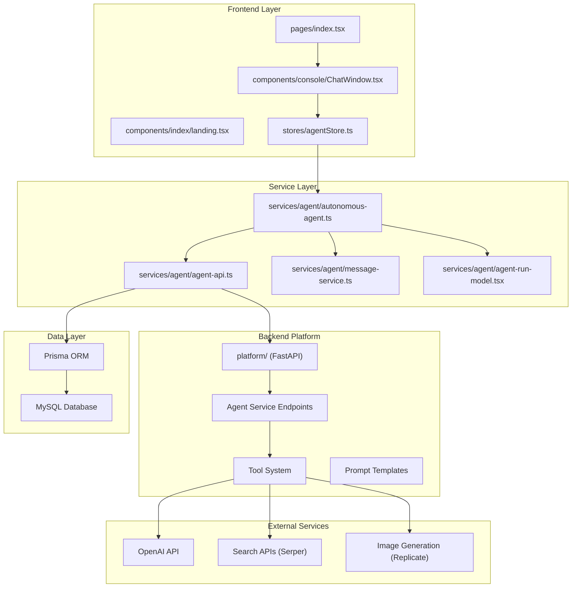
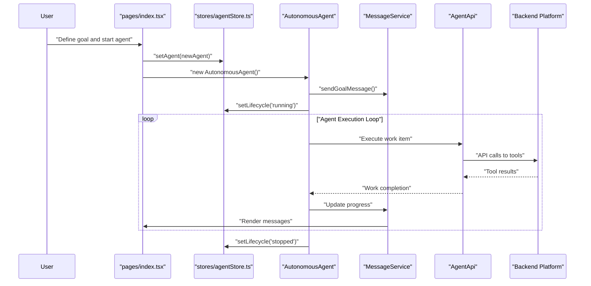
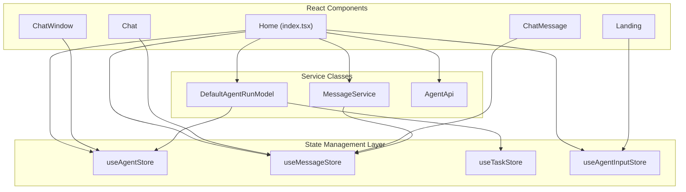

<!-- source: DeepWiki mcp.deepwiki.com · repo reworkd/AgentGPT · page 1 Overview · fetched 2026-10-26 -->

# Overview

Relevant source files

The following files were used as context for generating this wiki page:

- [.github/PULL_REQUEST_TEMPLATE/pull_request_template.md](.github/PULL_REQUEST_TEMPLATE/pull_request_template.md)
- [README.md](README.md)
- [docs/README.hu-Cs4K1Sr4C.md](docs/README.hu-Cs4K1Sr4C.md)
- [docs/README.zh-HANS.md](docs/README.zh-HANS.md)
- [next/src/components/console/ChatMessage.tsx](next/src/components/console/ChatMessage.tsx)
- [next/src/components/console/ChatWindow.tsx](next/src/components/console/ChatWindow.tsx)
- [next/src/components/console/MacWindowHeader.tsx](next/src/components/console/MacWindowHeader.tsx)
- [next/src/components/console/SummarizeButton.tsx](next/src/components/console/SummarizeButton.tsx)
- [next/src/pages/agent/index.tsx](next/src/pages/agent/index.tsx)
- [next/src/pages/index.tsx](next/src/pages/index.tsx)
- [next/src/services/agent/agent-run-model.tsx](next/src/services/agent/agent-run-model.tsx)
- [next/src/services/agent/autonomous-agent.ts](next/src/services/agent/autonomous-agent.ts)
- [next/src/services/agent/message-service.ts](next/src/services/agent/message-service.ts)
- [next/src/stores/agentStore.ts](next/src/stores/agentStore.ts)

This document provides a comprehensive overview of the AgentGPT system, covering its architecture, core components, and execution flow. AgentGPT is an autonomous AI agent platform that allows users to configure and deploy AI agents capable of pursuing complex goals through iterative task execution and learning.

The system consists of a Next.js frontend application, a FastAPI backend platform, and various supporting services. Users can define goals for AI agents, which then autonomously break down these goals into tasks, execute them using various tools, and learn from the results to achieve their objectives.

For detailed information about specific subsystems, see [Frontend](#2) for the user interface components, [Backend](#3) for the Python services, and [Agent System](#4) for the autonomous agent execution logic.

## System Purpose

AgentGPT enables users to create and deploy autonomous AI agents through a web browser interface. The platform handles the complete lifecycle of agent execution, from goal definition to task completion, while providing real-time feedback and interaction capabilities.

**Sources:** [README.md:24-26](), [next/src/pages/index.tsx:31-180]()

## High-Level Architecture

The system follows a modern full-stack architecture with clear separation between frontend presentation, backend services, and external integrations.

### System Architecture Diagram

**Sources:** [next/src/pages/index.tsx:1-194](), [next/src/services/agent/autonomous-agent.ts:1-172](), [README.md:82-92]()

## Core Components

### Frontend Application

The frontend is built with Next.js 13 and TypeScript, providing a responsive web interface for agent interaction. The main entry point is the `index.tsx` page which conditionally renders either a landing interface or chat interface based on agent state.

Key frontend components include:
- `Landing` component for initial goal input and agent configuration
- `Chat` component for ongoing agent interaction and message display  
- `ChatWindow` and `ChatMessage` components for message presentation
- Zustand stores for state management (`agentStore`, `messageStore`, `taskStore`)

### Backend Services

The backend consists of Python services built with FastAPI, handling agent execution, tool integration, and data persistence. The system uses a service-oriented architecture with clear separation of concerns.

### Agent Execution Engine

The core agent execution is handled by the `AutonomousAgent` class, which manages the complete lifecycle of autonomous task execution. This includes work scheduling, error handling, and state management through various lifecycle phases.

**Sources:** [next/src/pages/index.tsx:31-194](), [next/src/components/console/ChatWindow.tsx:29-114](), [next/src/services/agent/autonomous-agent.ts:17-172]()

## Agent Execution Flow

The following diagram illustrates how an agent processes goals and executes tasks:

### Agent Lifecycle Diagram

The agent execution follows this pattern:
1. User defines a goal through the web interface
2. A new `AutonomousAgent` instance is created with the goal
3. The agent enters a work execution loop, processing tasks sequentially
4. Each work item involves API calls to backend tools and services
5. Progress updates are streamed to the user interface in real-time
6. The agent continues until all tasks are completed or stopped by the user

**Sources:** [next/src/pages/index.tsx:72-101](), [next/src/services/agent/autonomous-agent.ts:42-82](), [next/src/services/agent/message-service.ts:19-106]()

## Technology Stack

The system leverages a modern technology stack optimized for AI application development:

| Layer | Technology | Purpose |
|-------|------------|---------|
| Frontend Framework | Next.js 13 + TypeScript | React-based web application with server-side rendering |
| State Management | Zustand | Lightweight state management for React components |
| Styling | TailwindCSS + HeadlessUI | Utility-first CSS framework with accessible components |
| Backend API | FastAPI | High-performance Python web framework for APIs |
| Database | MySQL + Prisma | Relational database with type-safe ORM |
| Authentication | Next-Auth.js | Authentication and session management |
| Schema Validation | Zod + Pydantic | Runtime type validation for frontend and backend |
| AI Integration | OpenAI API | Large language model integration |
| Containerization | Docker | Application containerization and deployment |

### Component Integration Diagram

The architecture emphasizes separation of concerns with dedicated layers for state management, business logic, and presentation. The Zustand stores provide centralized state management, while service classes handle business logic and external API interactions.

**Sources:** [README.md:82-92](), [next/src/stores/agentStore.ts:1-97](), [next/src/services/agent/agent-run-model.tsx:34-80](), [next/src/components/console/ChatWindow.tsx:29-114]()

## Deployment Architecture

AgentGPT supports multiple deployment configurations through Docker containerization and automated setup scripts. The system can be deployed locally for development or in production environments.

The deployment includes:
- Automated environment setup via CLI tools (`setup.sh`, `setup.bat`)
- Docker Compose orchestration for multi-service deployment
- Environment variable configuration for API keys and database connections
- Database migration and initialization scripts

**Sources:** [README.md:36-78](), [README.md:45-56]()

---

