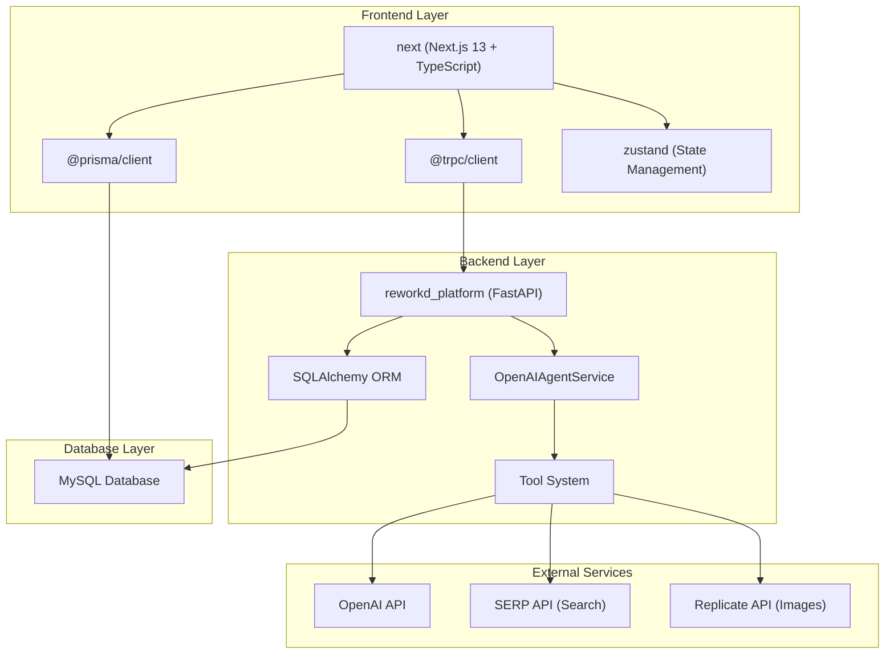
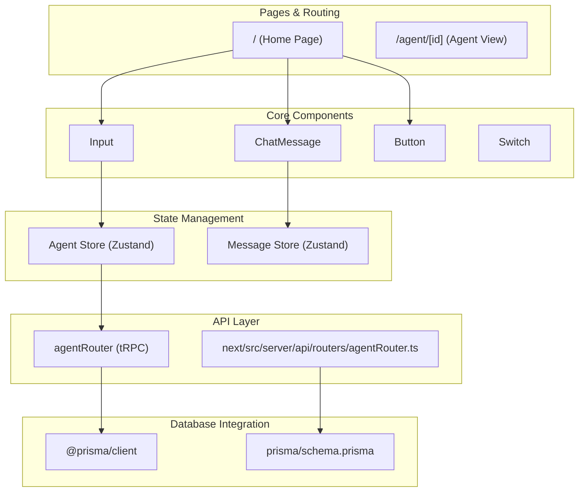
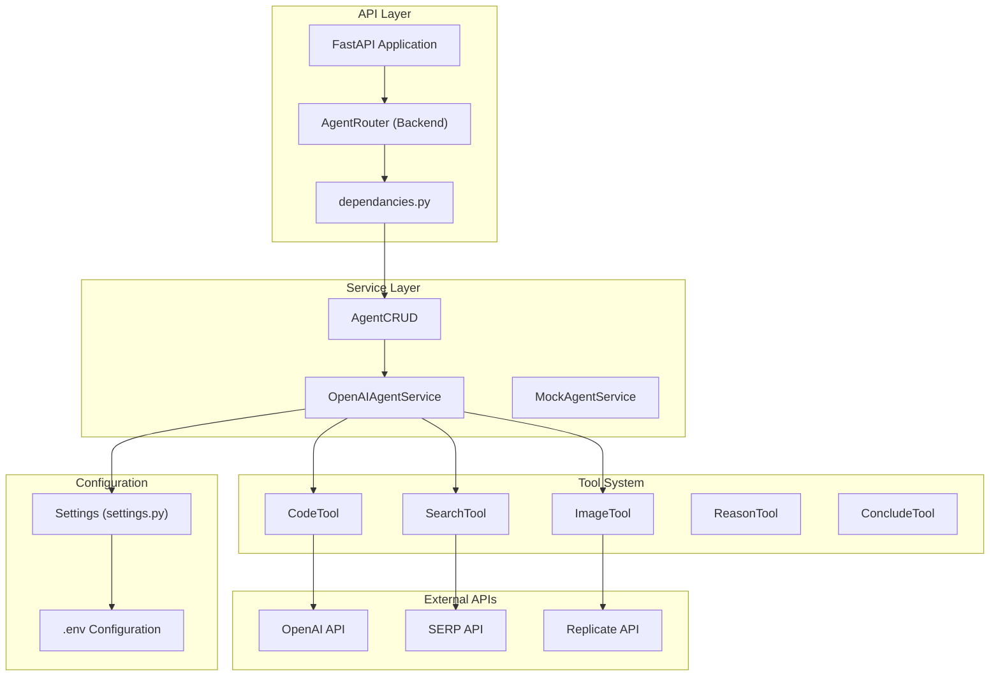
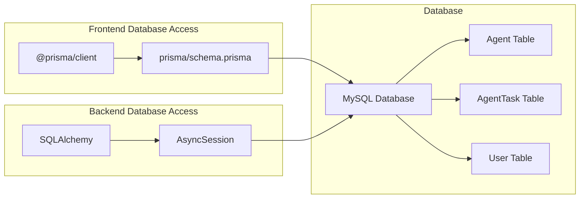
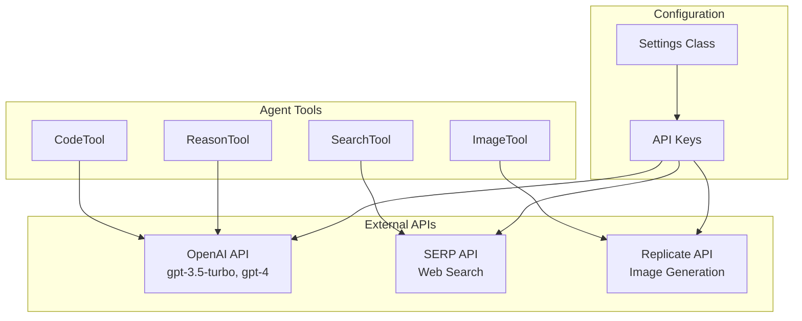
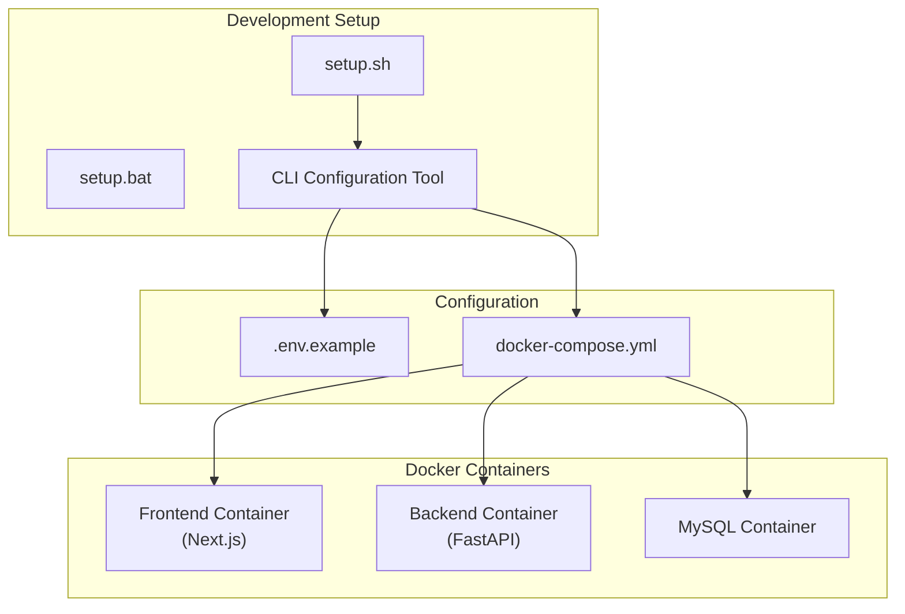

<!-- source: DeepWiki mcp.deepwiki.com · repo reworkd/AgentGPT · page 1.1 System Architecture · fetched 2026-10-26 -->

# System Architecture

<details>
<summary>Relevant source files</summary>

The following files were used as context for generating this wiki page:

- [.github/PULL_REQUEST_TEMPLATE/pull_request_template.md](.github/PULL_REQUEST_TEMPLATE/pull_request_template.md)
- [README.md](README.md)
- [docs/README.hu-Cs4K1Sr4C.md](docs/README.hu-Cs4K1Sr4C.md)
- [docs/README.zh-HANS.md](docs/README.zh-HANS.md)
- [next/package-lock.json](next/package-lock.json)
- [next/package.json](next/package.json)
- [next/public/locales/en/indexPage.json](next/public/locales/en/indexPage.json)
- [next/src/components/Button.tsx](next/src/components/Button.tsx)
- [next/src/components/Input.tsx](next/src/components/Input.tsx)
- [next/src/components/Label.tsx](next/src/components/Label.tsx)
- [next/src/components/Switch.tsx](next/src/components/Switch.tsx)
- [next/src/components/console/ChatMessage.tsx](next/src/components/console/ChatMessage.tsx)
- [next/src/components/drawer/DrawerItemButton.tsx](next/src/components/drawer/DrawerItemButton.tsx)
- [next/src/server/api/routers/agentRouter.ts](next/src/server/api/routers/agentRouter.ts)
- [platform/poetry.lock](platform/poetry.lock)
- [platform/pyproject.toml](platform/pyproject.toml)
- [platform/reworkd_platform/settings.py](platform/reworkd_platform/settings.py)
- [platform/reworkd_platform/web/api/agent/dependancies.py](platform/reworkd_platform/web/api/agent/dependancies.py)

</details>


## Purpose and Scope

This document describes the overall system architecture of AgentGPT, an autonomous AI agent platform that allows users to configure and deploy AI agents in their browser. It covers the high-level technical architecture, key components, data flow, and integration points between the Next.js frontend, FastAPI backend, and external services.

For information about specific agent execution flows and algorithms, see [Agent System](#4). For deployment and configuration details, see [Setup and Deployment](#5).

## High-Level Architecture Overview

AgentGPT follows a modern full-stack architecture with clear separation between frontend and backend services:



The system uses a microservices-inspired approach where the frontend handles user interactions and state management, while the backend focuses on AI agent orchestration and external service integration.

**Sources:** [README.md:82-92](), [next/package.json:17-64](), [platform/pyproject.toml:16-44]()

## Frontend Architecture

The frontend is built with Next.js 13 and TypeScript, providing a modern React-based user interface:



### Key Frontend Components

| Component | Purpose | File Path |
|-----------|---------|-----------|
| `ChatMessage` | Renders agent messages and task status | [next/src/components/console/ChatMessage.tsx]() |
| `Input` | Reusable form input component | [next/src/components/Input.tsx]() |
| `Button` | Interactive button with loading states | [next/src/components/Button.tsx]() |
| `agentRouter` | tRPC router for agent operations | [next/src/server/api/routers/agentRouter.ts]() |

The frontend uses tRPC for type-safe API communication, ensuring compile-time validation of API contracts between frontend and backend.

**Sources:** [next/src/components/console/ChatMessage.tsx:1-109](), [next/src/components/Input.tsx:1-73](), [next/src/components/Button.tsx:1-63](), [next/src/server/api/routers/agentRouter.ts:1-125]()

## Backend Architecture

The backend is implemented with FastAPI and follows a layered architecture pattern:



### Core Backend Services

The backend uses dependency injection through FastAPI's dependency system. The `AgentCRUD` class manages database operations, while service classes handle AI agent logic:

```python
# Example of dependency injection pattern
def agent_crud(
    user: UserBase = Depends(get_current_user),
    session: AsyncSession = Depends(get_db_session),
) -> AgentCRUD:
    return AgentCRUD(session, user)
```

### Configuration Management

The `Settings` class centralizes all configuration using Pydantic's `BaseSettings`:

| Setting Category | Key Properties | Purpose |
|------------------|----------------|---------|
| OpenAI | `openai_api_key`, `openai_api_base` | API access configuration |
| Database | `db_host`, `db_port`, `db_user`, `db_pass` | MySQL connection settings |
| External APIs | `serp_api_key`, `replicate_api_key` | Third-party service integration |

**Sources:** [platform/reworkd_platform/web/api/agent/dependancies.py:1-96](), [platform/reworkd_platform/settings.py:34-179]()

## Database Architecture and Data Flow

The system uses MySQL as the primary database with dual ORM access patterns:



### Data Flow Patterns

1. **Agent Creation**: Frontend creates agents via tRPC → `agentRouter.create` → Prisma → MySQL
2. **Task Execution**: Backend services use SQLAlchemy for transactional operations
3. **Real-time Updates**: WebSocket connections for streaming agent progress

The dual ORM approach allows the frontend to use Prisma's type-safe client while the backend leverages SQLAlchemy's advanced async capabilities for complex operations.

**Sources:** [next/src/server/api/routers/agentRouter.ts:56-67](), [platform/reworkd_platform/settings.py:122-130]()

## External Service Integration

AgentGPT integrates with multiple external APIs to provide comprehensive AI agent capabilities:

### API Integration Architecture



### Service Configuration

The system supports multiple deployment modes through environment configuration:

| Service | Configuration Keys | Purpose |
|---------|-------------------|---------|
| OpenAI | `OPENAI_API_KEY`, `OPENAI_API_BASE` | LLM operations and reasoning |
| SERP | `SERP_API_KEY` | Web search capabilities |
| Replicate | `REPLICATE_API_KEY` | AI image generation |
| Helicone | `HELICONE_API_KEY` | OpenAI proxy and monitoring |

**Sources:** [platform/reworkd_platform/settings.py:54-65](), [README.md:53-55]()

## Development and Deployment Infrastructure

The system supports multiple deployment modes with Docker-based containerization:

### Deployment Architecture



The setup scripts automate environment configuration, Docker container orchestration, and API key management, providing a streamlined developer experience.

**Sources:** [README.md:36-79](), [platform/reworkd_platform/settings.py:172-176]()

---

