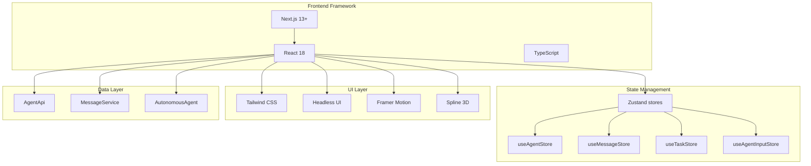
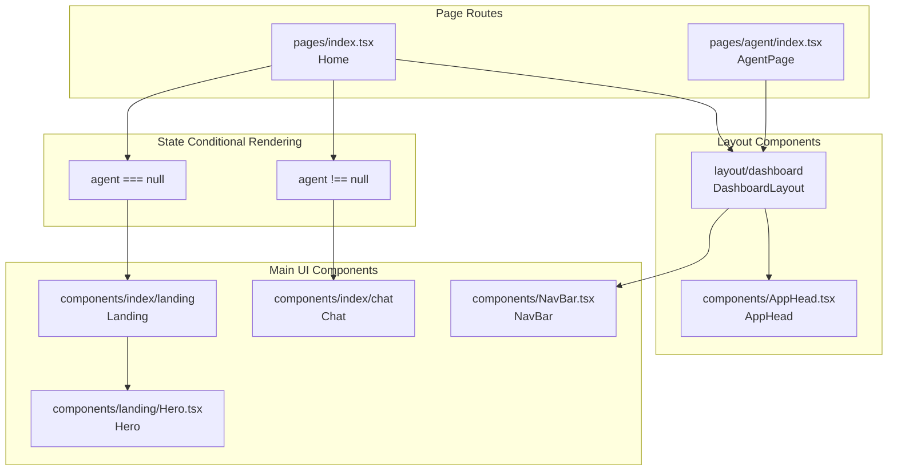
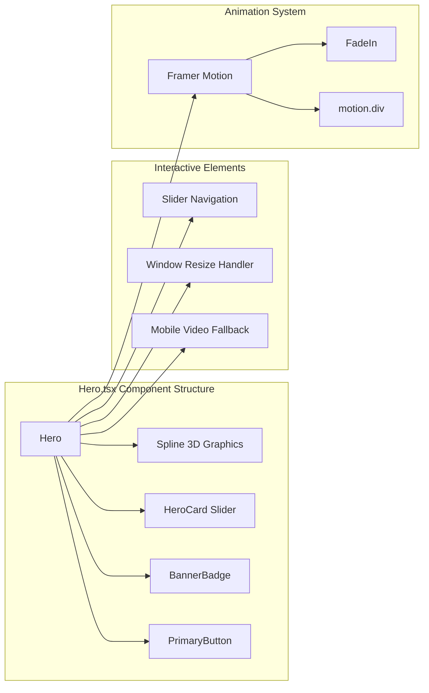
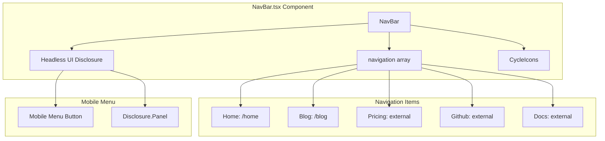
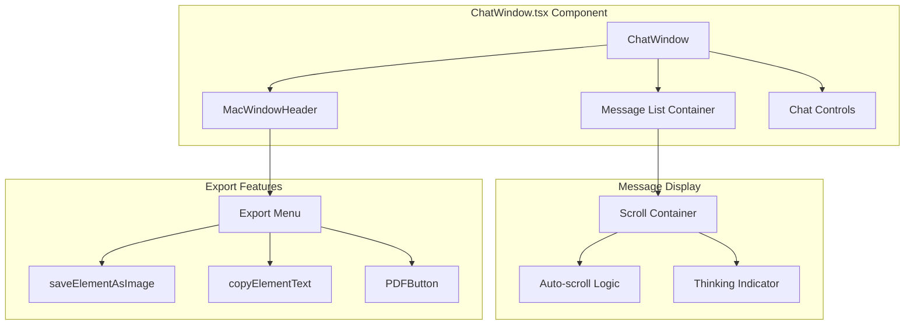
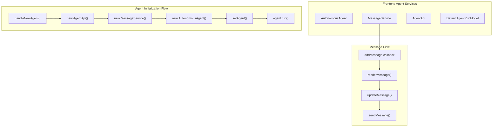
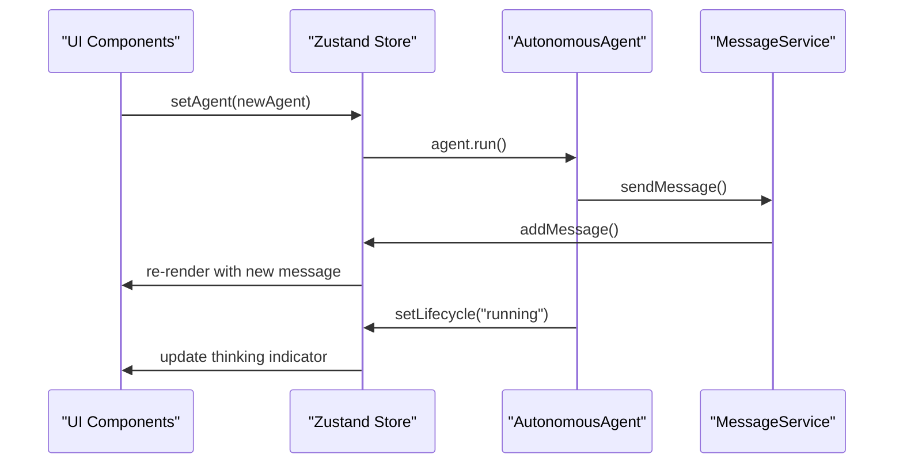

<!-- source: DeepWiki mcp.deepwiki.com · repo reworkd/AgentGPT · page 2 Frontend · fetched 2026-10-26 -->

# Frontend

Relevant source files

The following files were used as context for generating this wiki page:

- [next/public/favicon.svg](next/public/favicon.svg)
- [next/public/locales/en/drawer.json](next/public/locales/en/drawer.json)
- [next/public/prod_square.png](next/public/prod_square.png)
- [next/src/components/AppHead.tsx](next/src/components/AppHead.tsx)
- [next/src/components/BannerBadge.tsx](next/src/components/BannerBadge.tsx)
- [next/src/components/GlowWrapper.tsx](next/src/components/GlowWrapper.tsx)
- [next/src/components/HeroCard.tsx](next/src/components/HeroCard.tsx)
- [next/src/components/NavBar.tsx](next/src/components/NavBar.tsx)
- [next/src/components/console/ChatWindow.tsx](next/src/components/console/ChatWindow.tsx)
- [next/src/components/console/MacWindowHeader.tsx](next/src/components/console/MacWindowHeader.tsx)
- [next/src/components/console/SummarizeButton.tsx](next/src/components/console/SummarizeButton.tsx)
- [next/src/components/landing/Hero.tsx](next/src/components/landing/Hero.tsx)
- [next/src/components/motions/CycleIcons.tsx](next/src/components/motions/CycleIcons.tsx)
- [next/src/pages/agent/index.tsx](next/src/pages/agent/index.tsx)
- [next/src/pages/index.tsx](next/src/pages/index.tsx)
- [next/src/services/agent/agent-run-model.tsx](next/src/services/agent/agent-run-model.tsx)
- [next/src/services/agent/autonomous-agent.ts](next/src/services/agent/autonomous-agent.ts)
- [next/src/services/agent/message-service.ts](next/src/services/agent/message-service.ts)
- [next/src/stores/agentStore.ts](next/src/stores/agentStore.ts)
- [next/src/styles/globals.css](next/src/styles/globals.css)
- [next/tailwind.config.cjs](next/tailwind.config.cjs)

The frontend is a Next.js application that provides the user interface for interacting with autonomous AI agents. It handles user authentication, agent configuration, real-time chat interfaces, and visual workflow management. This document covers the client-side architecture, components, state management, and integration patterns.

For information about the backend API services, see [Backend](#3). For details on the agent execution system, see [Agent System](#4).

## Architecture Overview

The frontend follows a modern React architecture with Next.js as the framework, TypeScript for type safety, and Zustand for state management.

### Frontend Technology Stack

Sources: [next/src/pages/index.tsx:1-194](), [next/src/stores/agentStore.ts:1-97](), [next/src/services/agent/autonomous-agent.ts:1-172](), [next/tailwind.config.cjs:1-278]()

## Page Structure and Routing

The application uses Next.js file-based routing with several key pages and layouts.

### Main Page Components

Sources: [next/src/pages/index.tsx:138-179](), [next/src/pages/agent/index.tsx:44-95](), [next/src/components/AppHead.tsx:1-33]()

### Page State Logic

The main page (`pages/index.tsx`) conditionally renders either the landing experience or the active agent chat interface based on agent state:

| Condition | Component Rendered | Purpose |
|-----------|-------------------|---------|
| `agent === null` | `Landing` | Initial onboarding and agent creation |
| `agent !== null` | `Chat` | Active agent interaction interface |

Sources: [next/src/pages/index.tsx:153-175]()

## Key UI Components

### Hero Component

The `Hero` component provides the main landing page experience with 3D graphics and interactive elements.

The Hero component includes:
- **Spline 3D Integration**: Interactive 3D graphics for desktop users ([next/src/components/landing/Hero.tsx:69-75]())
- **Responsive Design**: Falls back to static image on mobile ([next/src/components/landing/Hero.tsx:60-68]())
- **Slider Interface**: Showcases different use cases with animated transitions ([next/src/components/landing/Hero.tsx:115-128]())

Sources: [next/src/components/landing/Hero.tsx:20-200]()

### Navigation System

Sources: [next/src/components/NavBar.tsx:18-125]()

### Chat Interface

The chat interface handles real-time agent communication and displays conversation history.

Sources: [next/src/components/console/ChatWindow.tsx:29-114](), [next/src/components/console/MacWindowHeader.tsx:24-150]()

## State Management System

The frontend uses Zustand for state management with multiple specialized stores.

### Store Architecture

```mermaid
graph TB
    subgraph "Zustand Store System"
        useAgentStore["useAgentStore"]
        useMessageStore["useMessageStore"]
        useTaskStore["useTaskStore"]
        useAgentInputStore["useAgentInputStore"]
    end
    
    subgraph "Agent Store State"
        agent["agent: AutonomousAgent | null"]
        lifecycle["lifecycle: AgentLifecycle"]
        isThinking["isAgentThinking: boolean"]
        summarized["summarized: boolean"]
        tools["tools: ActiveTool[]"]
    end
    
    subgraph "Message Store State" 
        messages["messages: Message[]"]
        addMessage["addMessage()"]
        updateMessage["updateMessage()"]
    end
    
    subgraph "Task Store State"
        tasks["tasks: Task[]"]
        addTask["addTask()"]
        updateTask["updateTask()"]
    end
    
    subgraph "Input Store State"
        nameInput["nameInput: string"]
        goalInput["goalInput: string"]
        setNameInput["setNameInput()"]
        setGoalInput["setGoalInput()"]
    end
    
    useAgentStore --> agent
    useAgentStore --> lifecycle
    useAgentStore --> isThinking
    useAgentStore --> summarized
    useAgentStore --> tools
    
    useMessageStore --> messages
    useMessageStore --> addMessage
    useMessageStore --> updateMessage
    
    useTaskStore --> tasks
    useTaskStore --> addTask
    useTaskStore --> updateTask
    
    useAgentInputStore --> nameInput
    useAgentInputStore --> goalInput
    useAgentInputStore --> setNameInput
    useAgentInputStore --> setGoalInput
```

Sources: [next/src/stores/agentStore.ts:10-97](), [next/src/pages/index.tsx:33-46]()

### Agent Lifecycle Management

The `AgentLifecycle` type defines the possible states:

| State | Description | UI Behavior |
|-------|-------------|-------------|
| `"offline"` | No agent instance | Shows landing page |
| `"running"` | Agent actively executing | Shows thinking indicator |
| `"pausing"` | Agent transitioning to pause | Maintains current UI |
| `"paused"` | Agent execution suspended | Shows resume option |
| `"stopped"` | Agent execution completed | Shows summarize option |

Sources: [next/src/services/agent/agent-run-model.tsx:32](), [next/src/components/console/ChatWindow.tsx:32-33]()

## Agent Integration Layer

The frontend integrates with the agent system through service classes that manage agent lifecycle and communication.

### Service Layer Architecture

Sources: [next/src/pages/index.tsx:72-101](), [next/src/services/agent/autonomous-agent.ts:27-40](), [next/src/services/agent/message-service.ts:12-27]()

### Agent State Synchronization

The frontend maintains synchronization between the agent service and UI state through reactive patterns:

Sources: [next/src/pages/index.tsx:84-100](), [next/src/services/agent/message-service.ts:19-22]()

## Styling and Theme System

The application uses Tailwind CSS with extensive customization for design consistency.

### Custom Design System

The theme system includes custom colors, animations, and utility classes defined in `tailwind.config.cjs`:

| Category | Examples | Purpose |
|----------|----------|---------|
| Custom Colors | `slate.1` through `slate.12` | Consistent grayscale palette |
| Box Shadows | `depth-1`, `depth-2`, `depth-3` | Layered depth system |
| Animations | `animate-border-pulse`, `moveBackground` | Interactive feedback |
| Custom Screens | `sm-h`, `md-h`, `lg-h` | Height-based breakpoints |

Sources: [next/tailwind.config.cjs:75-241](), [next/src/styles/globals.css:162-198]()

### CSS Custom Classes

Key utility classes defined in `globals.css`:

- **`.border-gradient`**: Gradient border effects for UI elements ([next/src/styles/globals.css:15-20]())
- **`.resend-font-effect-hero`**: Text shadow effects for hero text ([next/src/styles/globals.css:9-13]())
- **`.window-heights`**: Responsive height utilities ([next/src/styles/globals.css:76-78]())

Sources: [next/src/styles/globals.css:1-198]()

---

