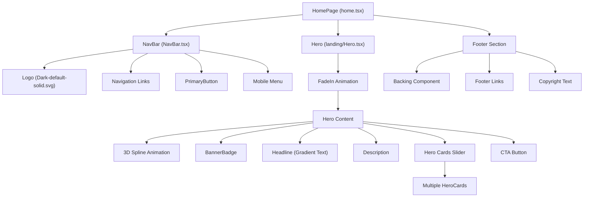
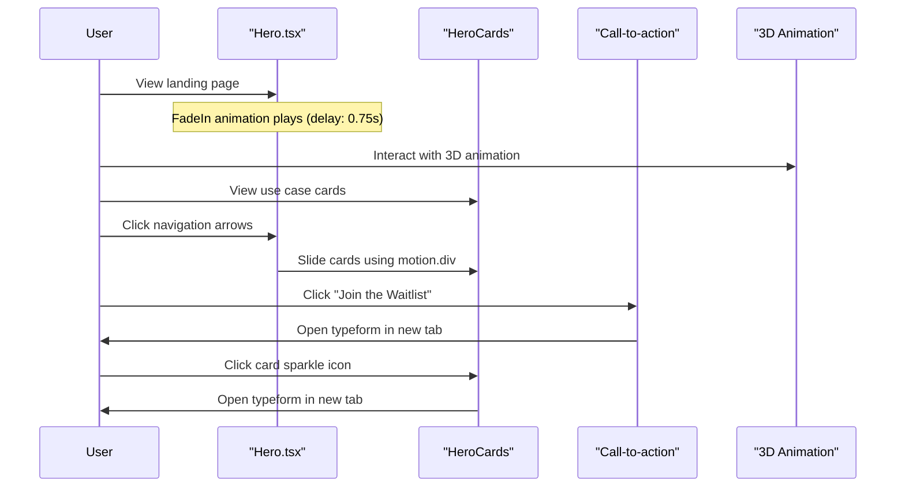
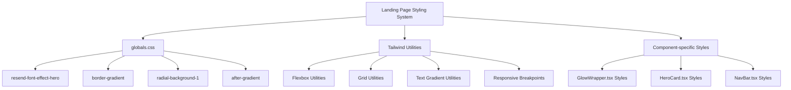
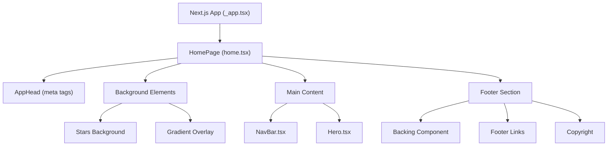

<!-- source: DeepWiki mcp.deepwiki.com · repo reworkd/AgentGPT · page 2.1 Landing Page UI · fetched 2026-10-26 -->

# Landing Page UI

Relevant source files

The following files were used as context for generating this wiki page:

- [next/public/favicon.svg](next/public/favicon.svg)
- [next/public/hero-background.png](next/public/hero-background.png)
- [next/public/locales/en/drawer.json](next/public/locales/en/drawer.json)
- [next/public/prod_square.png](next/public/prod_square.png)
- [next/src/components/AppHead.tsx](next/src/components/AppHead.tsx)
- [next/src/components/BannerBadge.tsx](next/src/components/BannerBadge.tsx)
- [next/src/components/GlowWrapper.tsx](next/src/components/GlowWrapper.tsx)
- [next/src/components/HeroCard.tsx](next/src/components/HeroCard.tsx)
- [next/src/components/Menu.tsx](next/src/components/Menu.tsx)
- [next/src/components/NavBar.tsx](next/src/components/NavBar.tsx)
- [next/src/components/WindowButton.tsx](next/src/components/WindowButton.tsx)
- [next/src/components/landing/Backing.tsx](next/src/components/landing/Backing.tsx)
- [next/src/components/landing/ConnectorSection.tsx](next/src/components/landing/ConnectorSection.tsx)
- [next/src/components/landing/FooterLinks.tsx](next/src/components/landing/FooterLinks.tsx)
- [next/src/components/landing/Hero.tsx](next/src/components/landing/Hero.tsx)
- [next/src/components/motions/CycleIcons.tsx](next/src/components/motions/CycleIcons.tsx)
- [next/src/pages/_app.tsx](next/src/pages/_app.tsx)
- [next/src/pages/home.tsx](next/src/pages/home.tsx)
- [next/src/styles/globals.css](next/src/styles/globals.css)
- [next/tailwind.config.cjs](next/tailwind.config.cjs)

This document describes the landing page user interface components, structure, and styling used in the AgentGPT application. The landing page serves as the primary entry point for users visiting the application, providing an introduction to the platform's capabilities and encouraging user engagement. For information about the main Agent Interface where users actually interact with AI agents, see [Agent Interface](#2.2).

## Overview

The landing page consists of several key components:
- A navigation bar (NavBar)
- A hero section with animated elements
- Interactive cards showcasing use cases
- A 3D animation element
- Call-to-action buttons
- Footer with additional information

The entire UI is built using React components with Next.js, styled with Tailwind CSS, and includes animations with Framer Motion.

Sources: [next/src/pages/home.tsx:1-40]()

## Component Structure

The landing page is organized as a hierarchy of React components:

Sources: 
- [next/src/pages/home.tsx:11-37]()
- [next/src/components/landing/Hero.tsx:20-164]()
- [next/src/components/NavBar.tsx:30-124]()

## Navigation Bar (NavBar)

The NavBar component provides navigation to different parts of the application and external resources:

### Structure and Features
- Logo and branding
- Navigation links (Home, Blog, Pricing, Github, Docs)
- Call-to-action button "Join the Waitlist"
- Mobile-responsive design with collapsible menu
- Icon cycling animation on hover

### Implementation Details
- Navigation links are defined in a static array
- Uses Headless UI's Disclosure component for the mobile menu
- Implements CycleIcons animation to highlight current/hovered navigation item
- Border gradient effect for the navigation container

Sources:
- [next/src/components/NavBar.tsx:18-27]() (Navigation links)
- [next/src/components/NavBar.tsx:53-74]() (Desktop navigation)
- [next/src/components/NavBar.tsx:76-91]() (CTA button)
- [next/src/components/NavBar.tsx:93-119]() (Mobile menu)

## Hero Section

The Hero section is the main visual element of the landing page, designed to capture attention and communicate the application's purpose:

### Key Components
1. **Title and Description**: Gradient text with engaging copy about web extraction capabilities
2. **3D Animation**: Interactive Spline animation that renders on desktop, with a static image fallback on mobile
3. **Banner Badge**: Highlighting recent funding announcement with animated hover effect
4. **Hero Cards Carousel**: Showcasing different use cases with horizontally scrollable cards
5. **Call-to-action Button**: "Join the Waitlist" with glow effect

### User Interaction Flow
The Hero section enables several user interactions:

Sources:
- [next/src/components/landing/Hero.tsx:52-163]()
- [next/src/components/landing/Hero.tsx:69-74]() (3D animation)
- [next/src/components/landing/Hero.tsx:86-101]() (Title and description)
- [next/src/components/landing/Hero.tsx:114-141]() (Hero cards carousel)
- [next/src/components/landing/Hero.tsx:143-159]() (CTA button)

## HeroCard Component

Each HeroCard represents a specific use case for the platform, organized as part of the carousel in the Hero section:

### Structure and Properties
- Industry title (e.g., "Manufacturing", "E-commerce")
- Use case subtitle (e.g., "Collect product data", "Get competitor prices")
- Left icon (different for each industry)
- Clickable sparkle icon that opens the waitlist form

### Visual Styling
- Border gradient effect
- Text gradients for title and subtitle
- Glow effect on the sparkle icon

Sources:
- [next/src/components/HeroCard.tsx:7-41]()
- [next/src/components/landing/Hero.tsx:167-198]() (roles array defining cards)

## Visual Styling and Animations

The landing page uses several custom styling techniques and animations:

### CSS Classes and Effects
1. **Gradient Text**: Using the `bg-gradient-to-r` and `bg-clip-text` utilities
2. **Border Gradients**: Custom CSS class `border-gradient` for container borders
3. **Glow Effects**: Using the `GlowWrapper` component for buttons and interactive elements
4. **Animation Components**:
   - `FadeIn`: For fade-in entrance animations
   - `CycleIcons`: For cycling through icons in the navbar
   - Framer Motion `motion.div`: For smooth card carousel animations

### Responsive Design
The layout adapts to different screen sizes:
- Mobile: Simplified layout with image instead of 3D animation
- Tablet: Adjusted spacing and layout
- Desktop: Full layout with all features

### CSS Implementation
The styling is implemented through:
- Tailwind CSS utilities
- Custom CSS classes in globals.css
- Component-specific styling

Sources:
- [next/src/styles/globals.css:9-13]() (resend-font-effect-hero)
- [next/src/styles/globals.css:15-20]() (border-gradient)
- [next/src/components/GlowWrapper.tsx:9-23]() (Glow effect)
- [next/tailwind.config.cjs:13-19]() (Responsive breakpoints)

## User Interaction Flows

The landing page enables several key user interactions:

### Navigation
- Clicking navigation links in the navbar redirects to different sections of the application
- Mobile menu toggle for smaller screens

### Call-to-Action
- "Join the Waitlist" button in the navbar and hero section
- Clicking HeroCard sparkle icons

### Hero Cards Carousel
- Left/right arrows for manual navigation
- Animation when changing cards

### Screen Size Adaptation
- Dynamic content loading based on screen size (3D animation vs. static image)
- Responsive layout adjustments

Sources:
- [next/src/components/landing/Hero.tsx:30-42]() (Slider navigation)
- [next/src/components/landing/Hero.tsx:143-159]() (CTA button)
- [next/src/components/landing/Hero.tsx:25-49]() (Screen size detection)
- [next/src/components/HeroCard.tsx:28-36]() (HeroCard interaction)

## Integration with Page Structure

The landing page components are integrated into the overall application structure:

Sources:
- [next/src/pages/home.tsx:11-37]()
- [next/src/pages/_app.tsx:17-41]()
- [next/src/components/AppHead.tsx:3-32]()

## Technical Implementation Details

### Key Technologies
- **React & Next.js**: For component-based UI
- **Tailwind CSS**: For styling
- **Framer Motion**: For animations
- **Headless UI**: For accessible UI components like Disclosure
- **Spline**: For 3D animation

### State Management
The Hero component maintains several state variables:
- `sliderIndex`: For tracking the current position in the HeroCard carousel
- `showVideo`: Boolean state for determining whether to show 3D animation or static image

### Event Handlers
- Window resize handler to switch between 3D animation and static image
- Slider button handlers for navigating the HeroCard carousel

Sources:
- [next/src/components/landing/Hero.tsx:22-24]() (State variables)
- [next/src/components/landing/Hero.tsx:26-49]() (Event handlers)
- [next/src/components/landing/Hero.tsx:115-140]() (Carousel implementation)

## Summary

The Landing Page UI serves as an engaging entry point to the AgentGPT application, utilizing modern web technologies to create a visually appealing and interactive experience. Its component-based architecture allows for easy maintenance and extension, while responsive design ensures usability across different devices.

The page effectively communicates the application's value proposition through its hero section, use case cards, and clear call-to-action elements, driving user engagement and conversion.

---

