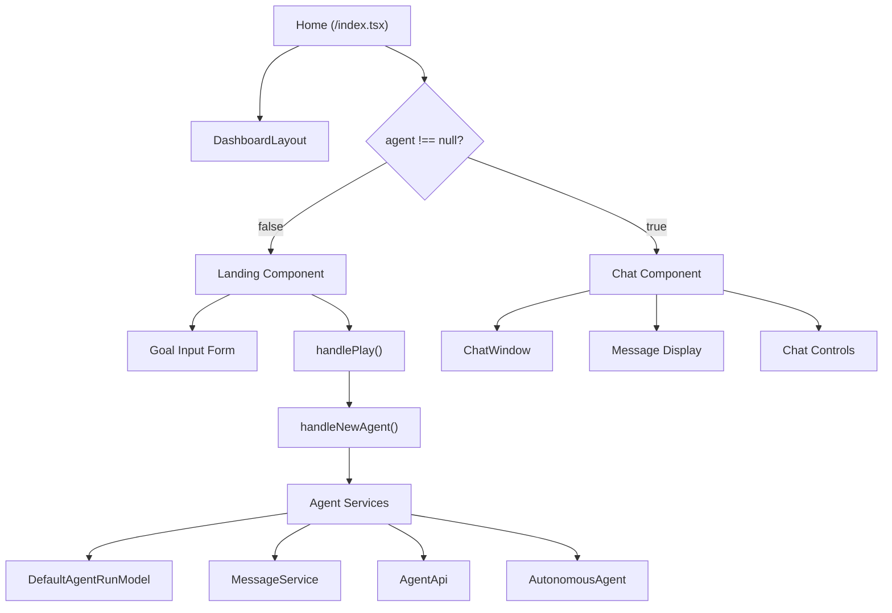
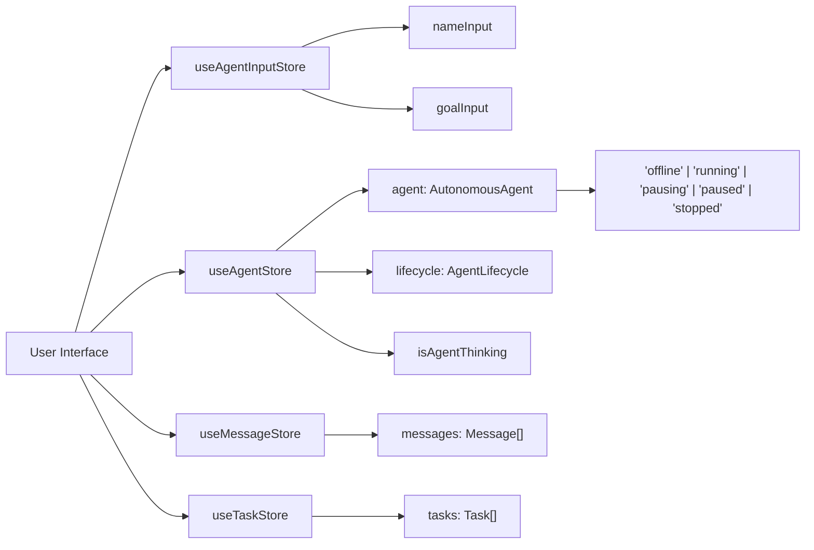
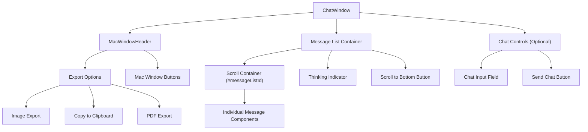
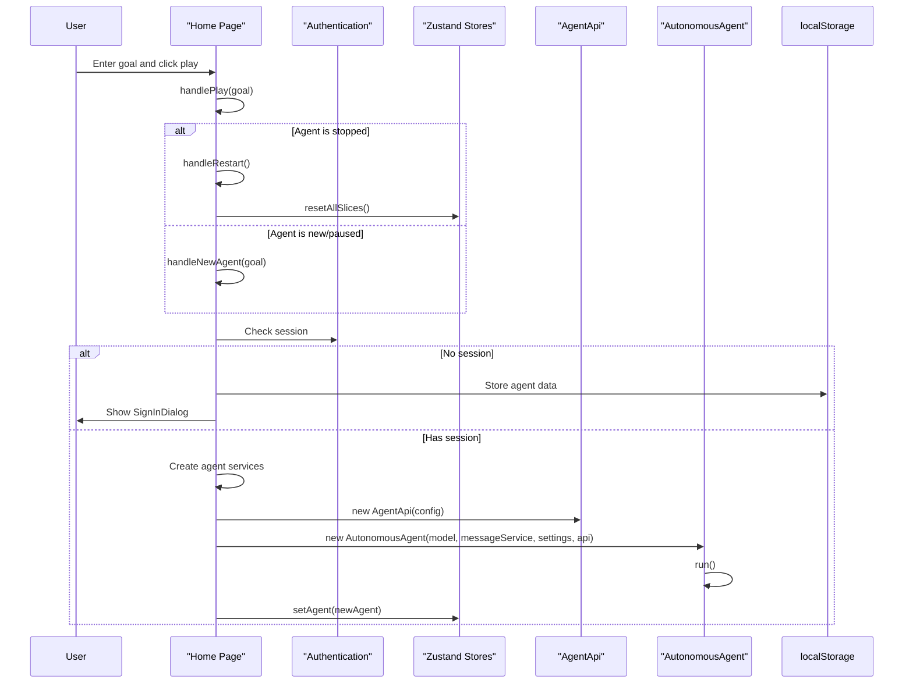
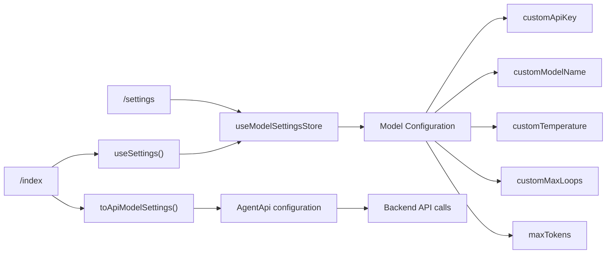

<!-- source: DeepWiki mcp.deepwiki.com · repo reworkd/AgentGPT · page 2.2 Agent Interface · fetched 2026-10-26 -->

# Agent Interface

Relevant source files

The following files were used as context for generating this wiki page:

- [next/src/components/console/ChatWindow.tsx](next/src/components/console/ChatWindow.tsx)
- [next/src/components/console/MacWindowHeader.tsx](next/src/components/console/MacWindowHeader.tsx)
- [next/src/components/console/SummarizeButton.tsx](next/src/components/console/SummarizeButton.tsx)
- [next/src/pages/agent/index.tsx](next/src/pages/agent/index.tsx)
- [next/src/pages/index.tsx](next/src/pages/index.tsx)
- [next/src/pages/settings.tsx](next/src/pages/settings.tsx)
- [next/src/services/agent/agent-run-model.tsx](next/src/services/agent/agent-run-model.tsx)
- [next/src/services/agent/autonomous-agent.ts](next/src/services/agent/autonomous-agent.ts)
- [next/src/services/agent/message-service.ts](next/src/services/agent/message-service.ts)
- [next/src/stores/agentStore.ts](next/src/stores/agentStore.ts)
- [next/src/stores/modelSettingsStore.ts](next/src/stores/modelSettingsStore.ts)
- [next/src/types/modelSettings.ts](next/src/types/modelSettings.ts)
- [next/src/ui/combox.tsx](next/src/ui/combox.tsx)
- [next/src/ui/input.tsx](next/src/ui/input.tsx)
- [next/src/utils/constants.ts](next/src/utils/constants.ts)

This document covers the main user interface for interacting with autonomous agents in AgentGPT. It includes the home page layout, chat interface components, state management, and the integration between frontend UI components and backend agent services.

For information about the underlying agent execution logic, see [Agent Service](#3.2). For details about the workflow builder interface, see [Workflow System](#2.5).

## Main Interface Components

The agent interface is primarily implemented in the home page at [next/src/pages/index.tsx](), which conditionally renders different UI states based on the agent's lifecycle. The interface switches between two main modes:

| Component | Purpose | Condition |
|-----------|---------|-----------|
| `Landing` | Initial goal input interface | `agent === null` |
| `Chat` | Active agent interaction interface | `agent !== null` |

The main interface uses the `DashboardLayout` wrapper and manages agent creation through several key services:

**Sources:** [next/src/pages/index.tsx:138-179](), [next/src/layout/dashboard.tsx]()

## Agent State Management

The interface uses Zustand stores to manage agent state, with the primary state flow controlled through the `useAgentStore` and related stores:

The agent lifecycle transitions are managed through the interface:

| Lifecycle State | UI Behavior | Actions Available |
|-----------------|-------------|-------------------|
| `offline` | Shows Landing component | Start new agent |
| `running` | Shows Chat with thinking indicator | Pause agent, chat |
| `pausing` | Transitioning to paused | None |
| `paused` | Shows Chat with resume option | Resume, stop |
| `stopped` | Shows Chat with restart option | Restart, summarize |

**Sources:** [next/src/stores/agentStore.ts:10-19](), [next/src/services/agent/agent-run-model.tsx:32](), [next/src/pages/index.tsx:37-41]()

## Chat Interface Components

The chat interface is built around the `ChatWindow` component which provides a macOS-style terminal interface:

The chat interface includes several interactive features:

- **Auto-scroll Management**: Tracks user scrolling behavior and conditionally auto-scrolls to new messages
- **Export Functionality**: Allows exporting conversation as image, text, or PDF
- **Real-time Chat**: Supports chatting with running agents through `chatControls` prop
- **Thinking Indicator**: Shows when agent is processing with spinner animation

**Sources:** [next/src/components/console/ChatWindow.tsx:29-114](), [next/src/components/console/MacWindowHeader.tsx:24-118]()

## Agent Creation and Lifecycle

The interface manages agent creation through a structured flow that integrates authentication, model settings, and backend services:

The agent creation process involves several key services:

- **`DefaultAgentRunModel`**: Manages task queue and agent run state
- **`MessageService`**: Handles message rendering and updates
- **`AgentApi`**: Interfaces with backend API using model settings and session
- **`AutonomousAgent`**: Main agent orchestrator that runs the execution loop

**Sources:** [next/src/pages/index.tsx:67-101](), [next/src/services/agent/autonomous-agent.ts:27-40](), [next/src/services/agent/message-service.ts:12-17]()

## Settings Integration

The agent interface integrates with the settings system through the `useSettings` hook and model configuration:

The settings are applied when creating new agents through the `toApiModelSettings` utility function, which converts frontend model settings into the format expected by the backend API.

**Sources:** [next/src/pages/index.tsx:47](), [next/src/pages/settings.tsx:34-67](), [next/src/utils/interfaces.ts](), [next/src/stores/modelSettingsStore.ts:11-31]()

## Message and Task Display

The interface renders different types of messages and tasks through a structured message system:

| Message Type | Display | Purpose |
|--------------|---------|---------|
| `goal` | Goal announcement | Shows initial agent goal |
| `task` | Task with status | Shows queued/running tasks |
| `system` | System message | Shows agent actions/thinking |
| `error` | Error message | Shows error states |

The task management integrates with the `useTaskStore` to track task lifecycle:

- **Task Creation**: New tasks are added through `MessageService.startTask()`
- **Task Updates**: Task status and results are updated through `AgentRunModel`
- **Task Display**: Tasks are rendered with status indicators (started, completed)

**Sources:** [next/src/services/agent/message-service.ts:29-64](), [next/src/stores/taskStore.ts](), [next/src/types/message.ts](), [next/src/types/task.ts]()

---

