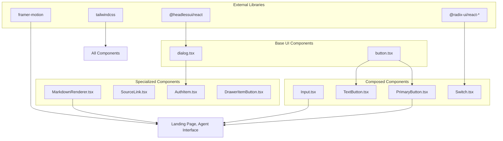
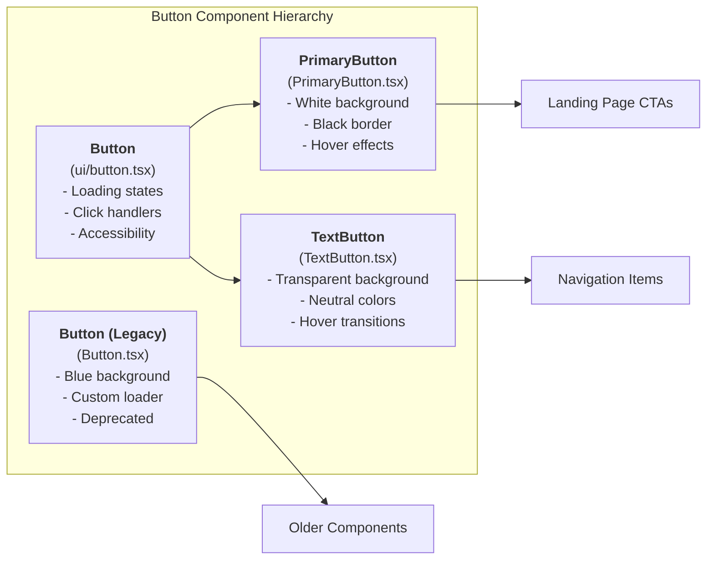
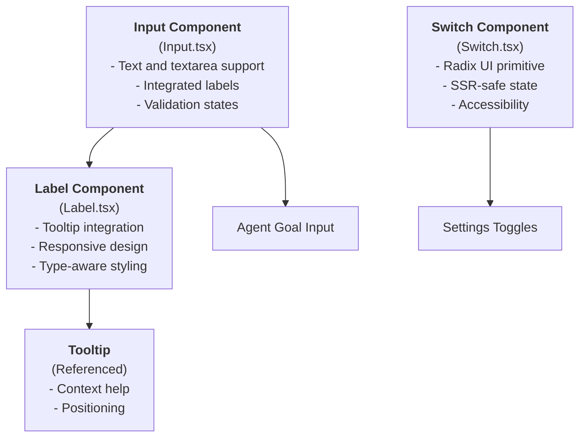
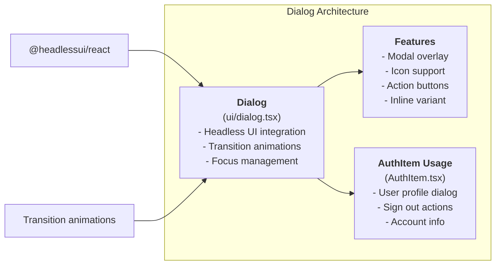
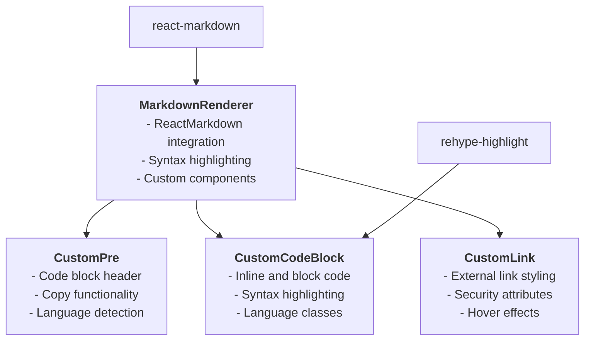
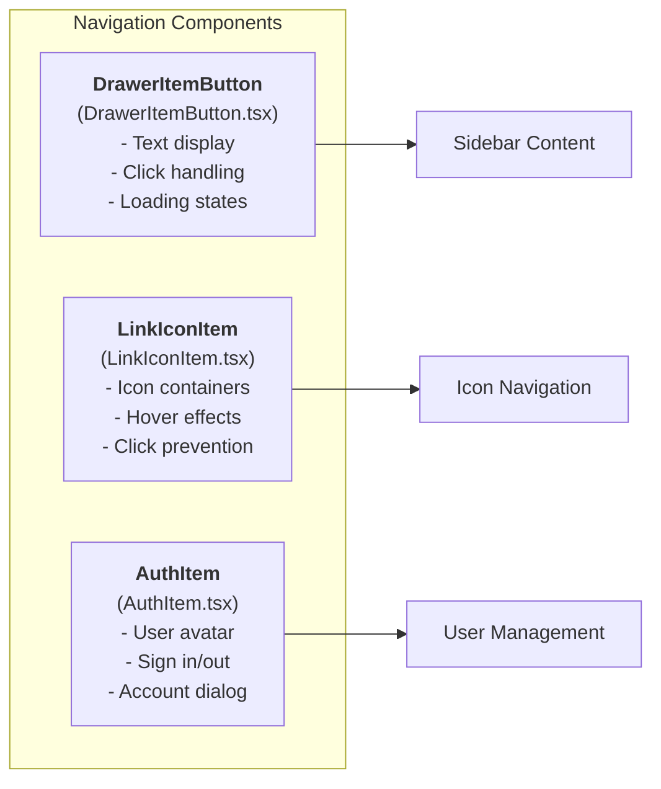

<!-- source: DeepWiki mcp.deepwiki.com · repo reworkd/AgentGPT · page 2.3 UI Components · fetched 2026-10-26 -->

# UI Components

<details>
<summary>Relevant source files</summary>

The following files were used as context for generating this wiki page:

- [next/package-lock.json](next/package-lock.json)
- [next/package.json](next/package.json)
- [next/public/errorFavicon.ico](next/public/errorFavicon.ico)
- [next/public/locales/en/indexPage.json](next/public/locales/en/indexPage.json)
- [next/src/components/Button.tsx](next/src/components/Button.tsx)
- [next/src/components/Input.tsx](next/src/components/Input.tsx)
- [next/src/components/Label.tsx](next/src/components/Label.tsx)
- [next/src/components/PrimaryButton.tsx](next/src/components/PrimaryButton.tsx)
- [next/src/components/Switch.tsx](next/src/components/Switch.tsx)
- [next/src/components/TextButton.tsx](next/src/components/TextButton.tsx)
- [next/src/components/console/MarkdownRenderer.tsx](next/src/components/console/MarkdownRenderer.tsx)
- [next/src/components/console/SourceCard.tsx](next/src/components/console/SourceCard.tsx)
- [next/src/components/console/SourceLink.tsx](next/src/components/console/SourceLink.tsx)
- [next/src/components/drawer/DrawerItemButton.tsx](next/src/components/drawer/DrawerItemButton.tsx)
- [next/src/components/landing/OpenSource.tsx](next/src/components/landing/OpenSource.tsx)
- [next/src/components/sidebar/AuthItem.tsx](next/src/components/sidebar/AuthItem.tsx)
- [next/src/components/sidebar/LinkIconItem.tsx](next/src/components/sidebar/LinkIconItem.tsx)
- [next/src/server/api/root.ts](next/src/server/api/root.ts)
- [next/src/server/api/routers/agentRouter.ts](next/src/server/api/routers/agentRouter.ts)
- [next/src/stores/configStore.ts](next/src/stores/configStore.ts)
- [next/src/ui/button.tsx](next/src/ui/button.tsx)
- [next/src/ui/dialog.tsx](next/src/ui/dialog.tsx)
- [platform/reworkd_platform/db/utils.py](platform/reworkd_platform/db/utils.py)
- [platform/reworkd_platform/services/ssl.py](platform/reworkd_platform/services/ssl.py)

</details>


This document covers the reusable UI component system used throughout the AgentGPT frontend application. These components provide the foundational building blocks for user interfaces including buttons, inputs, dialogs, and specialized content rendering components.

For information about the specific agent interface components and chat UI, see [Agent Interface](#2.2). For details about the workflow-specific UI components, see [Workflow System](#2.5).

## Component Architecture Overview

The UI component system follows a hierarchical structure with base components in the `ui/` directory and specialized components in the `components/` directory. Components are built using TypeScript, Tailwind CSS for styling, and various UI libraries for accessibility and functionality.



Sources: [next/src/ui/button.tsx:1-41](), [next/src/ui/dialog.tsx:1-94](), [next/src/components/PrimaryButton.tsx:1-28](), [next/package.json:17-65]()

## Core Button Components

The button system uses a base `Button` component that provides loading states, accessibility features, and consistent styling, with specialized variants for different use cases.



### Base Button Component

The foundational `Button` component provides core functionality:

| Feature | Implementation | File Reference |
|---------|---------------|----------------|
| Loading States | `loader` prop with `Loader` component | [next/src/ui/button.tsx:31]() |
| Click Handling | Async-aware onClick handler | [next/src/ui/button.tsx:18-21]() |
| Accessibility | Forward ref and proper button attributes | [next/src/ui/button.tsx:17]() |
| Visual Indicators | `Ping` component for notifications | [next/src/ui/button.tsx:31]() |

### Button Variants

**PrimaryButton**: Used for primary actions with white background and black border styling.
- Props: `className`, `children`, `icon`, `onClick`
- Styling: Rounded, hover effects, focus states
- Usage: Main CTAs, deploy buttons

**TextButton**: Used for secondary actions with transparent background.
- Props: `children`, `icon`, `onClick`, `className`
- Styling: Neutral colors, subtle hover effects
- Usage: Navigation, secondary actions

Sources: [next/src/ui/button.tsx:1-41](), [next/src/components/PrimaryButton.tsx:1-28](), [next/src/components/TextButton.tsx:1-27]()

## Input Components

The input system provides flexible form controls with consistent styling and label integration.



### Input Features

| Feature | Description | Implementation |
|---------|-------------|----------------|
| Type Support | Text input and textarea modes | [next/src/components/Input.tsx:25-27]() |
| Label Integration | Optional left-side labels with tooltips | [next/src/components/Input.tsx:31-33]() |
| Styling Variants | Small size option, disabled states | [next/src/components/Input.tsx:10]() |
| Keyboard Events | onKeyDown support for shortcuts | [next/src/components/Input.tsx:21]() |

### Switch Component

The `Switch` component uses Radix UI primitives for accessibility:
- SSR-safe state management with `useEffect`
- Proper focus and keyboard navigation
- Visual state indicators with CSS transitions

Sources: [next/src/components/Input.tsx:1-73](), [next/src/components/Label.tsx:1-39](), [next/src/components/Switch.tsx:1-48]()

## Dialog System

The dialog system provides modal interactions using Headless UI for accessibility.



### Dialog Features

| Feature | Purpose | Implementation |
|---------|---------|----------------|
| Overlay | Modal background with opacity transition | [next/src/ui/dialog.tsx:35]() |
| Focus Management | Initial focus and keyboard navigation | [next/src/ui/dialog.tsx:23]() |
| Action Buttons | Customizable footer actions | [next/src/ui/dialog.tsx:81-83]() |
| Responsive Design | Mobile and desktop layouts | [next/src/ui/dialog.tsx:40-44]() |

Sources: [next/src/ui/dialog.tsx:1-94](), [next/src/components/sidebar/AuthItem.tsx:62-96]()

## Specialized Content Components

Several components handle specific content rendering and interaction patterns.

### MarkdownRenderer

Renders markdown content with syntax highlighting and interactive features:



**Key Features:**
- GitHub Flavored Markdown support via `remark-gfm`
- Syntax highlighting with `rehype-highlight`
- Copy-to-clipboard functionality for code blocks
- Custom styling for headers, lists, and links

### SourceLink Component

Displays clickable source links with metadata:
- Fetches link metadata (title, favicon, hostname)
- Loading states with skeleton animation
- Error handling with fallback display
- Numbered indicators for source ordering

Sources: [next/src/components/console/MarkdownRenderer.tsx:1-146](), [next/src/components/console/SourceLink.tsx:1-79](), [next/src/components/console/SourceCard.tsx:1-24]()

## Drawer and Navigation Components

Components for sidebar and navigation interfaces.



### Component Responsibilities

| Component | Purpose | Key Features |
|-----------|---------|--------------|
| `DrawerItemButton` | Sidebar navigation items | Text truncation, loading states |
| `LinkIconItem` | Icon-based navigation | Hover animations, click handling |
| `AuthItem` | User authentication UI | Avatar display, dialog integration |

Sources: [next/src/components/drawer/DrawerItemButton.tsx:1-30](), [next/src/components/sidebar/LinkIconItem.tsx:1-17](), [next/src/components/sidebar/AuthItem.tsx:1-103]()

## Styling and Theming System

The component system uses a consistent approach to styling and theming.

### Technology Stack

| Technology | Purpose | Usage Pattern |
|------------|---------|---------------|
| Tailwind CSS | Utility-first styling | Class-based styling throughout |
| clsx | Conditional classes | Dynamic styling based on props/state |
| CSS Variables | Color tokens | Slate color palette (slate-1 to slate-12) |
| Framer Motion | Animations | Transitions and interactive animations |

### Styling Patterns

**Conditional Styling**: Components use `clsx` to apply styles based on props:
```typescript
className={clsx(
  "base-classes",
  props.disabled && "disabled-classes",
  props.variant === "primary" && "primary-classes"
)}
```

**Responsive Design**: Components use Tailwind's responsive prefixes:
- `sm:` for small screens and up
- `md:` for medium screens and up
- Mobile-first approach with progressive enhancement

**Color System**: Consistent use of slate color palette:
- `slate-1` to `slate-3`: Background colors
- `slate-6` to `slate-8`: Border colors  
- `slate-10` to `slate-12`: Text colors
- `sky-*`: Accent colors for interactive elements

Sources: [next/src/components/Input.tsx:36-57](), [next/src/ui/dialog.tsx:25-58](), [next/src/components/PrimaryButton.tsx:18-21]()

---

