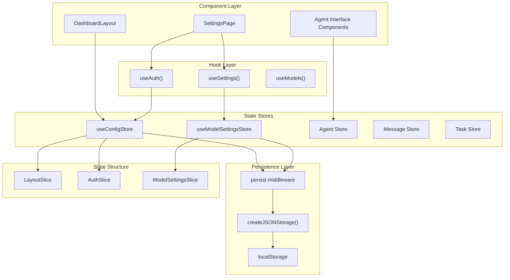
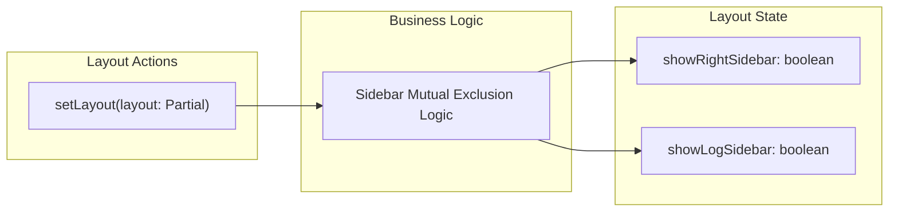
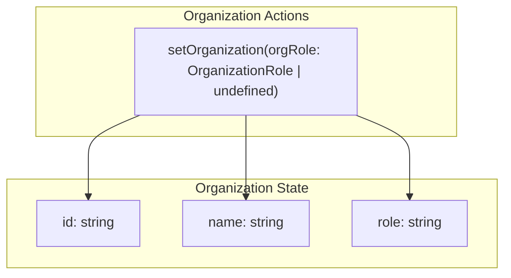
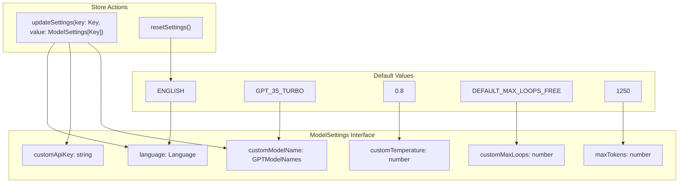
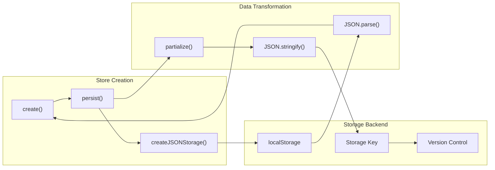
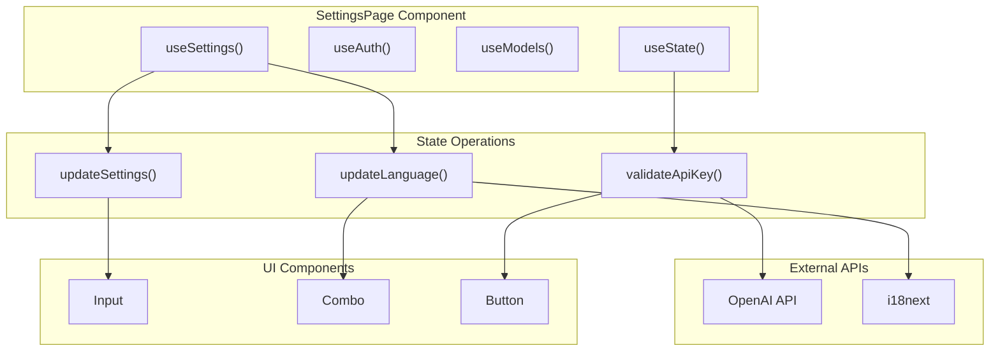
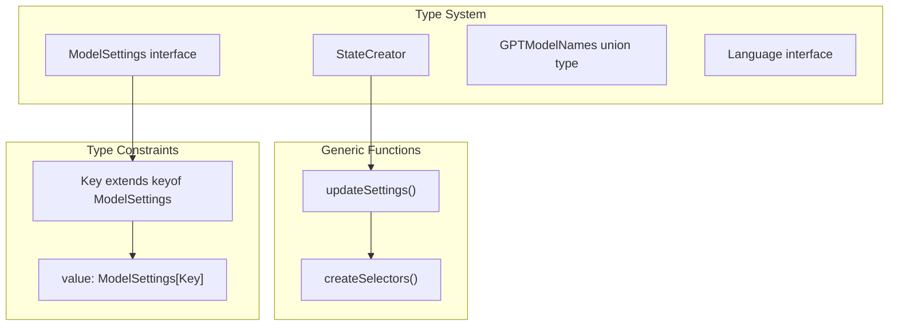

<!-- source: DeepWiki mcp.deepwiki.com · repo reworkd/AgentGPT · page 2.4 State Management · fetched 2026-10-26 -->

# State Management

<details>
<summary>Relevant source files</summary>

The following files were used as context for generating this wiki page:

- [next/src/components/console/MarkdownRenderer.tsx](next/src/components/console/MarkdownRenderer.tsx)
- [next/src/pages/settings.tsx](next/src/pages/settings.tsx)
- [next/src/stores/configStore.ts](next/src/stores/configStore.ts)
- [next/src/stores/modelSettingsStore.ts](next/src/stores/modelSettingsStore.ts)
- [next/src/types/modelSettings.ts](next/src/types/modelSettings.ts)
- [next/src/ui/combox.tsx](next/src/ui/combox.tsx)
- [next/src/ui/input.tsx](next/src/ui/input.tsx)
- [next/src/utils/constants.ts](next/src/utils/constants.ts)
- [platform/reworkd_platform/db/utils.py](platform/reworkd_platform/db/utils.py)
- [platform/reworkd_platform/services/ssl.py](platform/reworkd_platform/services/ssl.py)

</details>


## Purpose and Scope

This document covers the client-side state management system in the AgentGPT frontend application. The system uses Zustand for reactive state management, handling application configuration, model settings, layout preferences, and user interface state. For backend data persistence and database schemas, see [Storage and Database](#3.4). For API integration patterns, see [Agent API](#3.1).

## Architecture Overview

The AgentGPT frontend implements a distributed state management architecture using Zustand stores. Each store manages a specific domain of application state with built-in persistence and type safety.

### Store Architecture



Sources: [next/src/stores/configStore.ts:1-76](), [next/src/stores/modelSettingsStore.ts:1-55](), [next/src/pages/settings.tsx:32-68]()

## Store Implementations

### Configuration Store

The `useConfigStore` manages application layout and organization state through two primary slices: `LayoutSlice` and `AuthSlice`.

#### Layout Management



The layout slice implements mutual exclusion logic for sidebar visibility:

| Property | Type | Purpose |
|----------|------|---------|
| `showRightSidebar` | `boolean` | Controls right sidebar visibility |
| `showLogSidebar` | `boolean` | Controls log sidebar visibility |

The `setLayout` function enforces that only one sidebar can be visible at a time through conditional logic at [next/src/stores/configStore.ts:37-38]().

#### Organization Management



The `AuthSlice` manages user organization context through the `OrganizationRole` interface defined at [next/src/stores/configStore.ts:17-21]().

Sources: [next/src/stores/configStore.ts:7-48](), [next/src/stores/configStore.ts:50-59]()

### Model Settings Store

The `useModelSettingsStore` handles AI model configuration and user preferences with comprehensive persistence.

#### Settings State Structure



The store implements type-safe updates through generic constraints at [next/src/stores/modelSettingsStore.ts:25-29]().

#### Persistence Configuration

The store uses selective persistence with data transformation:

| Persistence Feature | Implementation | Purpose |
|---------------------|----------------|---------|
| Storage Key | `"agentgpt-settings-storage-v2"` | Versioned localStorage key |
| Partialize Function | Custom transformer | Ensures model compatibility |
| Token Clamping | `Math.min(maxTokens, 4000)` | Prevents invalid token counts |

Sources: [next/src/stores/modelSettingsStore.ts:11-31](), [next/src/stores/modelSettingsStore.ts:33-52](), [next/src/utils/constants.ts:11-20]()

## State Persistence System

### Zustand Middleware Integration



Both stores implement persistence through Zustand's `persist` middleware with `createJSONStorage(() => localStorage)` at [next/src/stores/configStore.ts:71]() and [next/src/stores/modelSettingsStore.ts:41]().

### Storage Keys and Versioning

| Store | Storage Key | Version Strategy |
|-------|-------------|------------------|
| Config Store | `"reworkd-config-2"` | Explicit version field |
| Model Settings Store | `"agentgpt-settings-storage-v2"` | Version in key name |

Sources: [next/src/stores/configStore.ts:69-72](), [next/src/stores/modelSettingsStore.ts:40-49]()

## Component Integration Patterns

### Settings Page Integration

The settings page demonstrates comprehensive state integration across multiple stores and external APIs:



The component implements real-time API key validation through axios requests to `https://api.openai.com/v1/engines` at [next/src/pages/settings.tsx:40-52]().

### State-UI Synchronization

The settings page demonstrates bidirectional data binding patterns:

| UI Component | State Binding | Update Pattern |
|--------------|---------------|----------------|
| Language Selector | `settings.language` | `updateLanguage(e)` |
| API Key Input | `settings.customApiKey` | `updateSettings("customApiKey", value)` |
| Model Selector | `getModel(settings.customModelName)` | `updateModel(model)` |
| Temperature Slider | `settings.customTemperature` | `updateSettings("customTemperature", value)` |

Sources: [next/src/pages/settings.tsx:91-100](), [next/src/pages/settings.tsx:151-167](), [next/src/pages/settings.tsx:168-182]()

## State Management Patterns

### Type Safety and Generics

The stores implement comprehensive type safety through TypeScript generics and interfaces:



The `updateSettings` function uses mapped types for compile-time safety at [next/src/stores/modelSettingsStore.ts:25]().

### Selector Pattern Implementation

Both stores use the `createSelectors` helper to generate automatic selectors:

```typescript
// Enables both object and function access patterns
const store = useConfigStore() // Full state object
const layout = useConfigStore.layout() // Individual selector
```

This pattern is implemented through the helper at [next/src/stores/configStore.ts:5]() and applied at [next/src/stores/configStore.ts:61-75]().

Sources: [next/src/stores/helpers.ts](), [next/src/types/modelSettings.ts:17-24](), [next/src/stores/modelSettingsStore.ts:12-14]()

---

