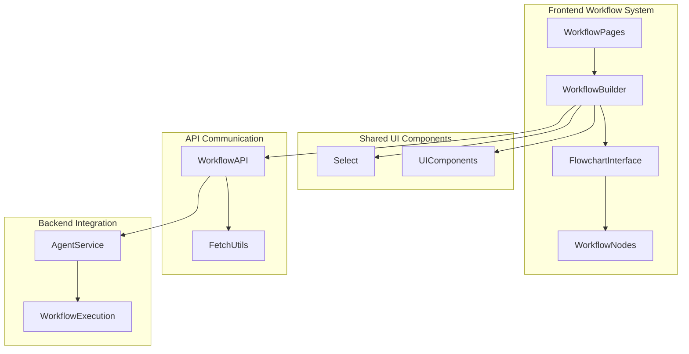
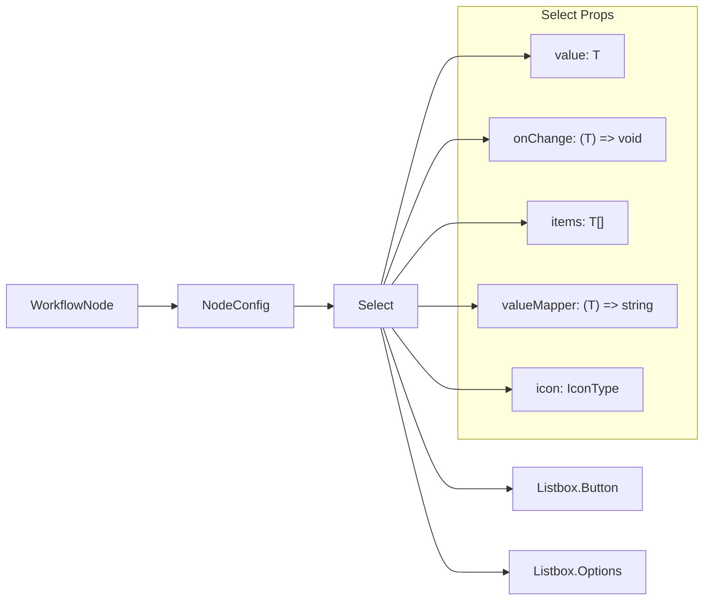
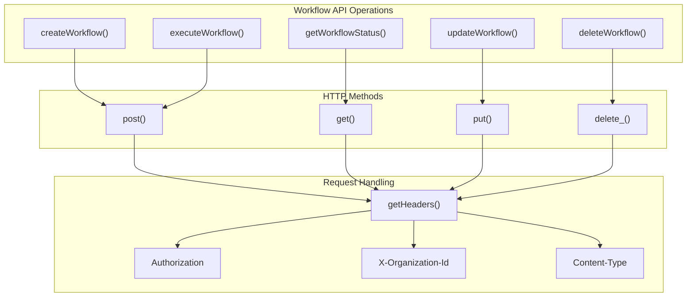
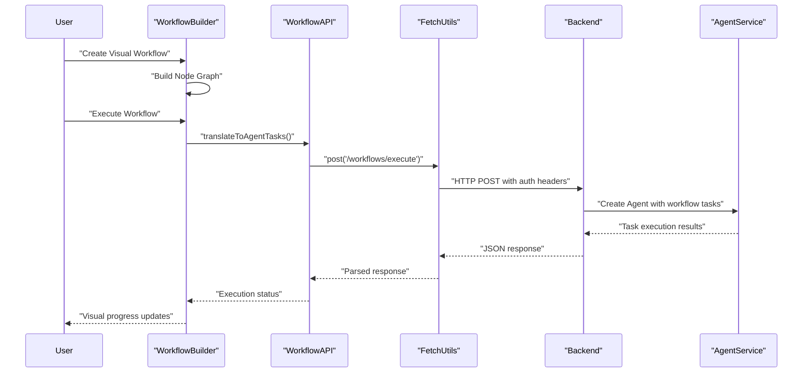

<!-- source: DeepWiki mcp.deepwiki.com · repo reworkd/AgentGPT · page 2.5 Workflow System · fetched 2026-10-26 -->

# Workflow System

Relevant source files

The following files were used as context for generating this wiki page:

- [next/src/services/fetch-utils.ts](next/src/services/fetch-utils.ts)
- [next/src/ui/select.tsx](next/src/ui/select.tsx)

## Purpose and Scope

The Workflow System provides a visual workflow builder interface that allows users to create and execute AI agent workflows through a flowchart-based interface. This system serves as an alternative to the traditional chat-based agent interface, enabling users to design complex multi-step processes using visual nodes and connections.

This document covers the frontend workflow builder components, visual interface elements, and integration with the backend workflow execution system. For information about the underlying agent execution and task processing, see [Agent System](#4). For details about the API layer that powers workflow execution, see [Agent API](#3.1).

## System Architecture

The Workflow System is implemented as part of the Next.js frontend and consists of several key architectural components that work together to provide visual workflow creation and execution capabilities.

### High-Level Architecture

Sources: Overall system architecture diagram, Component hierarchy diagram

### Component Structure

The workflow system follows a hierarchical component structure where workflow pages contain the builder interface, which in turn manages individual workflow nodes and their connections.

| Component Level | Purpose | Key Responsibilities |
|-----------------|---------|---------------------|
| **Workflow Pages** | Page-level routing and layout | Handle workflow creation, editing, and execution views |
| **Workflow Builder** | Main interface component | Manage workflow state, node creation, and connections |
| **Flowchart Interface** | Visual editor | Render nodes, handle drag-and-drop, manage canvas |
| **Workflow Nodes** | Individual workflow elements | Represent specific actions, conditions, or agent tasks |

Sources: Component hierarchy diagram

## Visual Interface Components

The workflow system leverages shared UI components from the broader AgentGPT frontend to maintain consistency and reusability across the application.

### Select Component Integration

The workflow builder utilizes the generic `Select` component for various configuration options within workflow nodes:

Sources: [next/src/ui/select.tsx:8-16]()

The `Select` component provides a flexible dropdown interface that workflow nodes can use for:
- Agent model selection
- Tool selection for specific workflow steps
- Conditional logic options
- Output format configurations

Key features of the select component include:
- Generic type support for any data type
- Custom value mapping for display
- Icon integration for visual identification
- Disabled state support
- Keyboard navigation and accessibility

Sources: [next/src/ui/select.tsx:18-99]()

## API Communication Layer

The workflow system communicates with the backend through a structured API layer that handles workflow creation, execution, and monitoring.

### Fetch Utilities Integration

The workflow API service builds upon the core fetch utilities to maintain consistent error handling and authentication across all backend communications:

Sources: [next/src/services/fetch-utils.ts:5-11](), [next/src/services/fetch-utils.ts:13-93]()

### Request Flow

The workflow system follows a consistent pattern for all API communications:

1. **Authentication**: Each request includes bearer token authentication and optional organization ID headers
2. **Schema Validation**: All responses are validated using Zod schemas to ensure type safety
3. **Error Handling**: Failed requests throw standardized errors that the UI can handle consistently
4. **Type Safety**: Generic type parameters ensure compile-time type checking for all API responses

| HTTP Method | Usage in Workflow System | Schema Validation |
|-------------|-------------------------|-------------------|
| `GET` | Retrieve workflow definitions and execution status | Response parsed with Zod schema |
| `POST` | Create new workflows and trigger execution | Request body serialized, response validated |
| `PUT` | Update existing workflow configurations | Full workflow state updates |
| `DELETE` | Remove workflows and cancel executions | Confirmation response validation |

Sources: [next/src/services/fetch-utils.ts:13-30](), [next/src/services/fetch-utils.ts:32-51](), [next/src/services/fetch-utils.ts:53-72](), [next/src/services/fetch-utils.ts:74-93]()

## Integration with Agent System

The workflow system serves as a visual interface layer that ultimately drives the same underlying agent execution engine used by the traditional chat interface.

### Workflow to Agent Translation

Sources: Agent execution flow diagram, [next/src/services/fetch-utils.ts:32-51]()

### State Management Integration

The workflow system integrates with the existing Zustand-based state management system to maintain consistency with the rest of the application. Workflow state is managed separately but follows the same patterns as agent and message stores.

The workflow system represents a sophisticated visual interface that translates user-created flowcharts into executable agent tasks, leveraging the same robust backend infrastructure that powers the traditional agent interface while providing an intuitive drag-and-drop workflow creation experience.

Sources: Component hierarchy diagram, Backend tool & service architecture diagram

---

