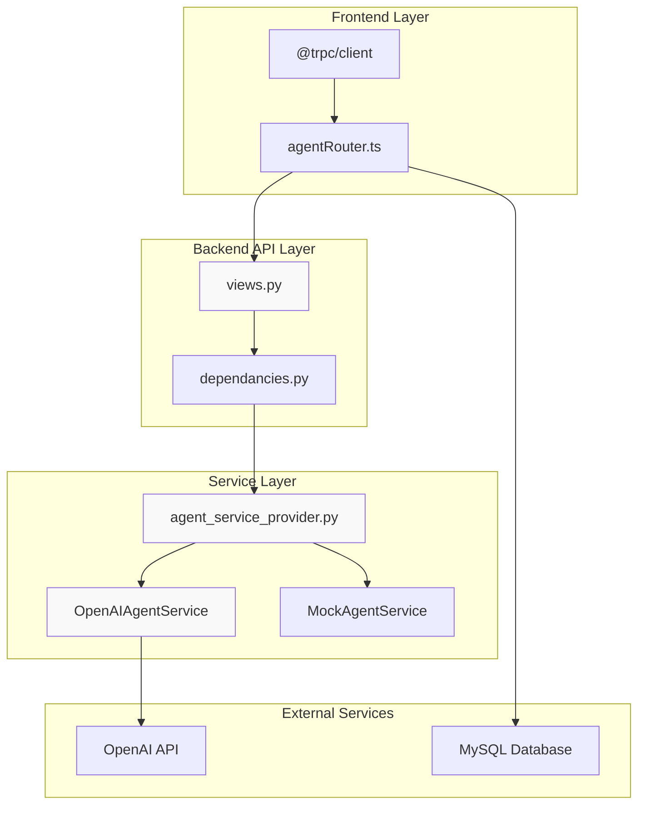
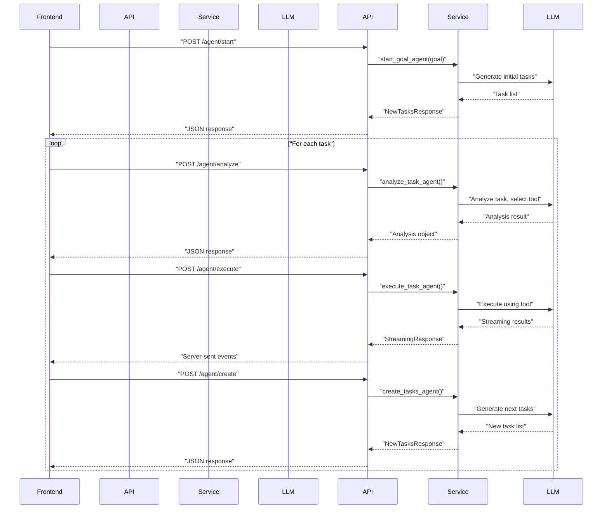
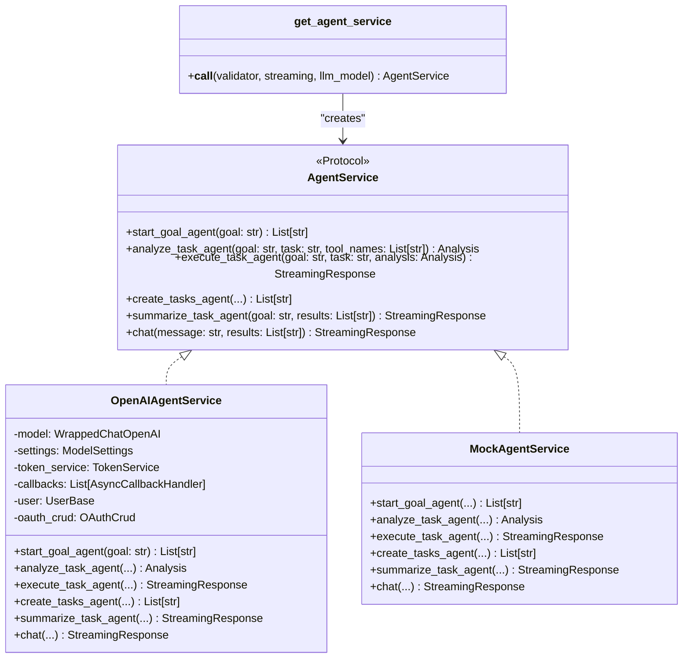
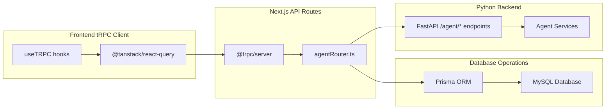
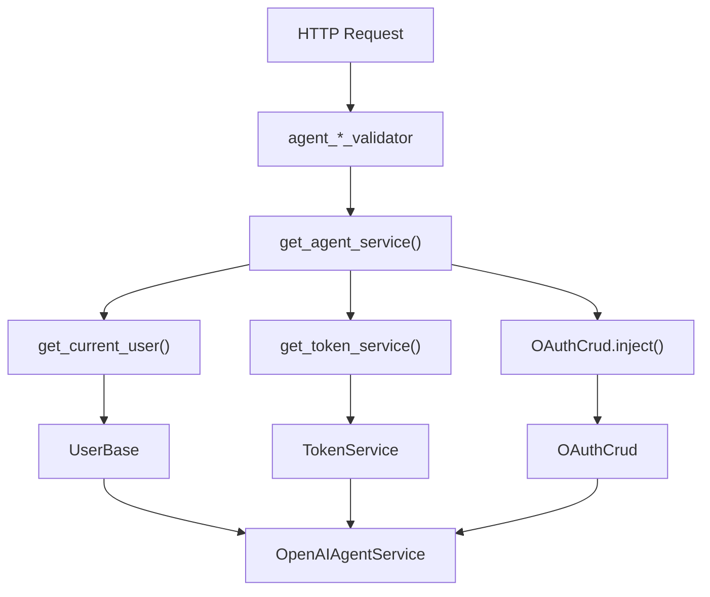

<!-- source: DeepWiki mcp.deepwiki.com · repo reworkd/AgentGPT · page 3.1 Agent API · fetched 2026-10-26 -->

# Agent API

<details>
<summary>Relevant source files</summary>

The following files were used as context for generating this wiki page:

- [next/package-lock.json](next/package-lock.json)
- [next/package.json](next/package.json)
- [next/public/locales/en/indexPage.json](next/public/locales/en/indexPage.json)
- [next/src/components/Button.tsx](next/src/components/Button.tsx)
- [next/src/components/Input.tsx](next/src/components/Input.tsx)
- [next/src/components/Label.tsx](next/src/components/Label.tsx)
- [next/src/components/Switch.tsx](next/src/components/Switch.tsx)
- [next/src/components/drawer/DrawerItemButton.tsx](next/src/components/drawer/DrawerItemButton.tsx)
- [next/src/server/api/routers/agentRouter.ts](next/src/server/api/routers/agentRouter.ts)
- [next/src/utils/interfaces.ts](next/src/utils/interfaces.ts)
- [platform/reworkd_platform/web/api/agent/agent_service/agent_service.py](platform/reworkd_platform/web/api/agent/agent_service/agent_service.py)
- [platform/reworkd_platform/web/api/agent/agent_service/agent_service_provider.py](platform/reworkd_platform/web/api/agent/agent_service/agent_service_provider.py)
- [platform/reworkd_platform/web/api/agent/agent_service/mock_agent_service.py](platform/reworkd_platform/web/api/agent/agent_service/mock_agent_service.py)
- [platform/reworkd_platform/web/api/agent/agent_service/open_ai_agent_service.py](platform/reworkd_platform/web/api/agent/agent_service/open_ai_agent_service.py)
- [platform/reworkd_platform/web/api/agent/views.py](platform/reworkd_platform/web/api/agent/views.py)

</details>


## Purpose and Scope

The Agent API provides REST endpoints for managing and executing autonomous AI agents. This document covers the Python/FastAPI backend API endpoints, the agent service layer, and the tRPC integration that connects the Next.js frontend to the backend services. 

For information about the agent execution logic and lifecycle, see [Agent Lifecycle](#4.1). For details about the frontend interface components, see [Agent Interface](#2.2).

## API Architecture Overview

The Agent API is built using a layered architecture with FastAPI handling HTTP requests, a service layer abstracting the agent implementation, and dependency injection for service selection.



**Sources:** [platform/reworkd_platform/web/api/agent/views.py:1-146](), [platform/reworkd_platform/web/api/agent/agent_service/agent_service_provider.py:1-54](), [next/src/server/api/routers/agentRouter.ts:1-124]()

## REST API Endpoints

The Agent API exposes six main endpoints through the `/agent` router, each handling different phases of agent execution:

| Endpoint | HTTP Method | Purpose | Response Type |
|----------|-------------|---------|---------------|
| `/start` | POST | Initialize agent with a goal and generate initial tasks | JSON |
| `/analyze` | POST | Analyze a task and determine appropriate tool | JSON |
| `/execute` | POST | Execute a task using the selected tool | Streaming |
| `/create` | POST | Generate new tasks based on execution results | JSON |
| `/summarize` | POST | Summarize completed tasks and results | Streaming |
| `/chat` | POST | Interactive chat with agent context | Streaming |
| `/tools` | GET | Retrieve available tools for the agent | JSON |

### Agent Execution Flow



**Sources:** [platform/reworkd_platform/web/api/agent/views.py:34-84](), [platform/reworkd_platform/web/api/agent/agent_service/open_ai_agent_service.py:60-176]()

## Agent Service Architecture

The service layer uses dependency injection and the strategy pattern to provide different agent implementations based on configuration:



The service provider function `get_agent_service` determines which implementation to use based on the `settings.ff_mock_mode_enabled` flag and creates the appropriate service with its dependencies.

**Sources:** [platform/reworkd_platform/web/api/agent/agent_service/agent_service.py:1-52](), [platform/reworkd_platform/web/api/agent/agent_service/open_ai_agent_service.py:43-59](), [platform/reworkd_platform/web/api/agent/agent_service/mock_agent_service.py:13-75](), [platform/reworkd_platform/web/api/agent/agent_service/agent_service_provider.py:22-53]()

## tRPC Integration

The frontend uses tRPC for type-safe API communication, with a separate router handling database operations and the main agent operations delegated to the Python backend:



The `agentRouter` handles:
- `create`: Creates new agent records in the database using `generateAgentName()`
- `save`: Persists agent tasks to the database via `AgentTask` entities
- `getAll`: Retrieves user's agent history
- `findById`: Fetches specific agent with tasks
- `deleteById`: Soft-deletes agents

**Sources:** [next/src/server/api/routers/agentRouter.ts:56-124](), [next/package.json:23-26]()

## Request/Response Schemas

The API uses Pydantic models for request validation and response serialization. Key schema interfaces include:

### Core Request Types

```typescript
interface RequestBody {
  run_id?: string;
  model_settings: ApiModelSettings;
  goal: string;
  task?: string;
  tasks?: string[];
  last_task?: string;
  result?: string;
  results?: string[];
  completed_tasks?: string[];
  analysis?: Analysis;
  tool_names?: string[];
  message?: string;
}

interface ApiModelSettings {
  language: string;
  model: GPTModelNames;
  temperature: number;
  max_tokens: number;
}
```

### Response Types

The API returns two main response patterns:
- **Synchronous responses**: JSON objects like `NewTasksResponse` and `Analysis`
- **Streaming responses**: Server-sent events using `FastAPIStreamingResponse` for long-running operations

**Sources:** [next/src/utils/interfaces.ts:25-38](), [next/src/utils/interfaces.ts:6-23](), [platform/reworkd_platform/web/api/agent/views.py:120-128]()

## Authentication and Dependencies

The Agent API integrates with the application's authentication system through dependency injection:

### Dependency Chain



Each endpoint uses FastAPI's dependency injection to validate requests, authenticate users, and provide the appropriate agent service implementation. The validation functions (`agent_start_validator`, `agent_analyze_validator`, etc.) ensure request schemas are correct before processing.

**Sources:** [platform/reworkd_platform/web/api/agent/views.py:37-39](), [platform/reworkd_platform/web/api/agent/agent_service/agent_service_provider.py:27-32](), [platform/reworkd_platform/web/api/agent/agent_service/open_ai_agent_service.py:44-58]()

---

