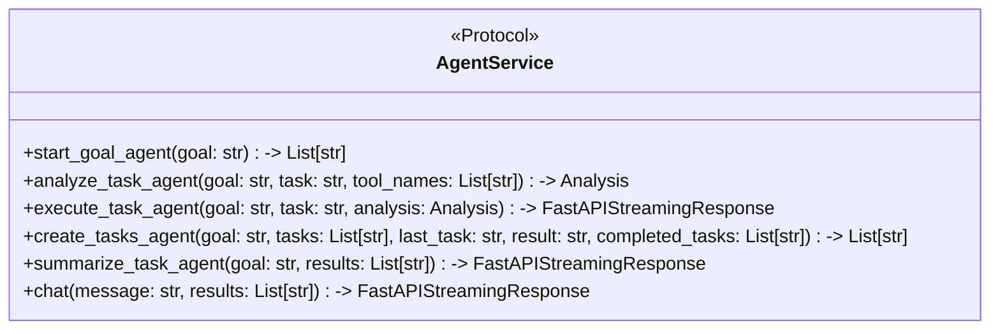
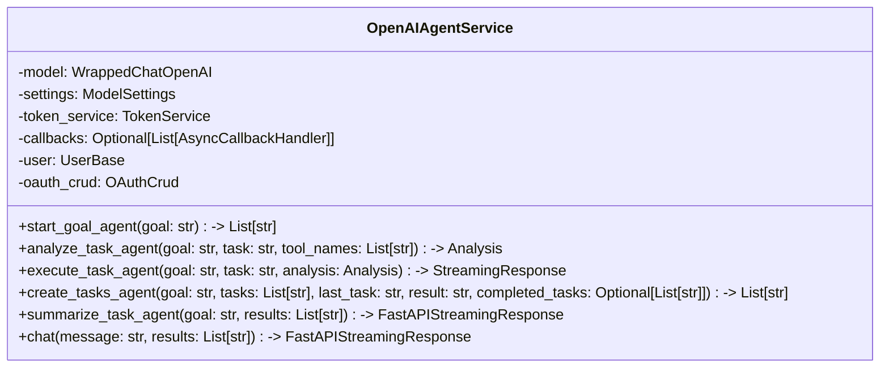
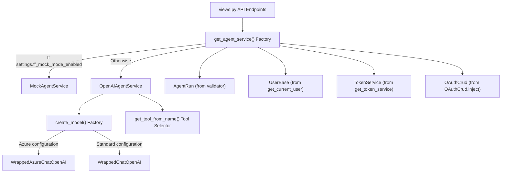
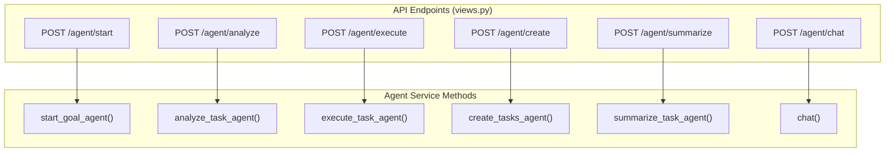
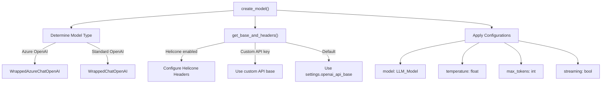
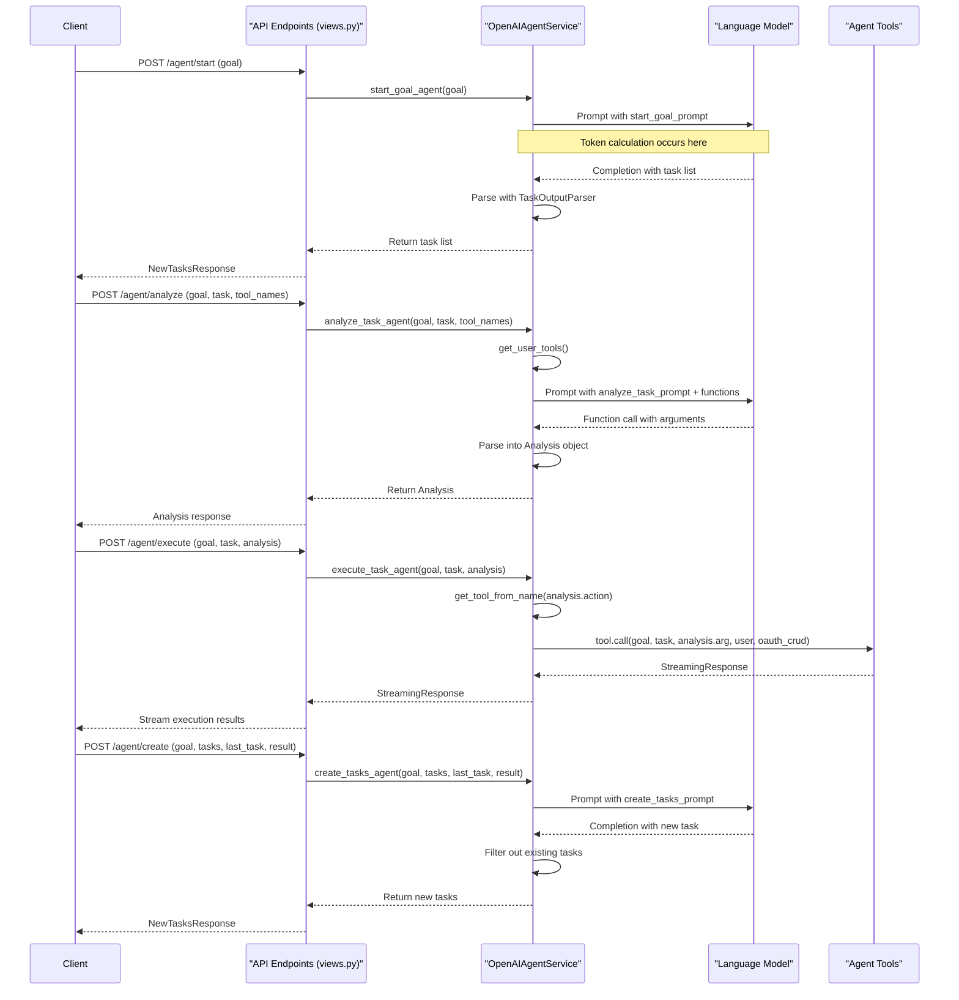
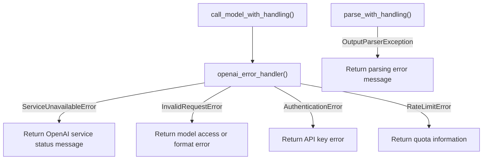
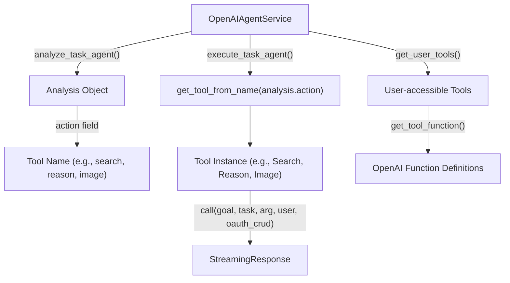

<!-- source: DeepWiki mcp.deepwiki.com · repo reworkd/AgentGPT · page 3.2 Agent Service · fetched 2026-10-26 -->

# Agent Service

<details>
<summary>Relevant source files</summary>

The following files were used as context for generating this wiki page:

- [next/src/utils/interfaces.ts](next/src/utils/interfaces.ts)
- [platform/reworkd_platform/services/tokenizer/token_service.py](platform/reworkd_platform/services/tokenizer/token_service.py)
- [platform/reworkd_platform/tests/agent/test_analysis.py](platform/reworkd_platform/tests/agent/test_analysis.py)
- [platform/reworkd_platform/tests/agent/test_crud.py](platform/reworkd_platform/tests/agent/test_crud.py)
- [platform/reworkd_platform/tests/agent/test_task_output_parser.py](platform/reworkd_platform/tests/agent/test_task_output_parser.py)
- [platform/reworkd_platform/tests/agent/test_tools.py](platform/reworkd_platform/tests/agent/test_tools.py)
- [platform/reworkd_platform/tests/test_settings.py](platform/reworkd_platform/tests/test_settings.py)
- [platform/reworkd_platform/web/api/agent/agent_service/agent_service.py](platform/reworkd_platform/web/api/agent/agent_service/agent_service.py)
- [platform/reworkd_platform/web/api/agent/agent_service/agent_service_provider.py](platform/reworkd_platform/web/api/agent/agent_service/agent_service_provider.py)
- [platform/reworkd_platform/web/api/agent/agent_service/mock_agent_service.py](platform/reworkd_platform/web/api/agent/agent_service/mock_agent_service.py)
- [platform/reworkd_platform/web/api/agent/agent_service/open_ai_agent_service.py](platform/reworkd_platform/web/api/agent/agent_service/open_ai_agent_service.py)
- [platform/reworkd_platform/web/api/agent/model_factory.py](platform/reworkd_platform/web/api/agent/model_factory.py)
- [platform/reworkd_platform/web/api/agent/views.py](platform/reworkd_platform/web/api/agent/views.py)

</details>


The Agent Service is a core component of the AgentGPT backend that orchestrates interactions between API endpoints and language models (LLMs) to enable autonomous agent operation. It provides the implementation for task generation, analysis, execution, and conversation capabilities that power the autonomous agent functionality.

For information about the API endpoints that call this service, see [Agent API](#3.1). For details about the tools that agents can use, see [Agent Tools](#3.3).

## Agent Service Interface

The Agent Service defines a protocol that all implementations must follow, providing a consistent interface for agent operations.



Sources: [platform/reworkd_platform/web/api/agent/agent_service/agent_service.py]()

## Service Implementations

The system provides two implementations of the Agent Service interface:

1. **OpenAIAgentService**: Primary implementation that uses OpenAI's language models
2. **MockAgentService**: Test implementation that returns mock responses for development/testing

### OpenAI Agent Service

The `OpenAIAgentService` class implements the core agent functionality using OpenAI's language models. It manages token usage, handles prompt construction, and coordinates with various agent tools.



Key dependencies:
- `model`: A `WrappedChatOpenAI` instance created by the model factory
- `settings`: `ModelSettings` containing language, temperature, and token limits
- `token_service`: `TokenService` for calculating and managing token usage
- `callbacks`: Optional list of `AsyncCallbackHandler` for model interactions
- `user`: `UserBase` containing current user information
- `oauth_crud`: `OAuthCrud` service for OAuth operations with external tools

Sources: [platform/reworkd_platform/web/api/agent/agent_service/open_i_agent_service.py:43-58]()

### Mock Agent Service

The `MockAgentService` provides a testing implementation that returns predefined responses without calling external APIs.

Sources: [platform/reworkd_platform/web/api/agent/agent_service/mock_agent_service.py]()

## Agent Service Provider

The Agent Service Provider is a factory function that determines which Agent Service implementation to create based on configuration and dependencies.



The `get_agent_service` function creates an Agent Service instance with the appropriate dependencies:
- Language model (created by the Model Factory)
- Token service for managing token usage
- User information and OAuth credentials

Sources: [platform/reworkd_platform/web/api/agent/agent_service/agent_service_provider.py]()

## API Integration and Method Mapping

The Agent Service methods are mapped to API endpoints in the views module:



Sources: [platform/reworkd_platform/web/api/agent/views.py]()

## Model Factory

The Agent Service relies on the Model Factory to create language model instances:



The Model Factory:
- Creates wrapped instances of ChatOpenAI or AzureChatOpenAI
- Configures API endpoints and authentication
- Sets model parameters based on user settings
- Handles Helicone integration for API monitoring

Sources: [platform/reworkd_platform/web/api/agent/model_factory.py]()

## Agent Service Operations

### Agent Lifecycle Workflow

The following sequence diagram shows how the Agent Service manages the agent lifecycle:



Sources:
- [platform/reworkd_platform/web/api/agent/agent_service/open_ai_agent_service.py]()
- [platform/reworkd_platform/web/api/agent/views.py]()

### Method Details

#### 1. Start Goal Agent

The `start_goal_agent` method generates initial tasks based on a user's goal:

```python
async def start_goal_agent(self, *, goal: str) -> List[str]:
    # Create prompt from goal and language
    # Calculate max tokens for response
    # Call model with the prompt
    # Parse output into a list of tasks
```

Key implementation details:
- Creates `ChatPromptTemplate` from `SystemMessagePromptTemplate` with `start_goal_prompt`
- Formats prompt with goal and `self.settings.language`
- Calculates token limits via `self.token_service.calculate_max_tokens`
- Calls model with error handling via `call_model_with_handling`
- Parses response using `TaskOutputParser` with empty `completed_tasks` list

Sources: [platform/reworkd_platform/web/api/agent/agent_service/open_ai_agent_service.py:60-86]()

#### 2. Analyze Task Agent

The `analyze_task_agent` method determines which tool to use for a given task:

```python
async def analyze_task_agent(self, *, goal: str, task: str, tool_names: List[str]) -> Analysis:
    # Get available tools based on tool_names
    # Create functions for each tool
    # Prompt the model with goal, task, and functions
    # Parse the function call and arguments into an Analysis object
```

Key implementation details:
- Retrieves user-accessible tools via `get_user_tools(tool_names, self.user, self.oauth_crud)`
- Maps tools to OpenAI function definitions with `get_tool_function`
- Formats `analyze_task_prompt` with goal, task, and `self.settings.language`
- Calculates tokens including function definitions in `str(functions)`
- Handles OpenAI errors via `openai_error_handler` with functions parameter
- Extracts function call from `message.additional_kwargs.get("function_call", {})`
- Parses arguments using `PydanticOutputParser(pydantic_object=AnalysisArguments)`
- Falls back to `Analysis.get_default_analysis(task)` on validation errors

Sources: [platform/reworkd_platform/web/api/agent/agent_service/open_ai_agent_service.py:88-124]()

#### 3. Execute Task Agent

The `execute_task_agent` method executes a task using the selected tool:

```python
async def execute_task_agent(self, *, goal: str, task: str, analysis: Analysis) -> StreamingResponse:
    # Adjust token limit for the response
    # Get tool class based on analysis.action
    # Call the tool with goal, task, and analysis.arg
    # Return streaming response
```

Key implementation details:
- Reduces `self.model.max_tokens` by 1000 if > 3000 (minimum 3000) to leave completion room
- Gets tool class via `get_tool_from_name(analysis.action)`
- Instantiates tool with `tool_class(self.model, self.settings.language)`
- Calls tool's `call` method with `(goal, task, analysis.arg, self.user, self.oauth_crud)`
- Returns `StreamingResponse` directly from tool execution

Sources: [platform/reworkd_platform/web/api/agent/agent_service/open_i_agent_service.py:126-144]()

#### 4. Create Tasks Agent

The `create_tasks_agent` method generates new tasks based on previous task results:

```python
async def create_tasks_agent(self, *, goal: str, tasks: List[str], 
                             last_task: str, result: str, 
                             completed_tasks: Optional[List[str]] = None) -> List[str]:
    # Create prompt with goal, tasks, last_task, result
    # Calculate max tokens for response
    # Call model with prompt
    # Filter out duplicate tasks
    # Return list of new tasks
```

Key implementation details:
- Creates `ChatPromptTemplate` from `SystemMessagePromptTemplate` with `create_tasks_prompt`
- Formats prompt with goal, language, tasks (joined with `\n`), last_task, and result
- Calculates token limits via `self.token_service.calculate_max_tokens`
- Calls model with error handling via `call_model_with_handling`
- Combines `completed_tasks` and current `tasks` into `previous_tasks`
- Returns `[completion]` if completion not in `previous_tasks`, else empty list

Sources: [platform/reworkd_platform/web/api/agent/agent_service/open_ai_agent_service.py:146-176]()

#### 5. Summarize Task Agent

The `summarize_task_agent` method generates a summary of all task results:

```python
async def summarize_task_agent(self, *, goal: str, results: List[str]) -> FastAPIStreamingResponse:
    # Use a high-capacity model
    # Limit tokens for summary
    # Tokenize and truncate results if necessary
    # Use summarize utility to generate summary
```

Key implementation details:
- Overrides `self.model.model_name = "gpt-3.5-turbo-16k"`
- Sets `self.model.max_tokens = 8000` for total tokens (prompt + completion)
- Limits input to `snippet_max_tokens = 7000` tokens to leave room for prompt overhead
- Tokenizes results with `self.token_service.tokenize("".join(results))`
- Truncates tokens with `text_tokens[0:snippet_max_tokens]` and detokenizes
- Calls `summarize(model=self.model, language=self.settings.language, goal=goal, text=text)`

Sources: [platform/reworkd_platform/web/api/agent/agent_service/open_ai_agent_service.py:178-197]()

#### 6. Chat

The `chat` method enables conversational interaction with the agent:

```python
async def chat(self, *, message: str, results: List[str]) -> FastAPIStreamingResponse:
    # Use a high-capacity model
    # Create prompt with system message, previous results, and user message
    # Calculate max tokens for response
    # Create LLMChain for the conversation
    # Return streaming response
```

Key implementation details:
- Overrides `self.model.model_name = "gpt-3.5-turbo-16k"`
- Creates `ChatPromptTemplate` with `SystemMessagePromptTemplate(prompt=chat_prompt)`
- Adds each result as `HumanMessage(content=result)` to message list
- Appends user message as final `HumanMessage(content=message)`
- Calculates token limits via `self.token_service.calculate_max_tokens`
- Creates `LLMChain(llm=self.model, prompt=prompt)`
- Returns `StreamingResponse.from_chain` with `{"language": self.settings.language}`

Sources: [platform/reworkd_platform/web/api/agent/agent_service/open_ai_agent_service.py:199-227]()

## Error Handling

The Agent Service uses utility functions to handle errors during model interactions:



These utility functions:
- `call_model_with_handling`: Wraps model calls with `openai_error_handler`
- `openai_error_handler`: Catches specific OpenAI exceptions and converts to `OpenAIError`
- `parse_with_handling`: Handles `OutputParserException` during response parsing
- Control logging based on whether `model_settings.custom_api_key` is used

Sources: [platform/reworkd_platform/web/api/agent/helpers.py]()

## Integration with Tools

The Agent Service interacts with various tools to execute tasks:



The `analyze_task_agent` method determines which tool to use, and the `execute_task_agent` method instantiates and calls the selected tool with the appropriate arguments.

Sources:
- [platform/reworkd_platform/web/api/agent/agent_service/open_ai_agent_service.py]()
- [platform/reworkd_platform/web/api/agent/tools/tools.py]()

## Token Management

The Agent Service uses the `TokenService` to manage token usage:

```python
# Calculate maximum tokens for a response
self.token_service.calculate_max_tokens(
    self.model,
    prompt.format_prompt(**args).to_string()
)
```

The Token Service:
- Counts tokens in prompt text
- Calculates available completion tokens based on model limits
- Adjusts the model's `max_tokens` parameter to stay within limits
- Handles token truncation when necessary

Sources: [platform/reworkd_platform/services/tokenizer/token_service.py]()

## Summary

The Agent Service is a critical component of the AgentGPT architecture that:

1. Defines a consistent interface for agent operations
2. Provides implementations using OpenAI models
3. Manages the entire agent lifecycle from goal setting to task execution
4. Handles error scenarios and token limitations
5. Integrates with various tools for task execution
6. Enables streaming responses for real-time feedback

Understanding this component is essential for extending the agent's capabilities or modifying its behavior within the system.

---

