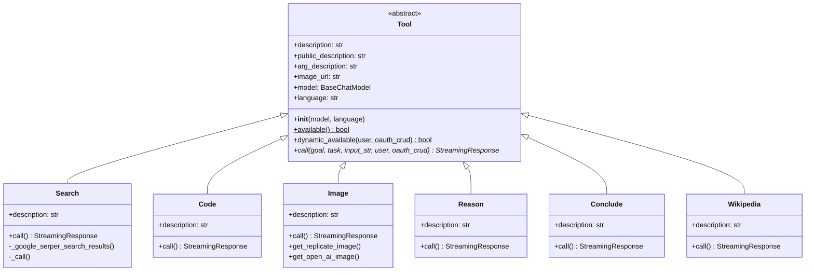
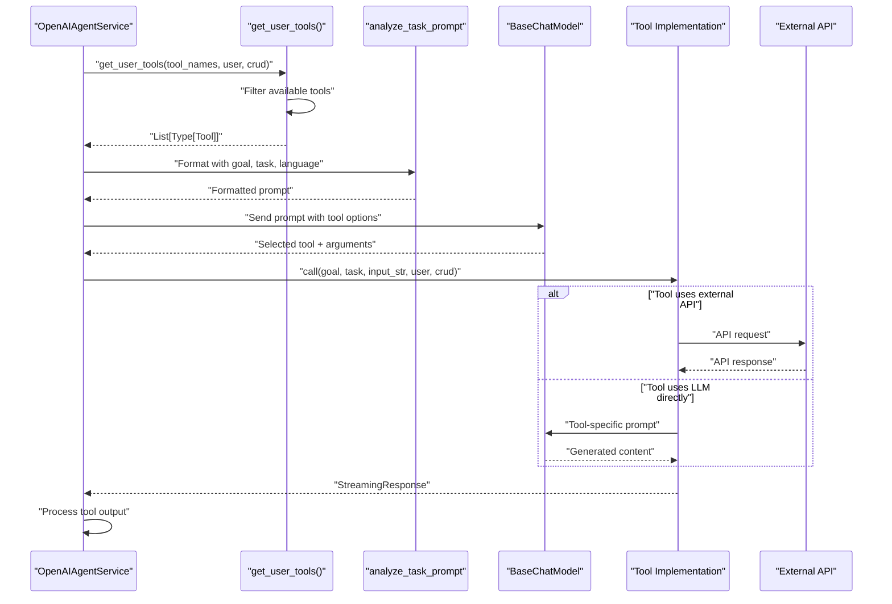
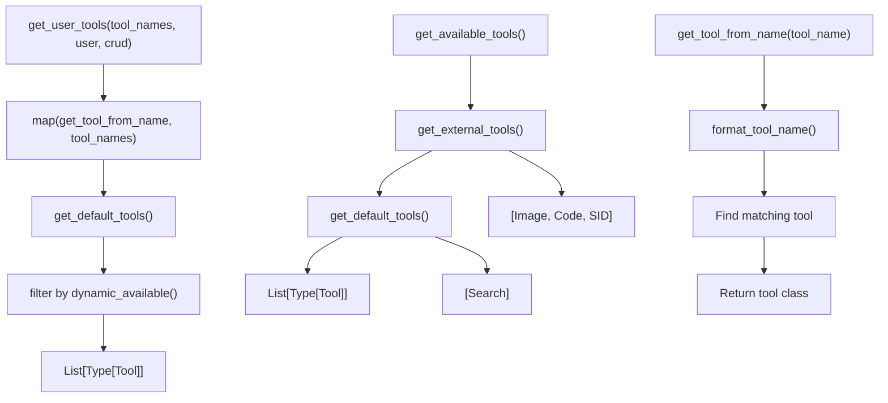
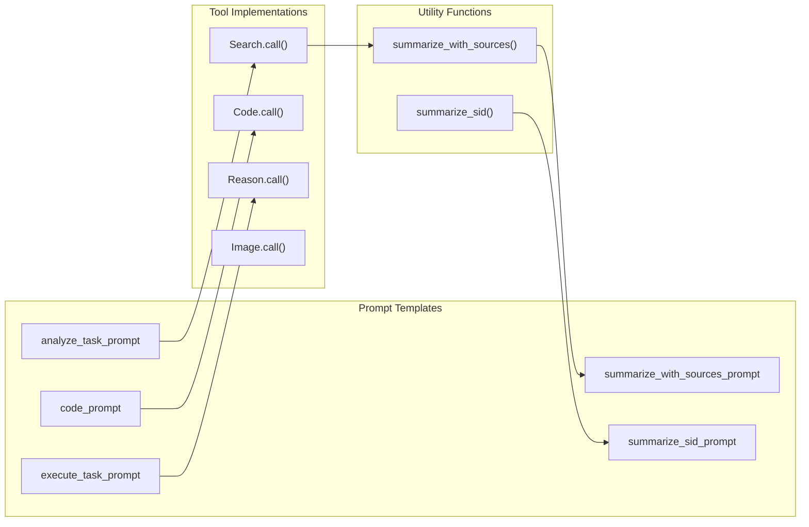
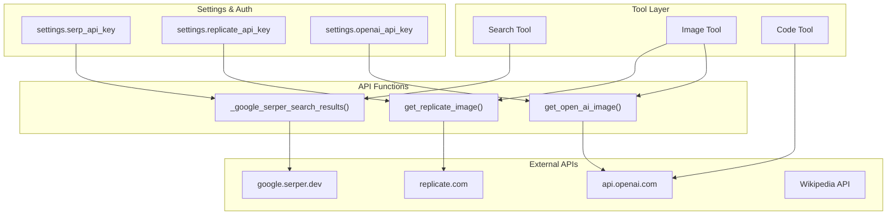

<!-- source: DeepWiki mcp.deepwiki.com · repo reworkd/AgentGPT · page 3.3 Agent Tools · fetched 2026-10-26 -->

# Agent Tools

<details>
<summary>Relevant source files</summary>

The following files were used as context for generating this wiki page:

- [platform/reworkd_platform/web/api/agent/prompts.py](platform/reworkd_platform/web/api/agent/prompts.py)
- [platform/reworkd_platform/web/api/agent/tools/code.py](platform/reworkd_platform/web/api/agent/tools/code.py)
- [platform/reworkd_platform/web/api/agent/tools/conclude.py](platform/reworkd_platform/web/api/agent/tools/conclude.py)
- [platform/reworkd_platform/web/api/agent/tools/image.py](platform/reworkd_platform/web/api/agent/tools/image.py)
- [platform/reworkd_platform/web/api/agent/tools/reason.py](platform/reworkd_platform/web/api/agent/tools/reason.py)
- [platform/reworkd_platform/web/api/agent/tools/search.py](platform/reworkd_platform/web/api/agent/tools/search.py)
- [platform/reworkd_platform/web/api/agent/tools/tool.py](platform/reworkd_platform/web/api/agent/tools/tool.py)
- [platform/reworkd_platform/web/api/agent/tools/tools.py](platform/reworkd_platform/web/api/agent/tools/tools.py)
- [platform/reworkd_platform/web/api/agent/tools/utils.py](platform/reworkd_platform/web/api/agent/tools/utils.py)
- [platform/reworkd_platform/web/api/agent/tools/wikipedia_search.py](platform/reworkd_platform/web/api/agent/tools/wikipedia_search.py)

</details>


This document covers the modular tool system that enables AgentGPT agents to perform various tasks including web search, code generation, image creation, and reasoning. The tool system provides a pluggable architecture where agents can dynamically select and execute appropriate tools based on their current objectives.

For information about how agents orchestrate tool usage during task execution, see [Task Execution](#4.2). For details about the prompt templates that guide tool selection, see [Prompts and Output Parsing](#4.3).

## Tool Architecture Overview

The agent tool system is built around an abstract `Tool` base class that defines a common interface for all agent capabilities. Each tool is responsible for a specific type of task and can integrate with external APIs or perform local computations.

### Tool Class Hierarchy



**Sources:** [platform/reworkd_platform/web/api/agent/tools/tool.py:11-42](), [platform/reworkd_platform/web/api/agent/tools/search.py:42-110](), [platform/reworkd_platform/web/api/agent/tools/code.py:10-26](), [platform/reworkd_platform/web/api/agent/tools/image.py:47-67](), [platform/reworkd_platform/web/api/agent/tools/reason.py:10-28](), [platform/reworkd_platform/web/api/agent/tools/conclude.py:9-16](), [platform/reworkd_platform/web/api/agent/tools/wikipedia_search.py:10-31]()

## Available Tool Types

The system provides several specialized tools, categorized as default tools (always available) and external tools (conditionally available based on API keys and user permissions).

| Tool Class | Type | Description | External API | Availability Method |
|------------|------|-------------|--------------|-------------------|
| `Search` | Default | Search Google for current information and facts | Serper API | `settings.serp_api_key` |
| `Code` | External | Write, refactor, and explain code | OpenAI API | Always available |
| `Image` | External | Generate AI images from text prompts | Replicate API + OpenAI DALL-E | API key dependent |
| `Reason` | Internal | Perform reasoning tasks using LLM | OpenAI API | Always available |
| `Conclude` | Internal | Mark task completion | None | Always available |
| `Wikipedia` | External | Search Wikipedia for historical information | Wikipedia API | Currently disabled |

**Sources:** [platform/reworkd_platform/web/api/agent/tools/tools.py:27-39](), [platform/reworkd_platform/web/api/agent/tools/search.py:42-54](), [platform/reworkd_platform/web/api/agent/tools/image.py:47-49](), [platform/reworkd_platform/web/api/agent/tools/code.py:10-12]()

## Tool Execution Flow

The following diagram shows how agents select and execute tools during task processing:



**Sources:** [platform/reworkd_platform/web/api/agent/tools/tools.py:12-16](), [platform/reworkd_platform/web/api/agent/prompts.py:24-36](), [platform/reworkd_platform/web/api/agent/tools/tool.py:32-41]()

## Tool Management System

The tool management system handles tool discovery, availability checking, and instantiation. Key functions in the `tools.py` module orchestrate tool operations:

### Tool Discovery Functions



**Sources:** [platform/reworkd_platform/web/api/agent/tools/tools.py:12-79]()

### Tool Availability Checking

Tools implement two availability mechanisms:

1. **Static Availability** (`available()` method): Checks if required API keys and configuration are present
2. **Dynamic Availability** (`dynamic_available()` method): Performs user-specific and runtime checks

**Sources:** [platform/reworkd_platform/web/api/agent/tools/tool.py:24-30](), [platform/reworkd_platform/web/api/agent/tools/search.py:51-53]()

## Integration with Language Models and Prompts

Tools integrate closely with the prompt system and language models to generate contextual responses:

### Tool-Specific Prompt Usage



**Sources:** [platform/reworkd_platform/web/api/agent/prompts.py:24-36](), [platform/reworkd_platform/web/api/agent/prompts.py:38-56](), [platform/reworkd_platform/web/api/agent/prompts.py:58-67](), [platform/reworkd_platform/web/api/agent/tools/utils.py:55-76](), [platform/reworkd_platform/web/api/agent/tools/utils.py:78-98]()

### LLMChain Integration

Most tools utilize `LLMChain` from LangChain to process prompts and stream responses:

```python
# Common pattern in tool implementations
chain = LLMChain(llm=self.model, prompt=specific_prompt)
return StreamingResponse.from_chain(
    chain,
    {"goal": goal, "language": self.language, "task": task},
    media_type="text/event-stream",
)
```

**Sources:** [platform/reworkd_platform/web/api/agent/tools/code.py:19-25](), [platform/reworkd_platform/web/api/agent/tools/reason.py:21-27]()

## External Service Integration

The tool system integrates with multiple external APIs to extend agent capabilities:

### API Integration Architecture



**Sources:** [platform/reworkd_platform/web/api/agent/tools/search.py:22-39](), [platform/reworkd_platform/web/api/agent/tools/image.py:15-44](), [platform/reworkd_platform/settings.py]()

### Error Handling and Fallbacks

Tools implement robust error handling with fallback mechanisms. For example, the `Search` tool falls back to `Reason` tool when the Serper API fails:

```python
async def call(self, goal: str, task: str, input_str: str, *args, **kwargs):
    try:
        return await self._call(goal, task, input_str, *args, **kwargs)
    except ClientResponseError:
        logger.exception("Error calling Serper API, falling back to reasoning")
        return await Reason(self.model, self.language).call(
            goal, task, input_str, *args, **kwargs
        )
```

**Sources:** [platform/reworkd_platform/web/api/agent/tools/search.py:55-64]()

---

