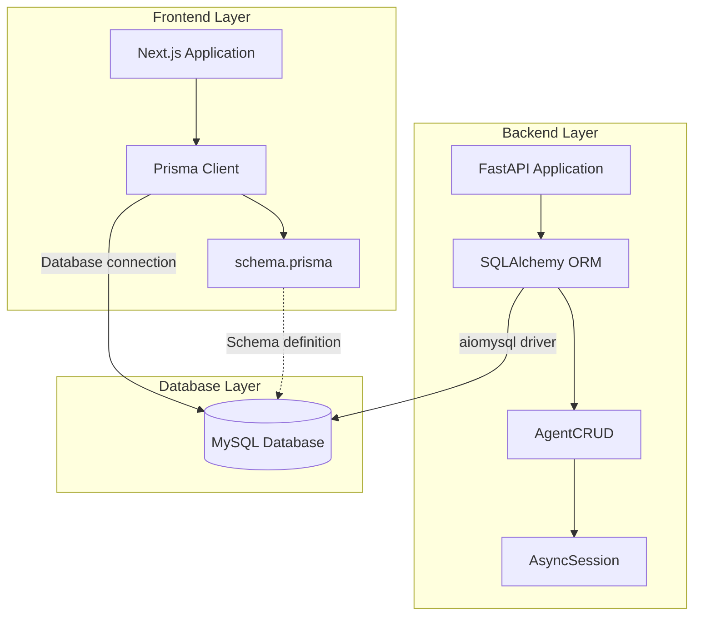
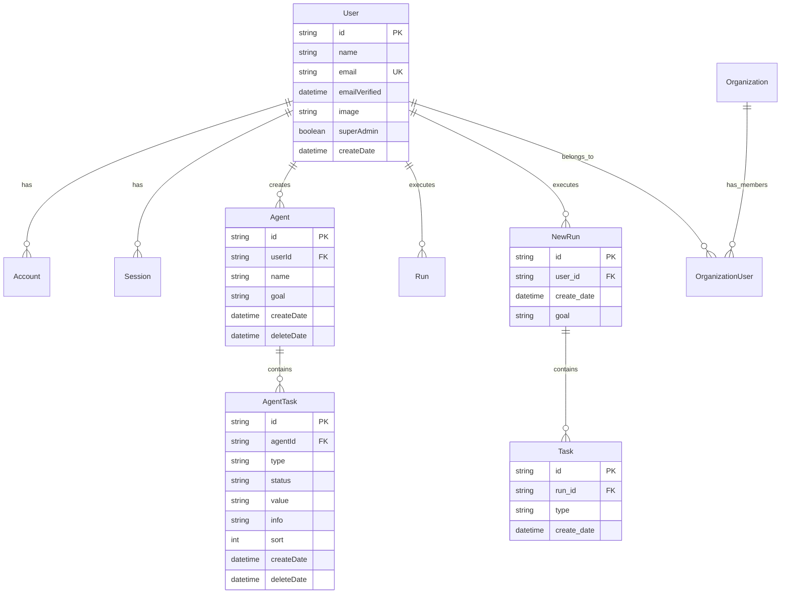
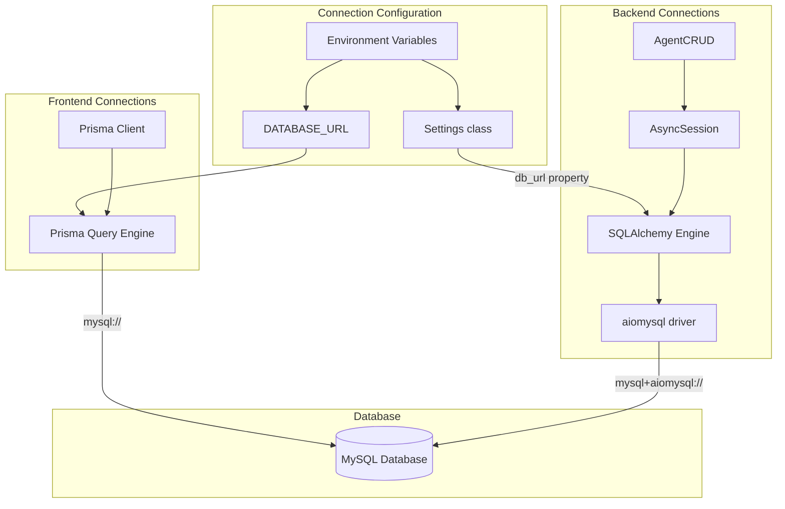
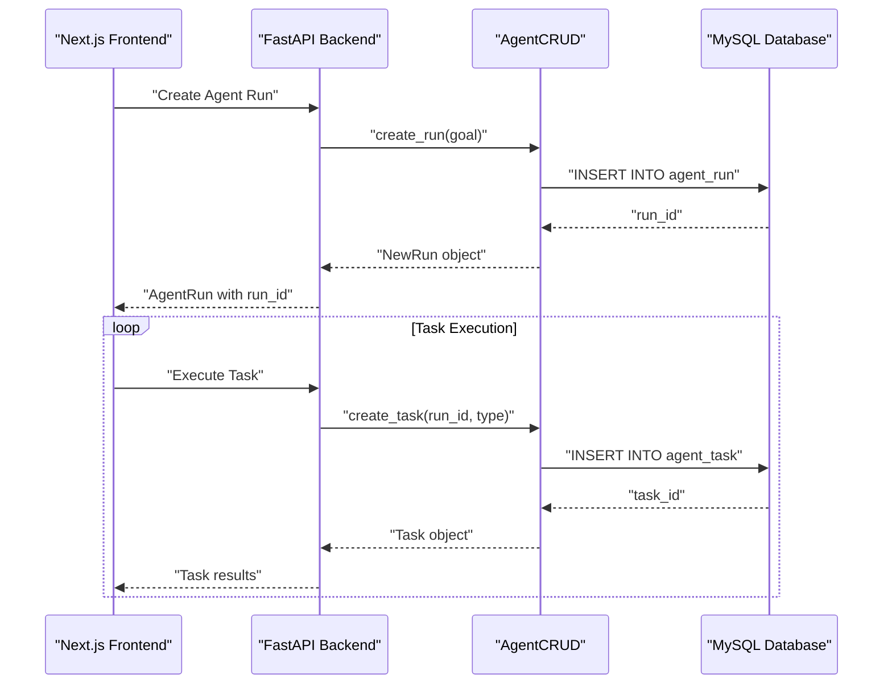
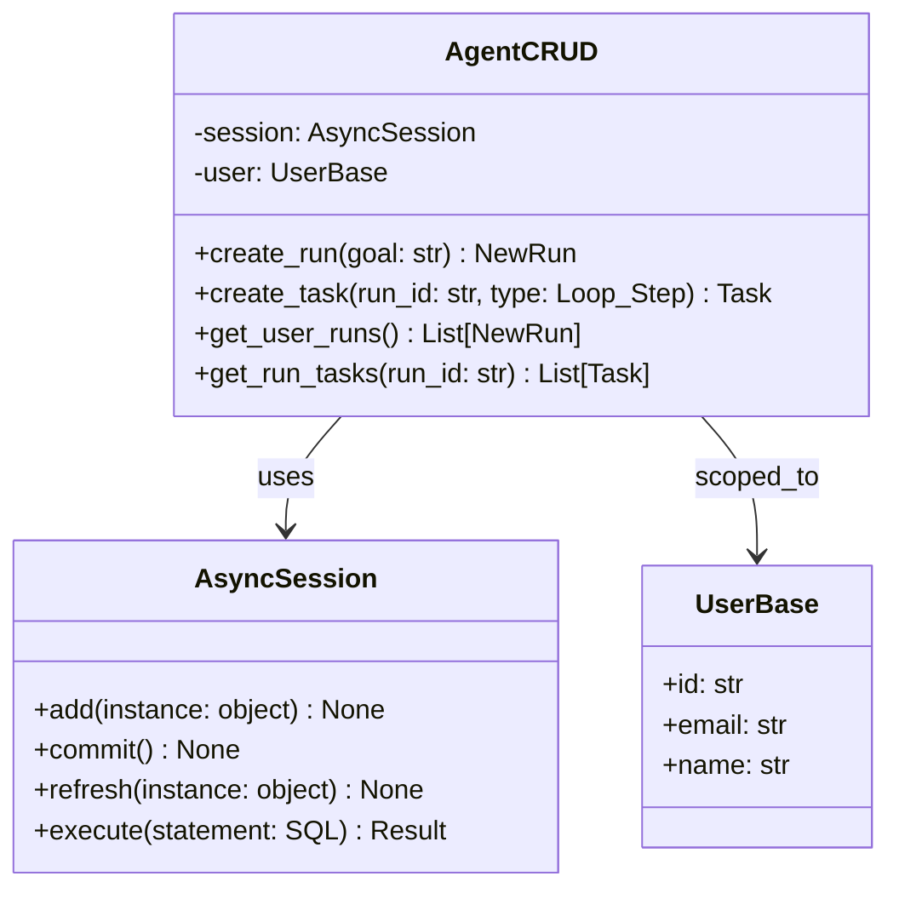
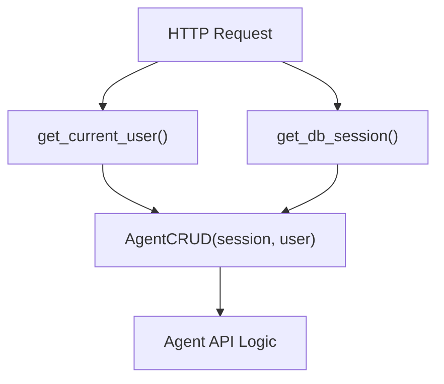

<!-- source: DeepWiki mcp.deepwiki.com · repo reworkd/AgentGPT · page 3.4 Storage and Database · fetched 2026-10-26 -->

# Storage and Database

<details>
<summary>Relevant source files</summary>

The following files were used as context for generating this wiki page:

- [next/prisma/schema.prisma](next/prisma/schema.prisma)
- [platform/poetry.lock](platform/poetry.lock)
- [platform/pyproject.toml](platform/pyproject.toml)
- [platform/reworkd_platform/settings.py](platform/reworkd_platform/settings.py)
- [platform/reworkd_platform/web/api/agent/dependancies.py](platform/reworkd_platform/web/api/agent/dependancies.py)

</details>


This page documents the database schemas, Prisma ORM integration, and data persistence layers used throughout the AgentGPT system. The system employs a dual-ORM architecture with Prisma for the Next.js frontend and SQLAlchemy for the FastAPI backend, both connecting to a shared MySQL database.

For information about Agent API and service implementation, see [Agent API](3.1) and [Agent Service](3.2).

## Database Architecture Overview

AgentGPT uses a dual-ORM approach to handle database operations across the full-stack application:

1. **Frontend (Next.js)**: Uses Prisma Client for database operations and schema management
2. **Backend (FastAPI)**: Uses SQLAlchemy with async MySQL driver for database operations  
3. **Shared Database**: MySQL database with consistent schema across both access layers

### Dual-ORM Architecture Diagram



Sources: [next/prisma/schema.prisma](), [platform/reworkd_platform/settings.py:71-79](), [platform/reworkd_platform/web/api/agent/dependancies.py:26-30]()

## Database Schema

The database schema is defined in `schema.prisma` and encompasses several key domains for the agent platform:

1. **Authentication System**: NextAuth.js models for user authentication and sessions
2. **Agent Execution System**: Models for agent definitions, tasks, and execution runs
3. **Organization Management**: Multi-tenant organization and user role models
4. **OAuth Integration**: Secure storage for OAuth provider credentials

### Core Entity Relationships



Sources: [next/prisma/schema.prisma:41-191]()

## Database Models

## Database Models

### Authentication Models (NextAuth.js Integration)

The system integrates with NextAuth.js using standard authentication models:

| Model | Purpose | Key Fields | Indices |
|-------|---------|------------|---------|
| `User` | Core user entity | `id`, `email`, `name`, `superAdmin`, `createDate` | `email`, `createDate` |
| `Account` | OAuth provider accounts | `provider`, `providerAccountId`, `userId` | `userId` |
| `Session` | Active user sessions | `sessionToken`, `userId`, `expires` | `userId` |
| `VerificationToken` | Email verification tokens | `identifier`, `token`, `expires` | `identifier + token` |

Sources: [next/prisma/schema.prisma:12-100]()

### Agent Execution Models

The core agent system uses both legacy and new implementations for tracking agent runs:

#### Legacy Agent Models
| Model | Purpose | Key Fields | Indices |
|-------|---------|------------|---------|
| `Agent` | Agent definition | `userId`, `name`, `goal`, `createDate`, `deleteDate` | `createDate`, `userId + deleteDate + createDate` |
| `AgentTask` | Agent task execution | `agentId`, `type`, `status`, `value`, `info`, `sort` | `agentId`, `type`, `createDate` |
| `Run` | Basic run tracking | `userId`, `createDate` | `userId + createDate`, `userId` |

#### New Agent Models  
| Model | Purpose | Key Fields | Indices |
|-------|---------|------------|---------|
| `NewRun` (mapped to `agent_run`) | Enhanced run tracking | `user_id`, `goal`, `create_date` | `user_id + create_date`, `user_id` |
| `Task` (mapped to `agent_task`) | Enhanced task tracking | `run_id`, `type`, `create_date` | `run_id` |

Sources: [next/prisma/schema.prisma:126-191]()

### Organization Management Models

Multi-tenant organization support with role-based access:

| Model | Purpose | Key Fields | Indices |
|-------|---------|------------|---------|
| `Organization` | Organization entity | `name`, `created_by`, `create_date` | `name` |
| `OrganizationUser` | User-organization relationships | `user_id`, `organization_id`, `role` | `user_id`, `organization_id`, `user_id + organization_id` |

Sources: [next/prisma/schema.prisma:61-92]()

### OAuth Integration Model

Secure storage for OAuth provider credentials with encryption:

| Field | Type | Purpose |
|-------|------|---------|
| `id` | String | Primary key |
| `user_id` | String | Associated user |
| `organization_id` | String? | Optional organization scope |
| `provider` | String | OAuth provider name |
| `state` | String | OAuth state parameter |
| `redirect_uri` | String | OAuth callback URI |
| `access_token_enc` | String? | Encrypted access token |
| `refresh_token_enc` | String? | Encrypted refresh token |
| `scope` | String? | OAuth scope permissions |

Sources: [next/prisma/schema.prisma:102-124]()

## Database Connectivity

The system uses different connection strategies for frontend and backend database access, both connecting to the same MySQL database.

### Database Connection Architecture



### Backend Database Configuration

The FastAPI backend uses SQLAlchemy with async MySQL support through the `Settings` class:

```python
# Database connection URL construction
@property
def db_url(self) -> URL:
    return URL.build(
        scheme="mysql+aiomysql",
        host=self.db_host,
        port=self.db_port,
        user=self.db_user,
        password=self.db_pass,
        path=f"/{self.db_base}",
    )
```

**Key Configuration Fields:**
- `db_host`: Database host (default: "localhost")
- `db_port`: Database port (default: 3308)
- `db_user`: Database username (default: "reworkd_platform")
- `db_pass`: Database password (default: "reworkd_platform")
- `db_base`: Database name (default: "reworkd_platform")
- `db_echo`: SQLAlchemy logging (default: False)

### Frontend Database Configuration

The Next.js frontend uses Prisma with the `DATABASE_URL` environment variable for connection management. The Prisma configuration includes:

- **Provider**: `mysql`
- **Relation Mode**: `prisma` (for compatibility with serverless databases like PlanetScale)
- **Client Generation**: Automatic Prisma Client generation

### Database Session Management

Backend database sessions are managed through dependency injection:

```python
def agent_crud(
    user: UserBase = Depends(get_current_user),
    session: AsyncSession = Depends(get_db_session),
) -> AgentCRUD:
    return AgentCRUD(session, user)
```

The `AgentCRUD` class provides database operations with user context and async session management.

Sources: [platform/reworkd_platform/settings.py:121-130](), [next/prisma/schema.prisma:5-9](), [platform/reworkd_platform/web/api/agent/dependancies.py:26-30](), [platform/reworkd_platform/settings.py:71-78]()

## Data Persistence Patterns

The system implements several data persistence patterns to support agent execution and user management.

### Agent Execution Data Flow

The agent execution system uses a dual-model approach for tracking runs and tasks:



### CRUD Operations Architecture

The backend implements CRUD operations through the `AgentCRUD` class, which provides user-scoped database operations:



### Database Transaction Patterns

Database operations follow consistent transaction patterns with user context:

1. **Run Creation**: Creates new agent execution with user association and goal
2. **Task Creation**: Creates individual tasks linked to runs with execution type
3. **User Scoping**: All operations are scoped to authenticated user context
4. **Async Sessions**: All database operations use async/await patterns for scalability

Sources: [platform/reworkd_platform/web/api/agent/dependancies.py:42-50](), [platform/reworkd_platform/web/api/agent/dependancies.py:26-30]()

## Database Dependencies and Patterns

The system uses FastAPI dependency injection for database session management and user context:

### Dependency Injection Pattern



**Key Dependency Functions:**
- `get_current_user()`: Extracts authenticated user from request
- `get_db_session()`: Provides async database session
- `agent_crud()`: Combines user and session into CRUD operations

### Validation and Data Flow

The system implements validation decorators for agent operations:

- `agent_start_validator`: Validates agent run creation
- `agent_analyze_validator`: Validates task analysis requests  
- `agent_execute_validator`: Validates task execution requests
- `agent_create_validator`: Validates task creation requests
- `agent_summarize_validator`: Validates summarization requests

Each validator creates database records and returns typed objects for downstream processing.

Sources: [platform/reworkd_platform/web/api/agent/dependancies.py:33-96]()

## Security Considerations

The system implements several security measures for data storage:

1. **Database Security**:
   - SSL connections in production environments
   - Encrypted OAuth tokens (indicated by `_enc` suffix in field names)

2. **S3 Security**:
   - Presigned URLs with limited validity for secure file access
   - Region-specific configuration (US East 1)

3. **Client Storage**:
   - Versioned localStorage keys to handle schema migrations

Sources: [platform/reworkd_platform/services/aws/s3.py:29-44](), [next/prisma/schema.prisma:112-114]()

---

