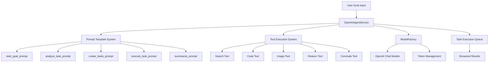
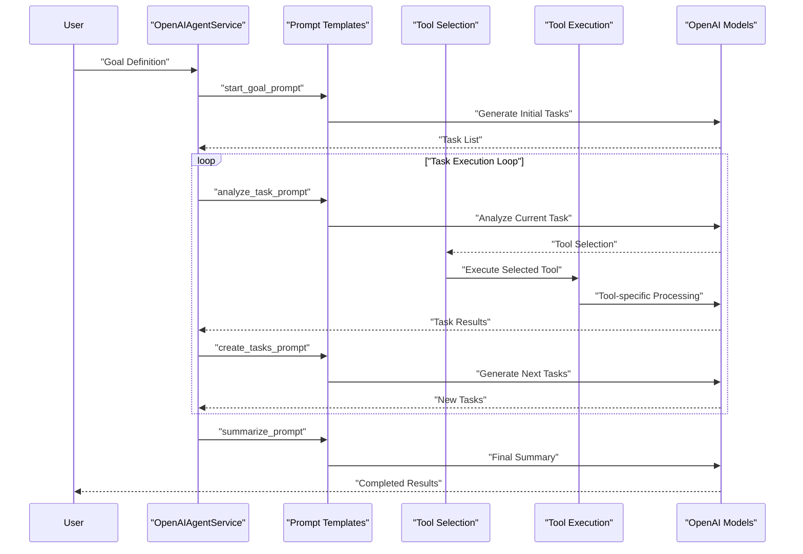
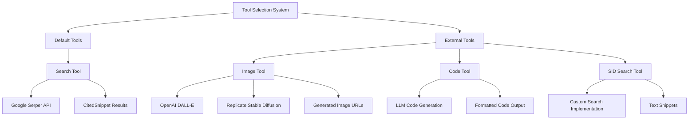
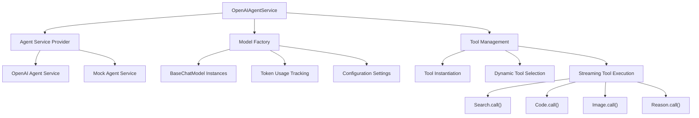

<!-- source: DeepWiki mcp.deepwiki.com · repo reworkd/AgentGPT · page 4 Agent System · fetched 2026-10-26 -->

# Agent System

<details>
<summary>Relevant source files</summary>

The following files were used as context for generating this wiki page:

- [.github/PULL_REQUEST_TEMPLATE/pull_request_template.md](.github/PULL_REQUEST_TEMPLATE/pull_request_template.md)
- [README.md](README.md)
- [docs/README.hu-Cs4K1Sr4C.md](docs/README.hu-Cs4K1Sr4C.md)
- [docs/README.zh-HANS.md](docs/README.zh-HANS.md)
- [next/src/components/console/ChatMessage.tsx](next/src/components/console/ChatMessage.tsx)
- [platform/reworkd_platform/web/api/agent/prompts.py](platform/reworkd_platform/web/api/agent/prompts.py)
- [platform/reworkd_platform/web/api/agent/tools/code.py](platform/reworkd_platform/web/api/agent/tools/code.py)
- [platform/reworkd_platform/web/api/agent/tools/conclude.py](platform/reworkd_platform/web/api/agent/tools/conclude.py)
- [platform/reworkd_platform/web/api/agent/tools/image.py](platform/reworkd_platform/web/api/agent/tools/image.py)
- [platform/reworkd_platform/web/api/agent/tools/reason.py](platform/reworkd_platform/web/api/agent/tools/reason.py)
- [platform/reworkd_platform/web/api/agent/tools/search.py](platform/reworkd_platform/web/api/agent/tools/search.py)
- [platform/reworkd_platform/web/api/agent/tools/tool.py](platform/reworkd_platform/web/api/agent/tools/tool.py)
- [platform/reworkd_platform/web/api/agent/tools/tools.py](platform/reworkd_platform/web/api/agent/tools/tools.py)
- [platform/reworkd_platform/web/api/agent/tools/utils.py](platform/reworkd_platform/web/api/agent/tools/utils.py)
- [platform/reworkd_platform/web/api/agent/tools/wikipedia_search.py](platform/reworkd_platform/web/api/agent/tools/wikipedia_search.py)

</details>


This document covers the autonomous agent execution system that forms the core of AgentGPT. The agent system handles goal decomposition, task execution, and tool coordination to enable autonomous AI agents to work toward user-defined objectives.

For information about the web API endpoints that expose agent functionality, see [Agent API](#3.1). For details about individual tools that agents use, see [Agent Tools](#3.3). For prompt template management, see [Prompts and Output Parsing](#4.3).

## System Purpose

The Agent System implements an autonomous execution loop where agents:
1. Accept high-level goals from users
2. Break down goals into executable tasks  
3. Select and execute appropriate tools for each task
4. Learn from results and generate new tasks
5. Continue until the goal is achieved or terminated

## Agent Architecture Overview

The agent system follows a modular architecture with clear separation between prompt management, tool execution, and service coordination.



Sources: [platform/reworkd_platform/web/api/agent/prompts.py:1-186](), [platform/reworkd_platform/web/api/agent/tools/tools.py:1-79]()

## Core Execution Loop

The agent execution follows a structured loop that combines prompt-driven task generation with tool-based execution.

### Agent Execution Flow



Sources: [platform/reworkd_platform/web/api/agent/prompts.py:5-22](), [platform/reworkd_platform/web/api/agent/prompts.py:24-36](), [platform/reworkd_platform/web/api/agent/prompts.py:69-92]()

### Task Generation and Analysis

The system uses structured prompts to break down goals and analyze tasks:

| Prompt Template | Purpose | Key Variables |
|-----------------|---------|---------------|
| `start_goal_prompt` | Convert user goal into initial search queries | `goal`, `language` |
| `analyze_task_prompt` | Determine appropriate tool for current task | `goal`, `task`, `language` |
| `create_tasks_prompt` | Generate next task based on previous results | `goal`, `tasks`, `lastTask`, `result`, `language` |
| `execute_task_prompt` | Execute reasoning-based tasks | `goal`, `task`, `language` |
| `summarize_prompt` | Combine results into cohesive output | `goal`, `text`, `language` |

Sources: [platform/reworkd_platform/web/api/agent/prompts.py:5-22](), [platform/reworkd_platform/web/api/agent/prompts.py:24-36](), [platform/reworkd_platform/web/api/agent/prompts.py:69-92](), [platform/reworkd_platform/web/api/agent/prompts.py:58-67](), [platform/reworkd_platform/web/api/agent/prompts.py:94-109]()

## Tool Selection and Execution

The agent system integrates multiple specialized tools that can be dynamically selected based on task requirements.

### Available Tool Types



Sources: [platform/reworkd_platform/web/api/agent/tools/tools.py:27-39](), [platform/reworkd_platform/web/api/agent/tools/search.py:42-110](), [platform/reworkd_platform/web/api/agent/tools/image.py:47-67](), [platform/reworkd_platform/web/api/agent/tools/code.py:10-26]()

### Tool Availability and Selection

The system dynamically determines tool availability based on API key configuration and user permissions:

```python
# Tool availability checking
def get_available_tools() -> List[Type[Tool]]:
    return get_external_tools() + get_default_tools()

async def get_user_tools(
    tool_names: List[str], user: UserBase, crud: OAuthCrud
) -> List[Type[Tool]]:
    tools = list(map(get_tool_from_name, tool_names)) + get_default_tools()
    return [tool for tool in tools if await tool.dynamic_available(user, crud)]
```

Sources: [platform/reworkd_platform/web/api/agent/tools/tools.py:19-21](), [platform/reworkd_platform/web/api/agent/tools/tools.py:12-16]()

## Agent Service Implementation

The core agent service coordinates between prompts, tools, and language models to execute the autonomous behavior.

### Service Architecture



Sources: [platform/reworkd_platform/web/api/agent/tools/tool.py:11-42](), [platform/reworkd_platform/web/api/agent/tools/search.py:55-110](), [platform/reworkd_platform/web/api/agent/tools/reason.py:10-28]()

### Tool Base Class Interface

All tools implement a common interface for consistent integration:

```python
class Tool(ABC):
    description: str = ""
    public_description: str = ""
    arg_description: str = "The argument to the function."
    image_url: str = "/tools/openai-white.png"
    
    model: BaseChatModel
    language: str
    
    @abstractmethod
    async def call(
        self,
        goal: str,
        task: str,
        input_str: str,
        user: UserBase,
        oauth_crud: OAuthCrud,
    ) -> StreamingResponse:
        pass
```

Sources: [platform/reworkd_platform/web/api/agent/tools/tool.py:11-42]()

## Streaming Response System

The agent system uses streaming responses to provide real-time feedback during task execution, allowing users to see progress as tasks are being processed.

### Response Flow

All tool executions return `FastAPIStreamingResponse` objects that stream results back to the frontend as they are generated. This enables:

- Real-time task progress visibility
- Immediate feedback on tool execution
- Graceful handling of long-running operations
- User engagement throughout the agent execution process

Sources: [platform/reworkd_platform/web/api/agent/tools/search.py:55-64](), [platform/reworkd_platform/web/api/agent/tools/utils.py:34-53](), [platform/reworkd_platform/web/api/agent/stream_mock.py]()

## Error Handling and Fallbacks

The system implements robust error handling with automatic fallbacks to ensure agent execution continues even when specific tools fail:

```python
async def call(
    self, goal: str, task: str, input_str: str, *args: Any, **kwargs: Any
) -> FastAPIStreamingResponse:
    try:
        return await self._call(goal, task, input_str, *args, **kwargs)
    except ClientResponseError:
        logger.exception("Error calling Serper API, falling back to reasoning")
        return await Reason(self.model, self.language).call(
            goal, task, input_str, *args, **kwargs
        )
```

When external APIs fail (like search services), the system automatically falls back to reasoning-based task execution using the language model directly.

Sources: [platform/reworkd_platform/web/api/agent/tools/search.py:55-64](), [platform/reworkd_platform/web/api/agent/tools/reason.py:16-28]()

---

