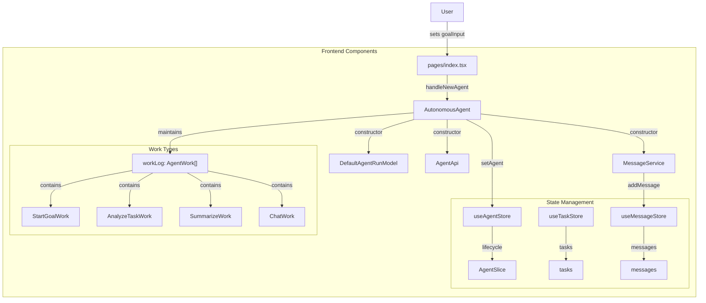
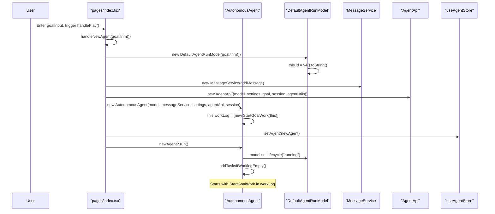
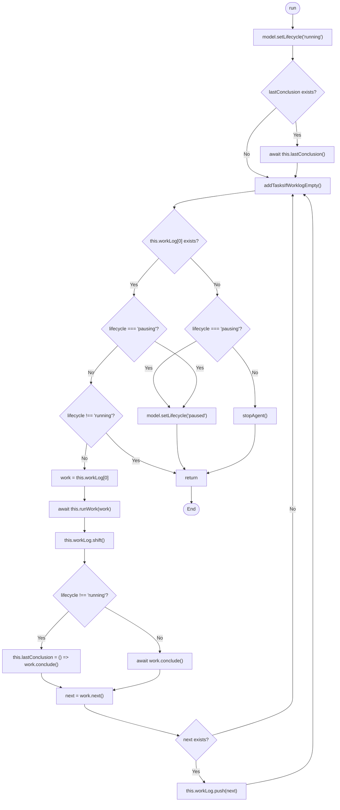
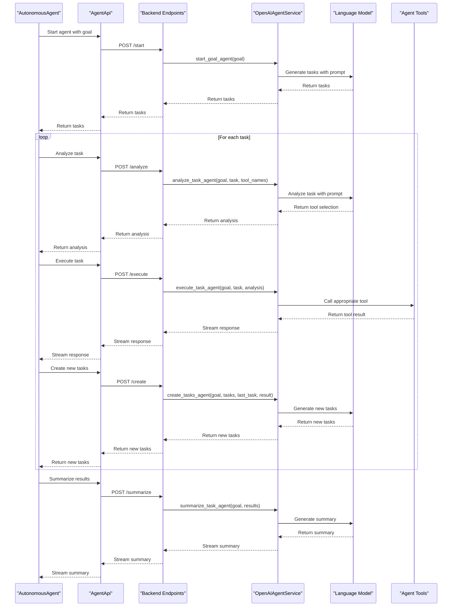
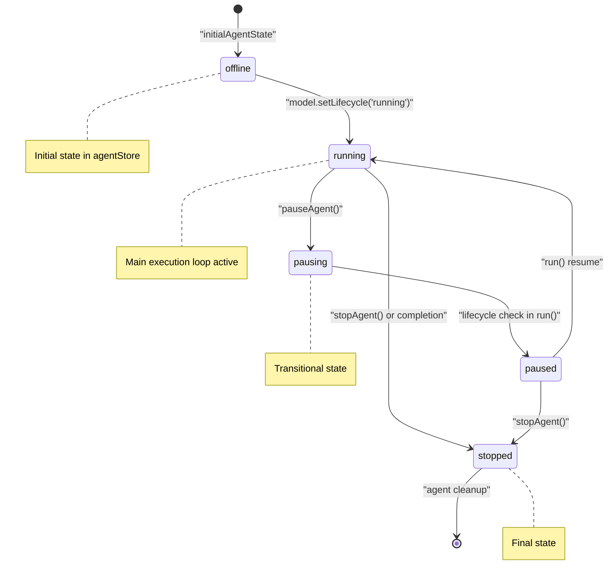
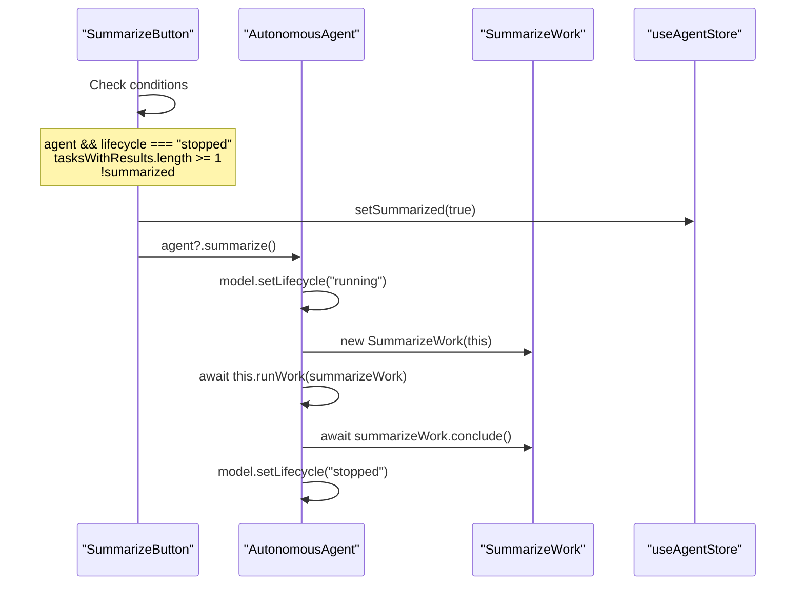
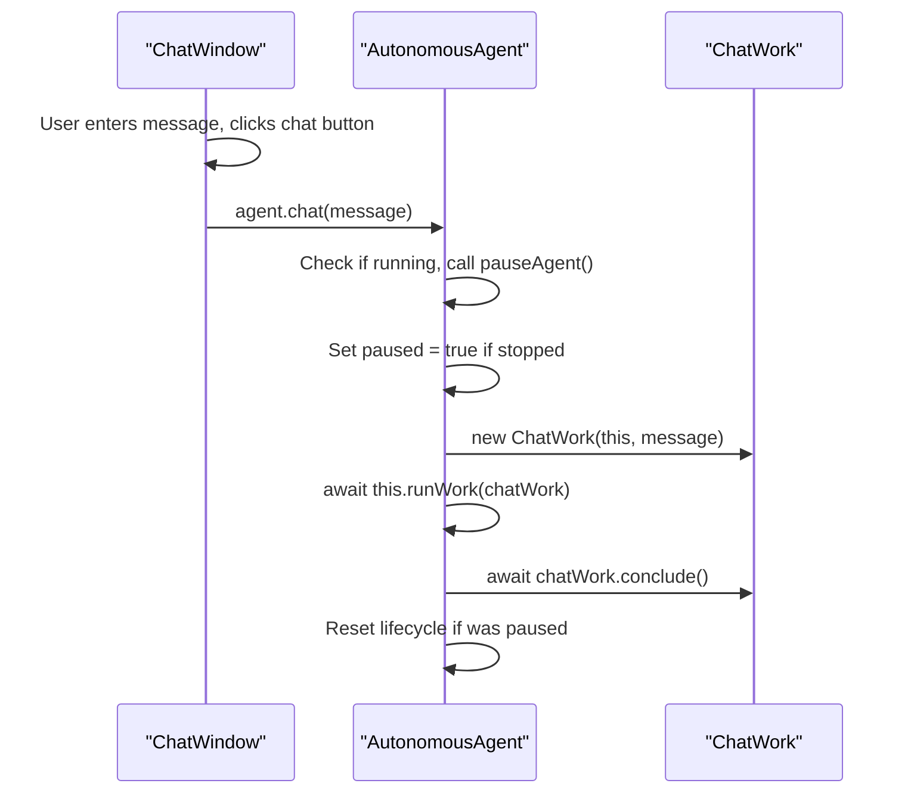

<!-- source: DeepWiki mcp.deepwiki.com · repo reworkd/AgentGPT · page 4.1 Agent Lifecycle · fetched 2026-10-26 -->

# Agent Lifecycle

<details>
<summary>Relevant source files</summary>

The following files were used as context for generating this wiki page:

- [.github/PULL_REQUEST_TEMPLATE/pull_request_template.md](.github/PULL_REQUEST_TEMPLATE/pull_request_template.md)
- [README.md](README.md)
- [docs/README.hu-Cs4K1Sr4C.md](docs/README.hu-Cs4K1Sr4C.md)
- [docs/README.zh-HANS.md](docs/README.zh-HANS.md)
- [next/src/components/console/ChatMessage.tsx](next/src/components/console/ChatMessage.tsx)
- [next/src/components/console/ChatWindow.tsx](next/src/components/console/ChatWindow.tsx)
- [next/src/components/console/MacWindowHeader.tsx](next/src/components/console/MacWindowHeader.tsx)
- [next/src/components/console/SummarizeButton.tsx](next/src/components/console/SummarizeButton.tsx)
- [next/src/pages/agent/index.tsx](next/src/pages/agent/index.tsx)
- [next/src/pages/index.tsx](next/src/pages/index.tsx)
- [next/src/services/agent/agent-run-model.tsx](next/src/services/agent/agent-run-model.tsx)
- [next/src/services/agent/autonomous-agent.ts](next/src/services/agent/autonomous-agent.ts)
- [next/src/services/agent/message-service.ts](next/src/services/agent/message-service.ts)
- [next/src/stores/agentStore.ts](next/src/stores/agentStore.ts)

</details>


This document details the complete lifecycle of an agent in the AgentGPT system, from creation to completion. It covers the agent states, initialization, execution flow, and how the agent processes tasks. For specific details about task execution and analysis, see [Task Execution](#4.2). For information about prompt templates used in agent operations, see [Prompts and Output Parsing](#4.3).

## Agent Lifecycle Overview

The AgentGPT system implements an autonomous agent that can execute a sequence of tasks to achieve a user-defined goal. The agent lifecycle encompasses the entire process from when a user initializes an agent with a goal to when the agent completes its execution.

```mermaid
stateDiagram-v2
    [*] --> "offline" : Initialize
    "offline" --> "running" : Start with goal
    "running" --> "pausing" : Pause request
    "pausing" --> "paused" : Pause complete
    "paused" --> "running" : Resume
    "running" --> "stopped" : Complete all tasks/Error/Manual stop
    "paused" --> "stopped" : Manual stop
    "stopped" --> [*]

    note right of "offline"
      Initial state before agent starts
    end note
    note right of "running"
      Agent actively processing tasks
    end note
    note right of "paused"
      Execution temporarily halted
    end note
    note right of "stopped"
      Agent execution completed
    end note
```

Sources: [next/src/services/agent/agent-run-model.tsx:32](). [next/src/services/agent/autonomous-agent.ts:42-81]().

## Agent Components and Architecture

The agent system consists of frontend components that coordinate to manage the agent's lifecycle and execution.



Sources: [next/src/pages/index.tsx:72-100](). [next/src/services/agent/autonomous-agent.ts:17-39](). [next/src/stores/agentStore.ts:10-26](). [next/src/stores/taskStore.ts:1-50](). [next/src/stores/messageStore.ts:1-30]().

### Core Components

| Component | File Location | Description |
|-----------|---------------|-------------|
| `AutonomousAgent` | [next/src/services/agent/autonomous-agent.ts:17]() | Main class managing agent lifecycle with `run()`, `pauseAgent()`, `stopAgent()` methods |
| `DefaultAgentRunModel` | [next/src/services/agent/agent-run-model.tsx:34]() | Implements `AgentRunModel` interface, manages goal, tasks, and lifecycle state |
| `MessageService` | [next/src/services/agent/message-service.ts:12]() | Handles `sendMessage()`, `sendErrorMessage()`, `startTask()` for UI updates |
| `AgentApi` | [next/src/services/agent/agent-api.ts:1]() | Frontend service for backend API communication |
| `useAgentStore` | [next/src/stores/agentStore.ts:78]() | Zustand store managing `agent`, `lifecycle`, `isAgentThinking` state |

Sources: [next/src/services/agent/autonomous-agent.ts:17-40](). [next/src/services/agent/agent-run-model.tsx:34-79](). [next/src/services/agent/message-service.ts:12-17](). [next/src/stores/agentStore.ts:10-26]().

## Agent Initialization

The agent initialization process starts when a user defines a goal in the `goalInput` field and triggers `handleNewAgent()`.



Sources: [next/src/pages/index.tsx:72-100](). [next/src/services/agent/autonomous-agent.ts:27-39](). [next/src/services/agent/agent-run-model.tsx:34-41](). [next/src/services/agent/message-service.ts:12-16]().

The initialization process involves:

1. User enters goal in `goalInput` and calls `handlePlay(goalInput)` [next/src/pages/index.tsx:67-70]()
2. `handleNewAgent()` creates a new `DefaultAgentRunModel(goal.trim())` with unique ID via `v4()` [next/src/services/agent/agent-run-model.tsx:38-41]()
3. `MessageService` is created with `addMessage` callback from `useMessageStore` [next/src/pages/index.tsx:85]()
4. `AgentApi` is created with `toApiModelSettings()` configuration [next/src/pages/index.tsx:86-91]()
5. `AutonomousAgent` constructor initializes `workLog` with `StartGoalWork` [next/src/services/agent/autonomous-agent.ts:39]()
6. `setAgent(newAgent)` updates `useAgentStore` state [next/src/pages/index.tsx:99]()
7. `newAgent?.run()` starts the execution loop [next/src/pages/index.tsx:100]()

Sources: [next/src/pages/index.tsx:72-100](). [next/src/services/agent/autonomous-agent.ts:27-39](). [next/src/services/agent/agent-run-model.tsx:34-47]().

The initialization process involves:

1. User sets a goal in the frontend
2. The frontend creates a new `DefaultAgentRunModel` with the goal
3. The frontend creates a `MessageService` for handling UI messages
4. The frontend creates an `AgentApi` for communicating with the backend
5. The frontend creates an `AutonomousAgent` with these components
6. The `AutonomousAgent.run()` method is called to start execution
7. The agent sends a request to the backend to generate initial tasks
8. The backend uses LLM prompting to generate tasks based on the goal
9. The tasks are returned to the frontend and displayed to the user

Sources: [next/src/pages/index.tsx:72-100](). [next/src/services/agent/autonomous-agent.ts:42-46]().

## Agent Execution Process

After initialization, the agent enters its main execution loop, processing tasks until completion.

### Agent Execution Loop

The `AutonomousAgent.run()` method implements the main execution loop using a `workLog` array of `AgentWork` items.



Sources: [next/src/services/agent/autonomous-agent.ts:42-81]().

The execution process follows these steps:

1. `model.setLifecycle("running")` sets the agent state [next/src/services/agent/autonomous-agent.ts:43]()
2. Resumes any pending `lastConclusion` from paused state [next/src/services/agent/autonomous-agent.ts:46-49]()
3. `addTasksIfWorklogEmpty()` adds `AnalyzeTaskWork` if tasks exist [next/src/services/agent/autonomous-agent.ts:115-123]()
4. Main loop processes `this.workLog[0]` until empty [next/src/services/agent/autonomous-agent.ts:52-75]()
5. `runWork(work)` executes the work item with retry logic [next/src/services/agent/autonomous-agent.ts:87-112]()
6. `this.workLog.shift()` removes completed work [next/src/services/agent/autonomous-agent.ts:61]()
7. `work.conclude()` finalizes the work and `work.next()` provides follow-up work [next/src/services/agent/autonomous-agent.ts:65-72]()
8. Process repeats until `workLog` is empty and no tasks remain

Sources: [next/src/services/agent/autonomous-agent.ts:42-81]().

The execution process follows these steps:

1. The agent sets its lifecycle to "running"
2. It checks if the work log is empty
   - If empty, it adds tasks if any are available, otherwise stops
3. It runs the next work item in the work log
4. It removes the completed work from the work log
5. It concludes the work and adds any follow-up work
6. It repeats the process until all tasks are complete
7. When done, it sets the lifecycle to "stopped"

Sources: [next/src/services/agent/autonomous-agent.ts:42-81]().

### AgentWork Types

The agent uses different `AgentWork` subclasses in its `workLog` to handle execution stages:

| Work Type | File Location | Description |
|-----------|---------------|-------------|
| `StartGoalWork` | [next/src/services/agent/agent-work/start-task-work.ts]() | Initial work added to `workLog` in constructor, gets initial tasks from goal |
| `AnalyzeTaskWork` | [next/src/services/agent/agent-work/analyze-task-work.ts]() | Added by `addTasksIfWorklogEmpty()` when `getCurrentTask()` exists |
| `SummarizeWork` | [next/src/services/agent/agent-work/summarize-work.ts]() | Created by `summarize()` method for final summary generation |
| `ChatWork` | [next/src/services/agent/agent-work/chat-work.ts]() | Created by `chat(message)` method for user interactions |

Each `AgentWork` implements:
- `run()`: Main execution logic
- `conclude()`: Finalization after execution  
- `next()`: Returns follow-up work or undefined
- `onError?()`: Optional error handling

Sources: [next/src/services/agent/autonomous-agent.ts:5-9](). [next/src/services/agent/autonomous-agent.ts:39](). [next/src/services/agent/autonomous-agent.ts:121](). [next/src/services/agent/autonomous-agent.ts:134-140](). [next/src/services/agent/autonomous-agent.ts:142-155]().

## Agent-Backend Interaction

The agent communicates with the backend through several API endpoints to perform its functions:



Sources: [platform/reworkd_platform/web/api/agent/views.py:34-117](). [platform/reworkd_platform/web/api/agent/agent_service/open_ai_agent_service.py:60-227](). [next/src/services/agent/autonomous-agent.ts:42-168]().

The agent interacts with the backend through these key endpoints:

1. **Start** (`/start`): Initializes the agent with a goal and generates initial tasks
2. **Analyze** (`/analyze`): Analyzes a task to determine the appropriate tool
3. **Execute** (`/execute`): Executes a task using the selected tool
4. **Create** (`/create`): Creates new tasks based on results
5. **Summarize** (`/summarize`): Generates a summary of results
6. **Chat** (`/chat`): Handles user interactions during execution

Each endpoint corresponds to a stage in the agent lifecycle and is handled by corresponding methods in the `OpenAIAgentService`.

Sources: [platform/reworkd_platform/web/api/agent/views.py:34-117](). [platform/reworkd_platform/web/api/agent/agent_service/open_ai_agent_service.py:60-227]().

## Agent Tools

The agent uses various tools to accomplish tasks. These tools are selected during the task analysis phase:

| Tool | Description | Use Case |
|------|-------------|----------|
| `Search` | Searches Google for information | Finding current information and answering questions |
| `Image` | Generates images based on prompts | Creating visual content |
| `Code` | Writes and reviews code | Programming tasks and code explanation |
| `Reason` | Uses logical reasoning | Making decisions and analyzing information |
| `Wikipedia` | Searches Wikipedia | Finding historical and factual information |
| `Conclude` | Concludes task execution | Ending a task when complete |

The tool selection process:
1. The agent analyzes the task using the `analyze_task_agent` method
2. The LLM determines the most appropriate tool for the task
3. The selected tool is called with the task information
4. The tool's result is returned to the agent

Sources: [platform/reworkd_platform/web/api/agent/tools/tools.py:12-78](). [platform/reworkd_platform/web/api/agent/tools/search.py:42-109](). [platform/reworkd_platform/web/api/agent/tools/image.py:47-66](). [platform/reworkd_platform/web/api/agent/tools/code.py:10-25](). [platform/reworkd_platform/web/api/agent/tools/reason.py:10-27](). [platform/reworkd_platform/web/api/agent/tools/wikipedia_search.py:10-30](). [platform/reworkd_platform/web/api/agent/tools/conclude.py:9-15]().

## Agent State Management

The agent state is managed through Zustand stores and the `DefaultAgentRunModel`:

### Zustand Stores

| Store | File Location | State Management |
|-------|---------------|------------------|
| `useAgentStore` | [next/src/stores/agentStore.ts:78]() | `agent: AutonomousAgent`, `lifecycle: AgentLifecycle`, `isAgentThinking: boolean` |
| `useTaskStore` | [next/src/stores/taskStore.ts]() | `tasks: Task[]`, `addTask()`, `updateTask()` methods |
| `useMessageStore` | [next/src/stores/messageStore.ts]() | `messages: Message[]`, `addMessage()`, `updateMessage()` methods |

### AgentLifecycle States

The `AgentLifecycle` type defines agent execution states:



Sources: [next/src/services/agent/agent-run-model.tsx:32](). [next/src/stores/agentStore.ts:21-26]().

### State Transitions

| Transition | Trigger | Implementation |
|------------|---------|----------------|
| `offline` → `running` | `handleNewAgent()` calls `newAgent?.run()` | [next/src/pages/index.tsx:100]() |
| `running` → `pausing` | User clicks pause, calls `pauseAgent()` | [next/src/services/agent/autonomous-agent.ts:125-127]() |
| `pausing` → `paused` | `run()` loop checks `getLifecycle() === "pausing"` | [next/src/services/agent/autonomous-agent.ts:54]() |
| `paused` → `running` | User resumes, calls `run()` again | [next/src/services/agent/autonomous-agent.ts:42]() |
| Any → `stopped` | `stopAgent()` or completion | [next/src/services/agent/autonomous-agent.ts:129-132]() |

The `DefaultAgentRunModel` proxies lifecycle state to `useAgentStore`:
- `getLifecycle()` calls `useAgentStore.getState().lifecycle` [next/src/services/agent/agent-run-model.tsx:46]()
- `setLifecycle()` calls `useAgentStore.getState().setLifecycle()` [next/src/services/agent/agent-run-model.tsx:47]()

Sources: [next/src/services/agent/agent-run-model.tsx:46-47](). [next/src/services/agent/autonomous-agent.ts:125-132](). [next/src/stores/agentStore.ts:40-44]().

## Special Operations

### Agent Summarization

The `SummarizeButton` component triggers agent summarization when conditions are met:



Sources: [next/src/components/console/SummarizeButton.tsx:8-39](). [next/src/services/agent/autonomous-agent.ts:134-140]().

Conditions for summarization:
- `agent !== null` and `lifecycle === "stopped"` [next/src/components/console/SummarizeButton.tsx:17]()
- `tasksWithResults.length >= 1` where tasks have `status === "completed"` [next/src/components/console/SummarizeButton.tsx:11-13]()
- `!summarized` to prevent duplicate summaries [next/src/components/console/SummarizeButton.tsx:17]()

### Agent Chat Interaction

The `ChatWindow` component enables user chat with agents through `chatControls`:



Sources: [next/src/components/console/ChatWindow.tsx:93-109](). [next/src/services/agent/autonomous-agent.ts:142-155]().

The `chat()` method handles different lifecycle states:
- If `lifecycle === "running"`, calls `pauseAgent()` first [next/src/services/agent/autonomous-agent.ts:143]()
- If `lifecycle === "stopped"`, temporarily sets to `"pausing"` for execution [next/src/services/agent/autonomous-agent.ts:145-148]()
- Creates and executes `ChatWork` with user message [next/src/services/agent/autonomous-agent.ts:149-151]()

Sources: [next/src/services/agent/autonomous-agent.ts:142-155](). [next/src/components/console/ChatWindow.tsx:93-109]().

## Agent Error Handling

The agent implements error handling to handle various failure scenarios:

1. **Network errors**: Retry the operation with exponential backoff
2. **API errors**: Display appropriate error messages
3. **LLM errors**: Fallback to default responses
4. **Tool errors**: Fall back to reasoning tool

The `runWork` method in `AutonomousAgent` uses the `withRetries` function to retry operations that fail due to retryable errors.

Sources: [next/src/services/agent/autonomous-agent.ts:87-112](). [next/src/services/agent/message-service.ts:66-106]().

## Conclusion

The Agent Lifecycle in AgentGPT encompasses the entire process of agent creation, initialization, task execution, and completion. The system uses a combination of frontend components for user interaction and state management, and backend services for LLM-based task processing and tool execution. The agent transitions through various lifecycle states as it processes tasks and responds to user actions, providing a flexible and powerful autonomous agent capability.

---

