<!-- source: DeepWiki mcp.deepwiki.com · repo reworkd/AgentGPT · page 4.2 Task Execution · fetched 2026-10-26 -->

# Task Execution

Relevant source files

The following files were used as context for generating this wiki page:

- [.github/PULL_REQUEST_TEMPLATE/pull_request_template.md](.github/PULL_REQUEST_TEMPLATE/pull_request_template.md)
- [README.md](README.md)
- [docs/README.hu-Cs4K1Sr4C.md](docs/README.hu-Cs4K1Sr4C.md)
- [docs/README.zh-HANS.md](docs/README.zh-HANS.md)
- [next/src/components/console/ChatMessage.tsx](next/src/components/console/ChatMessage.tsx)
- [platform/reworkd_platform/web/api/agent/prompts.py](platform/reworkd_platform/web/api/agent/prompts.py)
- [platform/reworkd_platform/web/api/agent/tools/code.py](platform/reworkd_platform/web/api/agent/tools/code.py)
- [platform/reworkd_platform/web/api/agent/tools/conclude.py](platform/reworkd_platform/web/api/agent/tools/conclude.py)
- [platform/reworkd_platform/web/api/agent/tools/image.py](platform/reworkd_platform/web/api/agent/tools/image.py)
- [platform/reworkd_platform/web/api/agent/tools/reason.py](platform/reworkd_platform/web/api/agent/tools/reason.py)
- [platform/reworkd_platform/web/api/agent/tools/search.py](platform/reworkd_platform/web/api/agent/tools/search.py)
- [platform/reworkd_platform/web/api/agent/tools/tool.py](platform/reworkd_platform/web/api/agent/tools/tool.py)
- [platform/reworkd_platform/web/api/agent/tools/tools.py](platform/reworkd_platform/web/api/agent/tools/tools.py)
- [platform/reworkd_platform/web/api/agent/tools/utils.py](platform/reworkd_platform/web/api/agent/tools/utils.py)
- [platform/reworkd_platform/web/api/agent/tools/wikipedia_search.py](platform/reworkd_platform/web/api/agent/tools/wikipedia_search.py)

This document covers how AgentGPT agents break down high-level goals into executable tasks and execute them using various tools and LLM interactions. The task execution system is the core engine that drives autonomous agent behavior through iterative planning, tool selection, and result processing.

For information about the overall agent lifecycle and management, see [Agent Lifecycle](#4.1). For details about prompt templates and output parsing, see [Prompts and Output Parsing](#4.3).

## Overview

The task execution system operates through a continuous loop where agents:
1. Break down goals into specific, actionable tasks
2. Analyze each task to select appropriate tools
3. Execute tools with LLM-generated inputs
4. Process results to determine next actions
5. Create new tasks or conclude when goals are met

This process is managed by the agent service layer and coordinated through a series of specialized prompt templates and tool implementations.

## Task Creation and Goal Decomposition

### Initial Task Generation

When an agent receives a high-level goal, the system uses the `start_goal_prompt` to decompose it into specific search queries or actionable tasks.

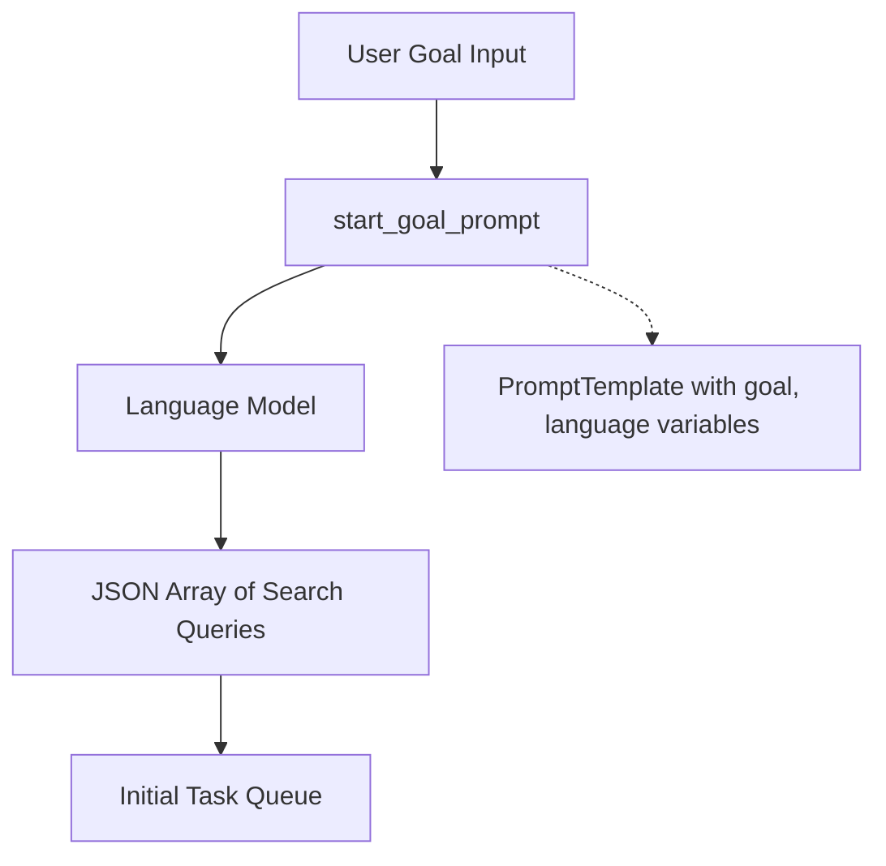

**Task Creation Process Flow**

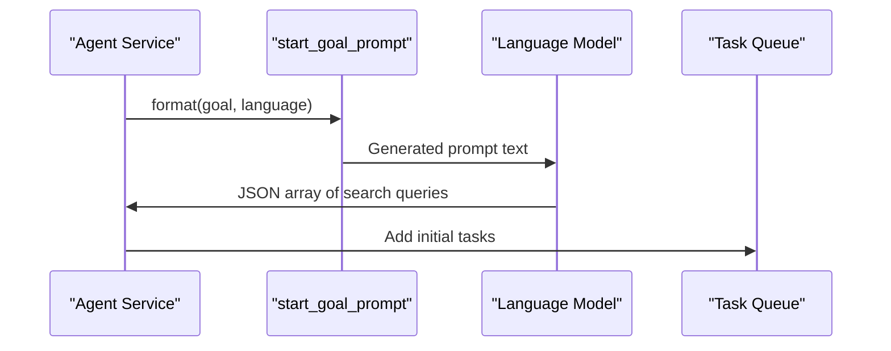

The `start_goal_prompt` implements plan-and-solve prompting methodology, limiting initial tasks to a maximum of 5 queries and ensuring they are succinct and actionable.

**Sources:** [platform/reworkd_platform/web/api/agent/prompts.py:5-22]()

### Dynamic Task Creation

As agents execute tasks and receive results, they generate new tasks using the `create_tasks_prompt` to continue progress toward the goal.

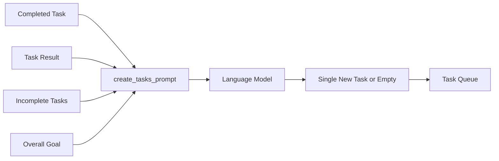

The system creates only one new task at a time to maintain focused execution and prevent task explosion.

**Sources:** [platform/reworkd_platform/web/api/agent/prompts.py:69-92]()

## Task Analysis and Tool Selection

### Task Analysis Process

Before executing each task, the agent analyzes it using the `analyze_task_prompt` to determine the most appropriate tool for execution.

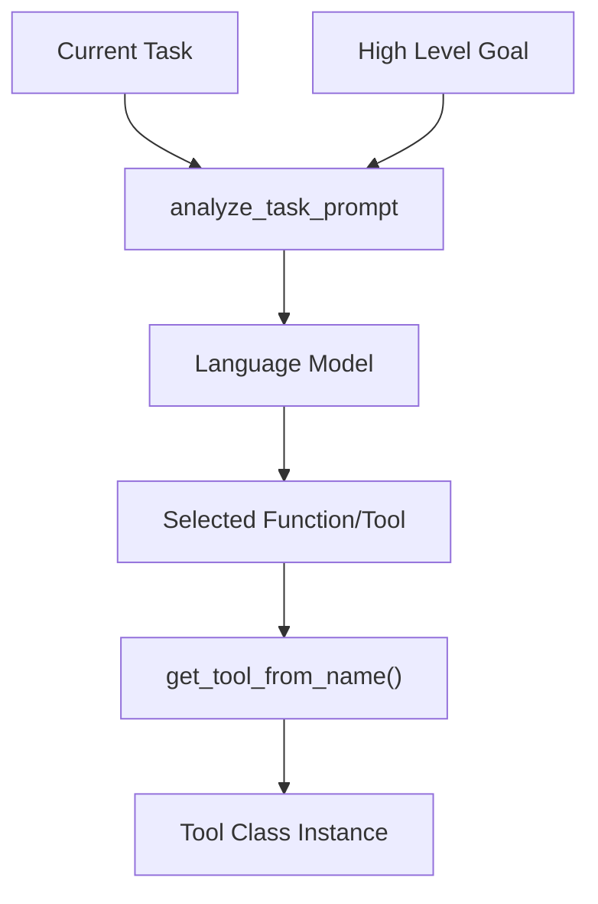

The analysis prompt ensures the agent selects the most efficient tool and includes reasoning in the specified language.

**Sources:** [platform/reworkd_platform/web/api/agent/prompts.py:24-36](), [platform/reworkd_platform/web/api/agent/tools/tools.py:65-70]()

### Available Tools Mapping

The system maintains a registry of available tools through the tools module:

| Tool Class | Tool Name | Description | Primary Use Case |
|------------|-----------|-------------|------------------|
| `Search` | `search` | Google search via Serper API | Current events, factual information |
| `Code` | `code` | Code generation and review | Programming tasks, debugging |
| `Image` | `image` | AI image generation | Visual content creation |
| `Reason` | `reason` | Logical reasoning and analysis | Decision making, problem solving |
| `Conclude` | `conclude` | Task conclusion | Ending task execution |

**Tool Selection Architecture**

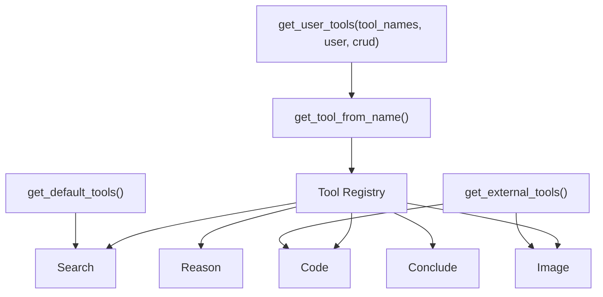

**Sources:** [platform/reworkd_platform/web/api/agent/tools/tools.py:12-16](), [platform/reworkd_platform/web/api/agent/tools/tools.py:27-39]()

## Tool Execution

### Tool Interface

All tools implement the abstract `Tool` class with a standardized `call()` method signature:

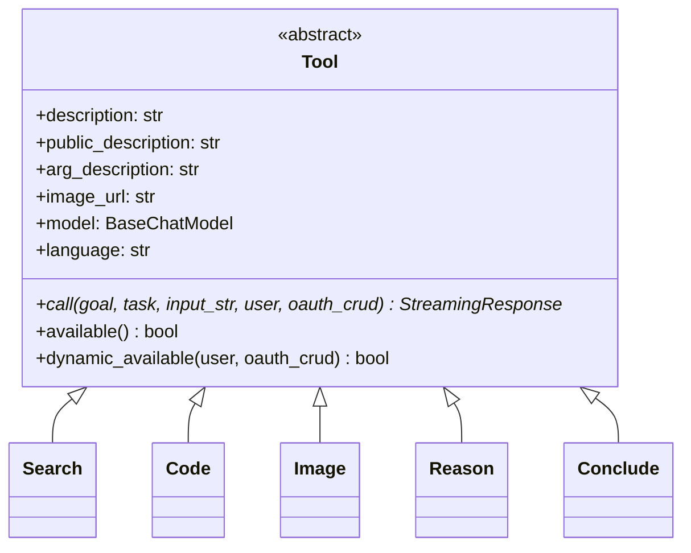

**Sources:** [platform/reworkd_platform/web/api/agent/tools/tool.py:11-41]()

### Search Tool Execution

The `Search` tool performs web searches and processes results with source citations:

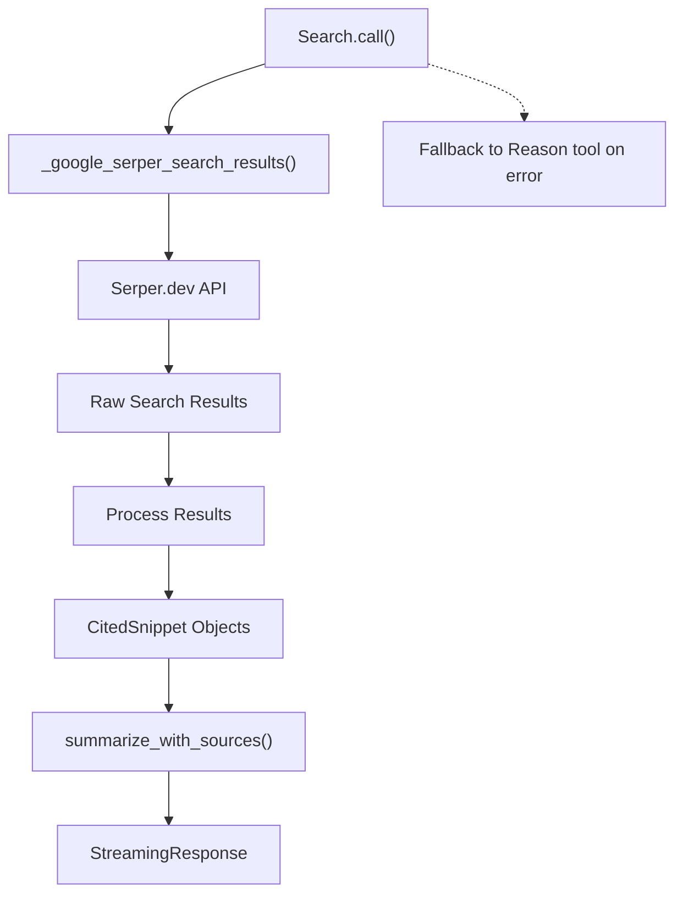

The search tool extracts answer boxes, organic results, and structured data, creating `CitedSnippet` objects with source URLs for proper attribution.

**Sources:** [platform/reworkd_platform/web/api/agent/tools/search.py:42-109](), [platform/reworkd_platform/web/api/agent/tools/utils.py:10-21]()

### Code Tool Execution

The `Code` tool generates programming solutions using specialized prompts:

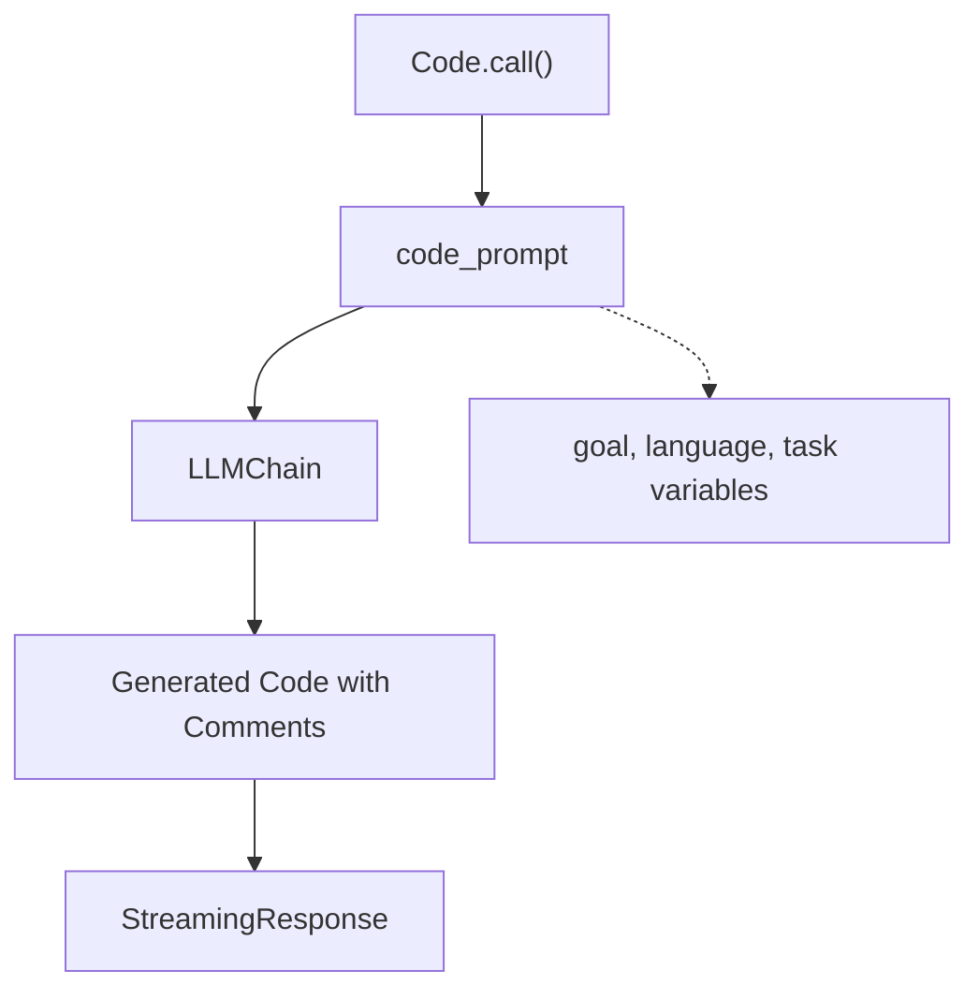

The code prompt instructs the model to act as a world-class software engineer, providing bug-free code with explanations in the specified language.

**Sources:** [platform/reworkd_platform/web/api/agent/tools/code.py:10-25](), [platform/reworkd_platform/web/api/agent/prompts.py:38-56]()

### Image Tool Execution

The `Image` tool supports dual image generation backends with fallback logic:

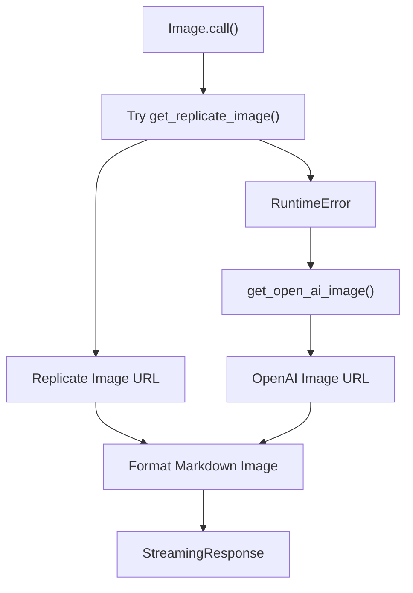

The tool prioritizes Replicate's Stable Diffusion model but falls back to OpenAI's DALL-E when Replicate is unavailable.

**Sources:** [platform/reworkd_platform/web/api/agent/tools/image.py:47-66](), [platform/reworkd_platform/web/api/agent/tools/image.py:15-32](), [platform/reworkd_platform/web/api/agent/tools/image.py:36-44]()

## Task Flow Control

### Execution Loop

The agent execution follows a controlled loop pattern with decision points for task continuation:

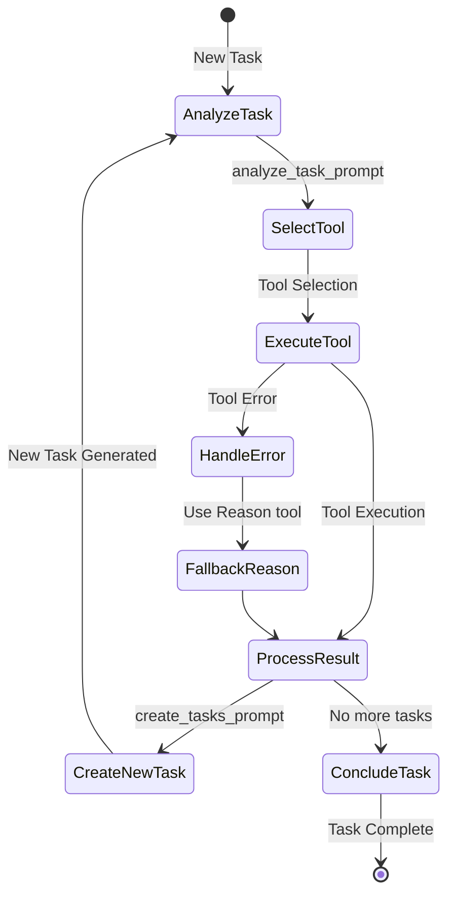

**Sources:** [platform/reworkd_platform/web/api/agent/tools/search.py:58-64]()

### Task Conclusion

Tasks conclude when the `Conclude` tool is selected or when the `create_tasks_prompt` returns no new tasks:

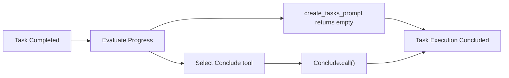

**Sources:** [platform/reworkd_platform/web/api/agent/tools/conclude.py:9-15]()

## Results Processing and Summarization

### Result Summarization

The system processes task results through various summarization functions depending on the data type and source:

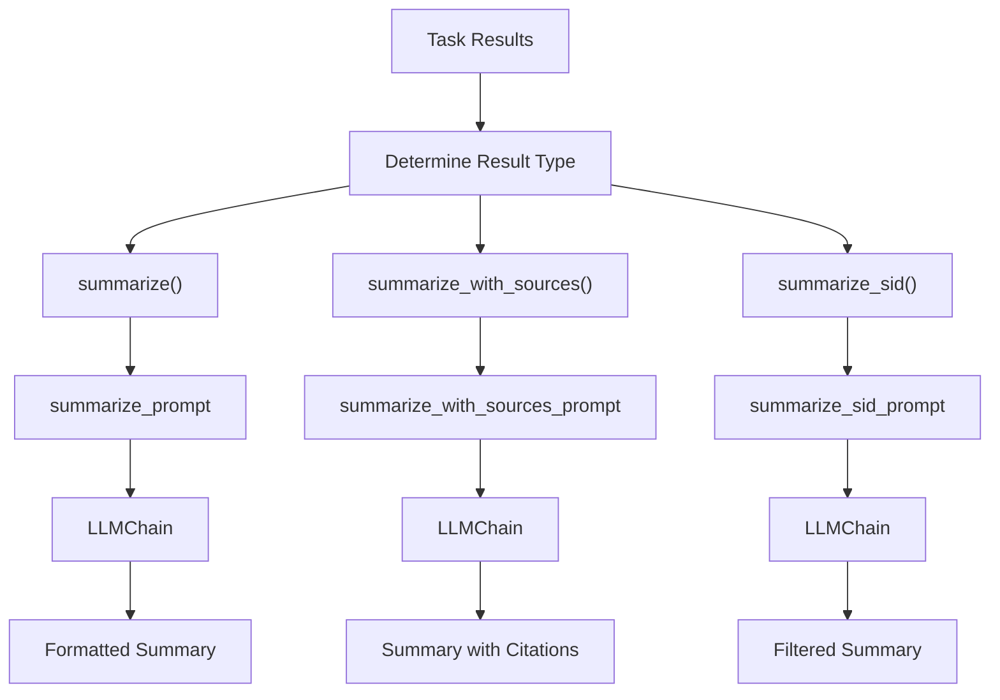

The summarization system ensures results are formatted appropriately for the goal context and include proper source attribution when applicable.

**Sources:** [platform/reworkd_platform/web/api/agent/tools/utils.py:34-98](), [platform/reworkd_platform/web/api/agent/prompts.py:94-109](), [platform/reworkd_platform/web/api/agent/prompts.py:138-156](), [platform/reworkd_platform/web/api/agent/prompts.py:158-172]()

### Streaming Response Handling

All tool executions return `StreamingResponse` objects to provide real-time feedback to users through the frontend interface. This enables live updates as agents process tasks and generate results.

**Sources:** [platform/reworkd_platform/web/api/agent/tools/tool.py:33-41](), [platform/reworkd_platform/web/api/agent/tools/utils.py:44-52]()

---

