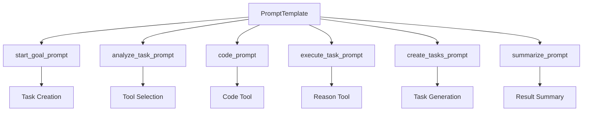
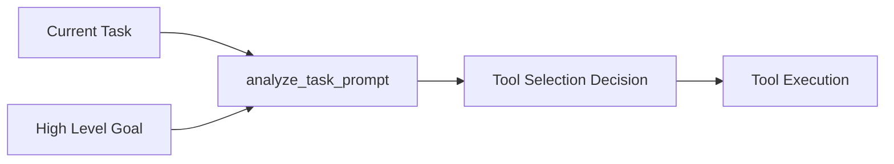
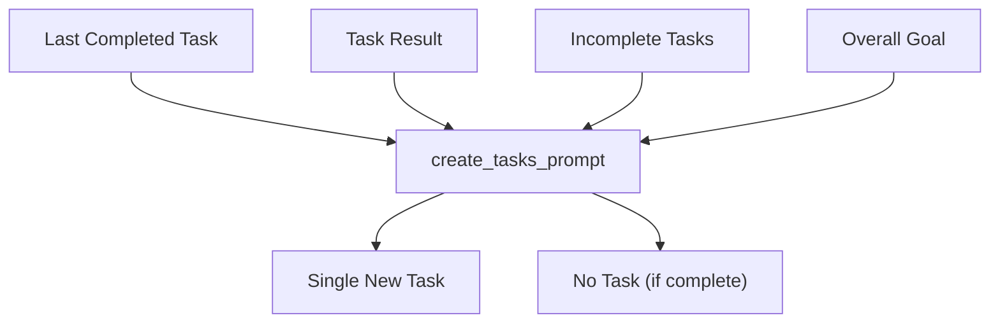
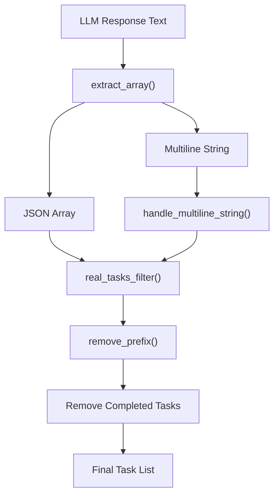
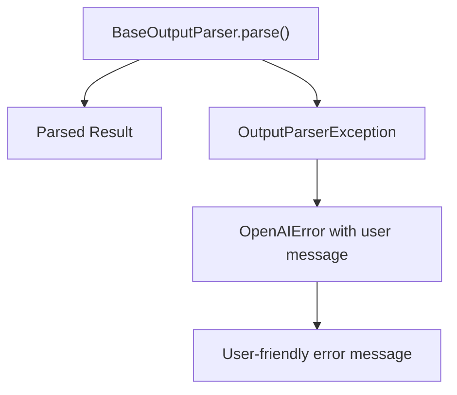
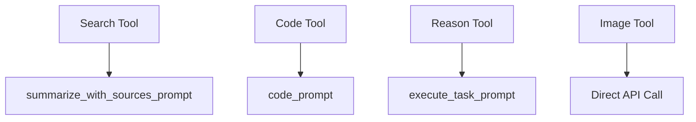
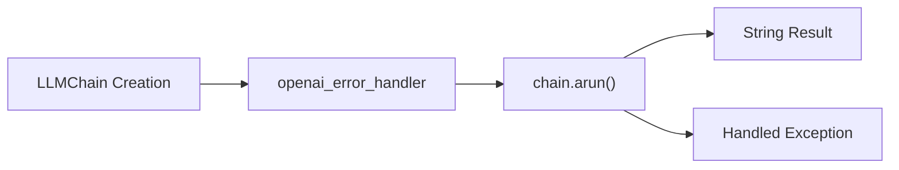

<!-- source: DeepWiki mcp.deepwiki.com · repo reworkd/AgentGPT · page 4.3 Prompts and Output Parsing · fetched 2026-10-26 -->

# Prompts and Output Parsing

<details>
<summary>Relevant source files</summary>

The following files were used as context for generating this wiki page:

- [platform/reworkd_platform/web/api/agent/helpers.py](platform/reworkd_platform/web/api/agent/helpers.py)
- [platform/reworkd_platform/web/api/agent/prompts.py](platform/reworkd_platform/web/api/agent/prompts.py)
- [platform/reworkd_platform/web/api/agent/task_output_parser.py](platform/reworkd_platform/web/api/agent/task_output_parser.py)
- [platform/reworkd_platform/web/api/agent/tools/code.py](platform/reworkd_platform/web/api/agent/tools/code.py)
- [platform/reworkd_platform/web/api/agent/tools/conclude.py](platform/reworkd_platform/web/api/agent/tools/conclude.py)
- [platform/reworkd_platform/web/api/agent/tools/image.py](platform/reworkd_platform/web/api/agent/tools/image.py)
- [platform/reworkd_platform/web/api/agent/tools/reason.py](platform/reworkd_platform/web/api/agent/tools/reason.py)
- [platform/reworkd_platform/web/api/agent/tools/search.py](platform/reworkd_platform/web/api/agent/tools/search.py)
- [platform/reworkd_platform/web/api/agent/tools/tool.py](platform/reworkd_platform/web/api/agent/tools/tool.py)
- [platform/reworkd_platform/web/api/agent/tools/tools.py](platform/reworkd_platform/web/api/agent/tools/tools.py)
- [platform/reworkd_platform/web/api/agent/tools/utils.py](platform/reworkd_platform/web/api/agent/tools/utils.py)
- [platform/reworkd_platform/web/api/agent/tools/wikipedia_search.py](platform/reworkd_platform/web/api/agent/tools/wikipedia_search.py)

</details>


This document covers the prompt template system and output parsing mechanisms used throughout the AgentGPT platform. It explains how natural language prompts are constructed, sent to language models, and how the responses are parsed and validated.

For information about how agents execute tasks using these prompts, see [Task Execution](#4.2). For details about the agent lifecycle that orchestrates prompt usage, see [Agent Lifecycle](#4.1).

## Prompt Template System

AgentGPT uses LangChain's `PromptTemplate` class to manage structured prompts with variable substitution. All prompt templates are centralized in the prompts module and support multilingual operation through language-specific formatting.



**Sources:** [platform/reworkd_platform/web/api/agent/prompts.py:1-186]()

## Core Prompt Categories

### Goal Initialization Prompts

The `start_goal_prompt` transforms high-level objectives into actionable search queries using Plan-and-Solve prompting methodology:

| Variable | Purpose | Example |
|----------|---------|---------|
| `goal` | User's objective | "Analyze market trends for electric vehicles" |
| `language` | Response language | "English", "Spanish", etc. |

The prompt constrains output to JSON arrays with a maximum of 5 queries, ensuring structured responses that can be reliably parsed.

**Sources:** [platform/reworkd_platform/web/api/agent/prompts.py:5-22]()

### Task Analysis and Tool Selection

The `analyze_task_prompt` enables agents to select appropriate tools for task execution:



This prompt enforces mandatory tool selection and includes multilingual reasoning requirements.

**Sources:** [platform/reworkd_platform/web/api/agent/prompts.py:24-36]()

### Specialized Tool Prompts

#### Code Generation
The `code_prompt` provides context-aware code generation with specific formatting requirements:
- Enforces markdown formatting with code blocks
- Requires step-by-step file-by-file approach
- Includes goal context for relevant code generation

#### Task Execution
The `execute_task_prompt` handles general reasoning and decision-making tasks when specialized tools aren't required.

**Sources:** [platform/reworkd_platform/web/api/agent/prompts.py:38-67]()

### Task Management Prompts

#### Task Creation
The `create_tasks_prompt` generates new tasks based on completed work and remaining objectives:



#### Summarization
Multiple summarization prompts handle different content types:
- `summarize_prompt`: General text consolidation
- `summarize_with_sources_prompt`: Citation-aware summarization
- `summarize_sid_prompt`: Query-specific snippet processing

**Sources:** [platform/reworkd_platform/web/api/agent/prompts.py:69-172]()

## Output Parsing Architecture

### Task Output Parser

The `TaskOutputParser` extends LangChain's `BaseOutputParser` to handle task list extraction from LLM responses:



The parser handles multiple input formats:
- JSON arrays: `["task1", "task2"]`
- Numbered lists: `1. First task\n2. Second task`
- Mixed formats with prefixes and noise

**Sources:** [platform/reworkd_platform/web/api/agent/task_output_parser.py:8-89]()

### Parsing Helper Functions

#### Array Extraction
The `extract_array` function uses regex patterns to identify and extract array-like structures:

```python
regex = (
    r"\[\s*\]|"  # Empty array check
    r"(\[(?:\s*(?:\"(?:[^\"\\]|\\.)*\"|\'(?:[^\'\\]|\\.)*\')\s*,?)*\s*\])"
)
```

#### Task Filtering
The `real_tasks_filter` function removes non-actionable responses using pattern matching:
- "No tasks required" patterns
- "Task complete" patterns  
- Empty or "do nothing" responses

**Sources:** [platform/reworkd_platform/web/api/agent/task_output_parser.py:41-88]()

## Error Handling and Validation

### Parse Exception Management

The `parse_with_handling` function wraps parser operations with consistent error handling:



### Model Interaction Error Handling

The `openai_error_handler` function provides comprehensive error management for LLM interactions:

| Error Type | Handling Strategy |
|------------|------------------|
| `ServiceUnavailableError` | Direct user to OpenAI status page |
| `InvalidRequestError` | Check model access and API key validity |
| `AuthenticationError` | Validate API key configuration |
| `RateLimitError` | Inform about quota limits and billing |

**Sources:** [platform/reworkd_platform/web/api/agent/helpers.py:19-77]()

## Integration with Agent Tools

### Tool-Specific Prompt Usage

Each tool integrates prompts differently based on its functionality:



### Streaming Response Integration

Tools use `LLMChain` with prompts to generate streaming responses:

```python
chain = LLMChain(llm=self.model, prompt=execute_task_prompt)
return StreamingResponse.from_chain(
    chain,
    {"goal": goal, "language": self.language, "task": task},
    media_type="text/event-stream",
)
```

**Sources:** [platform/reworkd_platform/web/api/agent/tools/reason.py:16-27](), [platform/reworkd_platform/web/api/agent/tools/code.py:14-25]()

### Model Chain Execution

The `call_model_with_handling` function standardizes prompt execution across the system:



This ensures consistent error handling and logging across all prompt-based operations.

**Sources:** [platform/reworkd_platform/web/api/agent/helpers.py:68-77](), [platform/reworkd_platform/web/api/agent/tools/utils.py:34-99]()

---

