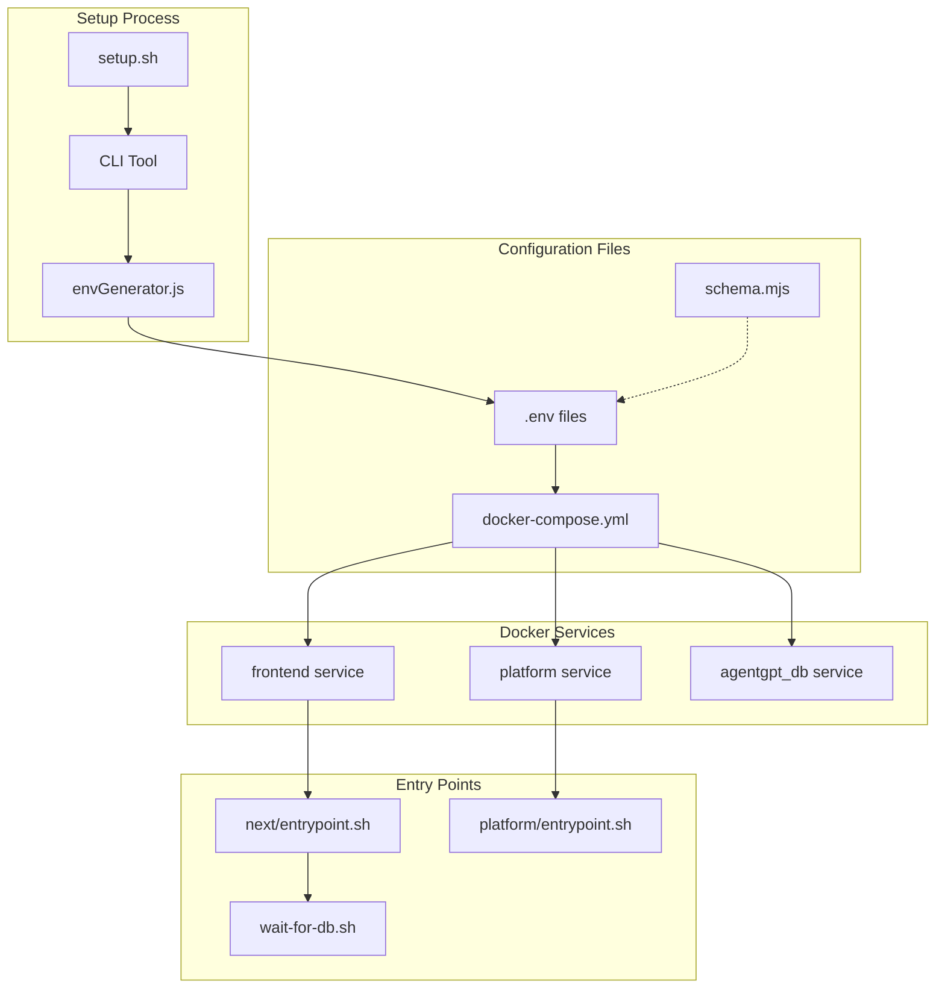
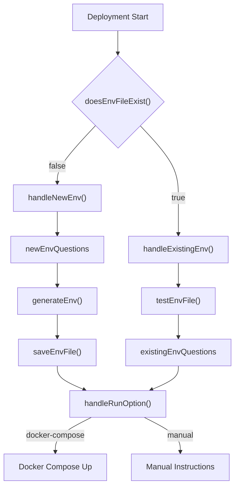
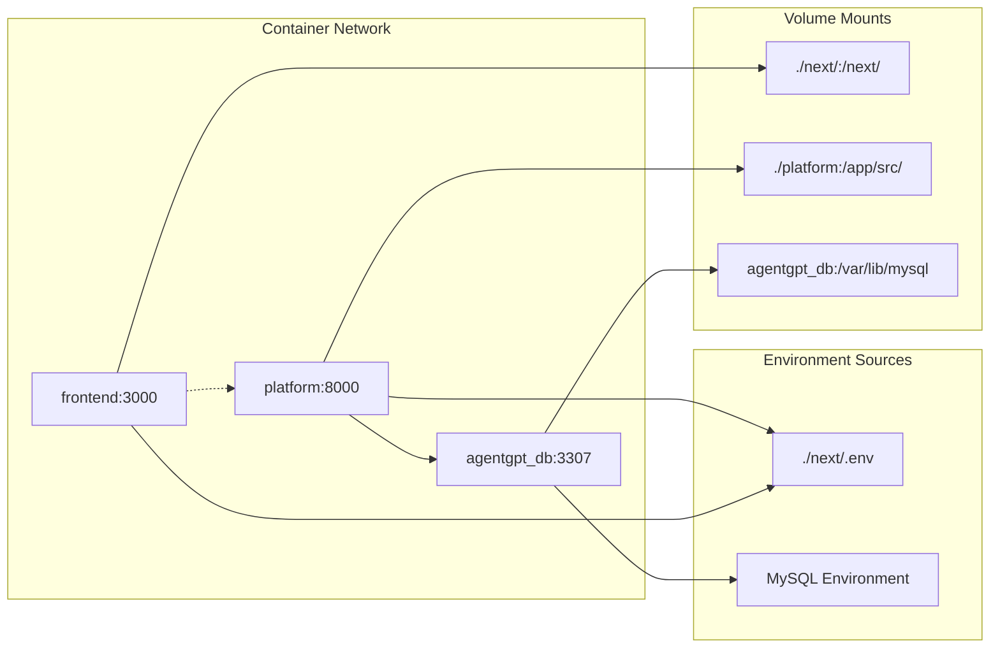
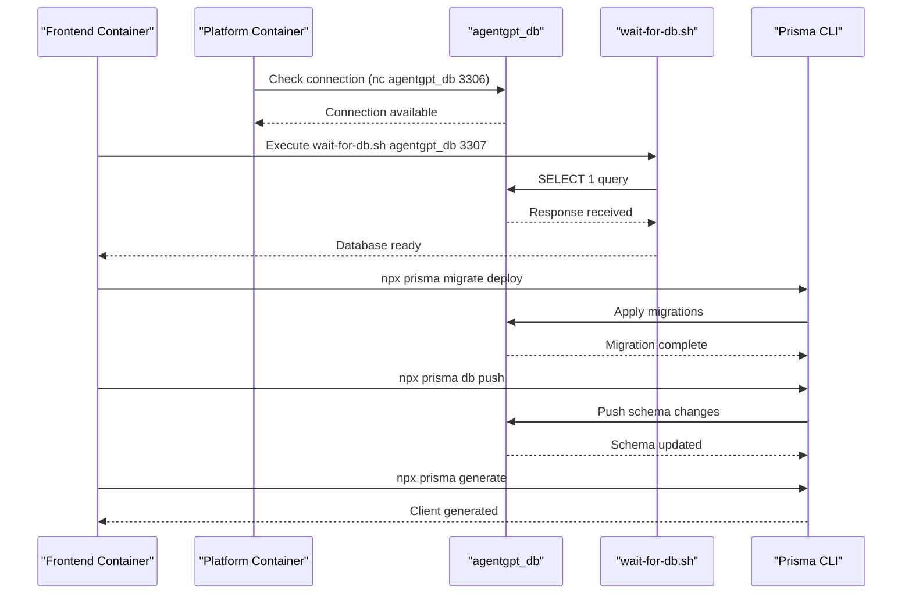

<!-- source: DeepWiki mcp.deepwiki.com · repo reworkd/AgentGPT · page 5 Setup and Deployment · fetched 2026-10-26 -->

# Setup and Deployment

<details>
<summary>Relevant source files</summary>

The following files were used as context for generating this wiki page:

- [.env.example](.env.example)
- [cli/package-lock.json](cli/package-lock.json)
- [cli/package.json](cli/package.json)
- [cli/src/envGenerator.js](cli/src/envGenerator.js)
- [cli/src/helpers.js](cli/src/helpers.js)
- [cli/src/index.js](cli/src/index.js)
- [cli/src/questions/existingEnvQuestions.js](cli/src/questions/existingEnvQuestions.js)
- [cli/src/questions/newEnvQuestions.js](cli/src/questions/newEnvQuestions.js)
- [cli/src/questions/sharedQuestions.js](cli/src/questions/sharedQuestions.js)
- [docker-compose.yml](docker-compose.yml)
- [next/.husky/pre-commit](next/.husky/pre-commit)
- [next/entrypoint.sh](next/entrypoint.sh)
- [next/next.config.mjs](next/next.config.mjs)
- [next/public/locales/en/chat.missing.json](next/public/locales/en/chat.missing.json)
- [next/public/logos/panache-default-solid.svg](next/public/logos/panache-default-solid.svg)
- [next/public/logos/yc-default-solid.svg](next/public/logos/yc-default-solid.svg)
- [next/src/components/console/ExampleAgents.tsx](next/src/components/console/ExampleAgents.tsx)
- [next/src/env/schema.mjs](next/src/env/schema.mjs)
- [next/wait-for-db.sh](next/wait-for-db.sh)
- [platform/Dockerfile](platform/Dockerfile)
- [platform/entrypoint.sh](platform/entrypoint.sh)
- [setup.sh](setup.sh)

</details>


This document covers the setup, configuration, and deployment processes for the AgentGPT system. It includes automated CLI-based setup, Docker containerization, environment configuration, and database initialization procedures.

For information about the overall system architecture, see [System Architecture](#1.1). For details about environment-specific configuration variables, see [Environment Configuration](#5.1). For CLI tool usage, see [CLI Configuration](#5.3). For Docker-based deployment, see [Docker Deployment](#5.2).

## Deployment Architecture Overview

The AgentGPT system supports two primary deployment methods: automated Docker Compose deployment and manual setup. The deployment involves three main services: the Next.js frontend, Python FastAPI backend platform, and MySQL database.

**Deployment Architecture**



Sources: [setup.sh:1-9](), [cli/src/index.js:1-61](), [docker-compose.yml:1-59](), [next/entrypoint.sh:1-29](), [platform/entrypoint.sh:1-15]()

## Environment Configuration Process

The system uses a comprehensive environment configuration process managed by the CLI tool. The configuration includes API keys, database connections, authentication providers, and deployment-specific settings.

**Environment Configuration Flow**



Sources: [cli/src/index.js:54-61](), [cli/src/envGenerator.js:101-103](), [cli/src/envGenerator.js:5-21](), [cli/src/envGenerator.js:139-142]()

### Environment Variable Categories

The system organizes environment variables into logical categories defined in `getEnvDefinition()`:

| Category | Purpose | Key Variables |
|----------|---------|---------------|
| Deployment Environment | Runtime environment settings | `NODE_ENV`, `NEXT_PUBLIC_VERCEL_ENV` |
| NextJS | Frontend configuration | `NEXT_PUBLIC_BACKEND_URL`, `NEXT_PUBLIC_MAX_LOOPS` |
| Next Auth config | Authentication setup | `NEXTAUTH_SECRET`, `NEXTAUTH_URL` |
| Auth providers | OAuth integration | `GOOGLE_CLIENT_ID`, `GITHUB_CLIENT_ID`, `DISCORD_CLIENT_ID` |
| Backend | Platform API configuration | `REWORKD_PLATFORM_OPENAI_API_KEY`, `REWORKD_PLATFORM_SERP_API_KEY` |
| Database (Backend) | Backend database connection | `REWORKD_PLATFORM_DATABASE_URL` |
| Database (Frontend) | Frontend database connection | `DATABASE_URL` |

Sources: [cli/src/envGenerator.js:23-76](), [.env.example:1-52]()

### Environment Validation

The CLI performs comprehensive validation for API keys including format checking and live API validation:

- **OpenAI API Key**: Validates format `/^sk-[a-zA-Z0-9]{48}$/` and tests against `https://api.openai.com/v1/models`
- **SERP API Key**: Validates format `/^[a-zA-Z0-9]{40}$/` and tests against `https://google.serper.dev/search`
- **Replicate API Key**: Validates format `/^r8_[a-zA-Z0-9]{37}$/` and tests against `https://api.replicate.com/v1/models`

Sources: [cli/src/questions/newEnvQuestions.js:12-30](), [cli/src/questions/newEnvQuestions.js:37-60](), [cli/src/questions/newEnvQuestions.js:67-85]()

## Docker Service Configuration

The Docker Compose configuration defines three interconnected services with specific dependencies and networking requirements.

**Docker Service Dependencies**



Sources: [docker-compose.yml:4-16](), [docker-compose.yml:17-37](), [docker-compose.yml:39-55]()

### Service Configurations

**Frontend Service** (`frontend`):
- Built from `./next/Dockerfile`
- Exposes port `3000:3000`
- Mounts environment file at `/next/.env`
- Excludes `node_modules` and `.next` from volume mounts

**Platform Service** (`platform`):
- Built from `./platform/Dockerfile` with `prod` target
- Exposes port `8000:8000`
- Depends on `agentgpt_db` service
- Uses environment file from `next/.env`
- Configures database connection via environment variables

**Database Service** (`agentgpt_db`):
- Uses `mysql:8.0` image
- Exposes port `3308:3307` (non-standard MySQL port)
- Configures UTF8MB4 character set
- Persistent volume storage

Sources: [docker-compose.yml:4-16](), [docker-compose.yml:17-37](), [docker-compose.yml:39-55]()

## Database Initialization Process

The system implements a multi-stage database initialization process with dependency checking and schema migration.

**Database Initialization Sequence**



Sources: [next/entrypoint.sh:15-26](), [next/wait-for-db.sh:1-12](), [platform/entrypoint.sh:3-14]()

### Database Connection Configuration

The database connection uses different ports for internal Docker networking versus external access:

- **Internal Docker Network**: Port `3307` (configured in `MYSQL_TCP_PORT`)
- **External Host Access**: Port `3308` (mapped from container port `3307`)
- **Database Name**: `reworkd_platform`
- **Credentials**: `reworkd_platform:reworkd_platform`

Sources: [docker-compose.yml:46-52](), [.env.example:37-43]()

## Manual Deployment Process

For manual deployment, the system provides instructions for running services independently outside of Docker containers.

### Manual Setup Requirements

1. **Frontend Setup**:
   ```bash
   cd ./next
   npm install && npm run dev
   ```

2. **Backend Setup**:
   ```bash
   cd ./platform
   poetry install && poetry run python -m reworkd_platform
   ```

3. **Database Setup**: Configure MySQL instance with credentials from environment file

Sources: [cli/src/index.js:41-51]()

### Environment Schema Validation

The Next.js application validates environment variables using Zod schemas defined in `schema.mjs`:

**Server Schema** includes:
- `DATABASE_URL`: Database connection string
- `NEXTAUTH_SECRET`: Authentication secret (required in production)
- OAuth provider credentials (`GOOGLE_CLIENT_ID`, `GITHUB_CLIENT_ID`, etc.)

**Client Schema** includes:
- `NEXT_PUBLIC_BACKEND_URL`: Backend API endpoint
- `NEXT_PUBLIC_MAX_LOOPS`: Agent execution limit
- `NEXT_PUBLIC_FF_MOCK_MODE_ENABLED`: Mock mode feature flag

Sources: [next/src/env/schema.mjs:17-36](), [next/src/env/schema.mjs:63-73]()

## Post-Deployment Verification

After successful deployment, the system provides these endpoints for verification:

- **Frontend**: `http://localhost:3000` (Next.js application)
- **Backend API**: `http://localhost:8000` (FastAPI platform)
- **Database**: `localhost:3308` (MySQL external access)

The CLI tool automatically validates API key connectivity during setup, ensuring external service integration is functional before deployment completion.

Sources: [cli/src/questions/newEnvQuestions.js:19-28](), [docker-compose.yml:9-10](), [docker-compose.yml:22-23](), [docker-compose.yml:45-46]()

---

