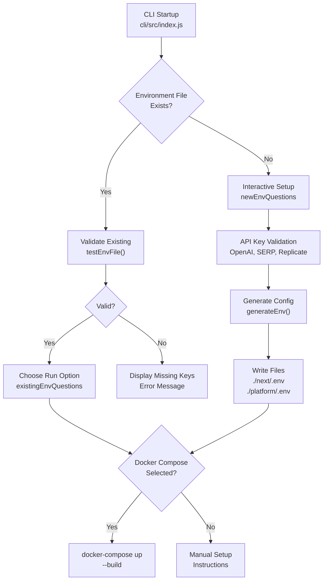
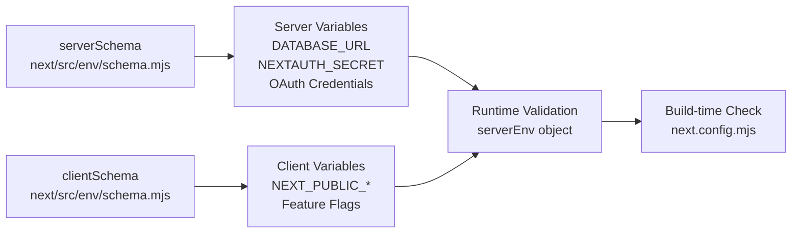
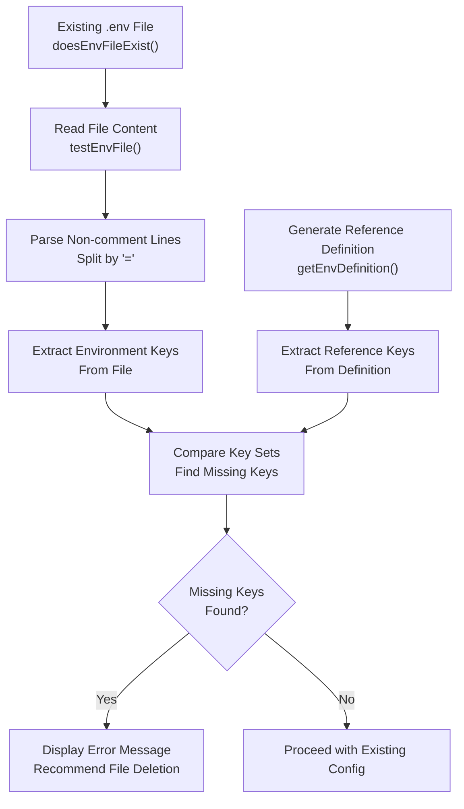
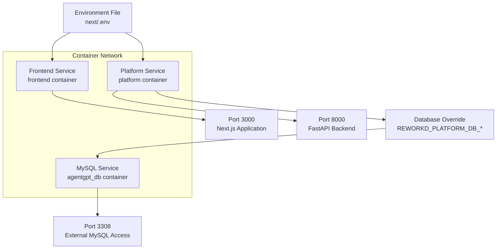

<!-- source: DeepWiki mcp.deepwiki.com · repo reworkd/AgentGPT · page 5.1 Environment Configuration · fetched 2026-10-26 -->

# Environment Configuration

Relevant source files

The following files were used as context for generating this wiki page:

- [.env.example](.env.example)
- [cli/package-lock.json](cli/package-lock.json)
- [cli/package.json](cli/package.json)
- [cli/src/envGenerator.js](cli/src/envGenerator.js)
- [cli/src/helpers.js](cli/src/helpers.js)
- [cli/src/index.js](cli/src/index.js)
- [cli/src/questions/existingEnvQuestions.js](cli/src/questions/existingEnvQuestions.js)
- [cli/src/questions/newEnvQuestions.js](cli/src/questions/newEnvQuestions.js)
- [cli/src/questions/sharedQuestions.js](cli/src/questions/sharedQuestions.js)
- [docker-compose.yml](docker-compose.yml)
- [next/next.config.mjs](next/next.config.mjs)
- [next/public/logos/panache-default-solid.svg](next/public/logos/panache-default-solid.svg)
- [next/public/logos/yc-default-solid.svg](next/public/logos/yc-default-solid.svg)
- [next/src/components/console/ExampleAgents.tsx](next/src/components/console/ExampleAgents.tsx)
- [next/src/env/schema.mjs](next/src/env/schema.mjs)

This document covers the environment configuration system for AgentGPT, including the automated CLI setup tool, manual configuration options, and environment variable validation. The system requires configuration of API keys, database connections, authentication providers, and deployment settings.

For information about Docker deployment specifically, see [Docker Deployment](#5.2). For CLI tool usage beyond environment setup, see [CLI Configuration](#5.3).

## Environment Variable Categories

AgentGPT requires configuration across multiple service layers, each with distinct environment variable requirements:

### Platform Configuration
- **Maximum Loops**: Controls agent execution limits (`NEXT_PUBLIC_MAX_LOOPS`, `REWORKD_PLATFORM_MAX_LOOPS`)
- **Environment Mode**: Development, test, or production (`NODE_ENV`, `NEXT_PUBLIC_VERCEL_ENV`)

### API Service Keys
- **OpenAI API**: Required for core agent functionality (`REWORKD_PLATFORM_OPENAI_API_KEY`)
- **Search Services**: SERP API for web search capabilities (`REWORKD_PLATFORM_SERP_API_KEY`)
- **Image Generation**: Replicate API for image creation (`REWORKD_PLATFORM_REPLICATE_API_KEY`)

### Database Configuration
Separate database configurations for frontend and backend services with identical connection parameters but different variable prefixes.

### Authentication Services
- **NextAuth**: Session management (`NEXTAUTH_SECRET`, `NEXTAUTH_URL`)
- **OAuth Providers**: Google, GitHub, Discord client credentials

**Sources**: [.env.example:1-52](), [cli/src/envGenerator.js:23-76]()

## CLI-Based Environment Generation

The AgentGPT CLI provides an interactive setup process that automatically generates properly configured environment files:

The CLI performs real-time API key validation by making test requests to verify credentials before generating the environment files.

**Sources**: [cli/src/index.js:1-61](), [cli/src/envGenerator.js:5-21](), [cli/src/questions/newEnvQuestions.js:1-87]()

## Environment File Structure

The CLI generates environment files following a structured format with categorized sections:

| Section | Variables | Purpose |
|---------|-----------|---------|
| Deployment Environment | `NODE_ENV`, `NEXT_PUBLIC_VERCEL_ENV` | Runtime environment detection |
| NextJS | `NEXT_PUBLIC_BACKEND_URL`, `NEXT_PUBLIC_MAX_LOOPS` | Frontend configuration |
| Next Auth | `NEXTAUTH_SECRET`, `NEXTAUTH_URL` | Authentication configuration |
| Auth Providers | Google, GitHub, Discord credentials | OAuth integration |
| Backend | Platform service configuration | Python FastAPI backend |
| Database (Backend) | `REWORKD_PLATFORM_DATABASE_*` | Backend database connection |
| Database (Frontend) | `DATABASE_*` | Frontend database connection |

The `generateEnvFileContent` function creates the final configuration by iterating through the structured definition and formatting key-value pairs with section comments.

**Sources**: [cli/src/envGenerator.js:78-90](), [cli/src/envGenerator.js:23-76]()

## Environment Validation

### Frontend Schema Validation

The Next.js frontend uses Zod schemas for environment variable validation:

The validation system distinguishes between server-side and client-side environment variables, with client variables requiring the `NEXT_PUBLIC_` prefix for browser exposure.

**Sources**: [next/src/env/schema.mjs:17-36](), [next/src/env/schema.mjs:63-73](), [next/next.config.mjs:8]()

### CLI Validation Process

The CLI includes comprehensive validation for existing environment files:

**Sources**: [cli/src/envGenerator.js:106-137](), [cli/src/envGenerator.js:101-103]()

## Docker Environment Integration

Docker Compose orchestrates environment configuration across multiple services:

The Docker configuration overrides specific database connection parameters to use container networking while maintaining the base environment file structure.

**Sources**: [docker-compose.yml:27-35](), [docker-compose.yml:47-52]()

## Configuration Files and Paths

The system maintains multiple configuration files across different service layers:

| File Path | Purpose | Generated By |
|-----------|---------|--------------|
| `next/.env` | Frontend environment variables | CLI or manual |
| `platform/.env` | Backend environment variables | CLI (copy of frontend) |
| `next/src/env/schema.mjs` | Environment validation schema | Manual |
| `.env.example` | Template and documentation | Manual |

Both `next/.env` and `platform/.env` contain identical content, as the CLI writes the same configuration to both locations using `saveEnvFile`.

**Sources**: [cli/src/envGenerator.js:98-99](), [cli/src/envGenerator.js:139-142]()

---

