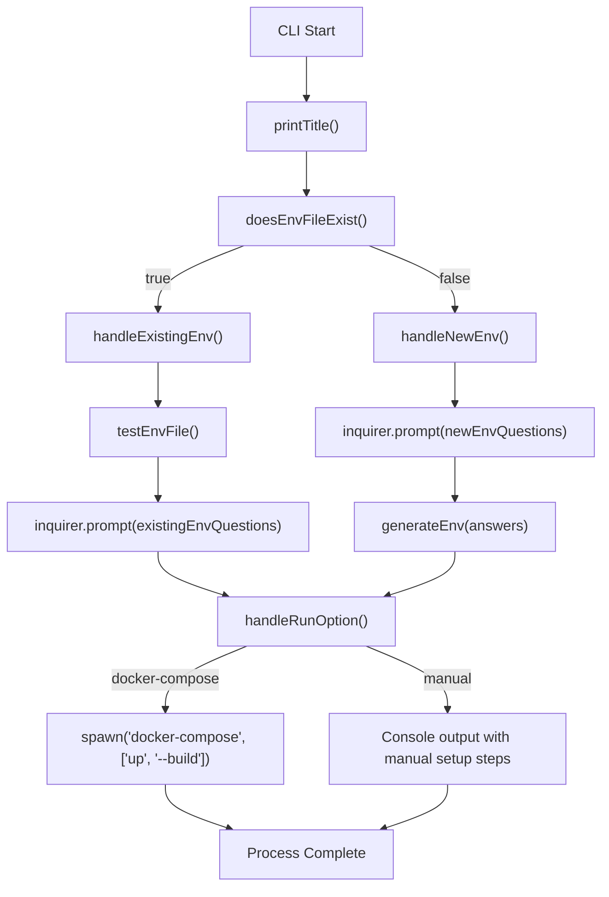
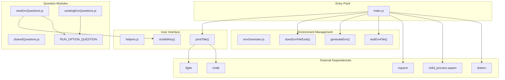
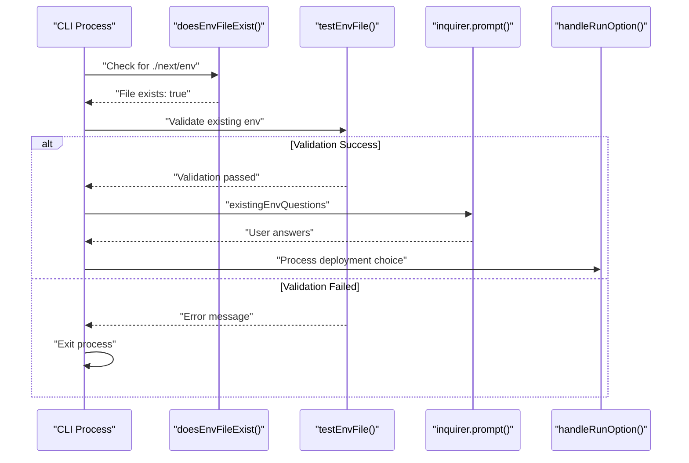
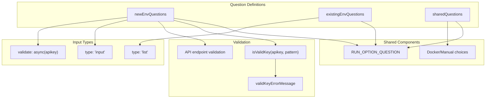

<!-- source: DeepWiki mcp.deepwiki.com · repo reworkd/AgentGPT · page 5.3 CLI Configuration · fetched 2026-10-26 -->

# CLI Configuration

<details>
<summary>Relevant source files</summary>

The following files were used as context for generating this wiki page:

- [cli/package-lock.json](cli/package-lock.json)
- [cli/package.json](cli/package.json)
- [cli/src/helpers.js](cli/src/helpers.js)
- [cli/src/index.js](cli/src/index.js)
- [cli/src/questions/existingEnvQuestions.js](cli/src/questions/existingEnvQuestions.js)
- [cli/src/questions/newEnvQuestions.js](cli/src/questions/newEnvQuestions.js)
- [cli/src/questions/sharedQuestions.js](cli/src/questions/sharedQuestions.js)

</details>


This document covers the AgentGPT command-line interface (CLI) tool, which provides automated setup and configuration for the development environment. The CLI handles environment file generation, API key validation, and deployment option selection. For information about environment variables and configuration files, see [Environment Configuration](#5.1). For Docker deployment details, see [Docker Deployment](#5.2).

## Overview

The AgentGPT CLI is a Node.js-based command-line tool that streamlines the initial setup process by generating required environment files and configuring the system for deployment. It provides an interactive experience for collecting API keys, validating credentials, and choosing deployment methods.

**CLI Execution Flow**



Sources: [cli/src/index.js:1-61]()

## CLI Architecture and Components

The CLI is structured as a modular Node.js application with clear separation of concerns between user interaction, validation, and system integration.

**CLI Component Structure**



Sources: [cli/src/index.js:1-8](), [cli/src/helpers.js:1-27](), [cli/package.json:16-31]()

## Interactive Setup Process

The CLI provides two distinct paths based on whether environment files already exist, with comprehensive validation for API keys and deployment options.

### New Environment Setup

For fresh installations, the CLI collects and validates API credentials for external services:

| Service | Key Pattern | Validation Method |
|---------|-------------|-------------------|
| OpenAI | `sk-[a-zA-Z0-9]{48}` | GET request to `/v1/models` endpoint |
| SERP API | `[a-zA-Z0-9]{40}` | POST request to `/search` endpoint |
| Replicate | `r8_[a-zA-Z0-9]{37}` | GET request to `/v1/models/replicate/hello-world` |

The validation process includes actual API calls to verify key authenticity:

```javascript
// OpenAI validation example from newEnvQuestions
const endpoint = "https://api.openai.com/v1/models"
const response = await fetch(endpoint, {
    headers: {
        "Authorization": `Bearer ${apikey}`,
    },
});
```

Sources: [cli/src/questions/newEnvQuestions.js:12-30](), [cli/src/questions/newEnvQuestions.js:37-60](), [cli/src/questions/newEnvQuestions.js:67-85]()

### Existing Environment Handling

When environment files are detected, the CLI validates the existing configuration using the `testEnvFile()` function and presents deployment options without requiring credential re-entry.

**Environment Detection and Validation Flow**



Sources: [cli/src/index.js:10-23](), [cli/src/questions/existingEnvQuestions.js:1-6]()

## Deployment Integration

The CLI provides two deployment pathways with different levels of automation and complexity.

### Docker Compose Integration

The recommended deployment method uses `child_process.spawn()` to execute Docker Compose with build flags:

```javascript
const dockerComposeUp = spawn("docker-compose", ["up", "--build"], {
  stdio: "inherit",
});
```

This approach:
- Inherits stdio for real-time output
- Builds containers before starting services
- Provides automated orchestration of all system components

### Manual Deployment Instructions

For advanced users or development scenarios, the CLI provides detailed manual setup instructions covering:
- Frontend setup: `npm install && npm run dev` in `./next` directory
- Backend setup: `poetry install && poetry run python -m reworkd_platform` in `./platform` directory
- Database configuration requirements

Sources: [cli/src/index.js:34-52]()

## Question System Architecture

The CLI uses a modular question system built on the `inquirer` library, with shared components and validation logic.

**Question Module Dependencies**



Sources: [cli/src/questions/sharedQuestions.js:1-11](), [cli/src/questions/newEnvQuestions.js:1-87](), [cli/src/helpers.js:21-26]()

## CLI Dependencies and Runtime

The CLI requires Node.js version `>=18.0.0 <19.0.0` and utilizes several key dependencies for functionality:

| Dependency | Purpose | Usage |
|------------|---------|--------|
| `inquirer` | Interactive prompts | User input collection and validation |
| `chalk` | Terminal styling | Colored output and formatting |
| `figlet` | ASCII art | Application title display |
| `dotenv` | Environment loading | Configuration file parsing |
| `node-fetch` | HTTP requests | API key validation |
| `configstore` | Configuration persistence | CLI settings storage |

The CLI integrates with the broader AgentGPT ecosystem by generating configuration files that are consumed by both the Next.js frontend and Python backend services.

Sources: [cli/package.json:6-8](), [cli/package.json:16-31]()