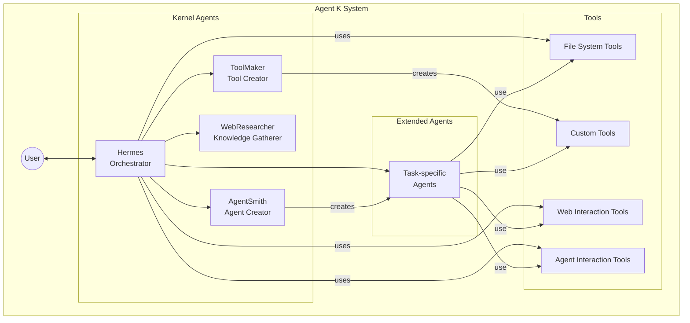
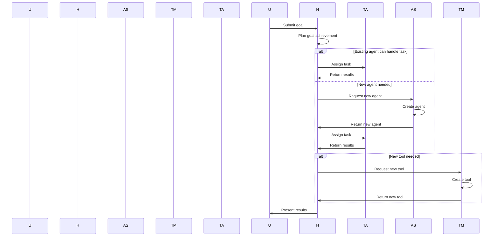
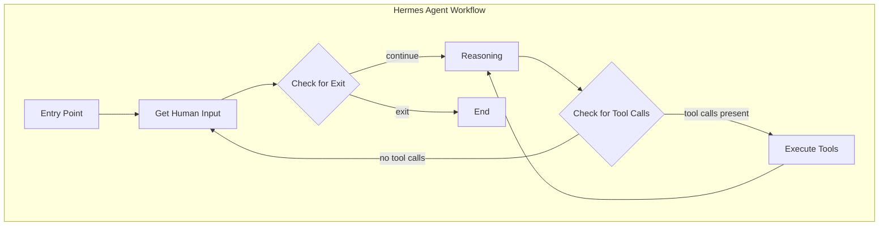
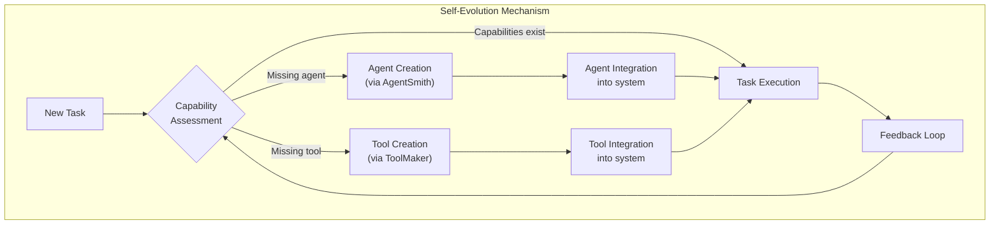

<!-- source: DeepWiki mcp.deepwiki.com · repo mikekelly/AgentK · page 1 Overview · fetched 2026-10-26 -->

# Overview

Relevant source files

The following files were used as context for generating this wiki page:

- [README.md](README.md)
- [agents/hermes.py](agents/hermes.py)

## Introduction to AgentK

AgentK is a self-evolving AGI (Artificial General Intelligence) system designed to complete user tasks through agent collaboration. It operates on the principle of minimal core functionality (hence "K" for kernel) that enables the system to bootstrap and expand its own capabilities over time. The system builds its own mind gradually as it faces new challenges, creating new agents and tools as needed.

Sources: [README.md:1-13](), [agents/hermes.py:15-18]()

## System Architecture

AgentK consists of two primary component types:

1. **Agents**: Specialized modules that collaborate to solve problems
2. **Tools**: Functions that agents can use to interact with the external world

These components are implemented as regular Python files in the `agents` and `tools` directories, making the system's capabilities easy to track and extend.

Sources: [README.md:15-20](), [agents/hermes.py:20-28]()

### Core Kernel Agents

The kernel of AgentK consists of four fundamental agents that bootstrap the system:

| Agent | Role | Description |
|-------|------|-------------|
| **Hermes** | Orchestrator | Interacts with humans, manages tasks, and coordinates activities of other agents |
| **AgentSmith** | Agent Creator | Creates and maintains other agents, ensuring they have necessary tools |
| **ToolMaker** | Tool Developer | Creates and refines tools for agents to use |
| **WebResearcher** | Knowledge Gatherer | Performs online research to provide up-to-date information |

Sources: [README.md:22-28](), [agents/hermes.py:24-28]()

## Workflow and Interaction Patterns

AgentK follows a structured workflow managed by the Hermes orchestrator:

Hermes works with users through this process:
1. Establish a clear understanding of the user's goal
2. Develop a detailed plan to achieve the goal through agent orchestration
3. Create new agents if required (via AgentSmith)
4. Assign tasks to appropriate agents
5. Respond to the user when the goal is achieved or when input is needed

Sources: [agents/hermes.py:30-35]()

## Implementation Details

### ReAct Pattern with LangGraph

AgentK is built on the LangGraph and LangChain frameworks, implementing the ReAct (Reasoning and Acting) pattern for agent workflows. Each agent operates in a cycle of reasoning followed by tool usage.

The workflow implementation in `hermes.py` demonstrates:
- A state graph using `MessagesState` for tracking conversation
- Nodes for human interaction, reasoning, and tool execution
- Conditional edges to control flow based on user input and tool calls

Sources: [agents/hermes.py:46-110](), [README.md:31-33]()

### Agent Implementation Example

Looking at Hermes as an example agent:

1. System prompt defines the agent's role and context
2. A set of tools is provided for the agent to use
3. The workflow is implemented as a state graph with:
   - Human interaction node
   - Reasoning node
   - Tool execution node
4. Conditional logic controls the flow between nodes

This pattern is consistent across agents, with each agent having specialized tools and system prompts.

Sources: [agents/hermes.py:13-44](), [agents/hermes.py:70-91]()

## Self-Evolution Mechanism

One of AgentK's key features is its ability to evolve by creating new components:

When faced with a new task, the system:
1. Assesses its current capabilities
2. Identifies missing agents or tools needed
3. Creates these components using AgentSmith or ToolMaker
4. Integrates the new components into the system
5. Completes the task using existing and new components
6. Learns from the experience for future tasks

Sources: [README.md:5-11](), [agents/hermes.py:32-34]()

## Deployment

AgentK runs isolated in a Docker container for security and reproducibility. The setup process involves:

1. Copying `.env.template` to `.env`
2. Setting environment variables
3. Running the `./agentk` script

For more detailed information on deployment, see [Deployment](#6).

Sources: [README.md:35-41]()

## Related Pages

- For details on the core architecture principles, see [Core Architecture](#2)
- For in-depth information on specific agents, see [Agents](#3)
- For information about tools and their usage, see [Tools](#4)
- For configuration options, see [Configuration](#5)
- For developer guidelines on extending the system, see [Developer Guide](#7)

---

