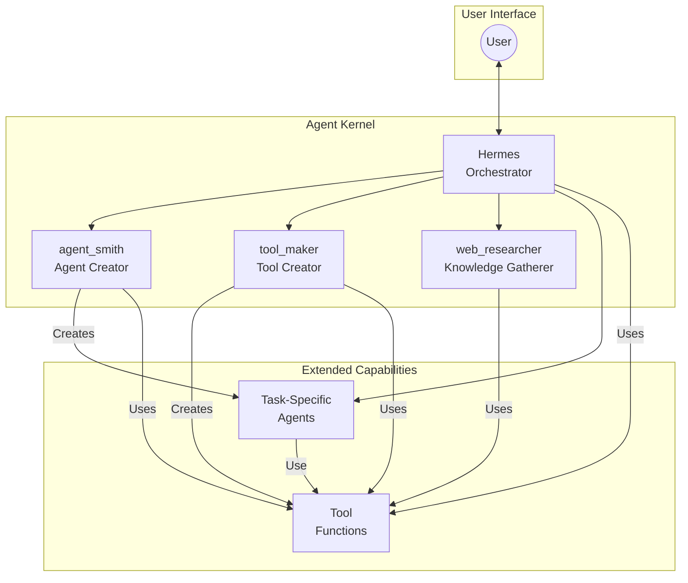
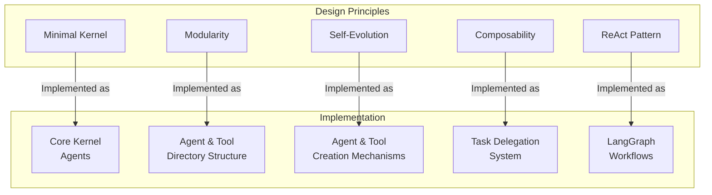
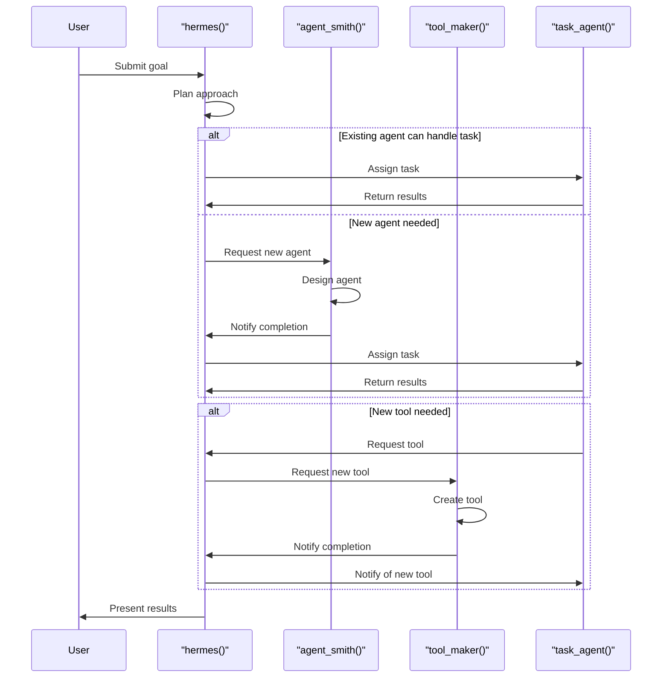
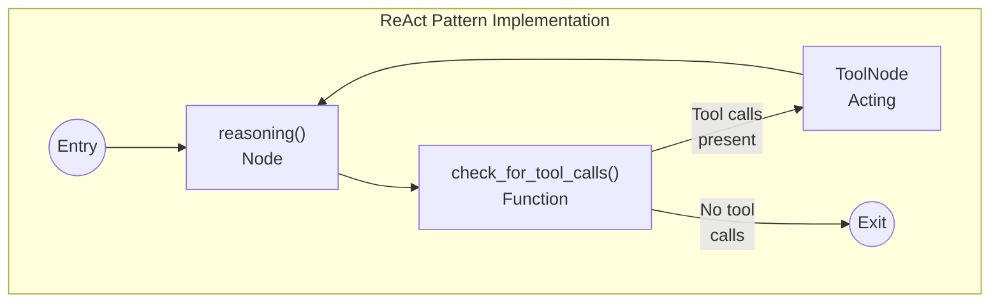
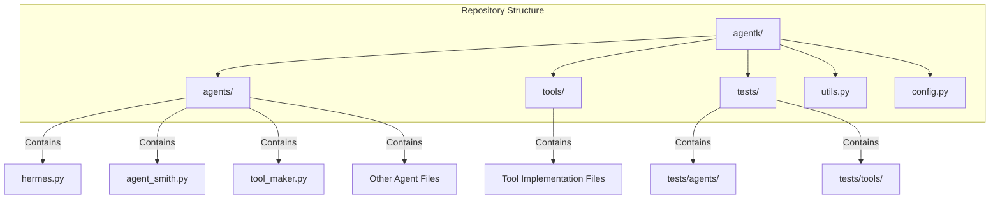

<!-- source: DeepWiki mcp.deepwiki.com · repo mikekelly/AgentK · page 2 Core Architecture · fetched 2026-10-26 -->

# Core Architecture

Relevant source files

The following files were used as context for generating this wiki page:

- [README.md](README.md)
- [agents/agent_smith.py](agents/agent_smith.py)
- [agents/hermes.py](agents/hermes.py)
- [agents/tool_maker.py](agents/tool_maker.py)

This page provides a detailed explanation of AgentK's key architectural principles, agent relationships, and self-evolution mechanisms. It focuses on the structural foundation of the system, how components interact, and the mechanisms that enable AgentK to extend its own capabilities. For information about specific agents, see [Agents](#3), and for details about tools, see [Tools](#4).

## Architectural Overview

AgentK is designed as a modular, self-evolving AGI system built around a minimal kernel. The "K" in AgentK stands for "kernel," emphasizing that the system starts with only the minimum components needed to bootstrap itself and then gradually builds its own capabilities.

The core architecture consists of:

1. **Kernel Agents**: A small set of fundamental agents that can bootstrap the system
2. **Agent Extension**: Mechanisms for creating new specialized agents
3. **Tool System**: A framework for creating and using tools that agents employ to interact with the world
4. **Orchestration**: Systems for coordinating agent activities and managing tasks

Sources: [README.md:10-19](), [agents/hermes.py:13-29]()

## Core Design Principles

AgentK adheres to several key architectural principles:

1. **Minimal Kernel**: The system starts with only the essential components needed to bootstrap itself.
2. **Modularity**: Functionality is divided into specialized agents and tools.
3. **Self-Evolution**: The system can extend its own capabilities by creating new agents and tools.
4. **Composability**: Components are designed to be easily combined to solve complex tasks.
5. **ReAct Pattern**: Agents follow a Reasoning-Acting cycle implemented through LangGraph.

Sources: [README.md:11-19]()

## Kernel Components

The kernel consists of four core agents, each with a specific responsibility:

| Agent | Function | Primary Responsibility | Implementation |
|-------|----------|------------------------|----------------|
| Hermes | `hermes()` | Orchestration & user interaction | [agents/hermes.py]() |
| AgentSmith | `agent_smith()` | Creating new agents | [agents/agent_smith.py]() |
| ToolMaker | `tool_maker()` | Creating new tools | [agents/tool_maker.py]() |
| WebResearcher | `web_researcher()` | Gathering knowledge from the web | Not shown in provided files |

These kernel components are designed to be the minimum set needed for self-evolution, allowing the system to bootstrap additional capabilities as needed.

Sources: [README.md:22-28](), [agents/hermes.py:24-29]()

## Agent Relationships and Workflows

Agents in AgentK interact through a hierarchical structure, with Hermes at the top of the hierarchy coordinating other agents:

The workflow typically follows this pattern:
1. User submits a goal to Hermes
2. Hermes analyzes the requirements and plans an approach
3. If existing agents can handle the task, Hermes delegates to them
4. If new capabilities are needed, Hermes requests AgentSmith or ToolMaker to create them
5. Once all subtasks are complete, Hermes presents results to the user

Sources: [agents/hermes.py:30-36]()

## Self-Evolution Mechanisms

AgentK's ability to evolve comes from two key mechanisms:

1. **Agent Creation**: Implemented by AgentSmith, which creates new specialized agents
2. **Tool Creation**: Implemented by ToolMaker, which creates new tools for agents to use

```mermaid
graph TD
    subgraph "Agent Creation Process"
        AS1["agent_smith()<br>receives task"]
        AS2["Plan agent<br>design"]
        AS3["Request tools<br>if needed"]
        AS4["Write agent<br>implementation"]
        AS5["Test agent"]
        AS6["Deploy agent"]
    end

    subgraph "Tool Creation Process"
        TM1["tool_maker()<br>receives task"]
        TM2["Design tool<br>implementation"]
        TM3["Write tool<br>code"]
        TM4["Write tool<br>tests"]
        TM5["Run tests"]
        TM6["Deploy tool"]
    end

    AS1 --> AS2 --> AS3 --> AS4 --> AS5 --> AS6
    TM1 --> TM2 --> TM3 --> TM4 --> TM5 --> TM6
```

Both mechanisms follow a similar pattern:
1. Receive a task to create a new component
2. Plan the implementation
3. Write the code and tests
4. Verify functionality
5. Deploy the new component

This allows the system to continuously extend its capabilities in response to user needs.

Sources: [agents/agent_smith.py:33-38](), [agents/tool_maker.py:25-29]()

## LangGraph Implementation Pattern

All agents in AgentK follow a ReAct (Reasoning and Acting) pattern implemented using LangGraph. This pattern consists of alternating reasoning and tool execution phases:

Each agent's workflow is implemented as a LangGraph `StateGraph` with these components:

1. **Reasoning Node**: Uses an LLM to analyze the current state and determine actions
2. **Tool Calling Check**: Determines whether the LLM wants to call tools
3. **Tool Execution Node**: Executes the tools requested by the LLM
4. **State Management**: Maintains the conversation history and other state information

This pattern is implemented in a nearly identical way across all agents in the system.

Sources: [agents/hermes.py:70-109](), [agents/agent_smith.py:72-107](), [agents/tool_maker.py:102-135]()

## Code Structure

The AgentK codebase is organized into a modular structure that facilitates self-evolution:

The organization follows these principles:
1. Each agent is a single Python file in the `agents/` directory
2. Each tool is a single Python file in the `tools/` directory
3. Tests for agents and tools are in the `tests/` directory
4. Utility functions and configuration are in dedicated files

This structure allows the system to easily add new components by creating new files in the appropriate directories. When agents or tools are created, their code is written directly to files in these directories, making them immediately available to the system.

Sources: [README.md:15-20](), [agents/tool_maker.py:32-38](), [agents/agent_smith.py:42-45]()

---

