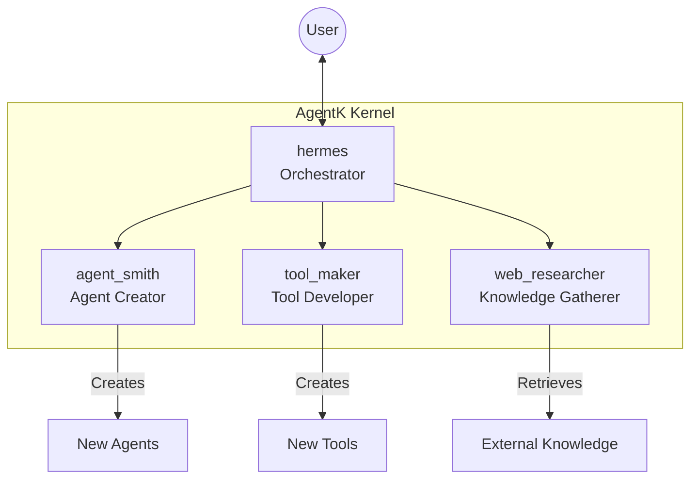
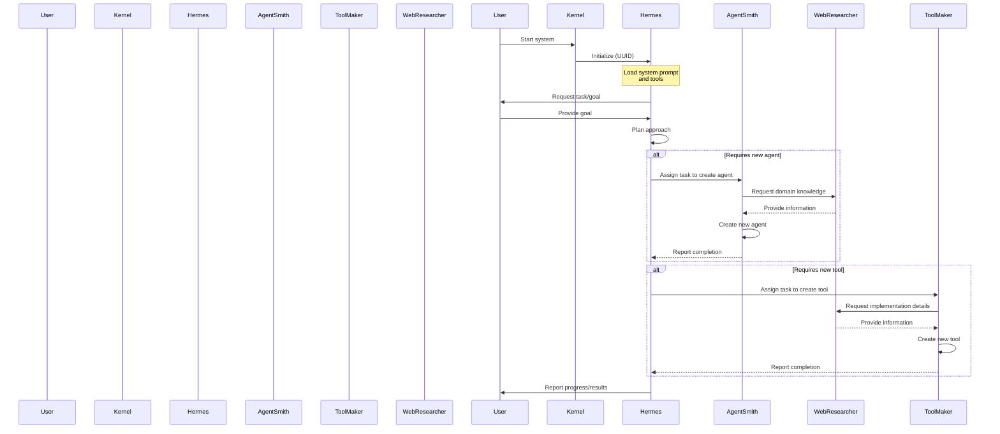
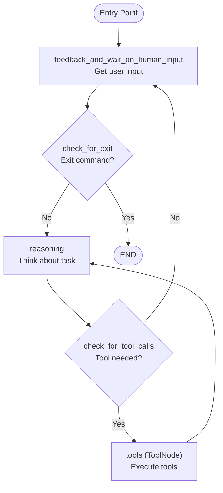

<!-- source: DeepWiki mcp.deepwiki.com · repo mikekelly/AgentK · page 2.1 Kernel Components · fetched 2026-10-26 -->

# Kernel Components

Relevant source files

The following files were used as context for generating this wiki page:

- [README.md](README.md)
- [agent_kernel.py](agent_kernel.py)
- [agents/hermes.py](agents/hermes.py)

## Purpose and Scope

This page documents the core kernel components of the AgentK system - the minimal set of agents necessary to bootstrap a self-evolving AGI. The kernel represents the foundational elements that enable the system to grow, create new agents, develop tools, and expand its capabilities automatically.

For information about the implementation details of LangGraph patterns used across agents, see [LangGraph Implementation](#2.2). For detailed documentation of individual agents, see the respective agent pages under [Agents](#3).

## What is the Kernel?

The "K" in AgentK stands for "kernel," referring to a minimal core. The kernel consists of a small set of foundational agents that collaborate to solve problems and can create new agents and tools as needed. This approach allows the system to bootstrap itself from a minimal starting point and gradually expand its capabilities.

The kernel is designed to be the smallest possible set of components necessary for the system to:
1. Interact with users
2. Create and manage new agents
3. Develop new tools
4. Acquire knowledge from external sources

Sources: [README.md:11-13](), [README.md:22-28]()

## Core Kernel Agents

The AgentK kernel consists of four primary agents:

**Diagram: Core Kernel Agents and Their Primary Functions**

Sources: [README.md:22-28](), [agents/hermes.py:24-28]()

### Hermes: The Orchestrator

Hermes is the central agent that coordinates all activities within the system. It serves as the primary interface between the user and other agents.

Key responsibilities:
- Interacts with humans to understand goals
- Plans how to achieve goals through agent orchestration
- Manages task creation and assignment
- Coordinates activities between agents
- Provides feedback to users

Sources: [agents/hermes.py:13-44](), [README.md:24]()

### AgentSmith: The Agent Creator

AgentSmith is responsible for the creation and maintenance of other agents in the system.

Key responsibilities:
- Creates new agent types as needed
- Ensures agents are equipped with necessary tools
- Tests functionality of newly created agents
- Maintains existing agents

Sources: [README.md:25](), [agents/hermes.py:26]()

### ToolMaker: The Tool Developer

ToolMaker creates and refines the tools that agents use to interact with the world and perform tasks.

Key responsibilities:
- Develops new tools based on system needs
- Refines existing tools to improve functionality
- Ensures tools are properly integrated into the system
- Maintains the tool ecosystem

Sources: [README.md:26](), [agents/hermes.py:27]()

### WebResearcher: The Knowledge Gatherer

WebResearcher is responsible for acquiring information from external sources.

Key responsibilities:
- Performs online research to gather information
- Provides up-to-date knowledge to other agents
- Enables informed decision-making
- Extends the system's knowledge base

Sources: [README.md:27](), [agents/hermes.py:28]()

## Kernel Architecture

The kernel architecture is designed to enable self-evolution through a collaborative agent system. The following diagram illustrates how the kernel components interact to bootstrap and extend the system:

**Diagram: Kernel Bootstrapping and Task Processing Flow**

Sources: [agent_kernel.py:1-8](), [agents/hermes.py:112-120]()

### Design Principles

The kernel is built on several key design principles:

1. **Minimal Core**: The kernel contains only the essential components needed for self-evolution.
2. **Separation of Concerns**: Each kernel agent has a specific, well-defined role.
3. **Composability**: Agents and tools are designed to work together in various combinations.
4. **Self-Evolution**: The system can extend its own capabilities by creating new agents and tools.
5. **Reusability**: Components are designed for reuse across different tasks and contexts.

## Technical Implementation

### Agent Communication and Workflow

The kernel agents communicate through a structured workflow implemented using LangGraph. Hermes, as the orchestrator, uses a ReAct pattern (Reasoning and Acting) to process tasks:

**Diagram: Hermes Agent Workflow Implementation**

Sources: [agents/hermes.py:93-108]()

### Kernel Initialization

The initialization of the kernel follows a simple process:

1. Load environment variables
2. Generate a unique session ID (UUID)
3. Start the Hermes agent with this ID
4. Hermes then coordinates all subsequent activities

The entry point for the system is the `agent_kernel.py` file, which initializes Hermes.

Sources: [agent_kernel.py:1-8]()

### Available Tools in the Kernel

The kernel starts with a minimal set of tools that allow it to manage agents. For Hermes, these include:

| Tool | Purpose |
|------|---------|
| `list_available_agents` | Retrieve a list of currently available agents in the system |
| `assign_agent_to_task` | Delegate a specific task to an appropriate agent |

These tools enable the basic orchestration functionality required for the kernel to operate.

Sources: [agents/hermes.py:10-11](), [agents/hermes.py:46]()

## Kernel Boundaries and Evolution

The kernel is designed to be minimal but sufficient for bootstrapping the entire system. As the system evolves, the kernel remains relatively stable while the agents and tools it creates may change and expand.

The boundary between kernel components and non-kernel components is defined by necessity: only those agents absolutely required for the system to bootstrap itself are considered part of the kernel. All other agents, even if they become essential to the system's operation, are considered extensions created by the kernel.

This approach ensures that the kernel remains focused and maintainable while allowing unlimited growth and evolution of the overall system.

---

