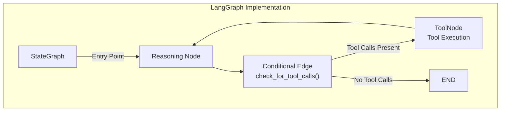
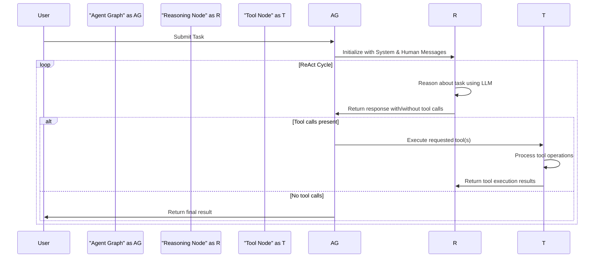
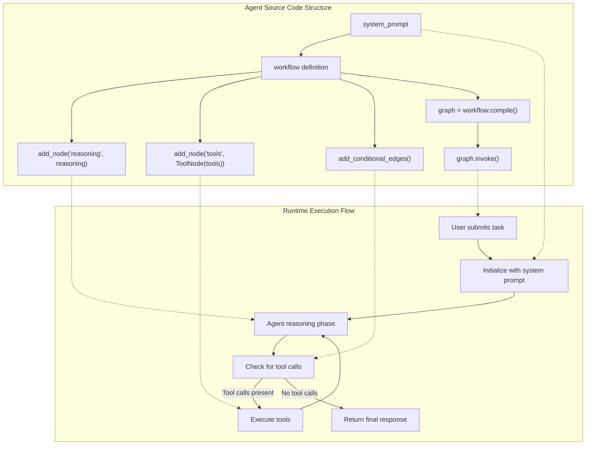
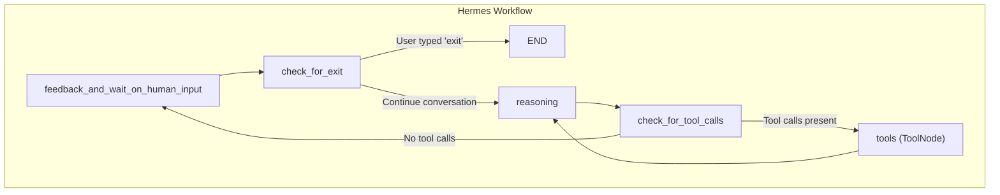

<!-- source: DeepWiki mcp.deepwiki.com · repo mikekelly/AgentK · page 2.2 LangGraph Implementation · fetched 2026-10-26 -->

# LangGraph Implementation

<details>
<summary>Relevant source files</summary>

The following files were used as context for generating this wiki page:

- [agents/agent_smith.py](agents/agent_smith.py)
- [agents/hermes.py](agents/hermes.py)
- [agents/tool_maker.py](agents/tool_maker.py)
- [agents/web_researcher.py](agents/web_researcher.py)

</details>


This document details how AgentK uses LangGraph to implement the ReAct (Reasoning and Acting) pattern across its agent ecosystem. It focuses on the technical architecture and workflow patterns that enable agents to alternate between reasoning about tasks and executing actions through tools.

For information about specific agents that use this pattern, see [Agents](#3) and its child pages.

## Core LangGraph Components in AgentK

AgentK implements the ReAct pattern using LangGraph's core components to create structured agent workflows. These components form the foundation of each agent's decision-making and action-execution process.



Sources: [agents/tool_maker.py:124-136](), [agents/agent_smith.py:95-107](), [agents/hermes.py:94-110](), [agents/web_researcher.py:42-54]()

The key LangGraph components used in AgentK include:

| Component | Description | AgentK Implementation |
|-----------|-------------|----------------------|
| `StateGraph` | Core class for defining agent workflows | Used with `MessagesState` to manage conversation state |
| `MessagesState` | State type tracking message history | Standard state type used across all agents |
| Nodes | Functions that process state | `reasoning` node for thinking, `ToolNode` for actions |
| Edges | Connections defining workflow | Direct and conditional connections between nodes |
| Conditional Edges | Logic determining flow direction | `check_for_tool_calls` function in each agent |

Sources: [agents/hermes.py:94-110](), [agents/tool_maker.py:124-136]()

## Standard ReAct Workflow Pattern

AgentK implements a consistent ReAct pattern across its agents. This pattern enables agents to alternate between reasoning about problems and executing tools to gather information or affect the environment.



Sources: [agents/tool_maker.py:102-123](), [agents/agent_smith.py:72-93](), [agents/web_researcher.py:20-41]()

## Implementation Details

### 1. State Management

All agents in AgentK use the `MessagesState` from LangGraph to maintain conversation history. This state is a dictionary with a single key, `messages`, which contains an array of message objects.

```python
# State structure
{
    "messages": [SystemMessage, HumanMessage, AIMessage, ...]
}
```

The message history progressively builds as the agent reasons and executes tools, providing context for each subsequent step in the workflow.

Sources: [agents/tool_maker.py:102-108](), [agents/agent_smith.py:72-78](), [agents/hermes.py:70-76]()

### 2. Node Implementation

Each agent implements two primary types of nodes:

1. **Reasoning Node**: Where the agent processes the current state using the language model and determines what to do next.

2. **Tool Node**: Where the agent executes the tools called during the reasoning phase.

```mermaid
classDiagram
    class "StateGraph~MessagesState~" {
        +add_node()
        +add_edge()
        +add_conditional_edges()
        +set_entry_point()
        +compile()
    }
    
    class "reasoning()" {
        +Process current state
        +Use LLM to generate response
        +Return updated messages
    }
    
    class "check_for_tool_calls()" {
        +Check for tool_calls in last message
        +Return 'tools' or END based on result
    }
    
    class "ToolNode" {
        +Execute requested tools
        +Return tool execution results
    }
    
    "StateGraph~MessagesState~" --> "reasoning()" : contains
    "StateGraph~MessagesState~" --> "ToolNode" : contains
    "reasoning()" --> "check_for_tool_calls()" : followed by
    "check_for_tool_calls()" --> "ToolNode" : routes to if tools needed
```

Sources: [agents/tool_maker.py:102-125](), [agents/agent_smith.py:72-95](), [agents/hermes.py:70-94]()

### 3. Decision Logic

The flow between nodes is controlled by conditional edge functions, specifically the `check_for_tool_calls` function that examines the agent's response to determine if tools need to be executed:

```python
def check_for_tool_calls(state: MessagesState) -> Literal["tools", END]:
    messages = state['messages']
    last_message = messages[-1]
    
    if last_message.tool_calls:
        # Tool calls present, route to tools node
        return "tools"
    
    # No tool calls, end the graph execution
    return END
```

This decision logic is consistent across most agents, with minor variations based on the specific agent's needs (such as Hermes, which returns to a user interaction node instead of ending).

Sources: [agents/tool_maker.py:110-123](), [agents/agent_smith.py:80-93](), [agents/web_researcher.py:27-40]()

## Code-to-Execution Mapping

The following diagram illustrates how code structures in agent files map to runtime behavior during execution:



Sources: [agents/tool_maker.py:137-143](), [agents/agent_smith.py:109-113](), [agents/hermes.py:112-120]()

## Variations in Agent Workflows

While the core ReAct pattern is consistent, each agent implements workflow variations tailored to their specific role:

| Agent | Entry Point | Terminal Condition | Special Features |
|-------|-------------|-------------------|-----------------|
| Hermes | `feedback_and_wait_on_human_input` | User types "exit" | Checkpointing for persistence |
| AgentSmith | `reasoning` | No tool calls | Example agent code in system prompt |
| ToolMaker | `reasoning` | No tool calls | Tool verification emphasis |
| WebResearcher | `reasoning` | No tool calls | Focused on web search tools |

Sources: [agents/hermes.py:94-110](), [agents/tool_maker.py:124-136](), [agents/agent_smith.py:95-107](), [agents/web_researcher.py:42-54]()

### Hermes: Special Case

The Hermes agent has a more complex flow as it serves as the primary user interface:



Sources: [agents/hermes.py:47-120]()

## Initializing and Invoking Agents

Each agent's workflow is invoked through an entry-point function that:
1. Accepts a task as input
2. Initializes the graph with system and human messages
3. Returns the final state of the conversation

```python
def agent_function(task: str) -> str:
    """Agent's purpose description."""
    return graph.invoke(
        {"messages": [SystemMessage(system_prompt), HumanMessage(task)]}
    )
```

This consistent pattern enables other parts of the system to interact with any agent in a standardized way.

Sources: [agents/tool_maker.py:139-143](), [agents/agent_smith.py:109-113](), [agents/web_researcher.py:57-61]()

## Common ReAct Agent Structure

All agents in AgentK follow this general structure:

1. **System prompt definition**: Defines the agent's role, capabilities, and approach
2. **Tool import and preparation**: Imports and prepares the tools available to the agent
3. **Node function definitions**: Defines reasoning and conditional logic functions
4. **Workflow construction**: Builds the LangGraph workflow with nodes and edges
5. **Graph compilation**: Compiles the workflow into an executable graph
6. **Entry point function**: Provides a standardized interface to invoke the agent

This consistent structure makes the system modular and extensible, allowing new agents to be added by following the same pattern.

Sources: [agents/tool_maker.py:10-143](), [agents/agent_smith.py:10-113](), [agents/web_researcher.py:1-61]()

---

