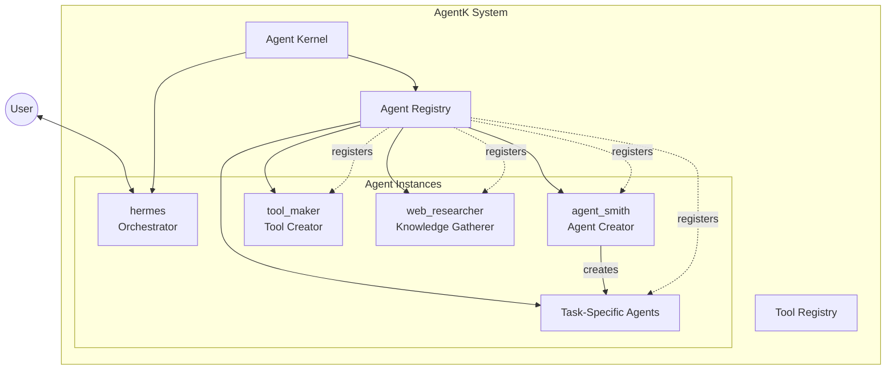
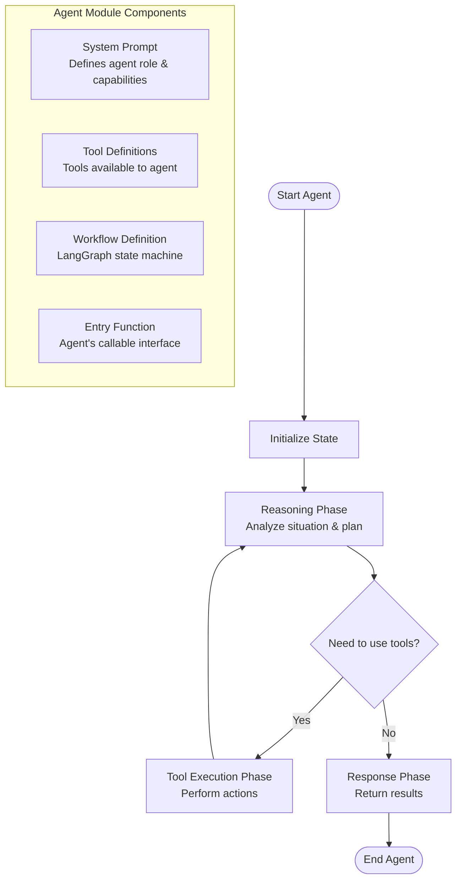
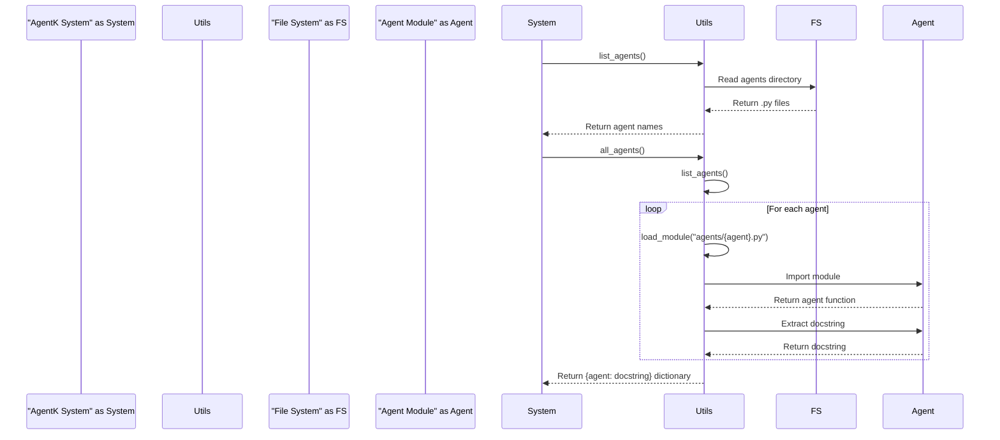
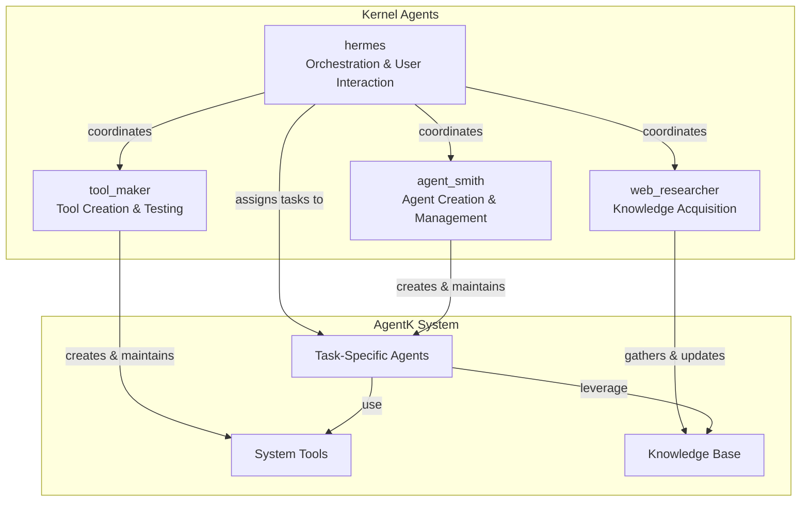
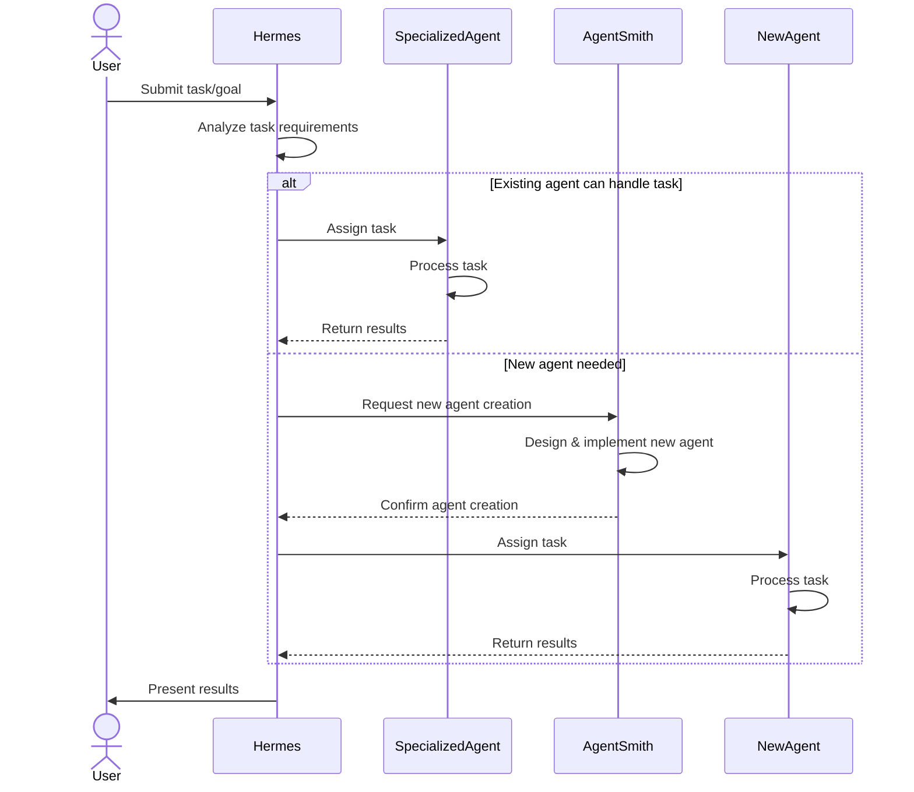
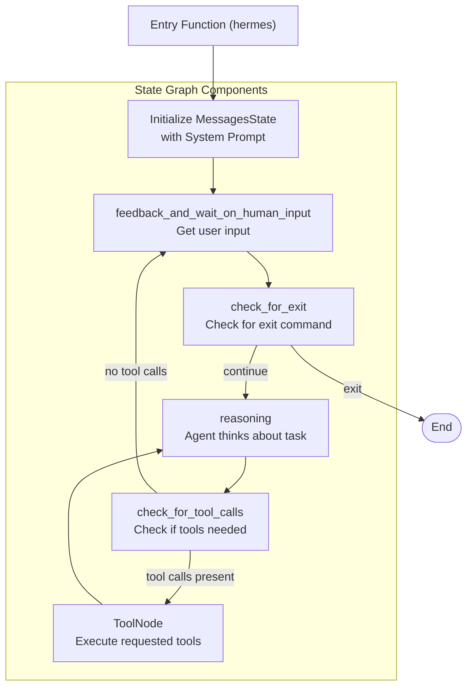

<!-- source: DeepWiki mcp.deepwiki.com · repo mikekelly/AgentK · page 3 Agents · fetched 2026-10-26 -->

# Agents

Relevant source files

The following files were used as context for generating this wiki page:

- [README.md](README.md)
- [agents/hermes.py](agents/hermes.py)
- [utils.py](utils.py)

This page provides an overview of the agent system in AgentK, explaining how agents are structured, loaded, and interact with each other. For information on specific agents such as Hermes or AgentSmith, see their dedicated pages ([Hermes: Orchestrator](#3.1), [AgentSmith: Agent Creator](#3.2), etc.). For information on creating new agents, see the [Creating New Agents](#7.1) guide.

## What are Agents in AgentK?

Agents in AgentK form the cognitive components of its modular, self-evolving architecture. Each agent is a specialized entity with specific capabilities and responsibilities, implemented as a Python module with a defined interface. Together, these agents collaborate to solve problems and complete tasks, dynamically creating new agents when needed.

Diagram: Agent System Overview

Sources: [README.md:15-27](), [utils.py:56-99]()

## Agent Architecture

Each agent in AgentK is typically implemented as a LangGraph workflow following the ReAct (Reasoning and Action) pattern. This architecture allows agents to alternate between reasoning about problems and taking actions through tools.

Diagram: Typical Agent Implementation Structure

Sources: [agents/hermes.py:10-120]()

Most agents follow a standard structure:
1. A system prompt defining the agent's role and capabilities
2. A set of tools available to the agent
3. A LangGraph workflow defining the agent's behavior
4. An entry function that serves as the callable interface

## Agent Registry and Loading

The AgentK system maintains a registry of available agents, allowing dynamic discovery, loading, and invocation of agent functionality. Agents are stored as Python files in the `agents/` directory and loaded on demand.

Diagram: Agent Loading Process

Sources: [utils.py:56-130]()

The key utility functions for agent management include:

| Function | Purpose | Location |
|----------|---------|----------|
| `list_agents()` | Lists all agent files in the agents directory | [utils.py:87-99]() |
| `all_agents()` | Loads all agent modules and extracts docstrings | [utils.py:56-70]() |
| `load_module()` | Dynamically loads a Python module from a file | [utils.py:113-130]() |
| `list_broken_agents()` | Identifies agents that fail to load properly | [utils.py:72-85]() |

## Core Kernel Agents

AgentK's architecture is built around a minimal "kernel" of four core agents that enable the system to bootstrap itself and grow its capabilities:

Diagram: Core Kernel Agent Relationships

Sources: [README.md:22-27](), [agents/hermes.py:13-29]()

Each kernel agent has a specific role:

1. **Hermes**: The orchestrator that interacts with humans, plans tasks, and coordinates other agents
2. **AgentSmith**: Creates and manages other agents, ensuring they have necessary tools
3. **ToolMaker**: Develops tools needed by agents to interact with the system and external world
4. **WebResearcher**: Gathers knowledge from online sources to support agent operations

For detailed information on each kernel agent, see their dedicated wiki pages ([Hermes: Orchestrator](#3.1), [AgentSmith: Agent Creator](#3.2), [ToolMaker: Tool Creator](#3.3), [WebResearcher: Knowledge Gatherer](#3.4)).

## Agent Interaction Patterns

Agents in AgentK collaborate through an orchestration pattern, with Hermes coordinating tasks and delegating to specialized agents. This interaction typically follows a hierarchical structure.

Diagram: Agent Interaction Flow

Sources: [agents/hermes.py:30-36](), [README.md:5]()

Key aspects of agent interaction:

1. **Task Orchestration**: Hermes acts as the central coordinator, breaking down user goals into subtasks
2. **Task Assignment**: Tasks are assigned to specialized agents based on their capabilities
3. **Agent Creation**: When no existing agent can handle a task, AgentSmith creates a new specialized agent
4. **Result Aggregation**: Results from various agents are collected and synthesized by Hermes

The interaction is facilitated by specific tools:
- `list_available_agents`: Returns a list of all available agents and their capabilities
- `assign_agent_to_task`: Delegates a specific task to an agent and returns the results

Sources: [agents/hermes.py:10-11](), [agents/hermes.py:46]()

## The Agent Implementation Pattern

Agents in AgentK typically follow the LangGraph ReAct pattern, with a standard structure for their implementation. The example below shows the implementation pattern from the Hermes agent:

Diagram: LangGraph Agent Implementation Pattern

Sources: [agents/hermes.py:46-110]()

The implementation typically includes:

1. **System Prompt**: Defines the agent's role, capabilities, and operating instructions
2. **Tool Definitions**: Lists the tools available to the agent
3. **State Handler Functions**: Process different states in the agent's workflow
4. **Workflow Definition**: Defines the state graph using LangGraph's StateGraph
5. **Entry Function**: Provides the callable interface for the agent

This pattern enables agents to:
- Reason about problems and plan solutions
- Use tools to interact with the system and external world
- Maintain conversation context and state
- Operate autonomously within their domain of expertise

## Conclusion

Agents form the cognitive core of AgentK, working collaboratively to achieve user goals through specialized capabilities and dynamic creation of new agents. The modular agent architecture, centered around a minimal kernel, allows the system to continuously evolve and extend its capabilities. The LangGraph ReAct pattern provides a consistent implementation approach across agents, enabling reasoning, tool usage, and effective task completion.

For details on individual agents, see their dedicated wiki pages. For information on creating new agents, see the [Creating New Agents](#7.1) guide.

Sources: [README.md:5-28](), [agents/hermes.py:1-120](), [utils.py:56-130]()

---

