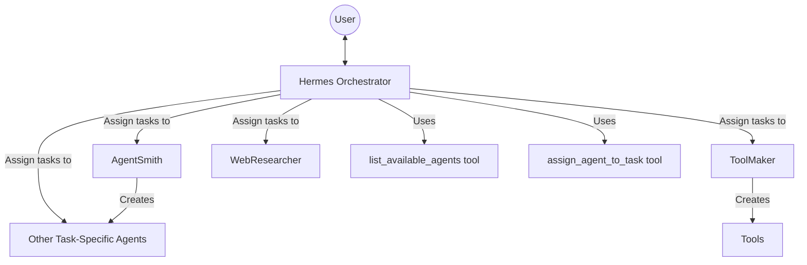
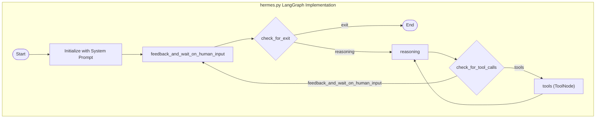
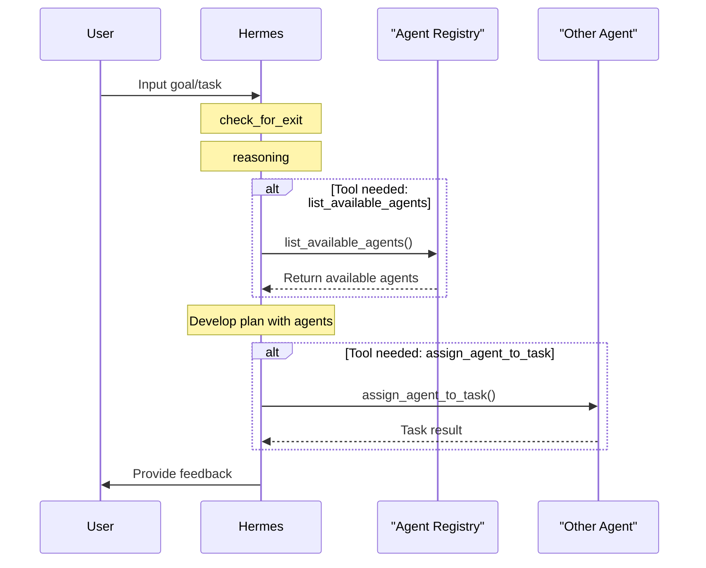

<!-- source: DeepWiki mcp.deepwiki.com · repo mikekelly/AgentK · page 3.1 Hermes: Orchestrator · fetched 2026-10-26 -->

# Hermes: Orchestrator

<details>
<summary>Relevant source files</summary>

The following files were used as context for generating this wiki page:

- [README.md](README.md)
- [agents/hermes.py](agents/hermes.py)

</details>


## Purpose and Scope

This document details the Hermes agent, which serves as the central orchestrator within the AgentK system. Hermes is responsible for interacting with users, understanding their goals, planning how to achieve those goals through agent orchestration, and coordinating the activities of other agents to complete tasks.

For information about other kernel agents, see [Kernel Components](#2.1) or the specific agent documentation: [AgentSmith: Agent Creator](#3.2), [ToolMaker: Tool Creator](#3.3), and [WebResearcher: Knowledge Gatherer](#3.4).

## Overview

Hermes functions as the entry point and coordination hub for the entire AgentK system. Named after the messenger of the gods in Greek mythology, Hermes facilitates communication between the user and the various specialized agents within the system. It implements a ReAct (Reasoning and Acting) pattern using LangGraph to process user inputs, plan solutions, and orchestrate other agents to execute those plans.



Diagram: Hermes's Position in the AgentK System Architecture

Sources: [README.md:24-27](), [agents/hermes.py:13-44]()

## Core Responsibilities

Hermes has four primary responsibilities in the AgentK ecosystem:

1. **Goal Understanding**: Collaborate with the user to reach a shared understanding of the goal
2. **Task Planning**: Develop a detailed sequential plan for achieving the goal
3. **Agent Orchestration**: Assign appropriate agents to specific tasks and coordinate their activities
4. **User Communication**: Provide feedback to the user on progress and request input when needed

Sources: [agents/hermes.py:30-35]()

## Implementation Architecture

Hermes is implemented as a LangGraph state machine with a ReAct pattern that alternates between reasoning (thinking) and acting (using tools).



Diagram: Hermes Workflow State Graph

Sources: [agents/hermes.py:95-109]()

### Node Functions

Hermes's workflow consists of the following key components:

| Node | Function | Purpose |
|------|----------|---------|
| `feedback_and_wait_on_human_input` | [agents/hermes.py:48-61]() | Presents messages to the user and collects input |
| `check_for_exit` | [agents/hermes.py:63-68]() | Checks if the user has requested to exit |
| `reasoning` | [agents/hermes.py:70-76]() | Invokes the LLM to think about the current state |
| `check_for_tool_calls` | [agents/hermes.py:78-91]() | Determines if tools should be called or feedback given |
| `acting` (ToolNode) | [agents/hermes.py:93]() | Executes the tool calls requested by the LLM |

Sources: [agents/hermes.py:48-93]()

## Tools

Hermes utilizes two primary tools to facilitate agent orchestration:

1. **`list_available_agents`**: Retrieves a current list of all available agents in the system
2. **`assign_agent_to_task`**: Delegates a specific task to an appropriate agent

These tools enable Hermes to maintain awareness of system capabilities and delegate work effectively.

Sources: [agents/hermes.py:46]()

## Interaction Pattern

The following sequence diagram illustrates how Hermes interacts with users and other agents:



Diagram: Hermes Interaction Sequence

Sources: [agents/hermes.py:30-35](), [agents/hermes.py:46]()

## System Prompt Analysis

Hermes's system prompt provides critical context and guidance that shapes its behavior:

1. **Identity Definition**: Defines Hermes as a ReAct agent for achieving user goals
2. **System Context**: Explains AgentK's purpose as a self-evolving AGI
3. **Agent Awareness**: Lists the core kernel agents and their roles
4. **Interaction Protocol**: Specifies the 4-step process for user interaction
5. **Agent Optimization Guidance**: Encourages creating reusable, composable agent roles

The system prompt concludes by including a real-time list of available agents, ensuring Hermes always has up-to-date information about system capabilities.

Sources: [agents/hermes.py:13-44]()

## Code Implementation

The main implementation function is quite straightforward:

```python
def hermes(uuid: str):
    """The orchestrator that interacts with the user to understand goals, plan out how agents can meet the goal, assign tasks, and coordinate the activities agents."""
    print(f"Starting session with AgentK (id:{uuid})")
    print("Type 'exit' to end the session.")

    return graph.invoke(
        {"messages": [SystemMessage(system_prompt)]},
        config={"configurable": {"thread_id": uuid}}
    )
```

This function initializes the LangGraph workflow with the system prompt and a unique session identifier, which enables checkpointing and session persistence.

Sources: [agents/hermes.py:112-120]()

## Technical Considerations

### Checkpointing

Hermes uses a checkpointing system initialized via `utils.checkpointer` to maintain conversational state between interactions. This allows sessions to be resumed and prevents loss of context.

Sources: [agents/hermes.py:110]()

### Language Model Configuration

Hermes leverages the default language model configured in the system, binding the appropriate tools to it during the reasoning phase.

Sources: [agents/hermes.py:74]()

### Console Interaction

Hermes provides visual feedback in the console during operation:
- Prints when it's thinking
- Shows reasoning content before taking action
- Lists tools being invoked
- Presents the final output to the user

Sources: [agents/hermes.py:51-55](), [agents/hermes.py:72](), [agents/hermes.py:84-88]()

## Summary

Hermes serves as the central orchestrator within AgentK, providing the critical interface between users and the system's capabilities. Through its LangGraph-based workflow, Hermes can understand goals, plan approaches, delegate to specialized agents, and deliver results—effectively functioning as the primary coordination mechanism for the entire system.

---

