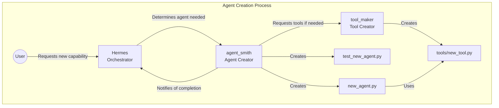
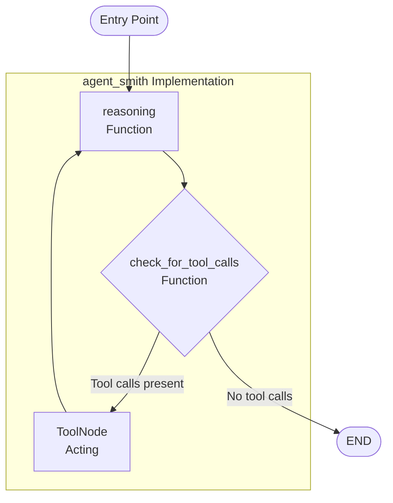
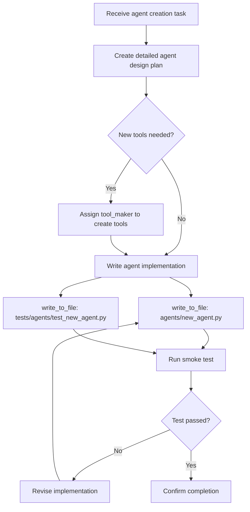
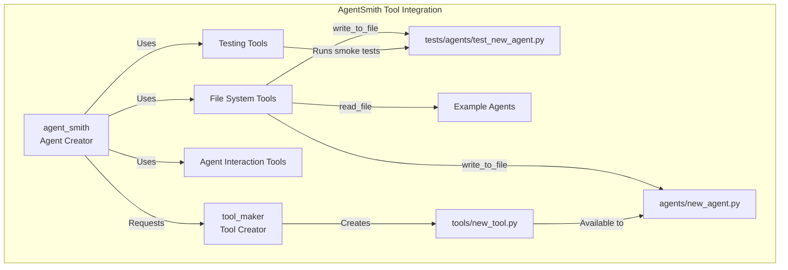
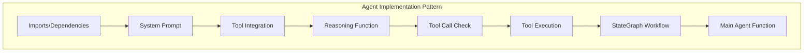
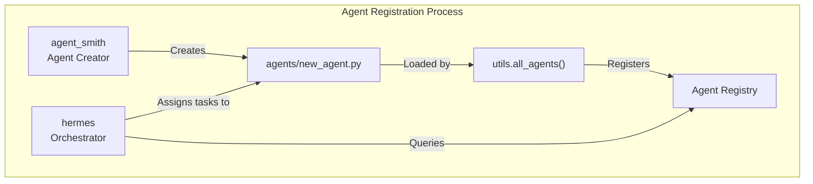

<!-- source: DeepWiki mcp.deepwiki.com · repo mikekelly/AgentK · page 3.2 AgentSmith: Agent Creator · fetched 2026-10-26 -->

# AgentSmith: Agent Creator

<details>
<summary>Relevant source files</summary>

The following files were used as context for generating this wiki page:

- [README.md](README.md)
- [agents/agent_smith.py](agents/agent_smith.py)

</details>


## Purpose and Scope

This document details AgentSmith, the agent responsible for creating and maintaining all other agents within the AgentK ecosystem. AgentSmith ensures new agents are properly designed, equipped with necessary tools, and thoroughly tested before deployment.

For information on how agents interact with each other, see [Core Architecture](#2).
For details on specific tools AgentSmith might request, see [Tools](#4).

Sources: [README.md:24-26](), [agents/agent_smith.py:18-24]()

## Role in AgentK Ecosystem

AgentSmith serves as the architect and developer of the agent ecosystem. It enables AgentK to evolve by creating specialized agents when new capabilities are needed. Without AgentSmith, the system would be limited to its initial set of agents.



AgentSmith is implemented in [agents/agent_smith.py](), operating within the ReAct pattern using LangGraph components.

Sources: [README.md:24-26](), [agents/agent_smith.py:1-113]()

## Implementation Details

AgentSmith is implemented as a LangGraph-based ReAct agent that alternates between reasoning and acting. This is the same pattern used by all agents in the system, making it consistent with the architecture it helps create and maintain.



Key components:
- **System Prompt**: Defines AgentSmith's identity, purpose, and guidelines for creating agents [agents/agent_smith.py:18-67]()
- **Reasoning Function**: Generates responses using a language model with bound tools [agents/agent_smith.py:72-78]()
- **Tool Call Check**: Determines if tools should be called [agents/agent_smith.py:80-93]()
- **ToolNode**: Executes tool calls [agents/agent_smith.py:95]()
- **StateGraph**: Defines the workflow connecting reasoning and acting [agents/agent_smith.py:97-105]()

Sources: [agents/agent_smith.py:72-105]()

## Agent Creation Process

AgentSmith follows a systematic process when creating new agents:



The process ensures new agents are:
1. Thoroughly planned
2. Equipped with necessary tools
3. Properly implemented with a consistent structure
4. Tested before being considered complete

Sources: [agents/agent_smith.py:33-39](), [agents/agent_smith.py:40-53]()

## Code Structure Guidelines

AgentSmith enforces strict guidelines for agent development to maintain system consistency:

| Requirement | Description |
|-------------|-------------|
| Location | All agents must be placed in the `agents/` directory |
| Naming | Agent file name and function name must match |
| Tool Import | Import tools with `from tools.tool_name import tool_name` |
| Framework | Use LangGraph to define agent workflows |
| Testing | Include smoke tests for all agents |
| Verification | Tests must run without errors before completion |

When creating a new agent, AgentSmith follows this file structure pattern:

```
agents/
  ├── new_agent.py         # Main agent implementation
tests/
  └── agents/
      └── test_new_agent.py # Smoke test for the agent
```

Sources: [agents/agent_smith.py:40-53]()

## Tool Integration

AgentSmith has access to all available tools in the system and can use them during agent creation:



AgentSmith can:
- Use `write_to_file` to create agent and test files
- Read existing agents for reference
- Run tests to verify agent functionality
- Request new tools from ToolMaker when needed

Sources: [agents/agent_smith.py:70](), [agents/agent_smith.py:40-53]()

## Example Agent Creation

AgentSmith uses the `web_researcher` agent as a reference example when creating new agents. Here's how the typical agent implementation follows the LangGraph pattern:



The example follows this structure:
1. Import necessary libraries
2. Define system prompt
3. Load available tools
4. Define reasoning function
5. Implement tool call detection
6. Create the tool execution node
7. Define the workflow graph
8. Create the main agent function that invokes the graph

Sources: [agents/agent_smith.py:10-17](), [agents/agent_smith.py:57-64]()

## Integration with the Agent Registry

Once AgentSmith creates a new agent, it becomes available to the entire system through the agent registry managed by `utils.py`. This allows other components, particularly Hermes, to discover and utilize the new capability.



When a user makes a request requiring the new agent's capabilities, Hermes can assign appropriate tasks to it, expanding the system's overall capabilities.

Sources: [agents/agent_smith.py:66-67]()

## Common Challenges and Solutions

AgentSmith addresses several challenges in agent creation:

| Challenge | Solution |
|-----------|----------|
| Tool requirements | Coordinates with ToolMaker to ensure necessary tools exist |
| Agent specificity | Avoids creating overly specific agents that merely proxy to functions |
| Testing rigor | Enforces smoke testing to validate agent functionality |
| Consistency | Follows strict guidelines for directory structure and naming |
| Generalization | Designs agents with reusable capabilities when possible |

Sources: [agents/agent_smith.py:47-52]()

## Usage

To request a new agent creation from AgentSmith:

1. Hermes orchestrator typically initiates agent creation requests
2. The request should clearly specify the agent's purpose and capabilities
3. AgentSmith handles the design, implementation, and testing autonomously
4. Upon completion, AgentSmith confirms the agent's name and purpose

A typical agent creation request might be:
"Create an agent that can analyze sentiment of text and categorize emotions in user messages."

Sources: [agents/agent_smith.py:109-113]()

---

