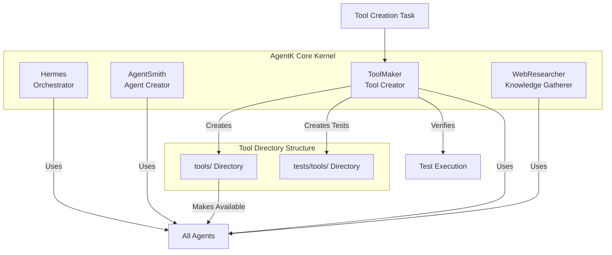
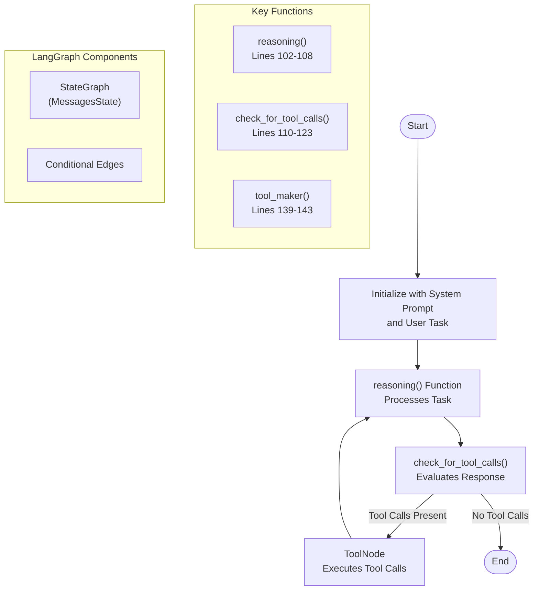
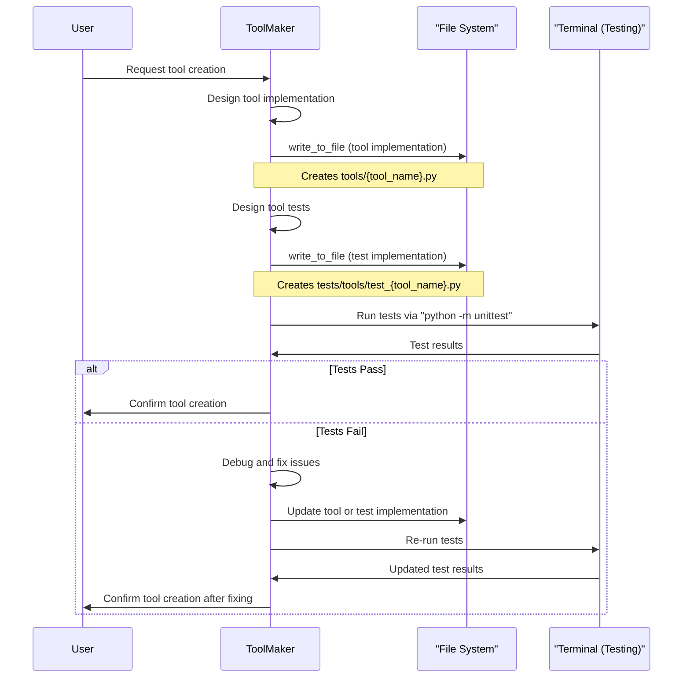

<!-- source: DeepWiki mcp.deepwiki.com · repo mikekelly/AgentK · page 3.3 ToolMaker: Tool Creator · fetched 2026-10-26 -->

# ToolMaker: Tool Creator

<details>
<summary>Relevant source files</summary>

The following files were used as context for generating this wiki page:

- [README.md](README.md)
- [agents/tool_maker.py](agents/tool_maker.py)

</details>


## Purpose and Scope

This document provides detailed information about the ToolMaker agent, one of the four core kernel agents in the AgentK system. ToolMaker is responsible for developing new tools that extend the capabilities of all agents in the system. This page covers the ToolMaker's implementation, workflow, tool creation process, and testing procedures. For information about the tools themselves, see [Tools](#4), and for specifics on the tool creation process as a standalone topic, see [Tool Creation Process](#4.3).

## Overview

ToolMaker is a specialized ReAct agent that creates and tests new tools for the AgentK system. These tools are Python functions that agents can use to interact with the outside world, manipulate files, access the web, or communicate with other agents. ToolMaker follows a systematic approach to tool development, ensuring each tool is properly implemented, tested, and documented.



**Diagram: ToolMaker's Position in AgentK Architecture**

Sources: [agents/tool_maker.py:9-48](), [README.md:26-27]()

## Implementation Details

ToolMaker is implemented as a LangGraph-based ReAct agent that follows the pattern of reasoning, checking for tool calls, and then acting by executing those tools. This implementation is defined in the `tool_maker.py` file.



**Diagram: ToolMaker's Internal LangGraph Workflow**

Sources: [agents/tool_maker.py:102-143]()

### Core Components

1. **System Prompt**: Defines ToolMaker's purpose, capabilities, and instructions for creating tools
2. **Reasoning Function**: Processes the current state and generates a response using the LLM
3. **Check For Tool Calls**: Determines if the response contains tool calls to execute
4. **Tool Node**: Executes any tool calls present in the response
5. **Workflow Graph**: Connects these components into a workflow using LangGraph

The main entry point for invoking ToolMaker is the `tool_maker()` function, which initializes the LangGraph workflow with a system message and the user's task.

Sources: [agents/tool_maker.py:10-98](), [agents/tool_maker.py:100-143]()

## Tool Creation Process

ToolMaker follows a systematic approach to creating new tools:



**Diagram: Tool Creation Process Flow**

Sources: [agents/tool_maker.py:25-29](), [agents/tool_maker.py:32-47]()

### Steps in Detail

1. **Design and Implementation**: ToolMaker designs the tool based on the requested functionality
2. **Code Writing**: Writes the tool implementation to the appropriate file
3. **Test Development**: Creates a test file to verify the tool's functionality
4. **Test Execution**: Runs the tests to ensure the tool works as expected
5. **Dependency Management**: Installs any required Python packages or system dependencies
6. **Completion Confirmation**: Reports back on the successful creation of the tool

Sources: [agents/tool_maker.py:25-47]()

## Tool Structure and Requirements

ToolMaker ensures that all tools follow a consistent structure and meet specific requirements:

```mermaid
graph TD
    subgraph "Tool Structure"
        ToolFile["tools/{tool_name}.py"]
        TestFile["tests/tools/test_{tool_name}.py"]
        
        ToolFile -->|"Contains"| ToolFunction["@tool<br>def {tool_name}(...): ..."]
        ToolFile -->|"Includes"| Docstring["\"\"\"Tool description\"\"\""]
        
        TestFile -->|"Contains"| TestClass["class Test{ToolName}(unittest.TestCase)"]
        TestClass -->|"Contains"| TestMethod["def test_...(self): ..."]
    end
    
    subgraph "Requirements"
        ReqOne["One tool per file"]
        ReqTwo["Filename matches function name"]
        ReqThree["Includes docstring"]
        ReqFour["Has test file"]
        ReqFive["Tests must pass"]
    end
```

**Diagram: Tool Structure and Requirements**

Sources: [agents/tool_maker.py:32-41]()

### Tool File Requirements

- **Location**: All tools must be placed in the `tools` directory
- **Naming**: The filename must match the function name of the tool
- **Structure**: One tool function per file, decorated with `@tool`
- **Documentation**: Each tool must include a docstring describing its purpose
- **Implementation**: Function must be properly implemented to fulfill its purpose

### Test File Requirements

- **Location**: Tests must be in the `tests/tools` directory
- **Naming**: Test files must follow the pattern `test_{tool_name}.py`
- **Structure**: Must include a test class inheriting from `unittest.TestCase`
- **Coverage**: Tests must verify the intended behavior of the tool
- **Validation**: Tests must pass before the tool is considered complete

Sources: [agents/tool_maker.py:32-41](), [agents/tool_maker.py:49-97]()

## Dependency Management

ToolMaker is responsible for managing dependencies required by the tools it creates:

### Python Dependencies
- Checks installed Python packages in `requirements.txt`
- Adds new dependencies to `requirements.txt` when needed
- Installs dependencies using `pip install -r requirements.txt`

### System Dependencies
- Checks installed Debian packages in `apt-packages-list.txt`
- Adds new dependencies to `apt-packages-list.txt` when needed
- Installs dependencies using `xargs -a apt-packages-list.txt apt-get install -y`

Sources: [agents/tool_maker.py:42-47]()

## Integration with Other Agents

ToolMaker plays a crucial role in the AgentK ecosystem by enhancing the capabilities of all agents through the creation of new tools:

| Agent | Interaction with ToolMaker |
|-------|----------------------------|
| Hermes | Requests new tool creation when needed for task completion |
| AgentSmith | Uses tools created by ToolMaker when designing new agents |
| WebResearcher | Uses web interaction tools to gather information |
| Other Task Agents | Use appropriate tools to complete their specialized tasks |

When a new capability is needed, any agent can request Hermes to ask ToolMaker to create an appropriate tool. Once created, the tool becomes immediately available to all agents in the system.

Sources: [README.md:15-18]()

## Example Tool Creation

ToolMaker follows a template pattern when creating tools, as demonstrated by these examples from its system prompt:

### Simple Tool Example

```python
# tools/add_smiley_face.py
from langchain_core.tools import tool

@tool
def add_smiley_face(text: str) -> str:
    """Adds an asccii face to the end of the supplied text."""
    return text + " :)"
```

With corresponding test:

```python
# tests/tools/test_add_smiley_face.py
import unittest

from tools import add_smiley_face

class TestAddSmileyFace(unittest.TestCase):
    def test_that_it_adds_a_smiley_to_text(self):
        self.assertEqual(add_smiley_face.add_smiley_face.invoke({ "text": "hello" }), "hello :)")

if __name__ == '__main__':
    unittest.main()
```

Sources: [agents/tool_maker.py:49-72](), [agents/tool_maker.py:74-97]()

## Conclusion

ToolMaker is a critical component of the AgentK system, responsible for creating and maintaining the tools that allow agents to interact with the world. By following a structured approach to tool development and ensuring all tools are properly tested, ToolMaker enables the continuous evolution of AgentK's capabilities.

For more information about the tools themselves, see [Tools](#4), and for a detailed explanation of the tool creation process as a standalone topic, see [Tool Creation Process](#4.3).

---

