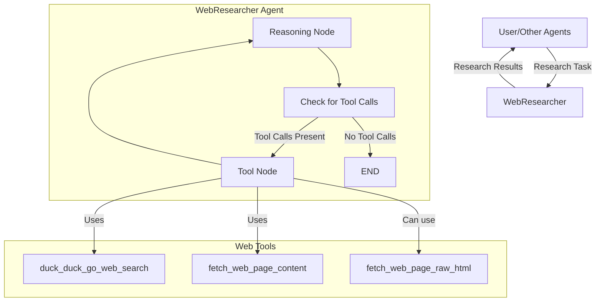
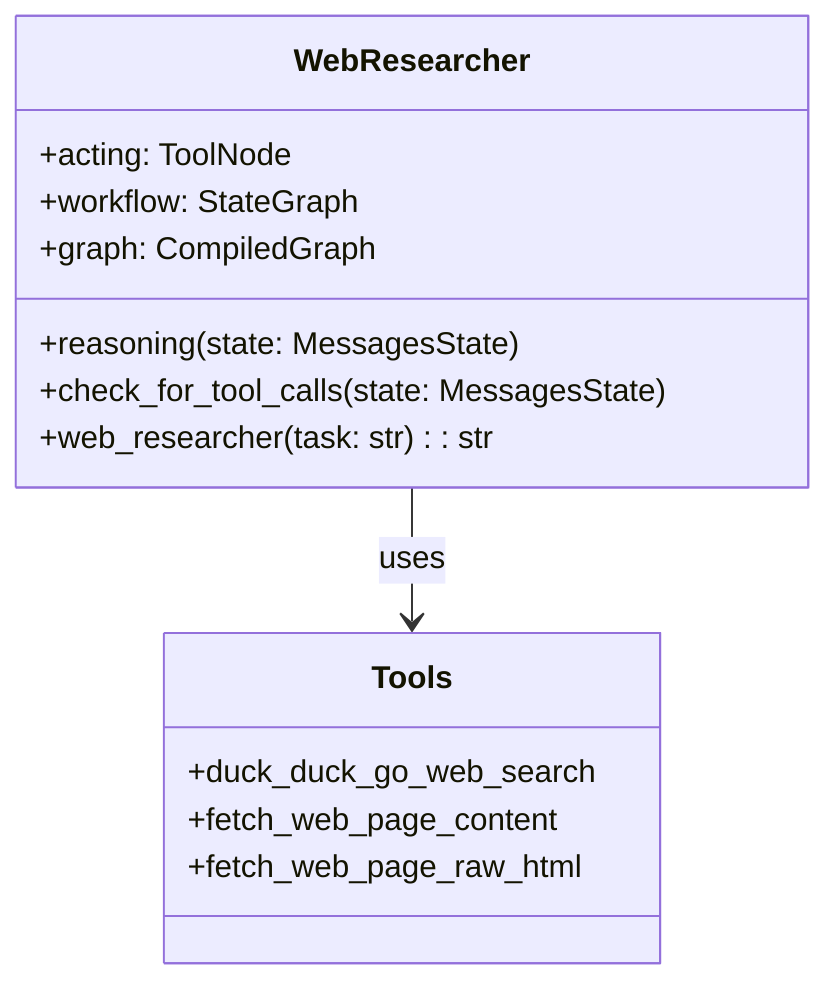
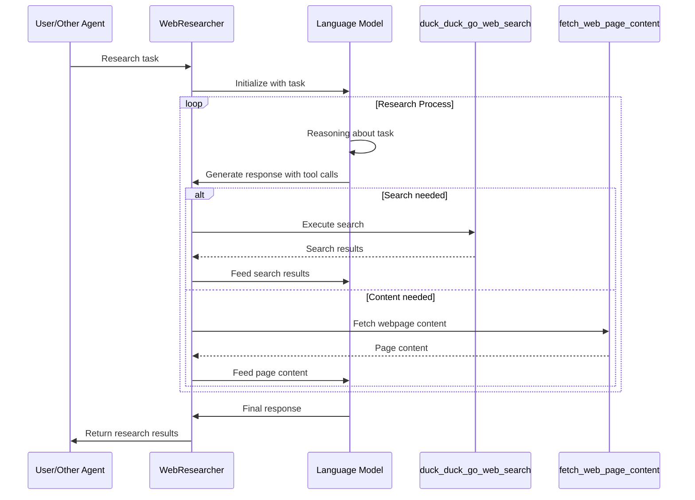
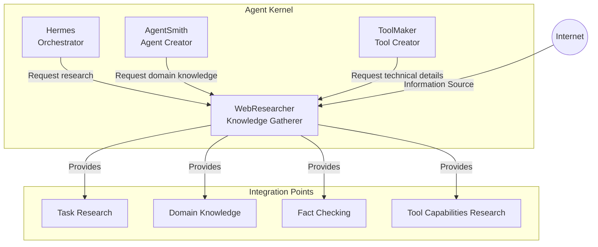

<!-- source: DeepWiki mcp.deepwiki.com · repo mikekelly/AgentK · page 3.4 WebResearcher: Knowledge Gatherer · fetched 2026-10-26 -->

# WebResearcher: Knowledge Gatherer

<details>
<summary>Relevant source files</summary>

The following files were used as context for generating this wiki page:

- [README.md](README.md)
- [agents/web_researcher.py](agents/web_researcher.py)
- [tests/tools/test_fetch_web_page_raw_html.py](tests/tools/test_fetch_web_page_raw_html.py)
- [tools/fetch_web_page_raw_html.py](tools/fetch_web_page_raw_html.py)

</details>


## Purpose and Scope

WebResearcher is a core kernel agent within the AgentK system that serves as the primary knowledge gathering component. It performs in-depth online research to provide the system with up-to-date information, enabling other agents to make informed decisions and execute tasks effectively. This agent bridges the gap between the AgentK system and the outside world of information available on the web.

This page documents the WebResearcher agent's architecture, capabilities, workflow, and integration with the overall AgentK system. For information about other kernel agents, please see [Core Architecture](#2.1) and for details on the web interaction tools that WebResearcher uses, see [Web Interaction Tools](#4.2).

Sources: [README.md:24-27](), [agents/web_researcher.py:1-61]()

## Architecture Overview

WebResearcher is implemented as a ReAct (Reasoning and Acting) agent using LangGraph for workflow management. It follows the common pattern used throughout AgentK where agents alternate between reasoning about what to do and taking actions via tools.



**Diagram: WebResearcher Architecture and Tool Integration**

Sources: [agents/web_researcher.py:9-61](), [tools/fetch_web_page_raw_html.py:1-22]()

## Implementation Details

WebResearcher is implemented in Python using LangGraph's state graph architecture. The agent maintains conversation state and follows a cyclic pattern of reasoning, checking for tool calls, and executing those tools.



**Diagram: WebResearcher Class Structure**

The core function `web_researcher(task: str)` serves as the entry point that other agents use to invoke WebResearcher's capabilities. It initializes the conversation with a system prompt and the user's task, then runs the workflow graph to completion.

Sources: [agents/web_researcher.py:18-61]()

## Workflow Process

The WebResearcher agent follows this workflow:

1. **Initialization**: The agent receives a research task
2. **Reasoning Phase**: The language model thinks about how to tackle the research task
3. **Tool Selection**: Determines if web tools need to be used and which ones
4. **Tool Execution**: Executes the selected tools (search or content fetching)
5. **Result Processing**: Processes the information retrieved from tools
6. **Repeat or Conclude**: Either returns to reasoning with new information or returns a final answer



**Diagram: WebResearcher Operational Workflow**

Sources: [agents/web_researcher.py:20-53]()

## Web Tools and Capabilities

WebResearcher has access to specialized tools for web interaction:

| Tool | Purpose | Description |
|------|---------|-------------|
| `duck_duck_go_web_search` | Search the web | Executes searches via DuckDuckGo to find relevant web pages |
| `fetch_web_page_content` | Extract content | Fetches and extracts the main content from web pages |
| `fetch_web_page_raw_html` | Raw HTML fetching | Returns the complete HTML of a web page for detailed parsing |

The `fetch_web_page_raw_html` tool uses Selenium with headless Chrome to access web pages, enabling WebResearcher to handle modern web applications and complex page structures.

Sources: [agents/web_researcher.py:15-18](), [tools/fetch_web_page_raw_html.py:1-22]()

## System Integration

WebResearcher is designed to be called by other agents in the AgentK system, particularly by Hermes (the orchestrator) and AgentSmith (when creating new agents that need domain knowledge).



**Diagram: WebResearcher System Integration**

Sources: [README.md:24-27]()

## Implementation Code Structure

The WebResearcher agent follows the ReAct pattern implemented through LangGraph:

1. **System Prompt**: Defines the agent's identity and capabilities
2. **Tool Loading**: Imports and prepares the web tools
3. **Reasoning Function**: Processes the current state and generates a response
4. **Tool Checking Function**: Determines whether tools need to be called
5. **Workflow Definition**: Sets up the LangGraph state machine
6. **Entry Point Function**: External interface to invoke the agent

The implementation uses a state graph with two main nodes:
- `reasoning`: Where the language model considers the research task
- `tools`: Where web tools are executed based on the reasoning output

Sources: [agents/web_researcher.py:9-61]()

## Testing and Reliability

WebResearcher's tools include unit tests to ensure reliability. For example, the `fetch_web_page_raw_html` tool is tested to verify it can properly fetch and return HTML content from web pages.

The agent is designed to provide detailed logging of its thought process and tool usage, making it easier to debug and understand its operation during complex research tasks.

Sources: [tests/tools/test_fetch_web_page_raw_html.py:1-13]()

## Usage Example

When another agent needs to research information, it can invoke WebResearcher as follows:

```python
from agents.web_researcher import web_researcher

# Get information on a topic
research_result = web_researcher("What are the latest advancements in quantum computing?")

# Use the research results
# (The result is the final state object from the LangGraph workflow)
```

WebResearcher will automatically:
1. Search for relevant information
2. Visit the most promising pages
3. Extract and synthesize the content
4. Return a comprehensive answer

Sources: [agents/web_researcher.py:57-61]()

## Limitations and Future Improvements

Current limitations of WebResearcher include:
- Limited to text-based research (no image or video analysis)
- May encounter issues with heavily JavaScript-dependent websites
- No built-in memory of past research queries

Potential future improvements could include:
- Integration with more specialized search engines
- Enhanced content extraction capabilities
- Persistent memory of research results
- Support for academic and paywalled content sources

Sources: [agents/web_researcher.py:1-61](), [tools/fetch_web_page_raw_html.py:1-22]()

---

