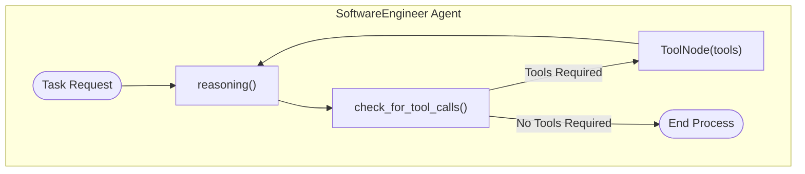
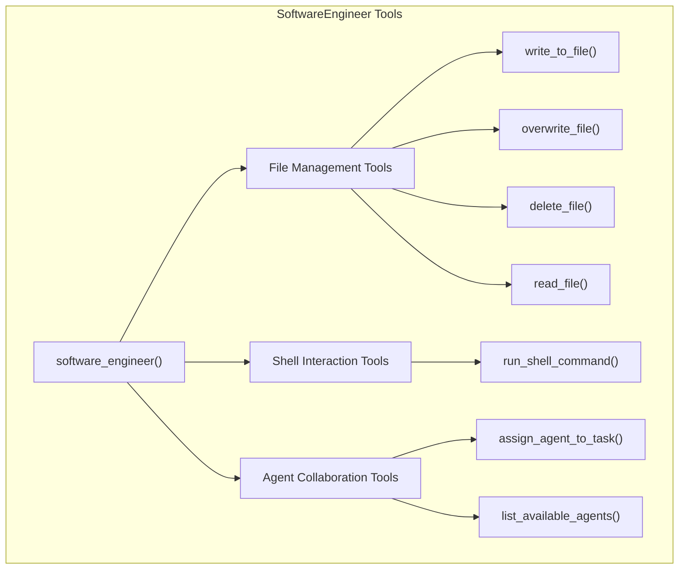
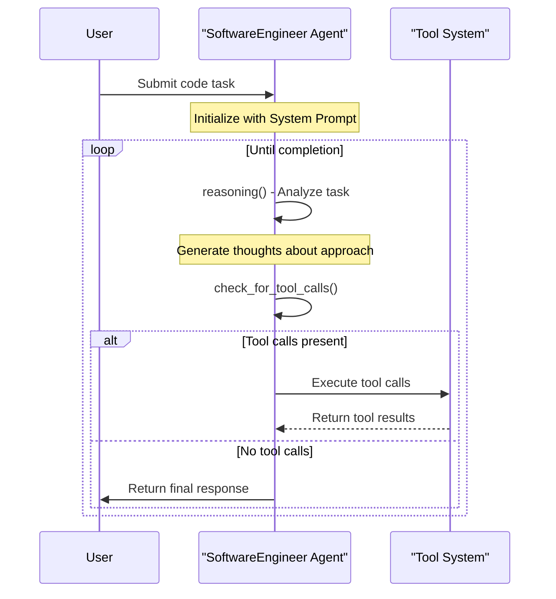
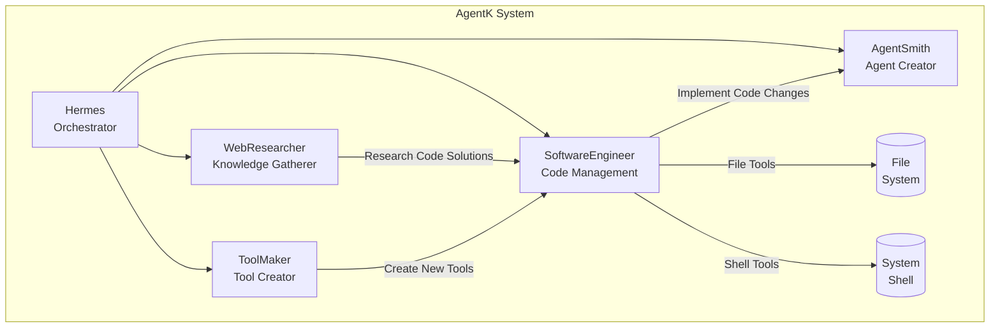

<!-- source: DeepWiki mcp.deepwiki.com · repo mikekelly/AgentK · page 3.5 SoftwareEngineer: Code Management · fetched 2026-10-26 -->

# SoftwareEngineer: Code Management

<details>
<summary>Relevant source files</summary>

The following files were used as context for generating this wiki page:

- [agents/software_engineer.py](agents/software_engineer.py)
- [tests/agents/test_software_engineer.py](tests/agents/test_software_engineer.py)

</details>


## Overview

The SoftwareEngineer agent is responsible for code creation, modification, and file system management within the AgentK system. This agent acts as the primary interface for manipulating code files, executing shell commands, and interacting with the underlying file system. 

For information about creating new agents, see [Creating New Agents](#7.1). For tool creation processes, see [Tool Creation Process](#4.3).

Sources: [agents/software_engineer.py:1-73]()

## Capabilities

The SoftwareEngineer agent provides the following core capabilities:

- Creating new code files
- Reading existing code files
- Modifying existing code files
- Deleting code files
- Running shell commands to interact with the development environment
- Collaborating with other agents by delegating specific tasks

This agent acts as the "hands" of the system for any file manipulation or code changes required during operation.

Sources: [agents/software_engineer.py:9-12](), [agents/software_engineer.py:69-73]()

## Architecture

The SoftwareEngineer agent follows the standard ReAct (Reasoning and Acting) pattern implemented across the AgentK system, using LangGraph for workflow orchestration.



Sources: [agents/software_engineer.py:32-66]()

The agent's architecture consists of:

1. **Reasoning Component**: Processes user requests and determines what actions to take
2. **Tool Checking Component**: Determines if tool calls are needed or if the task is complete
3. **Acting Component**: Executes the requested tools to perform file and code operations

## Tools Integration

The SoftwareEngineer agent has access to a specific set of tools that enable its code management capabilities.



Sources: [agents/software_engineer.py:14-30]()

| Tool Category | Tool Name | Purpose |
|---------------|-----------|---------|
| File Management | `write_to_file` | Creates a new file or appends to an existing file |
| File Management | `overwrite_file` | Completely replaces the contents of an existing file |
| File Management | `delete_file` | Removes a file from the system |
| File Management | `read_file` | Retrieves the contents of a file |
| Shell Interaction | `run_shell_command` | Executes commands in the system shell |
| Agent Collaboration | `assign_agent_to_task` | Delegates a task to another specialized agent |
| Agent Collaboration | `list_available_agents` | Provides information about which agents are available |

Sources: [agents/software_engineer.py:22-30]()

## Workflow Implementation

The SoftwareEngineer agent follows a cyclical workflow pattern implemented using LangGraph.



Sources: [agents/software_engineer.py:32-66]()

The workflow is implemented through these key functions:

1. **`reasoning(state)`**: Processes the current state of the conversation to determine next steps
2. **`check_for_tool_calls(state)`**: Determines if the agent needs to execute tools
3. **`acting` (ToolNode)**: Executes the requested tools
4. **`software_engineer(task)`**: Entry point function that initializes the agent with a task

Sources: [agents/software_engineer.py:32-73]()

## Usage Examples

The SoftwareEngineer agent can be invoked directly within the AgentK system for various code management tasks:

```python
from agents.software_engineer import software_engineer

# Create a new Python file
result = software_engineer("Create a new file called example.py with a simple 'Hello World' function")

# Modify an existing file
result = software_engineer("Add error handling to the function in example.py")

# Run system commands
result = software_engineer("Check what files exist in the current directory by running 'ls -la'")
```

The agent returns the result of its actions, including any file contents or command outputs.

Sources: [agents/software_engineer.py:69-73](), [tests/agents/test_software_engineer.py:1-10]()

## Integration with Agent System

The SoftwareEngineer agent acts as a specialized component within the broader AgentK system, particularly collaborating with other agents for complex tasks.



Sources: [agents/software_engineer.py:18-20](), [agents/software_engineer.py:27-29]()

The SoftwareEngineer agent typically:

1. Receives tasks from the Hermes orchestrator
2. May collaborate with WebResearcher to find code solutions
3. Implements tools created by ToolMaker
4. Provides implementation capability for AgentSmith when creating new agents

This positions the SoftwareEngineer agent as a critical component for the system's ability to modify its own code and create new files.

## System Prompt

The SoftwareEngineer's capabilities are guided by its system prompt, which defines its role and responsibilities:

```
You are software_engineer, a ReAct agent that can create, modify, and delete code.

You have tools to manage files, run shell commands, and collaborate with other agents by assigning them tasks.
```

This concise prompt establishes the agent's identity and primary capabilities, while the specific functionality is implemented through the available tools.

Sources: [agents/software_engineer.py:9-12]()

---

