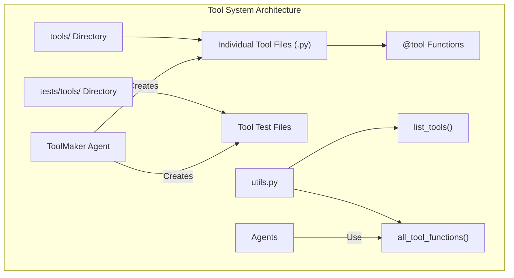
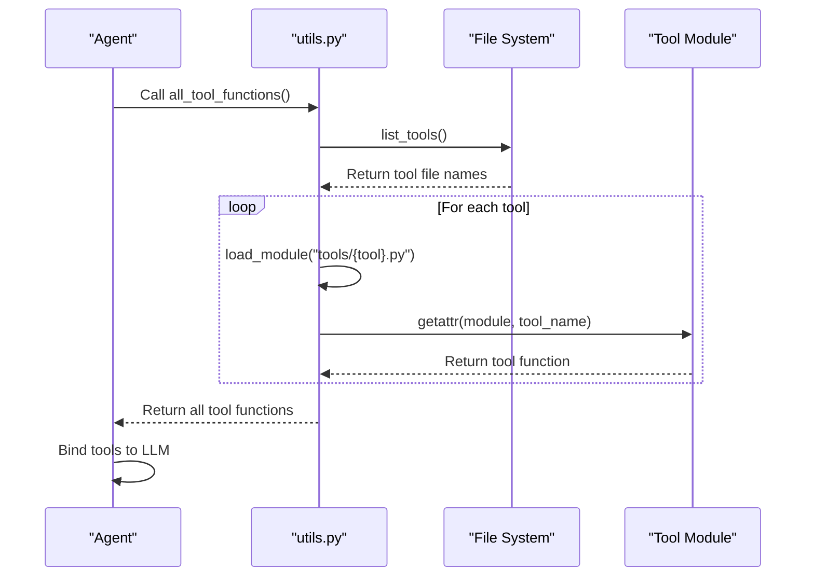
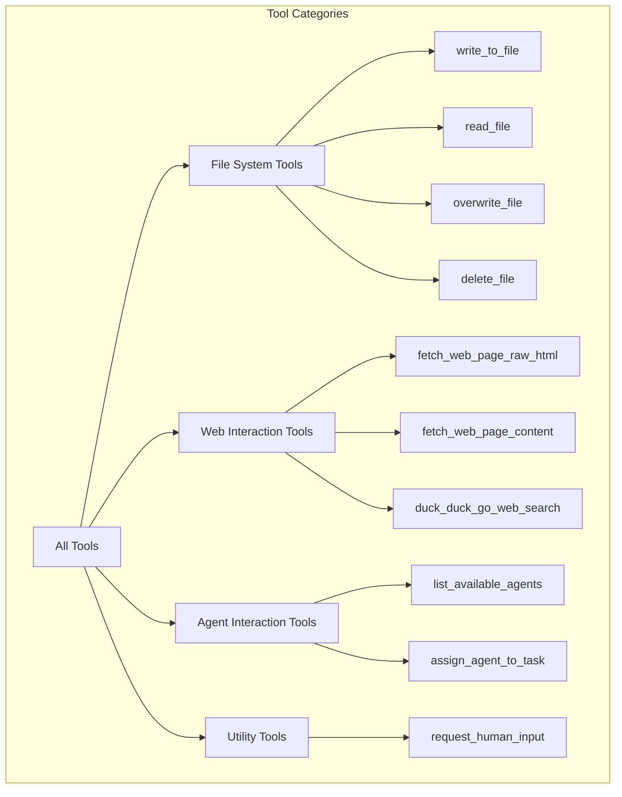
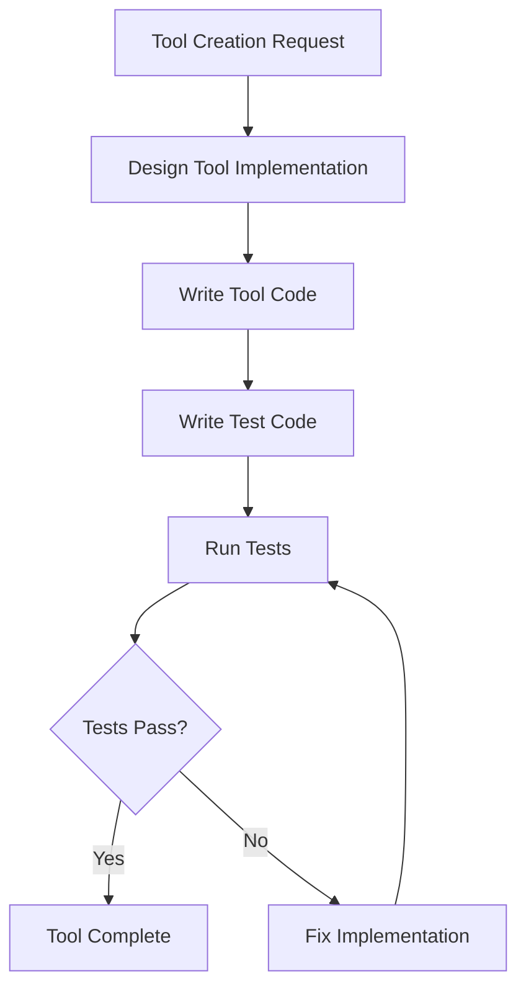
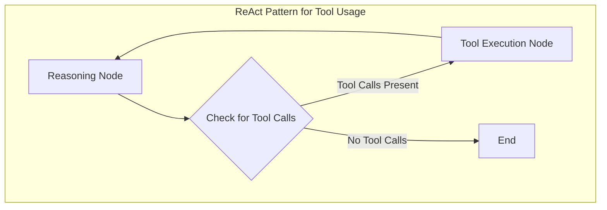

<!-- source: DeepWiki mcp.deepwiki.com · repo mikekelly/AgentK · page 4 Tools · fetched 2026-10-26 -->

# Tools

<details>
<summary>Relevant source files</summary>

The following files were used as context for generating this wiki page:

- [agents/tool_maker.py](agents/tool_maker.py)
- [utils.py](utils.py)

</details>


This page provides an overview of the tool system within AgentK, explaining how tools are structured, loaded, and used by agents. Tools are the primary way that agents interact with external systems and perform actions in the environment. For information about creating new tools, see [Creating New Tools](#7.2). For specific tool categories, see [File System Tools](#4.1) and [Web Interaction Tools](#4.2).

## Tool System Architecture

In AgentK, tools provide the interface between agents and the outside world. Each tool is implemented as a Python function decorated with the `@tool` decorator from LangChain, making it callable by LLM-powered agents.



Key components of the tool system:

- **Tools Directory**: Contains individual Python files, each with a single tool function
- **Utils Module**: Provides functions to list and load all tool functions
- **Tool Functions**: Decorated with `@tool`, each providing a specific capability
- **Test Files**: Unit tests that verify tool functionality
- **ToolMaker Agent**: Creates new tools when needed

Sources: [utils.py:13-54](), [agents/tool_maker.py:10-72]()

## Tool Loading Process

When agents need to use tools, the system loads them dynamically using functions in `utils.py`:



The loading process:
1. `list_tools()` scans the tools directory for Python files
2. `all_tool_functions()` loads each tool module and retrieves the tool function
3. The agent binds these tools to its language model for use

Sources: [utils.py:13-54](), [utils.py:101-130](), [agents/tool_maker.py:100-108]()

## Tool Categories

Tools in AgentK are organized into functional categories:



Major tool categories include:
- **File System Tools**: Create, read, update, and delete files
- **Web Interaction Tools**: Retrieve information from the web
- **Agent Interaction Tools**: Interact with other agents in the system
- **Utility Tools**: Perform various utility functions, including requesting human input

Sources: [agents/tool_maker.py:30-48]()

## Tool Implementation Structure

Each tool follows a consistent structure, making it easy to create and understand:

```
tools/{tool_name}.py
├── @tool decorator
├── Function definition matching file name
└── Docstring describing tool purpose
```

```
tests/tools/test_{tool_name}.py
├── TestCase class
├── Test methods
└── Main block to run tests
```

Example tool structure as shown in the ToolMaker documentation:

```python
# tools/add_smiley_face.py
from langchain_core.tools import tool

@tool
def add_smiley_face(text: str) -> str:
    """Adds an asccii face to the end of the supplied text."""
    return text + " :)"
```

```python
# tests/tools/test_add_smiley_face.py
import unittest

from tools import add_smiley_face

class TestAddSmileyFace(unittest.TestCase):
    def test_that_it_adds_a_smiley_to_text(self):
        self.assertEqual(add_smiley_face.add_smiley_face.invoke({ "text": "hello" }), "hello :)")

if __name__ == '__main__':
    unittest.main()
```

Sources: [agents/tool_maker.py:49-97]()

## Tool Creation Process

The ToolMaker agent is responsible for creating new tools when needed. The process follows these steps:



The ToolMaker follows this structured approach:
1. Design the tool implementation based on requirements
2. Write the tool code to the tools directory
3. Write test code to verify functionality
4. Run tests to ensure the tool works as expected
5. If tests fail, fix and retest until successful
6. Confirm completion with tool name and description

For dependencies:
- Python dependencies are added to `requirements.txt`
- System dependencies are added to `apt-packages-list.txt`

Sources: [agents/tool_maker.py:25-48](), [agents/tool_maker.py:139-143]()

## How Agents Use Tools

Agents use tools through a ReAct (Reasoning-Acting) pattern implemented with LangGraph:



The process works as follows:
1. The agent reasons about what to do next
2. The system checks if the agent wants to call any tools
3. If tools are called, they are executed and results returned to the agent
4. The agent continues reasoning with the tool results
5. This cycle repeats until no more tool calls are needed

In code, tools are bound to the language model using `tooled_up_model = model.bind_tools(tools)`.

Sources: [agents/tool_maker.py:102-135]()

## Tool Management Utilities

The `utils.py` module provides several functions for managing tools:

| Function | Purpose |
|----------|---------|
| `list_tools()` | Lists all tool names in the tools directory |
| `all_tool_functions()` | Loads and returns all tool functions |
| `list_broken_tools()` | Identifies tools that cannot be loaded due to errors |
| `load_module()` | Helper function to dynamically load Python modules |

These utilities enable the dynamic nature of the tool system, allowing agents to discover and use tools without hardcoding references.

Sources: [utils.py:13-130]()

---

