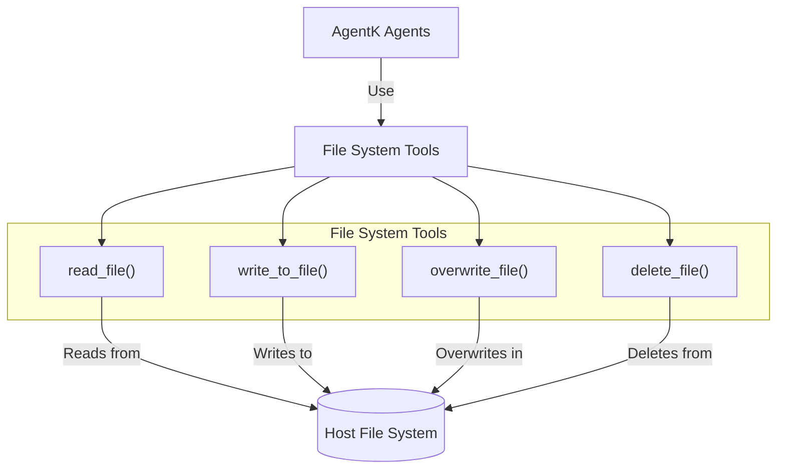
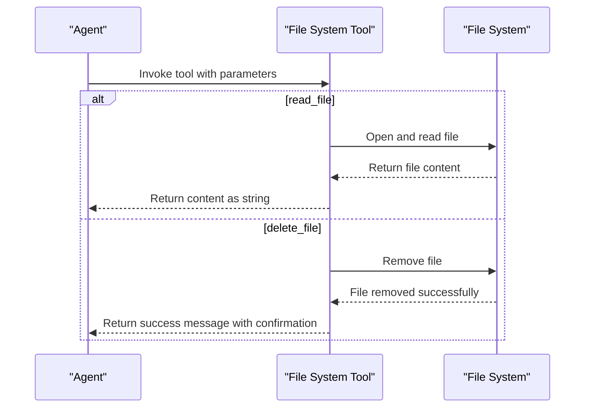

<!-- source: DeepWiki mcp.deepwiki.com · repo mikekelly/AgentK · page 4.1 File System Tools · fetched 2026-10-26 -->

# File System Tools

<details>
<summary>Relevant source files</summary>

The following files were used as context for generating this wiki page:

- [tests/tools/test_delete_file.py](tests/tools/test_delete_file.py)
- [tests/tools/test_read_file.py](tests/tools/test_read_file.py)
- [tools/delete_file.py](tools/delete_file.py)
- [tools/read_file.py](tools/read_file.py)

</details>


This document covers the file system interaction tools provided by the AgentK system. These tools allow agents to read from and manipulate files on the host file system, serving as the primary interface between agents and file storage operations. For information about web interaction tools, see [Web Interaction Tools](#4.2).

## Overview

The file system tools in AgentK provide essential functionality for reading, writing, and managing files. These tools are implemented as Langchain tools, making them easily accessible to any agent in the system.



*Diagram: File System Tools Architecture*

Sources: [tools/read_file.py](). [tools/delete_file.py]()

## Tool Implementation

Each file system tool is implemented as a separate Python module in the `tools` directory and decorated with the `@tool` decorator from Langchain. This allows the tools to be automatically discovered and loaded by the AgentK tool registry system.

### read_file

The `read_file` tool reads and returns the content of a file at a given path.

**Implementation details:**
- Located in `tools/read_file.py`
- Takes a single parameter: `file_path`
- Returns the entire content of the file as a string
- Uses Python's standard file handling capabilities

```python
@tool
def read_file(file_path: str) -> str:
    """Returns the content of the file at the given file path."""
    with open(file_path, 'r') as file:
        return file.read()
```

Sources: [tools/read_file.py:1-9]()

### delete_file

The `delete_file` tool removes a file from the file system.

**Implementation details:**
- Located in `tools/delete_file.py`
- Takes a single parameter: `file_path`
- Returns a confirmation message upon successful deletion
- Uses `os.remove()` to delete the file
- Includes exception handling to provide informative error messages

```python
@tool
def delete_file(file_path: str) -> str:
    """Deletes the file at the given path and returns a string confirming success."""
    try:
        os.remove(file_path)
        return f"File at {file_path} has been deleted successfully."
    except Exception as e:
        return str(e)
```

Sources: [tools/delete_file.py:1-12]()

## Tool Usage Pattern

The following diagram illustrates how agents interact with the file system tools:



*Diagram: Tool Interaction Flow*

Sources: [tests/tools/test_read_file.py](), [tests/tools/test_delete_file.py]()

## Tool Invocation

Tools are invoked using the Langchain tool invocation pattern. Below is a table showing how to invoke each of the implemented file system tools:

| Tool | Invocation Example | Parameters | Return Value |
|------|-------------------|------------|--------------|
| `read_file` | `read_file.invoke({'file_path': 'example.txt'})` | `file_path`: Path to the file to read | Content of the file as a string |
| `delete_file` | `delete_file.invoke({'file_path': 'example.txt'})` | `file_path`: Path to the file to delete | Confirmation message or error description |

Sources: [tests/tools/test_read_file.py:18-19](), [tests/tools/test_delete_file.py:14-15]()

## Error Handling

The file system tools are designed to handle common error cases and provide meaningful error messages:

- `read_file`: If the file doesn't exist or cannot be read, Python's built-in file handling will raise an exception
- `delete_file`: Explicitly catches exceptions and returns the error message as a string, allowing agents to understand what went wrong

This error handling pattern ensures that agents can make informed decisions when file operations fail.

Sources: [tools/delete_file.py:7-11]()

## Testing

Each file system tool has an associated test file that verifies its functionality:

- `test_read_file.py`: Tests the `read_file` tool by creating a temporary file, reading its content, and verifying the output
- `test_delete_file.py`: Tests the `delete_file` tool by creating a temporary file, deleting it, and verifying it was removed

The tests follow a common pattern:
1. Create a temporary test file in `setUp()`
2. Invoke the tool with appropriate parameters
3. Verify the expected outcome
4. Clean up any remaining test files in `tearDown()`

Sources: [tests/tools/test_read_file.py:1-23](), [tests/tools/test_delete_file.py:1-25]()

---

