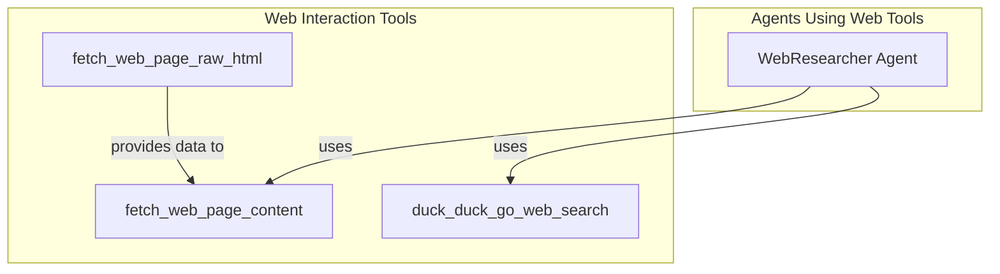
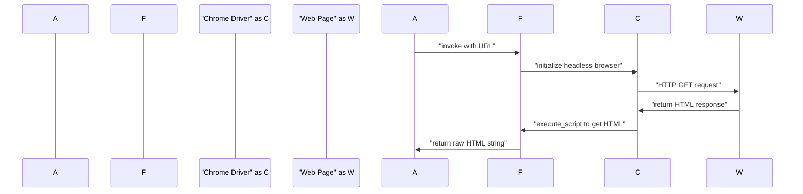
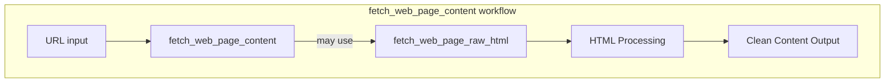
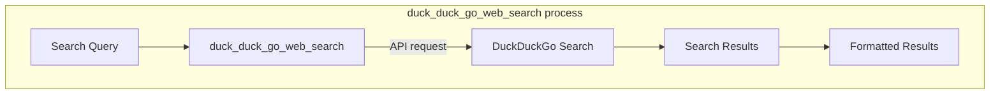
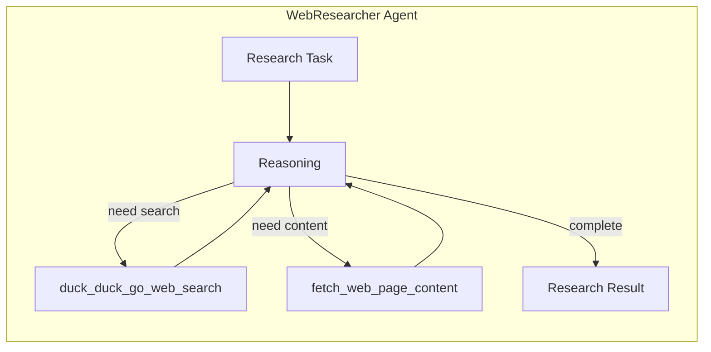

<!-- source: DeepWiki mcp.deepwiki.com · repo mikekelly/AgentK · page 4.2 Web Interaction Tools · fetched 2026-10-26 -->

# Web Interaction Tools

<details>
<summary>Relevant source files</summary>

The following files were used as context for generating this wiki page:

- [agents/web_researcher.py](agents/web_researcher.py)
- [tests/tools/test_fetch_web_page_raw_html.py](tests/tools/test_fetch_web_page_raw_html.py)
- [tools/fetch_web_page_raw_html.py](tools/fetch_web_page_raw_html.py)

</details>


This document covers the web interaction tools available in the AgentK system. These tools enable agents to retrieve information from the web through scraping, content extraction, and search capabilities. For information about other tool categories, see [File System Tools](#4.1) and [Tool Creation Process](#4.3).

## 1. Overview

Web Interaction Tools allow AgentK agents to interface with internet resources, enabling knowledge retrieval and web-based research. These tools form a critical part of the system's ability to gather external information, particularly for the [WebResearcher agent](#3.4).



**Web Interaction Tools Ecosystem**

Sources: [agents/web_researcher.py:15-18](), [tools/fetch_web_page_raw_html.py:7-22]()

## 2. Available Web Tools

The AgentK system includes the following web interaction tools:

| Tool Name | Function | Purpose |
|-----------|----------|---------|
| `fetch_web_page_raw_html` | Retrieves raw HTML from a URL | Used for web scraping raw content |
| `fetch_web_page_content` | Retrieves processed content from a URL | Used for extracting readable text and structure from web pages |
| `duck_duck_go_web_search` | Performs web searches via DuckDuckGo | Used for finding relevant web pages |

### 2.1 fetch_web_page_raw_html

The `fetch_web_page_raw_html` tool retrieves the complete HTML content of a web page using a headless Chrome browser.



**fetch_web_page_raw_html Workflow**

Sources: [tools/fetch_web_page_raw_html.py:7-22]()

#### Implementation Details

The tool is implemented as a LangChain tool using the `@tool` decorator from `langchain_core.tools`. It leverages Selenium WebDriver with a headless Chrome browser to load pages and extract their HTML content.

```
@tool
def fetch_web_page_raw_html(url: str) -> str:
    """Fetches the raw HTML of a web page. If a CSS selector is provided, returns only the matching elements."""
```

Key implementation details:
- Uses Selenium WebDriver with Chrome in headless mode
- Configured with security options (`--no-sandbox`, `--disable-dev-shm-usage`)
- Returns the complete document body HTML

Sources: [tools/fetch_web_page_raw_html.py:7-22]()

#### Testing

The tool includes unit tests that verify its ability to fetch HTML from a sample website (example.com) and validate that basic HTML elements are present in the response.

Sources: [tests/tools/test_fetch_web_page_raw_html.py:1-12]()

### 2.2 fetch_web_page_content

The `fetch_web_page_content` tool provides processed web content, extracting meaningful text from HTML pages. This tool is used by the WebResearcher agent to gather readable information from websites.



**fetch_web_page_content Processing Flow**

Sources: [agents/web_researcher.py:16-17]()

### 2.3 duck_duck_go_web_search

The `duck_duck_go_web_search` tool enables agents to perform web searches using the DuckDuckGo search engine. This tool is critical for the WebResearcher agent to discover relevant web pages about a topic.



**duck_duck_go_web_search Flow**

Sources: [agents/web_researcher.py:15-17]()

## 3. Usage in Agents

The web interaction tools are primarily used by the WebResearcher agent to gather information from the internet. This agent uses a ReAct pattern implemented with LangGraph to alternate between reasoning and acting.



**WebResearcher Tool Usage Pattern**

Sources: [agents/web_researcher.py:9-61]()

### 3.1 Tool Registration and Usage

The WebResearcher agent registers the web tools and makes them available to the language model:

```python
from tools.duck_duck_go_web_search import duck_duck_go_web_search
from tools.fetch_web_page_content import fetch_web_page_content

tools = [duck_duck_go_web_search, fetch_web_page_content]
```

The tools are bound to the language model during the reasoning phase:

```python
tooled_up_model = config.default_langchain_model.bind_tools(tools)
response = tooled_up_model.invoke(messages)
```

When the model decides to use a tool, the agent detects this and routes to the tool execution node:

```python
if last_message.tool_calls:
    return "tools"
```

Sources: [agents/web_researcher.py:15-38]()

## 4. Implementation Requirements

The web interaction tools have several dependencies that must be installed for proper operation:

- **Selenium WebDriver**: Used for browser automation
- **Chrome/Chromium**: Required for the headless browser functionality
- **ChromeDriver**: Browser driver that matches the installed Chrome version

These dependencies are included in the Docker configuration for the AgentK system to ensure consistent operation across environments.

Sources: [tools/fetch_web_page_raw_html.py:3-5]()

## 5. Security Considerations

The web interaction tools access external resources, which introduces potential security concerns:

1. **Content Safety**: External web content may contain malicious code or inappropriate material
2. **Resource Limits**: Web scraping should be performed responsibly to avoid overloading target websites
3. **Browser Security**: The headless browser runs with security options (`--no-sandbox`, `--disable-dev-shm-usage`) that should be understood in production environments

Sources: [tools/fetch_web_page_raw_html.py:9-14]()

## 6. Extension Points

The web interaction tools are designed to be extensible. New tools can be added to expand the system's web capabilities, such as:

- Content extraction for specific formats (PDF, images, etc.)
- Specialized search engines for different domains
- Authentication-required resource access
- Web form interaction

For information about creating new tools, see [Tool Creation Process](#4.3).

Sources: [agents/web_researcher.py:15-18]()

---

