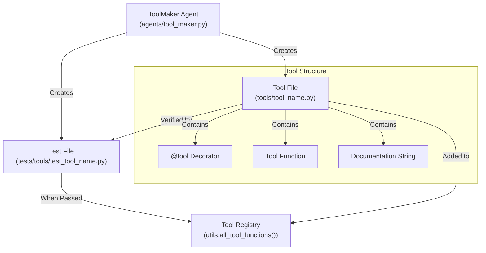
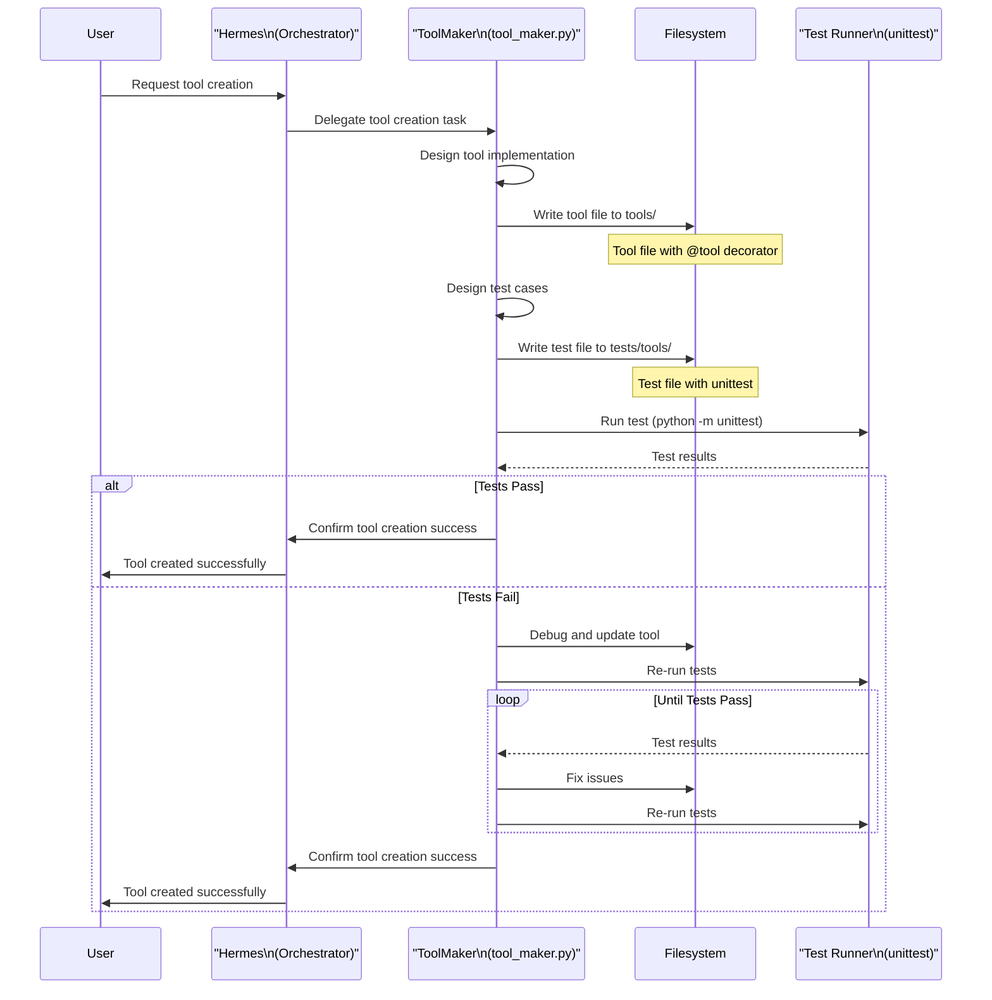
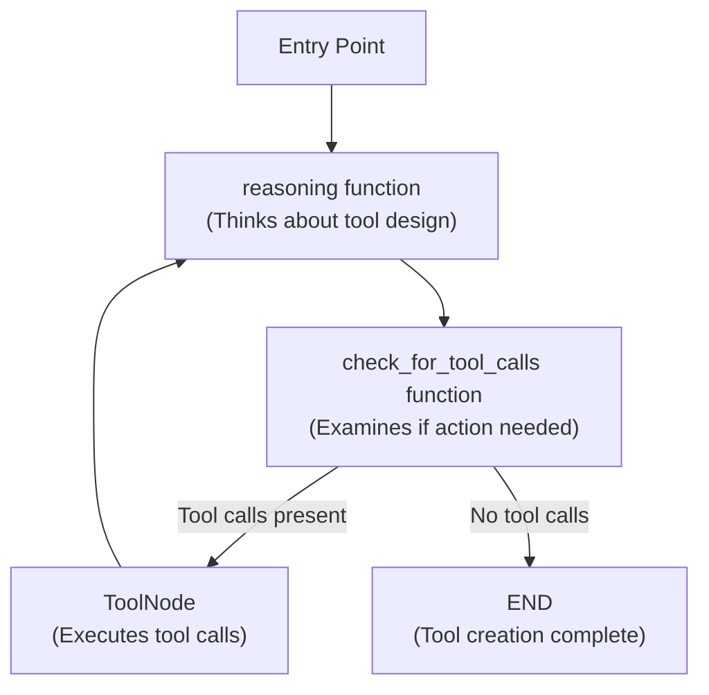
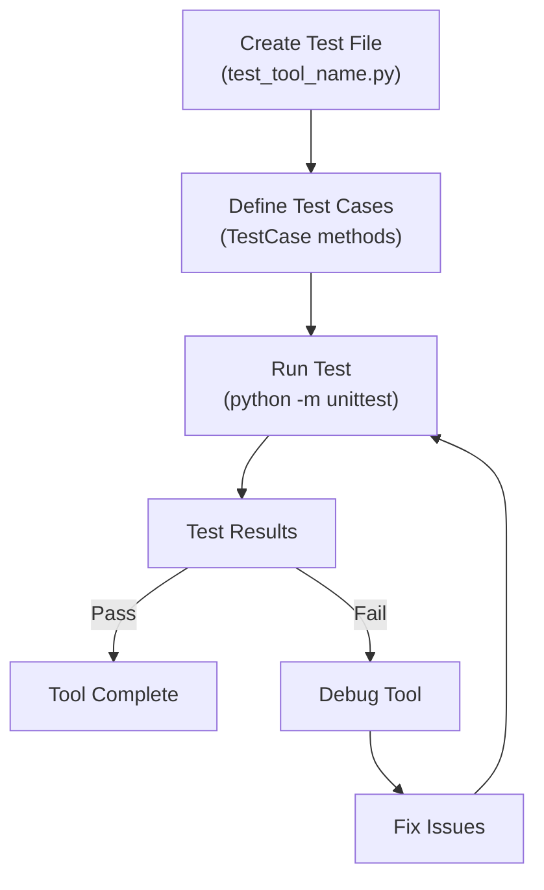
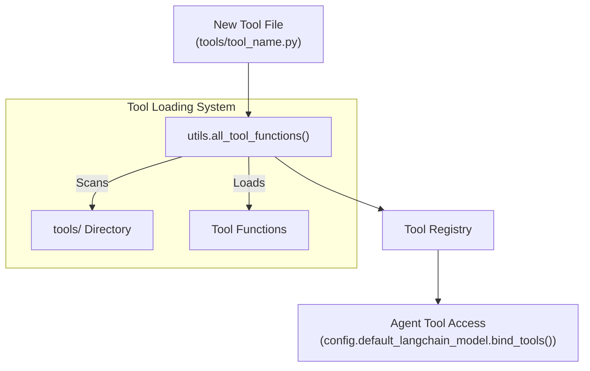

<!-- source: DeepWiki mcp.deepwiki.com · repo mikekelly/AgentK · page 4.3 Tool Creation Process · fetched 2026-10-26 -->

# Tool Creation Process

<details>
<summary>Relevant source files</summary>

The following files were used as context for generating this wiki page:

- [agents/tool_maker.py](agents/tool_maker.py)

</details>


This document explains the workflow for creating, testing, and incorporating new tools into the AgentK system. Tools are fundamental components that enable agents to interact with external systems, manipulate data, and perform specific tasks.

For an overview of the general tool system, see [Tools](#4). For documentation of specific tool categories, see [File System Tools](#4.1) and [Web Interaction Tools](#4.2).

## 1. ToolMaker Agent Overview

ToolMaker is a kernel agent responsible for creating new tools as needed within the AgentK system. It implements a ReAct pattern using LangGraph to reason about tool requirements and then act to create them.

Tool Creation System Diagram:



Sources: [agents/tool_maker.py:1-143]()

## 2. Tool Structure and Requirements

AgentK enforces specific structural requirements for all tools:

| Requirement | Description |
|-------------|-------------|
| Location | Tools must be stored in the `tools` directory |
| File Structure | One tool function per file |
| Naming | Tool file name must match tool function name |
| Decoration | Each tool must use the `@tool` decorator |
| Documentation | Tools must include a descriptive docstring |
| Testing | Each tool must have a corresponding test file |

Tool and Test File Structure:

```mermaid
graph TD
    ToolFile["Tool File\n(tools/tool_name.py)"] -->|"Imports"| LangChain["langchain_core.tools"]
    ToolFile -->|"Contains"| Decorator["@tool Decorator"]
    ToolFile -->|"Contains"| Function["def tool_name(...): ..."]
    Function -->|"Has"| Docstring["\"\"\"Tool description\"\"\""]
    Function -->|"Has"| Parameters["Input Parameters (typed)"]
    Function -->|"Returns"| ReturnValue["Return Value (typed)"]
    
    TestFile["Test File\n(tests/tools/test_tool_name.py)"] -->|"Imports"| Unittest["unittest"]
    TestFile -->|"Imports"| ToolModule["tools.tool_name"]
    TestFile -->|"Contains"| TestClass["TestClassName"]
    TestClass -->|"Contains"| TestMethods["test_* methods"]
```

Sources: [agents/tool_maker.py:31-47](), [agents/tool_maker.py:49-97]()

## 3. Tool Creation Workflow

The tool creation process follows a standardized workflow as defined in the ToolMaker agent's system prompt:



The workflow consists of these primary steps:

1. User requests a new tool via Hermes
2. ToolMaker analyzes the requirements
3. ToolMaker writes the tool implementation to the tools directory
4. ToolMaker creates tests for the tool
5. ToolMaker verifies the tests pass
6. ToolMaker confirms the tool is complete and ready for use

Sources: [agents/tool_maker.py:10-29](), [agents/tool_maker.py:100-136]()

## 4. ReAct Implementation in ToolMaker

ToolMaker implements the ReAct pattern using LangGraph, alternating between reasoning and acting:



The implementation includes:
- `reasoning` function: Processes messages and generates a response that may include tool calls
- `check_for_tool_calls` function: Checks if the response contains tool calls to execute
- `acting` (ToolNode): Executes any tool calls and returns the results

Sources: [agents/tool_maker.py:102-136]()

## 5. Tool Implementation Details

### 5.1 Tool Function Structure

Each tool function must:
- Be decorated with `@tool` from LangChain
- Have typed parameters and return values
- Include a clear docstring
- Implement the required functionality

Example tool structure:
```python
from langchain_core.tools import tool

@tool
def tool_name(param1: str, param2: int) -> str:
    """Concise description of what the tool does."""
    # Implementation
    return result
```

### 5.2 Dependency Management

Tools may require additional dependencies:

| Dependency Type | Configuration File | Installation Command |
|-----------------|-------------------|---------------------|
| Python Packages | `requirements.txt` | `pip install -r requirements.txt` |
| OS Dependencies | `apt-packages-list.txt` | `xargs -a apt-packages-list.txt apt-get install -y` |

When creating tools needing new dependencies, ToolMaker adds them to the appropriate file and runs the installation command.

### 5.3 Human Input Handling

For tools requiring human input (e.g., API keys):
- The `request_human_input` tool is used to prompt the user
- Workflow pauses until the human provides the required input

Sources: [agents/tool_maker.py:31-47]()

## 6. Tool Testing Process

Testing is a mandatory part of the tool creation process:



Test file requirements:
- Located in `tests/tools/` directory
- Named according to convention `test_tool_name.py`
- Uses Python's `unittest` framework
- Tests all expected functionality of the tool

ToolMaker executes tests using `python -m unittest path_to_test_file` and only considers a tool complete when all tests pass.

Sources: [agents/tool_maker.py:31-47](), [agents/tool_maker.py:49-97]()

## 7. Tool Integration

After creation and testing, tools are automatically integrated into the AgentK system:



The integration process:
1. `utils.all_tool_functions()` scans the tools directory
2. Tool functions are loaded and registered in the tool registry
3. Agents access tools through the LangChain tool-calling interface
4. New tools are immediately available without system restarts

Sources: [agents/tool_maker.py:100](), [agents/tool_maker.py:106]()

## 8. Example Tool Creation

The system includes example tool implementations to guide the creation process:

### 8.1 Simple Tool Example

**Tool file**: `tools/add_smiley_face.py`
```python
from langchain_core.tools import tool

@tool
def add_smiley_face(text: str) -> str:
    """Adds an asccii face to the end of the supplied text."""
    return text + " :)"
```

**Test file**: `tests/tools/test_add_smiley_face.py`
```python
import unittest

from tools import add_smiley_face

class TestAddSmileyFace(unittest.TestCase):
    def test_that_it_adds_a_smiley_to_text(self):
        self.assertEqual(add_smiley_face.add_smiley_face.invoke({ "text": "hello" }), "hello :)")

if __name__ == '__main__':
    unittest.main()
```

### 8.2 Parameterless Tool Example

**Tool file**: `tools/get_smiley.py`
```python
from langchain_core.tools import tool

@tool
def get_smiley() -> str:
    """Get a smiley."""
    return ":)"
```

**Test file**: `tests/tools/test_get_smiley.py`
```python
import unittest

from tools import get_smiley

class TestGetSmiley(unittest.TestCase):
    def test_that_it_returns_smiley(self):
        self.assertEqual(get_smiley.get_smiley.invoke({}), ":)")

if __name__ == '__main__':
    unittest.main()
```

Sources: [agents/tool_maker.py:49-97]()

---

