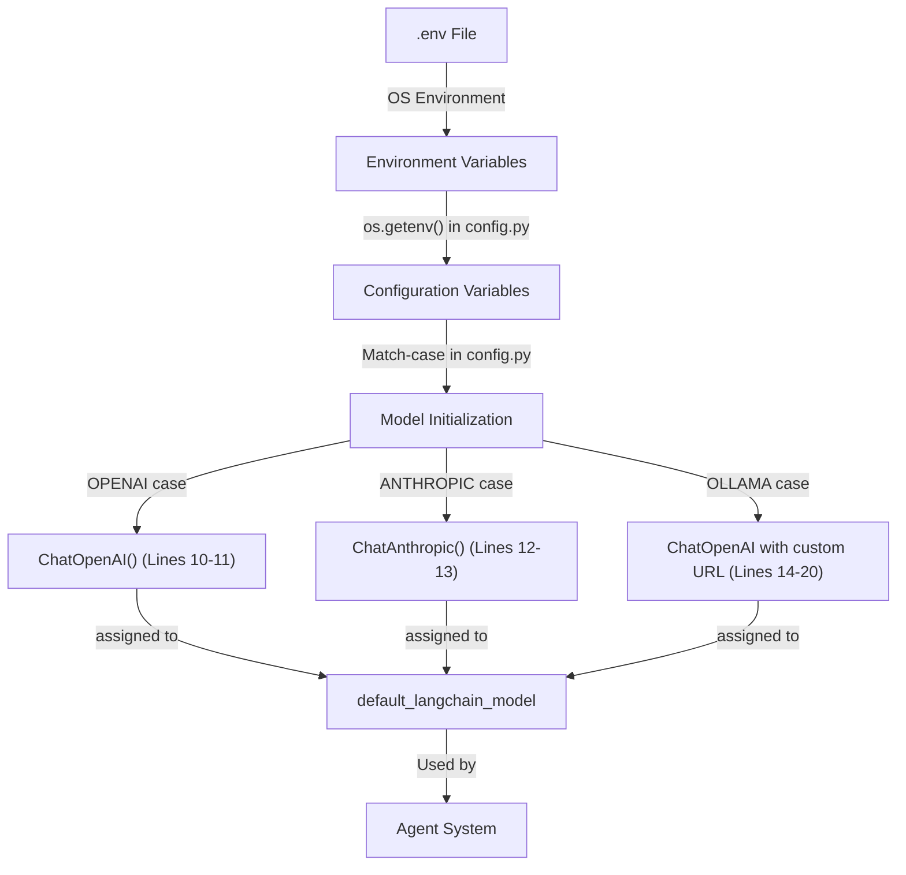
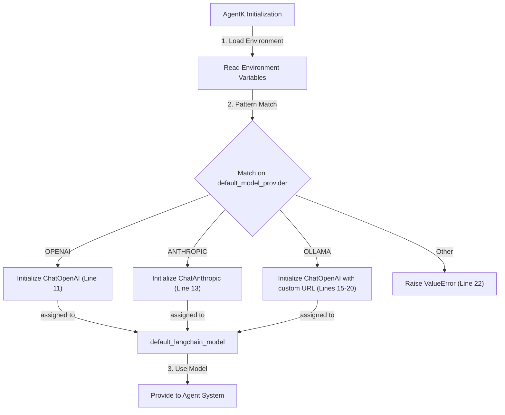

<!-- source: DeepWiki mcp.deepwiki.com · repo mikekelly/AgentK · page 5 Configuration · fetched 2026-10-26 -->

# Configuration

<details>
<summary>Relevant source files</summary>

The following files were used as context for generating this wiki page:

- [.env.example](.env.example)
- [config.py](config.py)

</details>


## Overview
The Configuration system in AgentK manages language model selection and system-wide settings. This document explains how to configure the language model provider, model parameters, and optional integrations.

For more detailed information about specific language model setup instructions, see [Language Model Setup](#5.1).

Sources: [config.py](), [.env.example]()

## Environment Configuration
AgentK uses environment variables for configuration, typically set in a `.env` file in the project root. A template file `.env.example` is provided to show the expected format.

Key configuration variables:

| Variable | Purpose | Default Value | Location |
|----------|---------|---------------|----------|
| `OPENAI_API_KEY` | Authentication key for OpenAI API | None (Required for OpenAI) | `.env` |
| `DEFAULT_MODEL_NAME` | Language model identifier | "gpt-4o" | `config.py:7` |
| `DEFAULT_MODEL_TEMPERATURE` | Controls randomness (0-1) | 0 | `config.py:5` |
| `DEFAULT_MODEL_PROVIDER` | Model provider selection | "OPENAI" | `config.py:6` |
| `ANTHROPIC_API_KEY` | Authentication key for Anthropic | None (Required for Anthropic) | `.env` |

The system also supports optional LangSmith integration for tracking and monitoring language model interactions:

```
LANGCHAIN_TRACING_V2=true
LANGCHAIN_ENDPOINT="https://api.smith.langchain.com"
LANGCHAIN_API_KEY=...
LANGCHAIN_PROJECT=...
```

Sources: [.env.example:1-13]()

## Language Model Configuration
The core model configuration logic resides in `config.py`, which initializes a language model based on environment variables. The resulting `default_langchain_model` object is used throughout the system for AI interactions.

The system supports three model providers with specific initialization requirements:

1. **OpenAI**: Default provider, initializes a `ChatOpenAI` instance
2. **Anthropic**: Initializes a `ChatAnthropic` instance for Claude models
3. **Ollama**: Initializes a `ChatOpenAI` instance with custom API base URL for local models

Sources: [config.py:1-23]()

## Configuration Flow Diagram



Sources: [config.py:5-22]()

## Model Provider Selection Process



Sources: [config.py:9-22]()

---

