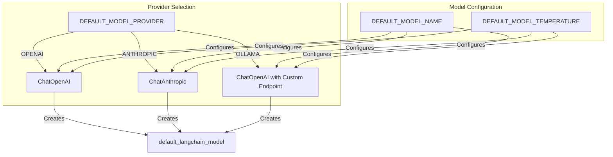
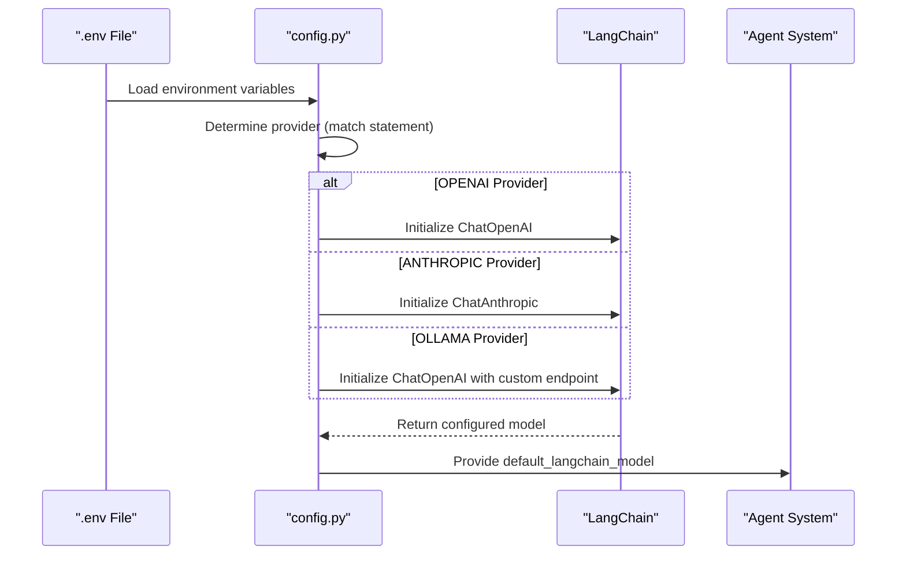
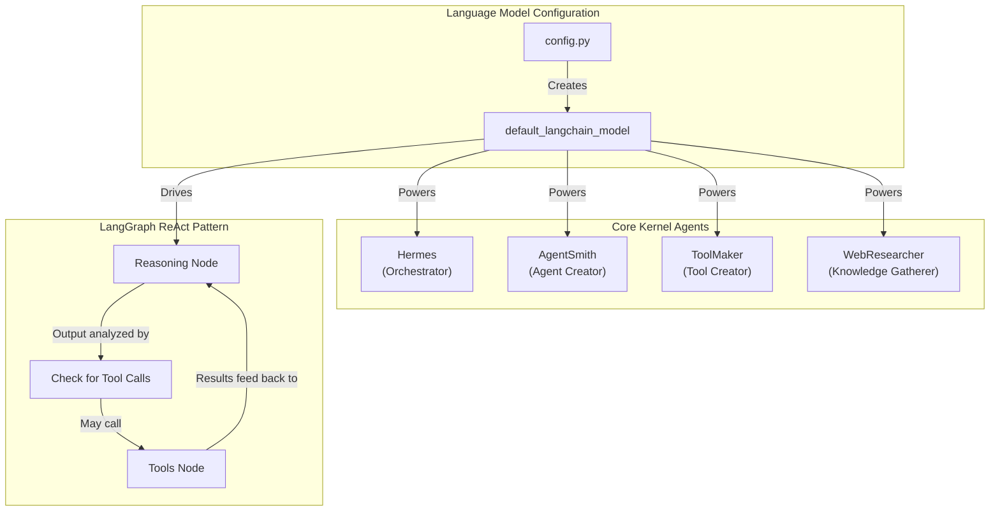

<!-- source: DeepWiki mcp.deepwiki.com · repo mikekelly/AgentK · page 5.1 Language Model Setup · fetched 2026-10-26 -->

# Language Model Setup

<details>
<summary>Relevant source files</summary>

The following files were used as context for generating this wiki page:

- [.env.example](.env.example)
- [config.py](config.py)

</details>


This document provides a technical guide to configuring language model providers and settings within the AgentK system. It covers the supported providers, configuration process, and integration points with the agent architecture. For general configuration settings, see [Configuration](#5).

## Supported Language Model Providers

AgentK supports three language model providers through LangChain integrations:



Sources: [config.py:1-22]()

## Provider Configuration Process

Language model configuration follows this process:

1. Environment variables are loaded from `.env` file
2. Based on the specified provider, the appropriate LangChain model is initialized
3. The model is assigned to `default_langchain_model` which is used throughout the system



Sources: [config.py:5-22]()

## Environment Variables

The following environment variables control language model configuration:

| Variable | Purpose | Default | Example Values |
|----------|---------|---------|---------------|
| DEFAULT_MODEL_PROVIDER | Specifies LLM provider | "OPENAI" | "OPENAI", "ANTHROPIC", "OLLAMA" |
| DEFAULT_MODEL_NAME | Specifies model to use | "gpt-4o" | "gpt-4o", "claude-3-opus", "llama2" |
| DEFAULT_MODEL_TEMPERATURE | Controls randomness (0-1) | 0 | 0, 0.7, 1 |
| OPENAI_API_KEY | Authentication for OpenAI | - | "sk-..." |
| ANTHROPIC_API_KEY | Authentication for Anthropic | - | "sk-ant-..." |

These variables are loaded in `config.py` with default values provided:

```python
default_model_temperature = int(os.getenv("DEFAULT_MODEL_TEMPERATURE", "0"))
default_model_provider = os.getenv("DEFAULT_MODEL_PROVIDER", "OPENAI").upper()
default_model_name = os.getenv("DEFAULT_MODEL_NAME", "gpt-4o")
```

Sources: [config.py:5-7](), [.env.example:1-8]()

## Provider-Specific Configuration

Each provider has specific initialization parameters in the `config.py` match statement:

### OpenAI Configuration

```python
default_langchain_model = ChatOpenAI(
    model_name=default_model_name, 
    temperature=default_model_temperature
)
```

### Anthropic Configuration

```python
default_langchain_model = ChatAnthropic(
    model_name=default_model_name, 
    temperature=default_model_temperature
)
```

### Ollama Configuration

```python
default_langchain_model = ChatOpenAI(
    model_name=default_model_name,
    temperature=default_model_temperature,
    openai_api_key="ollama",  # This can be any non-empty string
    openai_api_base="http://IPADDRESS:11434/v1",
)
```

Sources: [config.py:9-22]()

## Integration with AgentK Architecture

The configured language model integrates with the entire agent architecture as shown below:



Sources: [config.py:1-22]()

## Optional LangSmith Integration

AgentK supports LangSmith integration for debugging and tracing language model interactions. The following environment variables enable this functionality:

| Variable | Purpose |
|----------|---------|
| LANGCHAIN_TRACING_V2 | Enable LangSmith tracing |
| LANGCHAIN_ENDPOINT | LangSmith API endpoint |
| LANGCHAIN_API_KEY | Authentication for LangSmith |
| LANGCHAIN_PROJECT | Project name for organizing traces |

Example configuration in `.env` file:

```
LANGCHAIN_TRACING_V2=true
LANGCHAIN_ENDPOINT="https://api.smith.langchain.com"
LANGCHAIN_API_KEY=your_key_here
LANGCHAIN_PROJECT=agentk_development
```

Sources: [.env.example:9-13]()

## Common Issues and Solutions

| Issue | Solution |
|-------|----------|
| ValueError: Unsupported model provider | Ensure DEFAULT_MODEL_PROVIDER is one of: "OPENAI", "ANTHROPIC", "OLLAMA" |
| API authentication errors | Verify correct API key is set in .env file |
| Ollama connection failures | Check IP address and port configuration for your Ollama server |
| Model not found errors | Verify model name is valid for the selected provider |

When using Ollama, ensure you replace "IPADDRESS" in the configuration with your actual Ollama server address.

Sources: [config.py:21-22]()

## Setting Up a New Environment

To configure language models for a new AgentK environment:

1. Copy `.env.example` to `.env`
2. Set your chosen provider with `DEFAULT_MODEL_PROVIDER`
3. Configure the appropriate API key (`OPENAI_API_KEY` or `ANTHROPIC_API_KEY`)
4. Set your preferred model with `DEFAULT_MODEL_NAME`
5. Optionally set `DEFAULT_MODEL_TEMPERATURE` (0 for deterministic responses)
6. For Ollama, modify the API base URL to point to your server

Sources: [.env.example:1-8](), [config.py:5-22]()

---

