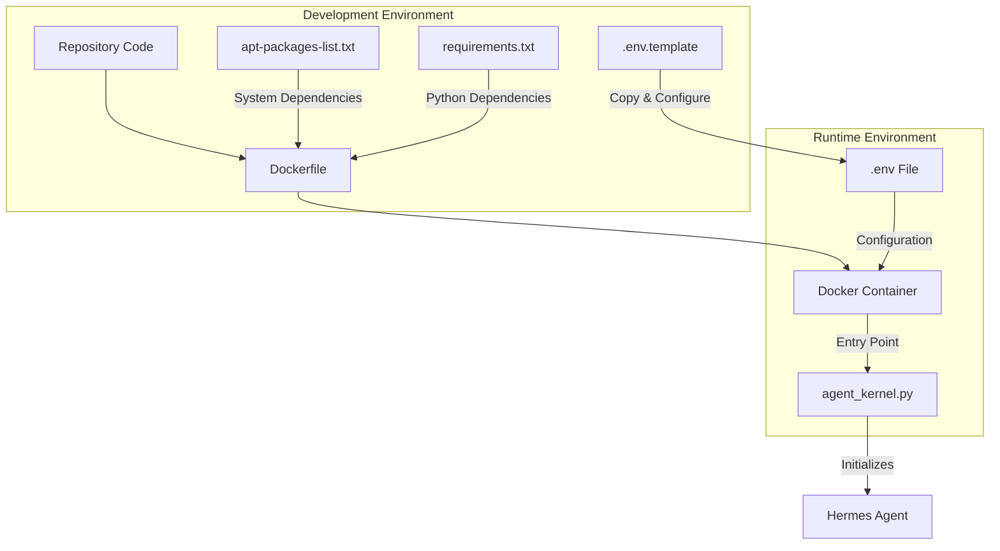
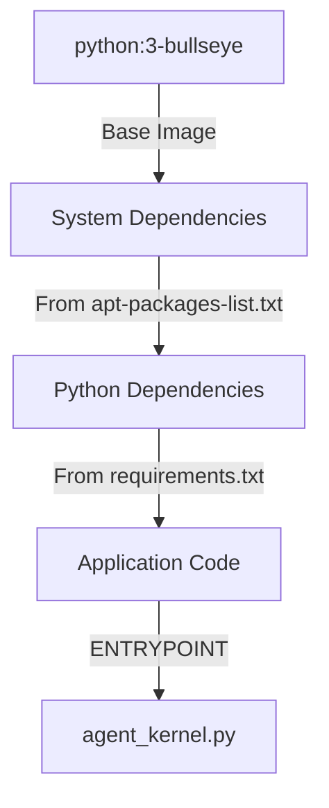
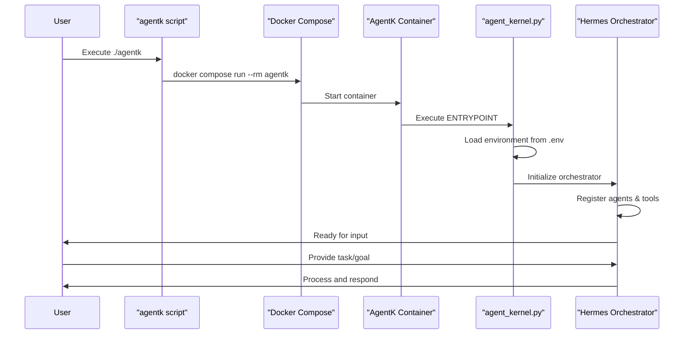

<!-- source: DeepWiki mcp.deepwiki.com · repo mikekelly/AgentK · page 6 Deployment · fetched 2026-10-26 -->

# Deployment

<details>
<summary>Relevant source files</summary>

The following files were used as context for generating this wiki page:

- [Dockerfile](Dockerfile)
- [agentk](agentk)
- [apt-packages-list.txt](apt-packages-list.txt)
- [requirements.txt](requirements.txt)

</details>


This document provides technical instructions for deploying and running the AgentK system. It covers containerization via Docker, environment configuration, and execution procedures. For information about language model configuration, see [Language Model Setup](#5.1).

## Deployment Architecture

AgentK is designed to be deployed as a containerized application using Docker. This containerization ensures consistent environments and isolates dependencies across different deployment targets.



Sources: [Dockerfile](), [agentk]()

## Prerequisites

Before deploying AgentK, ensure you have the following installed:

1. **Docker**: For container management
2. **Docker Compose**: For orchestrating the container
3. **Git**: For repository access (if not using a pre-built image)

## Environment Configuration

AgentK uses environment variables for configuration. Before deployment, you need to create an `.env` file with appropriate values:

1. Copy the template `.env.template` to `.env`
2. Configure language model API keys (OpenAI, Anthropic, etc.)
3. Set model preferences and system parameters

This configuration will be loaded at runtime using the `python-dotenv` package included in the requirements.

Sources: [requirements.txt:10]()

## Container Build and Setup

The AgentK container is defined in the `Dockerfile` and includes all necessary dependencies:



### System Dependencies

The container includes these key system packages:

| Package | Purpose |
|---------|---------|
| wget, curl | Network utilities |
| git | Source code management |
| chromium-driver | Web automation for research |
| ca-certificates | Secure communication |
| cmake, libclang-dev | Build dependencies |

Sources: [Dockerfile:1-16](), [apt-packages-list.txt:1-7]()

### Python Dependencies

Critical Python packages installed in the container:

| Package | Purpose |
|---------|---------|
| langgraph | Agent workflow orchestration |
| langchain-community | LLM tooling and utilities |
| langgraph-checkpoint | Persistence and state management |
| langchain-openai, langchain-anthropic | LLM provider integrations |
| selenium, unstructured | Web interaction capabilities |
| duckduckgo-search | Web search functionality |
| python-dotenv | Environment configuration |

Sources: [requirements.txt:1-10]()

## Running AgentK

The repository includes a convenient shell script named `agentk` that simplifies execution:

```bash
chmod +x agentk  # Make executable (first time only)
./agentk         # Run the system
```

This script executes `docker compose run --rm agentk`, which runs the container and removes it after execution.

Sources: [agentk:1-3]()

## Execution Flow

When the container starts, the following sequence occurs:



Sources: [Dockerfile:17](), [agentk:3]()

## Deployment Options

### Local Development

For local development and testing:

```bash
./agentk
```

### Server Deployment

For production deployment:

1. **Standalone Server**: Run on a dedicated machine with Docker installed
2. **Cloud Container Services**: Deploy to AWS ECS, Google Cloud Run, etc.
3. **Kubernetes**: For orchestrated, scalable deployments

## Resource Requirements

| Component | Minimum Requirement | Recommended |
|-----------|---------------------|-------------|
| CPU | 2 cores | 4+ cores |
| RAM | 4GB | 8GB+ |
| Disk | 2GB | 5GB+ |
| Network | Internet access for LLM API calls and web research |

## Troubleshooting

Common deployment issues:

| Issue | Solution |
|-------|----------|
| Container build fails | Check system requirements and Docker installation |
| Missing API credentials | Verify .env file configuration |
| Network connectivity issues | Ensure internet access for LLM API calls |
| Permission errors | Check file permissions for the agentk script |

## Advanced Configuration

For production deployments, consider:

1. **Persistence**: Configure volume mapping for file persistence
2. **API Keys**: Use secure methods for managing LLM API credentials
3. **Monitoring**: Implement container health checks and logging
4. **Resource Limits**: Set appropriate CPU and memory constraints

Sources: [Dockerfile](), [requirements.txt]()

---

