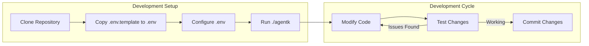
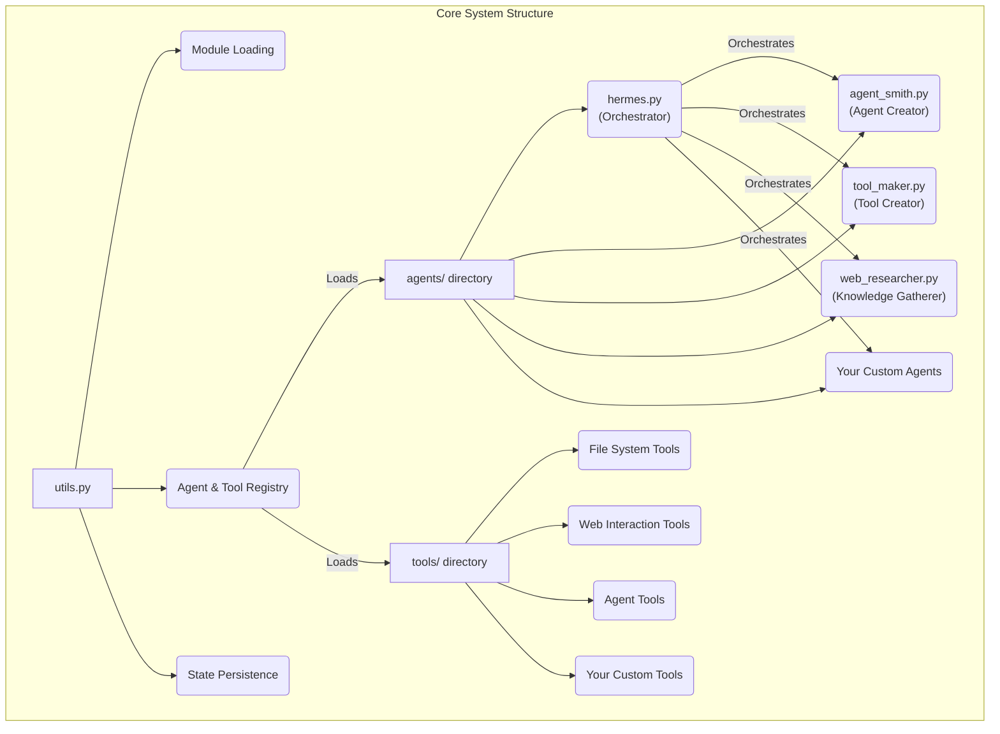
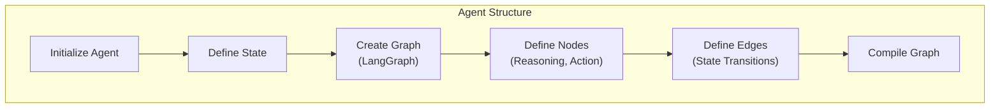
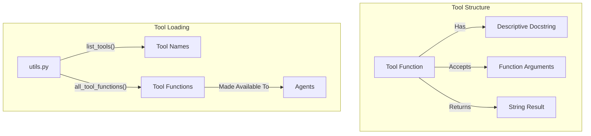
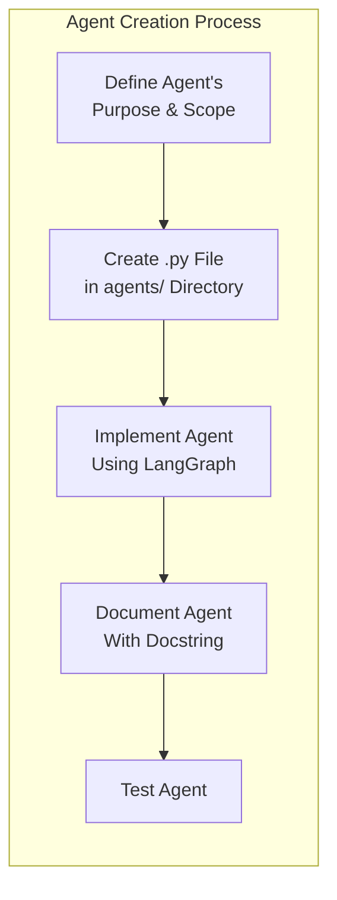
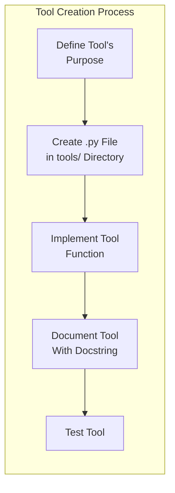
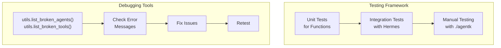
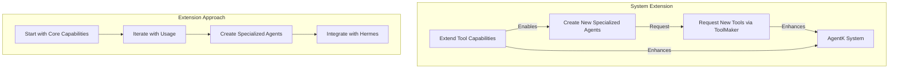

<!-- source: DeepWiki mcp.deepwiki.com · repo mikekelly/AgentK · page 7 Developer Guide · fetched 2026-10-26 -->

# Developer Guide

<details>
<summary>Relevant source files</summary>

The following files were used as context for generating this wiki page:

- [.gitignore](.gitignore)
- [README.md](README.md)
- [utils.py](utils.py)

</details>


This guide is designed for developers who want to extend or modify the AgentK system. It provides technical information on the system's architecture, detailed instructions for creating new agents and tools, and best practices for development. For deployment instructions, please see [Deployment](#6), and for configuration options, see [Configuration](#5).

## 1. Development Environment Setup

Setting up a proper development environment is essential for working with AgentK effectively.



### Prerequisites

1. Docker installed on your system
2. Git for version control
3. Python 3.9+ (for local development outside Docker)
4. A code editor (VS Code recommended)

### Setting Up Locally

1. Clone the repository:
   ```bash
   git clone https://github.com/mikekelly/AgentK.git
   cd AgentK
   ```

2. Create your environment file:
   ```bash
   cp .env.template .env
   ```

3. Edit `.env` with your preferred language model credentials and settings

4. Run AgentK:
   ```bash
   ./agentk
   ```

Sources: [README.md:35-41]()

## 2. Understanding the Core Architecture

Before extending AgentK, it's important to understand its modular architecture and how components interact.



### Module Loading System

AgentK uses a dynamic module loading system defined in `utils.py`. This system allows:

1. Loading Python files from the `agents/` and `tools/` directories as modules
2. Listing available agents and tools
3. Loading tool functions for use by agents

Key functions:
- `load_module()`: Loads a Python file as a module
- `list_agents()`: Lists all agents in the `agents/` directory
- `list_tools()`: Lists all tools in the `tools/` directory
- `all_tool_functions()`: Returns a list of callable tool functions

Sources: [utils.py:12-130]()

### Agent System Architecture

Agents in AgentK follow the LangGraph ReAct pattern (Reasoning and Acting), which enables them to:
1. Reason about tasks
2. Execute tools
3. Observe results
4. Continue reasoning



Sources: [README.md:29-33]()

### Tool System Architecture

Tools in AgentK are Python functions located in the `tools/` directory:



Sources: [utils.py:13-54]()

## 3. Creating New Agents

Creating new agents allows you to extend AgentK's capabilities for specific tasks.



### Agent Structure Template

New agents should follow this basic structure:

```python
"""
Detailed description of what this agent does and its capabilities.
"""

from langgraph.graph import StateGraph, END
from typing import TypedDict, Annotated, Sequence
import operator

def agent_name(config=None):
    """Detailed documentation of the agent's purpose and function"""
    
    # 1. Define state
    class AgentState(TypedDict):
        messages: Annotated[Sequence[dict], operator.add]
        # Add other state fields as needed
    
    # 2. Create graph
    workflow = StateGraph(AgentState)
    
    # 3. Define nodes (reasoning, tools, etc.)
    # ...
    
    # 4. Add edges
    # ...
    
    # 5. Compile graph
    agent = workflow.compile()
    
    return agent
```

### Key Considerations

1. **Agent Function Name**: Must match the filename (e.g., `my_agent.py` should contain a function named `my_agent()`)
2. **Docstring**: Include comprehensive documentation about the agent's purpose and capabilities
3. **Configuration**: Accept a `config` parameter for flexible initialization
4. **LangGraph Structure**: Follow the ReAct pattern with reasoning and action nodes
5. **Testing**: Test your agent thoroughly before integrating it

Sources: [utils.py:56-86]()

## 4. Creating New Tools

Tools extend the system's ability to interact with external systems, process data, or perform specific actions.



### Tool Structure Template

New tools should follow this simple structure:

```python
def tool_name(param1, param2=None):
    """
    Detailed description of what this tool does.
    
    :param param1: Description of first parameter
    :param param2: Description of second parameter
    :return: Description of what the tool returns
    """
    # Tool implementation
    result = "Result of the tool operation"
    return result
```

### Key Considerations

1. **Tool Function Name**: Must match the filename (e.g., `my_tool.py` should contain a function named `my_tool()`)
2. **Docstring**: Include comprehensive documentation about the tool's purpose, parameters, and return value
3. **Parameters**: Define clear parameters with appropriate types
4. **Return Value**: Always return string output for consistency
5. **Error Handling**: Include proper error handling to prevent system crashes
6. **Testing**: Test your tool thoroughly before integrating it

Sources: [utils.py:13-54]()

## 5. Testing and Debugging

Effective testing and debugging are crucial for maintaining a stable AgentK system.

### Testing Agents and Tools



### Debugging Techniques

1. **List Broken Components**:
   - Use `utils.list_broken_agents()` to find agents that fail to load
   - Use `utils.list_broken_tools()` to find tools that fail to load

2. **Common Issues**:
   - Function name not matching filename
   - Missing or incorrect docstring
   - Syntax errors in Python code
   - Import errors for dependencies
   - Tool functions not returning strings

3. **Checkpoint System**:
   AgentK uses SQLite for checkpointing, which stores conversation and agent state:
   - Checkpoint files are located in the project root as `checkpoints.sqlite`
   - Review or clear checkpoints if you encounter persistence issues

Sources: [utils.py:27-40](), [utils.py:72-85](), [.gitignore:1]()

## 6. Best Practices

Follow these practices to ensure your contributions integrate well with the AgentK ecosystem:

### Code Organization

1. **Modularity**: Keep agents and tools focused on specific tasks
2. **Documentation**: Provide clear docstrings that explain functionality
3. **Error Handling**: Gracefully handle errors to prevent crashes
4. **Configuration**: Make agents configurable rather than hard-coding values

### Agent Design Principles

1. **Single Responsibility**: Agents should have a clear, focused purpose
2. **LangGraph Pattern**: Follow the ReAct pattern for consistent behavior
3. **Tool Utilization**: Use existing tools when possible before creating new ones
4. **Testing**: Include testing capabilities in your agent implementation

### Tool Design Principles

1. **Reusability**: Design tools to be reusable across different agents
2. **Input Validation**: Validate inputs to prevent errors
3. **Clear Return Values**: Always return informative string results
4. **Idempotency**: When possible, design tools to be safely repeatable

Sources: [README.md:29-33]()

## 7. Extending the System

AgentK is designed to evolve through the creation of new agents and tools. Here are strategies for extending the system:



### Key Extension Areas

1. **Domain-Specific Agents**: Create agents specialized for particular domains
2. **Enhanced Web Capabilities**: Expand web research and interaction tools
3. **File and Data Processing**: Add tools for handling different file formats and data structures
4. **External API Integration**: Create tools to interact with external services
5. **Improved Testing**: Develop comprehensive testing tools and frameworks

Sources: [README.md:15-20]()

## Conclusion

This Developer Guide provides the foundation for contributing to AgentK's evolution. By creating new agents and tools, you can help expand the system's capabilities while maintaining its self-evolving nature. For specific implementation details, refer to the existing agents and tools as examples, and consult the subsections on [Creating New Agents](#7.1) and [Creating New Tools](#7.2) for step-by-step guidance.

---

