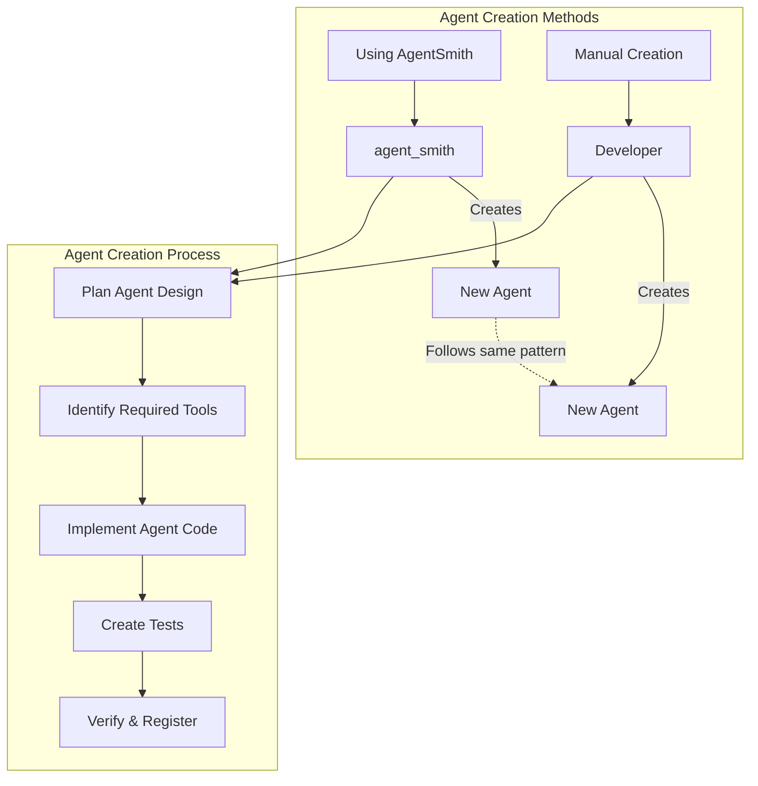
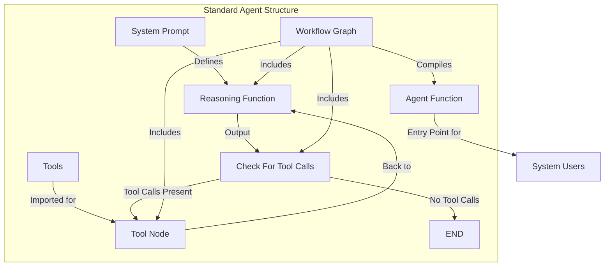
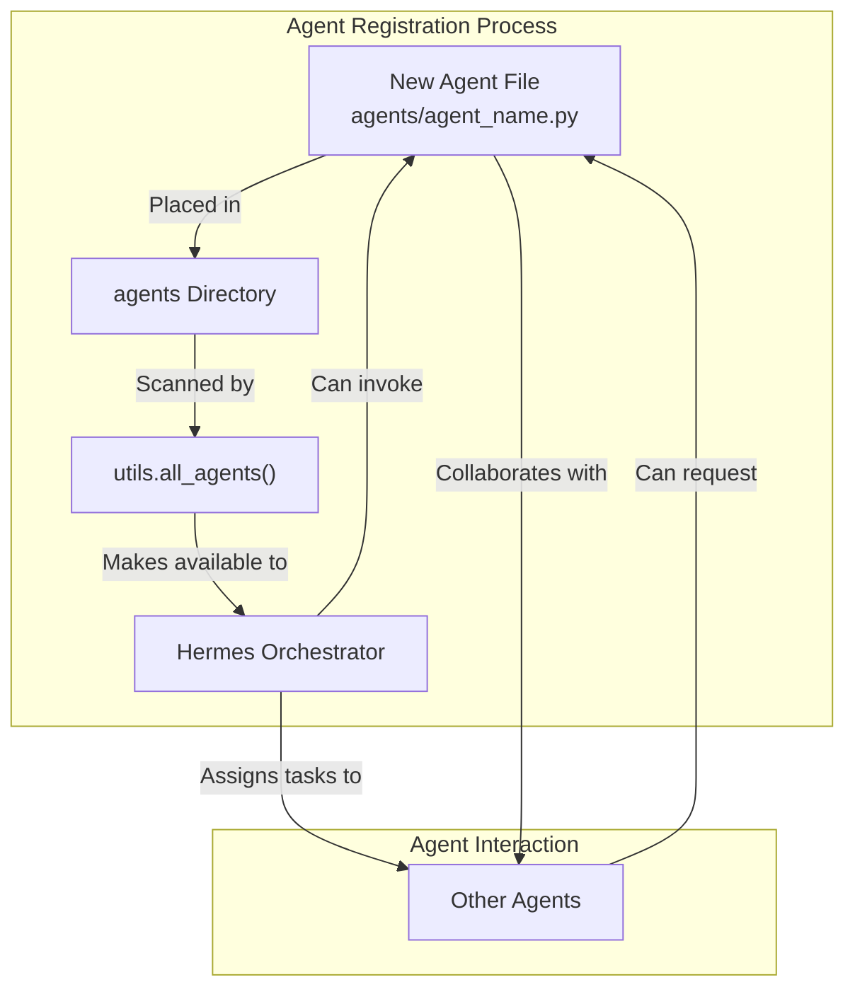

<!-- source: DeepWiki mcp.deepwiki.com · repo mikekelly/AgentK · page 7.1 Creating New Agents · fetched 2026-10-26 -->

# Creating New Agents

<details>
<summary>Relevant source files</summary>

The following files were used as context for generating this wiki page:

- [agents/agent_smith.py](agents/agent_smith.py)
- [agents/software_engineer.py](agents/software_engineer.py)
- [tests/agents/test_software_engineer.py](tests/agents/test_software_engineer.py)

</details>


This guide provides a step-by-step approach to developing and integrating new agents within the AgentK system. It covers both manual agent creation and using the AgentSmith agent to automatically generate new agents. For information about creating new tools that agents can use, see [Creating New Tools](#7.2).

## 1. Agent Creation Methods

There are two primary methods for creating new agents in AgentK:

1. **Using AgentSmith** - The automated approach where a specialized agent creates other agents
2. **Manual Creation** - Direct implementation by a developer following the agent architecture pattern



Sources: [agents/agent_smith.py:33-38]()

## 2. Agent Architecture

All agents in AgentK follow a consistent architecture based on the ReAct (Reasoning and Acting) pattern implemented with LangGraph.



Each agent consists of:

1. A **system prompt** defining the agent's role and capabilities
2. A set of **imported tools** the agent can use
3. A **reasoning function** for thinking and decision-making
4. A **check function** that determines if tool calls are needed
5. A **tool node** for executing tools
6. A **workflow graph** connecting these components
7. An **agent function** serving as the entry point

Sources: [agents/software_engineer.py:1-73](), [agents/agent_smith.py:70-109]()

## 3. Step-by-Step Agent Creation

### 3.1 Using AgentSmith (Recommended)

AgentSmith is designed to automate agent creation. It handles the technical implementation details while you focus on the agent's purpose and functionality.

| Step | Description |
|------|-------------|
| 1. Define purpose | Specify what the agent should do, its specialized role |
| 2. Submit to AgentSmith | Assign AgentSmith the task of creating the agent |
| 3. Review & approve | Review the implementation and make adjustments if needed |

Example usage:
```python
from agents.agent_smith import agent_smith

result = agent_smith("Create an agent called 'data_analyst' that can analyze CSV files, generate statistics, and create data visualizations")
```

AgentSmith will:
1. Plan the agent implementation
2. Identify required tools (requesting new ones from ToolMaker if needed)
3. Write the agent code and test file
4. Verify the implementation works
5. Return the result with a description of the new agent

Sources: [agents/agent_smith.py:109-113](), [agents/agent_smith.py:33-38]()

### 3.2 Manual Agent Creation

For developers who want to directly create agents, follow these steps:

1. **Plan your agent design**
   - Define a clear purpose and responsibilities
   - Determine the tools it will need
   - Specify its reasoning patterns

2. **Create the agent file**
   - Create a new Python file in the `agents` directory
   - Name the file to match the agent's function (e.g., `data_analyst.py`)

3. **Implement the agent following the standard pattern**:

```
1. Import required libraries
2. Define the system prompt
3. Import needed tools
4. Implement the reasoning function
5. Implement the tool call check function
6. Set up the workflow graph
7. Define the main agent function
```

4. **Create a test file**
   - Add a test file in the `tests/agents` directory
   - Verify the agent functions correctly

Sources: [agents/software_engineer.py:1-73](), [agents/agent_smith.py:40-50]()

## 4. Agent Implementation Details

### 4.1 Component Breakdown

Here's a detailed breakdown of the key components in an agent implementation:

| Component | Purpose | Implementation |
|-----------|---------|----------------|
| System Prompt | Defines the agent's role, capabilities, and behavior | String containing instructions for the LLM |
| Tools | Functionality the agent can use | Imported functions from the tools directory |
| Reasoning Function | Processes input and generates responses | Function that uses LLM to generate responses |
| Tool Call Checker | Determines if tools need to be called | Function that analyzes the LLM response |
| Tool Node | Executes tool calls | langgraph.prebuilt.ToolNode instance |
| Workflow Graph | Connects all components into a flow | StateGraph with nodes and edges |
| Agent Function | Public interface to invoke the agent | Function that initializes and runs the graph |

Sources: [agents/software_engineer.py:9-73]()

### 4.2 Required Code Structure

Every agent implementation must follow this structure:

```mermaid
graph TD
    subgraph "agents/agent_name.py"
        imports["Required Imports"] --> system_prompt["System Prompt"]
        system_prompt --> tool_imports["Tool Imports"]
        tool_imports --> tools_list["Tools List"]
        tools_list --> reasoning["Reasoning Function"]
        reasoning --> check_tools["Check For Tool Calls Function"]
        check_tools --> acting["Acting Node"]
        acting --> workflow["Workflow Graph Setup"]
        workflow --> graph["Graph Compilation"]
        graph --> agent_function["Agent Function Definition"]
    end
    
    subgraph "tests/agents/test_agent_name.py"
        test_imports["Test Imports"] --> test_case["Test Case"]
        test_case --> test_run["Test Run Code"]
    end
```

Sources: [agents/software_engineer.py:1-73](), [tests/agents/test_software_engineer.py:1-11]()

## 5. Coding the Agent Components

### 5.1 Required Imports

```python
from typing import Literal
from langchain_core.messages import HumanMessage, SystemMessage
from langgraph.graph import END, StateGraph, MessagesState
from langgraph.prebuilt import ToolNode
import config
```

### 5.2 System Prompt

The system prompt defines what the agent is and how it behaves. This is where you specify:
- The agent's identity
- Its capabilities
- Its approach to problem-solving
- Any special instructions

Example:
```python
system_prompt = """You are agent_name, a ReAct agent that [describe purpose].

You have tools to [describe what the agent can do].

[Additional instructions, constraints, or guidance...]
"""
```

### 5.3 Tool Imports and List

Import all tools the agent will use and add them to a list:

```python
from tools.tool_1 import tool_1
from tools.tool_2 import tool_2
# ... additional tools

tools = [
    tool_1,
    tool_2,
    # ... additional tools
]
```

### 5.4 Reasoning and Tool Call Functions

These functions control the agent's thinking and acting cycle:

```python
def reasoning(state: MessagesState):
    print("agent_name is thinking...")
    messages = state['messages']
    tooled_up_model = config.default_langchain_model.bind_tools(tools)
    response = tooled_up_model.invoke(messages)
    return {"messages": [response]}

def check_for_tool_calls(state: MessagesState) -> Literal["tools", END]:
    messages = state['messages']
    last_message = messages[-1]
    
    if last_message.tool_calls:
        # ... code to handle tool calls
        return "tools"
    
    return END
```

### 5.5 Workflow Graph Setup

Set up the LangGraph workflow:

```python
acting = ToolNode(tools)

workflow = StateGraph(MessagesState)
workflow.add_node("reasoning", reasoning)
workflow.add_node("tools", acting)
workflow.set_entry_point("reasoning")
workflow.add_conditional_edges(
    "reasoning",
    check_for_tool_calls,
)
workflow.add_edge("tools", 'reasoning')

graph = workflow.compile()
```

### 5.6 Agent Function Definition

```python
def agent_name(task: str) -> str:
    """Concise description of what the agent does."""
    return graph.invoke(
        {"messages": [SystemMessage(system_prompt), HumanMessage(task)]}
    )
```

Sources: [agents/software_engineer.py:1-73]()

## 6. Testing Your Agent

All new agents should have a corresponding test file to verify functionality:

1. Create a test file in the `tests/agents` directory named `test_agent_name.py`
2. Implement a basic test that imports and calls the agent
3. Run the test to verify it doesn't error

Example test file:

```python
import unittest
from agents.agent_name import agent_name

class TestAgentName(unittest.TestCase):
    def test_agent_name(self):
        self.assertTrue(callable(agent_name))
        # Add additional tests as needed

if __name__ == '__main__':
    unittest.main()
```

Sources: [tests/agents/test_software_engineer.py:1-11]()

## 7. Best Practices

### 7.1 Agent Design Principles

- **Single Responsibility**: Each agent should have a well-defined purpose
- **Tool Independence**: Agents should work with whatever tools are available
- **Reasoning First**: Focus on reasoning capabilities, not just tool usage
- **Generalization**: Avoid overly specific agents that could be more general

### 7.2 Naming and Documentation

- Use descriptive, lowercase names with underscores (e.g., `data_analyst`)
- File name must match the agent function name
- Include a concise docstring describing the agent's purpose
- Keep the system prompt detailed but focused

Sources: [agents/agent_smith.py:41-53]()

### 7.3 Integration with the System

New agents are automatically registered and available to the system once they are added to the `agents` directory, thanks to the dynamic loading mechanism in `utils.py`.



Sources: [agents/agent_smith.py:66-67]()

## 8. Common Issues and Solutions

| Issue | Solution |
|-------|----------|
| Agent not found by system | Ensure the filename matches the function name exactly |
| Tool import errors | Verify tool paths and that all tools exist |
| Workflow errors | Check graph node connections and conditional logic |
| Agent not functioning as expected | Review system prompt and ensure tools are properly bound |
| Test failures | Ensure the agent function is properly defined and callable |

With this guide, you should be able to create and integrate new agents into the AgentK system, either manually or by using AgentSmith to automate the process.

---

