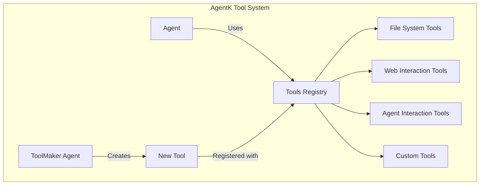
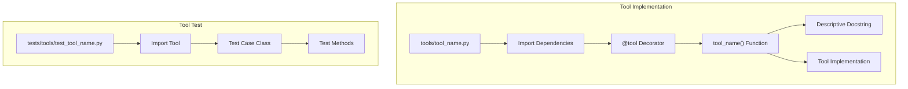
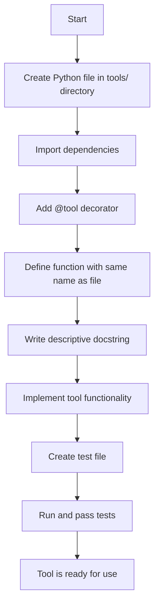
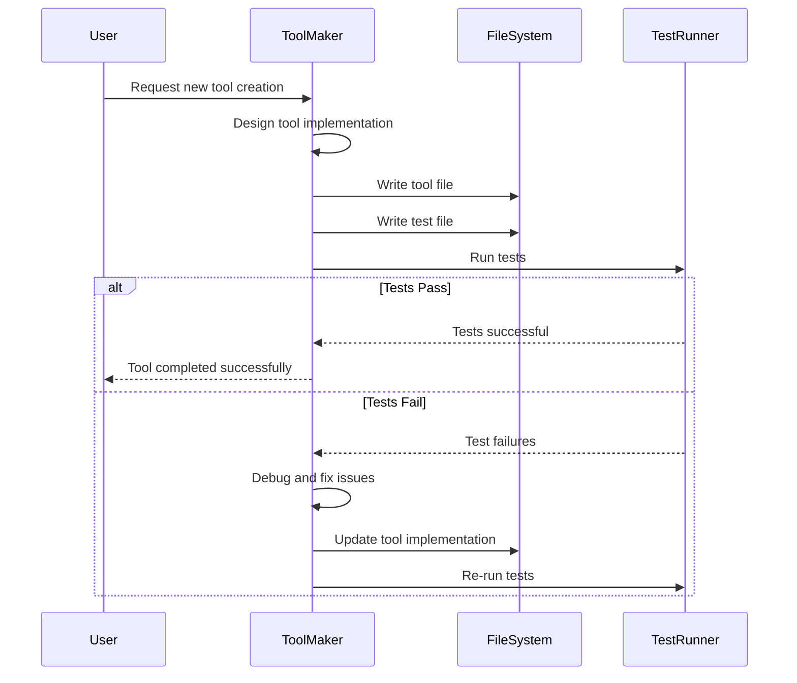
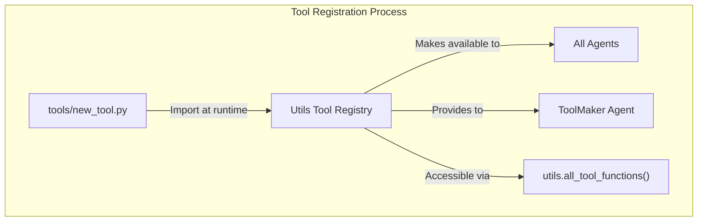

<!-- source: DeepWiki mcp.deepwiki.com · repo mikekelly/AgentK · page 7.2 Creating New Tools · fetched 2026-10-26 -->

# Creating New Tools

Relevant source files

The following files were used as context for generating this wiki page:

- [agents/tool_maker.py](agents/tool_maker.py)
- [tests/tools/test_fetch_web_page_raw_html.py](tests/tools/test_fetch_web_page_raw_html.py)
- [tools/fetch_web_page_raw_html.py](tools/fetch_web_page_raw_html.py)

## Purpose and Scope

This documentation provides a comprehensive guide for developers to create and integrate new tools into the AgentK system. Tools are functions that enable agents to interact with the outside world, manipulate files, access web content, and communicate with other agents. For information about creating new agents, see [Creating New Agents](#7.1).

## What Are Tools in AgentK?

Tools in AgentK are Python functions decorated with the `@tool` decorator from LangChain. They serve as the interface between agents and the external environment, allowing agents to perform actions such as reading/writing files, fetching web content, or executing system commands.

Sources: [agents/tool_maker.py:1-143]()

## Tool Structure and Requirements

### Basic Tool Structure

Every tool in AgentK follows a consistent structure:

### Key Requirements

When creating new tools, adhere to these requirements:

| Requirement | Description |
|-------------|-------------|
| Location | Tools must be placed in the `tools` directory |
| Naming | The filename and function name must be identical |
| Decorator | Functions must use the `@tool` decorator |
| Docstring | Include a clear, concise docstring describing the tool's purpose |
| One per file | Only one tool function per file |
| Testing | Include test file(s) that verify the tool's behavior |
| Dependencies | Document any required dependencies |

Sources: [agents/tool_maker.py:30-47]()

## Creating a New Tool: Step-by-Step Guide

### 1. Planning Your Tool

Before writing any code, define:
- The tool's purpose
- Input parameters
- Expected output
- Required dependencies

### 2. Creating the Tool File

1. Create a new Python file in the `tools` directory
2. Name the file according to the tool's function (e.g., `my_new_tool.py`)
3. Import required dependencies
4. Define the tool function with the same name as the file
5. Decorate the function with `@tool`
6. Add a clear docstring
7. Implement the tool functionality

### 3. Handling Dependencies

If your tool requires additional Python packages:
1. Add them to `requirements.txt`
2. Install using `pip install -r requirements.txt`

If your tool requires OS-level dependencies:
1. Add them to `apt-packages-list.txt`
2. Install using `xargs -a apt-packages-list.txt apt-get install -y`

Sources: [agents/tool_maker.py:42-46]()

## Writing Tests for Tools

Every tool must have corresponding tests to verify its functionality:

1. Create a test file in the `tests/tools/` directory named `test_<tool_name>.py`
2. Import the tool module
3. Create a test class that extends `unittest.TestCase`
4. Implement test methods that verify the tool's behavior
5. Run the tests with `python -m unittest tests/tools/test_<tool_name>.py`

### Test File Structure

| Component | Description |
|-----------|-------------|
| Imports | Import `unittest` and the tool module |
| Test Class | Class extending `unittest.TestCase` |
| Test Methods | Methods prefixed with `test_` that verify functionality |
| Main Block | Enables running the test directly |

Sources: [tests/tools/test_fetch_web_page_raw_html.py:1-13](), [agents/tool_maker.py:60-72](), [agents/tool_maker.py:85-97]()

## Tool Creation with ToolMaker Agent

The ToolMaker agent can automatically create tools based on requirements. It follows this workflow:

Sources: [agents/tool_maker.py:25-29](), [agents/tool_maker.py:100-143]()

## Tool Categories and Examples

AgentK organizes tools into several categories:

### File System Tools
Tools for reading, writing, and manipulating files:
- `write_to_file`: Write content to a file
- `overwrite_file`: Replace a file's content
- `read_file`: Read content from a file
- `delete_file`: Remove a file

### Web Interaction Tools
Tools for interacting with web content:
- `fetch_web_page_raw_html`: Fetches the raw HTML of a web page
- `fetch_web_page_content`: Extracts readable content from a web page
- `duck_duck_go_web_search`: Performs web searches

### Agent Interaction Tools
Tools for interacting with other agents:
- `list_available_agents`: Lists all available agents
- `assign_agent_to_task`: Delegates a task to another agent

Sources: [tools/fetch_web_page_raw_html.py:1-22]()

## Example: Web Page HTML Fetcher

Let's examine the implementation of the `fetch_web_page_raw_html` tool:

Key components:
- Imports Selenium WebDriver for browser automation
- Configures browser options (headless mode)
- Navigates to the provided URL
- Extracts and returns the page's HTML

The test verifies the tool can fetch HTML from example.com and checks for expected HTML elements.

Sources: [tools/fetch_web_page_raw_html.py:1-22](), [tests/tools/test_fetch_web_page_raw_html.py:1-13]()

## Best Practices for Tool Creation

| Practice | Description |
|----------|-------------|
| Single Responsibility | Each tool should do one thing well |
| Clear Documentation | Docstring should clearly explain purpose, inputs, and outputs |
| Error Handling | Handle potential errors gracefully |
| Resource Management | Clean up resources (files, connections) properly |
| Input Validation | Verify inputs before processing |
| Comprehensive Testing | Test edge cases and error conditions |
| Minimal Dependencies | Avoid unnecessary dependencies |

Sources: [agents/tool_maker.py:10-97]()

## The Tool Registry System

AgentK automatically discovers and registers tools through the utils module. When a new tool is added to the `tools` directory, it becomes available to agents without additional configuration.

Sources: [agents/tool_maker.py:100]()

## Troubleshooting Tool Creation

Common issues when creating tools:

| Issue | Solution |
|-------|----------|
| Tool not found | Ensure file is in the `tools` directory with correct naming |
| Decorator errors | Verify the `@tool` decorator is properly applied |
| Test failures | Check tool behavior against expected test results |
| Missing dependencies | Verify all required packages are installed |
| Permission issues | Check file/system permissions for OS-level operations |

When creating tools that interact with external services, ensure proper error handling for network issues, authentication failures, and rate limiting.

Sources: [agents/tool_maker.py:42-46]()