# Page: Overview

# Overview

<details>
<summary>Relevant source files</summary>

The following files were used as context for generating this wiki page:

- [README.md](README.md)
- [agents/hermes.py](agents/hermes.py)

</details>


## Introduction to AgentK

AgentK is a self-evolving AGI (Artificial General Intelligence) system designed to complete user tasks through agent collaboration. It operates on the principle of minimal core functionality (hence "K" for kernel) that enables the system to bootstrap and expand its own capabilities over time. The system builds its own mind gradually as it faces new challenges, creating new agents and tools as needed.

Sources: [README.md:1-13](), [agents/hermes.py:15-18]()

## System Architecture

AgentK consists of two primary component types:

1. **Agents**: Specialized modules that collaborate to solve problems
2. **Tools**: Functions that agents can use to interact with the external world

These components are implemented as regular Python files in the `agents` and `tools` directories, making the system's capabilities easy to track and extend.

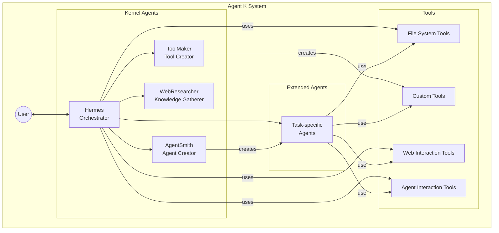

Sources: [README.md:15-20](), [agents/hermes.py:20-28]()

### Core Kernel Agents

The kernel of AgentK consists of four fundamental agents that bootstrap the system:

| Agent | Role | Description |
|-------|------|-------------|
| **Hermes** | Orchestrator | Interacts with humans, manages tasks, and coordinates activities of other agents |
| **AgentSmith** | Agent Creator | Creates and maintains other agents, ensuring they have necessary tools |
| **ToolMaker** | Tool Developer | Creates and refines tools for agents to use |
| **WebResearcher** | Knowledge Gatherer | Performs online research to provide up-to-date information |

Sources: [README.md:22-28](), [agents/hermes.py:24-28]()

## Workflow and Interaction Patterns

AgentK follows a structured workflow managed by the Hermes orchestrator:

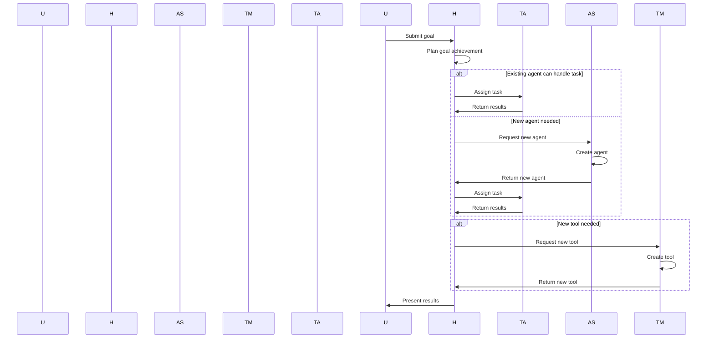

Hermes works with users through this process:
1. Establish a clear understanding of the user's goal
2. Develop a detailed plan to achieve the goal through agent orchestration
3. Create new agents if required (via AgentSmith)
4. Assign tasks to appropriate agents
5. Respond to the user when the goal is achieved or when input is needed

Sources: [agents/hermes.py:30-35]()

## Implementation Details

### ReAct Pattern with LangGraph

AgentK is built on the LangGraph and LangChain frameworks, implementing the ReAct (Reasoning and Acting) pattern for agent workflows. Each agent operates in a cycle of reasoning followed by tool usage.

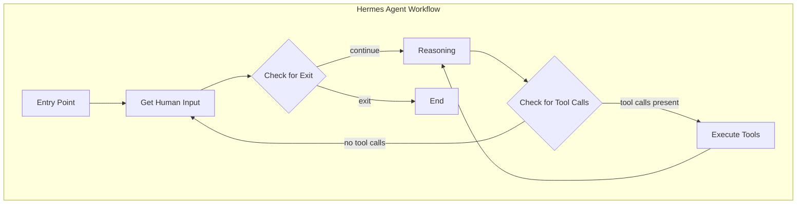

The workflow implementation in `hermes.py` demonstrates:
- A state graph using `MessagesState` for tracking conversation
- Nodes for human interaction, reasoning, and tool execution
- Conditional edges to control flow based on user input and tool calls

Sources: [agents/hermes.py:46-110](), [README.md:31-33]()

### Agent Implementation Example

Looking at Hermes as an example agent:

1. System prompt defines the agent's role and context
2. A set of tools is provided for the agent to use
3. The workflow is implemented as a state graph with:
   - Human interaction node
   - Reasoning node
   - Tool execution node
4. Conditional logic controls the flow between nodes

This pattern is consistent across agents, with each agent having specialized tools and system prompts.

Sources: [agents/hermes.py:13-44](), [agents/hermes.py:70-91]()

## Self-Evolution Mechanism

One of AgentK's key features is its ability to evolve by creating new components:

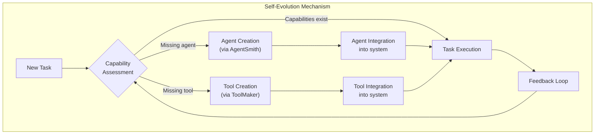

When faced with a new task, the system:
1. Assesses its current capabilities
2. Identifies missing agents or tools needed
3. Creates these components using AgentSmith or ToolMaker
4. Integrates the new components into the system
5. Completes the task using existing and new components
6. Learns from the experience for future tasks

Sources: [README.md:5-11](), [agents/hermes.py:32-34]()

## Deployment

AgentK runs isolated in a Docker container for security and reproducibility. The setup process involves:

1. Copying `.env.template` to `.env`
2. Setting environment variables
3. Running the `./agentk` script

For more detailed information on deployment, see [Deployment](#6).

Sources: [README.md:35-41]()

## Related Pages

- For details on the core architecture principles, see [Core Architecture](#2)
- For in-depth information on specific agents, see [Agents](#3)
- For information about tools and their usage, see [Tools](#4)
- For configuration options, see [Configuration](#5)
- For developer guidelines on extending the system, see [Developer Guide](#7)

---

# Page: Core Architecture

# Core Architecture

<details>
<summary>Relevant source files</summary>

The following files were used as context for generating this wiki page:

- [README.md](README.md)
- [agents/agent_smith.py](agents/agent_smith.py)
- [agents/hermes.py](agents/hermes.py)
- [agents/tool_maker.py](agents/tool_maker.py)

</details>


This page provides a detailed explanation of AgentK's key architectural principles, agent relationships, and self-evolution mechanisms. It focuses on the structural foundation of the system, how components interact, and the mechanisms that enable AgentK to extend its own capabilities. For information about specific agents, see [Agents](#3), and for details about tools, see [Tools](#4).

## Architectural Overview

AgentK is designed as a modular, self-evolving AGI system built around a minimal kernel. The "K" in AgentK stands for "kernel," emphasizing that the system starts with only the minimum components needed to bootstrap itself and then gradually builds its own capabilities.

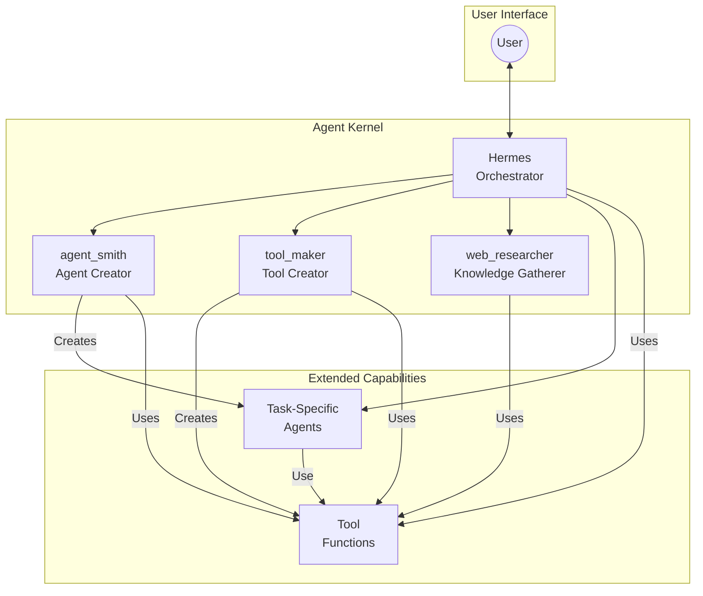

The core architecture consists of:

1. **Kernel Agents**: A small set of fundamental agents that can bootstrap the system
2. **Agent Extension**: Mechanisms for creating new specialized agents
3. **Tool System**: A framework for creating and using tools that agents employ to interact with the world
4. **Orchestration**: Systems for coordinating agent activities and managing tasks

Sources: [README.md:10-19](), [agents/hermes.py:13-29]()

## Core Design Principles

AgentK adheres to several key architectural principles:

1. **Minimal Kernel**: The system starts with only the essential components needed to bootstrap itself.
2. **Modularity**: Functionality is divided into specialized agents and tools.
3. **Self-Evolution**: The system can extend its own capabilities by creating new agents and tools.
4. **Composability**: Components are designed to be easily combined to solve complex tasks.
5. **ReAct Pattern**: Agents follow a Reasoning-Acting cycle implemented through LangGraph.

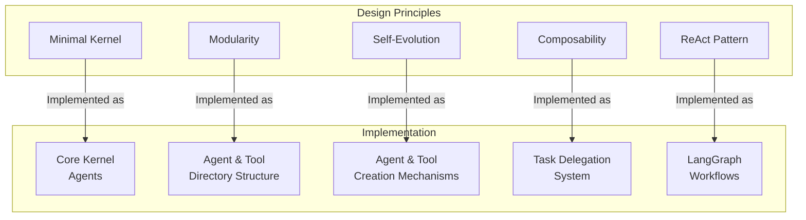

Sources: [README.md:11-19]()

## Kernel Components

The kernel consists of four core agents, each with a specific responsibility:

| Agent | Function | Primary Responsibility | Implementation |
|-------|----------|------------------------|----------------|
| Hermes | `hermes()` | Orchestration & user interaction | [agents/hermes.py]() |
| AgentSmith | `agent_smith()` | Creating new agents | [agents/agent_smith.py]() |
| ToolMaker | `tool_maker()` | Creating new tools | [agents/tool_maker.py]() |
| WebResearcher | `web_researcher()` | Gathering knowledge from the web | Not shown in provided files |

These kernel components are designed to be the minimum set needed for self-evolution, allowing the system to bootstrap additional capabilities as needed.

Sources: [README.md:22-28](), [agents/hermes.py:24-29]()

## Agent Relationships and Workflows

Agents in AgentK interact through a hierarchical structure, with Hermes at the top of the hierarchy coordinating other agents:

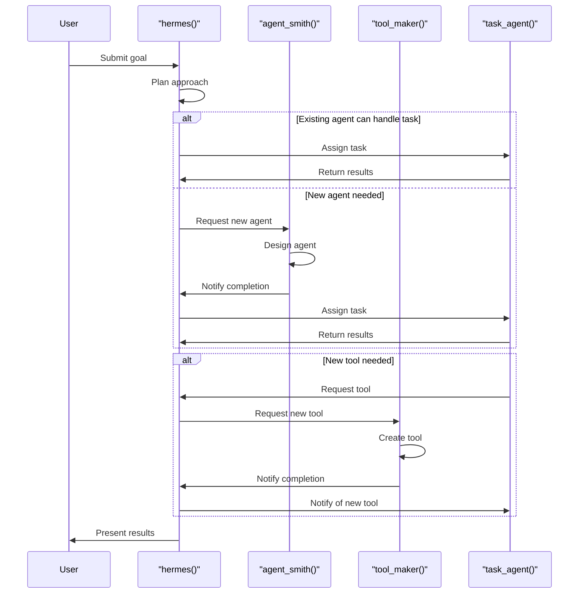

The workflow typically follows this pattern:
1. User submits a goal to Hermes
2. Hermes analyzes the requirements and plans an approach
3. If existing agents can handle the task, Hermes delegates to them
4. If new capabilities are needed, Hermes requests AgentSmith or ToolMaker to create them
5. Once all subtasks are complete, Hermes presents results to the user

Sources: [agents/hermes.py:30-36]()

## Self-Evolution Mechanisms

AgentK's ability to evolve comes from two key mechanisms:

1. **Agent Creation**: Implemented by AgentSmith, which creates new specialized agents
2. **Tool Creation**: Implemented by ToolMaker, which creates new tools for agents to use

```mermaid
graph TD
    subgraph "Agent Creation Process"
        AS1["agent_smith()<br>receives task"]
        AS2["Plan agent<br>design"]
        AS3["Request tools<br>if needed"]
        AS4["Write agent<br>implementation"]
        AS5["Test agent"]
        AS6["Deploy agent"]
    end

    subgraph "Tool Creation Process"
        TM1["tool_maker()<br>receives task"]
        TM2["Design tool<br>implementation"]
        TM3["Write tool<br>code"]
        TM4["Write tool<br>tests"]
        TM5["Run tests"]
        TM6["Deploy tool"]
    end

    AS1 --> AS2 --> AS3 --> AS4 --> AS5 --> AS6
    TM1 --> TM2 --> TM3 --> TM4 --> TM5 --> TM6
```

Both mechanisms follow a similar pattern:
1. Receive a task to create a new component
2. Plan the implementation
3. Write the code and tests
4. Verify functionality
5. Deploy the new component

This allows the system to continuously extend its capabilities in response to user needs.

Sources: [agents/agent_smith.py:33-38](), [agents/tool_maker.py:25-29]()

## LangGraph Implementation Pattern

All agents in AgentK follow a ReAct (Reasoning and Acting) pattern implemented using LangGraph. This pattern consists of alternating reasoning and tool execution phases:

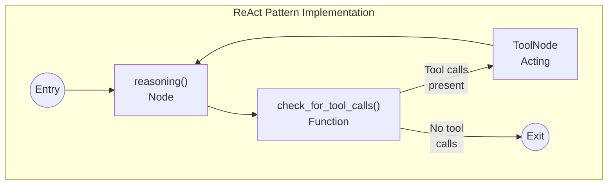

Each agent's workflow is implemented as a LangGraph `StateGraph` with these components:

1. **Reasoning Node**: Uses an LLM to analyze the current state and determine actions
2. **Tool Calling Check**: Determines whether the LLM wants to call tools
3. **Tool Execution Node**: Executes the tools requested by the LLM
4. **State Management**: Maintains the conversation history and other state information

This pattern is implemented in a nearly identical way across all agents in the system.

Sources: [agents/hermes.py:70-109](), [agents/agent_smith.py:72-107](), [agents/tool_maker.py:102-135]()

## Code Structure

The AgentK codebase is organized into a modular structure that facilitates self-evolution:

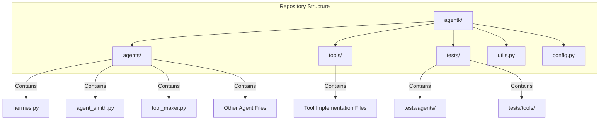

The organization follows these principles:
1. Each agent is a single Python file in the `agents/` directory
2. Each tool is a single Python file in the `tools/` directory
3. Tests for agents and tools are in the `tests/` directory
4. Utility functions and configuration are in dedicated files

This structure allows the system to easily add new components by creating new files in the appropriate directories. When agents or tools are created, their code is written directly to files in these directories, making them immediately available to the system.

Sources: [README.md:15-20](), [agents/tool_maker.py:32-38](), [agents/agent_smith.py:42-45]()

---

# Page: Kernel Components

# Kernel Components

<details>
<summary>Relevant source files</summary>

The following files were used as context for generating this wiki page:

- [README.md](README.md)
- [agent_kernel.py](agent_kernel.py)
- [agents/hermes.py](agents/hermes.py)

</details>


## Purpose and Scope

This page documents the core kernel components of the AgentK system - the minimal set of agents necessary to bootstrap a self-evolving AGI. The kernel represents the foundational elements that enable the system to grow, create new agents, develop tools, and expand its capabilities automatically.

For information about the implementation details of LangGraph patterns used across agents, see [LangGraph Implementation](#2.2). For detailed documentation of individual agents, see the respective agent pages under [Agents](#3).

## What is the Kernel?

The "K" in AgentK stands for "kernel," referring to a minimal core. The kernel consists of a small set of foundational agents that collaborate to solve problems and can create new agents and tools as needed. This approach allows the system to bootstrap itself from a minimal starting point and gradually expand its capabilities.

The kernel is designed to be the smallest possible set of components necessary for the system to:
1. Interact with users
2. Create and manage new agents
3. Develop new tools
4. Acquire knowledge from external sources

Sources: [README.md:11-13](), [README.md:22-28]()

## Core Kernel Agents

The AgentK kernel consists of four primary agents:

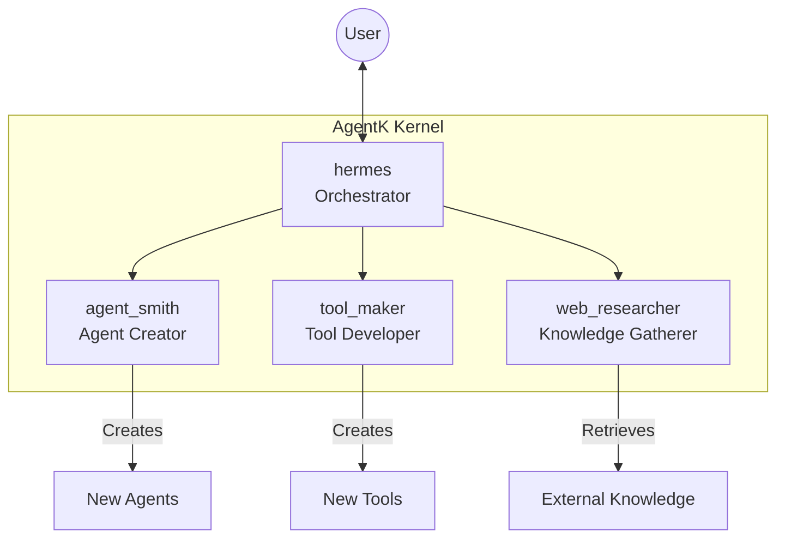

**Diagram: Core Kernel Agents and Their Primary Functions**

Sources: [README.md:22-28](), [agents/hermes.py:24-28]()

### Hermes: The Orchestrator

Hermes is the central agent that coordinates all activities within the system. It serves as the primary interface between the user and other agents.

Key responsibilities:
- Interacts with humans to understand goals
- Plans how to achieve goals through agent orchestration
- Manages task creation and assignment
- Coordinates activities between agents
- Provides feedback to users

Sources: [agents/hermes.py:13-44](), [README.md:24]()

### AgentSmith: The Agent Creator

AgentSmith is responsible for the creation and maintenance of other agents in the system.

Key responsibilities:
- Creates new agent types as needed
- Ensures agents are equipped with necessary tools
- Tests functionality of newly created agents
- Maintains existing agents

Sources: [README.md:25](), [agents/hermes.py:26]()

### ToolMaker: The Tool Developer

ToolMaker creates and refines the tools that agents use to interact with the world and perform tasks.

Key responsibilities:
- Develops new tools based on system needs
- Refines existing tools to improve functionality
- Ensures tools are properly integrated into the system
- Maintains the tool ecosystem

Sources: [README.md:26](), [agents/hermes.py:27]()

### WebResearcher: The Knowledge Gatherer

WebResearcher is responsible for acquiring information from external sources.

Key responsibilities:
- Performs online research to gather information
- Provides up-to-date knowledge to other agents
- Enables informed decision-making
- Extends the system's knowledge base

Sources: [README.md:27](), [agents/hermes.py:28]()

## Kernel Architecture

The kernel architecture is designed to enable self-evolution through a collaborative agent system. The following diagram illustrates how the kernel components interact to bootstrap and extend the system:

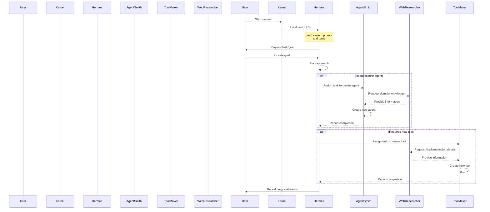

**Diagram: Kernel Bootstrapping and Task Processing Flow**

Sources: [agent_kernel.py:1-8](), [agents/hermes.py:112-120]()

### Design Principles

The kernel is built on several key design principles:

1. **Minimal Core**: The kernel contains only the essential components needed for self-evolution.
2. **Separation of Concerns**: Each kernel agent has a specific, well-defined role.
3. **Composability**: Agents and tools are designed to work together in various combinations.
4. **Self-Evolution**: The system can extend its own capabilities by creating new agents and tools.
5. **Reusability**: Components are designed for reuse across different tasks and contexts.

## Technical Implementation

### Agent Communication and Workflow

The kernel agents communicate through a structured workflow implemented using LangGraph. Hermes, as the orchestrator, uses a ReAct pattern (Reasoning and Acting) to process tasks:

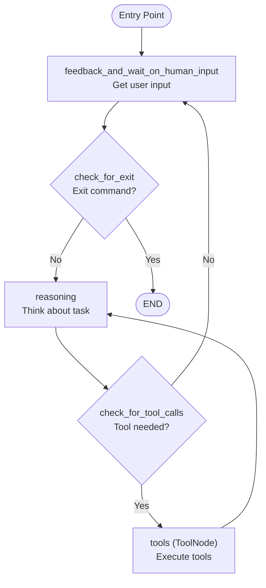

**Diagram: Hermes Agent Workflow Implementation**

Sources: [agents/hermes.py:93-108]()

### Kernel Initialization

The initialization of the kernel follows a simple process:

1. Load environment variables
2. Generate a unique session ID (UUID)
3. Start the Hermes agent with this ID
4. Hermes then coordinates all subsequent activities

The entry point for the system is the `agent_kernel.py` file, which initializes Hermes.

Sources: [agent_kernel.py:1-8]()

### Available Tools in the Kernel

The kernel starts with a minimal set of tools that allow it to manage agents. For Hermes, these include:

| Tool | Purpose |
|------|---------|
| `list_available_agents` | Retrieve a list of currently available agents in the system |
| `assign_agent_to_task` | Delegate a specific task to an appropriate agent |

These tools enable the basic orchestration functionality required for the kernel to operate.

Sources: [agents/hermes.py:10-11](), [agents/hermes.py:46]()

## Kernel Boundaries and Evolution

The kernel is designed to be minimal but sufficient for bootstrapping the entire system. As the system evolves, the kernel remains relatively stable while the agents and tools it creates may change and expand.

The boundary between kernel components and non-kernel components is defined by necessity: only those agents absolutely required for the system to bootstrap itself are considered part of the kernel. All other agents, even if they become essential to the system's operation, are considered extensions created by the kernel.

This approach ensures that the kernel remains focused and maintainable while allowing unlimited growth and evolution of the overall system.

---

# Page: LangGraph Implementation

# LangGraph Implementation

<details>
<summary>Relevant source files</summary>

The following files were used as context for generating this wiki page:

- [agents/agent_smith.py](agents/agent_smith.py)
- [agents/hermes.py](agents/hermes.py)
- [agents/tool_maker.py](agents/tool_maker.py)
- [agents/web_researcher.py](agents/web_researcher.py)

</details>


This document details how AgentK uses LangGraph to implement the ReAct (Reasoning and Acting) pattern across its agent ecosystem. It focuses on the technical architecture and workflow patterns that enable agents to alternate between reasoning about tasks and executing actions through tools.

For information about specific agents that use this pattern, see [Agents](#3) and its child pages.

## Core LangGraph Components in AgentK

AgentK implements the ReAct pattern using LangGraph's core components to create structured agent workflows. These components form the foundation of each agent's decision-making and action-execution process.

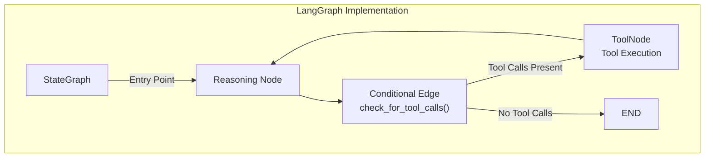

Sources: [agents/tool_maker.py:124-136](), [agents/agent_smith.py:95-107](), [agents/hermes.py:94-110](), [agents/web_researcher.py:42-54]()

The key LangGraph components used in AgentK include:

| Component | Description | AgentK Implementation |
|-----------|-------------|----------------------|
| `StateGraph` | Core class for defining agent workflows | Used with `MessagesState` to manage conversation state |
| `MessagesState` | State type tracking message history | Standard state type used across all agents |
| Nodes | Functions that process state | `reasoning` node for thinking, `ToolNode` for actions |
| Edges | Connections defining workflow | Direct and conditional connections between nodes |
| Conditional Edges | Logic determining flow direction | `check_for_tool_calls` function in each agent |

Sources: [agents/hermes.py:94-110](), [agents/tool_maker.py:124-136]()

## Standard ReAct Workflow Pattern

AgentK implements a consistent ReAct pattern across its agents. This pattern enables agents to alternate between reasoning about problems and executing tools to gather information or affect the environment.

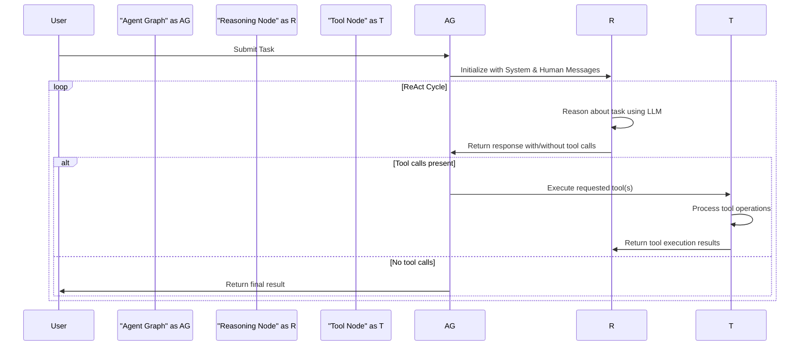

Sources: [agents/tool_maker.py:102-123](), [agents/agent_smith.py:72-93](), [agents/web_researcher.py:20-41]()

## Implementation Details

### 1. State Management

All agents in AgentK use the `MessagesState` from LangGraph to maintain conversation history. This state is a dictionary with a single key, `messages`, which contains an array of message objects.

```python
# State structure
{
    "messages": [SystemMessage, HumanMessage, AIMessage, ...]
}
```

The message history progressively builds as the agent reasons and executes tools, providing context for each subsequent step in the workflow.

Sources: [agents/tool_maker.py:102-108](), [agents/agent_smith.py:72-78](), [agents/hermes.py:70-76]()

### 2. Node Implementation

Each agent implements two primary types of nodes:

1. **Reasoning Node**: Where the agent processes the current state using the language model and determines what to do next.

2. **Tool Node**: Where the agent executes the tools called during the reasoning phase.

```mermaid
classDiagram
    class "StateGraph~MessagesState~" {
        +add_node()
        +add_edge()
        +add_conditional_edges()
        +set_entry_point()
        +compile()
    }
    
    class "reasoning()" {
        +Process current state
        +Use LLM to generate response
        +Return updated messages
    }
    
    class "check_for_tool_calls()" {
        +Check for tool_calls in last message
        +Return 'tools' or END based on result
    }
    
    class "ToolNode" {
        +Execute requested tools
        +Return tool execution results
    }
    
    "StateGraph~MessagesState~" --> "reasoning()" : contains
    "StateGraph~MessagesState~" --> "ToolNode" : contains
    "reasoning()" --> "check_for_tool_calls()" : followed by
    "check_for_tool_calls()" --> "ToolNode" : routes to if tools needed
```

Sources: [agents/tool_maker.py:102-125](), [agents/agent_smith.py:72-95](), [agents/hermes.py:70-94]()

### 3. Decision Logic

The flow between nodes is controlled by conditional edge functions, specifically the `check_for_tool_calls` function that examines the agent's response to determine if tools need to be executed:

```python
def check_for_tool_calls(state: MessagesState) -> Literal["tools", END]:
    messages = state['messages']
    last_message = messages[-1]
    
    if last_message.tool_calls:
        # Tool calls present, route to tools node
        return "tools"
    
    # No tool calls, end the graph execution
    return END
```

This decision logic is consistent across most agents, with minor variations based on the specific agent's needs (such as Hermes, which returns to a user interaction node instead of ending).

Sources: [agents/tool_maker.py:110-123](), [agents/agent_smith.py:80-93](), [agents/web_researcher.py:27-40]()

## Code-to-Execution Mapping

The following diagram illustrates how code structures in agent files map to runtime behavior during execution:

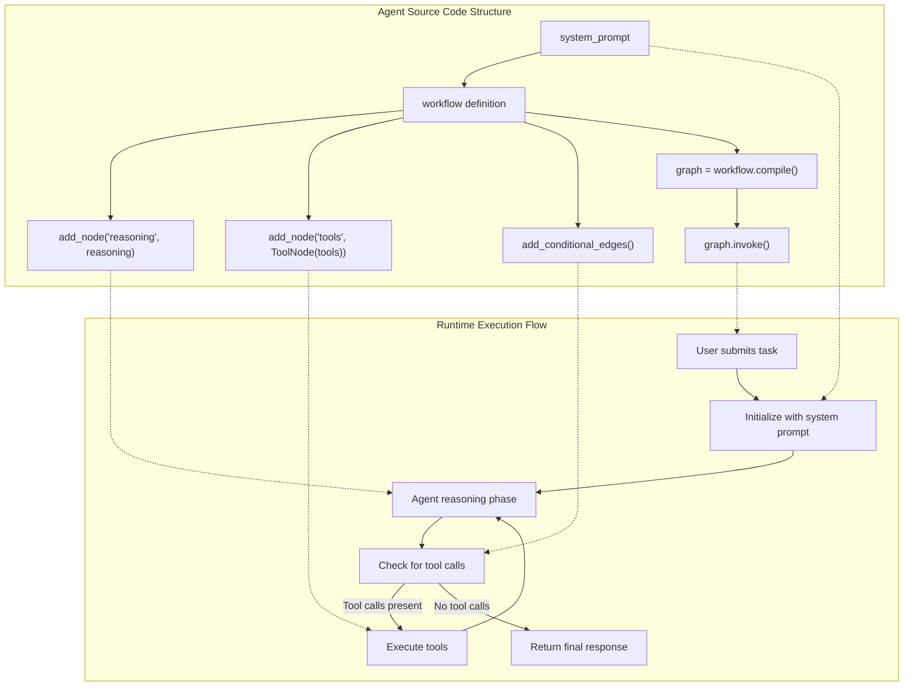

Sources: [agents/tool_maker.py:137-143](), [agents/agent_smith.py:109-113](), [agents/hermes.py:112-120]()

## Variations in Agent Workflows

While the core ReAct pattern is consistent, each agent implements workflow variations tailored to their specific role:

| Agent | Entry Point | Terminal Condition | Special Features |
|-------|-------------|-------------------|-----------------|
| Hermes | `feedback_and_wait_on_human_input` | User types "exit" | Checkpointing for persistence |
| AgentSmith | `reasoning` | No tool calls | Example agent code in system prompt |
| ToolMaker | `reasoning` | No tool calls | Tool verification emphasis |
| WebResearcher | `reasoning` | No tool calls | Focused on web search tools |

Sources: [agents/hermes.py:94-110](), [agents/tool_maker.py:124-136](), [agents/agent_smith.py:95-107](), [agents/web_researcher.py:42-54]()

### Hermes: Special Case

The Hermes agent has a more complex flow as it serves as the primary user interface:

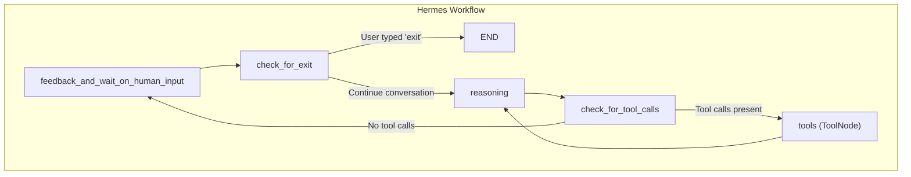

Sources: [agents/hermes.py:47-120]()

## Initializing and Invoking Agents

Each agent's workflow is invoked through an entry-point function that:
1. Accepts a task as input
2. Initializes the graph with system and human messages
3. Returns the final state of the conversation

```python
def agent_function(task: str) -> str:
    """Agent's purpose description."""
    return graph.invoke(
        {"messages": [SystemMessage(system_prompt), HumanMessage(task)]}
    )
```

This consistent pattern enables other parts of the system to interact with any agent in a standardized way.

Sources: [agents/tool_maker.py:139-143](), [agents/agent_smith.py:109-113](), [agents/web_researcher.py:57-61]()

## Common ReAct Agent Structure

All agents in AgentK follow this general structure:

1. **System prompt definition**: Defines the agent's role, capabilities, and approach
2. **Tool import and preparation**: Imports and prepares the tools available to the agent
3. **Node function definitions**: Defines reasoning and conditional logic functions
4. **Workflow construction**: Builds the LangGraph workflow with nodes and edges
5. **Graph compilation**: Compiles the workflow into an executable graph
6. **Entry point function**: Provides a standardized interface to invoke the agent

This consistent structure makes the system modular and extensible, allowing new agents to be added by following the same pattern.

Sources: [agents/tool_maker.py:10-143](), [agents/agent_smith.py:10-113](), [agents/web_researcher.py:1-61]()

---

# Page: Agents

# Agents

<details>
<summary>Relevant source files</summary>

The following files were used as context for generating this wiki page:

- [README.md](README.md)
- [agents/hermes.py](agents/hermes.py)
- [utils.py](utils.py)

</details>


This page provides an overview of the agent system in AgentK, explaining how agents are structured, loaded, and interact with each other. For information on specific agents such as Hermes or AgentSmith, see their dedicated pages ([Hermes: Orchestrator](#3.1), [AgentSmith: Agent Creator](#3.2), etc.). For information on creating new agents, see the [Creating New Agents](#7.1) guide.

## What are Agents in AgentK?

Agents in AgentK form the cognitive components of its modular, self-evolving architecture. Each agent is a specialized entity with specific capabilities and responsibilities, implemented as a Python module with a defined interface. Together, these agents collaborate to solve problems and complete tasks, dynamically creating new agents when needed.

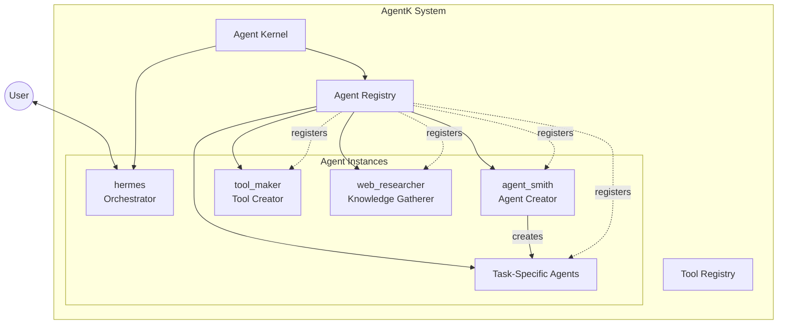

Diagram: Agent System Overview

Sources: [README.md:15-27](), [utils.py:56-99]()

## Agent Architecture

Each agent in AgentK is typically implemented as a LangGraph workflow following the ReAct (Reasoning and Action) pattern. This architecture allows agents to alternate between reasoning about problems and taking actions through tools.

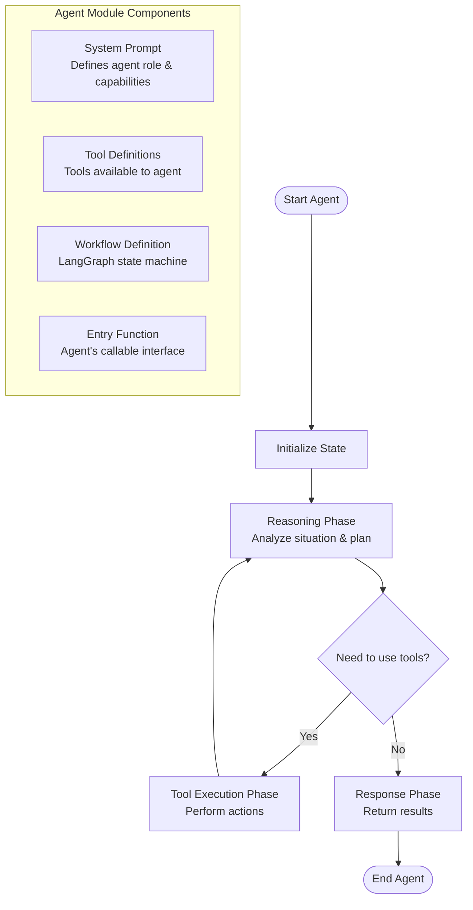

Diagram: Typical Agent Implementation Structure

Sources: [agents/hermes.py:10-120]()

Most agents follow a standard structure:
1. A system prompt defining the agent's role and capabilities
2. A set of tools available to the agent
3. A LangGraph workflow defining the agent's behavior
4. An entry function that serves as the callable interface

## Agent Registry and Loading

The AgentK system maintains a registry of available agents, allowing dynamic discovery, loading, and invocation of agent functionality. Agents are stored as Python files in the `agents/` directory and loaded on demand.

```mermaid
sequenceDiagram
    participant "AgentK System" as System
    participant "utils.py" as Utils
    participant "File System" as FS
    participant "Agent Module" as Agent
    
    System->>Utils: list_agents()
    Utils->>FS: Read agents directory
    FS-->>Utils: Return .py files
    Utils-->>System: Return agent names
    
    System->>Utils: all_agents()
    Utils->>Utils: list_agents()
    
    loop For each agent
        Utils->>Utils: load_module("agents/{agent}.py")
        Utils->>Agent: Import module
        Agent-->>Utils: Return agent function
        Utils->>Agent: Extract docstring
        Agent-->>Utils: Return docstring
    end
    
    Utils-->>System: Return {agent: docstring} dictionary
```

Diagram: Agent Loading Process

Sources: [utils.py:56-130]()

The key utility functions for agent management include:

| Function | Purpose | Location |
|----------|---------|----------|
| `list_agents()` | Lists all agent files in the agents directory | [utils.py:87-99]() |
| `all_agents()` | Loads all agent modules and extracts docstrings | [utils.py:56-70]() |
| `load_module()` | Dynamically loads a Python module from a file | [utils.py:113-130]() |
| `list_broken_agents()` | Identifies agents that fail to load properly | [utils.py:72-85]() |

## Core Kernel Agents

AgentK's architecture is built around a minimal "kernel" of four core agents that enable the system to bootstrap itself and grow its capabilities:

```mermaid
graph TD
    subgraph "Kernel Agents"
        Hermes["hermes<br>Orchestration & User Interaction"]
        AgentSmith["agent_smith<br>Agent Creation & Management"]
        ToolMaker["tool_maker<br>Tool Creation & Testing"]
        WebResearcher["web_researcher<br>Knowledge Acquisition"]
    end
    
    subgraph "AgentK System"
        TaskAgents["Task-Specific Agents"]
        Tools["System Tools"]
        Knowledge["Knowledge Base"]
    end
    
    Hermes -->|"coordinates"| AgentSmith
    Hermes -->|"coordinates"| ToolMaker
    Hermes -->|"coordinates"| WebResearcher
    Hermes -->|"assigns tasks to"| TaskAgents
    
    AgentSmith -->|"creates & maintains"| TaskAgents
    ToolMaker -->|"creates & maintains"| Tools
    WebResearcher -->|"gathers & updates"| Knowledge
    
    TaskAgents -->|"use"| Tools
    TaskAgents -->|"leverage"| Knowledge
```

Diagram: Core Kernel Agent Relationships

Sources: [README.md:22-27](), [agents/hermes.py:13-29]()

Each kernel agent has a specific role:

1. **Hermes**: The orchestrator that interacts with humans, plans tasks, and coordinates other agents
2. **AgentSmith**: Creates and manages other agents, ensuring they have necessary tools
3. **ToolMaker**: Develops tools needed by agents to interact with the system and external world
4. **WebResearcher**: Gathers knowledge from online sources to support agent operations

For detailed information on each kernel agent, see their dedicated wiki pages ([Hermes: Orchestrator](#3.1), [AgentSmith: Agent Creator](#3.2), [ToolMaker: Tool Creator](#3.3), [WebResearcher: Knowledge Gatherer](#3.4)).

## Agent Interaction Patterns

Agents in AgentK collaborate through an orchestration pattern, with Hermes coordinating tasks and delegating to specialized agents. This interaction typically follows a hierarchical structure.

```mermaid
sequenceDiagram
    actor User
    participant Hermes
    participant SpecializedAgent
    participant AgentSmith
    participant NewAgent
    
    User->>Hermes: Submit task/goal
    Hermes->>Hermes: Analyze task requirements
    
    alt Existing agent can handle task
        Hermes->>SpecializedAgent: Assign task
        SpecializedAgent->>SpecializedAgent: Process task
        SpecializedAgent-->>Hermes: Return results
    else New agent needed
        Hermes->>AgentSmith: Request new agent creation
        AgentSmith->>AgentSmith: Design & implement new agent
        AgentSmith-->>Hermes: Confirm agent creation
        Hermes->>NewAgent: Assign task
        NewAgent->>NewAgent: Process task
        NewAgent-->>Hermes: Return results
    end
    
    Hermes->>User: Present results
```

Diagram: Agent Interaction Flow

Sources: [agents/hermes.py:30-36](), [README.md:5]()

Key aspects of agent interaction:

1. **Task Orchestration**: Hermes acts as the central coordinator, breaking down user goals into subtasks
2. **Task Assignment**: Tasks are assigned to specialized agents based on their capabilities
3. **Agent Creation**: When no existing agent can handle a task, AgentSmith creates a new specialized agent
4. **Result Aggregation**: Results from various agents are collected and synthesized by Hermes

The interaction is facilitated by specific tools:
- `list_available_agents`: Returns a list of all available agents and their capabilities
- `assign_agent_to_task`: Delegates a specific task to an agent and returns the results

Sources: [agents/hermes.py:10-11](), [agents/hermes.py:46]()

## The Agent Implementation Pattern

Agents in AgentK typically follow the LangGraph ReAct pattern, with a standard structure for their implementation. The example below shows the implementation pattern from the Hermes agent:

```mermaid
graph TD
    Entry["Entry Function (hermes)"]
    
    subgraph "State Graph Components"
        Initialize["Initialize MessagesState<br>with System Prompt"]
        HumanInput["feedback_and_wait_on_human_input<br>Get user input"]
        ExitCheck["check_for_exit<br>Check for exit command"]
        Reasoning["reasoning<br>Agent thinks about task"]
        ToolCheck["check_for_tool_calls<br>Check if tools needed"]
        ToolExecution["ToolNode<br>Execute requested tools"]
    end
    
    Entry --> Initialize
    Initialize --> HumanInput
    HumanInput --> ExitCheck
    ExitCheck -->|"continue"| Reasoning
    ExitCheck -->|"exit"| End(["End"])
    Reasoning --> ToolCheck
    ToolCheck -->|"tool calls present"| ToolExecution
    ToolCheck -->|"no tool calls"| HumanInput
    ToolExecution --> Reasoning
```

Diagram: LangGraph Agent Implementation Pattern

Sources: [agents/hermes.py:46-110]()

The implementation typically includes:

1. **System Prompt**: Defines the agent's role, capabilities, and operating instructions
2. **Tool Definitions**: Lists the tools available to the agent
3. **State Handler Functions**: Process different states in the agent's workflow
4. **Workflow Definition**: Defines the state graph using LangGraph's StateGraph
5. **Entry Function**: Provides the callable interface for the agent

This pattern enables agents to:
- Reason about problems and plan solutions
- Use tools to interact with the system and external world
- Maintain conversation context and state
- Operate autonomously within their domain of expertise

## Conclusion

Agents form the cognitive core of AgentK, working collaboratively to achieve user goals through specialized capabilities and dynamic creation of new agents. The modular agent architecture, centered around a minimal kernel, allows the system to continuously evolve and extend its capabilities. The LangGraph ReAct pattern provides a consistent implementation approach across agents, enabling reasoning, tool usage, and effective task completion.

For details on individual agents, see their dedicated wiki pages. For information on creating new agents, see the [Creating New Agents](#7.1) guide.

Sources: [README.md:5-28](), [agents/hermes.py:1-120](), [utils.py:56-130]()

---

# Page: Hermes: Orchestrator

# Hermes: Orchestrator

<details>
<summary>Relevant source files</summary>

The following files were used as context for generating this wiki page:

- [README.md](README.md)
- [agents/hermes.py](agents/hermes.py)

</details>


## Purpose and Scope

This document details the Hermes agent, which serves as the central orchestrator within the AgentK system. Hermes is responsible for interacting with users, understanding their goals, planning how to achieve those goals through agent orchestration, and coordinating the activities of other agents to complete tasks.

For information about other kernel agents, see [Kernel Components](#2.1) or the specific agent documentation: [AgentSmith: Agent Creator](#3.2), [ToolMaker: Tool Creator](#3.3), and [WebResearcher: Knowledge Gatherer](#3.4).

## Overview

Hermes functions as the entry point and coordination hub for the entire AgentK system. Named after the messenger of the gods in Greek mythology, Hermes facilitates communication between the user and the various specialized agents within the system. It implements a ReAct (Reasoning and Acting) pattern using LangGraph to process user inputs, plan solutions, and orchestrate other agents to execute those plans.

```mermaid
graph TD
    User(("User")) <--> Hermes["Hermes Orchestrator"]
    
    Hermes -->|"Assign tasks to"| AgentSmith["AgentSmith"]
    Hermes -->|"Assign tasks to"| ToolMaker["ToolMaker"]
    Hermes -->|"Assign tasks to"| WebResearcher["WebResearcher"]
    Hermes -->|"Assign tasks to"| OtherAgents["Other Task-Specific Agents"]
    
    AgentSmith -->|"Creates"| OtherAgents
    ToolMaker -->|"Creates"| Tools["Tools"]
    
    Hermes -->|"Uses"| ListAgentsTool["list_available_agents tool"]
    Hermes -->|"Uses"| AssignTaskTool["assign_agent_to_task tool"]
```

Diagram: Hermes's Position in the AgentK System Architecture

Sources: [README.md:24-27](), [agents/hermes.py:13-44]()

## Core Responsibilities

Hermes has four primary responsibilities in the AgentK ecosystem:

1. **Goal Understanding**: Collaborate with the user to reach a shared understanding of the goal
2. **Task Planning**: Develop a detailed sequential plan for achieving the goal
3. **Agent Orchestration**: Assign appropriate agents to specific tasks and coordinate their activities
4. **User Communication**: Provide feedback to the user on progress and request input when needed

Sources: [agents/hermes.py:30-35]()

## Implementation Architecture

Hermes is implemented as a LangGraph state machine with a ReAct pattern that alternates between reasoning (thinking) and acting (using tools).

```mermaid
graph TD
    subgraph "hermes.py LangGraph Implementation"
        Start([Start]) --> Init["Initialize with System Prompt"]
        Init --> FeedbackNode["feedback_and_wait_on_human_input"]
        FeedbackNode --> CheckExit{"check_for_exit"}
        CheckExit -->|"exit"| End([End])
        CheckExit -->|"reasoning"| ReasoningNode["reasoning"]
        ReasoningNode --> CheckTools{"check_for_tool_calls"}
        CheckTools -->|"tools"| ToolsNode["tools (ToolNode)"]
        CheckTools -->|"feedback_and_wait_on_human_input"| FeedbackNode
        ToolsNode --> ReasoningNode
    end
```

Diagram: Hermes Workflow State Graph

Sources: [agents/hermes.py:95-109]()

### Node Functions

Hermes's workflow consists of the following key components:

| Node | Function | Purpose |
|------|----------|---------|
| `feedback_and_wait_on_human_input` | [agents/hermes.py:48-61]() | Presents messages to the user and collects input |
| `check_for_exit` | [agents/hermes.py:63-68]() | Checks if the user has requested to exit |
| `reasoning` | [agents/hermes.py:70-76]() | Invokes the LLM to think about the current state |
| `check_for_tool_calls` | [agents/hermes.py:78-91]() | Determines if tools should be called or feedback given |
| `acting` (ToolNode) | [agents/hermes.py:93]() | Executes the tool calls requested by the LLM |

Sources: [agents/hermes.py:48-93]()

## Tools

Hermes utilizes two primary tools to facilitate agent orchestration:

1. **`list_available_agents`**: Retrieves a current list of all available agents in the system
2. **`assign_agent_to_task`**: Delegates a specific task to an appropriate agent

These tools enable Hermes to maintain awareness of system capabilities and delegate work effectively.

Sources: [agents/hermes.py:46]()

## Interaction Pattern

The following sequence diagram illustrates how Hermes interacts with users and other agents:

```mermaid
sequenceDiagram
    participant User
    participant Hermes
    participant AgentRegistry as "Agent Registry"
    participant OtherAgent as "Other Agent"
    
    User->>Hermes: Input goal/task
    Note over Hermes: check_for_exit
    Note over Hermes: reasoning
    
    alt Tool needed: list_available_agents
        Hermes->>AgentRegistry: list_available_agents()
        AgentRegistry-->>Hermes: Return available agents
    end
    
    Note over Hermes: Develop plan with agents
    
    alt Tool needed: assign_agent_to_task
        Hermes->>OtherAgent: assign_agent_to_task()
        OtherAgent-->>Hermes: Task result
    end
    
    Hermes->>User: Provide feedback
```

Diagram: Hermes Interaction Sequence

Sources: [agents/hermes.py:30-35](), [agents/hermes.py:46]()

## System Prompt Analysis

Hermes's system prompt provides critical context and guidance that shapes its behavior:

1. **Identity Definition**: Defines Hermes as a ReAct agent for achieving user goals
2. **System Context**: Explains AgentK's purpose as a self-evolving AGI
3. **Agent Awareness**: Lists the core kernel agents and their roles
4. **Interaction Protocol**: Specifies the 4-step process for user interaction
5. **Agent Optimization Guidance**: Encourages creating reusable, composable agent roles

The system prompt concludes by including a real-time list of available agents, ensuring Hermes always has up-to-date information about system capabilities.

Sources: [agents/hermes.py:13-44]()

## Code Implementation

The main implementation function is quite straightforward:

```python
def hermes(uuid: str):
    """The orchestrator that interacts with the user to understand goals, plan out how agents can meet the goal, assign tasks, and coordinate the activities agents."""
    print(f"Starting session with AgentK (id:{uuid})")
    print("Type 'exit' to end the session.")

    return graph.invoke(
        {"messages": [SystemMessage(system_prompt)]},
        config={"configurable": {"thread_id": uuid}}
    )
```

This function initializes the LangGraph workflow with the system prompt and a unique session identifier, which enables checkpointing and session persistence.

Sources: [agents/hermes.py:112-120]()

## Technical Considerations

### Checkpointing

Hermes uses a checkpointing system initialized via `utils.checkpointer` to maintain conversational state between interactions. This allows sessions to be resumed and prevents loss of context.

Sources: [agents/hermes.py:110]()

### Language Model Configuration

Hermes leverages the default language model configured in the system, binding the appropriate tools to it during the reasoning phase.

Sources: [agents/hermes.py:74]()

### Console Interaction

Hermes provides visual feedback in the console during operation:
- Prints when it's thinking
- Shows reasoning content before taking action
- Lists tools being invoked
- Presents the final output to the user

Sources: [agents/hermes.py:51-55](), [agents/hermes.py:72](), [agents/hermes.py:84-88]()

## Summary

Hermes serves as the central orchestrator within AgentK, providing the critical interface between users and the system's capabilities. Through its LangGraph-based workflow, Hermes can understand goals, plan approaches, delegate to specialized agents, and deliver results—effectively functioning as the primary coordination mechanism for the entire system.

---

# Page: AgentSmith: Agent Creator

# AgentSmith: Agent Creator

<details>
<summary>Relevant source files</summary>

The following files were used as context for generating this wiki page:

- [README.md](README.md)
- [agents/agent_smith.py](agents/agent_smith.py)

</details>


## Purpose and Scope

This document details AgentSmith, the agent responsible for creating and maintaining all other agents within the AgentK ecosystem. AgentSmith ensures new agents are properly designed, equipped with necessary tools, and thoroughly tested before deployment.

For information on how agents interact with each other, see [Core Architecture](#2).
For details on specific tools AgentSmith might request, see [Tools](#4).

Sources: [README.md:24-26](), [agents/agent_smith.py:18-24]()

## Role in AgentK Ecosystem

AgentSmith serves as the architect and developer of the agent ecosystem. It enables AgentK to evolve by creating specialized agents when new capabilities are needed. Without AgentSmith, the system would be limited to its initial set of agents.

```mermaid
graph TD
    subgraph "Agent Creation Process"
        User(("User")) -->|"Requests new capability"| Hermes["Hermes<br>Orchestrator"]
        Hermes -->|"Determines agent needed"| AgentSmith["agent_smith<br>Agent Creator"]
        AgentSmith -->|"Creates"| NewAgent["new_agent.py"]
        AgentSmith -->|"Creates"| Tests["test_new_agent.py"]
        AgentSmith -->|"Requests tools if needed"| ToolMaker["tool_maker<br>Tool Creator"]
        ToolMaker -->|"Creates"| Tools["tools/new_tool.py"]
        NewAgent -->|"Uses"| Tools
        AgentSmith -->|"Notifies of completion"| Hermes
    end
```

AgentSmith is implemented in [agents/agent_smith.py](), operating within the ReAct pattern using LangGraph components.

Sources: [README.md:24-26](), [agents/agent_smith.py:1-113]()

## Implementation Details

AgentSmith is implemented as a LangGraph-based ReAct agent that alternates between reasoning and acting. This is the same pattern used by all agents in the system, making it consistent with the architecture it helps create and maintain.

```mermaid
graph TD
    Entry(["Entry Point"]) --> Reasoning["reasoning<br>Function"]
    Reasoning --> CheckTools{"check_for_tool_calls<br>Function"}
    CheckTools -->|"Tool calls present"| Tools["ToolNode<br>Acting"]
    CheckTools -->|"No tool calls"| End(["END"])
    Tools --> Reasoning
    
    subgraph "agent_smith Implementation"
        Reasoning
        CheckTools
        Tools
    end
```

Key components:
- **System Prompt**: Defines AgentSmith's identity, purpose, and guidelines for creating agents [agents/agent_smith.py:18-67]()
- **Reasoning Function**: Generates responses using a language model with bound tools [agents/agent_smith.py:72-78]()
- **Tool Call Check**: Determines if tools should be called [agents/agent_smith.py:80-93]()
- **ToolNode**: Executes tool calls [agents/agent_smith.py:95]()
- **StateGraph**: Defines the workflow connecting reasoning and acting [agents/agent_smith.py:97-105]()

Sources: [agents/agent_smith.py:72-105]()

## Agent Creation Process

AgentSmith follows a systematic process when creating new agents:

```mermaid
flowchart TD
    Task["Receive agent creation task"] --> Plan["Create detailed agent design plan"]
    Plan --> ToolCheck{"New tools needed?"}
    ToolCheck -->|"Yes"| ToolMaker["Assign tool_maker to create tools"]
    ToolCheck -->|"No"| Implementation
    ToolMaker --> Implementation["Write agent implementation"]
    Implementation --> WriteAgent["write_to_file: agents/new_agent.py"]
    Implementation --> WriteTest["write_to_file: tests/agents/test_new_agent.py"]
    WriteAgent --> RunTest["Run smoke test"]
    WriteTest --> RunTest
    RunTest --> TestPass{"Test passed?"}
    TestPass -->|"No"| Revise["Revise implementation"]
    Revise --> WriteAgent
    TestPass -->|"Yes"| Complete["Confirm completion"]
```

The process ensures new agents are:
1. Thoroughly planned
2. Equipped with necessary tools
3. Properly implemented with a consistent structure
4. Tested before being considered complete

Sources: [agents/agent_smith.py:33-39](), [agents/agent_smith.py:40-53]()

## Code Structure Guidelines

AgentSmith enforces strict guidelines for agent development to maintain system consistency:

| Requirement | Description |
|-------------|-------------|
| Location | All agents must be placed in the `agents/` directory |
| Naming | Agent file name and function name must match |
| Tool Import | Import tools with `from tools.tool_name import tool_name` |
| Framework | Use LangGraph to define agent workflows |
| Testing | Include smoke tests for all agents |
| Verification | Tests must run without errors before completion |

When creating a new agent, AgentSmith follows this file structure pattern:

```
agents/
  ├── new_agent.py         # Main agent implementation
tests/
  └── agents/
      └── test_new_agent.py # Smoke test for the agent
```

Sources: [agents/agent_smith.py:40-53]()

## Tool Integration

AgentSmith has access to all available tools in the system and can use them during agent creation:

```mermaid
graph TD
    subgraph "AgentSmith Tool Integration"
        AgentSmith["agent_smith<br>Agent Creator"] -->|"Uses"| FileTools["File System Tools"]
        AgentSmith -->|"Uses"| TestTools["Testing Tools"]
        AgentSmith -->|"Uses"| AgentTools["Agent Interaction Tools"]
        AgentSmith -->|"Requests"| ToolMaker["tool_maker<br>Tool Creator"]
        
        FileTools -->|"write_to_file"| AgentFile["agents/new_agent.py"]
        FileTools -->|"write_to_file"| TestFile["tests/agents/test_new_agent.py"]
        FileTools -->|"read_file"| ExistingAgents["Example Agents"]
        
        TestTools -->|"Runs smoke tests"| TestFile
        
        ToolMaker -->|"Creates"| NewTools["tools/new_tool.py"]
        NewTools -->|"Available to"| AgentFile
    end
```

AgentSmith can:
- Use `write_to_file` to create agent and test files
- Read existing agents for reference
- Run tests to verify agent functionality
- Request new tools from ToolMaker when needed

Sources: [agents/agent_smith.py:70](), [agents/agent_smith.py:40-53]()

## Example Agent Creation

AgentSmith uses the `web_researcher` agent as a reference example when creating new agents. Here's how the typical agent implementation follows the LangGraph pattern:

```mermaid
graph TD
    subgraph "Agent Implementation Pattern"
        Import["Imports/Dependencies"] --> SystemPrompt["System Prompt"]
        SystemPrompt --> ToolDefinition["Tool Integration"]
        ToolDefinition --> ReasoningNode["Reasoning Function"]
        ReasoningNode --> ToolCheckNode["Tool Call Check"]
        ToolCheckNode --> ToolExecutionNode["Tool Execution"]
        ToolExecutionNode --> WorkflowDefinition["StateGraph Workflow"]
        WorkflowDefinition --> MainFunction["Main Agent Function"]
    end
```

The example follows this structure:
1. Import necessary libraries
2. Define system prompt
3. Load available tools
4. Define reasoning function
5. Implement tool call detection
6. Create the tool execution node
7. Define the workflow graph
8. Create the main agent function that invokes the graph

Sources: [agents/agent_smith.py:10-17](), [agents/agent_smith.py:57-64]()

## Integration with the Agent Registry

Once AgentSmith creates a new agent, it becomes available to the entire system through the agent registry managed by `utils.py`. This allows other components, particularly Hermes, to discover and utilize the new capability.

```mermaid
graph TD
    subgraph "Agent Registration Process"
        AgentSmith["agent_smith<br>Agent Creator"] -->|"Creates"| NewAgent["agents/new_agent.py"]
        NewAgent -->|"Loaded by"| Utils["utils.all_agents()"]
        Utils -->|"Registers"| AgentRegistry["Agent Registry"]
        Hermes["hermes<br>Orchestrator"] -->|"Queries"| AgentRegistry
        Hermes -->|"Assigns tasks to"| NewAgent
    end
```

When a user makes a request requiring the new agent's capabilities, Hermes can assign appropriate tasks to it, expanding the system's overall capabilities.

Sources: [agents/agent_smith.py:66-67]()

## Common Challenges and Solutions

AgentSmith addresses several challenges in agent creation:

| Challenge | Solution |
|-----------|----------|
| Tool requirements | Coordinates with ToolMaker to ensure necessary tools exist |
| Agent specificity | Avoids creating overly specific agents that merely proxy to functions |
| Testing rigor | Enforces smoke testing to validate agent functionality |
| Consistency | Follows strict guidelines for directory structure and naming |
| Generalization | Designs agents with reusable capabilities when possible |

Sources: [agents/agent_smith.py:47-52]()

## Usage

To request a new agent creation from AgentSmith:

1. Hermes orchestrator typically initiates agent creation requests
2. The request should clearly specify the agent's purpose and capabilities
3. AgentSmith handles the design, implementation, and testing autonomously
4. Upon completion, AgentSmith confirms the agent's name and purpose

A typical agent creation request might be:
"Create an agent that can analyze sentiment of text and categorize emotions in user messages."

Sources: [agents/agent_smith.py:109-113]()

---

# Page: ToolMaker: Tool Creator

# ToolMaker: Tool Creator

<details>
<summary>Relevant source files</summary>

The following files were used as context for generating this wiki page:

- [README.md](README.md)
- [agents/tool_maker.py](agents/tool_maker.py)

</details>


## Purpose and Scope

This document provides detailed information about the ToolMaker agent, one of the four core kernel agents in the AgentK system. ToolMaker is responsible for developing new tools that extend the capabilities of all agents in the system. This page covers the ToolMaker's implementation, workflow, tool creation process, and testing procedures. For information about the tools themselves, see [Tools](#4), and for specifics on the tool creation process as a standalone topic, see [Tool Creation Process](#4.3).

## Overview

ToolMaker is a specialized ReAct agent that creates and tests new tools for the AgentK system. These tools are Python functions that agents can use to interact with the outside world, manipulate files, access the web, or communicate with other agents. ToolMaker follows a systematic approach to tool development, ensuring each tool is properly implemented, tested, and documented.

```mermaid
graph TD
    subgraph "AgentK Core Kernel"
        Hermes["Hermes<br>Orchestrator"]
        AgentSmith["AgentSmith<br>Agent Creator"]
        ToolMaker["ToolMaker<br>Tool Creator"]
        WebResearcher["WebResearcher<br>Knowledge Gatherer"]
    end
    
    subgraph "Tool Directory Structure"
        ToolsDir["tools/ Directory"]
        TestsDir["tests/tools/ Directory"]
    end
    
    Task["Tool Creation Task"] --> ToolMaker
    ToolMaker -->|"Creates"| ToolsDir
    ToolMaker -->|"Creates Tests"| TestsDir
    ToolMaker -->|"Verifies"| Tests["Test Execution"]
    
    ToolsDir -->|"Makes Available"| Agents["All Agents"]
    Hermes -->|"Uses"| Agents
    AgentSmith -->|"Uses"| Agents
    ToolMaker -->|"Uses"| Agents
    WebResearcher -->|"Uses"| Agents
```

**Diagram: ToolMaker's Position in AgentK Architecture**

Sources: [agents/tool_maker.py:9-48](), [README.md:26-27]()

## Implementation Details

ToolMaker is implemented as a LangGraph-based ReAct agent that follows the pattern of reasoning, checking for tool calls, and then acting by executing those tools. This implementation is defined in the `tool_maker.py` file.

```mermaid
graph TD
    Start(["Start"]) --> Initialize["Initialize with System Prompt<br>and User Task"]
    Initialize --> Reasoning["reasoning() Function<br>Processes Task"]
    Reasoning --> CheckTools["check_for_tool_calls()<br>Evaluates Response"]
    CheckTools -->|"Tool Calls Present"| ToolNode["ToolNode<br>Executes Tool Calls"]
    CheckTools -->|"No Tool Calls"| End(["End"])
    ToolNode --> Reasoning
    
    subgraph "Key Functions"
        reasoning["reasoning()<br>Lines 102-108"]
        check_for_tool_calls["check_for_tool_calls()<br>Lines 110-123"]
        tool_maker["tool_maker()<br>Lines 139-143"]
    end
    
    subgraph "LangGraph Components"
        StateGraph["StateGraph<br>(MessagesState)"]
        ConditionalEdges["Conditional Edges"]
    end
```

**Diagram: ToolMaker's Internal LangGraph Workflow**

Sources: [agents/tool_maker.py:102-143]()

### Core Components

1. **System Prompt**: Defines ToolMaker's purpose, capabilities, and instructions for creating tools
2. **Reasoning Function**: Processes the current state and generates a response using the LLM
3. **Check For Tool Calls**: Determines if the response contains tool calls to execute
4. **Tool Node**: Executes any tool calls present in the response
5. **Workflow Graph**: Connects these components into a workflow using LangGraph

The main entry point for invoking ToolMaker is the `tool_maker()` function, which initializes the LangGraph workflow with a system message and the user's task.

Sources: [agents/tool_maker.py:10-98](), [agents/tool_maker.py:100-143]()

## Tool Creation Process

ToolMaker follows a systematic approach to creating new tools:

```mermaid
sequenceDiagram
    participant User
    participant ToolMaker
    participant FileSystem as "File System"
    participant Terminal as "Terminal (Testing)"
    
    User->>ToolMaker: Request tool creation
    
    ToolMaker->>ToolMaker: Design tool implementation
    ToolMaker->>FileSystem: write_to_file (tool implementation)
    Note over ToolMaker,FileSystem: Creates tools/{tool_name}.py
    
    ToolMaker->>ToolMaker: Design tool tests
    ToolMaker->>FileSystem: write_to_file (test implementation)
    Note over ToolMaker,FileSystem: Creates tests/tools/test_{tool_name}.py
    
    ToolMaker->>Terminal: Run tests via "python -m unittest"
    Terminal->>ToolMaker: Test results
    
    alt Tests Pass
        ToolMaker->>User: Confirm tool creation
    else Tests Fail
        ToolMaker->>ToolMaker: Debug and fix issues
        ToolMaker->>FileSystem: Update tool or test implementation
        ToolMaker->>Terminal: Re-run tests
        Terminal->>ToolMaker: Updated test results
        ToolMaker->>User: Confirm tool creation after fixing
    end
```

**Diagram: Tool Creation Process Flow**

Sources: [agents/tool_maker.py:25-29](), [agents/tool_maker.py:32-47]()

### Steps in Detail

1. **Design and Implementation**: ToolMaker designs the tool based on the requested functionality
2. **Code Writing**: Writes the tool implementation to the appropriate file
3. **Test Development**: Creates a test file to verify the tool's functionality
4. **Test Execution**: Runs the tests to ensure the tool works as expected
5. **Dependency Management**: Installs any required Python packages or system dependencies
6. **Completion Confirmation**: Reports back on the successful creation of the tool

Sources: [agents/tool_maker.py:25-47]()

## Tool Structure and Requirements

ToolMaker ensures that all tools follow a consistent structure and meet specific requirements:

```mermaid
graph TD
    subgraph "Tool Structure"
        ToolFile["tools/{tool_name}.py"]
        TestFile["tests/tools/test_{tool_name}.py"]
        
        ToolFile -->|"Contains"| ToolFunction["@tool<br>def {tool_name}(...): ..."]
        ToolFile -->|"Includes"| Docstring["\"\"\"Tool description\"\"\""]
        
        TestFile -->|"Contains"| TestClass["class Test{ToolName}(unittest.TestCase)"]
        TestClass -->|"Contains"| TestMethod["def test_...(self): ..."]
    end
    
    subgraph "Requirements"
        ReqOne["One tool per file"]
        ReqTwo["Filename matches function name"]
        ReqThree["Includes docstring"]
        ReqFour["Has test file"]
        ReqFive["Tests must pass"]
    end
```

**Diagram: Tool Structure and Requirements**

Sources: [agents/tool_maker.py:32-41]()

### Tool File Requirements

- **Location**: All tools must be placed in the `tools` directory
- **Naming**: The filename must match the function name of the tool
- **Structure**: One tool function per file, decorated with `@tool`
- **Documentation**: Each tool must include a docstring describing its purpose
- **Implementation**: Function must be properly implemented to fulfill its purpose

### Test File Requirements

- **Location**: Tests must be in the `tests/tools` directory
- **Naming**: Test files must follow the pattern `test_{tool_name}.py`
- **Structure**: Must include a test class inheriting from `unittest.TestCase`
- **Coverage**: Tests must verify the intended behavior of the tool
- **Validation**: Tests must pass before the tool is considered complete

Sources: [agents/tool_maker.py:32-41](), [agents/tool_maker.py:49-97]()

## Dependency Management

ToolMaker is responsible for managing dependencies required by the tools it creates:

### Python Dependencies
- Checks installed Python packages in `requirements.txt`
- Adds new dependencies to `requirements.txt` when needed
- Installs dependencies using `pip install -r requirements.txt`

### System Dependencies
- Checks installed Debian packages in `apt-packages-list.txt`
- Adds new dependencies to `apt-packages-list.txt` when needed
- Installs dependencies using `xargs -a apt-packages-list.txt apt-get install -y`

Sources: [agents/tool_maker.py:42-47]()

## Integration with Other Agents

ToolMaker plays a crucial role in the AgentK ecosystem by enhancing the capabilities of all agents through the creation of new tools:

| Agent | Interaction with ToolMaker |
|-------|----------------------------|
| Hermes | Requests new tool creation when needed for task completion |
| AgentSmith | Uses tools created by ToolMaker when designing new agents |
| WebResearcher | Uses web interaction tools to gather information |
| Other Task Agents | Use appropriate tools to complete their specialized tasks |

When a new capability is needed, any agent can request Hermes to ask ToolMaker to create an appropriate tool. Once created, the tool becomes immediately available to all agents in the system.

Sources: [README.md:15-18]()

## Example Tool Creation

ToolMaker follows a template pattern when creating tools, as demonstrated by these examples from its system prompt:

### Simple Tool Example

```python
# tools/add_smiley_face.py
from langchain_core.tools import tool

@tool
def add_smiley_face(text: str) -> str:
    """Adds an asccii face to the end of the supplied text."""
    return text + " :)"
```

With corresponding test:

```python
# tests/tools/test_add_smiley_face.py
import unittest

from tools import add_smiley_face

class TestAddSmileyFace(unittest.TestCase):
    def test_that_it_adds_a_smiley_to_text(self):
        self.assertEqual(add_smiley_face.add_smiley_face.invoke({ "text": "hello" }), "hello :)")

if __name__ == '__main__':
    unittest.main()
```

Sources: [agents/tool_maker.py:49-72](), [agents/tool_maker.py:74-97]()

## Conclusion

ToolMaker is a critical component of the AgentK system, responsible for creating and maintaining the tools that allow agents to interact with the world. By following a structured approach to tool development and ensuring all tools are properly tested, ToolMaker enables the continuous evolution of AgentK's capabilities.

For more information about the tools themselves, see [Tools](#4), and for a detailed explanation of the tool creation process as a standalone topic, see [Tool Creation Process](#4.3).

---

# Page: WebResearcher: Knowledge Gatherer

# WebResearcher: Knowledge Gatherer

<details>
<summary>Relevant source files</summary>

The following files were used as context for generating this wiki page:

- [README.md](README.md)
- [agents/web_researcher.py](agents/web_researcher.py)
- [tests/tools/test_fetch_web_page_raw_html.py](tests/tools/test_fetch_web_page_raw_html.py)
- [tools/fetch_web_page_raw_html.py](tools/fetch_web_page_raw_html.py)

</details>


## Purpose and Scope

WebResearcher is a core kernel agent within the AgentK system that serves as the primary knowledge gathering component. It performs in-depth online research to provide the system with up-to-date information, enabling other agents to make informed decisions and execute tasks effectively. This agent bridges the gap between the AgentK system and the outside world of information available on the web.

This page documents the WebResearcher agent's architecture, capabilities, workflow, and integration with the overall AgentK system. For information about other kernel agents, please see [Core Architecture](#2.1) and for details on the web interaction tools that WebResearcher uses, see [Web Interaction Tools](#4.2).

Sources: [README.md:24-27](), [agents/web_researcher.py:1-61]()

## Architecture Overview

WebResearcher is implemented as a ReAct (Reasoning and Acting) agent using LangGraph for workflow management. It follows the common pattern used throughout AgentK where agents alternate between reasoning about what to do and taking actions via tools.

```mermaid
graph TD
    subgraph "WebResearcher Agent"
        Reasoning["Reasoning Node"] --> CheckTools["Check for Tool Calls"]
        CheckTools -->|"Tool Calls Present"| Acting["Tool Node"]
        CheckTools -->|"No Tool Calls"| End["END"]
        Acting --> Reasoning
    end

    subgraph "Web Tools"
        WebSearch["duck_duck_go_web_search"]
        FetchContent["fetch_web_page_content"]
        FetchRawHTML["fetch_web_page_raw_html"]
    end
    
    Acting -->|"Uses"| WebSearch
    Acting -->|"Uses"| FetchContent
    Acting -->|"Can use"| FetchRawHTML
    
    User["User/Other Agents"] -->|"Research Task"| WebResearcher
    WebResearcher -->|"Research Results"| User
```

**Diagram: WebResearcher Architecture and Tool Integration**

Sources: [agents/web_researcher.py:9-61](), [tools/fetch_web_page_raw_html.py:1-22]()

## Implementation Details

WebResearcher is implemented in Python using LangGraph's state graph architecture. The agent maintains conversation state and follows a cyclic pattern of reasoning, checking for tool calls, and executing those tools.

```mermaid
classDiagram
    class WebResearcher {
        +reasoning(state: MessagesState)
        +check_for_tool_calls(state: MessagesState)
        +acting: ToolNode
        +workflow: StateGraph
        +graph: CompiledGraph
        +web_researcher(task: str): str
    }
    
    class Tools {
        +duck_duck_go_web_search
        +fetch_web_page_content
        +fetch_web_page_raw_html
    }
    
    WebResearcher --> Tools : uses
```

**Diagram: WebResearcher Class Structure**

The core function `web_researcher(task: str)` serves as the entry point that other agents use to invoke WebResearcher's capabilities. It initializes the conversation with a system prompt and the user's task, then runs the workflow graph to completion.

Sources: [agents/web_researcher.py:18-61]()

## Workflow Process

The WebResearcher agent follows this workflow:

1. **Initialization**: The agent receives a research task
2. **Reasoning Phase**: The language model thinks about how to tackle the research task
3. **Tool Selection**: Determines if web tools need to be used and which ones
4. **Tool Execution**: Executes the selected tools (search or content fetching)
5. **Result Processing**: Processes the information retrieved from tools
6. **Repeat or Conclude**: Either returns to reasoning with new information or returns a final answer

```mermaid
sequenceDiagram
    participant User as User/Other Agent
    participant WR as WebResearcher
    participant LM as Language Model
    participant Search as duck_duck_go_web_search
    participant Fetch as fetch_web_page_content
    
    User->>WR: Research task
    WR->>LM: Initialize with task
    
    loop Research Process
        LM->>LM: Reasoning about task
        LM->>WR: Generate response with tool calls
        
        alt Search needed
            WR->>Search: Execute search
            Search-->>WR: Search results
            WR->>LM: Feed search results
        else Content needed
            WR->>Fetch: Fetch webpage content
            Fetch-->>WR: Page content
            WR->>LM: Feed page content
        end
    end
    
    LM->>WR: Final response
    WR->>User: Return research results
```

**Diagram: WebResearcher Operational Workflow**

Sources: [agents/web_researcher.py:20-53]()

## Web Tools and Capabilities

WebResearcher has access to specialized tools for web interaction:

| Tool | Purpose | Description |
|------|---------|-------------|
| `duck_duck_go_web_search` | Search the web | Executes searches via DuckDuckGo to find relevant web pages |
| `fetch_web_page_content` | Extract content | Fetches and extracts the main content from web pages |
| `fetch_web_page_raw_html` | Raw HTML fetching | Returns the complete HTML of a web page for detailed parsing |

The `fetch_web_page_raw_html` tool uses Selenium with headless Chrome to access web pages, enabling WebResearcher to handle modern web applications and complex page structures.

Sources: [agents/web_researcher.py:15-18](), [tools/fetch_web_page_raw_html.py:1-22]()

## System Integration

WebResearcher is designed to be called by other agents in the AgentK system, particularly by Hermes (the orchestrator) and AgentSmith (when creating new agents that need domain knowledge).

```mermaid
graph TD
    subgraph "Agent Kernel"
        Hermes["Hermes<br>Orchestrator"]
        AgentSmith["AgentSmith<br>Agent Creator"]
        WebResearcher["WebResearcher<br>Knowledge Gatherer"]
        ToolMaker["ToolMaker<br>Tool Creator"]
    end
    
    subgraph "Integration Points"
        TaskInfo["Task Research"]
        DomainInfo["Domain Knowledge"]
        FactChecking["Fact Checking"]
        ToolResearch["Tool Capabilities Research"]
    end
    
    Hermes -->|"Request research"| WebResearcher
    AgentSmith -->|"Request domain knowledge"| WebResearcher
    ToolMaker -->|"Request technical details"| WebResearcher
    
    WebResearcher -->|"Provides"| TaskInfo
    WebResearcher -->|"Provides"| DomainInfo
    WebResearcher -->|"Provides"| FactChecking
    WebResearcher -->|"Provides"| ToolResearch
    
    Internet((Internet)) -->|"Information Source"| WebResearcher
```

**Diagram: WebResearcher System Integration**

Sources: [README.md:24-27]()

## Implementation Code Structure

The WebResearcher agent follows the ReAct pattern implemented through LangGraph:

1. **System Prompt**: Defines the agent's identity and capabilities
2. **Tool Loading**: Imports and prepares the web tools
3. **Reasoning Function**: Processes the current state and generates a response
4. **Tool Checking Function**: Determines whether tools need to be called
5. **Workflow Definition**: Sets up the LangGraph state machine
6. **Entry Point Function**: External interface to invoke the agent

The implementation uses a state graph with two main nodes:
- `reasoning`: Where the language model considers the research task
- `tools`: Where web tools are executed based on the reasoning output

Sources: [agents/web_researcher.py:9-61]()

## Testing and Reliability

WebResearcher's tools include unit tests to ensure reliability. For example, the `fetch_web_page_raw_html` tool is tested to verify it can properly fetch and return HTML content from web pages.

The agent is designed to provide detailed logging of its thought process and tool usage, making it easier to debug and understand its operation during complex research tasks.

Sources: [tests/tools/test_fetch_web_page_raw_html.py:1-13]()

## Usage Example

When another agent needs to research information, it can invoke WebResearcher as follows:

```python
from agents.web_researcher import web_researcher

# Get information on a topic
research_result = web_researcher("What are the latest advancements in quantum computing?")

# Use the research results
# (The result is the final state object from the LangGraph workflow)
```

WebResearcher will automatically:
1. Search for relevant information
2. Visit the most promising pages
3. Extract and synthesize the content
4. Return a comprehensive answer

Sources: [agents/web_researcher.py:57-61]()

## Limitations and Future Improvements

Current limitations of WebResearcher include:
- Limited to text-based research (no image or video analysis)
- May encounter issues with heavily JavaScript-dependent websites
- No built-in memory of past research queries

Potential future improvements could include:
- Integration with more specialized search engines
- Enhanced content extraction capabilities
- Persistent memory of research results
- Support for academic and paywalled content sources

Sources: [agents/web_researcher.py:1-61](), [tools/fetch_web_page_raw_html.py:1-22]()

---

# Page: SoftwareEngineer: Code Management

# SoftwareEngineer: Code Management

<details>
<summary>Relevant source files</summary>

The following files were used as context for generating this wiki page:

- [agents/software_engineer.py](agents/software_engineer.py)
- [tests/agents/test_software_engineer.py](tests/agents/test_software_engineer.py)

</details>


## Overview

The SoftwareEngineer agent is responsible for code creation, modification, and file system management within the AgentK system. This agent acts as the primary interface for manipulating code files, executing shell commands, and interacting with the underlying file system. 

For information about creating new agents, see [Creating New Agents](#7.1). For tool creation processes, see [Tool Creation Process](#4.3).

Sources: [agents/software_engineer.py:1-73]()

## Capabilities

The SoftwareEngineer agent provides the following core capabilities:

- Creating new code files
- Reading existing code files
- Modifying existing code files
- Deleting code files
- Running shell commands to interact with the development environment
- Collaborating with other agents by delegating specific tasks

This agent acts as the "hands" of the system for any file manipulation or code changes required during operation.

Sources: [agents/software_engineer.py:9-12](), [agents/software_engineer.py:69-73]()

## Architecture

The SoftwareEngineer agent follows the standard ReAct (Reasoning and Acting) pattern implemented across the AgentK system, using LangGraph for workflow orchestration.

```mermaid
graph TD
    subgraph "SoftwareEngineer Agent"
        Start([Task Request]) --> Reasoning["reasoning()"]
        Reasoning --> CheckTools["check_for_tool_calls()"]
        CheckTools -->|"Tools Required"| ToolsNode["ToolNode(tools)"]
        CheckTools -->|"No Tools Required"| End([End Process])
        ToolsNode --> Reasoning
    end

    classDef default stroke-width:1px;
```

Sources: [agents/software_engineer.py:32-66]()

The agent's architecture consists of:

1. **Reasoning Component**: Processes user requests and determines what actions to take
2. **Tool Checking Component**: Determines if tool calls are needed or if the task is complete
3. **Acting Component**: Executes the requested tools to perform file and code operations

## Tools Integration

The SoftwareEngineer agent has access to a specific set of tools that enable its code management capabilities.

```mermaid
graph TD
    subgraph "SoftwareEngineer Tools"
        SE["software_engineer()"] --> FileTools["File Management Tools"]
        SE --> ShellTools["Shell Interaction Tools"]
        SE --> AgentTools["Agent Collaboration Tools"]
        
        FileTools --> WriteFile["write_to_file()"]
        FileTools --> OverwriteFile["overwrite_file()"]
        FileTools --> DeleteFile["delete_file()"]
        FileTools --> ReadFile["read_file()"]
        
        ShellTools --> RunShell["run_shell_command()"]
        
        AgentTools --> Assign["assign_agent_to_task()"]
        AgentTools --> ListAgents["list_available_agents()"]
    end
    
    classDef default stroke-width:1px;
```

Sources: [agents/software_engineer.py:14-30]()

| Tool Category | Tool Name | Purpose |
|---------------|-----------|---------|
| File Management | `write_to_file` | Creates a new file or appends to an existing file |
| File Management | `overwrite_file` | Completely replaces the contents of an existing file |
| File Management | `delete_file` | Removes a file from the system |
| File Management | `read_file` | Retrieves the contents of a file |
| Shell Interaction | `run_shell_command` | Executes commands in the system shell |
| Agent Collaboration | `assign_agent_to_task` | Delegates a task to another specialized agent |
| Agent Collaboration | `list_available_agents` | Provides information about which agents are available |

Sources: [agents/software_engineer.py:22-30]()

## Workflow Implementation

The SoftwareEngineer agent follows a cyclical workflow pattern implemented using LangGraph.

```mermaid
sequenceDiagram
    participant User
    participant SE as "SoftwareEngineer Agent"
    participant Tools as "Tool System"
    
    User->>SE: Submit code task
    Note over SE: Initialize with System Prompt
    
    loop Until completion
        SE->>SE: reasoning() - Analyze task
        Note over SE: Generate thoughts about approach
        
        SE->>SE: check_for_tool_calls()
        
        alt Tool calls present
            SE->>Tools: Execute tool calls
            Tools-->>SE: Return tool results
        else No tool calls
            SE->>User: Return final response
        end
    end
```

Sources: [agents/software_engineer.py:32-66]()

The workflow is implemented through these key functions:

1. **`reasoning(state)`**: Processes the current state of the conversation to determine next steps
2. **`check_for_tool_calls(state)`**: Determines if the agent needs to execute tools
3. **`acting` (ToolNode)**: Executes the requested tools
4. **`software_engineer(task)`**: Entry point function that initializes the agent with a task

Sources: [agents/software_engineer.py:32-73]()

## Usage Examples

The SoftwareEngineer agent can be invoked directly within the AgentK system for various code management tasks:

```python
from agents.software_engineer import software_engineer

# Create a new Python file
result = software_engineer("Create a new file called example.py with a simple 'Hello World' function")

# Modify an existing file
result = software_engineer("Add error handling to the function in example.py")

# Run system commands
result = software_engineer("Check what files exist in the current directory by running 'ls -la'")
```

The agent returns the result of its actions, including any file contents or command outputs.

Sources: [agents/software_engineer.py:69-73](), [tests/agents/test_software_engineer.py:1-10]()

## Integration with Agent System

The SoftwareEngineer agent acts as a specialized component within the broader AgentK system, particularly collaborating with other agents for complex tasks.

```mermaid
graph TD
    subgraph "AgentK System"
        Hermes["Hermes<br>Orchestrator"] --> SE["SoftwareEngineer<br>Code Management"]
        Hermes --> AS["AgentSmith<br>Agent Creator"]
        Hermes --> TM["ToolMaker<br>Tool Creator"]
        Hermes --> WR["WebResearcher<br>Knowledge Gatherer"]
        
        WR -->|"Research Code Solutions"| SE
        TM -->|"Create New Tools"| SE
        SE -->|"Implement Code Changes"| AS
        
        SE -->|"File Tools"| FileSystem[("File<br>System")]
        SE -->|"Shell Tools"| Shell[("System<br>Shell")]
    end
    
    classDef default stroke-width:1px;
```

Sources: [agents/software_engineer.py:18-20](), [agents/software_engineer.py:27-29]()

The SoftwareEngineer agent typically:

1. Receives tasks from the Hermes orchestrator
2. May collaborate with WebResearcher to find code solutions
3. Implements tools created by ToolMaker
4. Provides implementation capability for AgentSmith when creating new agents

This positions the SoftwareEngineer agent as a critical component for the system's ability to modify its own code and create new files.

## System Prompt

The SoftwareEngineer's capabilities are guided by its system prompt, which defines its role and responsibilities:

```
You are software_engineer, a ReAct agent that can create, modify, and delete code.

You have tools to manage files, run shell commands, and collaborate with other agents by assigning them tasks.
```

This concise prompt establishes the agent's identity and primary capabilities, while the specific functionality is implemented through the available tools.

Sources: [agents/software_engineer.py:9-12]()

---

# Page: Tools

# Tools

<details>
<summary>Relevant source files</summary>

The following files were used as context for generating this wiki page:

- [agents/tool_maker.py](agents/tool_maker.py)
- [utils.py](utils.py)

</details>


This page provides an overview of the tool system within AgentK, explaining how tools are structured, loaded, and used by agents. Tools are the primary way that agents interact with external systems and perform actions in the environment. For information about creating new tools, see [Creating New Tools](#7.2). For specific tool categories, see [File System Tools](#4.1) and [Web Interaction Tools](#4.2).

## Tool System Architecture

In AgentK, tools provide the interface between agents and the outside world. Each tool is implemented as a Python function decorated with the `@tool` decorator from LangChain, making it callable by LLM-powered agents.

```mermaid
graph TD
    subgraph "Tool System Architecture"
        ToolsDir["tools/ Directory"] --> ToolFiles["Individual Tool Files (.py)"]
        ToolFiles --> ToolFunctions["@tool Functions"]
        
        TestsDir["tests/tools/ Directory"] --> TestFiles["Tool Test Files"]
        
        Utils["utils.py"] --> ListTools["list_tools()"]
        Utils --> AllToolFunctions["all_tool_functions()"]
        
        Agents["Agents"] -->|"Use"| AllToolFunctions
        ToolMaker["ToolMaker Agent"] -->|"Creates"| ToolFiles
        ToolMaker -->|"Creates"| TestFiles
    end
```

Key components of the tool system:

- **Tools Directory**: Contains individual Python files, each with a single tool function
- **Utils Module**: Provides functions to list and load all tool functions
- **Tool Functions**: Decorated with `@tool`, each providing a specific capability
- **Test Files**: Unit tests that verify tool functionality
- **ToolMaker Agent**: Creates new tools when needed

Sources: [utils.py:13-54](), [agents/tool_maker.py:10-72]()

## Tool Loading Process

When agents need to use tools, the system loads them dynamically using functions in `utils.py`:

```mermaid
sequenceDiagram
    participant Agent as "Agent"
    participant Utils as "utils.py"
    participant FileSystem as "File System"
    participant Tools as "Tool Module"
    
    Agent->>Utils: Call all_tool_functions()
    Utils->>FileSystem: list_tools()
    FileSystem-->>Utils: Return tool file names
    
    loop For each tool
        Utils->>Utils: load_module("tools/{tool}.py")
        Utils->>Tools: getattr(module, tool_name)
        Tools-->>Utils: Return tool function
    end
    
    Utils-->>Agent: Return all tool functions
    Agent->>Agent: Bind tools to LLM
```

The loading process:
1. `list_tools()` scans the tools directory for Python files
2. `all_tool_functions()` loads each tool module and retrieves the tool function
3. The agent binds these tools to its language model for use

Sources: [utils.py:13-54](), [utils.py:101-130](), [agents/tool_maker.py:100-108]()

## Tool Categories

Tools in AgentK are organized into functional categories:

```mermaid
graph TD
    subgraph "Tool Categories"
        Tools["All Tools"] --> FileTools["File System Tools"]
        Tools --> WebTools["Web Interaction Tools"]
        Tools --> AgentTools["Agent Interaction Tools"]
        Tools --> UtilityTools["Utility Tools"]
        
        FileTools --> WriteFile["write_to_file"]
        FileTools --> ReadFile["read_file"]
        FileTools --> OverwriteFile["overwrite_file"]
        FileTools --> DeleteFile["delete_file"]
        
        WebTools --> FetchRaw["fetch_web_page_raw_html"]
        WebTools --> FetchContent["fetch_web_page_content"]
        WebTools --> WebSearch["duck_duck_go_web_search"]
        
        AgentTools --> ListAgents["list_available_agents"]
        AgentTools --> AssignTask["assign_agent_to_task"]
        
        UtilityTools --> HumanInput["request_human_input"]
    end
```

Major tool categories include:
- **File System Tools**: Create, read, update, and delete files
- **Web Interaction Tools**: Retrieve information from the web
- **Agent Interaction Tools**: Interact with other agents in the system
- **Utility Tools**: Perform various utility functions, including requesting human input

Sources: [agents/tool_maker.py:30-48]()

## Tool Implementation Structure

Each tool follows a consistent structure, making it easy to create and understand:

```
tools/{tool_name}.py
├── @tool decorator
├── Function definition matching file name
└── Docstring describing tool purpose
```

```
tests/tools/test_{tool_name}.py
├── TestCase class
├── Test methods
└── Main block to run tests
```

Example tool structure as shown in the ToolMaker documentation:

```python
# tools/add_smiley_face.py
from langchain_core.tools import tool

@tool
def add_smiley_face(text: str) -> str:
    """Adds an asccii face to the end of the supplied text."""
    return text + " :)"
```

```python
# tests/tools/test_add_smiley_face.py
import unittest

from tools import add_smiley_face

class TestAddSmileyFace(unittest.TestCase):
    def test_that_it_adds_a_smiley_to_text(self):
        self.assertEqual(add_smiley_face.add_smiley_face.invoke({ "text": "hello" }), "hello :)")

if __name__ == '__main__':
    unittest.main()
```

Sources: [agents/tool_maker.py:49-97]()

## Tool Creation Process

The ToolMaker agent is responsible for creating new tools when needed. The process follows these steps:

```mermaid
graph TD
    Request["Tool Creation Request"] --> Design["Design Tool Implementation"]
    Design --> Write["Write Tool Code"]
    Write --> WriteTest["Write Test Code"]
    WriteTest --> RunTest["Run Tests"]
    RunTest --> TestResult{"Tests Pass?"}
    TestResult -->|"Yes"| Complete["Tool Complete"]
    TestResult -->|"No"| Fix["Fix Implementation"]
    Fix --> RunTest
```

The ToolMaker follows this structured approach:
1. Design the tool implementation based on requirements
2. Write the tool code to the tools directory
3. Write test code to verify functionality
4. Run tests to ensure the tool works as expected
5. If tests fail, fix and retest until successful
6. Confirm completion with tool name and description

For dependencies:
- Python dependencies are added to `requirements.txt`
- System dependencies are added to `apt-packages-list.txt`

Sources: [agents/tool_maker.py:25-48](), [agents/tool_maker.py:139-143]()

## How Agents Use Tools

Agents use tools through a ReAct (Reasoning-Acting) pattern implemented with LangGraph:

```mermaid
graph TD
    subgraph "ReAct Pattern for Tool Usage"
        Reasoning["Reasoning Node"] --> CheckTools{"Check for Tool Calls"}
        CheckTools -->|"Tool Calls Present"| ToolExecution["Tool Execution Node"]
        CheckTools -->|"No Tool Calls"| End["End"]
        ToolExecution --> Reasoning
    end
```

The process works as follows:
1. The agent reasons about what to do next
2. The system checks if the agent wants to call any tools
3. If tools are called, they are executed and results returned to the agent
4. The agent continues reasoning with the tool results
5. This cycle repeats until no more tool calls are needed

In code, tools are bound to the language model using `tooled_up_model = model.bind_tools(tools)`.

Sources: [agents/tool_maker.py:102-135]()

## Tool Management Utilities

The `utils.py` module provides several functions for managing tools:

| Function | Purpose |
|----------|---------|
| `list_tools()` | Lists all tool names in the tools directory |
| `all_tool_functions()` | Loads and returns all tool functions |
| `list_broken_tools()` | Identifies tools that cannot be loaded due to errors |
| `load_module()` | Helper function to dynamically load Python modules |

These utilities enable the dynamic nature of the tool system, allowing agents to discover and use tools without hardcoding references.

Sources: [utils.py:13-130]()

---

# Page: File System Tools

# File System Tools

<details>
<summary>Relevant source files</summary>

The following files were used as context for generating this wiki page:

- [tests/tools/test_delete_file.py](tests/tools/test_delete_file.py)
- [tests/tools/test_read_file.py](tests/tools/test_read_file.py)
- [tools/delete_file.py](tools/delete_file.py)
- [tools/read_file.py](tools/read_file.py)

</details>


This document covers the file system interaction tools provided by the AgentK system. These tools allow agents to read from and manipulate files on the host file system, serving as the primary interface between agents and file storage operations. For information about web interaction tools, see [Web Interaction Tools](#4.2).

## Overview

The file system tools in AgentK provide essential functionality for reading, writing, and managing files. These tools are implemented as Langchain tools, making them easily accessible to any agent in the system.

```mermaid
graph TD
    subgraph "File System Tools"
        ReadFile["read_file()"]
        DeleteFile["delete_file()"]
        WriteFile["write_to_file()"]
        OverwriteFile["overwrite_file()"]
    end
    
    Agent["AgentK Agents"] -->|Use| FileSystemTools["File System Tools"]
    FileSystemTools --> ReadFile
    FileSystemTools --> WriteFile
    FileSystemTools --> OverwriteFile
    FileSystemTools --> DeleteFile
    
    ReadFile -->|Reads from| FileSystem[("Host File System")]
    WriteFile -->|Writes to| FileSystem
    OverwriteFile -->|Overwrites in| FileSystem
    DeleteFile -->|Deletes from| FileSystem
```

*Diagram: File System Tools Architecture*

Sources: [tools/read_file.py](). [tools/delete_file.py]()

## Tool Implementation

Each file system tool is implemented as a separate Python module in the `tools` directory and decorated with the `@tool` decorator from Langchain. This allows the tools to be automatically discovered and loaded by the AgentK tool registry system.

### read_file

The `read_file` tool reads and returns the content of a file at a given path.

**Implementation details:**
- Located in `tools/read_file.py`
- Takes a single parameter: `file_path`
- Returns the entire content of the file as a string
- Uses Python's standard file handling capabilities

```python
@tool
def read_file(file_path: str) -> str:
    """Returns the content of the file at the given file path."""
    with open(file_path, 'r') as file:
        return file.read()
```

Sources: [tools/read_file.py:1-9]()

### delete_file

The `delete_file` tool removes a file from the file system.

**Implementation details:**
- Located in `tools/delete_file.py`
- Takes a single parameter: `file_path`
- Returns a confirmation message upon successful deletion
- Uses `os.remove()` to delete the file
- Includes exception handling to provide informative error messages

```python
@tool
def delete_file(file_path: str) -> str:
    """Deletes the file at the given path and returns a string confirming success."""
    try:
        os.remove(file_path)
        return f"File at {file_path} has been deleted successfully."
    except Exception as e:
        return str(e)
```

Sources: [tools/delete_file.py:1-12]()

## Tool Usage Pattern

The following diagram illustrates how agents interact with the file system tools:

```mermaid
sequenceDiagram
    participant Agent as "Agent"
    participant Tool as "File System Tool"
    participant FS as "File System"
    
    Agent->>Tool: Invoke tool with parameters
    
    alt read_file
        Tool->>FS: Open and read file
        FS-->>Tool: Return file content
        Tool-->>Agent: Return content as string
    else delete_file
        Tool->>FS: Remove file
        FS-->>Tool: File removed successfully
        Tool-->>Agent: Return success message with confirmation
    end
```

*Diagram: Tool Interaction Flow*

Sources: [tests/tools/test_read_file.py](), [tests/tools/test_delete_file.py]()

## Tool Invocation

Tools are invoked using the Langchain tool invocation pattern. Below is a table showing how to invoke each of the implemented file system tools:

| Tool | Invocation Example | Parameters | Return Value |
|------|-------------------|------------|--------------|
| `read_file` | `read_file.invoke({'file_path': 'example.txt'})` | `file_path`: Path to the file to read | Content of the file as a string |
| `delete_file` | `delete_file.invoke({'file_path': 'example.txt'})` | `file_path`: Path to the file to delete | Confirmation message or error description |

Sources: [tests/tools/test_read_file.py:18-19](), [tests/tools/test_delete_file.py:14-15]()

## Error Handling

The file system tools are designed to handle common error cases and provide meaningful error messages:

- `read_file`: If the file doesn't exist or cannot be read, Python's built-in file handling will raise an exception
- `delete_file`: Explicitly catches exceptions and returns the error message as a string, allowing agents to understand what went wrong

This error handling pattern ensures that agents can make informed decisions when file operations fail.

Sources: [tools/delete_file.py:7-11]()

## Testing

Each file system tool has an associated test file that verifies its functionality:

- `test_read_file.py`: Tests the `read_file` tool by creating a temporary file, reading its content, and verifying the output
- `test_delete_file.py`: Tests the `delete_file` tool by creating a temporary file, deleting it, and verifying it was removed

The tests follow a common pattern:
1. Create a temporary test file in `setUp()`
2. Invoke the tool with appropriate parameters
3. Verify the expected outcome
4. Clean up any remaining test files in `tearDown()`

Sources: [tests/tools/test_read_file.py:1-23](), [tests/tools/test_delete_file.py:1-25]()

---

# Page: Web Interaction Tools

# Web Interaction Tools

<details>
<summary>Relevant source files</summary>

The following files were used as context for generating this wiki page:

- [agents/web_researcher.py](agents/web_researcher.py)
- [tests/tools/test_fetch_web_page_raw_html.py](tests/tools/test_fetch_web_page_raw_html.py)
- [tools/fetch_web_page_raw_html.py](tools/fetch_web_page_raw_html.py)

</details>


This document covers the web interaction tools available in the AgentK system. These tools enable agents to retrieve information from the web through scraping, content extraction, and search capabilities. For information about other tool categories, see [File System Tools](#4.1) and [Tool Creation Process](#4.3).

## 1. Overview

Web Interaction Tools allow AgentK agents to interface with internet resources, enabling knowledge retrieval and web-based research. These tools form a critical part of the system's ability to gather external information, particularly for the [WebResearcher agent](#3.4).

```mermaid
graph TD
    subgraph "Web Interaction Tools"
        FetchRawHTML["fetch_web_page_raw_html"]
        FetchContent["fetch_web_page_content"]
        WebSearch["duck_duck_go_web_search"]
    end

    subgraph "Agents Using Web Tools"
        WebResearcher["WebResearcher Agent"]
    end

    WebResearcher -->|"uses"| FetchContent
    WebResearcher -->|"uses"| WebSearch
    FetchRawHTML -->|"provides data to"| FetchContent
```

**Web Interaction Tools Ecosystem**

Sources: [agents/web_researcher.py:15-18](), [tools/fetch_web_page_raw_html.py:7-22]()

## 2. Available Web Tools

The AgentK system includes the following web interaction tools:

| Tool Name | Function | Purpose |
|-----------|----------|---------|
| `fetch_web_page_raw_html` | Retrieves raw HTML from a URL | Used for web scraping raw content |
| `fetch_web_page_content` | Retrieves processed content from a URL | Used for extracting readable text and structure from web pages |
| `duck_duck_go_web_search` | Performs web searches via DuckDuckGo | Used for finding relevant web pages |

### 2.1 fetch_web_page_raw_html

The `fetch_web_page_raw_html` tool retrieves the complete HTML content of a web page using a headless Chrome browser.

```mermaid
sequenceDiagram
    participant "Agent" as A
    participant "fetch_web_page_raw_html" as F
    participant "Chrome Driver" as C
    participant "Web Page" as W

    A->>F: "invoke with URL"
    F->>C: "initialize headless browser"
    C->>W: "HTTP GET request"
    W->>C: "return HTML response"
    C->>F: "execute_script to get HTML"
    F->>A: "return raw HTML string"
```

**fetch_web_page_raw_html Workflow**

Sources: [tools/fetch_web_page_raw_html.py:7-22]()

#### Implementation Details

The tool is implemented as a LangChain tool using the `@tool` decorator from `langchain_core.tools`. It leverages Selenium WebDriver with a headless Chrome browser to load pages and extract their HTML content.

```
@tool
def fetch_web_page_raw_html(url: str) -> str:
    """Fetches the raw HTML of a web page. If a CSS selector is provided, returns only the matching elements."""
```

Key implementation details:
- Uses Selenium WebDriver with Chrome in headless mode
- Configured with security options (`--no-sandbox`, `--disable-dev-shm-usage`)
- Returns the complete document body HTML

Sources: [tools/fetch_web_page_raw_html.py:7-22]()

#### Testing

The tool includes unit tests that verify its ability to fetch HTML from a sample website (example.com) and validate that basic HTML elements are present in the response.

Sources: [tests/tools/test_fetch_web_page_raw_html.py:1-12]()

### 2.2 fetch_web_page_content

The `fetch_web_page_content` tool provides processed web content, extracting meaningful text from HTML pages. This tool is used by the WebResearcher agent to gather readable information from websites.

```mermaid
graph TD
    subgraph "fetch_web_page_content workflow"
        URL["URL input"] --> FetchContent["fetch_web_page_content"]
        FetchContent -->|"may use"| FetchRawHTML["fetch_web_page_raw_html"]
        FetchRawHTML --> HTMLProcessing["HTML Processing"]
        HTMLProcessing --> CleanContent["Clean Content Output"]
    end
```

**fetch_web_page_content Processing Flow**

Sources: [agents/web_researcher.py:16-17]()

### 2.3 duck_duck_go_web_search

The `duck_duck_go_web_search` tool enables agents to perform web searches using the DuckDuckGo search engine. This tool is critical for the WebResearcher agent to discover relevant web pages about a topic.

```mermaid
graph TD
    subgraph "duck_duck_go_web_search process"
        Query["Search Query"] --> DDGSearch["duck_duck_go_web_search"]
        DDGSearch -->|"API request"| DuckDuckGo["DuckDuckGo Search"]
        DuckDuckGo --> SearchResults["Search Results"]
        SearchResults --> FormattedResults["Formatted Results"]
    end
```

**duck_duck_go_web_search Flow**

Sources: [agents/web_researcher.py:15-17]()

## 3. Usage in Agents

The web interaction tools are primarily used by the WebResearcher agent to gather information from the internet. This agent uses a ReAct pattern implemented with LangGraph to alternate between reasoning and acting.

```mermaid
graph LR
    subgraph "WebResearcher Agent"
        Task["Research Task"] --> Reasoning["Reasoning"]
        Reasoning -->|"need search"| DDGSearch["duck_duck_go_web_search"]
        Reasoning -->|"need content"| FetchContent["fetch_web_page_content"]
        DDGSearch --> Reasoning
        FetchContent --> Reasoning
        Reasoning -->|"complete"| Result["Research Result"]
    end
```

**WebResearcher Tool Usage Pattern**

Sources: [agents/web_researcher.py:9-61]()

### 3.1 Tool Registration and Usage

The WebResearcher agent registers the web tools and makes them available to the language model:

```python
from tools.duck_duck_go_web_search import duck_duck_go_web_search
from tools.fetch_web_page_content import fetch_web_page_content

tools = [duck_duck_go_web_search, fetch_web_page_content]
```

The tools are bound to the language model during the reasoning phase:

```python
tooled_up_model = config.default_langchain_model.bind_tools(tools)
response = tooled_up_model.invoke(messages)
```

When the model decides to use a tool, the agent detects this and routes to the tool execution node:

```python
if last_message.tool_calls:
    return "tools"
```

Sources: [agents/web_researcher.py:15-38]()

## 4. Implementation Requirements

The web interaction tools have several dependencies that must be installed for proper operation:

- **Selenium WebDriver**: Used for browser automation
- **Chrome/Chromium**: Required for the headless browser functionality
- **ChromeDriver**: Browser driver that matches the installed Chrome version

These dependencies are included in the Docker configuration for the AgentK system to ensure consistent operation across environments.

Sources: [tools/fetch_web_page_raw_html.py:3-5]()

## 5. Security Considerations

The web interaction tools access external resources, which introduces potential security concerns:

1. **Content Safety**: External web content may contain malicious code or inappropriate material
2. **Resource Limits**: Web scraping should be performed responsibly to avoid overloading target websites
3. **Browser Security**: The headless browser runs with security options (`--no-sandbox`, `--disable-dev-shm-usage`) that should be understood in production environments

Sources: [tools/fetch_web_page_raw_html.py:9-14]()

## 6. Extension Points

The web interaction tools are designed to be extensible. New tools can be added to expand the system's web capabilities, such as:

- Content extraction for specific formats (PDF, images, etc.)
- Specialized search engines for different domains
- Authentication-required resource access
- Web form interaction

For information about creating new tools, see [Tool Creation Process](#4.3).

Sources: [agents/web_researcher.py:15-18]()

---

# Page: Tool Creation Process

# Tool Creation Process

<details>
<summary>Relevant source files</summary>

The following files were used as context for generating this wiki page:

- [agents/tool_maker.py](agents/tool_maker.py)

</details>


This document explains the workflow for creating, testing, and incorporating new tools into the AgentK system. Tools are fundamental components that enable agents to interact with external systems, manipulate data, and perform specific tasks.

For an overview of the general tool system, see [Tools](#4). For documentation of specific tool categories, see [File System Tools](#4.1) and [Web Interaction Tools](#4.2).

## 1. ToolMaker Agent Overview

ToolMaker is a kernel agent responsible for creating new tools as needed within the AgentK system. It implements a ReAct pattern using LangGraph to reason about tool requirements and then act to create them.

Tool Creation System Diagram:

```mermaid
graph TD
    ToolMaker["ToolMaker Agent\n(agents/tool_maker.py)"] -->|"Creates"| ToolFile["Tool File\n(tools/tool_name.py)"]
    ToolMaker -->|"Creates"| TestFile["Test File\n(tests/tools/test_tool_name.py)"]
    ToolFile -->|"Verified by"| TestFile
    TestFile -->|"When Passed"| ToolRegistry["Tool Registry\n(utils.all_tool_functions())"]
    ToolFile -->|"Added to"| ToolRegistry
    
    subgraph "Tool Structure"
        ToolFile -->|"Contains"| Decorator["@tool Decorator"]
        ToolFile -->|"Contains"| Function["Tool Function"]
        ToolFile -->|"Contains"| Docstring["Documentation String"]
    end
```

Sources: [agents/tool_maker.py:1-143]()

## 2. Tool Structure and Requirements

AgentK enforces specific structural requirements for all tools:

| Requirement | Description |
|-------------|-------------|
| Location | Tools must be stored in the `tools` directory |
| File Structure | One tool function per file |
| Naming | Tool file name must match tool function name |
| Decoration | Each tool must use the `@tool` decorator |
| Documentation | Tools must include a descriptive docstring |
| Testing | Each tool must have a corresponding test file |

Tool and Test File Structure:

```mermaid
graph TD
    ToolFile["Tool File\n(tools/tool_name.py)"] -->|"Imports"| LangChain["langchain_core.tools"]
    ToolFile -->|"Contains"| Decorator["@tool Decorator"]
    ToolFile -->|"Contains"| Function["def tool_name(...): ..."]
    Function -->|"Has"| Docstring["\"\"\"Tool description\"\"\""]
    Function -->|"Has"| Parameters["Input Parameters (typed)"]
    Function -->|"Returns"| ReturnValue["Return Value (typed)"]
    
    TestFile["Test File\n(tests/tools/test_tool_name.py)"] -->|"Imports"| Unittest["unittest"]
    TestFile -->|"Imports"| ToolModule["tools.tool_name"]
    TestFile -->|"Contains"| TestClass["TestClassName"]
    TestClass -->|"Contains"| TestMethods["test_* methods"]
```

Sources: [agents/tool_maker.py:31-47](), [agents/tool_maker.py:49-97]()

## 3. Tool Creation Workflow

The tool creation process follows a standardized workflow as defined in the ToolMaker agent's system prompt:

```mermaid
sequenceDiagram
    participant User
    participant Hermes as "Hermes\n(Orchestrator)"
    participant ToolMaker as "ToolMaker\n(tool_maker.py)"
    participant Filesystem
    participant TestRunner as "Test Runner\n(unittest)"
    
    User->>Hermes: Request tool creation
    Hermes->>ToolMaker: Delegate tool creation task
    
    ToolMaker->>ToolMaker: Design tool implementation
    ToolMaker->>Filesystem: Write tool file to tools/
    Note over Filesystem: Tool file with @tool decorator
    
    ToolMaker->>ToolMaker: Design test cases
    ToolMaker->>Filesystem: Write test file to tests/tools/
    Note over Filesystem: Test file with unittest
    
    ToolMaker->>TestRunner: Run test (python -m unittest)
    TestRunner-->>ToolMaker: Test results
    
    alt Tests Pass
        ToolMaker->>Hermes: Confirm tool creation success
        Hermes->>User: Tool created successfully
    else Tests Fail
        ToolMaker->>Filesystem: Debug and update tool
        ToolMaker->>TestRunner: Re-run tests
        loop Until Tests Pass
            TestRunner-->>ToolMaker: Test results
            ToolMaker->>Filesystem: Fix issues
            ToolMaker->>TestRunner: Re-run tests
        end
        ToolMaker->>Hermes: Confirm tool creation success
        Hermes->>User: Tool created successfully
    end
```

The workflow consists of these primary steps:

1. User requests a new tool via Hermes
2. ToolMaker analyzes the requirements
3. ToolMaker writes the tool implementation to the tools directory
4. ToolMaker creates tests for the tool
5. ToolMaker verifies the tests pass
6. ToolMaker confirms the tool is complete and ready for use

Sources: [agents/tool_maker.py:10-29](), [agents/tool_maker.py:100-136]()

## 4. ReAct Implementation in ToolMaker

ToolMaker implements the ReAct pattern using LangGraph, alternating between reasoning and acting:

```mermaid
graph TD
    Entry["Entry Point"] --> Reasoning["reasoning function\n(Thinks about tool design)"]
    Reasoning --> CheckToolCalls["check_for_tool_calls function\n(Examines if action needed)"]
    CheckToolCalls -->|"Tool calls present"| Tools["ToolNode\n(Executes tool calls)"]
    CheckToolCalls -->|"No tool calls"| End["END\n(Tool creation complete)"]
    Tools --> Reasoning
```

The implementation includes:
- `reasoning` function: Processes messages and generates a response that may include tool calls
- `check_for_tool_calls` function: Checks if the response contains tool calls to execute
- `acting` (ToolNode): Executes any tool calls and returns the results

Sources: [agents/tool_maker.py:102-136]()

## 5. Tool Implementation Details

### 5.1 Tool Function Structure

Each tool function must:
- Be decorated with `@tool` from LangChain
- Have typed parameters and return values
- Include a clear docstring
- Implement the required functionality

Example tool structure:
```python
from langchain_core.tools import tool

@tool
def tool_name(param1: str, param2: int) -> str:
    """Concise description of what the tool does."""
    # Implementation
    return result
```

### 5.2 Dependency Management

Tools may require additional dependencies:

| Dependency Type | Configuration File | Installation Command |
|-----------------|-------------------|---------------------|
| Python Packages | `requirements.txt` | `pip install -r requirements.txt` |
| OS Dependencies | `apt-packages-list.txt` | `xargs -a apt-packages-list.txt apt-get install -y` |

When creating tools needing new dependencies, ToolMaker adds them to the appropriate file and runs the installation command.

### 5.3 Human Input Handling

For tools requiring human input (e.g., API keys):
- The `request_human_input` tool is used to prompt the user
- Workflow pauses until the human provides the required input

Sources: [agents/tool_maker.py:31-47]()

## 6. Tool Testing Process

Testing is a mandatory part of the tool creation process:

```mermaid
graph TD
    CreateTest["Create Test File\n(test_tool_name.py)"] --> 
    DefineTest["Define Test Cases\n(TestCase methods)"] -->
    RunTest["Run Test\n(python -m unittest)"] -->
    CheckResult["Test Results"]
    
    CheckResult -->|"Pass"| Complete["Tool Complete"]
    CheckResult -->|"Fail"| DebugTool["Debug Tool"] --> FixIssue["Fix Issues"] --> RunTest
```

Test file requirements:
- Located in `tests/tools/` directory
- Named according to convention `test_tool_name.py`
- Uses Python's `unittest` framework
- Tests all expected functionality of the tool

ToolMaker executes tests using `python -m unittest path_to_test_file` and only considers a tool complete when all tests pass.

Sources: [agents/tool_maker.py:31-47](), [agents/tool_maker.py:49-97]()

## 7. Tool Integration

After creation and testing, tools are automatically integrated into the AgentK system:

```mermaid
graph TD
    NewTool["New Tool File\n(tools/tool_name.py)"] --> 
    UtilsFunction["utils.all_tool_functions()"] -->
    ToolRegistry["Tool Registry"] -->
    AgentToolAccess["Agent Tool Access\n(config.default_langchain_model.bind_tools())"]
    
    subgraph "Tool Loading System"
        UtilsFunction -->|"Scans"| ToolsDir["tools/ Directory"]
        UtilsFunction -->|"Loads"| ToolFunctions["Tool Functions"]
    end
```

The integration process:
1. `utils.all_tool_functions()` scans the tools directory
2. Tool functions are loaded and registered in the tool registry
3. Agents access tools through the LangChain tool-calling interface
4. New tools are immediately available without system restarts

Sources: [agents/tool_maker.py:100](), [agents/tool_maker.py:106]()

## 8. Example Tool Creation

The system includes example tool implementations to guide the creation process:

### 8.1 Simple Tool Example

**Tool file**: `tools/add_smiley_face.py`
```python
from langchain_core.tools import tool

@tool
def add_smiley_face(text: str) -> str:
    """Adds an asccii face to the end of the supplied text."""
    return text + " :)"
```

**Test file**: `tests/tools/test_add_smiley_face.py`
```python
import unittest

from tools import add_smiley_face

class TestAddSmileyFace(unittest.TestCase):
    def test_that_it_adds_a_smiley_to_text(self):
        self.assertEqual(add_smiley_face.add_smiley_face.invoke({ "text": "hello" }), "hello :)")

if __name__ == '__main__':
    unittest.main()
```

### 8.2 Parameterless Tool Example

**Tool file**: `tools/get_smiley.py`
```python
from langchain_core.tools import tool

@tool
def get_smiley() -> str:
    """Get a smiley."""
    return ":)"
```

**Test file**: `tests/tools/test_get_smiley.py`
```python
import unittest

from tools import get_smiley

class TestGetSmiley(unittest.TestCase):
    def test_that_it_returns_smiley(self):
        self.assertEqual(get_smiley.get_smiley.invoke({}), ":)")

if __name__ == '__main__':
    unittest.main()
```

Sources: [agents/tool_maker.py:49-97]()

---

# Page: Configuration

# Configuration

<details>
<summary>Relevant source files</summary>

The following files were used as context for generating this wiki page:

- [.env.example](.env.example)
- [config.py](config.py)

</details>


## Overview
The Configuration system in AgentK manages language model selection and system-wide settings. This document explains how to configure the language model provider, model parameters, and optional integrations.

For more detailed information about specific language model setup instructions, see [Language Model Setup](#5.1).

Sources: [config.py](), [.env.example]()

## Environment Configuration
AgentK uses environment variables for configuration, typically set in a `.env` file in the project root. A template file `.env.example` is provided to show the expected format.

Key configuration variables:

| Variable | Purpose | Default Value | Location |
|----------|---------|---------------|----------|
| `OPENAI_API_KEY` | Authentication key for OpenAI API | None (Required for OpenAI) | `.env` |
| `DEFAULT_MODEL_NAME` | Language model identifier | "gpt-4o" | `config.py:7` |
| `DEFAULT_MODEL_TEMPERATURE` | Controls randomness (0-1) | 0 | `config.py:5` |
| `DEFAULT_MODEL_PROVIDER` | Model provider selection | "OPENAI" | `config.py:6` |
| `ANTHROPIC_API_KEY` | Authentication key for Anthropic | None (Required for Anthropic) | `.env` |

The system also supports optional LangSmith integration for tracking and monitoring language model interactions:

```
LANGCHAIN_TRACING_V2=true
LANGCHAIN_ENDPOINT="https://api.smith.langchain.com"
LANGCHAIN_API_KEY=...
LANGCHAIN_PROJECT=...
```

Sources: [.env.example:1-13]()

## Language Model Configuration
The core model configuration logic resides in `config.py`, which initializes a language model based on environment variables. The resulting `default_langchain_model` object is used throughout the system for AI interactions.

The system supports three model providers with specific initialization requirements:

1. **OpenAI**: Default provider, initializes a `ChatOpenAI` instance
2. **Anthropic**: Initializes a `ChatAnthropic` instance for Claude models
3. **Ollama**: Initializes a `ChatOpenAI` instance with custom API base URL for local models

Sources: [config.py:1-23]()

## Configuration Flow Diagram

```mermaid
graph TD
    EnvFile[".env File"] -->|"OS Environment"| EnvVars["Environment Variables"]
    EnvVars -->|"os.getenv() in config.py"| ConfigVars["Configuration Variables"]
    ConfigVars -->|"Match-case in config.py"| ModelInit["Model Initialization"]
    ModelInit -->|"OPENAI case"| OpenAIInit["ChatOpenAI() (Lines 10-11)"]
    ModelInit -->|"ANTHROPIC case"| AnthropicInit["ChatAnthropic() (Lines 12-13)"]
    ModelInit -->|"OLLAMA case"| OllamaInit["ChatOpenAI with custom URL (Lines 14-20)"]
    OpenAIInit -->|"assigned to"| DefaultModel["default_langchain_model"]
    AnthropicInit -->|"assigned to"| DefaultModel
    OllamaInit -->|"assigned to"| DefaultModel
    DefaultModel -->|"Used by"| AgentSystem["Agent System"]
```

Sources: [config.py:5-22]()

## Model Provider Selection Process

```mermaid
flowchart TD
    Start["AgentK Initialization"] -->|"1. Load Environment"| ReadEnv["Read Environment Variables"]
    ReadEnv -->|"2. Pattern Match"| MatchProvider{"Match on default_model_provider"}
    MatchProvider -->|"OPENAI"| OpenAI["Initialize ChatOpenAI (Line 11)"]
    MatchProvider -->|"ANTHROPIC"| Anthropic["Initialize ChatAnthropic (Line 13)"]
    MatchProvider -->|"OLLAMA"| Ollama["Initialize ChatOpenAI with custom URL (Lines 15-20)"]
    MatchProvider -->|"Other"| Error["Raise ValueError (Line 22)"]
    OpenAI -->|"assigned to"| ModelAssign["default_langchain_model"]
    Anthropic -->|"assigned to"| ModelAssign
    Ollama -->|"assigned to"| ModelAssign
    ModelAssign -->|"3. Use Model"| AgentSystem["Provide to Agent System"]
```

Sources: [config.py:9-22]()

---

# Page: Language Model Setup

# Language Model Setup

<details>
<summary>Relevant source files</summary>

The following files were used as context for generating this wiki page:

- [.env.example](.env.example)
- [config.py](config.py)

</details>


This document provides a technical guide to configuring language model providers and settings within the AgentK system. It covers the supported providers, configuration process, and integration points with the agent architecture. For general configuration settings, see [Configuration](#5).

## Supported Language Model Providers

AgentK supports three language model providers through LangChain integrations:

```mermaid
graph TD
    subgraph "Provider Selection"
        EnvVar["DEFAULT_MODEL_PROVIDER"]
        EnvVar -->|"OPENAI"| OpenAI["ChatOpenAI"]
        EnvVar -->|"ANTHROPIC"| Anthropic["ChatAnthropic"]
        EnvVar -->|"OLLAMA"| Ollama["ChatOpenAI with Custom Endpoint"]
    end
    
    subgraph "Model Configuration"
        ModelName["DEFAULT_MODEL_NAME"]
        ModelTemp["DEFAULT_MODEL_TEMPERATURE"]
    end
    
    ModelName -->|"Configures"| OpenAI
    ModelName -->|"Configures"| Anthropic
    ModelName -->|"Configures"| Ollama
    ModelTemp -->|"Configures"| OpenAI
    ModelTemp -->|"Configures"| Anthropic
    ModelTemp -->|"Configures"| Ollama
    
    OpenAI -->|"Creates"| DefaultModel["default_langchain_model"]
    Anthropic -->|"Creates"| DefaultModel
    Ollama -->|"Creates"| DefaultModel
```

Sources: [config.py:1-22]()

## Provider Configuration Process

Language model configuration follows this process:

1. Environment variables are loaded from `.env` file
2. Based on the specified provider, the appropriate LangChain model is initialized
3. The model is assigned to `default_langchain_model` which is used throughout the system

```mermaid
sequenceDiagram
    participant DotEnv as ".env File"
    participant Config as "config.py"
    participant LangChain as "LangChain"
    participant Agents as "Agent System"
    
    DotEnv->>Config: Load environment variables
    Config->>Config: Determine provider (match statement)
    
    alt OPENAI Provider
        Config->>LangChain: Initialize ChatOpenAI
    else ANTHROPIC Provider
        Config->>LangChain: Initialize ChatAnthropic
    else OLLAMA Provider
        Config->>LangChain: Initialize ChatOpenAI with custom endpoint
    end
    
    LangChain-->>Config: Return configured model
    Config->>Agents: Provide default_langchain_model
```

Sources: [config.py:5-22]()

## Environment Variables

The following environment variables control language model configuration:

| Variable | Purpose | Default | Example Values |
|----------|---------|---------|---------------|
| DEFAULT_MODEL_PROVIDER | Specifies LLM provider | "OPENAI" | "OPENAI", "ANTHROPIC", "OLLAMA" |
| DEFAULT_MODEL_NAME | Specifies model to use | "gpt-4o" | "gpt-4o", "claude-3-opus", "llama2" |
| DEFAULT_MODEL_TEMPERATURE | Controls randomness (0-1) | 0 | 0, 0.7, 1 |
| OPENAI_API_KEY | Authentication for OpenAI | - | "sk-..." |
| ANTHROPIC_API_KEY | Authentication for Anthropic | - | "sk-ant-..." |

These variables are loaded in `config.py` with default values provided:

```python
default_model_temperature = int(os.getenv("DEFAULT_MODEL_TEMPERATURE", "0"))
default_model_provider = os.getenv("DEFAULT_MODEL_PROVIDER", "OPENAI").upper()
default_model_name = os.getenv("DEFAULT_MODEL_NAME", "gpt-4o")
```

Sources: [config.py:5-7](), [.env.example:1-8]()

## Provider-Specific Configuration

Each provider has specific initialization parameters in the `config.py` match statement:

### OpenAI Configuration

```python
default_langchain_model = ChatOpenAI(
    model_name=default_model_name, 
    temperature=default_model_temperature
)
```

### Anthropic Configuration

```python
default_langchain_model = ChatAnthropic(
    model_name=default_model_name, 
    temperature=default_model_temperature
)
```

### Ollama Configuration

```python
default_langchain_model = ChatOpenAI(
    model_name=default_model_name,
    temperature=default_model_temperature,
    openai_api_key="ollama",  # This can be any non-empty string
    openai_api_base="http://IPADDRESS:11434/v1",
)
```

Sources: [config.py:9-22]()

## Integration with AgentK Architecture

The configured language model integrates with the entire agent architecture as shown below:

```mermaid
graph TD
    subgraph "Language Model Configuration"
        config["config.py"]
        default_model["default_langchain_model"]
    end
    
    subgraph "Core Kernel Agents"
        Hermes["Hermes<br>(Orchestrator)"]
        AgentSmith["AgentSmith<br>(Agent Creator)"]
        ToolMaker["ToolMaker<br>(Tool Creator)"]
        WebResearcher["WebResearcher<br>(Knowledge Gatherer)"]
    end
    
    subgraph "LangGraph ReAct Pattern"
        ReasoningNode["Reasoning Node"]
        CheckTools["Check for Tool Calls"]
        ToolsNode["Tools Node"]
    end
    
    config -->|"Creates"| default_model
    default_model -->|"Powers"| Hermes
    default_model -->|"Powers"| AgentSmith
    default_model -->|"Powers"| ToolMaker
    default_model -->|"Powers"| WebResearcher
    
    default_model -->|"Drives"| ReasoningNode
    ReasoningNode -->|"Output analyzed by"| CheckTools
    CheckTools -->|"May call"| ToolsNode
    ToolsNode -->|"Results feed back to"| ReasoningNode
```

Sources: [config.py:1-22]()

## Optional LangSmith Integration

AgentK supports LangSmith integration for debugging and tracing language model interactions. The following environment variables enable this functionality:

| Variable | Purpose |
|----------|---------|
| LANGCHAIN_TRACING_V2 | Enable LangSmith tracing |
| LANGCHAIN_ENDPOINT | LangSmith API endpoint |
| LANGCHAIN_API_KEY | Authentication for LangSmith |
| LANGCHAIN_PROJECT | Project name for organizing traces |

Example configuration in `.env` file:

```
LANGCHAIN_TRACING_V2=true
LANGCHAIN_ENDPOINT="https://api.smith.langchain.com"
LANGCHAIN_API_KEY=your_key_here
LANGCHAIN_PROJECT=agentk_development
```

Sources: [.env.example:9-13]()

## Common Issues and Solutions

| Issue | Solution |
|-------|----------|
| ValueError: Unsupported model provider | Ensure DEFAULT_MODEL_PROVIDER is one of: "OPENAI", "ANTHROPIC", "OLLAMA" |
| API authentication errors | Verify correct API key is set in .env file |
| Ollama connection failures | Check IP address and port configuration for your Ollama server |
| Model not found errors | Verify model name is valid for the selected provider |

When using Ollama, ensure you replace "IPADDRESS" in the configuration with your actual Ollama server address.

Sources: [config.py:21-22]()

## Setting Up a New Environment

To configure language models for a new AgentK environment:

1. Copy `.env.example` to `.env`
2. Set your chosen provider with `DEFAULT_MODEL_PROVIDER`
3. Configure the appropriate API key (`OPENAI_API_KEY` or `ANTHROPIC_API_KEY`)
4. Set your preferred model with `DEFAULT_MODEL_NAME`
5. Optionally set `DEFAULT_MODEL_TEMPERATURE` (0 for deterministic responses)
6. For Ollama, modify the API base URL to point to your server

Sources: [.env.example:1-8](), [config.py:5-22]()

---

# Page: Deployment

# Deployment

<details>
<summary>Relevant source files</summary>

The following files were used as context for generating this wiki page:

- [Dockerfile](Dockerfile)
- [agentk](agentk)
- [apt-packages-list.txt](apt-packages-list.txt)
- [requirements.txt](requirements.txt)

</details>


This document provides technical instructions for deploying and running the AgentK system. It covers containerization via Docker, environment configuration, and execution procedures. For information about language model configuration, see [Language Model Setup](#5.1).

## Deployment Architecture

AgentK is designed to be deployed as a containerized application using Docker. This containerization ensures consistent environments and isolates dependencies across different deployment targets.

```mermaid
flowchart TD
    subgraph "Development Environment"
        sourceCode["Repository Code"]
        dockerfile["Dockerfile"]
        aptPackages["apt-packages-list.txt"]
        requirements["requirements.txt"]
        envTemplate[".env.template"]
    end

    subgraph "Runtime Environment"
        dockerContainer["Docker Container"]
        envFile[".env File"]
        agentKernel["agent_kernel.py"]
    end

    sourceCode --> dockerfile
    dockerfile --> dockerContainer
    aptPackages -->|"System Dependencies"| dockerfile
    requirements -->|"Python Dependencies"| dockerfile
    envTemplate -->|"Copy & Configure"| envFile
    envFile -->|"Configuration"| dockerContainer
    dockerContainer -->|"Entry Point"| agentKernel
    agentKernel -->|"Initializes"| hermes["Hermes Agent"]
```

Sources: [Dockerfile](), [agentk]()

## Prerequisites

Before deploying AgentK, ensure you have the following installed:

1. **Docker**: For container management
2. **Docker Compose**: For orchestrating the container
3. **Git**: For repository access (if not using a pre-built image)

## Environment Configuration

AgentK uses environment variables for configuration. Before deployment, you need to create an `.env` file with appropriate values:

1. Copy the template `.env.template` to `.env`
2. Configure language model API keys (OpenAI, Anthropic, etc.)
3. Set model preferences and system parameters

This configuration will be loaded at runtime using the `python-dotenv` package included in the requirements.

Sources: [requirements.txt:10]()

## Container Build and Setup

The AgentK container is defined in the `Dockerfile` and includes all necessary dependencies:

```mermaid
flowchart TD
    baseImage["python:3-bullseye"] -->|"Base Image"| systemDeps
    systemDeps["System Dependencies"] -->|"From apt-packages-list.txt"| pythonDeps
    pythonDeps["Python Dependencies"] -->|"From requirements.txt"| appCode
    appCode["Application Code"] -->|"ENTRYPOINT"| entryPoint["agent_kernel.py"]
```

### System Dependencies

The container includes these key system packages:

| Package | Purpose |
|---------|---------|
| wget, curl | Network utilities |
| git | Source code management |
| chromium-driver | Web automation for research |
| ca-certificates | Secure communication |
| cmake, libclang-dev | Build dependencies |

Sources: [Dockerfile:1-16](), [apt-packages-list.txt:1-7]()

### Python Dependencies

Critical Python packages installed in the container:

| Package | Purpose |
|---------|---------|
| langgraph | Agent workflow orchestration |
| langchain-community | LLM tooling and utilities |
| langgraph-checkpoint | Persistence and state management |
| langchain-openai, langchain-anthropic | LLM provider integrations |
| selenium, unstructured | Web interaction capabilities |
| duckduckgo-search | Web search functionality |
| python-dotenv | Environment configuration |

Sources: [requirements.txt:1-10]()

## Running AgentK

The repository includes a convenient shell script named `agentk` that simplifies execution:

```bash
chmod +x agentk  # Make executable (first time only)
./agentk         # Run the system
```

This script executes `docker compose run --rm agentk`, which runs the container and removes it after execution.

Sources: [agentk:1-3]()

## Execution Flow

When the container starts, the following sequence occurs:

```mermaid
sequenceDiagram
    participant User
    participant Script as "agentk script"
    participant Docker as "Docker Compose"
    participant Container as "AgentK Container"
    participant Kernel as "agent_kernel.py"
    participant Hermes as "Hermes Orchestrator"
    
    User->>Script: Execute ./agentk
    Script->>Docker: docker compose run --rm agentk
    Docker->>Container: Start container
    Container->>Kernel: Execute ENTRYPOINT
    Kernel->>Kernel: Load environment from .env
    Kernel->>Hermes: Initialize orchestrator
    Hermes->>Hermes: Register agents & tools
    Hermes->>User: Ready for input
    User->>Hermes: Provide task/goal
    Hermes->>User: Process and respond
```

Sources: [Dockerfile:17](), [agentk:3]()

## Deployment Options

### Local Development

For local development and testing:

```bash
./agentk
```

### Server Deployment

For production deployment:

1. **Standalone Server**: Run on a dedicated machine with Docker installed
2. **Cloud Container Services**: Deploy to AWS ECS, Google Cloud Run, etc.
3. **Kubernetes**: For orchestrated, scalable deployments

## Resource Requirements

| Component | Minimum Requirement | Recommended |
|-----------|---------------------|-------------|
| CPU | 2 cores | 4+ cores |
| RAM | 4GB | 8GB+ |
| Disk | 2GB | 5GB+ |
| Network | Internet access for LLM API calls and web research |

## Troubleshooting

Common deployment issues:

| Issue | Solution |
|-------|----------|
| Container build fails | Check system requirements and Docker installation |
| Missing API credentials | Verify .env file configuration |
| Network connectivity issues | Ensure internet access for LLM API calls |
| Permission errors | Check file permissions for the agentk script |

## Advanced Configuration

For production deployments, consider:

1. **Persistence**: Configure volume mapping for file persistence
2. **API Keys**: Use secure methods for managing LLM API credentials
3. **Monitoring**: Implement container health checks and logging
4. **Resource Limits**: Set appropriate CPU and memory constraints

Sources: [Dockerfile](), [requirements.txt]()

---

# Page: Developer Guide

# Developer Guide

<details>
<summary>Relevant source files</summary>

The following files were used as context for generating this wiki page:

- [.gitignore](.gitignore)
- [README.md](README.md)
- [utils.py](utils.py)

</details>


This guide is designed for developers who want to extend or modify the AgentK system. It provides technical information on the system's architecture, detailed instructions for creating new agents and tools, and best practices for development. For deployment instructions, please see [Deployment](#6), and for configuration options, see [Configuration](#5).

## 1. Development Environment Setup

Setting up a proper development environment is essential for working with AgentK effectively.

```mermaid
flowchart LR
    subgraph "Development Setup"
        Clone["Clone Repository"] --> CopyEnv["Copy .env.template to .env"]
        CopyEnv --> ConfigEnv["Configure .env"]
        ConfigEnv --> RunAgentK["Run ./agentk"]
    end
    
    subgraph "Development Cycle"
        Modify["Modify Code"] --> Test["Test Changes"]
        Test --> |"Issues Found"| Modify
        Test --> |"Working"| Commit["Commit Changes"]
    end
    
    RunAgentK --> Modify
```

### Prerequisites

1. Docker installed on your system
2. Git for version control
3. Python 3.9+ (for local development outside Docker)
4. A code editor (VS Code recommended)

### Setting Up Locally

1. Clone the repository:
   ```bash
   git clone https://github.com/mikekelly/AgentK.git
   cd AgentK
   ```

2. Create your environment file:
   ```bash
   cp .env.template .env
   ```

3. Edit `.env` with your preferred language model credentials and settings

4. Run AgentK:
   ```bash
   ./agentk
   ```

Sources: [README.md:35-41]()

## 2. Understanding the Core Architecture

Before extending AgentK, it's important to understand its modular architecture and how components interact.

```mermaid
graph TD
    subgraph "Core System Structure"
        dir_agents["agents/ directory"] --> Hermes("hermes.py\n(Orchestrator)")
        dir_agents --> AgentSmith("agent_smith.py\n(Agent Creator)")
        dir_agents --> ToolMaker("tool_maker.py\n(Tool Creator)")
        dir_agents --> WebResearcher("web_researcher.py\n(Knowledge Gatherer)")
        dir_agents --> CustomAgents("Your Custom Agents")
        
        dir_tools["tools/ directory"] --> FileTools("File System Tools")
        dir_tools --> WebTools("Web Interaction Tools")
        dir_tools --> AgentTools("Agent Tools")
        dir_tools --> CustomTools("Your Custom Tools")
        
        utils["utils.py"] --> Loader("Module Loading")
        utils --> Registry("Agent & Tool Registry")
        utils --> Checkpointing("State Persistence")
    end
    
    Registry -->|"Loads"| dir_agents
    Registry -->|"Loads"| dir_tools
    Hermes -->|"Orchestrates"| AgentSmith
    Hermes -->|"Orchestrates"| ToolMaker
    Hermes -->|"Orchestrates"| WebResearcher
    Hermes -->|"Orchestrates"| CustomAgents
```

### Module Loading System

AgentK uses a dynamic module loading system defined in `utils.py`. This system allows:

1. Loading Python files from the `agents/` and `tools/` directories as modules
2. Listing available agents and tools
3. Loading tool functions for use by agents

Key functions:
- `load_module()`: Loads a Python file as a module
- `list_agents()`: Lists all agents in the `agents/` directory
- `list_tools()`: Lists all tools in the `tools/` directory
- `all_tool_functions()`: Returns a list of callable tool functions

Sources: [utils.py:12-130]()

### Agent System Architecture

Agents in AgentK follow the LangGraph ReAct pattern (Reasoning and Acting), which enables them to:
1. Reason about tasks
2. Execute tools
3. Observe results
4. Continue reasoning

```mermaid
graph TD
    subgraph "Agent Structure"
        Init["Initialize Agent"] --> State["Define State"]
        State --> Graph["Create Graph\n(LangGraph)"]
        Graph --> Nodes["Define Nodes\n(Reasoning, Action)"]
        Nodes --> Edges["Define Edges\n(State Transitions)"]
        Edges --> Compile["Compile Graph"]
    end
```

Sources: [README.md:29-33]()

### Tool System Architecture

Tools in AgentK are Python functions located in the `tools/` directory:

```mermaid
graph TD
    subgraph "Tool Structure"
        ToolFunc["Tool Function"] -->|"Has"| DocString["Descriptive Docstring"]
        ToolFunc -->|"Accepts"| Args["Function Arguments"]
        ToolFunc -->|"Returns"| Result["String Result"]
    end
    
    subgraph "Tool Loading"
        Utils["utils.py"] -->|"list_tools()"| ToolNames["Tool Names"]
        Utils -->|"all_tool_functions()"| ToolFuncs["Tool Functions"]
        ToolFuncs -->|"Made Available To"| Agents["Agents"]
    end
```

Sources: [utils.py:13-54]()

## 3. Creating New Agents

Creating new agents allows you to extend AgentK's capabilities for specific tasks.

```mermaid
flowchart LR
    subgraph "Agent Creation Process"
        DefineScope["Define Agent's\nPurpose & Scope"] --> CreateFile["Create .py File\nin agents/ Directory"]
        CreateFile --> ImplementAgent["Implement Agent\nUsing LangGraph"]
        ImplementAgent --> DocAgent["Document Agent\nWith Docstring"]
        DocAgent --> TestAgent["Test Agent"]
    end
```

### Agent Structure Template

New agents should follow this basic structure:

```python
"""
Detailed description of what this agent does and its capabilities.
"""

from langgraph.graph import StateGraph, END
from typing import TypedDict, Annotated, Sequence
import operator

def agent_name(config=None):
    """Detailed documentation of the agent's purpose and function"""
    
    # 1. Define state
    class AgentState(TypedDict):
        messages: Annotated[Sequence[dict], operator.add]
        # Add other state fields as needed
    
    # 2. Create graph
    workflow = StateGraph(AgentState)
    
    # 3. Define nodes (reasoning, tools, etc.)
    # ...
    
    # 4. Add edges
    # ...
    
    # 5. Compile graph
    agent = workflow.compile()
    
    return agent
```

### Key Considerations

1. **Agent Function Name**: Must match the filename (e.g., `my_agent.py` should contain a function named `my_agent()`)
2. **Docstring**: Include comprehensive documentation about the agent's purpose and capabilities
3. **Configuration**: Accept a `config` parameter for flexible initialization
4. **LangGraph Structure**: Follow the ReAct pattern with reasoning and action nodes
5. **Testing**: Test your agent thoroughly before integrating it

Sources: [utils.py:56-86]()

## 4. Creating New Tools

Tools extend the system's ability to interact with external systems, process data, or perform specific actions.

```mermaid
flowchart LR
    subgraph "Tool Creation Process"
        DefinePurpose["Define Tool's\nPurpose"] --> CreateFile["Create .py File\nin tools/ Directory"]
        CreateFile --> ImplementTool["Implement Tool\nFunction"]
        ImplementTool --> DocTool["Document Tool\nWith Docstring"]
        DocTool --> TestTool["Test Tool"]
    end
```

### Tool Structure Template

New tools should follow this simple structure:

```python
def tool_name(param1, param2=None):
    """
    Detailed description of what this tool does.
    
    :param param1: Description of first parameter
    :param param2: Description of second parameter
    :return: Description of what the tool returns
    """
    # Tool implementation
    result = "Result of the tool operation"
    return result
```

### Key Considerations

1. **Tool Function Name**: Must match the filename (e.g., `my_tool.py` should contain a function named `my_tool()`)
2. **Docstring**: Include comprehensive documentation about the tool's purpose, parameters, and return value
3. **Parameters**: Define clear parameters with appropriate types
4. **Return Value**: Always return string output for consistency
5. **Error Handling**: Include proper error handling to prevent system crashes
6. **Testing**: Test your tool thoroughly before integrating it

Sources: [utils.py:13-54]()

## 5. Testing and Debugging

Effective testing and debugging are crucial for maintaining a stable AgentK system.

### Testing Agents and Tools

```mermaid
flowchart TB
    subgraph "Testing Framework"
        UnitTest["Unit Tests\nfor Functions"] --> IntegrationTest["Integration Tests\nwith Hermes"]
        IntegrationTest --> ManualTest["Manual Testing\nwith ./agentk"]
    end
    
    subgraph "Debugging Tools"
        List["utils.list_broken_agents()\nutils.list_broken_tools()"] --> CheckErrors["Check Error\nMessages"]
        CheckErrors --> Fix["Fix Issues"]
        Fix --> Retest["Retest"]
    end
```

### Debugging Techniques

1. **List Broken Components**:
   - Use `utils.list_broken_agents()` to find agents that fail to load
   - Use `utils.list_broken_tools()` to find tools that fail to load

2. **Common Issues**:
   - Function name not matching filename
   - Missing or incorrect docstring
   - Syntax errors in Python code
   - Import errors for dependencies
   - Tool functions not returning strings

3. **Checkpoint System**:
   AgentK uses SQLite for checkpointing, which stores conversation and agent state:
   - Checkpoint files are located in the project root as `checkpoints.sqlite`
   - Review or clear checkpoints if you encounter persistence issues

Sources: [utils.py:27-40](), [utils.py:72-85](), [.gitignore:1]()

## 6. Best Practices

Follow these practices to ensure your contributions integrate well with the AgentK ecosystem:

### Code Organization

1. **Modularity**: Keep agents and tools focused on specific tasks
2. **Documentation**: Provide clear docstrings that explain functionality
3. **Error Handling**: Gracefully handle errors to prevent crashes
4. **Configuration**: Make agents configurable rather than hard-coding values

### Agent Design Principles

1. **Single Responsibility**: Agents should have a clear, focused purpose
2. **LangGraph Pattern**: Follow the ReAct pattern for consistent behavior
3. **Tool Utilization**: Use existing tools when possible before creating new ones
4. **Testing**: Include testing capabilities in your agent implementation

### Tool Design Principles

1. **Reusability**: Design tools to be reusable across different agents
2. **Input Validation**: Validate inputs to prevent errors
3. **Clear Return Values**: Always return informative string results
4. **Idempotency**: When possible, design tools to be safely repeatable

Sources: [README.md:29-33]()

## 7. Extending the System

AgentK is designed to evolve through the creation of new agents and tools. Here are strategies for extending the system:

```mermaid
graph TD
    subgraph "System Extension"
        ExtendTools["Extend Tool Capabilities"] -->|"Enables"| NewAgents["Create New Specialized Agents"]
        NewAgents -->|"Request"| NewTools["Request New Tools via ToolMaker"]
        NewTools -->|"Enhances"| AgentK["AgentK System"]
        ExtendTools -->|"Enhances"| AgentK
    end
    
    subgraph "Extension Approach"
        First["Start with Core Capabilities"] --> Iterate["Iterate with Usage"]
        Iterate --> Specialize["Create Specialized Agents"]
        Specialize --> Integrate["Integrate with Hermes"]
    end
```

### Key Extension Areas

1. **Domain-Specific Agents**: Create agents specialized for particular domains
2. **Enhanced Web Capabilities**: Expand web research and interaction tools
3. **File and Data Processing**: Add tools for handling different file formats and data structures
4. **External API Integration**: Create tools to interact with external services
5. **Improved Testing**: Develop comprehensive testing tools and frameworks

Sources: [README.md:15-20]()

## Conclusion

This Developer Guide provides the foundation for contributing to AgentK's evolution. By creating new agents and tools, you can help expand the system's capabilities while maintaining its self-evolving nature. For specific implementation details, refer to the existing agents and tools as examples, and consult the subsections on [Creating New Agents](#7.1) and [Creating New Tools](#7.2) for step-by-step guidance.

---

# Page: Creating New Agents

# Creating New Agents

<details>
<summary>Relevant source files</summary>

The following files were used as context for generating this wiki page:

- [agents/agent_smith.py](agents/agent_smith.py)
- [agents/software_engineer.py](agents/software_engineer.py)
- [tests/agents/test_software_engineer.py](tests/agents/test_software_engineer.py)

</details>


This guide provides a step-by-step approach to developing and integrating new agents within the AgentK system. It covers both manual agent creation and using the AgentSmith agent to automatically generate new agents. For information about creating new tools that agents can use, see [Creating New Tools](#7.2).

## 1. Agent Creation Methods

There are two primary methods for creating new agents in AgentK:

1. **Using AgentSmith** - The automated approach where a specialized agent creates other agents
2. **Manual Creation** - Direct implementation by a developer following the agent architecture pattern

```mermaid
flowchart TD
    subgraph "Agent Creation Methods"
        A1["Using AgentSmith"] --> AS["agent_smith"]
        A2["Manual Creation"] --> DEV["Developer"]
        
        AS -->|"Creates"| NA1["New Agent"]
        DEV -->|"Creates"| NA2["New Agent"]
    end
    
    NA1 -.->|"Follows same pattern"| NA2
    
    subgraph "Agent Creation Process"
        P1["Plan Agent Design"]
        P2["Identify Required Tools"]
        P3["Implement Agent Code"]
        P4["Create Tests"]
        P5["Verify & Register"]
    end
    
    AS --> P1
    DEV --> P1
    P1 --> P2 --> P3 --> P4 --> P5
```

Sources: [agents/agent_smith.py:33-38]()

## 2. Agent Architecture

All agents in AgentK follow a consistent architecture based on the ReAct (Reasoning and Acting) pattern implemented with LangGraph.

```mermaid
graph TD
    subgraph "Standard Agent Structure"
        SP["System Prompt"] -->|"Defines"| RF["Reasoning Function"]
        Tools -->|"Imported for"| TN["Tool Node"]
        
        RF -->|"Output"| CTC["Check For Tool Calls"]
        CTC -->|"Tool Calls Present"| TN
        CTC -->|"No Tool Calls"| End["END"]
        TN -->|"Back to"| RF
        
        WF["Workflow Graph"] -->|"Compiles"| AG["Agent Function"]
    end
    
    WF -->|"Includes"| RF
    WF -->|"Includes"| TN
    WF -->|"Includes"| CTC
    
    AG -->|"Entry Point for"| Users["System Users"]
```

Each agent consists of:

1. A **system prompt** defining the agent's role and capabilities
2. A set of **imported tools** the agent can use
3. A **reasoning function** for thinking and decision-making
4. A **check function** that determines if tool calls are needed
5. A **tool node** for executing tools
6. A **workflow graph** connecting these components
7. An **agent function** serving as the entry point

Sources: [agents/software_engineer.py:1-73](), [agents/agent_smith.py:70-109]()

## 3. Step-by-Step Agent Creation

### 3.1 Using AgentSmith (Recommended)

AgentSmith is designed to automate agent creation. It handles the technical implementation details while you focus on the agent's purpose and functionality.

| Step | Description |
|------|-------------|
| 1. Define purpose | Specify what the agent should do, its specialized role |
| 2. Submit to AgentSmith | Assign AgentSmith the task of creating the agent |
| 3. Review & approve | Review the implementation and make adjustments if needed |

Example usage:
```python
from agents.agent_smith import agent_smith

result = agent_smith("Create an agent called 'data_analyst' that can analyze CSV files, generate statistics, and create data visualizations")
```

AgentSmith will:
1. Plan the agent implementation
2. Identify required tools (requesting new ones from ToolMaker if needed)
3. Write the agent code and test file
4. Verify the implementation works
5. Return the result with a description of the new agent

Sources: [agents/agent_smith.py:109-113](), [agents/agent_smith.py:33-38]()

### 3.2 Manual Agent Creation

For developers who want to directly create agents, follow these steps:

1. **Plan your agent design**
   - Define a clear purpose and responsibilities
   - Determine the tools it will need
   - Specify its reasoning patterns

2. **Create the agent file**
   - Create a new Python file in the `agents` directory
   - Name the file to match the agent's function (e.g., `data_analyst.py`)

3. **Implement the agent following the standard pattern**:

```
1. Import required libraries
2. Define the system prompt
3. Import needed tools
4. Implement the reasoning function
5. Implement the tool call check function
6. Set up the workflow graph
7. Define the main agent function
```

4. **Create a test file**
   - Add a test file in the `tests/agents` directory
   - Verify the agent functions correctly

Sources: [agents/software_engineer.py:1-73](), [agents/agent_smith.py:40-50]()

## 4. Agent Implementation Details

### 4.1 Component Breakdown

Here's a detailed breakdown of the key components in an agent implementation:

| Component | Purpose | Implementation |
|-----------|---------|----------------|
| System Prompt | Defines the agent's role, capabilities, and behavior | String containing instructions for the LLM |
| Tools | Functionality the agent can use | Imported functions from the tools directory |
| Reasoning Function | Processes input and generates responses | Function that uses LLM to generate responses |
| Tool Call Checker | Determines if tools need to be called | Function that analyzes the LLM response |
| Tool Node | Executes tool calls | langgraph.prebuilt.ToolNode instance |
| Workflow Graph | Connects all components into a flow | StateGraph with nodes and edges |
| Agent Function | Public interface to invoke the agent | Function that initializes and runs the graph |

Sources: [agents/software_engineer.py:9-73]()

### 4.2 Required Code Structure

Every agent implementation must follow this structure:

```mermaid
graph TD
    subgraph "agents/agent_name.py"
        imports["Required Imports"] --> system_prompt["System Prompt"]
        system_prompt --> tool_imports["Tool Imports"]
        tool_imports --> tools_list["Tools List"]
        tools_list --> reasoning["Reasoning Function"]
        reasoning --> check_tools["Check For Tool Calls Function"]
        check_tools --> acting["Acting Node"]
        acting --> workflow["Workflow Graph Setup"]
        workflow --> graph["Graph Compilation"]
        graph --> agent_function["Agent Function Definition"]
    end
    
    subgraph "tests/agents/test_agent_name.py"
        test_imports["Test Imports"] --> test_case["Test Case"]
        test_case --> test_run["Test Run Code"]
    end
```

Sources: [agents/software_engineer.py:1-73](), [tests/agents/test_software_engineer.py:1-11]()

## 5. Coding the Agent Components

### 5.1 Required Imports

```python
from typing import Literal
from langchain_core.messages import HumanMessage, SystemMessage
from langgraph.graph import END, StateGraph, MessagesState
from langgraph.prebuilt import ToolNode
import config
```

### 5.2 System Prompt

The system prompt defines what the agent is and how it behaves. This is where you specify:
- The agent's identity
- Its capabilities
- Its approach to problem-solving
- Any special instructions

Example:
```python
system_prompt = """You are agent_name, a ReAct agent that [describe purpose].

You have tools to [describe what the agent can do].

[Additional instructions, constraints, or guidance...]
"""
```

### 5.3 Tool Imports and List

Import all tools the agent will use and add them to a list:

```python
from tools.tool_1 import tool_1
from tools.tool_2 import tool_2
# ... additional tools

tools = [
    tool_1,
    tool_2,
    # ... additional tools
]
```

### 5.4 Reasoning and Tool Call Functions

These functions control the agent's thinking and acting cycle:

```python
def reasoning(state: MessagesState):
    print("agent_name is thinking...")
    messages = state['messages']
    tooled_up_model = config.default_langchain_model.bind_tools(tools)
    response = tooled_up_model.invoke(messages)
    return {"messages": [response]}

def check_for_tool_calls(state: MessagesState) -> Literal["tools", END]:
    messages = state['messages']
    last_message = messages[-1]
    
    if last_message.tool_calls:
        # ... code to handle tool calls
        return "tools"
    
    return END
```

### 5.5 Workflow Graph Setup

Set up the LangGraph workflow:

```python
acting = ToolNode(tools)

workflow = StateGraph(MessagesState)
workflow.add_node("reasoning", reasoning)
workflow.add_node("tools", acting)
workflow.set_entry_point("reasoning")
workflow.add_conditional_edges(
    "reasoning",
    check_for_tool_calls,
)
workflow.add_edge("tools", 'reasoning')

graph = workflow.compile()
```

### 5.6 Agent Function Definition

```python
def agent_name(task: str) -> str:
    """Concise description of what the agent does."""
    return graph.invoke(
        {"messages": [SystemMessage(system_prompt), HumanMessage(task)]}
    )
```

Sources: [agents/software_engineer.py:1-73]()

## 6. Testing Your Agent

All new agents should have a corresponding test file to verify functionality:

1. Create a test file in the `tests/agents` directory named `test_agent_name.py`
2. Implement a basic test that imports and calls the agent
3. Run the test to verify it doesn't error

Example test file:

```python
import unittest
from agents.agent_name import agent_name

class TestAgentName(unittest.TestCase):
    def test_agent_name(self):
        self.assertTrue(callable(agent_name))
        # Add additional tests as needed

if __name__ == '__main__':
    unittest.main()
```

Sources: [tests/agents/test_software_engineer.py:1-11]()

## 7. Best Practices

### 7.1 Agent Design Principles

- **Single Responsibility**: Each agent should have a well-defined purpose
- **Tool Independence**: Agents should work with whatever tools are available
- **Reasoning First**: Focus on reasoning capabilities, not just tool usage
- **Generalization**: Avoid overly specific agents that could be more general

### 7.2 Naming and Documentation

- Use descriptive, lowercase names with underscores (e.g., `data_analyst`)
- File name must match the agent function name
- Include a concise docstring describing the agent's purpose
- Keep the system prompt detailed but focused

Sources: [agents/agent_smith.py:41-53]()

### 7.3 Integration with the System

New agents are automatically registered and available to the system once they are added to the `agents` directory, thanks to the dynamic loading mechanism in `utils.py`.

```mermaid
graph TD
    subgraph "Agent Registration Process"
        NA["New Agent File<br>agents/agent_name.py"] -->|"Placed in"| AD["agents Directory"]
        AD -->|"Scanned by"| UR["utils.all_agents()"]
        UR -->|"Makes available to"| H["Hermes Orchestrator"]
        H -->|"Can invoke"| NA
    end
    
    subgraph "Agent Interaction"
        H -->|"Assigns tasks to"| OA["Other Agents"]
        OA -->|"Can request"| NA
        NA -->|"Collaborates with"| OA
    end
```

Sources: [agents/agent_smith.py:66-67]()

## 8. Common Issues and Solutions

| Issue | Solution |
|-------|----------|
| Agent not found by system | Ensure the filename matches the function name exactly |
| Tool import errors | Verify tool paths and that all tools exist |
| Workflow errors | Check graph node connections and conditional logic |
| Agent not functioning as expected | Review system prompt and ensure tools are properly bound |
| Test failures | Ensure the agent function is properly defined and callable |

With this guide, you should be able to create and integrate new agents into the AgentK system, either manually or by using AgentSmith to automate the process.

---

# Page: Creating New Tools

# Creating New Tools

<details>
<summary>Relevant source files</summary>

The following files were used as context for generating this wiki page:

- [agents/tool_maker.py](agents/tool_maker.py)
- [tests/tools/test_fetch_web_page_raw_html.py](tests/tools/test_fetch_web_page_raw_html.py)
- [tools/fetch_web_page_raw_html.py](tools/fetch_web_page_raw_html.py)

</details>


## Purpose and Scope

This documentation provides a comprehensive guide for developers to create and integrate new tools into the AgentK system. Tools are functions that enable agents to interact with the outside world, manipulate files, access web content, and communicate with other agents. For information about creating new agents, see [Creating New Agents](#7.1).

## What Are Tools in AgentK?

Tools in AgentK are Python functions decorated with the `@tool` decorator from LangChain. They serve as the interface between agents and the external environment, allowing agents to perform actions such as reading/writing files, fetching web content, or executing system commands.

```mermaid
graph TD
    subgraph "AgentK Tool System"
        Tools["Tools Registry"] --> FileTools["File System Tools"]
        Tools --> WebTools["Web Interaction Tools"]
        Tools --> AgentTools["Agent Interaction Tools"]
        Tools --> CustomTools["Custom Tools"]
        
        Agent["Agent"] -->|"Uses"| Tools
        ToolMaker["ToolMaker Agent"] -->|"Creates"| NewTool["New Tool"]
        NewTool -->|"Registered with"| Tools
    end
```

Sources: [agents/tool_maker.py:1-143]()

## Tool Structure and Requirements

### Basic Tool Structure

Every tool in AgentK follows a consistent structure:

```mermaid
graph TD
    subgraph "Tool Implementation"
        ToolFile["tools/tool_name.py"] --> Import["Import Dependencies"]
        Import --> Decorator["@tool Decorator"]
        Decorator --> Function["tool_name() Function"]
        Function --> Docstring["Descriptive Docstring"]
        Function --> Implementation["Tool Implementation"]
    end
    
    subgraph "Tool Test"
        TestFile["tests/tools/test_tool_name.py"] --> TestImport["Import Tool"]
        TestImport --> TestCase["Test Case Class"]
        TestCase --> TestMethods["Test Methods"]
    end
```

### Key Requirements

When creating new tools, adhere to these requirements:

| Requirement | Description |
|-------------|-------------|
| Location | Tools must be placed in the `tools` directory |
| Naming | The filename and function name must be identical |
| Decorator | Functions must use the `@tool` decorator |
| Docstring | Include a clear, concise docstring describing the tool's purpose |
| One per file | Only one tool function per file |
| Testing | Include test file(s) that verify the tool's behavior |
| Dependencies | Document any required dependencies |

Sources: [agents/tool_maker.py:30-47]()

## Creating a New Tool: Step-by-Step Guide

### 1. Planning Your Tool

Before writing any code, define:
- The tool's purpose
- Input parameters
- Expected output
- Required dependencies

### 2. Creating the Tool File

1. Create a new Python file in the `tools` directory
2. Name the file according to the tool's function (e.g., `my_new_tool.py`)
3. Import required dependencies
4. Define the tool function with the same name as the file
5. Decorate the function with `@tool`
6. Add a clear docstring
7. Implement the tool functionality

```mermaid
flowchart TD
    A["Start"] --> B["Create Python file in tools/ directory"]
    B --> C["Import dependencies"]
    C --> D["Add @tool decorator"]
    D --> E["Define function with same name as file"]
    E --> F["Write descriptive docstring"]
    F --> G["Implement tool functionality"]
    G --> H["Create test file"]
    H --> I["Run and pass tests"]
    I --> J["Tool is ready for use"]
```

### 3. Handling Dependencies

If your tool requires additional Python packages:
1. Add them to `requirements.txt`
2. Install using `pip install -r requirements.txt`

If your tool requires OS-level dependencies:
1. Add them to `apt-packages-list.txt`
2. Install using `xargs -a apt-packages-list.txt apt-get install -y`

Sources: [agents/tool_maker.py:42-46]()

## Writing Tests for Tools

Every tool must have corresponding tests to verify its functionality:

1. Create a test file in the `tests/tools/` directory named `test_<tool_name>.py`
2. Import the tool module
3. Create a test class that extends `unittest.TestCase`
4. Implement test methods that verify the tool's behavior
5. Run the tests with `python -m unittest tests/tools/test_<tool_name>.py`

### Test File Structure

| Component | Description |
|-----------|-------------|
| Imports | Import `unittest` and the tool module |
| Test Class | Class extending `unittest.TestCase` |
| Test Methods | Methods prefixed with `test_` that verify functionality |
| Main Block | Enables running the test directly |

Sources: [tests/tools/test_fetch_web_page_raw_html.py:1-13](), [agents/tool_maker.py:60-72](), [agents/tool_maker.py:85-97]()

## Tool Creation with ToolMaker Agent

The ToolMaker agent can automatically create tools based on requirements. It follows this workflow:

```mermaid
sequenceDiagram
    participant User
    participant ToolMaker
    participant FileSystem
    participant TestRunner

    User->>ToolMaker: Request new tool creation
    ToolMaker->>ToolMaker: Design tool implementation
    ToolMaker->>FileSystem: Write tool file
    ToolMaker->>FileSystem: Write test file
    ToolMaker->>TestRunner: Run tests
    
    alt Tests Pass
        TestRunner-->>ToolMaker: Tests successful
        ToolMaker-->>User: Tool completed successfully
    else Tests Fail
        TestRunner-->>ToolMaker: Test failures
        ToolMaker->>ToolMaker: Debug and fix issues
        ToolMaker->>FileSystem: Update tool implementation
        ToolMaker->>TestRunner: Re-run tests
    end
```

Sources: [agents/tool_maker.py:25-29](), [agents/tool_maker.py:100-143]()

## Tool Categories and Examples

AgentK organizes tools into several categories:

### File System Tools
Tools for reading, writing, and manipulating files:
- `write_to_file`: Write content to a file
- `overwrite_file`: Replace a file's content
- `read_file`: Read content from a file
- `delete_file`: Remove a file

### Web Interaction Tools
Tools for interacting with web content:
- `fetch_web_page_raw_html`: Fetches the raw HTML of a web page
- `fetch_web_page_content`: Extracts readable content from a web page
- `duck_duck_go_web_search`: Performs web searches

### Agent Interaction Tools
Tools for interacting with other agents:
- `list_available_agents`: Lists all available agents
- `assign_agent_to_task`: Delegates a task to another agent

Sources: [tools/fetch_web_page_raw_html.py:1-22]()

## Example: Web Page HTML Fetcher

Let's examine the implementation of the `fetch_web_page_raw_html` tool:

Key components:
- Imports Selenium WebDriver for browser automation
- Configures browser options (headless mode)
- Navigates to the provided URL
- Extracts and returns the page's HTML

The test verifies the tool can fetch HTML from example.com and checks for expected HTML elements.

Sources: [tools/fetch_web_page_raw_html.py:1-22](), [tests/tools/test_fetch_web_page_raw_html.py:1-13]()

## Best Practices for Tool Creation

| Practice | Description |
|----------|-------------|
| Single Responsibility | Each tool should do one thing well |
| Clear Documentation | Docstring should clearly explain purpose, inputs, and outputs |
| Error Handling | Handle potential errors gracefully |
| Resource Management | Clean up resources (files, connections) properly |
| Input Validation | Verify inputs before processing |
| Comprehensive Testing | Test edge cases and error conditions |
| Minimal Dependencies | Avoid unnecessary dependencies |

Sources: [agents/tool_maker.py:10-97]()

## The Tool Registry System

```mermaid
graph TD
    subgraph "Tool Registration Process"
        ToolFile["tools/new_tool.py"] -->|"Import at runtime"| ToolRegistry["Utils Tool Registry"]
        ToolRegistry -->|"Makes available to"| Agents["All Agents"]
        ToolRegistry -->|"Provides to"| ToolMaker["ToolMaker Agent"]
        ToolRegistry -->|"Accessible via"| AllToolFunc["utils.all_tool_functions()"]
    end
```

AgentK automatically discovers and registers tools through the utils module. When a new tool is added to the `tools` directory, it becomes available to agents without additional configuration.

Sources: [agents/tool_maker.py:100]()

## Troubleshooting Tool Creation

Common issues when creating tools:

| Issue | Solution |
|-------|----------|
| Tool not found | Ensure file is in the `tools` directory with correct naming |
| Decorator errors | Verify the `@tool` decorator is properly applied |
| Test failures | Check tool behavior against expected test results |
| Missing dependencies | Verify all required packages are installed |
| Permission issues | Check file/system permissions for OS-level operations |

When creating tools that interact with external services, ensure proper error handling for network issues, authentication failures, and rate limiting.

Sources: [agents/tool_maker.py:42-46]()