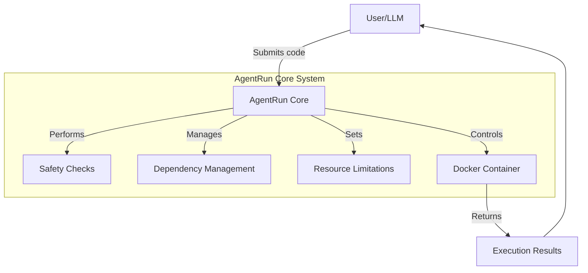
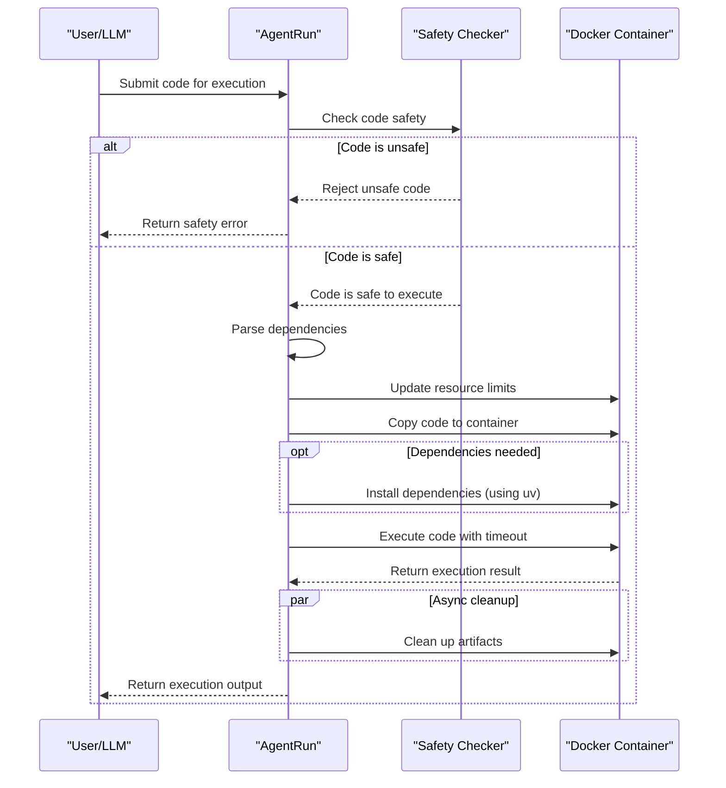
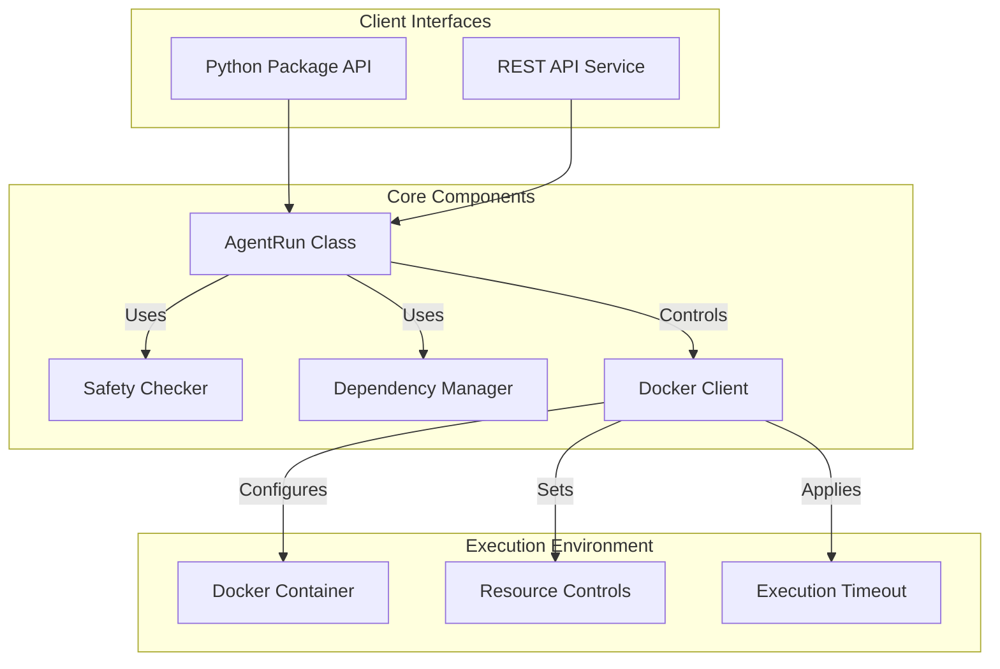
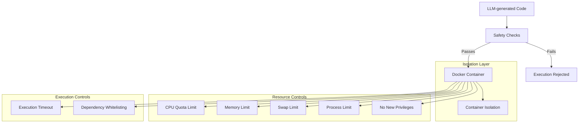

<!-- source: DeepWiki mcp.deepwiki.com · repo tjmlabs/AgentRun · page 1 Overview · fetched 2026-10-26 -->

# Overview

Relevant source files

The following files were used as context for generating this wiki page:

- [README.md](README.md)
- [docs/index.md](docs/index.md)

AgentRun is a Python library designed to safely execute code generated by Large Language Models (LLMs). It provides a secure sandboxed environment using Docker containers with configurable resource limits, automatic dependency management, and safety checks. This page provides a high-level overview of the system's purpose, architecture, and key components.

For detailed installation instructions, see [Installation and Setup](#2). For integration with specific LLM providers, see [Integration with LLMs](#5).

## Purpose and Core Functionality

AgentRun solves a critical challenge in AI agent development: allowing LLMs to execute Python code safely. While code execution significantly enhances LLM capabilities (e.g., performing calculations, data analysis, or API calls), it introduces security risks that AgentRun mitigates through multiple layers of protection:

- Code safety analysis before execution
- Isolated Docker container environment
- Configurable resource limitations (CPU, memory, execution time)
- Controlled dependency management
- Automatic cleanup of execution artifacts

The system is designed to be simple to use while maintaining robust security controls, offering both a Python package for integration into applications and a standalone REST API service.

Sources: [README.md:12-14](), [README.md:34-36]()

## Deployment Options

AgentRun can be deployed in two primary ways:

```mermaid
graph TD
    subgraph "Python Package Deployment"
        PyApp["Python Application"] -->|"import agentrun"| AgentRunPkg["AgentRun Class"]
        AgentRunPkg -->|"execute_code_in_container()"| UserDocker["User-managed Docker"]
        UserDocker -->|"Executes in isolation"| Code1["LLM-generated Code"]
    end
    
    subgraph "REST API Deployment"
        Client["Client Application"] -->|"HTTP POST /v1/run/"| ApiEndpoint["FastAPI Endpoint"]
        ApiEndpoint -->|"Processes"| AgentRunAPI["AgentRun Instance"]
        AgentRunAPI -->|"Uses"| DockerCompose["Pre-configured Docker"]
        DockerCompose -->|"Executes in isolation"| Code2["LLM-generated Code"]
    end
```

| Feature | Python Package | REST API |
|---------|----------------|----------|
| Docker setup | User configures | Pre-configured |
| Installation | `pip install agentrun` | Git clone + Docker Compose |
| Ease of use | Requires Docker knowledge | Minimal Docker knowledge needed |
| Customization | Full control | Limited to API parameters |

Sources: [README.md:50-53](), [README.md:55-58](), [README.md:111-120]()

## System Architecture

AgentRun employs a layered architecture with multiple security controls:

1. **Input Layer**: Receives code from users or LLMs
2. **Safety Layer**: Analyzes code for potentially harmful operations
3. **Execution Layer**: Manages Docker containers, dependencies, and resource limits
4. **Output Layer**: Returns execution results with transparent exception handling

Sources: [README.md:38-49]()

## Code Execution Flow

This diagram illustrates the complete execution flow from code submission to result delivery, including safety checks, dependency handling, execution, and cleanup processes.

Sources: [README.md:107-109](), [README.md:304-324]()

## Core Components

### Key Components Details

1. **AgentRun Class**: Central orchestrator that coordinates all aspects of code execution
2. **Safety Checker**: Analyzes code for potentially harmful patterns before execution
3. **Dependency Manager**: Handles package installation with optional whitelisting and caching
4. **Docker Client**: Interfaces with Docker to create/manage isolated execution environments
5. **Resource Controls**: Configures CPU, memory, and time limits for execution

Sources: [README.md:38-49](), [README.md:272-297]()

## Security Architecture

Security is enforced at multiple levels:

1. **Code Analysis**: Checks for unsafe patterns before execution
2. **Container Isolation**: Provides OS-level separation from host system
3. **Resource Limitations**: Prevents resource exhaustion attacks
   - CPU limits (default: 50% of one core)
   - Memory limits (default: 100MB RAM)
   - Swap limits (default: 512MB)
   - Execution timeout (default: 20 seconds)
4. **Dependency Controls**: Optional whitelisting of allowed packages

Sources: [README.md:271-316]()

## Performance Characteristics

AgentRun is optimized for performance while maintaining strong security. Benchmark metrics:

- Median execution time: <200ms without dependencies
- Median execution time: ~400ms with one average-sized dependency
- Dependency installation is typically the main performance bottleneck
- Optional dependency caching significantly improves performance for subsequent runs

For detailed performance optimization strategies, see [Performance Optimization](#4.2).

Sources: [README.md:326-330]()

## Integration with LLMs

AgentRun is designed to work with any LLM system capable of generating Python code. It provides a straightforward execution environment that can be integrated with function calling patterns for various LLM providers including OpenAI, Groq, Anthropic, and locally-hosted models like Ollama.

For specific integration guides, see:
- [Function Calling Pattern](#5.1)
- [OpenAI Integration](#5.2)
- [Groq Integration](#5.3)
- [Ollama Integration](#5.4)

Sources: [README.md:124-128](), [README.md:151-156]()

---

