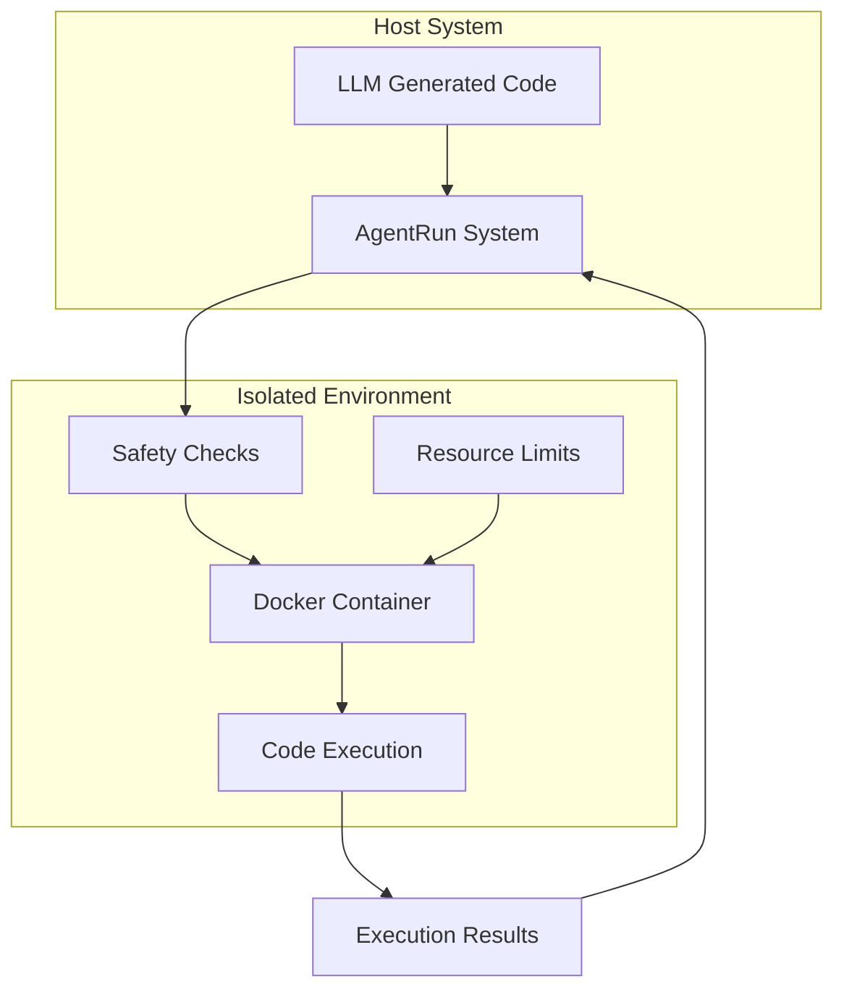
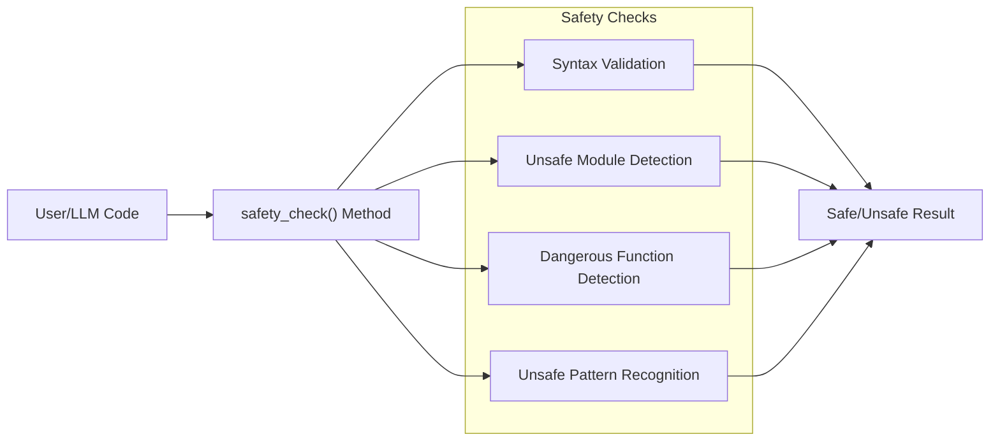
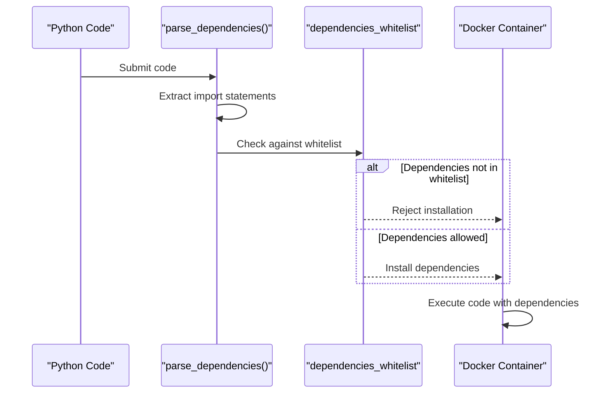
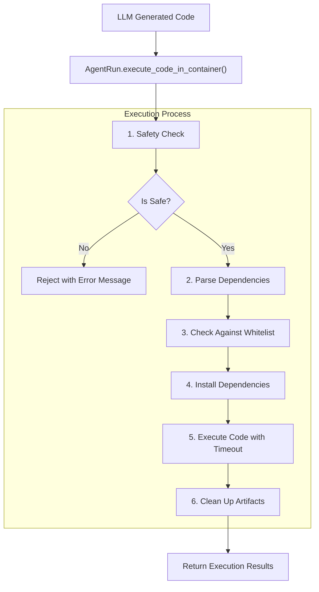
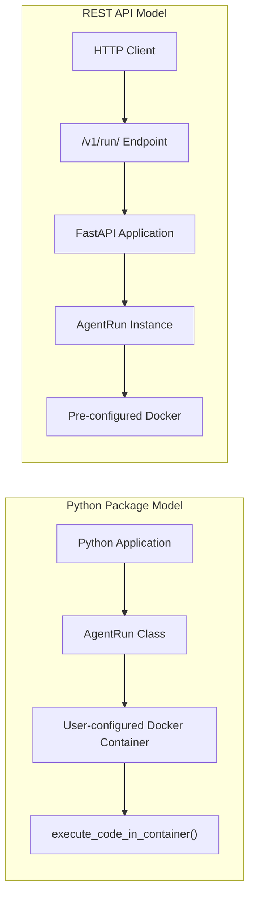

<!-- source: DeepWiki mcp.deepwiki.com · repo tjmlabs/AgentRun · page 1.1 Key Concepts · fetched 2026-10-26 -->

# Key Concepts

Relevant source files

The following files were used as context for generating this wiki page:

- [README.md](README.md)
- [docs/index.md](docs/index.md)
- [tests/test_agentrun.py](tests/test_agentrun.py)

This document outlines the fundamental concepts and mechanisms that form the backbone of AgentRun, a system designed to safely execute Python code generated by Large Language Models (LLMs). It explains the core architecture, sandboxed execution environment, safety mechanisms, and resource management features that enable secure code execution.

For implementation details of the AgentRun class, see [AgentRun Class](#3.1). For configuration options, see [Configuration Options](#4).

## Sandboxed Execution

The cornerstone of AgentRun is its ability to execute code in a fully isolated environment, preventing any harmful operations from affecting the host system.

AgentRun uses Docker containers to create an isolated environment where:

- Code execution is contained and cannot affect the host system
- Resources (CPU, memory, processes) are strictly limited
- Filesystem access is restricted
- Network operations can be monitored or limited
- Privilege escalation is prevented with security options like `no-new-privileges`

Sources: [README.md:40-42](), [tests/test_agentrun.py:19-27]()

## Safety Checking Mechanisms

Before any code is executed, AgentRun performs comprehensive safety checks to identify potentially harmful operations.

The safety checker detects:

- Syntax errors in the code
- Unsafe module imports (e.g., `os`, `subprocess`)
- Dangerous built-in functions (e.g., `eval`, `exec`, `globals`)
- Attempts to access private attributes (those starting with `_`)
- Unsafe function calls (e.g., `open`, `system`)

If any safety violations are detected, the code execution is rejected with a specific error message explaining the issue.

Sources: [tests/test_agentrun.py:36-105]()

## Resource Control

AgentRun employs multiple resource limitation mechanisms to prevent runaway processes or resource exhaustion.

| Resource Type | Default | Purpose |
|--------------|---------|---------|
| CPU Quota | 50000 (50% of one core) | Limits CPU usage per scheduling period |
| Memory Limit | 100MB | Restricts RAM usage |
| Swap Limit | 512MB | Controls combined memory and swap usage |
| PID Limit | 10 | Prevents fork bombs by limiting process creation |
| Execution Timeout | 20 seconds | Stops long-running scripts |

These resource controls ensure that even if malicious code passes safety checks, it cannot consume excessive resources or perform denial-of-service attacks.

Sources: [README.md:269-297](), [tests/test_agentrun.py:25-26]()

## Dependency Management

AgentRun provides a sophisticated dependency management system that:
1. Automatically parses required dependencies from code
2. Verifies dependencies against an optional whitelist
3. Installs allowed dependencies within the container
4. Provides caching to improve performance

Key dependency management features:

- **Dependency Parsing**: Automatically identifies required packages from import statements
- **Whitelisting**: Optional restrictions on which packages can be installed
- **Dependency Caching**: Pre-installed dependencies for improved performance
- **Just-in-time Installation**: Only installs what's needed for the current execution

Sources: [README.md:44-46](), [tests/test_agentrun.py:140-157](), [tests/test_agentrun.py:160-204]()

## Execution Flow

The complete flow of code execution in AgentRun follows these steps:

Key steps in the execution flow:

1. **Code Submission**: The LLM-generated code is submitted to AgentRun
2. **Safety Check**: The code is analyzed for potential security issues
3. **Dependency Management**: Required packages are parsed and installed if allowed
4. **Container Preparation**: Resource limits are applied to the container
5. **Code Execution**: The code runs with a specified timeout
6. **Result Handling**: Output is captured and returned, errors are handled transparently
7. **Cleanup**: Artifacts created during execution are removed

Sources: [README.md:98-109](), [tests/test_agentrun.py:207-222]()

## Deployment Models

AgentRun provides two primary deployment options:

### Python Package
- Install with `pip install agentrun`
- Requires a running Docker container
- Fully customizable with configuration options
- Direct integration into Python applications

### REST API Service
- Clone the repository and use Docker Compose
- Pre-configured Docker setup
- Simple HTTP endpoint for code execution
- Minimal setup requirements

Sources: [README.md:55-120]()

## Integration with LLMs

AgentRun is designed to seamlessly integrate with any LLM that can generate Python code. Typical integration patterns include:

| Integration Method | Description |
|-------------------|-------------|
| Direct Code Execution | Send code directly from LLM to AgentRun |
| Function Calling | Use LLM function calling capabilities to invoke AgentRun |
| Tool Usage | Implement as a tool for LLM-based agents |

The function calling pattern is particularly effective, as it allows the LLM to decide when code execution is necessary to solve a problem.

Sources: [README.md:124-163]()

## Exception Handling

AgentRun provides transparent exception handling that:

- Returns Python exceptions with full tracebacks, just as they would appear in a normal Python environment
- Provides clear error messages for safety violations or dependency issues
- Times out long-running scripts with appropriate messages
- Handles Docker-related errors gracefully

This ensures that LLMs receive informative feedback about execution results, even when errors occur.

Sources: [README.md:48](), [tests/test_agentrun.py:306-316]()

---

